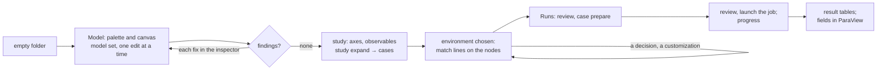

# API — operations, the registry, and the surfaces over them

**Role:** contract
**Status:** current; what is not built yet is marked so
**Authority:** what an operation is and how it is declared
(`femkit/core/operations.py`), the operation registry (`femkit/registry.py`,
with `femkit/reference.py` beside it),
and the two generic surfaces over it: the command line (`femkit/cli/`) and the
web application (`femkit/web/`)

## The short version

| rule | § |
|---|---|
| Everything femkit does for a person is an **operation**, declared once: name, request model, result model, whether it changes anything, its lock subject | 2 |
| A changing operation is **plan, then apply**; the plan is printable, is what `--dry-run` shows, and is what the person consents to | 3 |
| The command line and the web are **generic adapters**: every command and route is derived from the declarations; neither holds a decision or a per-operation branch | 4, 5 |
| Request fields become options and arguments; the field's description is the help | 4.1 |
| One result model gives the text a person reads, the JSON a program reads, and the exit code | 2.3, 4.3 |
| An operation reaches files, processes and configuration only through its **`Context`** | 2.4 |
| Adding a verb is one declared operation; no surface file changes | 6 |

## 1. Why one layer

Every way to drive femkit — a terminal, a script with `--json`, the web page,
a test — calls the same operation with the same request model and gets the same
result model. Behaviour cannot drift between surfaces because there is only one
copy of it. A test drives an operation directly; a surface test checks only
the generic adapter, once.

## 2. Declaring an operation

An operation lives in its domain package, in its operations module
(`femkit/envs/operations.py`, `femkit/config/operations.py`, …; § 6 says when a
domain has a second); `schema check|docs` live in `femkit/reference.py`,
because they read every domain ([`framework.md`](framework.md) § 1).

### 2.1 A read-only operation

```python
class ListRequest(Model):
    """No inputs."""

class EnvRow(Model):
    name: str = Field(description="environment name")
    state: str = Field(description="observed state (envs.md § 3.2)")

class ListResult(Result):
    rows: list[EnvRow]
    def text(self) -> str: ...

@operation("env.list", request=ListRequest, result=ListResult)
def env_list(req: ListRequest, ctx: Context) -> ListResult:
    """Every environment with its definition, state and GPU qualification."""
```

### 2.2 A changing operation

```python
@operation("env.install", request=InstallRequest, result=InstallOutcome,
           changes=True, subject=lambda req: [f"env-{n}" for n in req.names])
class EnvInstall:
    """Install environments from their definitions (envs.md § 4)."""

    def plan(self, req: InstallRequest, ctx: Context) -> Plan: ...
    def apply(self, plan: Plan, ctx: Context, observer: Observer) -> InstallOutcome: ...
```

| declaration part | meaning |
|---|---|
| name | `group.verb` (`env.install`), or one word for a top-level verb (`doctor`). It is the command `python -m femkit env install` and the route `/api/env/install` |
| `request` | a `Model`; its fields are every input the operation takes |
| `result` | a `Result` subclass (§ 2.3) |
| `changes` | `False` (default): one function `(req, ctx) -> result`. `True`: a class with `plan` and `apply` (§ 3) |
| `subject` | for a changing operation: the lock subjects it holds while applying (core.md § 5), from the request; or `"plan"` when they depend on what the plan observes — the plan names them (`serve start`: a login node listens on a socket unless asked otherwise, § 5.4) |
| docstring | the command's help and the route's description |

The name is unique; the registry refuses a duplicate at start.

### 2.3 Results

```python
class Result(Model):
    issues: list[Issue] = []
    def ok(self) -> bool                  # default: no issue of severity "error"
    def text(self) -> str                 # what a person reads; required

class Outcome(Result):                    # the result of apply
    plan: Plan
    status: Literal["done", "failed"]
    log: str | None                       # the operation directory (core.md § 6); empty when each row names its own
    def ok(self) -> bool                  # status == "done" and no error issue
```

- `text()` renders only fields of the model; it decides nothing.
- A result field carries a description like a request field; the JSON a
  program reads is `model_dump(mode="json")`, nothing else.
- An operation whose answer is a verdict (`doctor`: ready or not) overrides
  `ok()`; the exit code follows it (§ 4.3).

### 2.4 Context

```python
@dataclass
class Context:
    env: Mapping[str, str]                          # the process environment, read once
    now: Callable[[], datetime]
    def cached(self, key: str, factory: Callable[[], T]) -> T    # loaded once per context
    @classmethod
    def from_process(cls) -> "Context"
```

- The surface makes one `Context` per invocation and passes it to the
  operation. Directories come from `core.dirs`, which reads the process
  environment on every call (core.md § 3), so a test sets the `FEMKIT_*`
  variables there. `ctx.env` is that environment read once, for what an
  operation reads or passes on itself: the manager variable, a check's
  environment.
- Domain data is loaded through `ctx.cached` by the domain's own loader —
  `definitions.catalogue.load(ctx)`, `config.settings.load(ctx)` — so a file
  is read once per invocation and a `DefinitionError` surfaces before any step.
- The context carries no domain types; the core stays free of domains.

## 3. Plan, then apply

```python
class Step(Model):
    id: str                                # stable within the plan, e.g. "build:netgen"
    describe: str                          # one line for a person
    argv: tuple[str, ...] | None = None    # the command it will run, when it runs one

class Plan(Model):
    operation: str
    request: dict                          # the request, as JSON
    subjects: tuple[str, ...]              # the lock subjects apply holds alone: what it changes
    shared: tuple[str, ...] = ()           # those it holds shared: what it uses and does not change
    basis: dict                            # the observed facts the plan was made from
    steps: tuple[Step, ...]                # empty: nothing to do
    issues: list[Issue] = []
    asks: tuple[Ask, ...] = ()             # request fields to ask for on a terminal (§ 3.1)
    def text(self) -> str
    def digest(self) -> str                # SHA-256 of the canonical JSON
```

1. `plan(req, ctx)` observes state and reads definitions. It writes nothing,
   starts nothing but read-only probes, and lists every step with its command
   line. A state that does not allow the action raises `Refused` here
   (core.md § 7, `require`).
2. The surface shows the plan and obtains consent (§ 4.2, § 5).
3. The runner takes the subjects' locks — `subjects` alone, `shared` shared
   (core.md § 5) — then calls `apply(plan, ctx,
   observer)`. `apply` first observes again and raises `PlanStale` if the
   facts differ from `plan.basis`; then it runs the steps, writing the event
   log (core.md § 6) and reporting each step to the observer. The first step
   that does not finish stops the run — unless the steps do not depend on one
   another (`env bootstrap`'s installs, envs.md § 6.2): then every step runs,
   and the run fails if any did.

```python
class Observer(Protocol):
    def operation_start(self, plan: Plan, where: Path) -> None   # where: the operation directory
    def step_start(self, step: Step, index: int, total: int) -> None
    def step_log(self, log: Path) -> None   # the running step writes its log here, as it runs
    def step_end(self, step: Step, outcome: str, log: Path | None) -> None
    def note(self, text: str) -> None
    def operation_end(self, plan: Plan, status: str) -> None
```

An empty plan asks no consent and is still applied: it changes nothing, writes
an event log of no steps, and returns the operation's outcome. A changing
command therefore always answers with its outcome type — `config init` with
nothing to add still reports every key it kept.

### 3.1 Questions

Some values only the person can give, and install time is when they are there:
the activation preamble, where environments go.
A plan names each such request field it lacks in `asks`:

```python
class Ask(Model):
    key: str                     # the request field the answer fills
    question: str                # one line
    context: tuple[str, ...]     # what the person should see beside it
```

The CLI asks them on a terminal, before consent, and plans again with the
answers; a list field takes a line per item, ended by an empty line. An empty
answer is no answer, and the plan stands as it was. An answer is checked as it is
given: one holding characters that are not text — an arrow or erase key the
terminal passed through — or one the request model refuses is said, with the
characters shown, and the question is asked again, so one keystroke never ends
the command. Nothing is asked under
`--yes` or `--dry-run`, or without a terminal. A program reads `asks` in the
`--dry-run --json` plan and sends the fields itself. No domain module reads a
terminal.

## 4. The command line — `femkit/cli/`

One click group per name prefix, one command per operation, built at start
from the registry. The CLI package holds the adapter and nothing
operation-specific.

### 4.1 From request fields to options

| request field | command line |
|---|---|
| `json_schema_extra={"cli": "argument"}` | a positional argument; a `list[...]` field takes one or more |
| `bool`, default `False` | a flag `--name` |
| any other field | an option `--name VALUE`; a `list[...]` field repeats |
| a field with no default | required |

- Underscores become dashes (`cuda_architectures` → `--cuda-architectures`).
- A value is validated by the request model; its errors are reported by key,
  exit 2.
- Help is the operation's docstring and each field's description.

### 4.2 Options every command has

| option | on | meaning |
|---|---|---|
| `--json` | all | print exactly one JSON document on stdout: the result (for a changing operation, its outcome, even when there was nothing to do), or for `--dry-run` the plan, or for a refusal `{"refused": …, "message": …, "next": […]}` |
| `--dry-run` | changing | print the plan and stop; never asks or writes, and starts nothing but the plan's read-only probes |
| `--yes`, `-y` | changing | consent given in advance |

Consent: with a non-empty plan and no `--yes`, the CLI first asks the plan's
questions (§ 3.1), then prints the plan and asks on a terminal; without a
terminal it refuses (`ConsentDeclined`). Progress goes
to stderr through a terminal observer, so stdout holds only the result.

### 4.3 Exit codes

| code | when |
|---|---|
| 0 | the result's `ok()` is true (including "nothing to do") |
| 1 | the operation ran and `ok()` is false, or an exception that is not a `Refusal` (a defect) — reported with its log path |
| 2 | a `Refusal`: bad usage, a declared file that does not load, a state that does not allow the action, a held lock, consent declined, a stale plan — reported with its `next` commands |

### 4.4 The text a person reads

Built from `core/text.py`, so every command reads alike:

- **The first line is tagged** `[group verb]` — `[config init] …` — and says
  the outcome in a few words; the details follow, indented.
- **Values are shown as typed**, never as Python or JSON: a path as a path, a
  command line as a command line (`mpirun -np {ranks}`), a list space-joined,
  `unset` and `none` in words.
- **Rows are aligned columns**; a note about a row follows it after `#`.
- **A finding** is one line marked `x` (error), `!` (warning) or `-` (info),
  with the commands that resolve it indented under it.
- **What to do next** is `next -- <sentence>:` and the commands, one a line,
  indented, prose after `#`. A printed command is one a person can paste:
  `python -m femkit …`, run in the control environment from the checkout,
  because femkit is never installed ([`envs.md`](envs.md) § 7). Contracts
  write commands the same way, or leave out the leading `python -m femkit`
  (`env install NAME`) where the context makes it plain.
- **A refusal** is `[group verb] refused: <reason>` and `next -- instead:`
  with the commands its state allows.
- **Progress** goes to stderr. An operation
  with steps first says, as `[group verb]`, how many and where its logs are
  (the log folder names what it acts on); each step is numbered
  (`[ 3/16] configure netgen`) and ends with its outcome and the time it took
  (one line only, for a step done at once); a step that did not finish shows
  its log's path and last lines. An operation run inside another's step
  (`env bootstrap`'s installs, `env install`'s validate) is indented under
  that step. On a terminal, a running step whose log the observer was told
  of shows one line under it, rewritten in place about once a second: the
  time it has run and its log's last line, cut to the terminal's width. The
  line is erased before anything else is printed and when the step ends, so
  it takes no room; output that is not a terminal never gets it. Paths under the
  home directory are written from `~`. With `--yes` the plan is printed first,
  its steps only; its findings come with the outcome.

`--json` is for programs: the model as JSON, indented.

## 5. The web application — `femkit/web/`

Two parts: a flask application built from the same registry, and a front end
that runs in the browser. Both live in the `web` environment
([`envs.md`](envs.md) § 1): the server runs on its Python, and the page is
built with its Node.js; the control environment holds neither. The routes and
`serve` are built in token mode, and the front end's operation, progress and
documents views and, in part, the Model workspace; TLS, sign-in, `--no-auth`,
uploads and the other views are not built yet (plan § 3, M7), and these rules
hold when they are. A basic test checks that every registered operation can be
expressed this way (its request and result models produce a JSON schema).
The reasons for the front end's form are
[ADR 0009](../decisions/0009-web-front-end.md).

### 5.1 Routes

| route | does |
|---|---|
| `GET /api/operations` | every operation: name, description, request and result JSON schemas |
| `POST /api/<name>` | a read-only operation: request JSON in, result JSON out |
| `POST /api/<name>/plan` | a changing operation: request JSON in, plan JSON out |
| `POST /api/<name>/apply` | `{"request": …, "digest": …}`: re-plans, refuses with `PlanStale` unless the new plan's digest equals the one the person saw, then applies. A refusal before the run starts is answered as any other; otherwise the answer is JSON lines: `{"operation": "<subject>/<time>"}` as each run starts — its operation directory, the address `GET /api/events/…` and `GET /api/tail/…` take; an operation over several subjects runs once per subject (core.md § 6) — and last the outcome, or the defect. The apply runs to its end whether or not the page still reads |
| `GET /api/events/<subject>/<time>` | the event log of the operation in `<state>/operations/<subject>/<time>/`, as a stream from its first line as it grows, ending when the operation ends or is found interrupted: how a long apply's progress reaches the page; each path part must match its pattern and the path must lie inside `<state>/operations/` |
| `GET /api/health?nonce=<n>` | that the server is up, and an HMAC of the client's nonce keyed with the server's token, which proves the answer comes from this server without the client sending the token; the one `/api` route that needs no token (§ 5.5) |
| `PUT /api/upload?project=<path>` | streams one file into that project's upload area and answers with its SHA-256 (§ 5.5) |
| `GET /auth/start/<provider>`, `GET /auth/callback/<provider>`, `POST /auth/sign-out` | sign-in, with sign-in configured (§ 5.5) |
| `GET /api/tail/<subject>/<time>/<step>` | the last lines of that step's log, for the running step's live line; its path checked as the event stream's |
| `GET /api/docs` | every document the viewer shows: the repository's own Markdown files (below) |
| `GET /api/docs/<path>` | one of them — its text and its headings, each with its link anchor — or an image a document shows, as data; any other path is 404 |
| `GET /`, `GET /docs` and `/static/…` | the built front end; `/docs` opens it as the document viewer |

HTTP status follows § 4.3: 200 for a result, exit 0 or 1 (the body says `ok`);
409 for a refusal; 500 for a defect, with the log path. A request body is the
request model and nothing else: no field takes executable text, a shell
fragment, an environment variable or a path outside the folders the operation
names.

### 5.2 The front end

- **Built from the registry and the schemas, never from a list of its own.**
  Forms are rendered from the JSON schemas; the model graph from the graph
  document `model graph` returns ([`models.md`](models.md) § 11.2); the
  palette, the port types and the statuses come from that document. Adding a
  field, an operation or a node kind changes no front-end code.
- **Writes only through plan and apply.** Every change the page makes — an
  edit of the model, a decision, preparing a case — is an operation, shown as
  its plan and applied with its digest; the page holds no state the files do
  not. Two exceptions: an upload, which writes only into a project's upload
  area, which nothing reads until an operation names the file (§ 5.5); and a
  node's position, which is presentation that no other step reads
  ([`models.md`](models.md) § 11.2): moving a node plans `model layout` and
  applies it with its digest at once, without showing the plan.
- **Code is a file.** A customization is uploaded as a file into the project
  (§ 5.5) and named by an operation that records its hash; the page shows it
  and never runs or edits code typed into a form.
- **Fields are viewed in ParaView**
  ([ADR 0002](../decisions/0002-paraview-visualization-boundary.md)); the page
  shows numbers, tables and where the field files are.

#### 5.2.1 Views

| view | shows | acts through |
|---|---|---|
| operation | any operation as a form, its plan, its outcome | the routes of § 5.1 |
| model graph | the model and a study as nodes and typed wires; findings on each node; with an environment chosen, each node's worst match line | `model graph`, `model check`, `model set`, `model unset`, `model rename`, `model layout` |
| node | the selected node's form, from its kind's schema; for an open match line, the decisions and customizations that resolve it | `model set`, `model unset` |
| review | `case prepare`'s plan — the match report, each decision, each customization with its hash, the translator's command — and `job prepare`'s — the inputs, those customizations changed, the steps, the command ([`models.md`](models.md) § 9.6) | apply with the digest |
| progress | an operation's steps as they run, and the running step's log's last lines | `GET /api/events/…`, `GET /api/tail/…` |
| jobs and results | runs, their states, the result tables; where each field file is, for ParaView | the job and result operations |
| documents | the repository's documents, in a tab of their own (§ 5.2.3) | `GET /api/docs…` |

#### 5.2.2 Layout

The page has three workspaces — **Model**, **Runs** and **Operations** — under
one top bar, and the documents in a tab of their own (§ 5.2.3):

```text
┌─────────────────────────────────────────────────────────────────────────────────────┐
│ femkit  project ▾  study ▾  environment ▾  [Model] [Runs] [Operations]  docs ↗      │
├──────────────┬──────────────────────────────────────────────────────┬───────────────┤
│ palette      │ canvas — the model and the study as a graph          │ inspector     │
│              │                                                      │               │
│ geometry     │  parameter ┐                                         │ the selected  │
│ regions      │  shape ────┴─▶ region ──┬─▶ condition                │ node's form,  │
│ materials    │                         ├─▶ assign ◀── material      │ each field    │
│ conditions   │                         └─▶ observable ◀── axis      │ with its      │
│ sources      │                                                      │ sentence;     │
│ study        │  nodes: findings ● and, with an environment,         │ its findings, │
│              │  the worst match line of each                        │ each a fix    │
├──────────────┴──────────────────────────────────────────────────────┴───────────────┤
│ findings · cases · progress of the running operation                                │
└─────────────────────────────────────────────────────────────────────────────────────┘
```

- **The top bar** chooses the project, the study and an environment. The
  environment overlays each node with its worst match line
  ([`models.md`](models.md) § 6.2); with none chosen, the graph shows the
  physics alone.
- **Model** is the palette, the canvas and the inspector:
  - **the palette** lists what may be added, from the formulation and the
    schema: the shape kinds (those the environment's mesher cannot build
    marked, with why), the region kinds, the material properties the
    formulation reads, its condition and source kinds grouped by where they
    may stand, and the study's axes and observables (the formulation's
    derived quantities). Each entry's tooltip is its formulation sentence,
    linked to its section in the document viewer;
  - **the canvas** shows each object of the model and the study as a node at
    its address ([`models.md`](models.md) § 11.1), and each reference as a wire
    between ports of its type, laid out in the chain's order: parameters and
    geometry, regions, materials and conditions, the study. A port accepts only
    its own type. Dropping a palette entry on the canvas, or on a node — a
    condition on a boundary — and drawing or removing a wire each plan the
    `model set` or `model unset` they mean; the plan is shown and applied with
    its digest. Moving a node saves its position (`model layout`);
  - **the inspector** is the selected node's form, from its schema — for a
    condition or a source, the formulation's parameters with their units — each
    field with its sentence. Below it are the node's findings, each with its fix
    as a button that plans the edit the finding names, and, for an open match
    line, the decisions and customizations that resolve it.
- **Every canvas action is also a form action.** Adding, wiring and removing
  each have their form in the inspector, so the model is built as fully by
  keyboard as by mouse.
- **The bottom panel** holds the findings of `model check`, each leading to its
  node; the cases, with their axis values and, per environment, their match
  and preparation state (`case list`), and `study expand`; and the progress of
  the running operation (§ 5.2.1).
- **Runs** is each case against each environment: the review before
  `case prepare` and before a job is launched, the jobs and their states, the
  result tables, and where each field file is for ParaView.
- **Operations** is every operation as a form (§ 5.2.1), for what no workspace
  shows.
- **On a narrow screen** the palette and the inspector become drawers over the
  canvas.

A person's way through it, from an empty folder:



What each part waits on: the Model workspace is built but for what plan § 3,
M7 item 3 lists open; the environment's overlay waits on abilities and the
match report (M5 step 3, M7 item 4); Runs, past its cases and `study expand`,
on preparation and jobs (M3, M4, M6, M7 item 5). Operations, progress and the
documents are built.

#### 5.2.3 The document viewer

- **The document viewer** opens in its own tab at `/docs`, its token handed
  over in the address's fragment as the page's own is (§ 5.5). It shows every
  Markdown file under `docs/` and `examples/`, and the root documents
  `PROJECT_CONTRACT.md` § 2 names — by name, so a local file beside them is
  never shown — as a tree of folders that expand, and renders each as GitHub does: tables, code,
  math (KaTeX), Mermaid diagrams. Links work as in the repository: a link to
  another of these documents opens it in the viewer, at its section, and the
  browser's back and forward move through them; a link to any other file of the
  repository shows its path, not followed; a link outside opens in a new tab.
  A section of a document has an address of its own, so a tooltip or a finding
  can link to it.
- **It cannot be made to reach beyond its documents.** The server serves a
  path only when it is on the list `GET /api/docs` gives — made by walking
  those folders without following a symbolic link — so no spelling of a path
  reaches another file, and a document's text is never sent as anything but
  text. The page renders a document's raw HTML as text, follows no
  `javascript:` link, loads an image only from that list, and applies a
  diagram's or a formula's styles through the page's object model, so the
  content-security policy (§ 5.5) holds without an exception.
- **Each heading's anchor is the server's**, by GitHub's rule — the same
  function that checks a formulation's sections ([`models.md`](models.md) § 4)
  — so a link written in one document, a section a formulation names, and the
  viewer's address of that section always agree.

### 5.3 Source and build

- **Source** is a React application, in a top-level `frontend/` folder
  (`PROJECT_CONTRACT.md` § 2); its graph view uses React Flow
  ([ADR 0009](../decisions/0009-web-front-end.md)). `package.json` declares,
  under `femkit.sources`, the files the bundle is built from, its lock file
  included.
- **Built by `web build`**, an operation like any other, with the Node.js of
  the `web` environment ([`definitions.md`](definitions.md) § 4.7;
  `env install web`) — never the control environment, and never a Node.js of
  the person's own. It copies the declared sources into
  `<cache>/frontend/work/`, runs `npm ci --ignore-scripts` there from the
  committed lock file, then `npm run build`, each inside the environment
  through the manager ([`envs.md`](envs.md) § 4.4), with npm's cache and
  configuration under `<cache>/frontend/`: nothing is read from or written to
  the person's `~/.npm` or `~/.npmrc`, and no `node_modules` lands in the
  checkout. `web build --relock` first solves `package-lock.json` again from
  `package.json` and writes it into `frontend/`.
- **The built bundle is shipped** in `femkit/web/static/`: generated, never
  edited by hand. `web build` writes `static/build.json`: the SHA-256 over the
  declared source files, the Node.js and npm versions, and the SHA-256 of every
  bundle file; and `static/THIRD-PARTY-LICENSES.txt`, each package the lock
  file installs for the page, with its license text. A basic test recomputes
  both hashes without Node.js, so a source changed without rebuilding and a
  bundle edited by hand both fail.
  Installing femkit never needs Node.js, and the page loads nothing from the
  network: scripts, styles and fonts are all in the bundle.

### 5.4 Serving — `serve`

`serve` is a group of verbs, declared as operations of the `server` domain
([`framework.md`](framework.md) § 1); a verb is always named, never implied:

| verb | does |
|---|---|
| `serve start` | plans the address, the files and the child's command; applying takes the server's lock, opens the listening socket, writes the access token (§ 5.5) and starts the supervisor detached, which inherits the lock and holds it for as long as it runs; returns once the child answers with that token, printing the address to open, with the token |
| `serve status` | every server this account runs, each with two answers kept apart: is the process up (the pidfile's checks), and does it answer with this server's token (§ 5.5); the address with its token only for one named server (`--port`, `--socket`) |
| `serve restart` | reads the configuration first, as a fresh child would, and refuses with its reason if it does not load — leaving the running server alone; refuses while the child holds an operation's lock (an install started from the page) unless `--force`, naming each; otherwise signals the supervisor (`SIGHUP`), which replaces its child with the same token |
| `serve stop` | refuses while the child holds an operation's lock unless `--force`, naming each; otherwise stops the supervisor (`SIGTERM`), which sends its child `SIGTERM`, ends its event streams, waits, then sends `SIGKILL`, and removes the pidfile, the socket and the token |
| `serve foreground` | `start` without detaching: the same lock, checks and files, so `status`, `restart` and `stop` from another terminal act on it; the child's output goes to the terminal as well as the log; Ctrl-C stops them, and is a normal stop, exit 0 |

The supervisor runs `python -m femkit.web` as a child process, with the `web`
environment's Python and the checkout as its working folder; `start` and
`foreground` refuse while that environment is not `ready`, naming
`env install web`. The supervisor itself runs in the control environment, and
the `server` domain never imports the web package, as no domain imports a
surface. The
supervisor imports only the standard library and the core's file and process
building blocks — never flask, the web package or another domain — so a change
that breaks the application leaves the supervisor running, to start the fixed
child at the next `restart`. Everything `start` refuses — a server already
running, a held address, an unsafe runtime folder, a configuration that does
not load — it refuses before it detaches, with the listening socket already
open: after that nothing reaches the terminal. Starting
a detached, supervised process is a core building block
([`core.md`](core.md) § 8): the child is spawned
from the supervisor's main thread, ends when its supervisor ends
(`PR_SET_PDEATHSIG`, checked again with `getppid` after it is set), and both are
identified as a run's process is — process ID and start time. **The supervisor
opens the listening socket once and hands it to each child**, so the address is
never free between a child's end and the next one's start, and no other
program can take it in that gap.

**Listening.** On a machine femkit observes as a cluster login node
([`jobs.md`](jobs.md) § 9.1) the server listens on a Unix socket,
`<runtime>/serve-<name>.sock`, which only its owner can open: no other account
on the node can connect to it or take its place. The person forwards it with
SSH from their own machine, with the forwarding line `start` prints (§ 5.5),
and opens the printed address there. Elsewhere it listens on TCP, `127.0.0.1` and
`--port`; `--socket` and `--tcp` choose either explicitly.

**Files**, each in a directory of the person's own account:

| file | holds | made |
|---|---|---|
| `<runtime>/serve-<name>.pid` | the supervisor's and the child's process IDs and start times, the host and its boot ID, and where it listens | by `start`, rewritten by the supervisor at each respawn, `0600` |
| `<runtime>/serve-<name>.token` | the access token (§ 5.5) | by `start`, before the child runs: created exclusively, never following a link, `0600` |
| `<runtime>/serve-<name>.sock` | the Unix socket, when it listens on one; its path at most 108 bytes, or `start` refuses, naming it; never an abstract socket, which has no permissions | by the supervisor, `0600` |
| `<state>/logs/serve-<name>.log` | every event the supervisor and the server report, timestamped: child start, respawn, give-up, stop, a `status` that found it up but not answering; each request's method, path without its query (control characters escaped), status, time and, with sign-in, the account — never a header, a token or a body | by the supervisor alone, `0600` |
| `<state>/logs/serve-<name>.supervisor.log` | what the detached supervisor itself prints before or outside the server's log — a traceback, an import that failed; `start` shows its last lines when the child never answers | by the supervisor's own output, `0600` |
| `<state>/logs/serve-<name>.stacks.log` | every thread's stack, appended each time the child receives `SIGUSR1` | by the child, `0600` |

`<name>` is the port, or `sock` for the socket. `<runtime>` is the runtime
directory ([`config.md`](config.md) § 2), host-keyed under `<state>` on every
machine: a session's `$XDG_RUNTIME_DIR` is deleted at its last logout, on a
workstation as on a login node, while a detached server lives on. It is made
`0700`, and refused — naming the folder — if anyone else can enter it or any
folder above it is writable by others.

- **The log is capped and rotated** by the supervisor, the log's one writer:
  over its size limit it is closed and compressed to
  `serve-<name>.log.1.gz`, older archives shift up, and only the newest few are
  kept (`--log-max-mb`, `--log-keep`).
- **Every verb checks before it acts**: the processes the pidfile names are
  alive, this account's, femkit servers, with the recorded start times; a
  pidfile written on another host names that host and is never treated as
  stale.
- **The supervisor respawns a child that dies by a signal**, and gives up after
  two such deaths within 30 s, saying so in the log and removing the pidfile, the
  socket and the token. A child that exits with an error — a configuration it
  cannot load — is not respawned.
- **It never kills a running child on its own.** A server that is up but not
  answering is a question, not a verdict: its stacks are dumped and read
  (`kill -USR1`), and a person decides on `serve restart`.
- **The web server** handles requests on a bounded pool of threads, with a
  time limit for reading a request's headers and a cap on open event streams,
  and does the TLS handshake in the connection's thread, never in the loop that
  accepts connections, so a slow or silent client can neither stall nor
  exhaust it. No debugger or code-reloading mode is ever served.

The server is a state machine ([`framework.md`](framework.md) § 3), observed
from its lock, its pidfile and the processes the pidfile names. **The lock is
the supervisor's liveness**: the subject `server-<host>-<name>`
([`core.md`](core.md) § 5), taken by `start` and `foreground` through the
operation runner, and held by the supervisor from then on — the kernel releases
it however the supervisor ends, so a supervisor that is gone is observed, never
guessed from a process ID that may have been reused. `start` and `foreground`
also take the `web` environment's subject, `env-web`, **shared**, and the
supervisor holds it with the server's own: while any server runs, `env
install web`, `env clean web` and `env validate web`, which need it alone, are
refused, naming each server and its `serve stop`; and no server starts while
an operation holds it alone ([`core.md`](core.md) § 5). `restart` and `stop`
take no lock of their own: they verify the holder and signal it. Which operation
locks the child holds is read from the kernel's lock table, never from a lock
file's text. The rules, in order:

| # | observed when | state | `start` | `stop` | `restart` |
|---|---|---|---|---|---|
| 1 | the pidfile was written on another host | `elsewhere` | refused: names the host | refused: names the host | refused: names the host |
| 2 | the lock is free, and no pidfile | `stopped` | starts | nothing to do | refused: offers `start` |
| 3 | the lock is free, and a pidfile is left — its supervisor ended without removing it: killed, or the machine restarted | `stale` | ends a child it names that still runs, removes the files, starts | the same, without starting | refused: offers `start` |
| 4 | the lock is held, and the pidfile names its supervisor, alive with its recorded start time | `running` | refused: already running | stops | restarts |
| 5 | otherwise: the lock is held, and no pidfile names its holder yet | `starting` | refused: names the holder | refused: names the holder | refused: names the holder |

Whether a `running` server answers is a fact `status` shows, not a state:
answering can change between two looks.

### 5.5 Access

The state reached by configuring nothing is the safe one: a mistake leaves a
capability missing, never open to everyone. Every rule here holds in every
mode, unless it says otherwise.

**The access token** — every server has one; the page and programs must send it
unless sign-in or `--no-auth` says otherwise below. A machine's loopback address
is reached by every account on that machine, so loopback alone keeps nobody
out.

- `serve start` makes 32 random bytes from the operating system's secure
  source, URL-safe, and writes them to `serve-<name>.token` (§ 5.4). The child
  reads the token from that file; it never travels on a command line or in an
  environment variable, which other accounts can read.
- The printed address carries the token in its fragment,
  `http://127.0.0.1:8000/#token=<token>`. A browser never sends a fragment to a
  server, so the token is in no request line, server log, proxy log or
  `Referer` header. The page reads it, keeps it in the tab's session storage —
  which belongs to this origin, port included, and is kept only by this tab,
  coming back only if the browser restores the tab — replaces the address so
  the token leaves the address bar and the history entry, and sends
  `Authorization: Bearer <token>` with every request it makes. A program does
  the same.
- For a socket, `start` prints the forwarding line to run on the person's own
  machine, `ssh -o ExitOnForwardFailure=yes -L 127.0.0.1:8000:<socket> <host>`,
  so a local port already taken by another program stops the forwarding instead
  of handing the token to that program.
- **No cookie is set in token mode.** Cookies are shared by every port of a
  host, and any page in the browser can make a request that carries them; a
  token sent only as a header cannot be ridden by another page or leak to
  another server on the same host.
- Every route requires the token except the page itself and its bundle, which
  hold nothing secret, the sign-in routes (below), and `GET /api/health`, which answers a client's nonce
  with an HMAC keyed by the token: `status` and `start` check the answer, so
  they tell their own server from another program on the address without ever
  sending the token. On a Unix socket the server also checks the connecting
  process's account (`SO_PEERCRED`) is its owner's. A request without the
  token gets 401 in JSON; the page then asks for it.
- The event stream is read with `fetch`, which sends the header; a browser's
  `EventSource` cannot.
- Tokens are compared in constant time. A restart keeps the token; `serve
  start` makes a new one; `serve stop` and a supervisor that gives up delete
  it. `status` prints it only for one named server. With sign-in configured,
  the token still serves the owner's own programs, as `Bearer`, and the page
  uses sign-in.

**Every request is checked**, in every mode:

- **Host.** The `Host` header must name the server: on TCP, the address it
  listens on — printed as `127.0.0.1`, never `localhost`, which another account
  can answer on `[::1]` — with its port, or `web.public_name` when it serves a
  public name; on a
  Unix socket, whose local port the person picks when forwarding it,
  `127.0.0.1`, `localhost` or `[::1]` with any port. Anything else is refused
  before any handler runs: a web page cannot reach the server by pointing a
  name of its own at `127.0.0.1`.
- **Writes** — every method but `GET` and `HEAD` — must carry
  `Content-Type: application/json` (an upload, its declared type), and, when
  the browser sends an `Origin`, one equal to the origin the `Host` names, its
  scheme that of the TLS listener or, behind a trusted proxy, its
  `X-Forwarded-Proto`; `Origin: null` is refused. No CORS headers are sent and no `OPTIONS` route
  exists, so no other origin is ever allowed.
- **Size.** A request body is capped (JSON at 1 MiB; uploads at their own
  limit, below); a larger one gets 413 naming the limit.
- **Failed attempts** — a 401, a refused `Host` — are answered at once and
  logged, never delayed or locked out: a 256-bit token cannot be guessed, a
  delay would hold one of the bounded threads, and every local client arrives
  from the same address, so a lockout would let any page or account lock the
  owner out. The cap on event streams stays below the thread pool's size.
- **Errors** answer with the reason and nothing else: no path outside the
  project, stack trace or version string reaches a response. The
  full detail is in the server's log.

**Every response** carries:

```text
Content-Security-Policy: default-src 'none'; script-src 'self'; style-src 'self';
  img-src 'self' data:; font-src 'self'; connect-src 'self'; form-action 'self';
  frame-ancestors 'none'; base-uri 'none'; object-src 'none'
X-Content-Type-Options: nosniff
Referrer-Policy: no-referrer
Cross-Origin-Opener-Policy: same-origin
Cross-Origin-Resource-Policy: same-origin
Cache-Control: no-store            (every /api response)
Strict-Transport-Security: max-age=31536000   (over HTTPS only)
```

The bundle contains no inline script or style element, which a basic test
checks; styles a script sets through the page's object model are allowed by
this policy. The browser validates nothing a schema could forbid: a value is
checked by the plan route, so the policy needs no `unsafe-eval`.

**HTTPS.** A server on the loopback address or a Unix socket, reached from
this machine or through an SSH tunnel, is carried encrypted by SSH and serves
plain HTTP. Any other address (`--host`), and any server with a
`web.public_name`, requires TLS, and the refusal says so:

- directly from PEM files (`--cert` and `--key`, or `web.tls` in
  `config.toml`; the command line wins): the key file must be this account's
  and readable by no one else, or the server refuses to start; TLS 1.2 is the
  minimum, with the standard library's default server context and its
  ciphers;
- or from a reverse proxy that terminates TLS in front of a loopback server,
  with `web.trust_proxy` trusting exactly one hop of its forwarded headers.
  `web.trust_proxy` and `--no-auth` together are refused.

**Sign-in** opens the page to a group, and requires HTTPS. With no
`[web.auth]` section in `config.toml` nobody signs in.

- A `[web.auth]` section names one or more identity providers (OpenID Connect)
  and an **allow-list** in which each entry names one provider's issuer and one
  account at it — its subject identifier, or an address that provider asserts
  as verified; a section without a non-empty allow-list is refused, since a
  provider alone admits anyone with an account there, and an address alone is
  trusted from any provider that will assert it. Everyone on the list acts
  with the server owner's account on this machine — reading the projects,
  preparing and running work, adding customizations whose code runs in a
  reviewed job — so the list names only people the owner trusts that far.
- The flow is the authorization code flow with PKCE. Each provider has its own
  redirect address, and the provider is bound to the `state`; the `state`, the
  `nonce` and the PKCE verifier live, for the round trip only, in a cookie of
  their own — `__Host-` prefixed, `Secure`, `HttpOnly`, `SameSite=Lax` so it
  survives the provider's redirect back, a few minutes long, used once. The ID
  token's signature is checked against the provider's published keys (found
  through its discovery document) with the algorithms the configuration pins,
  and its issuer, audience, expiry, `nonce` and identity are checked against
  the round trip and the allow-list; femkit never holds a password.
- **Sessions are kept on the server.** The session cookie holds only a random
  session ID — `__Host-` prefixed, `Secure`, `HttpOnly`, `SameSite=Strict`,
  `Path=/`; the record in `<runtime>` holds the account, the idle timeout and
  the absolute lifetime. Signing out deletes the record, and the allow-list is
  checked again on every request — read again whenever `config.toml` changes,
  and admitting nobody while it does not load — so removing someone from it
  ends their session at once.
- Each apply records who made it in its event log ([`core.md`](core.md) § 6) —
  the signed-in account, or `owner (token)` — as each request does in the
  server's log.
- The sign-in routes (§ 5.1) need no token; they are how a session begins.
- The provider's client secret and the session-signing key are files in
  `<config>/secrets/`, under fixed names; the folder must be `0700` and each
  file `0600`, or the server refuses to start, naming the file. The session key
  is created on the first run.

**`--no-auth`** stops requiring the token on the routes; the token is still
written, so `start` and `status` still prove their server through the health
route. It is accepted only on TCP's loopback address — never on a Unix socket, which a forwarding opens to every account on
the machine it is forwarded to, and never with `web.trust_proxy` — and the
server says when it starts that every account on this machine can then reach
it.

**Uploads.** A file reaches the server only through `PUT /api/upload`, whose
`project` names a project inside the server's projects folder (`web.projects`)
— checked as a path inside it, opened without following links — and which streams the file,
under its own size limit and the project's total quota (`web.upload_max_mb`),
to a temporary file renamed to `<project>/.femkit/uploads/<sha256>`, and
answers with the hash. While `web.projects` or `web.upload_max_mb` is unset,
uploads are refused, naming the key. The operation
that adds a customization names that hash and a name under `custom/` that
follows [`models.md`](models.md) § 8.2's rule, and opens the path without
following links. Nothing uploaded runs except in a job the person reviewed
([`models.md`](models.md) § 8.4). The page shows code as text inside JSON,
never as a document of its own.

## 6. The registry — `femkit/registry.py`

```python
DOMAINS = ("femkit.config.operations", "femkit.envs.operations", ...)
def operations() -> dict[str, Operation]     # imports DOMAINS when called, never at import
```

The one list of where operations live. Adding a verb to an existing domain
changes only that domain's operations module; adding a domain, or a second
module to a domain whose operations serve another subject (`jobs.setup`: this
machine's setup, beside the machine records), adds one line here.
