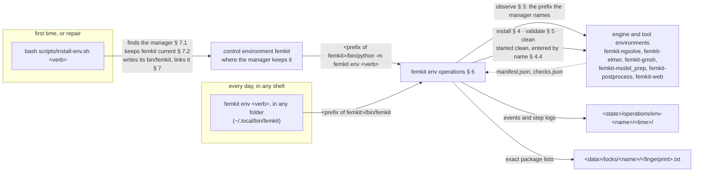
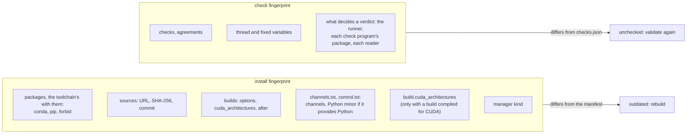
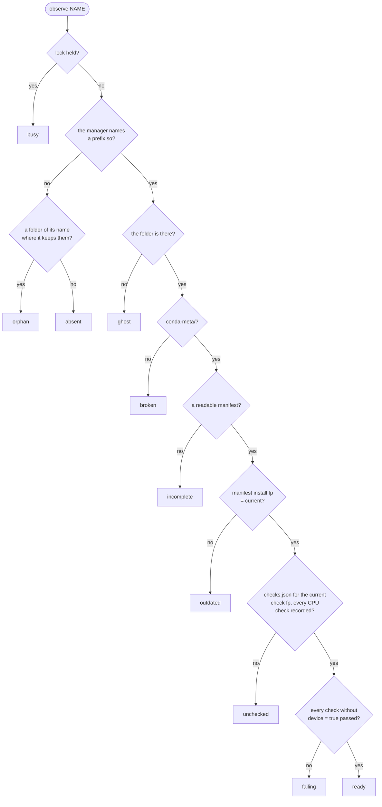
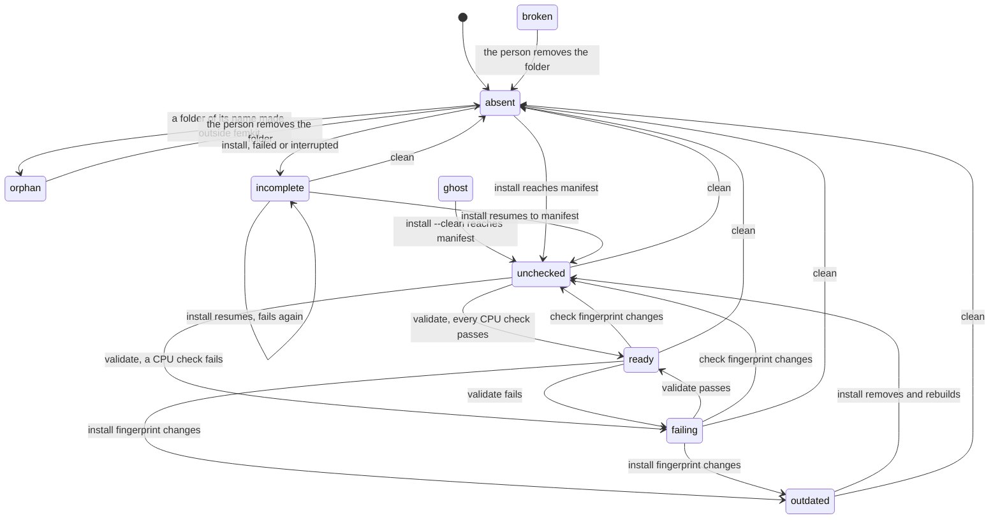
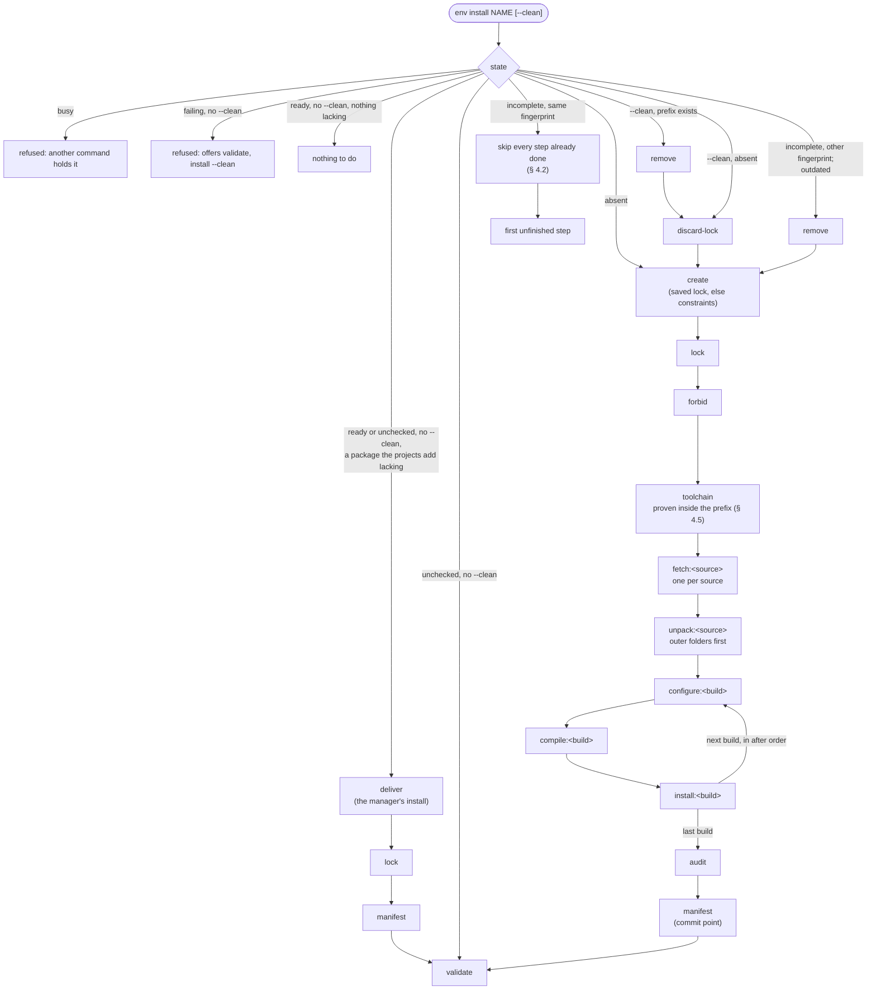
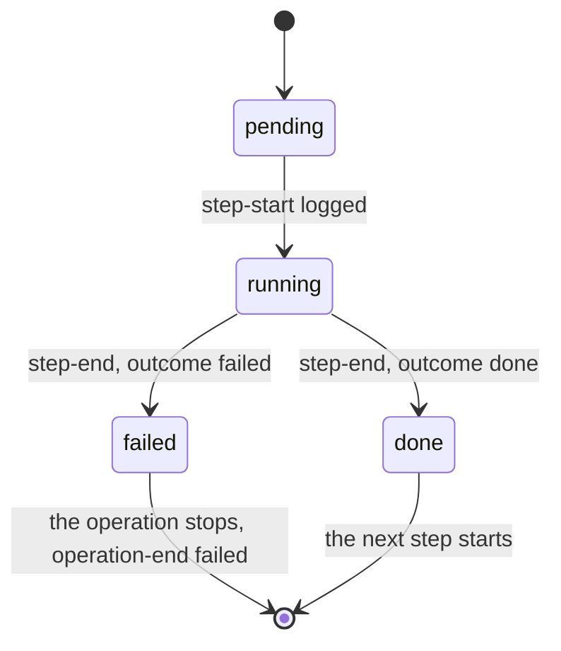
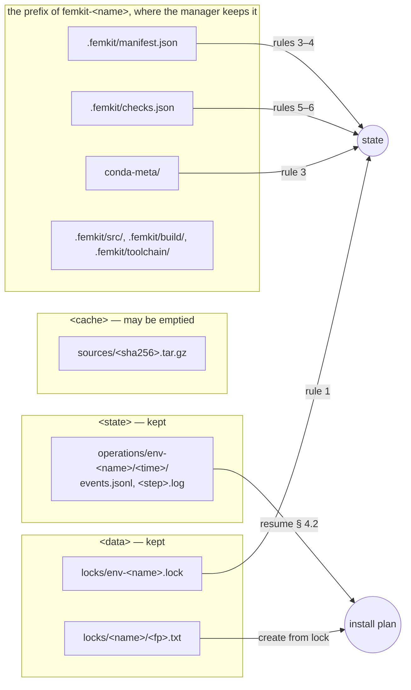
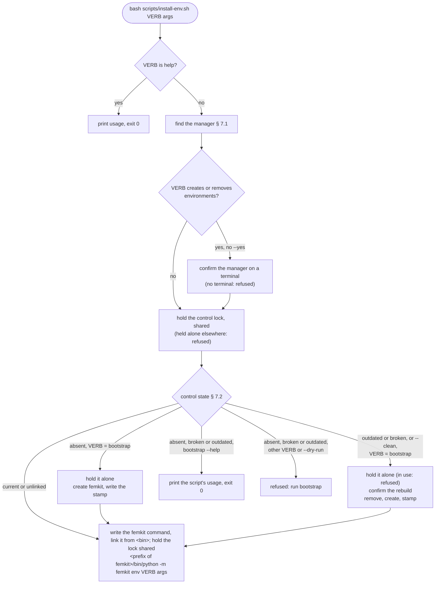
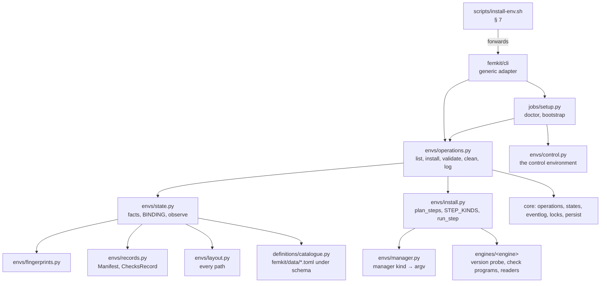

# Environments — lifecycle, installer and install script

**Role:** contract
**Status:** current; what is not built yet is marked so
**Authority:** the environment state machine, the install step machine, install
records, checks as they decide state, and `scripts/install-env.sh` with its control
environment state machine

## The short version

| rule | § |
|---|---|
| **control** (runs femkit), one environment per engine definition, plus a `-cuda` one for a definition with a CUDA part (today `ngsolve`, `elmer`, `ngsolve-cuda`, `elmer-cuda`), and one per tool definition (today `gmsh`, `model_prep`, `postprocess` and `web`): each an **ordinary named environment of the package manager**, `femkit` and `femkit-<name>`, kept where the manager keeps its environments; its prefix is **the one the manager names so**, never formed | 1 |
| **Conda manages, the recipe decides**: where an environment lies, the package cache, the list of environments and activation are the manager's; what goes into an environment is femkit's recipe alone — the person's settings that would change it set aside by the manager's own flags, or refused before any create | 4.4 |
| Every process femkit starts for an environment — femkit's own Python too, through the `femkit` command — **starts clean**, from the start `femkit/data/process.toml` declares, and **enters only through the manager's own `run` or activation**, by the environment's name | 4.4 |
| An environment's state is **observed** from its lock, what the manager lists and names, its prefix and its records, by ten ordered rules — the earlier tool's presence states, `orphan`, `ghost` and `broken`, among them; the first that matches is the state. Its operation log decides only what a resume may skip | 3, 4.2 |
| Each state allows a fixed set of actions; anything else is refused before it starts, with the allowed commands | 3.3 |
| An install is a fixed sequence of steps logged as events; a failed or interrupted install **resumes** from its last finished step | 4 |
| The **manifest** is written last; until it exists, the environment is not installed | 4.3 |
| **Two fingerprints**: what was built, and what was checked — the checks and the code that decides their verdicts. A changed check re-validates; it never rebuilds | 2 |
| CPU checks decide whether an environment is usable; GPU checks, run only when asked for, decide whether its GPU path is qualified | 5 |
| `scripts/install-env.sh` finds the manager, keeps the control environment `femkit` current, links `~/.local/bin/femkit` to its `femkit` command, and forwards every verb to `python -m femkit env`, each from the clean start | 7 |

### The picture

How a command reaches an environment, and what it leaves on disk:

The three questions every command answers in this order:

| question | answered by | § |
|---|---|---|
| Can Python run at all? | the install script's control state | 7.2 |
| What state is each environment in? | the ten observation rules | 3.2 |
| What may this command do in that state? | the action table; anything else is refused with the allowed commands | 3.3 |

## 1. The environments

| environment | defined by | holds |
|---|---|---|
| `control` | `femkit/data/channels.txt`, `control.txt` | Python and the libraries the `femkit` command needs — the netCDF4 library among them, to read every file of the one store, without xarray ([`models.md`](models.md) § 3); no solver, no web server |
| `gmsh` | `femkit/data/environments/gmsh.toml`, a tool environment ([`definitions.md`](definitions.md) § 4.7) | Gmsh with its Python module, on the Python every environment shares: where a person's geometry scripts and Gmsh's meshing run ([`workflow.md`](workflow.md) § 2); a default, since every project's geometry runs there |
| `web` | `femkit/data/environments/web.toml`, a tool environment ([`definitions.md`](definitions.md) § 4.7) | everything the web surface needs: the control environment's packages, by reference, with flask to serve the page and Node.js to build it ([`web.md`](web.md)); installed on request, `env install web`, never by `--all` or `bootstrap` |
| `model_prep` | `femkit/data/environments/model_prep.toml`, a tool environment ([`definitions.md`](definitions.md) § 4.7) | numpy, scipy, the netCDF4 library and xarray, through which the one store writes, on the Python every environment shares: where a project's `definitions.py` runs, and nothing else, through femkit's program that writes their values ([`models.md`](models.md) § 3); a default |
| `postprocess` | `femkit/data/environments/postprocess.toml`, a tool environment ([`definitions.md`](definitions.md) § 4.7) | numpy, scipy, matplotlib, the netCDF4 library, xarray and meshio on the Python every environment shares, and every package the projects under the projects root declare for their scripts ([`models.md`](models.md) § 2), installed into it on each machine: where every observables part's `observe.py` runs, through femkit's observe program with M6 ([`models.md`](models.md) §§ 5.2, 10.1); declared, installed and validated by femkit as every tool environment is; a default |
| `ngsolve`, `elmer` | `femkit/data/environments/<name>.toml` | one engine with everything it builds and runs with on CPUs, and nothing for analysing what it solved; defaults |
| `ngsolve-cuda`, `elmer-cuda` | the same file's `[cuda]` part ([`definitions.md`](definitions.md) § 4.5) | the same engine with CUDA; installed on request, never by `--all` or `bootstrap` |

**Each is an ordinary named environment of the package manager.** The
manager's kind's `create` makes it by its name, `<manager> create -n <name>`,
and the manager decides where it lies — under its own `envs/`, or wherever the
person's configuration (`envs_dirs`) keeps environments: that is the manager's
business, never femkit's. Its name comes from one rule, declared in
`femkit/data/naming.toml` and read by the catalogue (`catalogue.managed`) and
by the install script: `femkit` for the control environment, `femkit-<name>`
for every other — `femkit-elmer`, `femkit-ngsolve`, `femkit-gmsh`,
`femkit-model_prep`, `femkit-postprocess`, `femkit-web`, `femkit-elmer-cuda`.
So `conda env list` lists every one, and `conda activate femkit` enters the
control environment.

**Its prefix is the one the manager names so.** Whatever needs where an
environment lies — its records (§ 4.3), a build's paths, a check's `{prefix}`
— takes, of the prefixes the manager's kind's `environments` query lists
(`<manager> env list --json`, [`definitions.md`](definitions.md) § 6), the
one the manager itself names by the environment's name: its own name for each
listed prefix, where the kind declares where the manager says it (`names`:
conda's `envs_details`, a prefix's name the folder's where it lies in one of
conda's `envs_dirs`, empty elsewhere), and, where it says none, a listed
prefix in one of the folders where the manager keeps environments (its
`envs_dirs` query), under the name there — asked once per invocation
(`manager.Manager.prefix`). Nothing forms it, as `<root>/envs/<name>` would,
and no listed path whose last step only happens to be the name is taken: an
environment made by its path elsewhere is no femkit environment. Two prefixes
the manager names so are refused, naming both. Everything that enters an
environment enters it by its name, through the manager's own `run` or
activation (§ 4.4). No command sets `PATH` or library paths by hand or derives
a prefix from a binary's location.

## 2. Fingerprints

| fingerprint | covers | when it changes |
|---|---|---|
| **install** | the environment's packages, sources and builds as femkit declares them — never a package a project declares, which `postprocess` is installed with beside them and which a later install delivers into it as it stands (§ 4.1; [`definitions.md`](definitions.md) § 4.7); the channels (`channels.txt`), and, for an environment that provides Python, the Python minor (`control.txt`) — every fact its create's constraints are made of; `build.cuda_architectures` when a build has `cuda_architectures = true`; the manager kind — read, for an installed environment, as its manifest records the manager that built it, so another manager named now leaves it as built, and an install records the kind of the manager that runs it | the environment is `outdated` and must be rebuilt |
| **check** | the environment's checks and agreements, its thread and fixed variables, and every file of the code that decides their verdicts: the runner, `femkit/envs/checks.py`, which runs and judges them; what each check runs — for `python -m <module>`, every file of that module's package, as the checkout holds it; and the module of each reader its checks name. Nothing else: a file no check runs or reads — an engine's hand-over — re-validates nothing | its check results no longer count; it is `unchecked` until validated |

`build.jobs` and anything else that changes how fast, not what, is outside both.

| change | install fp | check fp | result |
|---|---|---|---|
| a pin in `packages.conda` | ✓ | | `outdated` → `install` removes and rebuilds |
| a package a project under the projects root declares, added to `postprocess` — never another environment | | | nothing: `install` delivers it into the prefix as it stands (§§ 3.3, 4.1) |
| a source's release or SHA-256 | ✓ | | `outdated` |
| a CMake option | ✓ | | `outdated` |
| `build.cuda_architectures` (env with a build compiled for CUDA) | ✓ | | `outdated` |
| `build.cuda_architectures` (env without one) | | | nothing |
| a check's tolerance, ranks or threads | | ✓ | `unchecked` → `validate` only |
| a file of a check program's package, or a reader a check names | | ✓ | `unchecked` |
| an engine's hand-over, or any file no check runs or reads | | | nothing |
| whether a tool environment provides Python | ✓ | | `outdated` |
| `build.jobs` | | | nothing |

## 3. Environment state machine

The machine is data, `femkit/data/states/environment.toml` ([`core.md`](core.md)
§ 7): its states, the rules below as conditions over the facts
`envs/state.py` gathers and names, and the action table of § 3.3. The tables
here say what it holds. It is every environment's, an engine's or a tool's.

### 3.1 Facts

All but what the manager lists and names are read from disk; that is asked
once per invocation (§ 1). So observing starts the manager's `environments`
query — with its `names` query, where its kind declares one, from the same
answer, and, where the manager names no environment so, its `envs_dirs` query
— and no other process, needs no network, and writes nothing; while no
manager is named it is refused, naming the install script (§ 7.1). It reads
no definition but the environments', the manager kinds and the channel order:
a definition of another kind that does not load — a formulation — leaves
every `env` command working. It reads no project: a package a project
declares changes no environment's state; `install` reads what the projects
declare, and `env list` and `doctor` read it beside the state, to say what is
to be delivered (§§ 3.3, 4.1, 6; definitions.md § 4.7).

| fact | read from |
|---|---|
| lock held | another process holds the environment's subject lock alone ([`core.md`](core.md) § 5); the process holding it reads its own environment as not busy. A lock held shared — a program using the environment, as a running web server uses `web` ([`web.md`](web.md) § 4) — leaves its state as it is; `install`, `clean` and `validate`, which need the lock alone, are refused while it is held, naming each user and the command that ends its use |
| listed | the manager lists a prefix it names by the environment's name (§ 1) |
| orphan | where it lists none: a folder of the environment's name in one of the folders where the manager keeps environments by their names (`envs_dirs`) — where its create would make the environment, and where its `run` and activation would find it |
| prefix | what is at the prefix it lists: nothing, a plain folder, or a manager environment — the folder a manager kind marks each environment it makes with, its `environment` ([`definitions.md`](definitions.md) § 6), `conda-meta/` for conda and mamba alike |
| manifest | `<prefix>/.femkit/manifest.json`: missing, unreadable, or its install fingerprint |
| checks | `<prefix>/.femkit/checks.json`: missing, or its check fingerprint and outcomes |
| last install | the newest install's `events.jsonl` for this environment (a validate's is no install's): its install fingerprint, finished steps, and how it ended — read only to decide what a resume may skip (§ 4.2); no rule below reads it |

### 3.2 Observation — the first rule that matches

| # | when | state | meaning |
|---|---|---|---|
| 1 | the lock is held | `busy` | another command is working on it |
| 2 | the manager lists no environment of its name, and a folder of its name lies where the manager keeps environments | `orphan` | a folder the manager does not list as an environment stands where it would be made: femkit never makes an environment over it, nor removes it |
| 3 | the manager lists no environment of its name | `absent` | not installed |
| 4 | the folder the manager lists is not there | `ghost` | the manager lists a folder that is gone |
| 5 | the folder the manager lists is not a manager environment | `broken` | a folder that is no environment, which femkit never installs into nor removes |
| 6 | no readable manifest | `incomplete` | an install started and did not finish |
| 7 | manifest's install fingerprint ≠ current | `outdated` | its definition or build configuration changed since it was built |
| 8 | no check results for the current check fingerprint, or none for some check without `device = true` | `unchecked` | installed; its current CPU checks have not all run |
| 9 | a check without `device = true` did not pass | `failing` | installed; a required check fails |
| 10 | otherwise | `ready` | usable |

`orphan`, `ghost` and `broken` are the earlier tool's presence states: a
folder in the manager's way that it does not list, a listing with no folder,
and a listed folder that is no environment. With conda 26 the last two do not
arise — conda lists only folders that hold `conda-meta/history` (read in its
`core/envs_manager.py`) — and they stand for a manager that lists otherwise.

The rules are ordered, so every combination of facts has exactly one state.
A `ready` or `failing` environment also reports its **GPU
qualification**: `none`, `not-run`, `passed` or `failed` (§ 5).

### 3.3 Actions

| state | `install` | `install --clean` | `validate` | `validate --gpu` | `clean` |
|---|---|---|---|---|---|
| `orphan` | refused: names the folder, to remove or move aside | refused, the same | refused | refused | refused, the same |
| `absent` | install | install, discarding the saved lock | refused | refused | nothing to do |
| `ghost` | refused: offers `install --clean` | install afresh, nothing removed first, discarding the saved lock | refused | refused | nothing to do |
| `broken` | refused: names the folder, to remove or move aside | refused, the same | refused | refused | refused, the same |
| `busy` | refused | refused | refused | refused | refused |
| `incomplete` | resume (§ 4.2) | remove, install | refused | refused | remove |
| `outdated` | remove, install | remove, install | refused | refused | remove |
| `unchecked` | validate, delivering first what the projects add that it lacks (§ 4.1) | remove, install | validate | refused | remove |
| `failing` | refused | remove, install | validate | validate the GPU checks | remove |
| `ready` | deliver what the projects add that it lacks (§ 4.1); else nothing to do | remove, install | validate | validate the GPU checks | remove |

`install` never decides on its own to discard a working build: in `failing` it
is refused and offers `validate` and `install --clean`. Every refusal prints the
allowed commands from this table — but in `busy`, where the refusal is the
lock's `Busy` ([`core.md`](core.md) § 9), naming the command that holds the
environment and what ends its hold (core.md § 5); in `orphan` and `broken` the
step is the folder's removal, `rm -rf <folder>`, the folder named, which
femkit never runs. `install --all` applies `install` to every environment
whose definition has `default = true`.

What `install` does in a state is the environment table's own `[tasks]` and
`[does]` ([`core.md`](core.md) § 7) — in `unchecked`, validate; in `ready`
and `unchecked`, where the projects under the projects root declare a package
for it that its manifest does not record, deliver it into the prefix as it
stands, then validate (§ 4.1) — never a removal or a rebuild; with
`--clean`, discard the saved lock and build, in `absent` and `ghost` too; in
`incomplete`, resume from the steps the last attempt finished for the
current fingerprint (§ 4.2); in `orphan` and `broken`, nothing — and what
`clean` does, `remove`, in each installed state; never a state's next-step row
run as code. Which states allow the environment to be **used** — a stage, a
check, `web build`, `serve`, the definitions — is declared in the same table;
one `envs` check refuses any other state with that state's own next steps,
never an `env install` written by hand.

How the states move. An arrow is a command, or a change made outside femkit.
`busy` is any state while another command holds the lock. `clean` leads from
every installed state back to `absent`, and `install --clean` from every
installed state through a rebuild.

`install` runs `validate` after `manifest` (§ 4.1), so one command normally takes
`absent` straight on to `ready` or `failing`; `unchecked` is what is left when
that validate did not run or did not finish.

## 4. Install

### 4.1 Steps

`env install NAME --dry-run` prints these, with their exact commands:

| step | does | once per |
|---|---|---|
| `remove` | remove the prefix first, when it is replaced: `outdated`, `--clean`, or an `incomplete` one that cannot resume | environment |
| `discard-lock` | with `--clean` only: delete the saved lock, so the constraints are solved again | environment |
| `create` | create the environment by its name (§ 1) from the saved lock for the current install fingerprint if there is one, otherwise from the declared constraints, every setting of the person's that would change what goes in set aside — a plan holding a create, or a delivery, is refused before it starts while one nothing sets aside holds (§ 4.4); the manager decides where its prefix lies, and each later step asks it (a plan made before the environment exists shows that prefix as `<prefix of femkit-NAME>`, and each step runs with the one the manager then lists) | environment |
| `deliver` | install into the prefix, as it stands, the packages the projects under the projects root declare that its manifest does not record — only new ones: none femkit's recipe declares or pins for it, under any version ([`definitions.md`](definitions.md) § 4.7) — by the manager kind's `install` from the declared channels alone, the person's settings set aside as a create sets them aside (§ 4.4) — then `lock` and `manifest` again, recording them, and `validate`: never a removal or a create. After a create from a saved lock it installs every one they declare, since the lock may be older than they are | environment taking the projects' packages |
| `lock` | export the exact package list; save it as `@EXPLICIT` and one package URL a line — the form every manager's `create --file` reads, without the manager's own header — under `<data>/locks/<name>/<install fingerprint>.txt` | environment |
| `forbid` | refuse if the lock contains a forbidden package family | environment |
| `toolchain` | prove the toolchain inside the prefix before any source is fetched (§ 4.5): every tool and compiler resolves inside it; a trivial program in each language its `compilers` names — C, C++ and Fortran for both shipped engines — compiles, links and runs; when the toolchain names MPI wrappers, a program built with each runs on two ranks with `launch.mpi`. Each finding is said when the program ends: what was proven, then each problem | environment with builds |
| `fetch:<source>` | download the archive into the cache and verify its SHA-256 | source |
| `unpack:<source>` | unpack it into the prefix's source tree and write its version text | source |
| `configure:<build>` | run CMake with framework and declared options; then require every declared option read by the project (absent from CMake's list of unused variables) and present in `CMakeCache.txt` | build, in `after` order |
| `compile:<build>` | build | build |
| `install:<build>` | install into the prefix | build |
| `audit` | every `provides` executable and module is found **inside** the prefix; for an environment with builds, each of its toolchain's compiler variables resolves inside it — the modules and the compilers by the audit's program, `femkit/engines/audit.py`, run inside the prefix | environment |
| `manifest` | run the environment's `version_command` and require the version it states; write the manifest (§ 4.3) — the commit point | environment |
| `validate` | run the CPU checks (§ 5) as their own operation, with its own event log, shown indented under this step; done once every check has run, whatever its verdict | environment |

A failed check leaves the environment installed but not `ready`: the step
`validate` is done, and the install exits 1 when an environment it finished is
not then `ready`, naming each check that failed.

The build steps — `configure`, `compile`, `install` — have no time limit: a
build takes as long as the machine needs, and femkit never cuts one off. Only
the quick steps (the toolchain check, the audit, the version command) and the
checks have one.

Which steps a plan holds, by state:

Every step's command is fixed by data, never by an engine's name:

| step | the command comes from | checked after |
|---|---|---|
| `remove`, `create`, `deliver`, `lock` | the manager kind file (`femkit/data/managers/<kind>.toml`) | — |
| `forbid` | `packages.forbid`; a family `f` matches a package named `f` or `f-…` | — |
| `fetch`, `unpack` | `[[sources]]`: URL, SHA-256, `into`, version text | the archive's SHA-256 |
| `configure` | framework options + `[[builds]].options`, run through `<manager> run -n <name>` | every declared option read by the project and in `CMakeCache.txt`; the compilers inside the prefix |
| `compile`, `install` | `cmake --build` / `cmake --install`, `build.jobs` in parallel | — |
| `toolchain` | `[toolchain]`: its compilers, MPI wrappers and tools; `launch.mpi` for the two-rank run | each tool and compiler inside the prefix; each trivial program compiled, linked and run |
| `audit` | `provides`: executables and Python modules | each found inside the prefix; with builds, each variable `[toolchain].compilers` names too |
| `manifest` | the environment's `version_command` ([`definitions.md`](definitions.md) § 4): the last line it prints, or what its engine's version reader reads where that output is irregular | the stated version equals `version`, and the manager's version reads; otherwise the step fails, its log saying why |

### 4.2 Step machine and resume

Each step goes `pending → running → done`, or `→ failed`, or `→ killed` — its
command ended by `SIGKILL` (§ 6.2), which counts as failed; an install stops at
its first failed step (a validate runs every check, § 5). The operation log records each transition with the step's
inputs.

`install` on an `incomplete` environment resumes when the last install — a
validate is none — had the **current** install fingerprint and did not end done:
steps that logged `done` in it, or in the unbroken run of earlier unfinished
installs with the same fingerprint, are skipped and the rest run. An install that
ended done leaves nothing to resume: a prefix broken after it is removed and
installed again. When the fingerprint differs, the leftover prefix is removed and the
install starts from `create`. A crashed command and a failed step resume the
same way. The `toolchain` step is the one exception: it proves the machine the
install runs on, and a resume may run on another (a cluster's login node, then
an allocation's node), so it runs again on every resume.

An example: two attempts, then a resume.

| attempt | fingerprint | steps run | ends | the next `install` skips |
|---|---|---|---|---|
| 1 | `a1` | `create`, `lock`, `forbid` ✗ | failed at `forbid` | `create`, `lock` |
| 2 | `a1` | `forbid`, `toolchain`, `fetch:netgen` ✗ | failed at `fetch:netgen` | `create`, `lock`, `forbid` (`toolchain` runs again) |
| 3 | `a1` | `toolchain`, `fetch:netgen` … `manifest` | done | — |
| (instead) | `b2` | `remove`, `create`, … | the definition changed, so nothing is skipped | — |

One `env install` over several environments, as one operation:

### 4.3 Records

| record | written | holds |
|---|---|---|
| lock | step `lock` | the exact package list, keyed by install fingerprint; saved again after a `deliver`, so it holds what a project added; kept after `clean`, so a later install reproduces it; discarded by `install --clean` |
| manifest | step `manifest`, atomically, last | install fingerprint, lock hash, manager kind and version, the version its version command stated, the packages the projects declare that it was created with or was delivered beside its own (`projects`, § 4.1), which of the person's own settings its commands set aside, each with where the manager read it — none where the kind declares no way to read them (`settings`, § 4.4) — time |
| checks | each `validate`, atomically | check fingerprint; each check's outcome, quantities, reason and log path (the GPU qualification is derived from them, § 5) |

Where every file lives, and what removes it:

| file | path | written by | removed by |
|---|---|---|---|
| prefix | where the manager keeps `femkit-<name>` (§ 1) | `create` | `remove`, `clean` |
| manifest | `<prefix>/.femkit/manifest.json` | `manifest` | with the prefix |
| checks | `<prefix>/.femkit/checks.json` | `validate` | with the prefix |
| proofs | `<prefix>/.femkit/proofs.json` | `formulation verify --record` ([`models.md`](models.md) § 6.3; not built yet, plan § 4, M6) | with the prefix |
| source tree | `<prefix>/.femkit/src/<source>/` | `unpack` | with the prefix |
| build tree | `<prefix>/.femkit/build/<build>/` | `configure`, `compile` | with the prefix |
| toolchain programs | `<prefix>/.femkit/toolchain/` | `toolchain`, emptied first each time | with the prefix |
| lock | `<data>/locks/<name>/<install fp>.txt` | `lock` | `discard-lock` (`install --clean`) only |
| downloaded archive | `<cache>/sources/<sha256>.tar.gz` | `fetch` | never by femkit; the cache may be emptied |
| event log | `<state>/operations/env-<name>/<time>/events.jsonl` | every install, validate, clean | never by femkit |
| step log | `<state>/operations/env-<name>/<time>/<step>.log` (`:` written as `-`) | each step | never by femkit |
| subject lock | `<data>/locks/env-<name>.lock` | held while a command acts | released on exit; a dead holder never counts |

### 4.4 Entering an environment: a clean start, then the manager's own way in

**One door.** Every process femkit starts for an environment begins the one
way: from a **clean start**, declared once as data in
`femkit/data/process.toml` ([`definitions.md`](definitions.md) § 1) and read
by its one owner, `envs/start.py` — `begin` for a process femkit starts,
`clean` for the invocation's, `lines` for the shell of a run script and of the
`femkit` command — then into the environment **only through the manager's own
`run` or activation, by the environment's name** (§ 1): never `PATH` or a
library path set by hand. That covers the manager's own commands — a query, a
create, a removal, a lock's export, a delivery — and every command inside an
environment: femkit's programs (the definitions' in `model_prep`, the
toolchain proof, the audit, the probe's), the checks, a build's `configure`,
`compile` and `install`, the version command, `web build`'s `npm`; femkit's
own Python programs on an environment's Python, the web server's supervisor
on the control environment's and its child on the web environment's
([`web.md`](web.md) § 4), each begun from the clean start with femkit's
checkout alone as its import path — `dirs.femkit_env`, the door's one addition
for femkit's own code (§ 7); and the run
scripts the jobs domain writes, which run the same start as shell before their
preamble and their activation ([`jobs.md`](jobs.md) § 4, block 8) — a stage's
program, the person's `observe.py` and an output translator's script (with
M6) run in those. femkit itself is no environment's work: the `femkit` command
and the install script's forward start it isolated (`-I`, none of the person's
Python settings, no user site-packages) and keep the shell it is typed in but
what `process.toml`'s `femkit_sheds` names — library injection — so femkit
sees the machine it reads and probes as the person does: `PATH`, the loaded
modules, a scheduler's commands, the GPUs' tools (§ 7, `envs/start.py`'s
`own_lines`). A command inside an environment goes through the door of the
envs domain, `envs/inside.py`, which resolves the manager and the
environment's name, begins the clean start with the program's declared extra
variables, and holds any fallback; each femkit program is declared as data
with its environment, its entry, its time limit and the variables it passes or
sets, in `femkit/data/programs.toml` ([`definitions.md`](definitions.md) § 1),
and its documents are defined once under `femkit/engines/`. A femkit program a
stage's job runs — the observe program, with M6 — is declared there too, its
time limit there alone; its environment, `postprocess`, is its stage kind's
alone, never declared there ([`workflow.md`](workflow.md) § 2.1), and it
enters it as every stage does, by its run script ([`jobs.md`](jobs.md) § 4).
The web server's child alone runs on its environment's own `python`, with the
listening socket handed to it, not through the manager's `run`: whether a
manager's `run` keeps a socket open for its command is not measured.

- **The clean start.** A process begins with only the invocation's variables
  that `process.toml`'s pass list names, with what each scheduler kind adds —
  the variables a job of it sees (`passes`) and the shell functions it needs
  (`functions`, the module system's `module`), passed as bash passes an
  exported function — and of them none its remove list names; `PATH` is the
  system's own; then what it sets. The lists, and the reason for each entry,
  are `process.toml`'s alone, the one home: in kind, the person's identity,
  home, locale, proxies and conda configuration and femkit's own variables
  pass; another active environment, a platform forced on the manager, its
  virtual packages overridden and a package root an outside toolchain names
  are removed, every remove entry one a pass pattern would keep, or it does
  not load; everything else — the outside Python, library injection, an
  outside compiler and its flags, any shell function no scheduler kind
  declares — no pattern passes. As shell, every exported variable the start
  does not keep is unset, and every exported function but those declared is
  no longer exported, so the shell keeps it — a preamble's `module` may call
  one — and no child inherits it. The start is a pass list, not a deny-list,
  because a deny-list would have to know every variable a build reads:
  Elmer's own CMake alone reads some forty-five `*_ROOT`/`*ROOT` package
  roots, CMake reads `CC`, `CXX`, `FC`, the `*FLAGS`, `CMAKE_PREFIX_PATH` and
  `<Package>_ROOT`, gcc reads `CPATH` and `LIBRARY_PATH`, and the loader reads
  `LD_LIBRARY_PATH` for the test programs both builds run while configuring
  ([ADR 0006](../decisions/0006-toolchain-first.md)). The system `PATH` stays
  because the manager's own wrapper needs a shell; the toolchain check proves
  every tool a build calls resolves inside the prefix.
- **Then the manager's own way in, and nothing filtered after it.** A command
  inside an environment runs through the manager kind's `run`, by the
  environment's name (`<manager> run -n femkit-elmer …`); a run script enters
  by the activation the machine's record states, by the name (`conda activate
  femkit-elmer`). The environment's activation scripts and the variables its
  definition declares — its thread and fixed variables — then set the run time
  ([`jobs.md`](jobs.md) § 4): nothing is removed after the activation. The
  shell function, `conda activate`, exists once the manager's own hook for
  bash is evaluated: a run script evaluates it from the manager its target's
  record names, by the manager's way — `eval "$(<manager> shell.bash hook)"`
  for conda, the kind's `activate.hook` — never from a file guessed from where
  the manager lies, and stops, naming that manager, where it is not there; the
  hook exports what `conda activate` needs (conda 26.7.1's `activate.py`, read,
  not run), so it needs nothing from outside the clean start. The activate
  script, `source activate`, is found on `PATH`, which after the clean start
  is the system's: it works only where the preamble puts the manager's `bin`
  on `PATH`, as a cluster's module does, and a run script whose preamble did
  not stops before it, saying that this is the cause ([`jobs.md`](jobs.md) § 4,
  block 8). `conda run` (`cli/main_run.py`) hands its command the variables
  it was given, with the environment's activation added.
- **Conda manages, the recipe decides** ([ADR 0026](../decisions/0026-environments-under-condas-management.md)).
  The person: "why can't we leave conda's management as is, and have our env
  fitting there? … as long as we strictly make sure all components are placed
  within its own env dir, whereever conda manages it … why would you take over
  what conda manages"; and, deciding it, "Conda manages, recipe decides". So
  the manager keeps
  everything it manages as the person set it up: where each environment lies,
  its package cache, its list of environments — every femkit environment is
  one `conda env list` lists — and how a shell enters one; femkit sets none of
  the manager's own variables, and the person's `.condarc` and conda variables
  reach it (the clean start passes them). What goes **into** an environment
  comes from femkit's recipe alone: every command that solves or installs — a
  create, a create from a saved lock, a delivery — carries the manager's own
  flags that set aside each of the person's settings that would change it, as
  its kind file declares ([`definitions.md`](definitions.md) § 6): for conda,
  read in conda 26.7.1's source and not run, `--override-channels` their
  `channels` and `default_channels`, `--no-default-packages` their
  `create_default_packages` (a create from a lock too: conda adds them to any
  create otherwise), `--no-pin` their `pinned_packages`, and every channel
  named by its full address, `https://conda.anaconda.org/<channel>`, which
  their `channel_alias`, `custom_channels` and `custom_multichannels` never
  re-route; a platform forced by `CONDA_SUBDIR` and virtual packages
  overridden by `CONDA_OVERRIDE_*` never reach it (the clean start removes
  them). A setting nothing sets aside refuses an install before any create —
  conda's `override_channels_enabled: false`, under which it refuses
  `--override-channels`; a `subdir` or `subdirs` forced in a file; a
  `migrated_channel_aliases` or `migrated_custom_channels`, which re-route a
  channel named by its address — naming the setting, the file the manager
  read it from and what to change there (`Refused` · `setting-refused`); the
  install script refuses so too before it makes the control environment
  (§ 7.3). Where the person's settings were read is the manager's own answer
  (`conda config --show-sources --json`, its kind's `settings`), and the
  install's manifest records which were found and set aside (§ 4.3). mamba
  2.9.0 refuses `--no-default-packages`; whether it honours a person's
  `create_default_packages`, whether it has a form that sets
  `pinned_packages` aside, and how it says where it read a setting are not
  measured, so a mamba install records none, and the lock and the `forbid`
  step show what a create brought. Each component is installed only into its
  own environment: nothing goes into the manager's `base`, and nothing is
  installed with pip. femkit's own records — locks, manifests, logs — stay in
  femkit's folders (§ 4.3), and npm's cache and configuration in femkit's
  cache, its registry npm's own, declared beside it (`programs.toml`): the
  person's `~/.npmrc` is never read, and their `npm_config_*` variables no
  clean start passes. A conda removal and a create from a saved lock name the
  declared channels too: measured with conda 26.7.1, a removal otherwise
  checks the terms of service of the `defaults` channels the manager's base
  configuration lists — channels femkit never uses — and stops; femkit never
  accepts terms on the person's behalf. A mamba removal names none: mamba
  2.9.0 refuses channels on `env remove` (exit 109). Each kind file says which
  (`channels_named`, [`definitions.md`](definitions.md) § 6). Measured with
  conda 26.7: `conda env create -f` cannot keep the person's channels out (it
  adds them, and ignores `nodefaults`), which is why the control environment
  is a package list for `create --file` ([`definitions.md`](definitions.md)
  § 3). Whether a create's solve still differs under a setting no list above
  names — the solver chosen, say — is not measured: the saved lock fixes what
  a later create installs.
- Every step that runs inside a prefix — `configure`, `compile`, `install`,
  the audit, the version command, a check — goes through the manager kind's `run`. Each
  kind's `run` is a form measured to start the command with the prefix's
  activation and pass its exit status: mamba 2.9.0's `run` given conda's
  `--no-capture-output` writes `exec -- …` into its run script, which bash
  refuses, and the command never starts, so the mamba kind leaves it out
  (measured on mamba 1.5.9 and 2.9.0, by prefix; by name, not measured yet).
  Where a machine's `run` still cannot start a command, the step would enter
  through the kind's shell hook (its `activate`, § 6.2) and `job probe` would
  record `manager.run_enters = false` ([`jobs.md`](jobs.md) § 9.1); that
  fallback is not built yet (plan § 4, M1).

### 4.5 The toolchain and the host

An environment with builds is built in two stages: its toolchain, proven on this
machine, then the engine, with that toolchain only
([`definitions.md`](definitions.md) § 4.6;
[ADR 0006](../decisions/0006-toolchain-first.md)).

- **The proof** is the `toolchain` step (§ 4.1). `femkit/engines/toolchain.py`
  runs inside the prefix and measures: where each tool and compiler resolves,
  and whether each trivial program compiles, links and runs. It reports one JSON
  object; `envs/toolchain.py` judges it. A failure names the language and its
  first error line — "CPU ISA level is lower than required", say — and no
  source is fetched.
- **Why this is enough:** an environment is built on the machine that runs it —
  the workstation builds its own, a cluster builds its own with `bootstrap`
  there — and a job is a script that machine's installed engine runs. Proving
  the toolchain where the build happens is what proves the environment runs
  there.

## 5. Validate

Validation is execution ([`framework.md`](framework.md) § 4): the request is
`validate` or `validate --gpu`, and it runs what was asked and asks nothing of
the machine. A GPU check run where no GPU is allocated runs anyway and fails,
its reason and log saying the device was not there; so `validate --gpu` belongs
where a GPU is allocated. Where a GPU is — the machine's record —
and placing a GPU validate on it — `job prepare` — are
[`jobs.md`](jobs.md) § 9 and [`jobs.md`](jobs.md) § 3.

`env validate NAME` runs the checks without `device = true` through the generic
runner ([`definitions.md`](definitions.md) § 5), each as a step of its own
operation, then judges the agreement groups and writes the check results. Every
check runs, whatever the one before it gave, so the record covers them all: a
check that fails is a finished step, and its verdict is in the results. Each
check ends `passed` or `failed`.

- `validate --gpu` runs the device checks and every check sharing an agreement
  group with one, so each group is judged. It adds GPU results to current CPU
  results — typically on a GPU node, after a CPU validate elsewhere — so the
  action table refuses it while there are none (`unchecked`, § 3.3).
- `validate --gpu` on an environment that declares no GPU check is refused: there
  is nothing to run, and its qualification is `none`. On a CPU environment whose
  definition has a CUDA part, the refusal names its `-cuda` environment
  ([`definitions.md`](definitions.md) § 4.5).
- Each validate replaces the outcomes of the checks it ran and keeps the
  others recorded for the current check fingerprint.
- The environment is usable when every check without `device = true` passed
  (§ 3.2 rule 6). Device checks never make it unusable.
- GPU qualification: `none` when no device check is declared, `not-run` while
  some device check has no outcome, `passed` when every one passed, `failed`
  otherwise. It is a summary of the device checks' outcomes, not a machine of
  its own ([`core.md`](core.md) § 7): it allows and refuses nothing — what may
  be done is the environment's machine's (§ 3.3). `passed` means what the device checks prove and no more: both
  shipped ones are real-valued Poisson solves on one GPU, so it does not
  establish complex-valued electromagnetics, several GPUs, or production GPU
  use; complex frequency-domain cases stay on the CPU until a CPU/GPU
  equivalence check for them passes.
- `validate` exits 1 unless the environment is then `ready`; `validate --gpu`
  exits 1 unless it is then `ready` and its GPU qualification `passed`. Each
  failure is a finding, with one more for each check that caused it — its
  reason, its log the finding's file ([`core.md`](core.md) § 10): the CPU
  checks for not `ready`, the device checks for the GPU.
- A device check kept from an earlier validate is judged again with its
  agreement group, so a reference that now fails fails it too
  ([`definitions.md`](definitions.md) § 5.2).
- A `command` check on several MPI ranks needs `launch.mpi` (a `ctest` starts
  its own ranks); with it unset, `validate` and an `install` that would
  validate are refused before anything starts.

On a cluster, validation that needs compute-node resources — `validate --gpu`
needs a GPU node — runs as a job ([`jobs.md`](jobs.md)): the job asks for the
resources and runs `env validate` there. Not built yet (plan § 4, M4).

## 6. Commands

| command | does |
|---|---|
| `env list` | every environment with its definition, its name with the manager, state and GPU qualification, and what the projects declare for it that `env install` would deliver (§ 4.1), said with that step; a folder of an environment's name the manager does not list, said with the folder (§ 3) |
| `env install NAME… \| --all [--clean]` | § 3.3, § 4 |
| `env validate NAME [--gpu]` | § 5 |
| `env bootstrap [--clean]` + `config init`'s options | set up this machine: `config init`, every default environment installed (with `--clean`, rebuilt), this machine's record, then `doctor` (§ 6.2) |
| `doctor` | whether this machine is ready (§ 6.1) |
| `env clean NAME` | remove the environment, by its name, with its manifest and checks; keep its lock |
| `env log NAME` | the last operation's steps and log paths |

### 6.1 `doctor` — is this machine ready?

One report, read from the same observations and action tables as every other
command, so it can never recommend what a state machine would refuse. Each row
has its state and, where something is missing, the next command:

| subject | ready when | otherwise |
|---|---|---|
| control environment | `current` (§ 7.2): Python runs femkit from it, its `femkit` command there names this checkout, and `<bin>/femkit` links that command (§ 7) | the step its state allows: `bash <checkout>/scripts/install-env.sh bootstrap`, the script by its absolute path (never `--clean`, which also rebuilds every default environment) |
| `config.toml` | found, loads, and states `activation.preamble` and `activation.command` ([`config.md`](config.md) § 3.1) | `config init`, which asks for each key unset; when it does not load, its state names each problem |
| this machine's record | present, loads, and not `stale` ([`jobs.md`](jobs.md) § 9.3) | `job probe --write` — after stating the activation keys while either is unset, since the probe is refused until then |
| each default engine environment, and any other once installed | `ready` (§ 3.2), holding every package the projects declare for it — the one answer of what it lacks (§ 4.1); a CUDA environment never installed is not counted | that state's allowed actions (§ 3.3); for what it lacks, its `install`, which delivers it |

Each row's state is its machine's; what the state rests on — which keys are
unset, what drifted, whose checkout the `femkit` command runs — is its detail
beside it. A row that cannot be observed is `unknown`, its detail saying why;
the report never stops short. (A `FEMKIT_CONFIG_DIR` or `FEMKIT_DATA_DIR` that is not an absolute path
is refused before any row, as it is for every command that reads them: no row
could say where anything is.) While `config.toml` does not load, the record and the engine
environments are `unknown`. While no package manager is named, one
`engine environments` row says so, with the command that names one.

It changes nothing. It exits 0 when every row is ready and 1 otherwise, so a
script can ask. It is the last step of `env bootstrap` (§ 6.2).

### 6.2 `env bootstrap` — set up this machine

Install time is when the person who knows the answers is there. One plan, one
consent, then four parts in order:

1. **`config init`**, with bootstrap's own copies of its options, and its
   questions ([`config.md`](config.md) § 3.2) asked first. Every install reads
   `config.toml`, so if it is not written nothing is installed.
2. **Every default environment**, one install each. Each is planned against
   `config.toml` as bootstrap will write it, so the plan already shows each
   install and its number of steps (`env install NAME --dry-run` lists them), and says now
   which installs will be refused and why: an environment with MPI while
   `launch.mpi` is unset, for instance. A refused install is not started
   and counts against the exit. A ready one is left alone, unless `--clean`. The
   installs do not depend on one another, so a failed one does not stop the
   next.
3. **This machine's record**, written by `job probe --write` after the
   installs, so its environments are the ones now here: when there is none,
   when it does not load, when it is stale against `config.toml` as bootstrap
   will write it (`jobs.md` § 9.3) — what the record's state allows, its
   step — or when bootstrap installs any environment. A current record is
   kept only when nothing is installed (`job probe --write` measures it
   again). The plan measures it already, so it shows before the one consent
   what the probe could not measure and why, and each difference from the
   record there (`jobs.md` § 9.2), or the probe's refusal; the outcome shows
   those of the measurement written, after the installs. While
   `activation.preamble` or `activation.command` stays unset, none is
   written, and the plan says so: what each unset key blocks, as `config
   init` says it ([`config.md`](config.md) § 3.1).
4. **`doctor`** (§ 6.1).

An `activation.command` the named manager's kind has no form of is refused
before anything runs, naming the kind's forms: the entry lines below, and every
run script on this machine, enter an environment by it.

The outcome lists every part with its status (`done`, `failed`, `killed`,
`refused`, `left alone`), the doctor report, and one verdict. The exit is 0
only when every part is done and `doctor` finds the machine ready.

It ends with the lines that enter femkit's control environment the way a
person enters any of the manager's — which a new shell does not need, since
`femkit` is on its path (§ 7): the preamble, the activation the person stated
(`activation.command`, [`config.md`](config.md) § 3.1) of `femkit`, by its
name, and `femkit doctor`. While no package manager is named, bootstrap is
refused before its plan, naming the install script: no environment can be
found or made but by the manager (§§ 1, 7.1). `source activate` is one line,
`source activate femkit`; `conda activate` or `mamba activate` is the
manager's own hook for bash evaluated first — `eval "$(<manager> shell.bash
hook)"`, the kind's `activate.hook`, from the manager this machine names —
then the line. While `activation.command` is unset, the activation line says
so and names `config init --activation`.

On a cluster, `bootstrap` and `install` run inside an interactive allocation,
not on a login node, whose limits kill large builds. When the machine's
scheduler kind declares `interactive` ([`jobs.md`](jobs.md) § 7) and the
process is in no job (the kind's job-ID variable is unset), bootstrap's plan
warns before any install, naming that command — never a partition — and,
as a step of its own, the same bootstrap to run inside it. A step
whose own command ends by `SIGKILL` (exit `-9`, or `137` as a shell reports it) is
`killed`. Its next step is the environment table's `install` row for the
state the killed step leaves ([`core.md`](core.md) § 7), never a command
written by hand. Where the process runs is read as the machine record reads it
([`jobs.md`](jobs.md) § 9.1). On a login node, the finding names the same
command (or, for a kind that declares none, says to run inside a job); inside a
scheduler job, it says to ask the allocation for more memory or lower
`build.jobs`; on a workstation, to free memory or lower `build.jobs`. A compiler killed under the
build tool makes the build tool exit with its own code; that step is `killed`
too when its log holds the line its compiler driver prints for it — GCC's
`… fatal error: Killed signal terminated program f951`, on a cluster's login
node, or NVCC's `nvcc error : 'cudafe++' died due to signal 9 (Kill signal)`,
in a cluster allocation, each as measured there — and the same finding
follows. A compiler that says it in other words leaves its step `failed`, and
the warning before the installs is what covers it.

## 7. The install script and the control environment

`scripts/install-env.sh` is the one shell program. It exists because the control environment must exist
before Python can run, and it does only that:

1. find the package manager (§ 7.1) and ask the person to confirm it (`--yes`
   skips the question);
2. make sure the control environment, the manager's environment `femkit`,
   exists and is current (§ 7.2, § 7.3), and that `femkit` is on the path;
3. forward its arguments verbatim to the control environment's own `python
   -m femkit env …`.

The script reads `--yes`/`-y`, `--clean`, `--dry-run` and `--help` for its own
steps and forwards every argument unchanged; every other flag is Python's, and
`bash scripts/install-env.sh <verb> --help` prints femkit's own help.

**`femkit` in every shell.** Day to day, femkit runs as `femkit …`, in any
shell and any folder, with nothing activated — the form every printed command
uses ([`api.md`](api.md) § 4.4). `femkit` is a launcher the script writes into
the control environment, `<prefix of femkit>/bin/femkit`, each time it runs,
and links from `<bin>/femkit` — `~/.local/bin/femkit`, `<bin>` made where it
is not there ([`config.md`](config.md) § 2) — a folder most shells put on the
path once it exists; where it is not on this shell's path, bootstrap prints
the one line that puts it there, `export PATH=<bin>:"$PATH"`, for the
person's `~/.bashrc`, or the activation of the control environment by its
name, `conda activate femkit`. The launcher, a bash script made from its one
source, `femkit/data/launcher.sh`, starts femkit's control Python as every
process for an environment starts (§ 4.4): from the clean start, written into
it by the script from `process.toml` and the scheduler kinds — the very lines
`envs/start.py` writes, which doctor fills it with to read it back — so no
outside Python, library, toolchain or other environment of the shell it is
typed in reaches femkit, nor anything femkit starts; then the control
environment's own Python on femkit from the checkout the script ran from —
`python -I <checkout>/femkit/__main__.py`, isolated: no user site-packages,
never the folder it runs in on Python's import path, so no file of the
person's stands in for a module femkit imports; `femkit/__main__.py`, run by
its path, puts its own checkout on femkit's import path. `conda activate
femkit`, the way into any of the manager's environments, still works and also
puts `femkit` on the path. femkit starts one of its own Python programs one
way, on whichever environment's Python — the web server's supervisor and its
child ([`web.md`](web.md) § 4), a check program inside a prefix (§ 4.4):
`dirs.femkit_argv`, the module run with `-P`, and `dirs.femkit_env`, the clean
start with the checkout alone as its `PYTHONPATH`, the door's one addition for
femkit's own code. Whether the launcher is there, names this checkout and is
linked is a fact of the control environment's state (§ 7.2); a launcher whose
checkout is gone says so, and names the script to run from the checkout's new
place.

What the control process itself then finds on `PATH` — a scheduler's commands
for `job probe`, the GPU query — and the loaded modules `config init` shows
beside its question are read in that clean start: a machine whose scheduler
commands lie outside the system's folders states them to the probe
(`--set scheduler.commands.submit=PATH`, [`jobs.md`](jobs.md) § 9.2).

### 7.1 Finding the manager

The script lists every manager in reach, in this order: `FEMKIT_ENV_MANAGER`
(a path, or a name looked up on `PATH`); `conda`, `mamba`, `micromamba` on
`PATH` — the manager loaded in this shell, by a cluster's module for instance,
is the strongest sign of the one meant; `MAMBA_EXE` / `CONDA_EXE`, which an old
`conda init` may have left behind; the root above an active `CONDA_PREFIX`; the
usual install roots under `$HOME` and `/opt`. A file reached two ways is listed
once. Only a manager with a kind file in `femkit/data/managers/` can be driven;
the others are listed with that reason — a Miniforge install puts `mamba`
beside `conda`.

The first manager that can be driven is proposed. For a verb that creates or
removes an environment (`bootstrap`, `install`, `clean`), a terminal asks which
to use, the proposal taken on Enter; `--yes` takes the proposal; other verbs
take it and say so. `FEMKIT_ENV_MANAGER` naming one that cannot be driven is
never replaced silently: a terminal asks, and `--yes` is refused. None that can
be driven: exit 2, listing what was found and where the script looked, and
saying that on a cluster the manager's module is loaded in this shell first.

The script and Python drive the same manager the same way: the script creates
and removes the control environment with the commands of that manager's kind
file (`create`, `channel`, `remove`), by its name, as Python does every other,
each from the same clean start (§ 4.4), read from `process.toml` and the
scheduler kinds as Python reads them — one reading of the same data. It asks
the manager for the control environment's prefix as Python asks for any
(§ 1): the listed prefix the manager names `femkit` in its `names` answer, or,
where it says none, a listed one in one of its `envs_dirs` under that name —
never a listed path elsewhere whose last step is `femkit`.
The script prints the manager and the rule that found it, and hands Python its
full path as `FEMKIT_ENV_MANAGER`: Python runs it from clean starts whose
`PATH` holds only the system's (§ 4.4), where a bare name could find another
manager or none. Day to day, Python reads the `MAMBA_EXE` or `CONDA_EXE` the
manager's own shell hook sets — in a shell where the manager is initialised,
or the control environment activated. Python never searches: in a shell where
neither is set — the manager's hook not loaded, a cluster's module not loaded —
a command that needs the manager is refused, naming the install script.

### 7.2 Control state — observed by the script

The machine is data, `femkit/data/states/control.toml` ([`core.md`](core.md)
§ 7), which `doctor` observes it by, from the facts `envs/control.py` gathers.
The script runs before femkit can, so it holds the same rules in bash
(`control_state`); a basic test stands the control prefix in every way its
facts can combine and holds the script's state, and the next step its refusal
names, to the table's.

| # | when | state |
|---|---|---|
| 1 | the manager names no environment `femkit` (§ 1) | `absent` |
| 2 | no `conda-meta/`, no `bin/python`, or no stamp file | `broken` |
| 3 | the stamp's SHA-256 ≠ that of `channels.txt` then `control.txt` | `outdated` |
| 4 | its `femkit` command is missing, or is not the one the script writes from this checkout (§ 7), or `<bin>/femkit` is not a link to it | `unlinked` |
| 5 | otherwise: Python runs femkit from it, its `femkit` command runs this checkout, and `femkit` is linked | `current` |

`doctor` calls the control environment ready when it is `current`, and names
the step its state allows otherwise.

The stamp, `<prefix of femkit>/.femkit/control.sha256`, is written last when
the control environment is created; it records the SHA-256 of `channels.txt`
followed by `control.txt`, the files it was made from (femkit's
`catalogue.control_digest`, and the script's `control_digest`, compute it
alike). The data and bin directories are resolved by the rules of
[`config.md`](config.md) § 2, the same as Python's, and written as Python writes
a path — no empty or `.` step, no `/` at its end — so every place the script
forms, the `femkit` command's text among them, is the text femkit forms.

### 7.3 Actions

| state | `bootstrap` | `bootstrap --clean` | any other verb |
|---|---|---|---|
| `absent` | create, then forward | create, then forward | refused: run `bootstrap` |
| `broken` | remove, create, then forward | remove, create, then forward | refused: run `bootstrap` |
| `outdated` | remove, create, then forward | remove, create, then forward | refused: run `bootstrap` |
| `unlinked` | forward | remove, create, then forward | forward |
| `current` | forward | remove, create, then forward | forward |

Every run but a `--dry-run` or `--help` writes the `femkit` command and its
link before it forwards, so an `unlinked` control environment is `current`
once forwarded. The link is the script's alone: it replaces only a link, or
nothing, at `<bin>/femkit` — a file of the person's there is refused, naming
it, never overwritten.

- **The control environment's lock.** The script holds the core's lock on the
  subject `control` — `<data>/locks/control.lock`, as `core/locks.py` would
  take it ([`core.md`](core.md) § 5), with `flock -n` — shared from before it
  observes the state until the forwarded command ends, and alone while it
  creates or removes the environment. Every long-lived femkit process that
  runs from the control environment holds it shared too: a web server's
  supervisor, as it holds the `web` environment's ([`web.md`](web.md) § 4).
  So the control environment is never removed under a femkit that runs from
  it, and nothing runs from it while it is made: a hold the script cannot
  take is refused at once, never waited for, naming each live holder as the
  lock's file names it and what ends its hold, then the same command again.

`--clean` is forwarded too, so `bootstrap --clean` also rebuilds every default
environment (`env bootstrap --clean`; a `-cuda`
environment is rebuilt only by its own `env install NAME --clean`). No repair
the script or `doctor` prints carries it. Only a line that repeats the person's
own command carries their `--clean`: after a failed control rebuild (never with
`--yes`), and where there is no terminal to confirm on (with `--yes`, which is
the consent the question would have asked for).

- **Create** is the kind's `create` by the name — `<manager> create -y -n
  femkit --override-channels --no-default-packages --no-pin` for conda, `-c
  https://conda.anaconda.org/<channel>` for each line of `channels.txt`, then
  `--file control.txt` — and then the stamp, in the prefix the manager then
  lists; **remove** is the kind's `remove`, `<manager> remove --all -y -n
  femkit --override-channels`, with each channel where the kind names its
  channels there — the kind's declared forms (a basic test holds the two
  together); the field tests run them on each kind. Before either, a setting
  of the person's that nothing the create carries sets aside is refused, as
  Python refuses it (§ 4.4), naming the setting and the file the manager read
  it from.
- **Forward** is `<prefix of femkit>/bin/python -I
  <checkout>/femkit/__main__.py env <the arguments>`, the `femkit` command's
  own form (§ 7) — from the clean start, `FEMKIT_ENV_MANAGER` set to the
  manager the script found: femkit runs from its checkout, is never installed
  into an environment, and imports none of the person's own Python packages.
  Every line the script prints names it by its absolute path in the checkout,
  `bash <checkout>/scripts/install-env.sh …`, as femkit's own steps do, so it
  pastes from any folder.
  It never goes through `<manager> run`: some managers' `run` writes a shell stub that dies on `exec: --: invalid
  option`, a cluster's mamba module among them, and `run` stands between
  Python and the terminal it asks on (§ 6.2). femkit is pure Python and needs
  no activation to run. `bootstrap` is forwarded as `env bootstrap`, which
  sets up the rest (§ 6.2).
- Before a verb that creates or removes environments (`bootstrap`, `install`,
  `clean`) the manager is confirmed on a terminal; a rebuild of the control
  environment asks once more, and prints the command that recreates it should
  the create after the removal fail. `--yes` answers both in advance; without
  a terminal and without `--yes`, the script refuses. Other verbs ask nothing.
- `--help` and `--dry-run` never create or remove, nor write the `femkit`
  command or its link. On a control environment that is `absent`, `broken` or
  `outdated`, `bootstrap --help` prints the script's own usage and
  exits 0 — femkit's help needs the control environment — while another verb's
  `--help`, and `--dry-run`, are refused,
  because making it would be the install that was not asked for. On a
  `current` or `unlinked` one both are forwarded, a `--clean` with them included.
- Exit codes follow [`api.md`](api.md) § 4.3.

## 8. Where each part lives in the code

| part | module |
|---|---|
| control state, actions, forwarding, the `femkit` link (§ 7) | `scripts/install-env.sh` |
| the `femkit` command (§ 7): its one source, which the script fills and doctor reads it by | `femkit/data/launcher.sh`; filled — the checkout, the Python and what femkit's own process sheds (`femkit_sheds`) — in `scripts/install-env.sh` (`write_launcher`) and `femkit/envs/control.py` (`launcher_text`) |
| facts, observation rules, action table (§ 3) | `femkit/envs/state.py` |
| fingerprints (§ 2) | `femkit/envs/fingerprints.py` |
| install steps, resume, validate after `manifest` (§ 4.1, § 4.2) | `femkit/envs/install.py`, `femkit/envs/operations.py` |
| records (§ 4.3) | `femkit/envs/records.py`, `femkit/envs/layout.py` (every path within a prefix) |
| `validate` and the check runner (§ 5) | `femkit/envs/checks.py`, `femkit/envs/operations.py`; check programs and readers in `femkit/engines/<engine>/` |
| `env list`, `install`, `validate`, `clean`, `log` (§ 6) | `femkit/envs/operations.py` |
| the toolchain step's program and judgement (§ 4.5) | `femkit/engines/toolchain.py` (runs inside the prefix, measures), `femkit/envs/toolchain.py` (judges) |
| the clean start every process for an environment begins from (§ 4.4): its declaration, and its one reader — `begin` for a process femkit starts, `clean` for the invocation's, `lines` for the shell of a run script and of the `femkit` command | `femkit/data/process.toml`; `femkit/envs/start.py`; `scripts/install-env.sh` (`start_lines`), which runs before Python |
| an environment's name with the manager, and its prefix the manager names so (§ 1); a folder in its way it does not list (§ 3) | `femkit/data/naming.toml`, read by `femkit/definitions/catalogue.py` (`managed`) and `scripts/install-env.sh`; `femkit/envs/manager.py` (`Manager.prefix`, `Manager.orphan`) |
| the person's settings set aside or refused (§ 4.4) | the manager kind's `settings`; `femkit/envs/manager.py` (`Manager.settings`), `femkit/envs/install.py` (`refuse_settings`) |
| `doctor`, `env bootstrap` (§ 6.1, § 6.2) | `femkit/jobs/setup.py`: both read or write this machine's record, which sits in `jobs`, above `envs` ([`framework.md`](framework.md) § 1) |
| an environment's activation lines, by its name (§ 6.2) | `femkit/envs/manager.py`, from the manager kind's `activate` |
