# Environments — lifecycle, installer and install script

**Role:** contract
**Status:** current; what is not built yet is marked so
**Authority:** the environment state machine, the install step machine, install
records, checks as they decide state, and `scripts/install-env.sh` with its control
environment state machine

## The short version

| rule | § |
|---|---|
| **control** (runs femkit) at a fixed place under `<data>`, and under `paths.environments` one environment per engine definition, plus a `-cuda` one for a definition with a CUDA part (today `ngsolve`, `elmer`, `ngsolve-cuda`, `elmer-cuda`) | 1 |
| An environment's state is **observed** from its lock, its prefix and its records, by seven ordered rules; the first that matches is the state. Its operation log decides only what a resume may skip | 3, 4.2 |
| Each state allows a fixed set of actions; anything else is refused before it starts, with the allowed commands | 3.3 |
| An install is a fixed sequence of steps logged as events; a failed or interrupted install **resumes** from its last finished step | 4 |
| The **manifest** is written last; until it exists, the environment is not installed | 4.3 |
| **Two fingerprints**: what was built, and what was checked. A changed check re-validates; it never rebuilds | 2 |
| CPU checks decide whether an environment is usable; GPU checks, run only when asked for, decide whether its GPU path is qualified | 5 |
| `scripts/install-env.sh` finds the manager, keeps the control environment current, and forwards every verb to `python -m femkit env` | 7 |

### The picture

How a command reaches an environment, and what it leaves on disk:

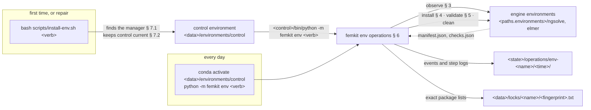

The three questions every command answers in this order:

| question | answered by | § |
|---|---|---|
| Can Python run at all? | the install script's control state | 7.2 |
| What state is each engine environment in? | the seven observation rules | 3.2 |
| What may this command do in that state? | the action table; anything else is refused with the allowed commands | 3.3 |

## 1. The environments

| environment | defined by | holds |
|---|---|---|
| `control` | `femkit/data/channels.txt`, `control.txt` | Python and the libraries the `femkit` command needs; no solver, no web server |
| `web` | `femkit/data/environments/web.toml`, a tool environment ([`definitions.md`](definitions.md) § 4.7) | everything the web surface needs: the control environment's packages, by reference, with flask to serve the page and Node.js to build it ([`api.md`](api.md) § 5); installed on request, `env install web`, never by `--all` or `bootstrap` |
| `ngsolve`, `elmer` | `femkit/data/environments/<name>.toml` | one engine with everything it builds and runs with on CPUs; the defaults |
| `ngsolve-cuda`, `elmer-cuda` | the same file's `[cuda]` part ([`definitions.md`](definitions.md) § 4.5) | the same engine with CUDA; installed on request, never by `--all` or `bootstrap` |

The control environment lives at `<data>/environments/control`
([`config.md`](config.md) § 2): the install script must find it before any
Python runs, so its place cannot come from `config.toml`, and `FEMKIT_DATA_DIR`
is the one way to move it. Each engine environment lives at
`<paths.environments>/<name>` ([`config.md`](config.md) § 3). Every
environment is reached only through the manager's own commands, as its kind file
declares them ([`definitions.md`](definitions.md) § 6). No command sets
`PATH` or library paths by hand or derives a prefix from a binary's location.

## 2. Fingerprints

| fingerprint | covers | when it changes |
|---|---|---|
| **install** | the environment's packages, sources and builds; the Python minor and channels (`control.txt`, `channels.txt`); `build.cuda_architectures` when a build has `cuda_architectures = true`; the manager kind | the environment is `outdated` and must be rebuilt |
| **check** | the environment's checks and agreements, its thread and fixed variables, the files of its engine package, and the shared code that runs and judges checks (`femkit/envs/checks.py`, and `femkit/engines/__init__.py`, `summary.py` and `cuda.py`; not the toolchain's program, which checks nothing) | its check results no longer count; it is `unchecked` until validated |

`build.jobs` and anything else that changes how fast, not what, is outside both.

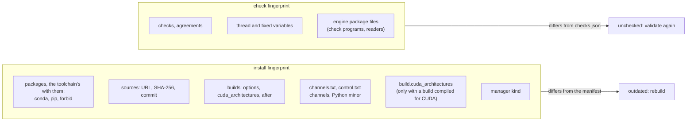

| change | install fp | check fp | result |
|---|---|---|---|
| a pin in `packages.conda` | ✓ | | `outdated` → `install` removes and rebuilds |
| a source's release or SHA-256 | ✓ | | `outdated` |
| a CMake option | ✓ | | `outdated` |
| `build.cuda_architectures` (env with a build compiled for CUDA) | ✓ | | `outdated` |
| `build.cuda_architectures` (env without one) | | | nothing |
| a check's tolerance, ranks or threads | | ✓ | `unchecked` → `validate` only |
| a check program or reader in `femkit/engines/<engine>/` | | ✓ | `unchecked` |
| `build.jobs` | | | nothing |

## 3. Engine environment state machine

### 3.1 Facts

All are read from disk; observing starts no process and needs no network.

| fact | read from |
|---|---|
| lock held | another process holds the environment's subject lock alone ([`core.md`](core.md) § 5); the process holding it reads its own environment as not busy. A lock held shared — a program using the environment, as a running web server uses `web` ([`api.md`](api.md) § 5.4) — leaves its state as it is; `install`, `clean` and `validate`, which need the lock alone, are refused while it is held, naming each user and the command that ends its use |
| prefix | `absent`, a plain directory, or a manager environment (`conda-meta/` present) |
| manifest | `<prefix>/.femkit/manifest.json`: missing, unreadable, or its install fingerprint |
| checks | `<prefix>/.femkit/checks.json`: missing, or its check fingerprint and outcomes |
| last operation | the newest `events.jsonl` for this environment: its install fingerprint, finished steps, and whether it ended — read only to decide what a resume may skip (§ 4.2); no rule below reads it |

### 3.2 Observation — the first rule that matches

| # | when | state | meaning |
|---|---|---|---|
| 1 | the lock is held | `busy` | another command is working on it |
| 2 | no prefix | `absent` | not installed |
| 3 | no readable manifest, or the prefix is not a manager environment | `incomplete` | an install started and did not finish, or the folder is wreckage |
| 4 | manifest's install fingerprint ≠ current | `outdated` | its definition or build configuration changed since it was built |
| 5 | no check results for the current check fingerprint, or none for some check without `device = true` | `unchecked` | installed; its current CPU checks have not all run |
| 6 | a check without `device = true` did not pass | `failing` | installed; a required check fails |
| 7 | otherwise | `ready` | usable |

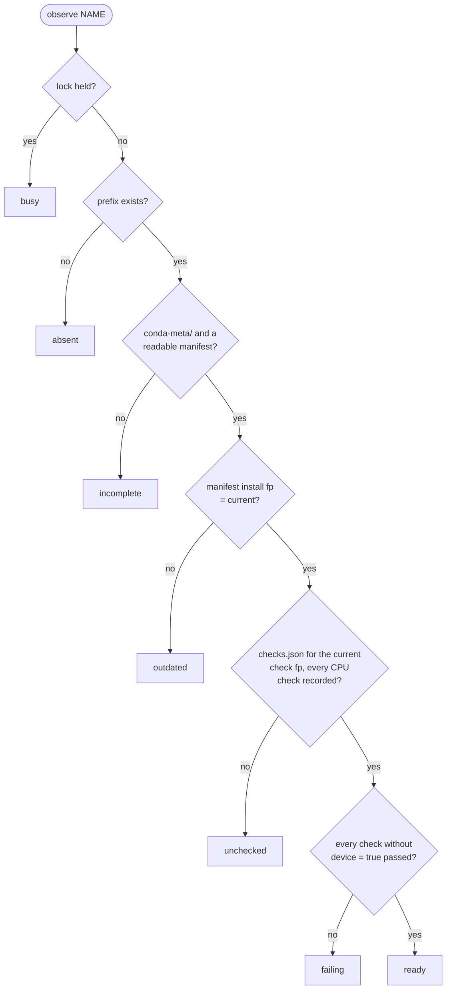

The rules are ordered, so every combination of facts has exactly one state.
A `ready` or `failing` environment also reports its **GPU
qualification**: `none`, `not-run`, `passed` or `failed` (§ 5).

### 3.3 Actions

| state | `install` | `install --clean` | `validate` | `validate --gpu` | `clean` |
|---|---|---|---|---|---|
| `absent` | install | install | refused | refused | nothing to do |
| `busy` | refused | refused | refused | refused | refused |
| `incomplete` | resume (§ 4.2) | remove, install | refused | refused | remove |
| `outdated` | remove, install | remove, install | refused | refused | remove |
| `unchecked` | validate | remove, install | validate | refused | remove |
| `failing` | refused | remove, install | validate | validate the GPU checks | remove |
| `ready` | nothing to do | remove, install | validate | validate the GPU checks | remove |

`install` never decides on its own to discard a working build: in `failing` it
is refused and offers `validate` and `install --clean`. Every refusal prints the
allowed commands from this table. `install --all` applies `install` to every
environment whose definition has `default = true`.

How the states move. An arrow is a command, or a change made outside femkit.
`busy` is any state while another command holds the lock. `clean` leads from
every installed state back to `absent`, and `install --clean` from every
installed state through a rebuild.

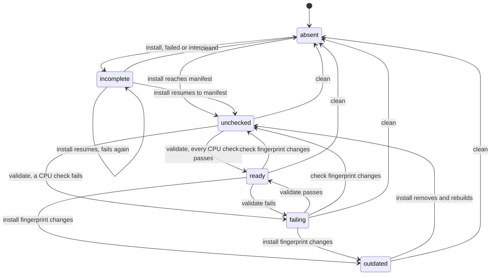

`install` runs `validate` after `manifest` (§ 4.1), so one command normally takes
`absent` straight on to `ready` or `failing`; `unchecked` is what is left when
that validate did not run or did not finish.

## 4. Install

### 4.1 Steps

`env plan NAME` prints these, with their exact commands:

| step | does | once per |
|---|---|---|
| `remove` | remove the prefix first, when it is replaced: `outdated`, `--clean`, or an `incomplete` one that cannot resume | environment |
| `discard-lock` | with `--clean` only: delete the saved lock, so the constraints are solved again | environment |
| `create` | create the prefix from the saved lock for the current install fingerprint if there is one, otherwise from the declared constraints | environment |
| `lock` | export the exact package list; save it as `@EXPLICIT` and one package URL a line — the form every manager's `create --file` reads, without the manager's own header — under `<data>/locks/<name>/<install fingerprint>.txt` | environment |
| `forbid` | refuse if the lock contains a forbidden package family | environment |
| `toolchain` | prove the toolchain inside the prefix before any source is fetched (§ 4.5): every tool and compiler resolves inside it; a trivial program in each language its `compilers` names — C, C++ and Fortran for both shipped engines — compiles, links and runs; when the toolchain names MPI wrappers, a program built with each runs on two ranks with `launch.mpi`. Each finding is said when the program ends: what was proven, then each problem | environment with builds |
| `fetch:<source>` | download the archive into the cache and verify its SHA-256 | source |
| `unpack:<source>` | unpack it into the prefix's source tree and write its version text | source |
| `configure:<build>` | run CMake with framework and declared options; then require every declared option read by the project (absent from CMake's list of unused variables) and present in `CMakeCache.txt` | build, in `after` order |
| `compile:<build>` | build | build |
| `install:<build>` | install into the prefix | build |
| `audit` | every `provides` executable and module is found **inside** the prefix; for an environment with builds, each of its toolchain's compiler variables resolves inside it | environment |
| `manifest` | write the manifest (§ 4.3) — the commit point | environment |
| `validate` | run the CPU checks (§ 5) as their own operation, with its own event log, shown indented under this step; done once every check has run, whatever its verdict | environment |

A failed check leaves the environment installed but not `ready`: the step
`validate` is done, and the install exits 1 when an environment it finished is
not then `ready`, naming each check that failed.

The build steps — `configure`, `compile`, `install` — have no time limit: a
build takes as long as the machine needs, and femkit never cuts one off. Only
the quick steps (the toolchain check, the audit, the version probe) and the
checks have one.

Which steps a plan holds, by state:

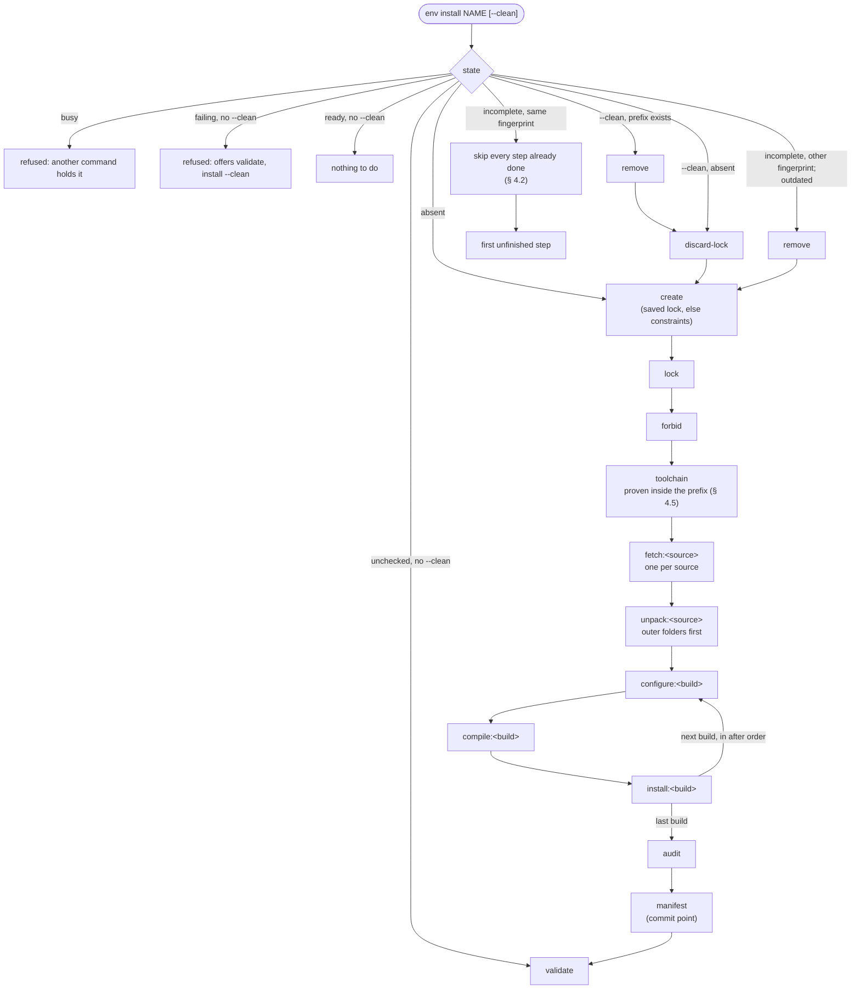

Every step's command is fixed by data, never by an engine's name:

| step | the command comes from | checked after |
|---|---|---|
| `remove`, `create`, `lock` | the manager kind file (`femkit/data/managers/<kind>.toml`) | — |
| `forbid` | `packages.forbid`; a family `f` matches a package named `f` or `f-…` | — |
| `fetch`, `unpack` | `[[sources]]`: URL, SHA-256, `into`, version text | the archive's SHA-256 |
| `configure` | framework options + `[[builds]].options`, run through `<manager> run -p <prefix>` | every declared option read by the project and in `CMakeCache.txt`; the compilers inside the prefix |
| `compile`, `install` | `cmake --build` / `cmake --install`, `build.jobs` in parallel | — |
| `toolchain` | `[toolchain]`: its compilers, MPI wrappers and tools; `launch.mpi` for the two-rank run | each tool and compiler inside the prefix; each trivial program compiled, linked and run |
| `audit` | `provides`: executables and Python modules | each found inside the prefix; with builds, each variable `[toolchain].compilers` names too |
| `manifest` | the engine's version probe (`femkit/engines/<engine>/`) | the probed version equals `version` |

### 4.2 Step machine and resume

Each step goes `pending → running → done`, or `→ failed`, or `→ killed` — its
command ended by `SIGKILL` (§ 6.2), which counts as failed; an install stops at
its first failed step (a validate runs every check, § 5). The operation log records each transition with the step's
inputs.

`install` on an `incomplete` environment resumes when the last operation had the
**current** install fingerprint: steps that logged `done` in that operation, or in
the unbroken run of earlier operations with the same fingerprint, are skipped and
the rest run. When the fingerprint differs, the leftover prefix is removed and the
install starts from `create`. A crashed command and a failed step resume the
same way. The `toolchain` step is the one exception: it proves the machine the
install runs on, and a resume may run on another (a cluster's login node, then
an allocation's node), so it runs again on every resume.

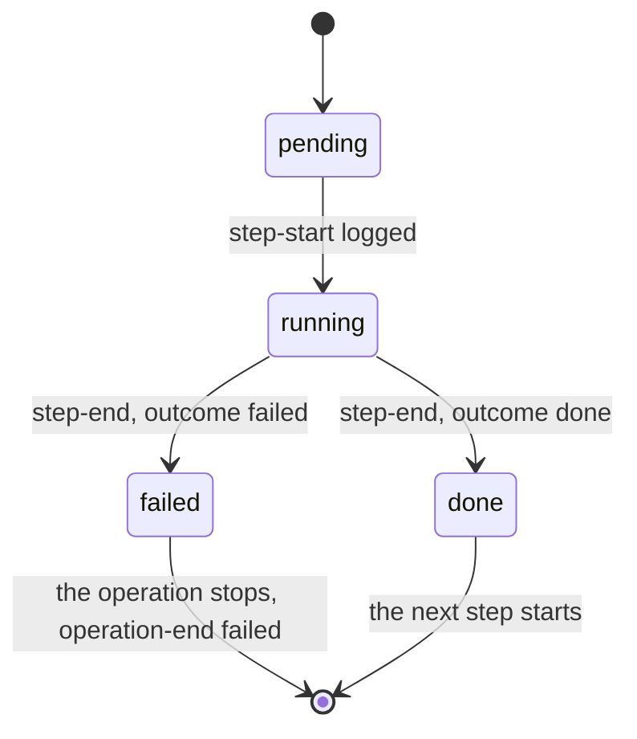

An example: two attempts, then a resume.

| attempt | fingerprint | steps run | ends | the next `install` skips |
|---|---|---|---|---|
| 1 | `a1` | `create`, `lock`, `forbid` ✗ | failed at `forbid` | `create`, `lock` |
| 2 | `a1` | `forbid`, `toolchain`, `fetch:netgen` ✗ | failed at `fetch:netgen` | `create`, `lock`, `forbid` (`toolchain` runs again) |
| 3 | `a1` | `toolchain`, `fetch:netgen` … `manifest` | done | — |
| (instead) | `b2` | `remove`, `create`, … | the definition changed, so nothing is skipped | — |

One `env install` over several environments, as one operation:

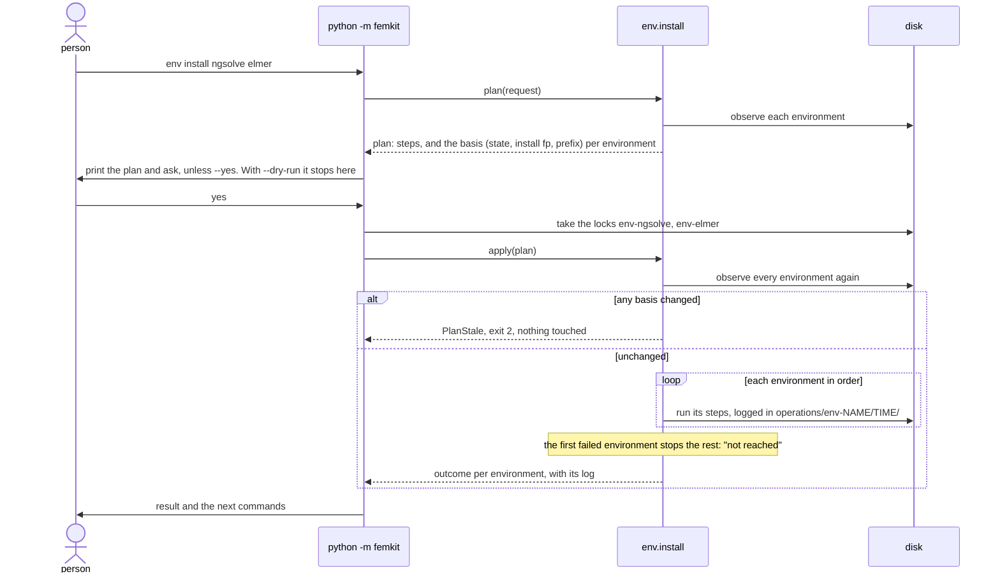

### 4.3 Records

| record | written | holds |
|---|---|---|
| lock | step `lock` | the exact package list, keyed by install fingerprint; kept after `clean`, so a later install reproduces it; discarded by `install --clean` |
| manifest | step `manifest`, atomically, last | install fingerprint, lock hash, manager kind and version, solver version from the engine's version probe, time |
| checks | each `validate`, atomically | check fingerprint; each check's outcome, quantities, reason and log path (the GPU qualification is derived from them, § 5) |

Where every file lives, and what removes it:

| file | path | written by | removed by |
|---|---|---|---|
| prefix | `<paths.environments>/<name>/` | `create` | `remove`, `clean` |
| manifest | `<prefix>/.femkit/manifest.json` | `manifest` | with the prefix |
| checks | `<prefix>/.femkit/checks.json` | `validate` | with the prefix |
| proofs | `<prefix>/.femkit/proofs.json` | `formulation verify --record` ([`models.md`](models.md) § 6.3; not built yet, plan § 3, M6) | with the prefix |
| source tree | `<prefix>/.femkit/src/<source>/` | `unpack` | with the prefix |
| build tree | `<prefix>/.femkit/build/<build>/` | `configure`, `compile` | with the prefix |
| toolchain programs | `<prefix>/.femkit/toolchain/` | `toolchain`, emptied first each time | with the prefix |
| lock | `<data>/locks/<name>/<install fp>.txt` | `lock` | `discard-lock` (`install --clean`) only |
| downloaded archive | `<cache>/sources/<sha256>.tar.gz` | `fetch` | never by femkit; the cache may be emptied |
| event log | `<state>/operations/env-<name>/<time>/events.jsonl` | every install, validate, clean | never by femkit |
| step log | `<state>/operations/env-<name>/<time>/<step>.log` (`:` written as `-`) | each step | never by femkit |
| subject lock | `<data>/locks/env-<name>.lock` | held while a command acts | released on exit; a dead holder never counts |

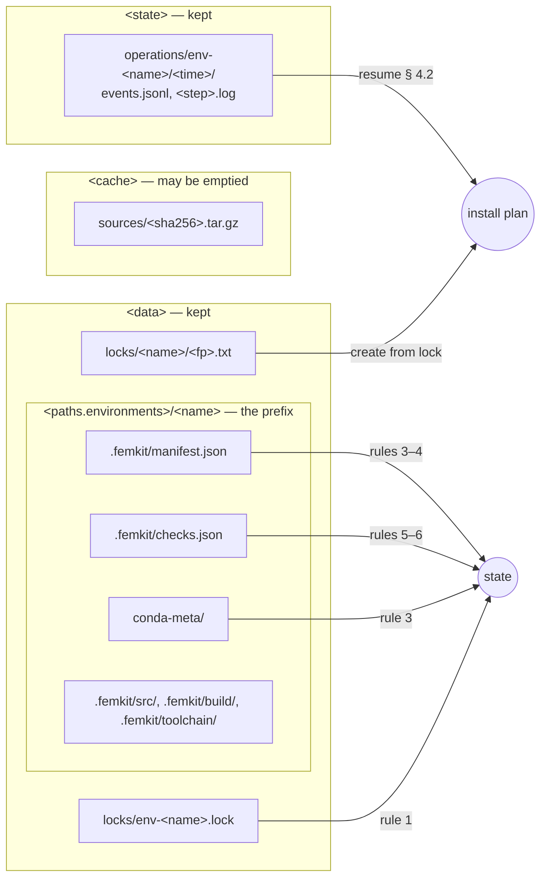

### 4.4 Entering a prefix: only the environment and its toolchain

- **The manager runs in femkit's own places.** Every manager command femkit
  runs — a query, a create, a removal, a `run`, the install script's included
  (§ 7) — runs with `HOME` set to `<cache>/manager-home/`, its package cache at
  `<cache>/pkgs/` (`CONDA_PKGS_DIRS`), environment registration off
  (`CONDA_REGISTER_ENVS=false`) and `TMPDIR` at `<cache>/tmp/`, so nothing it
  or a command inside a prefix writes lands in the person's home or the
  system's temporary folder: package downloads, repodata and notice caches, its
  list of environments, mamba's process records, Node.js's compile cache
  (measured 2026-11-23: `web build` left `/tmp/node-compile-cache` before this
  rule). Measured 2026-11-23 on a workstation:
  conda 26.7.1 honours both variables; mamba 2.9.0 honours the package cache
  but registers every environment it creates in `$HOME/.conda/environments.txt`
  with no setting to stop it, so its `HOME` is femkit's; `conda info` writes
  `~/.anaconda/keyring` and `~/.conda/aau_token` into whichever `HOME` it has;
  both report the same root prefix under either `HOME`. The variables that
  name the person's own configuration and caches apart from `HOME` —
  `XDG_CONFIG_HOME`, `XDG_CACHE_HOME`, `XDG_DATA_HOME`, `XDG_STATE_HOME`,
  `CONDARC`, `MAMBARC` — are removed from every manager command: measured
  2026-11-23, conda 26.7.1 under femkit's `HOME` still reads
  `$XDG_CONFIG_HOME/conda/.condarc` and `$CONDARC`. The person's
  `~/.condarc` and `~/.mambarc` are therefore not read by femkit's installs:
  the channels are femkit's own (below), and a proxy reaches the manager
  through `HTTPS_PROXY`, which passes. A command inside a prefix inherits that
  `HOME`, so a build's or a check's own caches stay in femkit's places too. A
  conda removal names the declared channels, as a create does: measured with
  conda 26.7.1, a removal under femkit's `HOME` otherwise checks the terms of
  service of the `defaults` channels the manager's own base configuration
  lists — channels femkit never uses — and stops; femkit never accepts terms
  on the person's behalf. A mamba removal names none: mamba 2.9.0 refuses
  channels on `env remove` (exit 109) and checks no terms. Each kind file says
  which (`remove_channels`, [`definitions.md`](definitions.md) § 6).
- **Nothing outside the definitions enters a prefix.** Every environment,
  the control one included, is created by the manager kind's `create`: the
  channels `channels.txt` names and no others — the person's own conda
  channels are overridden — and, with conda, none of their default packages
  (`--no-default-packages`); a later create installs the exact lock. mamba 2
  has no such option (measured, 2.9.0: it refuses `--no-default-packages`), and
  needs none: the person's own configuration, where `create_default_packages`
  would be set, is not read (above). Measured
  with conda 26.7: `conda env create -f` cannot do this (it adds the person's
  channels, and ignores `nodefaults`), which is why the control environment is
  a package list for `create --file`. The manager kind file declares these
  commands ([`definitions.md`](definitions.md) § 3, § 6).
- Every step that runs inside a prefix — `configure`, `compile`, `install`,
  the version probe, a check — goes through the manager kind's `run`. Each
  kind's `run` is a form measured to start the command with the prefix's
  activation and pass its exit status: mamba 2.9.0's `run` given conda's
  `--no-capture-output` writes `exec -- …` into its run script, which bash
  refuses, and the command never starts, so the mamba kind leaves it out
  (measured on mamba 1.5.9 and 2.9.0). Where a machine's `run` still cannot
  start a command, the step would enter through the kind's shell hook (its
  `activate`, § 6.2) and `job probe` would record `manager.run_enters = false`
  ([`jobs.md`](jobs.md) § 9.1); that fallback is not built yet (plan § 3, M1).
- **Every command femkit runs inside a prefix starts from an allow-list** —
  `HOME`, `USER`, `LOGNAME`, `LANG`, `LC_*`, `TERM`, `TMPDIR`,
  `CUDA_VISIBLE_DEVICES`, OpenMPI's two run-as-root variables, and
  `PATH=/usr/bin:/bin`, with `PYTHONNOUSERSITE=1` so no user site-packages
  load, and the checkout alone as `PYTHONPATH` for femkit's own programs (the
  toolchain check, the check programs) — and the manager's
  activation then adds the prefix's own settings, its `bin` first: the
  toolchain check, `configure`, `compile`, `install`, `audit`, the version
  probe, every check. Nothing else a shell, a module or a site profile set
  reaches them: a deny-list would have to know every variable a build reads,
  and Elmer's own CMake alone reads some forty-five `*_ROOT`/`*ROOT` package
  roots, CMake reads `CC`, `CXX`, `FC`, the `*FLAGS`, `CMAKE_PREFIX_PATH` and
  `<Package>_ROOT`, gcc reads `CPATH` and `LIBRARY_PATH`, and the loader reads
  `LD_LIBRARY_PATH` for the test programs both builds run while configuring.
  The system `PATH` stays because the manager's own wrapper needs a shell;
  the toolchain check proves every tool a build calls resolves inside the
  prefix. The allow-list is one constant, `envs/manager.py` (`CONFINED`).
- The manager's own commands — create, remove, export a lock — keep the
  invocation's variables but those naming the person's own configuration
  (above): the manager reads its installation's configuration and proxies.

### 4.5 The toolchain and the host

An environment with builds is built in two stages: its toolchain, proven on this
machine, then the engine, with that toolchain only
([`definitions.md`](definitions.md) § 4.6;
[ADR 0006](../decisions/0006-toolchain-first.md)).

- **The proof** is the `toolchain` step (§ 4.1). `femkit/engines/toolchain.py`
  runs inside the prefix and measures: where each tool and compiler resolves,
  and whether each trivial program compiles, links and runs. It reports one JSON
  object; `envs/toolchain.py` judges it. A failure names the language and its
  first error line — "CPU ISA level is lower than required", say — and no
  source is fetched.
- **Why this is enough:** an environment is built on the machine that runs it —
  the workstation builds its own, a cluster builds its own with `bootstrap`
  there — and a job is a script that machine's installed engine runs. Proving
  the toolchain where the build happens is what proves the environment runs
  there.

## 5. Validate

Validation is execution ([`framework.md`](framework.md) § 4): the request is
`validate` or `validate --gpu`, and it runs what was asked and asks nothing of
the machine. A GPU check run where no GPU is allocated runs anyway and fails,
its reason and log saying the device was not there; so `validate --gpu` belongs
where a GPU is allocated. Where a GPU is — the machine's record —
and placing a GPU validate on it — `job prepare` — are
[`jobs.md`](jobs.md) § 9 and [`jobs.md`](jobs.md) § 3.

`env validate NAME` runs the checks without `device = true` through the generic
runner ([`definitions.md`](definitions.md) § 5), each as a step of its own
operation, then judges the agreement groups and writes the check results. Every
check runs, whatever the one before it gave, so the record covers them all: a
check that fails is a finished step, and its verdict is in the results. Each
check ends `passed` or `failed`.

- `validate --gpu` runs the device checks and every check sharing an agreement
  group with one, so each group is judged. It adds GPU results to current CPU
  results — typically on a GPU node, after a CPU validate elsewhere — so the
  action table refuses it while there are none (`unchecked`, § 3.3).
- `validate --gpu` on an environment that declares no GPU check is refused: there
  is nothing to run, and its qualification is `none`. On a CPU environment whose
  definition has a CUDA part, the refusal names its `-cuda` environment
  ([`definitions.md`](definitions.md) § 4.5).
- Each validate replaces the outcomes of the checks it ran and keeps the
  others recorded for the current check fingerprint.
- The environment is usable when every check without `device = true` passed
  (§ 3.2 rule 6). Device checks never make it unusable.
- GPU qualification: `none` when no device check is declared, `not-run` while
  some device check has no outcome, `passed` when every one passed, `failed`
  otherwise. `passed` means what the device checks prove and no more: both
  shipped ones are real-valued Poisson solves on one GPU, so it does not
  establish complex-valued electromagnetics, several GPUs, or production GPU
  use; complex frequency-domain cases stay on the CPU until a CPU/GPU
  equivalence check for them passes.
- `validate` exits 1 unless the environment is then `ready`; `validate --gpu`
  exits 1 unless it is then `ready` and its GPU qualification `passed`. Each
  failure names the checks that caused it, with their reasons and logs: the
  CPU checks for not `ready`, the device checks for the GPU.
- A device check kept from an earlier validate is judged again with its
  agreement group, so a reference that now fails fails it too
  ([`definitions.md`](definitions.md) § 5.2).
- A `command` check on several MPI ranks needs `launch.mpi` (a `ctest` starts
  its own ranks); with it unset, `validate` and an `install` that would
  validate are refused before anything starts.

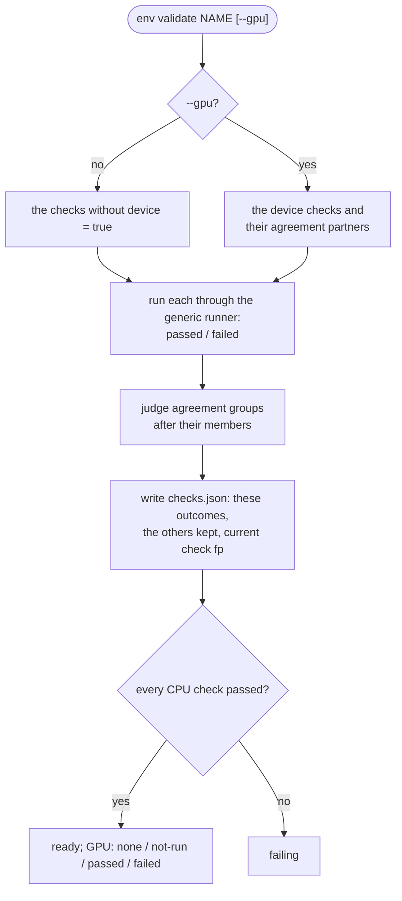

On a cluster, validation that needs compute-node resources — `validate --gpu`
needs a GPU node — runs as a job ([`jobs.md`](jobs.md)): the job asks for the
resources and runs `env validate` there.

## 6. Commands

| command | does |
|---|---|
| `env list` | every environment with its definition, state and GPU qualification |
| `env plan NAME` | the steps `install` would run now, without running them |
| `env install NAME… \| --all [--clean]` | § 3.3, § 4 |
| `env validate NAME [--gpu]` | § 5 |
| `env bootstrap [--clean]` + `config init`'s options | set up this machine: `config init`, every default environment installed (with `--clean`, rebuilt), this machine's record, then `doctor` (§ 6.2) |
| `doctor` | whether this machine is ready (§ 6.1) |
| `env clean NAME` | remove the prefix and its manifest and checks; keep its lock |
| `env log NAME` | the last operation's steps and log paths |

### 6.1 `doctor` — is this machine ready?

One report, read from the same observations and action tables as every other
command, so it can never recommend what a state machine would refuse. Each row
has its state and, where something is missing, the next command:

| subject | ready when | otherwise |
|---|---|---|
| control environment | current — `python -m femkit` runs inside it (§ 7.2) | `bash scripts/install-env.sh bootstrap` (never `--clean`, which also rebuilds every default environment) |
| `config.toml` | found, loads, and states `activation.preamble` and `activation.command` ([`config.md`](config.md) § 3.1) | `config init`, or `config init --preamble LINE` / `--no-preamble` and `--activation COMMAND` for each key unset; when it does not load, its state names each problem |
| this machine's record | present, loads, and not `stale` ([`jobs.md`](jobs.md) § 9.3) | `job probe --write` — after stating the activation keys while either is unset, since the probe is refused until then |
| each default engine environment, and any other once installed | `ready` (§ 3.2); a CUDA environment never installed is not counted | that state's allowed actions (§ 3.3) |

A row that cannot be observed says why as its state; the report never stops
short. (A `FEMKIT_CONFIG_DIR` or `FEMKIT_DATA_DIR` that is not an absolute path
is refused before any row, as it is for every command that reads them: no row
could say where anything is.) While `config.toml` does not load, the record and the engine
environments are `unknown`. While no package manager is named, one
`engine environments` row says so, with the command that names one.

It changes nothing. It exits 0 when every row is ready and 1 otherwise, so a
script can ask. It is the last step of `env bootstrap` (§ 6.2).

### 6.2 `env bootstrap` — set up this machine

Install time is when the person who knows the answers is there. One plan, one
consent, then four parts in order:

1. **`config init`**, with bootstrap's own copies of its options, and its
   questions ([`config.md`](config.md) § 3.2) asked first. Every install reads
   `config.toml`, so if it is not written nothing is installed.
2. **Every default environment**, one install each. Each is planned against
   `config.toml` as bootstrap will write it, so the plan already shows each
   install and its number of steps (`env plan NAME` lists them), and says now
   which installs will be refused and why: an environment with MPI while
   `launch.mpi` is unset, for instance. A refused install is not started
   and counts against the exit. A ready one is left alone, unless `--clean`. The
   installs do not depend on one another, so a failed one does not stop the
   next.
3. **This machine's record**, written by `job probe --write` after the
   installs, so its environments are the ones now here: when there is none,
   when it does not load, when it is stale against `config.toml` as bootstrap
   will write it (`jobs.md` § 9.3), or when bootstrap installs any
   environment. A current record is kept only when nothing is installed
   (`job probe --write` measures it again). While `activation.preamble` or
   `activation.command` stays unset, none is written, and the plan says so.
4. **`doctor`** (§ 6.1).

The outcome lists every part with its status (`done`, `failed`, `killed`,
`refused`, `left alone`), the doctor report, and one verdict. The exit is 0
only when every part is done and `doctor` finds the machine ready.

It ends with the lines that enter femkit day to day on this machine: the
preamble, the activation the person stated (`activation.command`,
[`config.md`](config.md) § 3.1) of the real control prefix, the checkout, and
`doctor`. `source activate` is one line, `source activate <prefix>`;
`conda activate` or `mamba activate` is the manager kind's hook file sourced
first, then the line. While `activation.command` is unset, the activation line
says so and names `config init --activation`.

On a cluster, `bootstrap` and `install` run inside an interactive allocation,
not on a login node, whose limits kill large builds. When the machine's
scheduler kind declares `interactive` ([`jobs.md`](jobs.md) § 7) and the
process is in no job (the kind's job-ID variable is unset), bootstrap's plan
warns before any install, naming that command — never a partition. A step
whose own command ends by `SIGKILL` (exit `-9`, or `137` as a shell reports it) is
`killed`. Where the process runs is read as the machine record reads it
([`jobs.md`](jobs.md) § 9.1). On a login node, the finding names the same
command (or, for a kind that declares none, says to run inside a job); inside a
scheduler job, it says to ask the allocation for more memory or lower
`build.jobs`; on a workstation, to free memory or lower `build.jobs`. A compiler killed under the
build tool makes the build tool exit with its own code; that step is `killed`
too when its log holds the line its compiler driver prints for it — GCC's
`… fatal error: Killed signal terminated program f951`, on a cluster's login
node, or NVCC's `nvcc error : 'cudafe++' died due to signal 9 (Kill signal)`,
in a cluster allocation, each as measured there — and the same finding
follows. A compiler that says it in other words leaves its step `failed`, and
the warning before the installs is what covers it.

## 7. The install script and the control environment

`scripts/install-env.sh` is the one shell program. It exists because the control environment must exist
before Python can run, and it does only that:

1. find the package manager (§ 7.1) and ask the person to confirm it (`--yes`
   skips the question);
2. make sure the control environment exists and is current (§ 7.2, § 7.3);
3. forward its arguments verbatim to the control environment's own `python
   -m femkit env …`.

The script reads `--yes`/`-y`, `--clean`, `--dry-run` and `--help` for its own
steps and forwards every argument unchanged; every other flag is Python's, and
`bash scripts/install-env.sh <verb> --help` prints femkit's own help. Day to day, femkit runs in the activated
control environment, from the checkout — activated by the manager's own
activation (`conda activate <data>/environments/control` on a conda machine;
`env bootstrap` prints the exact line for this one) — then `python -m femkit …`,
the form every printed command uses ([`api.md`](api.md) § 4.4).

### 7.1 Finding the manager

The script lists every manager in reach, in this order: `FEMKIT_ENV_MANAGER`
(a path, or a name looked up on `PATH`); `conda`, `mamba`, `micromamba` on
`PATH` — the manager loaded in this shell, by a cluster's module for instance,
is the strongest sign of the one meant; `MAMBA_EXE` / `CONDA_EXE`, which an old
`conda init` may have left behind; the root above an active `CONDA_PREFIX`; the
usual install roots under `$HOME` and `/opt`. A file reached two ways is listed
once. Only a manager with a kind file in `femkit/data/managers/` can be driven;
the others are listed with that reason — a Miniforge install puts `mamba`
beside `conda`.

The first manager that can be driven is proposed. For a verb that creates or
removes an environment (`bootstrap`, `install`, `clean`), a terminal asks which
to use, the proposal taken on Enter; `--yes` takes the proposal; other verbs
take it and say so. `FEMKIT_ENV_MANAGER` naming one that cannot be driven is
never replaced silently: a terminal asks, and `--yes` is refused. None that can
be driven: exit 2, listing what was found and where the script looked, and
saying that on a cluster the manager's module is loaded in this shell first.

The script and Python drive the same manager the same way: the script creates
and removes the control environment with the commands of that manager's kind
file (`create`, `channel`, `remove`), as Python does every other, and in the
same places: `HOME` at `<cache>/manager-home/`, the package cache at
`<cache>/pkgs/`, registration off (§ 4.4). The script prints
the manager and the rule that found it, and hands Python its full path as
`FEMKIT_ENV_MANAGER`: Python runs it from confined commands whose `PATH` holds
only the system's (§ 4.4), where a bare name could find another manager or
none. Run
day to day in the activated control environment, Python reads the `MAMBA_EXE`
or `CONDA_EXE` the manager's own activation set. Python never searches.

### 7.2 Control state — observed by the script

| # | when | state |
|---|---|---|
| 1 | no control prefix | `absent` |
| 2 | no `conda-meta/`, no `bin/python`, or no stamp file | `broken` |
| 3 | the stamp's SHA-256 ≠ that of `channels.txt` then `control.txt` | `outdated` |
| 4 | otherwise | `current` |

The stamp, `<control prefix>/.femkit/control.sha256`, is written last when the
control environment is created; it records the SHA-256 of `channels.txt`
followed by `control.txt`, the files it was made from (femkit's
`catalogue.control_digest`, and the script's `control_digest`, compute it alike). The data directory is resolved by the rule of
[`config.md`](config.md) § 2, the same as Python's.

### 7.3 Actions

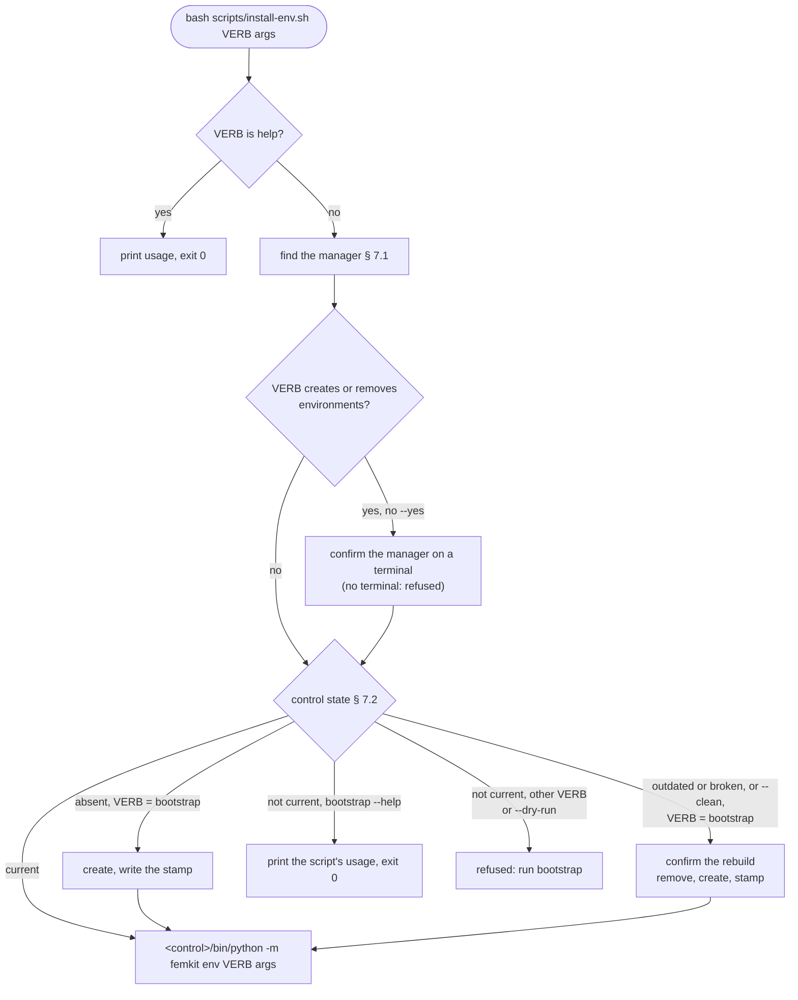

| state | `bootstrap` | `bootstrap --clean` | any other verb |
|---|---|---|---|
| `absent` | create, then forward | create, then forward | refused: run `bootstrap` |
| `broken` | remove, create, then forward | remove, create, then forward | refused: run `bootstrap` |
| `outdated` | remove, create, then forward | remove, create, then forward | refused: run `bootstrap` |
| `current` | forward | remove, create, then forward | forward |

`--clean` is forwarded too, so `bootstrap --clean` also rebuilds every default
environment (`env bootstrap --clean`; a `-cuda`
environment is rebuilt only by its own `env install NAME --clean`). No repair
the script or `doctor` prints carries it. Only a line that repeats the person's
own command carries their `--clean`: after a failed control rebuild (never with
`--yes`), and where there is no terminal to confirm on (with `--yes`, which is
the consent the question would have asked for).

- **Create** is the conda kind's `create` — `<manager> create -y -p <prefix>
  --override-channels --no-default-packages`, `-c <channel>` for each line of
  `channels.txt`, then `--file control.txt` — and then the stamp; **remove** is `<manager> env remove -y -p <prefix>` — the conda kind's
  declared forms (a basic test holds the two together); the field tests run
  them on each kind.
- **Forward** is `<control prefix>/bin/python -m femkit env <the arguments>`,
  with the repository root on `PYTHONPATH` and `FEMKIT_ENV_MANAGER` set:
  femkit runs from its checkout and is never installed into an environment.
  It never goes through `<manager> run`: some managers' `run` writes a shell stub that dies on `exec: --: invalid
  option`, a cluster's mamba module among them, and `run` stands between
  Python and the terminal it asks on (§ 6.2). femkit is pure Python and needs
  no activation to run. `bootstrap` is forwarded as `env bootstrap`, which
  sets up the rest (§ 6.2).
- Before a verb that creates or removes environments (`bootstrap`, `install`,
  `clean`) the manager is confirmed on a terminal; a rebuild of the control
  environment asks once more, and prints the command that recreates it should
  the create after the removal fail. `--yes` answers both in advance; without
  a terminal and without `--yes`, the script refuses. Other verbs ask nothing.
- `--help` and `--dry-run` never create or remove. On a control environment
  that is not `current`, `bootstrap --help` prints the script's own usage and
  exits 0 — femkit's help needs the control environment — while another verb's
  `--help`, and `--dry-run`, are refused,
  because making it would be the install that was not asked for. On a
  `current` one both are forwarded, a `--clean` with them included.
- Exit codes follow [`api.md`](api.md) § 4.3.

## 8. Where each part lives in the code

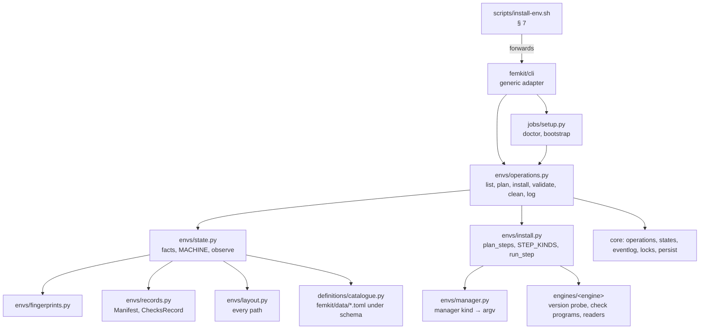

| part | module |
|---|---|
| control state, actions, forwarding (§ 7) | `scripts/install-env.sh` |
| facts, observation rules, action table (§ 3) | `femkit/envs/state.py` |
| fingerprints (§ 2) | `femkit/envs/fingerprints.py` |
| install steps, resume, validate after `manifest` (§ 4.1, § 4.2) | `femkit/envs/install.py`, `femkit/envs/operations.py` |
| records (§ 4.3) | `femkit/envs/records.py`, `femkit/envs/layout.py` |
| `validate` and the check runner (§ 5) | `femkit/envs/checks.py`, `femkit/envs/operations.py`; check programs and readers in `femkit/engines/<engine>/` |
| `env list`, `plan`, `install`, `clean`, `log` (§ 6) | `femkit/envs/operations.py` |
| the toolchain step's program and judgement (§ 4.5) | `femkit/engines/toolchain.py` (runs inside the prefix, measures), `femkit/envs/toolchain.py` (judges) |
| the allow-list every command in a prefix starts from (§ 4.4) | `femkit/envs/manager.py` (`CONFINED`, `confined`) |
| `doctor`, `env bootstrap` (§ 6.1, § 6.2) | `femkit/jobs/setup.py`: both read or write this machine's record, which sits in `jobs`, above `envs` ([`framework.md`](framework.md) § 1) |
| a prefix's activation lines (§ 6.2) | `femkit/envs/manager.py`, from the manager kind's `activate` |
