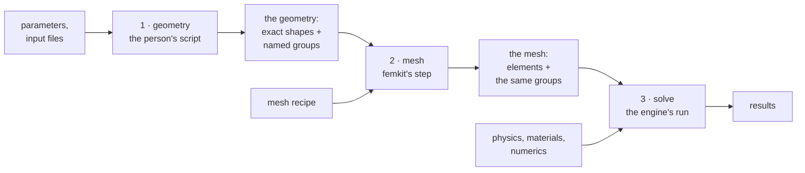

# Geometry contract — the script and its contract, and the step from geometry to mesh

**Role:** contract
**Status:** current, approved by the person (plan § 6); nothing in it is
built yet (plan § 3, R). How a step is run — its run folder,
its run script, its monitoring — is designed with execution (plan § 3, X)
**Authority:** what a component is; the geometry script and the contract that
wraps it; the pipeline from geometry to mesh to solve, and the contract of each
step; mesh recipes; the kinds of geometry pieces and their coverage; how each
engine receives its mesh. Where these files sit is
[`projects.md`](projects.md) § 2; the material assignment is
[`materials.md`](materials.md) § 5; what a physics states on a group is
[`models.md`](models.md) § 3. The reasons are
[ADR 0012](../decisions/0012-one-mesh-path.md) and
[ADR 0013](../decisions/0013-geometry-scripts.md).

## The short version

| rule | § |
|---|---|
| Geometry is the person's: a full, working Python script with Gmsh, written as they like | 2 |
| A **contract** wraps the script: the inputs it needs, checked before it runs; the outputs it promises, checked after | 3 |
| Downstream parts name only the **groups the contract promises**, so a pairing is checked before anything runs | 3 |
| Three steps — **geometry, mesh, solve** — each wrapped by a contract, the output of one the declared input of the next | 4 |
| The **mesh** is femkit's step: the geometry and a **mesh recipe** in, a mesh with the same named groups out | 5, 6 |
| A group's **kind** — body, outer boundary, interface — is observed once the geometry exists | 7 |
| **One mesh path**: Gmsh, in the mesh step's environment; how each engine receives the mesh is declared as data | 8 |
| **Importing** a CAD file is a script whose input is the file: the same contract | 9 |



## 1. A component

A component is one geometry: its script, `components/<c>/geometry.py`, and its
contract, `components/<c>/component.toml`, which also holds the component's
material assignment ([`materials.md`](materials.md) § 5). A project may hold
several — a sharp-tipped bowtie, a rounded one, a 2-D cross-section — and a
physics, a mesh recipe or an observable set serves any component that promises
the groups it names ([`projects.md`](projects.md) § 3).

## 2. The script

The script is the person's: a full, working Python script using Gmsh, written
as they like, importing what they like. femkit never generates, parses or
rewrites it. It builds the shapes, names the groups the rest of the project
needs — in Gmsh's terms, physical groups — and writes the geometry. It does not
mesh: meshing is the next step (§ 5).

- **Its inputs** — the values of the parameters its contract declares — reach
  it as its run hands them over, designed with execution (plan § 3, X). A
  script that hard-codes every size reads none.
- **Templates and examples.** A new component starts from one of a few example
  scripts with their contracts — a rectangle, a box, layered slabs — shipped
  with femkit, each run by a test so none goes stale. One guide explains the
  script, its contract and the pipeline.
  Geometry is the person's work; femkit gives a start and the rules, nothing
  more.

## 3. The script's contract — `component.toml`

```toml
schema = 1
script = "geometry.py"

[frame]
unit = "nm"                           # the unit the script works in; every bare coordinate in it
# symmetry = { axis = "y" }           # for an axisymmetric 2-D physics: the axis of revolution

[inputs.parameters]                   # project parameters the script reads, and the quantity each must be
gap        = "length"
arm_length = "length"

[inputs.files]                        # files the script reads, each with its SHA-256
# "tip_profile.csv" = { sha256 = "…" }

[outputs]
geometry = "geometry.<format>"        # the format: chosen by measurement (§ 10)

[outputs.groups]                      # the named groups it promises, and the dimension of each
gold_left  = { dimension = 3 }        # a body
gold_right = { dimension = 3 }
gap        = { dimension = 3 }
water      = { dimension = 3 }
outer      = { dimension = 2 }        # faces
tips       = { dimension = 0 }        # points: where the mesh must be fine
```

- **Before the script runs**: every declared parameter exists in the project
  and is the quantity declared — a gap is a length; every declared file is
  there and matches its SHA-256. Otherwise the step is refused, naming what is
  missing.
- **After it runs**: the promised geometry file exists; every promised group is
  in it, with its dimension, and is not empty. A group the script makes but
  does not promise is reported, and never used downstream.
- **Downstream reads only the contract.** A physics, a mesh recipe, an
  observable set and the material assignment may name only promised groups, so
  a study's pairing is checked from the contracts before anything runs
  ([`projects.md`](projects.md) § 3). What only the built geometry can tell —
  whether `outer` is an outer boundary or lies between two bodies — is checked once it exists (§ 7); until then the part is `unchecked`
  ([`projects.md`](projects.md) § 8).
- **What a script reads beyond its declared files is not enforced**: a script
  can open any file the account can; femkit runs it with only its declared
  files beside it, and records their hashes.

## 4. The pipeline

Every result comes from three steps, each wrapped by a contract — its inputs
checked before it starts, its outputs after it ends — the output of one the
declared input of the next:

| step | does | its inputs | its outputs | whose |
|---|---|---|---|---|
| 1 · geometry | builds the exact shapes and names the groups | the parameters and files its contract declares | the geometry file and its promised groups | the person's script |
| 2 · mesh | cuts the geometry into elements | the geometry; a mesh recipe | the mesh, with the same groups, and its region map | femkit's (§ 5) |
| 3 · solve | solves the case on the mesh | the mesh; the physics, the materials' data, the numerics | the run's results | the engine's ([`models.md`](models.md) § 9) |

- **A step runs again only when its inputs change**: a gap sweep makes one
  geometry and one mesh per gap; a mesh-convergence ladder one geometry and a
  mesh per rung; a wavelength sweep one geometry and one mesh, shared by every
  wavelength.
- **How a step runs** — its run folder, its run script inside the step's
  environment, its monitoring, where its outputs land — is designed with
  execution (plan § 3, X), so nothing runs outside a run folder. Not built yet.
- **Room to grow, by the same contract**: step 1 may be a standard script
  (importing, § 9); step 2 may later be a script of the person's that keeps the
  mesh step's contract.

## 5. The mesh step

femkit's own step, in the mesh step's environment — an environment holding
Gmsh with its Python interface, proposed as `gmsh`, decided with execution
(plan § 3, X): it reads the geometry and the study's mesh recipe, meshes, and writes the mesh with every promised group as a
named group of it, and its region map — each group's name, its elements, its
measure in the mesh against its measure in the geometry. A group missing from
the mesh, or measured unlike the geometry beyond the recipe's tolerance,
refuses the mesh, naming the group. A mesh depends on the geometry and the
recipe alone: no observable, no environment and no physics changes it.

## 6. Mesh recipes — `mesh/<recipe>.toml`

A recipe states the mesh's size over the whole geometry and on named groups,
how fast elements grow away from a group, the quality limits, the points the
mesh must contain — promised point groups, or points given with their units —
and the **geometry order** — how closely elements follow a
curved surface: 1 flat, 2 bent to the curve. The geometry order lives here
alone, since it changes the mesh itself. A recipe's numbers may be values of
its own, which a study's axes vary — a convergence ladder over its sizes or its
order. A recipe names groups only, so it serves every component that promises
them.

## 7. Kinds and coverage

Once a geometry exists, each group's **kind** is observed from it, by a table
declared as data (`femkit/data/geometry/kinds.toml`): its dimension against the
geometry's, and how many bodies it touches.

| kind | its dimension | bodies it touches |
|---|---|---|
| body | the geometry's | — |
| outer boundary | one less | one, on the outside |
| interface | one less | two |
| embedded | one less | one, inside it |
| edge | one, in 3-D | — |
| point | zero | — |

Coverage is checked per piece of the geometry, by the owner of each statement:
every body has exactly one material ([`materials.md`](materials.md) § 5), and
every outer face exactly one condition of each physics
([`models.md`](models.md) § 3). Groups may overlap; two statements reaching one
piece may not, and the refusal names the piece.

## 8. The hand-over to each engine

Every mesh is made by Gmsh, in the mesh step's environment
([ADR 0012](../decisions/0012-one-mesh-path.md); § 5). How each engine receives it is
declared as data, in `femkit/data/meshers/gmsh.toml`: the format written, the
format each engine reads, the conversion step, and what each keeps — group
names, the geometry order. Elmer receives MSH 2.2 through ElmerGrid; NGSolve
receives the mesh through femkit's own layer, which builds NGSolve's mesh with
every group's name, so NGSolve never handles a file format. Measured on the
`ngsolve` environment's build: NGSolve's own reader of a two-body Gmsh mesh kept
both bodies' elements and only the first body's name. Which geometry orders each route keeps
is not measured, nor whether femkit's layer can give NGSolve curved
second-order elements; a geometry order a route does not keep is a match line
([`models.md`](models.md) § 6.2). Not built yet (plan § 3, X).

Absorbing layers — layer domains an engine such as NGSolve needs to truncate an
open domain, and the other does not — are open, the person's (plan § 6): made
by the mesh step per environment from the open boundary, or promised by the
geometry and used only by the environment that needs them.

## 9. Importing a CAD file

Importing is a step-1 script whose declared input is the file:

```toml
script = "import_step.py"             # femkit's standard import script, copied in as a start
[inputs.files]
"bowtie.step" = { sha256 = "…" }
[outputs]
geometry = "geometry.<format>"
[outputs.groups]
gold_left = { dimension = 3 }         # a body the file names "gold_left"
outer     = { dimension = 2 }         # faces the script picks out
```

The standard import script reads the file, takes the bodies' names from it, and
leaves a marked place for the person to pick out the faces the file does not
name. Measured (Gmsh's version not recorded): Gmsh
reads the names of a STEP file's solids; whether
FreeCAD writes them is not measured. Not built yet (plan § 3, X).

## 10. The geometry's file format

Step 1 writes a file that keeps both the exact shapes and the group names, so
step 2 meshes the true curves and keeps the names. Which of Gmsh's formats does
both is chosen by measurement with the execution design: measured (Gmsh's
version not recorded), a Gmsh script saving to STEP lost the names (plan § 3, X).
