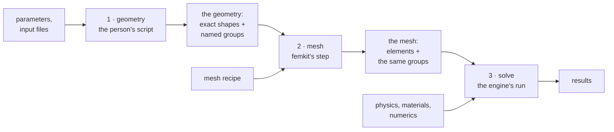

# Geometry contract — the script and its contract, and the step from geometry to mesh

**Role:** contract
**Status:** current, approved by the person
([ADR 0012](../decisions/0012-one-mesh-path.md),
[ADR 0013](../decisions/0013-geometry-scripts.md)). Built in
`femkit/geometry/`: the contract's schema and its check (§ 3),
the templates' scripts written to the hand-over (§ 2), the recipe's schema and
its check (§ 6), and the places of § 7 as data, read before the geometry
exists. Not built: running a script, the pipeline and the mesh step
(§§ 2, 4, 5), the places observed once the geometry exists and the coverage
(§ 7), the hand-over to each engine (§ 8), importing (§ 9) and the
geometry's file format (§ 10) (plan § 4, X); how a step is run — its run
folder, its run script, its monitoring — is designed with execution
**Authority:** what a component is; the geometry script and the contract that
wraps it; the pipeline from geometry to mesh to solve, and the contract of each
step; mesh recipes; the kinds of geometry pieces and their coverage; how each
engine receives its mesh. Where these files sit is
[`projects.md`](projects.md) § 2; the material assignment is
[`materials.md`](materials.md) § 5; what a physics states on a group is
[`models.md`](models.md) § 3. The reasons are
[ADR 0012](../decisions/0012-one-mesh-path.md) and
[ADR 0013](../decisions/0013-geometry-scripts.md).

## The short version

| rule | § |
|---|---|
| Geometry is the person's: a full, working Python script with Gmsh, written as they like; femkit hands it its inputs as one JSON file and names the file it writes | 2 |
| A **contract** wraps the script: the inputs it needs, checked before it runs; the outputs it promises, checked after | 3 |
| Downstream parts name only the **groups the contract promises**, so a pairing is checked before anything runs | 3 |
| Three steps — **geometry, mesh, solve** — each wrapped by a contract, the output of one the declared input of the next | 4 |
| The **mesh** is femkit's step: the geometry and a **mesh recipe** in, a mesh with the same named groups out | 5, 6 |
| A group's **kind** is one of six places — body, outer boundary, interface, embedded, edge, point — declared once, and observed once the geometry exists | 7 |
| **One mesh path**: Gmsh, in the mesh step's environment; how each engine receives the mesh is declared as data | 8 |
| **Importing** a CAD file is a script whose input is the file: the same contract | 9 |



## 1. A component

A component is one geometry: its script, `components/<c>/geometry.py`, and its
contract, `components/<c>/component.toml`, which also holds the component's
material assignment ([`materials.md`](materials.md) § 5). A project may hold
several — a sharp-tipped bowtie, a rounded one, a 2-D cross-section — and a
physics, a mesh recipe or an observable set serves any component that promises
the groups it names ([`projects.md`](projects.md) § 3).

## 2. The script

The script is the person's: a full, working Python script using Gmsh, written
as they like, importing what they like. femkit never generates, parses or
rewrites it. It builds the shapes, names the groups the rest of the project
needs — in Gmsh's terms, physical groups — and writes the geometry. It does not
mesh: meshing is the next step (§ 5).

- **Its name is fixed**: `components/<c>/geometry.py`, beside its contract
  ([`projects.md`](projects.md) § 2), so no file names it.
- **The hand-over.** femkit runs the script as
  `python geometry.py INPUTS OUTPUT`, with the files its contract declares
  beside it at their paths from the component's folder (§ 3). `INPUTS` is one
  JSON file, `{"schema": 1, "parameters": {"gap": 1.5, …}}`: the value of each
  parameter the contract declares, as a JSON number — a length in the frame's
  unit, an angle in degrees, a number as itself — the nearest double to the
  case's exact value. `OUTPUT` is the path of the file the script writes, with
  `gmsh.write(OUTPUT)`; its extension, and so the format, is femkit's choice
  (§ 10), never the script's. A script that hard-codes every size declares no
  parameter and finds `parameters` empty. A person can run it by hand the same
  way, with an `INPUTS` file of their own. femkit's templates are written to
  this hand-over; running a script is the geometry step's, not built yet
  (plan § 4, X).
- **Where a script starts.** A new component starts from one in femkit's
  project templates ([`projects.md`](projects.md) § 7) — the Laplace square's
  rectangle, the two-material slab's layers — each run by a test once the
  geometry step exists (plan § 4, X), so none goes stale. One guide explains
  the script, its contract and the pipeline. Geometry is the person's work;
  femkit gives a start and the rules, nothing more.

## 3. The script's contract — `component.toml`

```toml
schema = 1                            # the shape this file is written in (models.md § 2)

[frame]
dimension = 3                         # 2, drawn in the x-y plane, or 3
unit = "nm"                           # every number the script writes, and every length handed to it

# [frame.symmetry]                    # for an axisymmetric 2-D physics:
# axis = "y"                          # the axis of revolution, `x` or `y`

[inputs.parameters]                   # project parameters the script reads, and what each must be
gap        = "length"
arm_length = "length"
# opening  = "angle"

[inputs.files]                        # files beside the script that it reads, by their path from this folder
# "tip_profile.csv" = "…"             # with its SHA-256

[groups]                              # the named groups it promises, each with its dimension
gold_left  = 3                        # a body
gold_right = 3
gap        = 3
water      = 3
outer      = 2                        # faces
tips       = 0                        # points: where the mesh must be fine
```

Whole contracts, each key with its help, are the templates' components
([`projects.md`](projects.md) § 7).

- **The frame** is the script's space. Its `dimension` — 2, drawn in the x-y
  plane, or 3 — is the geometry's: the kinds of § 7 and a physics' meaning
  ([`models.md`](models.md) § 3) depend on it. Its `unit` is the unit of every
  number the script writes and of every length handed to it. Its origin is
  where the script's coordinates are zero: every point a physics or an
  observable set gives — a source's phase reference, a probe — is measured
  from the origin of the component a study pairs it with, its lengths
  converted to the frame's unit. Its `symmetry`, for a 2-D geometry a physics
  treats as axisymmetric — whose `meaning` for 2-D is `axisymmetric`
  ([`models.md`](models.md) § 3) — names the axis of revolution, `x` or `y`,
  in the drawing's plane, the drawing lying on one side of it. A study pairing
  such a physics with a frame that states none is a finding at the frame's
  `symmetry` ([`models.md`](models.md) § 5.1); an axis in a frame that is not
  2-D is a finding; that the drawing lies on one side of its axis is checked
  once the geometry exists. The dimensions a frame may have are one list,
  `FRAMES` in `definitions/places.py`, which the frame's schema and the kinds
  of place (§ 7) read.
  Only the script's own numbers are bare; every coordinate written anywhere
  else in a project is a length with its unit ([`models.md`](models.md) § 3).
- **Inputs.** `[inputs.parameters]` names each project parameter the script
  reads and what it must be: `length`, `angle` or `number`, each handed over
  as § 2 says. `[inputs.files]` names each file the script reads by its path
  from the component's folder — steps of letters, digits, `.`, `_` and `-`,
  none starting with `.` or `-`, none `..` — with its SHA-256; the door forms
  the path ([`projects.md`](projects.md) § 6), and a file whose digest differs
  is a finding whose right value is the digest it has now.
- **Groups.** `[groups]` names each group the script promises with its
  dimension: the frame's for a body, one less for a face, 1 for an edge in
  3-D, 0 for a point.
- **Before the script runs**: every declared parameter exists in the project
  and is what it is declared to be — a gap is a length; every declared file is
  there and matches its SHA-256. Otherwise the step is refused, naming what is
  missing.
- **After it runs**: the file femkit named exists; every promised group is in
  it, with its dimension, and is not empty. A group the script makes but does
  not promise is reported, and never used downstream.
- **Downstream reads only the contract.** A physics, a mesh recipe, an
  observable set and the material assignment may name only promised groups, so
  a study's pairing is checked from the contracts before anything runs
  ([`projects.md`](projects.md) § 3). What only the built geometry can tell —
  whether `outer` is an outer boundary or lies between two bodies — is checked once it exists (§ 7); until then the part is `unchecked`
  ([`projects.md`](projects.md) § 8).
- **What a script reads beyond its declared files is not enforced**: a script
  can open any file the account can; femkit runs it with only its declared
  files beside it, and records their hashes.

## 4. The pipeline

Every result comes from three steps, each wrapped by a contract — its inputs
checked before it starts, its outputs after it ends — the output of one the
declared input of the next:

| step | does | its inputs | its outputs | whose |
|---|---|---|---|---|
| 1 · geometry | builds the exact shapes and names the groups | the parameters and files its contract declares | the geometry file and its promised groups | the person's script |
| 2 · mesh | cuts the geometry into elements | the geometry; a mesh recipe | the mesh, with the same groups, and its region map | femkit's (§ 5) |
| 3 · solve | solves the case on the mesh | the mesh; the physics, the materials' data, the numerics | the run's results | the engine's ([`models.md`](models.md) § 9) |

- **A step runs again only when its inputs change**: a gap sweep makes one
  geometry and one mesh per gap; a mesh-convergence ladder one geometry and a
  mesh per rung; a wavelength sweep one geometry and one mesh, shared by every
  wavelength.
- **How a step runs** — its run folder, its run script inside the step's
  environment, its monitoring, where its outputs land — is designed with
  execution (plan § 4, X), so nothing runs outside a run folder. Not built yet.
- **Room to grow, by the same contract**: step 1 may be a standard script
  (importing, § 9); step 2 may later be a script of the person's that keeps the
  mesh step's contract.

## 5. The mesh step

femkit's own step, in the mesh step's environment — an environment holding
Gmsh with its Python interface, proposed as `gmsh`, decided with execution
(plan § 4, X): it reads the geometry and the study's mesh recipe, meshes, and writes the mesh with every promised group as a
named group of it, and its region map — each group's name, its elements, its
measure in the mesh against its measure in the geometry. A group missing from
the mesh, or measured unlike the geometry beyond the recipe's tolerance,
refuses the mesh, naming the group. A mesh depends on the geometry and the
recipe alone: no observable, no environment and no physics changes it.

## 6. Mesh recipes — `mesh/<recipe>.toml`

A recipe states the mesh's size over the whole geometry and on named groups,
how fast elements grow away from a group, the worst element it accepts, how
closely the mesh keeps each group's measure (§ 5), and the **geometry order** —
how closely elements follow a curved surface. The geometry order lives here
alone, since it changes the mesh itself. A recipe names groups only, so it
serves every component that promises them; a point the mesh must contain is a
point group the script promises (§ 3), given a size in `sizes` — a recipe adds
no geometry of its own.

| key | holds |
|---|---|
| `schema` | the shape the file is written in ([`models.md`](models.md) § 2) |
| `size` | the largest element size anywhere: a length |
| `order` | the geometry order: `1`, straight-sided elements; `2`, elements bent to follow a curved surface |
| `tolerance` | how far each group's measure in the mesh may differ from its measure in the geometry, relative: a plain number |
| `sizes` | a finer size on and near named groups: a length for each promised group it names |
| `growth` | how fast the size grows away from a group of `sizes`: the size added per unit of distance, a plain number above 0; required with `sizes` |
| `quality` | the smallest quality an element may have, by Gmsh's signed inverse condition number (SICN), at most 1; unset, only an inverted element, below 0, is refused |

```toml
schema = 1
size = "20 nm"                 # the largest element anywhere
order = 2                      # the metal's surfaces are curved
tolerance = 1e-3
growth = 0.3                   # 1 nm away from a group, elements 0.3 nm larger
quality = 0.2

[sizes]
gap = "0.5 nm"
tips = "0.2 nm"
gold_left = "2 nm"
gold_right = "2 nm"
```

- **A recipe's values are what an axis varies**: a study names one by its
  address ([`projects.md`](projects.md) § 5) — `mesh:fine:size`,
  `mesh:fine:sizes.gap`, `mesh:fine:order` — for a convergence ladder
  ([`models.md`](models.md) § 5.1). Its numbers are its own, or expressions of
  the project's parameters (`"gap / 4"`).
- **In Gmsh's terms**, the mesh step reads `size` as the largest element size,
  each of `sizes` as a size field that starts at the group and grows at
  `growth` until it reaches `size`, and `order` as the element order; its code
  is designed with the mesh step (plan § 4, X).
- Built: the recipe's schema and its check (`femkit/geometry/recipe.py`). Not
  built yet: the mesh step (plan § 4, X).

## 7. Kinds and coverage

Once a geometry exists, each group's **kind** — the place it is — is observed
from it: its dimension against the geometry's, and how many bodies it touches.

| place | its name | its dimension | bodies it touches |
|---|---|---|---|
| body | `body` | the geometry's | — |
| outer boundary | `outer_boundary` | one less | one, on the outside |
| interface | `interface` | one less | two |
| embedded | `embedded` | one less | one, inside it |
| edge | `edge` | one, in 3-D | — |
| point | `point` | zero | — |

- **One vocabulary of places.** These six are declared as data, in
  `femkit/data/geometry/kinds.toml` — each place's name, its sentence, its
  dimension and the bodies it touches — and are the only names of a place: a
  formulation's `on` ([`models.md`](models.md) § 4.3) and a schema field's
  `ref` ([`core.md`](core.md) § 2) read them — `on = ["outer_boundary"]`,
  `group:outer_boundary|group:interface`. Its dimension is stated for each
  geometry the place exists in, keyed by the geometry's — an edge's only for
  3 — and a face's bodies with its side, `outside` or `inside`, for one body;
  what a group of a promised dimension may be, before the geometry exists, is
  read from them (`definitions/places.py`, `possible`). A formulation's `on`
  is checked against them when it loads; a schema's `ref` names them, and
  nothing checks those names against the list yet.
- **Before the geometry exists**, a group's place is known as far as its
  promised dimension tells: one of the frame's dimension is a body; one of one
  less is an outer boundary, an interface or an embedded face. So a material
  assigned to a face is a finding on the component at once, and a condition
  on a body as soon as a study pairs the physics with it; whether a face is
  outer or between two bodies is checked once the geometry exists, and is
  `unchecked` until then ([`projects.md`](projects.md) § 8) — one note on the
  study that pairs them, naming every such group and the place it must be, in
  plain words ([`models.md`](models.md) § 5.1).

Coverage is checked per piece of the geometry, by the owner of each statement:
every body has exactly one material ([`materials.md`](materials.md) § 5), and
every outer face exactly one condition of each physics
([`models.md`](models.md) § 3). Groups may overlap; two statements reaching one
piece may not, and the refusal names the piece.

## 8. The hand-over to each engine

Every mesh is made by Gmsh, in the mesh step's environment
([ADR 0012](../decisions/0012-one-mesh-path.md); § 5). How each engine receives it is
declared as data, in `femkit/data/meshers/gmsh.toml`: the format written, the
format each engine reads, the conversion step, and what each keeps — group
names, the geometry order. Elmer receives MSH 2.2 through ElmerGrid; NGSolve
receives the mesh through femkit's own layer, which builds NGSolve's mesh with
every group's name, so NGSolve never handles a file format. Measured on the
`ngsolve` environment's build: NGSolve's own reader of a two-body Gmsh mesh kept
both bodies' elements and only the first body's name. Which geometry orders each route keeps
is not measured, nor whether femkit's layer can give NGSolve curved
second-order elements; a geometry order a route does not keep is a match line
([`models.md`](models.md) § 6.2). Not built yet (plan § 4, X).

Absorbing layers — layer domains an engine such as NGSolve needs to truncate
an open domain, and the other does not — are open, the person's (plan § 4,
M9): made by the mesh step per environment from the open boundary, or
promised by the geometry and used only by the environment that needs them.

## 9. Importing a CAD file

Importing is a step-1 script whose declared input is the file: femkit's
standard import script, copied in as the component's `geometry.py`, with a
contract such as

```toml
[inputs.files]
"bowtie.step" = "…"                   # its SHA-256

[groups]
gold_left = 3                         # a body the file names "gold_left"
outer     = 2                         # faces the script picks out
```

The standard import script reads the file, takes the bodies' names from it, and
leaves a marked place for the person to pick out the faces the file does not
name. Measured (Gmsh's version not recorded): Gmsh
reads the names of a STEP file's solids; whether
FreeCAD writes them is not measured. Not built yet; the plan places it after
X (plan § 4, X).

## 10. The geometry's file format

Step 1 writes a file that keeps both the exact shapes and the group names, so
step 2 meshes the true curves and keeps the names. Which of Gmsh's formats does
both is chosen by measurement with the execution design: measured (Gmsh's
version not recorded), a Gmsh script saving to STEP lost the names (plan § 4, X).
