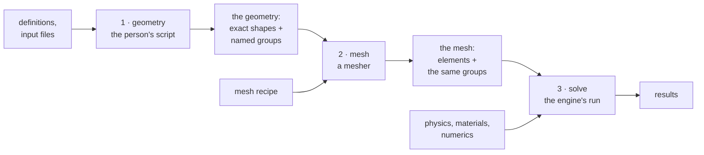

# Geometry contract — the script and its contract, the mesh recipes, the six places and the hand-over

**Role:** contract
**Status:** current, approved by the person
([ADR 0012](../decisions/0012-one-mesh-path.md),
[ADR 0013](../decisions/0013-geometry-scripts.md),
[ADR 0016](../decisions/0016-every-step-runs-from-a-run-folder.md),
[ADR 0017](../decisions/0017-netgen-curves-ngsolve-geometry.md),
[ADR 0018](../decisions/0018-one-graph-from-description-to-execution.md)).
Built in `femkit/geometry/`: the contract's schema and its check (§ 3), the
templates' scripts written to the hand-over (§ 2), the recipe's schema and
its check (§ 6), the places of § 7 as data, read before the geometry exists,
and read from a built geometry's `groups.json`; in `femkit/engines/`: the
geometry stage's check, Gmsh's meshing, the mesh's check and their documents
(§§ 3–7), the script's mesh and its pass-through (§ 3), and the hand-overs of
§ 8, as data, but Netgen's; the recipe's `mesher` and its second shape
(§ 6). Being built (plan § 4, X): `project check` reading a built geometry
(§ 7), Netgen's mesher and hand-over (§ 8). Not built:
importing (§ 9)
**Authority:** what a component is; the geometry script and the contract that
wraps it; the mesh's check; mesh recipes; the kinds of geometry pieces and
their coverage; how each engine receives its mesh. How the stages are
declared, chained and run is [`workflow.md`](workflow.md) and
[`jobs.md`](jobs.md); where these files sit, [`projects.md`](projects.md)
§ 2; the material assignment, [`materials.md`](materials.md) § 5; what a
physics states on a group, [`models.md`](models.md) § 3. The reasons are
[ADR 0012](../decisions/0012-one-mesh-path.md) and
[ADR 0013](../decisions/0013-geometry-scripts.md).

## The short version

| rule | § |
|---|---|
| Geometry is the person's: a full, working Python script with Gmsh, written as they like; femkit hands it its inputs as one JSON file and names the file it writes | 2 |
| A **contract** wraps the script: the inputs it needs, checked before it runs; the outputs it promises, checked after — a mesh among them when the script meshes too | 3 |
| Downstream parts name only the **groups the contract promises**, so a pairing is checked before anything runs | 3 |
| The geometry, the mesh and the solve are a case's **stages**, each a tool's program wrapped by a contract ([`workflow.md`](workflow.md)) | 4 |
| Every mesh passes **one check**, whichever mesher made it: every group named and measured like the geometry | 5 |
| A **mesh recipe** states its **mesher** — never the study — and what the mesher honours: sizes, order, quality | 6 |
| A group's **kind** is one of six places — body, outer boundary, interface, embedded, edge, point — declared once, and observed once the geometry exists | 7 |
| A mesh reaches its engine by a **hand-over**, declared as data, keyed by the mesh's type and the engine | 8 |
| **Importing** a CAD file is a script whose input is the file: the same contract | 9 |



## 1. A component

A component is one geometry: its script, `components/<c>/geometry.py`, and its
contract, `components/<c>/component.toml`, which also holds the component's
material assignment ([`materials.md`](materials.md) § 5). A project may hold
several — a sharp-tipped bowtie, a rounded one, a 2-D cross-section — and a
physics or a mesh recipe serves any component that promises the groups it
names ([`projects.md`](projects.md) § 3).

## 2. The script

The script is the person's: a full, working Python script using Gmsh, written
as they like, importing what they like. femkit never generates, parses or
rewrites it. It builds the shapes, names the groups the rest of the project
needs — in Gmsh's terms, physical groups — and writes the geometry. Meshing
is the next stage, a mesher's ([`workflow.md`](workflow.md) § 2.3) — unless
the script meshes too, a mesh a recipe cannot state, which its contract then
declares (§ 3) and the pass-through takes on unchanged.

- **Its name is fixed**: `components/<c>/geometry.py`, beside its contract
  ([`projects.md`](projects.md) § 2), so no file names it.
- **The hand-over.** femkit runs the script as
  `python geometry.py INPUTS OUTPUT [MESH]`, in its geometry stage's run in
  the `gmsh` environment ([`workflow.md`](workflow.md) § 2.1), with the files its contract declares beside it at their
  paths from the component's folder (§ 3). `INPUTS` is one
  JSON file, `{"schema": 2, "definitions": {"gap": 1.5, …}}`: the value of each
  definition the contract declares, as a JSON number — a length in the frame's
  unit, an angle in degrees, a number as itself — the nearest double to the
  case's exact value. `OUTPUT` is the path of the file the script writes, with
  `gmsh.write(OUTPUT)`: `geometry.xao` — its extension, and so the format, is
  femkit's choice (§ 10), never the script's. `MESH`, given only when the
  contract declares a mesh, is the path of the mesh it writes,
  `gmsh.write(MESH)`: `mesh.msh`, Gmsh's MSH 2.2 as text — the script sets
  `Mesh.MshFileVersion` to 2.2 and `Mesh.Binary` to 0 first. A script that hard-codes every size declares no
  definition and finds `definitions` empty. A person can run it by hand the same
  way, with an `INPUTS` file of their own. femkit's templates are written to
  this hand-over.
- **What a script may import** is what the `gmsh` environment holds — Gmsh
  with its Python module, NumPy — as its definition lists it
  (`femkit/data/environments/gmsh.toml`). A script importing anything else
  stops with Python's own message, in its run's log; the package is added to
  the definition, never installed into the environment by hand or with pip
  ([`definitions.md`](definitions.md) § 4.1).
- **Where a script starts.** A new component starts from one in femkit's
  project templates ([`projects.md`](projects.md) § 7) — the Laplace square's
  rectangle, the two-material slab's layers — each run by a test, so none
  goes stale. A geometry chapter of the manual, with worked examples each run
  by a test — naming faces again after a split, a finer size near a point, a
  structured layer by extrusion, a transfinite block, a rounded tip, a STEP
  file imported with its bodies' names — is not written yet (plan § 4, X);
  until it is, the manual's chapter 3 shows the script and its contract.
  Geometry is the person's work; femkit gives a start and the rules, nothing
  more.

## 3. The script's contract — `component.toml`

```toml
schema = 1                            # the shape this file is written in (models.md § 2)

[frame]
dimension = 3                         # 2, drawn in the x-y plane, or 3
unit = "nm"                           # every number the script writes, and every length handed to it

# [frame.symmetry]                    # for an axisymmetric 2-D physics:
# axis = "y"                          # the axis of revolution, `x` or `y`

[inputs.definitions]                  # the project's definitions the script reads, and what each must be
gap        = "length"
arm_length = "length"
# opening  = "angle"

[inputs.files]                        # files beside the script that it reads, by their path from this folder
# "tip_profile.csv" = "…"             # with its SHA-256

# [outputs]                           # only for a script that meshes too:
# mesh = { order = 2 }                # it writes MESH, at this geometry order; its recipe names the `given` mesher

[groups]                              # the named groups it promises, each with its dimension
gold_left  = 3                        # a body
gold_right = 3
gap        = 3
water      = 3
outer      = 2                        # faces
tips       = 0                        # points: where the mesh must be fine
```

Whole contracts, each key with its help, are the templates' components
([`projects.md`](projects.md) § 7).

- **The frame** is the script's space. Its `dimension` — 2, drawn in the x-y
  plane, or 3 — is the geometry's: the kinds of § 7 and a physics' meaning
  ([`models.md`](models.md) § 3) depend on it. Its `unit` is the unit of every
  number the script writes and of every length handed to it. Its origin is
  where the script's coordinates are zero: every point a physics gives — a
  source's phase reference — is measured
  from the origin of the component a study pairs it with, its lengths
  converted to the frame's unit. Its `symmetry`, for a 2-D geometry a physics
  treats as axisymmetric — whose `meaning` for 2-D is `axisymmetric`
  ([`models.md`](models.md) § 3) — names the axis of revolution, `x` or `y`,
  in the drawing's plane, the drawing lying on one side of it. A study pairing
  such a physics with a frame that states none is a finding at the frame's
  `symmetry` ([`models.md`](models.md) § 5.1); an axis in a frame that is not
  2-D is a finding; that the drawing lies on one side of its axis is checked
  once the geometry exists, by the geometry stage's check (below). The
  dimensions a frame may have are one list,
  `FRAMES` in `definitions/places.py`, which the frame's schema and the kinds
  of place (§ 7) read.
  Only the script's own numbers are bare; every coordinate written anywhere
  else in a project is a length with its unit ([`models.md`](models.md) § 3).
- **The inputs are definitions** ([ADR 0021](../decisions/0021-definitions.md)),
  computed ones included, taken from the case, which records each value it
  got, and the script keeps receiving each in the frame's unit, never in SI:
  the drawing's tolerances are lengths in its own unit.
- **Inputs.** `[inputs.definitions]` names each project definition the script
  reads and what it must be: `length`, `angle` or `number`, each handed over
  as § 2 says. `[inputs.files]` names each file the script reads by its path
  from the component's folder — steps of letters, digits, `.`, `_` and `-`,
  none starting with `.` or `-`, none `..` — with its SHA-256; the door forms
  the path ([`projects.md`](projects.md) § 6), and a file whose digest differs
  is a finding whose right value is the digest it has now.
- **Groups.** `[groups]` names each group the script promises with its
  dimension: the frame's for a body, one less for a face, 1 for an edge in
  3-D, 0 for a point.
- **A mesh.** `[outputs] mesh = { order = N }` says the script meshes too and
  writes `MESH` at geometry order `N`, 1 or 2 as a recipe's (§ 6), every
  promised group a named group of it; after the script runs, the check finds
  each promised group in it. The mesh stage then passes it through unchanged
  under the mesh's check (§ 5) when the study's mesh recipe names the `given`
  mesher (§ 6), and its declared order chooses the hand-over
  ([`workflow.md`](workflow.md) § 2.3).
- **Before the script runs**: every declared definition exists in the project
  and is what it is declared to be — a gap is a length; every declared file is
  there and matches its SHA-256. Otherwise the stage is refused, naming what is
  missing.
- **After it runs**: the file femkit named exists; every promised group is in
  it, with its dimension, and is not empty; it holds nothing of a dimension
  above its frame's — a 2-D frame's script draws no volume, which no physics
  of the frame would mean; and, for a frame with an axis of revolution, the
  drawing lies on one side of the axis, touching it at most — read from
  Gmsh's bounding box of the whole drawing, which lies 1e-7 of the frame's
  unit beyond the drawing on every side (measured 2026-11-25 on Gmsh 4.15.2:
  a unit square's edge at x = 0 reads from x = −1e-7), so a drawing crossing
  its axis by less than that reads as touching it. A group the script makes
  but does not promise is reported, and never used downstream.
- **Downstream reads only the contract.** A physics, a mesh recipe, an
  observables part and the material assignment may name only promised groups, so
  a study's pairing is checked from the contracts before anything runs
  ([`projects.md`](projects.md) § 3). What only the built geometry can tell —
  whether `outer` is an outer boundary or lies between two bodies — is checked once it exists (§ 7); until then the part is `unchecked`
  ([`projects.md`](projects.md) § 8).
- **What a script reads beyond its declared files is not enforced**: a script
  can open any file the account can; femkit runs it with only its declared
  files beside it, and records their hashes.

## 4. The stages

The geometry, the mesh and the solve are a case's **stages**, each a tool's
program wrapped by a contract: the geometry stage's is this contract's § 3,
the mesh stage's the mesh's check (§ 5) with its mesher's definition. How the
stages are declared, named, chained, written as calculation folders, put in jobs and shown is
[`workflow.md`](workflow.md); how each runs, [`jobs.md`](jobs.md).

## 5. The mesh's check

Every mesh stage leaves its mesh with every promised group as a named group
of it, and the region map, `regions.json` — each group's name, its dimension,
its elements, its measure in the mesh against its measure in the geometry, and
the worst element's quality, in one shape for every mesher. The check, one
program for every mesher (`femkit/engines/stages/`), reads the region map and
the recipe, and refuses the mesh, naming the group, for a group missing from
it or empty, or measured unlike the geometry beyond the recipe's tolerance;
and for an element below the recipe's `quality`, or inverted when it states
none. What a recipe's value may be is the recipe's check's (§ 6), before
anything runs.

- **A measure is integrated over each element's own shape** — its Jacobian at
  Gauss points — never read from a mesher's per-element size: measured
  2026-11-25, Gmsh 4.15.2's element `volume` reads a second-order edge as
  straight (a unit circle's length off by 1.6e-3, relative, at orders 1 and
  2), while the disk it bounds, meshed at order 2, has its area within 3.1e-6
  of π, relative (6.4e-3 at order 1).
- A mesh depends on the geometry, the recipe and its mesher alone: no
  observable and no physics changes it.

## 6. Mesh recipes — `mesh/<recipe>.toml`

A recipe states the **mesher** that makes the mesh, the mesh's size over the
whole geometry and on named groups, how fast elements grow away from a
group, the worst element it accepts, how closely the mesh keeps each group's
measure (§ 5), and the **geometry order** — how closely elements follow a
curved surface. The geometry order lives here alone, since it changes the
mesh itself. A recipe names groups only, so it serves every component that
promises them; a point the mesh must contain is a point group the script
promises (§ 3), given a size in `sizes` — a recipe adds no geometry of its
own.

**The mesher is the recipe's**, never a study's: the mesh stage runs in the
environment that provides it ([`workflow.md`](workflow.md) §§ 2, 2.3), and
it names no engine. A study pairs a recipe with its component and names no
engine; when an engine is chosen to solve it, `study prep --engine`, femkit
checks before anything runs that the engine takes what the recipe's mesher
writes, through a hand-over at the recipe's order (§ 8), and an engine that
cannot take it refuses that prep, its error at the study's `mesh`;
`project check` shows the engines that can, as a fact
([`models.md`](models.md) § 5.1). Every engine solves from the one mesh the
recipe makes; at a geometry order above 1 NGSolve takes Netgen's mesh alone,
which Elmer cannot take today, and whether a hand-over gives Elmer Netgen's
mesh is not measured (plan § 4, M6, M9).

| key | holds |
|---|---|
| `schema` | the shape the file is written in, `2` ([`models.md`](models.md) § 2) |
| `mesher` | the mesher that makes the mesh, by name — one `femkit/data/meshers/` declares: `gmsh`, Gmsh's; `netgen`, Netgen's, for NGSolve above geometry order 1; `given`, the pass-through of a mesh the component's script writes ([`workflow.md`](workflow.md) § 2.3) |
| `size` | the largest element size anywhere: a length above 0 |
| `order` | the geometry order: `1`, straight-sided elements; `2`, elements bent to follow a curved surface |
| `tolerance` | how far each group's measure in the mesh may differ from its measure in the geometry, relative: a plain number, 0 or above |
| `sizes` | a finer size on and near named groups: a length above 0 for each promised group it names |
| `growth` | how fast the size grows away from a group of `sizes`: the size added per unit of distance, a plain number above 0; required with `sizes` |
| `quality` | the smallest quality an element may have, by Gmsh's signed inverse condition number (SICN), at most 1; unset, only an inverted element, below 0, is refused |

```toml
schema = 2
mesher = "gmsh"                # Gmsh meshes it, in the gmsh environment
size = {value = 20, unit = "nm"}   # the largest element anywhere
order = 2                      # the metal's surfaces are curved
tolerance = 1e-3
growth = 0.3                   # 1 nm away from a group, elements 0.3 nm larger
quality = 0.2

[sizes]
gap = {value = 0.5, unit = "nm"}
tips = {value = 0.2, unit = "nm"}
gold_left = {value = 2, unit = "nm"}
gold_right = {value = 2, unit = "nm"}
```

- **A recipe's values are what an axis varies**: a study names one by its
  address ([`projects.md`](projects.md) § 5) — `mesh:fine:size`,
  `mesh:fine:sizes.gap`, `mesh:fine:order` — for a convergence ladder
  ([`models.md`](models.md) § 5.1). Each is in the one quantity form
  ([`core.md`](core.md) § 11): `{value, unit}`, or a definition's name — a
  value computed from others a function in `definitions.py`
  ([ADR 0021](../decisions/0021-definitions.md)).
- **In Gmsh's terms**, Gmsh's meshing reads `size` as the largest element size
  (`Mesh.MeshSizeMax`), with no size taken from points, curvature or the
  boundary, so the recipe alone sets it; each of `sizes` as a size field that
  starts at the group — its distance from a point, an edge or a face group, or
  a constant size inside a body group — and grows at `growth` until it reaches
  `size`, the smallest of them applying where they meet; `order` as the
  element order, a second-order mesh bent onto the geometry's true surfaces;
  and `quality` against each element's signed inverse condition number.
- **Every rule a recipe's values follow is the recipe's check's**
  (`femkit/geometry/recipe.py`), found by `project check` at the key — and at
  an axis's value that varies it ([`models.md`](models.md) § 5.1) — before
  anything runs; the mesh stage checks only the shape of the document femkit
  hands it (§ 5).

## 7. Kinds and coverage

Once a geometry exists, each group's **kind** — the place it is — is observed
from it: its dimension against the geometry's, and how many bodies it touches.
The geometry stage's check writes what it observed into `groups.json`: each
promised group's pieces with their dimensions, each face's bodies on either
side, and the bodies a face is embedded in — what it saw, never which place
that makes. femkit reads the place from them by the vocabulary below
(`femkit/geometry/steps.py`, `places_of`), so the rule that tells an outer
boundary from an interface has one home, the data. Measured 2026-11-25 on Gmsh
4.15.2's adjacencies: the two-material slab's `middle` touches both its bodies
(an interface), the square's sides one (outer boundaries), and a segment cut
into a square touches none and is listed as embedded in it.

| place | its name | its dimension | bodies it touches |
|---|---|---|---|
| body | `body` | the geometry's | — |
| outer boundary | `outer_boundary` | one less | one, on the outside |
| interface | `interface` | one less | two |
| embedded | `embedded` | one less | one, inside it |
| edge | `edge` | one, in 3-D | — |
| point | `point` | zero | — |

- **One vocabulary of places.** These six are declared as data, in
  `femkit/data/geometry/kinds.toml` — each place's name, its sentence, its
  dimension and the bodies it touches — and are the only names of a place: a
  formulation's `on` ([`models.md`](models.md) § 4.3) and a schema field's
  `ref` ([`core.md`](core.md) § 2) read them — `on = ["outer_boundary"]`,
  `group:outer_boundary|group:interface`. Its dimension is stated for each
  geometry the place exists in, keyed by the geometry's — an edge's only for
  3 — and a face's bodies with its side, `outside` or `inside`, for one body;
  what a group of a promised dimension may be, before the geometry exists, is
  read from them (`definitions/places.py`, `possible`). A formulation's `on`
  is checked against them when it loads; a schema's `ref` names them, and
  nothing checks those names against the list yet.
- **Before the geometry exists**, a group's place is known as far as its
  promised dimension tells: one of the frame's dimension is a body; one of one
  less is an outer boundary, an interface or an embedded face. So a material
  assigned to a face is a finding on the component at once, and a condition
  on a body as soon as a study pairs the physics with it; whether a face is
  outer or between two bodies is checked once the geometry exists, and is
  `unchecked` until then ([`projects.md`](projects.md) § 8) — one note on the
  study that pairs them, naming every such group and the place it must be, in
  plain words ([`models.md`](models.md) § 5.1), and `study prep`, which writes
  the job that builds it.
- **Once the geometry exists** — a study's case has a finished geometry run —
  `project check` reads that run's `groups.json`: a group whose place is not
  one a statement on it allows is a finding at that statement, naming the
  place it is and the one it must be, in plain words, and the note goes for
  that study. A study's cases of different geometries are each read. Not
  built yet (plan § 4, X): `project check` reading the runs.

Coverage is checked per piece of the geometry, by the owner of each statement:
every body has exactly one material ([`materials.md`](materials.md) § 5), and
every outer face exactly one condition of each physics
([`models.md`](models.md) § 3). Groups may overlap; two statements reaching one
piece may not, and the refusal names the piece.

## 8. The hand-over to each engine

A mesh reaches its engine by a **hand-over**, keyed by the artifact type of
the mesh it reads and the engine it hands to
([`workflow.md`](workflow.md) § 2.2), each declared once,
`femkit/data/handovers/<name>.toml`: the geometry orders it hands over, the places whose groups it
hands by name, its conversion in words, and its program, that program's
arguments and what it leaves. Which mesher makes the mesh it reads is the
mesh recipe's (§ 6); a recipe whose mesher writes what no hand-over gives
the engine chosen at the recipe's order refuses that engine's prep, its
error at the study's `mesh` ([`models.md`](models.md) § 5.1), and with the
match report a match line ([`models.md`](models.md) § 6.2).

A hand-over gives its engine the promised groups each of whose places, as
far as the group's dimension tells (§ 7), is one it names
(`femkit/geometry/steps.py`, `handed`), written as the `handover` document; its
program, run inside the engine's own job before the solve, reads the mesh and
that document, builds or converts the engine's mesh from the handed groups
alone, and finds each one's name in it, failing, naming each that is not
there. A statement on a group a hand-over does not hand — an edge or a point, in
Elmer — is a match line, `unsupported`, shown before anything runs
([`models.md`](models.md) § 6.2; built with M5). Placing the hand-over in a
prepared case's job is [`models.md`](models.md) § 9 (plan § 4, M6).

| hand-over | reads | engine | orders | hands | how |
|---|---|---|---|---|---|
| `elmergrid` | `mesh/msh-2.2` | Elmer | 1, 2 | bodies and faces | ElmerGrid, `ElmerGrid 14 2`, given the mesh with those groups alone; its folder named without a dot |
| `layer` | `mesh/msh-2.2` | NGSolve | 1 | every place | femkit's own layer, NGSolve's mesh built element by element, every group by its name |
| `netgen` | `mesh/netgen-vol` | NGSolve | 2 | every place | Netgen's own mesh, loaded by the solve, which reads the shapes again and curves it — decided, not built (plan § 4, X) |

- **Elmer.** Measured 2026-11-25, ElmerGrid of Elmer 26.2 on Gmsh 4.15.2's
  MSH 2.2: every body's and face's name kept, in 2-D and 3-D; second order
  kept — six-node triangles, three-node edges and ten-node tetrahedra — which
  Elmer reads as curved; the output folder's name cut at its first dot
  (`-out a.b` writes `a`); and the name of a point group dropped, while in
  3-D an edge or a point group makes ElmerGrid read the mesh as 2-D and drop
  every body's and face's name. So the hand-over gives ElmerGrid the bodies and
  faces alone, the mesh stage's mesh keeping every promised group for the
  other hand-overs: two unit cubes with an edge and a point group reach Elmer with
  both bodies, the face between them and their outer faces named.
- **NGSolve, at order 1.** femkit's layer builds NGSolve's mesh from the
  mesh, so NGSolve never handles a file format. Measured 2026-11-25 on
  NGSolve 6.2.2606: every group's name kept, in 2-D and 3-D, and every
  region's measure the mesh's to 1e-14. Its declared limits, each shown:
  - first-order elements alone, since from Gmsh's second-order nodes the mesh
    it builds is not curved — the unit disk's area off by 2.0e-3, relative,
    against 3.1e-6 in Gmsh — and `Mesh.Curve` on it ends the process: there
    is no geometry behind it;
  - two handed groups sharing a piece are refused, naming them, though groups
    may overlap (§ 7): NGSolve gives each element one name. Lifting it — each
    element named by its piece, a group the union of its pieces' regions — is
    the input writer's (plan § 4, M6).
- **NGSolve, above order 1: Netgen's mesher and hand-over**
  ([ADR 0017](../decisions/0017-netgen-curves-ngsolve-geometry.md)). Netgen
  meshes the geometry's shapes, by a recipe stating `mesher = "netgen"`, in
  a mesh stage of its own in the `ngsolve` environment, and writes `mesh.vol`; the solve loads it,
  reads the same shapes again and curves the mesh to the recipe's order from
  the true geometry. Measured 2026-11-25 on NGSolve and Netgen 6.2.2606 with
  OpenCASCADE 7.9.3: a unit disk meshed so in one process, then curved in
  another that read its shapes again, has the area of one meshed and curved in
  a single process — relative errors 6.8e-3, 1.1e-5 and 3.0e-6 at orders 1, 2
  and 3, order 3 beyond what a recipe asks today (§ 6); Netgen reads STEP, BREP and IGES, not `.xao`, and Gmsh's BREP and
  STEP keep no group names — so the geometry stage also writes its shapes as
  BREP, and each group is carried onto Netgen's shapes from `groups.json` by
  its pieces' centre and measure, never by their order: measured 2026-11-25
  (Gmsh 4.15.2 writing the BREP, Netgen 6.2.2606 with OpenCASCADE 7.9.3 reading
  it), Netgen lists a piece shared by several others once for each — the face
  between two bodies twice, 14 faces for Gmsh's 12 — so no position matches,
  while every one of Gmsh's pieces matched exactly one of Netgen's distinct
  pieces by centre and measure within 1e-9, in every dimension: the
  two-material slab (2 faces, 7 edges, 6 points) and two boxes fragmented with
  a sphere (3 bodies, 12 faces, 23 edges, 14 points). A piece that matches none,
  or more than one, is refused, naming it. With it, the two engines solve
  different meshes of one geometry. Not built yet (plan § 4,
  X); until it is, geometry order 2 in NGSolve is a match line,
  `unsupported`.

Absorbing layers — layer domains an engine such as NGSolve needs to truncate
an open domain, and the other does not — are open, the person's (plan § 4,
M9): made by the mesh stage from the open boundary for the engine that needs
them, or promised by the geometry and used only when that engine solves.

## 9. Importing a CAD file

Importing is a geometry script whose declared input is the file: femkit's
standard import script, copied in as the component's `geometry.py`, with a
contract such as

```toml
[inputs.files]
"bowtie.step" = "…"                   # its SHA-256

[groups]
gold_left = 3                         # a body the file names "gold_left"
outer     = 2                         # faces the script picks out
```

The standard import script reads the file, takes the bodies' names from it, and
leaves a marked place for the person to pick out the faces the file does not
name. Measured (Gmsh's version not recorded): Gmsh
reads the names of a STEP file's solids; whether
FreeCAD writes them is not measured. Not built yet; the plan places it after
X (plan § 4, X).

## 10. The geometry's file format

The geometry stage writes a file that keeps both the exact shapes and the
group names, so a mesher meshes the true curves and keeps the names: **`geometry.xao`**, the
OpenCASCADE shapes with their groups. Measured 2026-11-25 on Gmsh 4.15.2, the
Laplace square written to it and opened again: every group and the exact
shapes (lines, a plane) kept. Why no other format is
[ADR 0016](../decisions/0016-every-step-runs-from-a-run-folder.md)'s.
