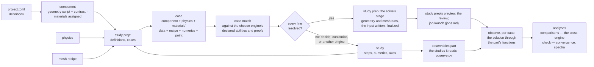
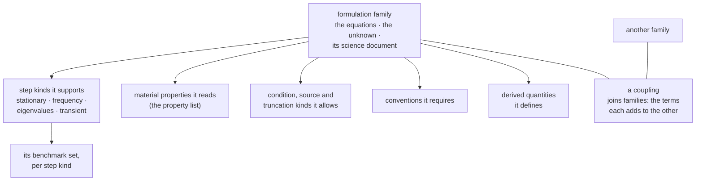

# Models — one calculation, described once, solved in a chosen environment

**Role:** contract
**Status:** current. Built in `femkit/models/`: the part kinds
this contract owns — the project file and its definitions, physics,
studies and observables parts — each with its schema and its check,
registered at femkit's start; each study's pairing read from the contracts
(§§ 3, 5); a study naming no engine, its `[solve]` and `[meshing]`, and the
engines that can solve it, the engine chosen by `study prep --engine`
(§ 5.1); the observables part, its rank and its wire (§§ 5.2, 11.2); the
second shapes
of a study, a mesh recipe and an observables part (§ 2); a project's
packages (§ 2); axes by address and their crossing; named steps and what
one takes from another (§ 4.5); `case.json`, its exact form and its ID,
prep's cases step (§ 5.3); `project check`, `project graph`, `study list`
(§ 11), and the rules `case list` reads, that command the `workflow`
domain's ([`workflow.md`](workflow.md) § 7); the formulation type with
`electrostatics` and its benchmark, the template `two_material` (§ 4.3);
the units ([`core.md`](core.md) § 11); the mesher definition type
(`definitions/meshers.py`); the one runner of the person's Python, its
check and the one store, `femkit/engines/person/` (§ 3), with `model_prep`
and `postprocess` installed by default (§§ 3, 5.2). Their fields are
documented by [`../reference/parts.md`](../reference/parts.md) and
[`../reference/cases.md`](../reference/cases.md). Not built: the observe
stage (M6), analyses (M9); the rest is the plan's § 4, M5, M6, M8, M9
**Authority:** how a calculation is described independently of any engine — its
definitions, its physics, its studies, its observables and analyses; how a study's
cases are made; how a case is matched against the declared abilities of the
engine chosen to solve it, with every limitation shown; how abilities are proven; how
a person decides on each limitation and adds their own steps; how a case is
prepared and handed to a job; how a case's observables are computed after its
solve, and how results are analysed. A
project's tree, its parts and the one door are [`projects.md`](projects.md)'s;
the geometry, its contract and its meshes [`geometry.md`](geometry.md)'s; materials
[`materials.md`](materials.md)'s. The reasons are
[ADR 0008](../decisions/0008-one-model-declared-abilities.md) and ADRs
[0011](../decisions/0011-project-structure.md)–[0014](../decisions/0014-materials.md)
and [0025](../decisions/0025-one-engine-per-study-observables-after.md)

## The short version

| rule | § |
|---|---|
| A person describes **physics** — definitions, a formulation, conditions and sources on named groups — never solver input; a **study** asks the questions and names no engine: the engine that solves it is chosen when it is solved, `study prep --engine`, and one engine solves a run; every other step runs in an environment of its own | 3, 5 |
| A project's parts, their files and the one door through which they are read and written are [`projects.md`](projects.md); the geometry and its meshes [`geometry.md`](geometry.md); materials [`materials.md`](materials.md) | 2 |
| The physics a project may state is a closed list of **formulations**, solver-neutral, each with its benchmark set | 4 |
| Physics solved together, or in turn, are steps of one study, solved by one engine; physics in **different engines are different studies**, one feeding another — not built until after M9 | 4.5 |
| An **observables part** reads studies after they solve — any whose components promise the groups it takes: each observable a typed value, as a definition is — what it takes, its type and unit — computed by the person's function in `observe.py`, in femkit's `postprocess` environment; **analyses** compare and report across cases, studies and engines, the cross-engine check — two engines' solves of one study — among them | 5.2, 10 |
| A **case** is the component, the physics, the materials' data, the mesh recipe, the numerics and one axis point — nothing about an engine or an observable, so every engine solves the same cases; each study's cases are its own, never shared with another's; its ID is the hash of its content, canonical and unit-exact | 5.3 |
| Each **engine environment declares its abilities** as data; matching a case gives a **match report**: for each element, how exactly the chosen engine's input writer expresses it and whether that is proven | 6 |
| An ability counts only once **proven** in that environment by benchmark runs, recorded beside the environment and keyed to everything it rests on | 6.3 |
| Nothing is approximated silently: an approximation or an unproven ability needs a **decision**, an unsupported element a **customization** or another engine; both are stated under the engine's name in the study's `[solve]`, `[solve.<engine>]`, and go stale when what they answered changes | 7, 8 |
| **Meshes** are made by the mesher each mesh recipe names, run in the environment that provides it — Gmsh's in `gmsh`, Netgen's in `ngsolve` — and handed to the engine that solves by a hand-over declared as data; a recipe that engine cannot take refuses its prep at the study's `mesh` | 5.1, 6.5 |
| **The solve's stage**, which `study prep` writes, uses the case's geometry and mesh runs, has its engine's input writer write the input, applies the customizations and writes the job request; the **job's plan** is the review; a preparation is `blocked`, `orphaned`, `open`, `stale` or `prepared` | 9 |
| A case's observables are computed **after each engine's solve of it**, a stage of their own, by the person's script, handed one object, `case`: the finished solve run, its values, its groups as built, its study and engine; what the engine writes and what the script reads of it are theirs, femkit reading only a solve's log and status, and checking what each function returns; a solve depends on nothing observed; every result says how faithful it is; comparisons show fidelity, pair two engines' solves of one case, and refuse what does not solve the same stated problem | 10 |
| The project is also a **graph** derived from its parts, addressed in one grammar; a surface renders it, and writes a part only as the person typed it in the page's text editor | 11 |

## 1. The chain



A person writes the project's definitions, a component — its geometry script,
the groups it promises, which material fills each — physics, mesh recipes,
one or more studies, and the observables parts that read them. No file names
an engine: the engine that solves a study is chosen when it is solved,
`study prep <study> --engine <engine>`, and may be switched at any time.
`study prep` writes the study's cases. `case match` matches a case
against what the chosen engine declares, and has proven, it can do, and
lists every element of the case with its status. Until every line is
resolved — by a recorded decision, a customization, or another engine —
nothing is prepared. `study prep` then writes each case's solve stage: it uses the case's geometry and mesh runs, writes the input,
applies the customizations and writes the job request; the job's plan shows
the person what will run before it runs ([`jobs.md`](jobs.md)). After a case
is solved, each observables part that reads its study computes its
observables from the solution, a stage of its own, and analyses compare them.

## 2. The project

A project's tree — every folder and file, its writer, the door that reads it,
and whether it moves with the project — is [`projects.md`](projects.md) § 2.
What this contract adds:

- **One writer each.** `generated/` is evidence of what the engine's input
  writer wrote and is never edited; what a person wants changed is a customization (§ 8), applied into
  `final/`. A file whose hash differs from its manifest makes the preparation
  `stale` (§ 9.5), and the job refuses it ([`jobs.md`](jobs.md)).
- **Cases and preparations belong to their study.** Each study's cases are its
  own, in its own folder, `cases/<study>/<id>/case.json`; femkit never shares a
  case between studies. Every engine solves the same cases, from the study's
  geometries and meshes, in the study's run folders, `runs/<study>/`; each
  engine's solves, and what is observed of them, are its own, keyed by the
  engine ([`projects.md`](projects.md) § 2; [`workflow.md`](workflow.md)
  § 4; [`jobs.md`](jobs.md) § 1). Results are compared only by an analysis
  the person writes (§ 10.2).
- **Intent is never read back from input.** Prepared input is evidence, never
  the source of intent ([`../design.md`](../design.md), scientific data).
- **Every file carries its shape.** A JSON file femkit writes carries
  `schema`, an integer raised when its shape changes: `case.json`,
  `manifest.json`, a geometry's record, a mesh's manifest, the
  proof record (§ 6.3), the script's inputs ([`geometry.md`](geometry.md)
  § 2). Every part's file the person writes states it too, as its first key,
  `schema`, the number of its part kind's shape — `schema = 2` for a study,
  a mesh recipe and an observables part, `schema = 1` for every other kind.
  A file stating another number does not load: it is a finding naming the
  shape the file states, the shape femkit reads, and what changed between
  them, which each part schema declares for every shape after its first — a
  study's second shape: `[solve]` and `[meshing]` in place of
  `[environments.<e>]`, naming no engine, and no `observables` (§ 5.1); a
  mesh recipe's: its `mesher` ([`geometry.md`](geometry.md) § 6); an
  observables
  part's: a folder holding `observables.toml` and `observe.py`, each
  observable computed by its function (§ 5.2). An observables part written
  in its first shape, the file `observables/<o>.toml`, is told so by the
  door — an observables part is now a folder — never left a stray
  ([`projects.md`](projects.md) § 4). femkit never rewrites the file, and the
  person brings it to the new shape in their editor, the templates showing
  it whole.
- **The packages its scripts need travel with it.** The project file's
  `[postprocess]` table names, in `packages`, the conda packages its
  observables scripts import beyond what femkit's `postprocess`
  environment holds, each by its conda name, its module the same name, or
  as a table stating the name it is imported by where that differs —
  `packages = ["pint", { conda = "scikit-image", module = "skimage" }]` —
  so a project copied to another machine says what its scripts need and
  what they import. A package femkit's recipe declares or pins is held: an
  entry naming one is a finding at it, `package-held` — a warning for the bare
  name, which femkit already provides, an error with a version — and is never
  delivered, so no project changes what femkit's environment holds. Each
  machine installs them into its `postprocess`:
  `env install postprocess` installs femkit's set and every package any
  project under the projects root declares ([`envs.md`](envs.md) §§ 1–2);
  `observe.py`'s imports are checked against the environment's modules and
  its own project's packages before any solve (§ 5.2); an observe stage's
  identity holds femkit's set and its own project's packages alone, so
  another project's package never makes it anew
  ([`workflow.md`](workflow.md) § 4); a proof never rests on them (§ 6.3).
  No other environment takes a project's packages: a solver's, a geometry
  script's and `definitions.py`'s stay as femkit ships them.
- **A case is named by its content**, its ID (§ 5.3), within its study:
  `{value = 500, unit = "nm"}` and `{value = 0.5, unit = "µm"}` give the same ID, and renaming a group or a material
  changes the case and its ID — the old preparations become `orphaned` and keep
  their runs.
- **Benchmarks** (§ 4, § 6.3) are femkit's project templates
  ([`projects.md`](projects.md) § 7) that a formulation names, each holding its
  materials as its own so a proof never depends on a person's library;
  `formulation verify` copies them to
  `<data>/benchmarks/<formulation>/<benchmark>/` to prepare and run them
  there. What a benchmark's reference rests on is a definition of its
  template — the two-material slab's interface position is `interface` in its
  project file — so a test computes the reference from the template itself.

## 3. Definitions and physics

**Definitions** ([ADR 0021](../decisions/0021-definitions.md)): `project.toml`'s
`[definitions]` holds each shared value by its name — its address
`project:definitions.<name>` ([`projects.md`](projects.md) § 5) — as a table: `type`, the
number's type — `int`, `float` (a 64-bit double) or `complex`; `unit`, any
unit of femkit's table or a product of them — `"nm"`, `"F/m"`,
`"C^2/(N m^2)"` — or `"1"` for a dimensionless value, never left out, an
`int` taking `"1"` alone; and exactly one of `value`, a number of its type —
a complex as `[real, imaginary]` — or `function`, the name of the function in
the project's `definitions.py` that computes it ([`projects.md`](projects.md)
§ 2). A written value is read exactly; a computed one is recorded as its
function returned it:

```toml
[definitions.gap]
type = "float"
value = 10
unit = "nm"

[definitions.layers]
type = "int"
value = 4
unit = "1"

[definitions.source_amplitude]
type = "complex"
value = [1.0, 0.5]
unit = "V/m"

[definitions.half_gap]
type = "float"
function = "half_gap"
unit = "nm"
```

```python
import numpy as np
from scipy import constants
import project.definitions as defs          # femkit's: every definition, constant or computed


def half_gap():
    return defs.gap / 2
```

- **`project.definitions` is femkit's**, built in memory at each call, never a
  file of the project: every definition as a plain number of its type, in SI,
  an angle in degrees, as [`core.md`](core.md) § 11 converts it — the computed
  ones in the order their reads of `defs.<name>` give. A function takes no
  arguments, reads each definition as `defs.<name>`, and returns a plain
  number of its definition's type in SI; the person's code never converts a
  unit.
- **Checked before anything runs**, each a finding at the definition or the
  line: a definition with both or neither of `value` and `function`; a value
  not of its type — an `int` holds a whole number, a `float` may be written
  `10` and is a double; a unit outside the table; a `defs.<name>` naming no
  definition; a circle of definitions; a function the file lacks; an import of
  anything but `project.definitions`, `math`, `cmath` and the modules
  `model_prep`'s definition declares it provides — numpy, scipy, netCDF4
  ([`definitions.md`](definitions.md) § 4) — the one list of them; anything at the file's top
  level but imports and functions — the file read without running it by the
  one static reader of a file of the person's functions, told the signature
  each must have, here none ([`framework.md`](framework.md) § 5). **When it
  runs**, each at the file and the line: a result not a finite number of its
  declared type, an exception, a call past the time limit. Its dimension is
  the person's promise, written as its unit.
- **No physical quantity is written as text** in the parts or the materials —
  a recipe's size, a condition's value: `{value, unit}`, its number's type
  the field's own, or the name of a definition; only a typed value (next)
  carries `type`. A job's resources keep the scheduler's
  spellings ([`jobs.md`](jobs.md) § 2). No string is evaluated as Python.
- **One typed value**, a definition's and an observable's (§ 5.2) alike: its
  `type`, the type of its numbers, and its `unit`, as above — one number, or
  an array with named dimensions and coordinates, as an xarray DataArray
  holds it, over the case's own dimensions: a profile along a line, a map on
  a plane, which an observable declares with `dims` (§ 5.2). A spectrum is
  an analysis over a sweep's cases (§ 10.2), never a case's value. A
  function computing one returns a plain number of its type, or a DataArray
  of it, in SI — its coordinates too — and its declared unit states its
  dimension, the person's promise, and shows it
  ([ADR 0021](../decisions/0021-definitions.md) decision 4). One check holds
  what a function returns to its declaration — its type, its dimensions by
  name, a coordinate for each, every value finite — before anything is
  written; no check reads a value's dimension. Where a definition of an
  array may be cited — a geometry's inputs, a quantity field, an axis — is
  not settled (plan § 4, X); until then a definition is one number.
- **One store for every declared output femkit keeps** — a study's computed
  definitions, each case's observables (§ 10.1) and what each output
  translator gives ([`workflow.md`](workflow.md) § 2.4): netCDF, through one
  door ([`framework.md`](framework.md) § 5). One writer, through xarray,
  inside the environment that computed them; one reader in the control
  process, `persist.read_record` ([`core.md`](core.md) § 4), through
  netCDF4, which needs no xarray; any tool opens the file
  (`xarray.open_dataset`). Every call into the netCDF-C library in the
  control process, where the web server's threads read, holds one
  process-wide lock, `persist.NETCDF_LOCK`, as the person's earlier tool's
  does: it measured two threads inside the library at once crashing the
  process. The writer runs in a process of its own with one thread, and
  holds none. Its metadata is in the file, by the CF conventions —
  never a file beside it, so the numbers and their description cannot drift
  apart: each variable its `units`, the SI unit its values are in, its
  `declared_unit`, its description as `long_name` — the comment above its
  table, else its name — its declared type and its dimensions, each
  coordinate its `units`; and the file its `schema`, which the reader
  checks, and its provenance as global attributes — what it applies to: the
  study, and for a case's results the case, the engine, the environment and
  the run; and the SHA-256 of the script that computed it
  ([ADR 0025](../decisions/0025-one-engine-per-study-observables-after.md)
  decision 6). No time is written in it — the run's records hold the time
  ([`jobs.md`](jobs.md) § 4) — so the same result is the same bytes.
- **The functions run** in `model_prep`, an environment femkit declares
  holding numpy, scipy, the netCDF4 library and xarray, a default, through
  femkit's own program in it, `femkit/engines/person/definitions.py`, which
  builds `project.definitions` for each set of constants, calls the
  functions in their order, in one process for the file, holds each result
  by the one check of a typed value, and writes their values through the one
  store's writer, within the time limit its entry in `programs.toml`
  declares; an axis sweeps a constant, never a computed definition, and each
  case records the values it got — the one source of a case's values, a
  geometry script's included.
- **Where they run** — the second exception to § 8.4, beside the geometry
  script ([ADR 0022](../decisions/0022-one-prep-step.md)): in `project check`,
  which computes and validates them and writes nothing — a function that
  fails, a result not of its type, a call past the time limit each a finding
  at the definition's key, its file and line said; and in `study prep`'s
  definitions step, in its plan — its preview included — which keeps their
  values for its study. Never when a file is saved. A plan runs them once,
  cached in femkit's cache by what they rest on ([`api.md`](api.md) § 3).
  Every other reader — `study flow`, `case list`, `study list`, a save's
  impact — takes a computed value from the kept values where they are in
  sync; otherwise the stages that rest on it have no identity yet and are not
  drawn, and one finding, `not-kept`, says they wait for `study prep`
  ([`workflow.md`](workflow.md) § 3). `project check` computes the
  constants as written, one set; prep, every point of the study's sweep. A
  project with no computed definition keeps no file and needs no
  `model_prep`. Each case records the values it got as its resolved content
  (§ 5.3) — no field of its own. A finding about `definitions.py` is the
  project's, with the file and the line.
- **The kept values**, one file per study, `computed/<study>/definitions.nc`,
  of the one store (above), written whole by prep: along one dimension,
  `point`, an entry per distinct set of the constants the study's sweep
  gives — each constant a variable, each computed definition a variable of
  its declared type, a complex one by netCDF4's complex convention — every
  value in SI with its metadata; and, as the file's provenance, the study it
  is kept for, the SHA-256 of `definitions.py` — the script that computed
  it, said once — and of the `[definitions]` table, and the environment with
  its install fingerprint, which every reader compares before using it —
  a mismatch stale, never used silently; when prep wrote it is prep's own
  record's. The conversion of each value is
  [`core.md`](core.md) § 11's.

**A physics** is one file of the project, `physics/<p>.toml`. It states, on
named groups — never naming a component, so it serves every component whose
contract promises the groups it names ([`geometry.md`](geometry.md) § 3):

| part | holds | rule |
|---|---|---|
| `formulation` | one formulation family (§ 4) | the family supports the step kind each study asks of it |
| `meaning` | for each dimension of the components it serves, keyed by the dimension, what it means for the formulation (§ 4): in 2-D per unit depth or axisymmetric, TE or TM | chosen, never assumed: a study pairing it with a component of a dimension it does not state is a finding, so one physics serves a 3-D and a 2-D component by stating both |
| `conventions` | what the formulation requires chosen — for a frequency-domain problem, `phasor` (`"exp(-iwt)"` or `"exp(+iwt)"`: the sign s of [`electromagnetics.md`](../science/electromagnetics.md)) and `amplitude` (`"peak"` or `"rms"`) | never defaulted |
| `conditions` | keyed by the group: for every outer-boundary group, one condition of a kind the formulation allows; for an interface group that carries one, `interface` (continuity, stated) or a sheet condition the formulation allows — each its `kind` and the parameters its kind lists (`value`) | a natural condition on an outer boundary is stated, never implied; a kind stands only on the places its `on` names ([`geometry.md`](geometry.md) § 7) |
| `radiation` | for an open problem: the outer-boundary groups through which waves leave to infinity, and the material beyond them | how the domain is truncated there is each engine's choice, under its name in the study's `[solve]` (§ 5.1) |
| `sources` | each by its name: its `kind`, one the formulation allows; the group it is `on`; and every parameter the formulation lists for it — for a plane wave: total or scattered field, amplitude, polarization, direction, the background medium, the phase reference point | — |

Which material fills each body is the component's, never a physics'
([`materials.md`](materials.md) § 5): every physics a component is paired with
uses it.

- **Units.** Every dimensional value is written in the one quantity form
  ([`core.md`](core.md) § 11) — `{value = 1, unit = "nm"}`, or a definition's
  name; a value computed from others is a function in `definitions.py`. A
  physics and a mesh recipe serve any component, so a coordinate in them is a
  length with its unit, measured from the origin of the component a study
  pairs it with;
  only the geometry script's own numbers are bare, in its contract's unit
  ([`geometry.md`](geometry.md) § 3).
  Internally each quantity has a canonical unit — SI, and degrees for angles,
  so that a written angle stays exact — and is held as an exact rational
  (§ 5.3); each engine's input writer converts to what its engine reads. Conversion for display
  happens only at a surface, in the study's display units. Unknown keys are
  refused. The grammar, the unit table and the canonical units are
  [`core.md`](core.md) § 11.
- **Complex values follow the physics' convention**: a material's data is
  converted from its source's convention when prep makes a case
  ([`materials.md`](materials.md) § 6).
- `project check` applies every rule of this table and of the formulation, each
  study's pairing ([`projects.md`](projects.md) § 3), and, once the geometry
  exists, the kinds and coverage of [`geometry.md`](geometry.md) § 7; it
  changes no file — but a job's word, which any reader of a run writes once
  ([`jobs.md`](jobs.md) § 5.1).

The Laplace check is the template `laplace_square`
(`femkit/data/templates/laplace_square/`, [`projects.md`](projects.md) § 7):
a square of side `side`, its left side held at 0 V and its right side at
`bias`, its top and bottom insulating, filled with the project's own
`vacuum`. Its project file and its physics, in short:

```toml
# project.toml
schema = 1
description = "Laplace on a square: 0 V on the left, the bias on the right, insulated top and bottom"
components = ["square"]
studies = ["check"]

[definitions.side]
type = "float"
value = 1
unit = "m"

[definitions.bias]
type = "float"
value = 1
unit = "V"
```

```toml
# physics/electrostatics.toml
schema = 1
formulation = "electrostatics"
meaning = { 2 = "per unit depth" }          # what 2-D means for electrostatics (§ 4)

[conditions]
left  = { kind = "potential", value = { value = 0, unit = "V" } }
right = { kind = "potential", value = "bias" }
sides = { kind = "insulating" }
```

Its component's contract is [`geometry.md`](geometry.md) § 3's, with
`dimension = 2`, `unit = "m"`, `side` its one input, the groups `domain = 2`,
`left`, `right` and `sides` each `1`, and `[assign.domain]` naming
`material = "vacuum"`.

## 4. Formulations: families and step kinds

A formulation is one physical problem stated without reference to any engine.
It is cut in two, so the physics is written once whatever is asked of it:

- **a family** — the equations, their unknown, the properties they read, the
  conditions and sources they allow — declared as data, one file per family,
  `femkit/data/formulations/<family>.toml`, with its science document; a
  physics names its family (§ 3);
- **a step kind** — the kind of calculation: a static field, a field at one
  frequency, the structure's resonances, a field in time — declared as data in
  one list, `femkit/data/step_kinds.toml`; a study's step names a physics and a
  kind (§ 5.1), and the family must support that kind.

The person's decision: one physics file serves a frequency sweep and
an eigenvalue study of the same structure; a new kind of calculation is a new
step kind, never a copy of every physics file. Both lists are closed: what is
not declared is refused, naming what is.

### 4.1 The family tree



| family | the equations | unknown | step kinds | science document | state |
|---|---|---|---|---|---|
| `electrostatics` | −∇·(ε∇φ) = ρ | potential φ, in H¹, in V | `stationary` | [`electrostatics.md`](../science/electrostatics.md) | built, as `electrostatics` |
| `maxwell` | Maxwell's equations, time-harmonic | electric field **E**, in H(curl), in V/m | `frequency`; `eigenvalues` later | [`electromagnetics.md`](../science/electromagnetics.md) | not built (plan § 4, M9) |

A family is one physics. Several physics are joined by steps and couplings
(§ 4.5), never by a family of their own. Families to come are added to this
table as they are declared; none is named here before it is.

### 4.2 Step kinds — `femkit/data/step_kinds.toml`

| kind | the calculation | the variable it supplies | what it produces, for a later step | state |
|---|---|---|---|---|
| `stationary` | a field that does not change in time | none | the field | built, as electrostatics' one kind |
| `frequency` | a field oscillating at one frequency, the phasor of its convention | the frequency, or the vacuum wavelength, from a named definition | the field; absorbed power and the other derived quantities | not built (M9) |
| `eigenvalues` | the frequencies and fields the structure supports without a source | none; it finds them | each mode: its frequency and its field | not built; named for the tree |
| `transient` | a field in time | time | the field at each time | not built; named for the tree |

Each kind states, as data, in `femkit/data/step_kinds.toml`: its sentence;
the variables it supplies, which a material's data may vary with
([`materials.md`](materials.md) §§ 2, 6) — built, with `stationary`, which
supplies none; what it produces, which a later step of a study may take; and
what a family that supports it must add — a `frequency` family, its phasor and
amplitude conventions — each not declared yet (plan § 4, M9).

### 4.3 A family's declaration

Each family states:

- the unknown, its function space and unit — potential φ in H¹ (V), electric
  field **E** in H(curl) (V/m);
- the equation, with every symbol and unit defined near its first use, in its
  science document (`docs/science/`: `electrostatics.md` for `electrostatics`,
  [`electromagnetics.md`](../science/electromagnetics.md) for
  `maxwell`);
- what each dimension means for it — for `electrostatics` in 2-D, per unit
  depth or axisymmetric; for `maxwell` in 2-D, TE or TM — chosen in the
  physics, never assumed;
- the material properties it reads, by their names in the property list
  ([`materials.md`](materials.md) § 1), each needed real or allowed complex,
  the variable a dataset may vary with being the one its step kind supplies
  (§ 4.2), so a dataset that varies with what the step does not supply is
  refused ([`materials.md`](materials.md) § 6);
- the condition, source and truncation kinds it allows, each with its
  parameters and their units, and its `on`: the places it may stand on, by
  their names in the one vocabulary of places ([`geometry.md`](geometry.md)
  § 7) — `outer_boundary`, `interface`, `body`;
- the conventions a physics must choose;
- the derived quantities it defines — **E**, **D**, energy density, Poynting
  flux, absorbed power — each in its science document;
- its **benchmark set**, per step kind it supports (§ 6.3): problems with known answers — each a project
  holding its study, which each engine solves, stating under each engine's
  name what that engine chooses (a truncation, say), an observables part
  reading it, and its reference solution — chosen so that each
  ability they prove is one an error would show in. A solution an engine's
  input writer reproduces whatever it gets wrong proves nothing: φ = x on a square is
  reproduced exactly by linear elements and does not depend on ε. So a set
  holds manufactured, non-polynomial solutions with a measured convergence
  rate per element family, degree and geometry order — their sources and
  boundary values written in the expression language (plan § 4, M6) — a
  two-material case for interfaces and ε, and, for `maxwell` in the frequency
  kind, TE and
  TM cases in 2-D, a reflection benchmark for each truncation, and a lossy,
  open problem with a known answer — scattering by a lossy sphere against its
  series solution, its absorbed power positive — so that a wrong phasor sign or
  truncation shows.

Loading a formulation checks that each ability any environment declares for it
is exercised by at least one benchmark; one that is not could never be proven,
and is refused.

`electrostatics` in its keys, in part — the whole file is
`femkit/data/formulations/electrostatics.toml`, and every key is in
[`../reference/definitions.md`](../reference/definitions.md). Each property
(its sentence the property list's, with what the formulation adds), condition,
source and derived quantity carries the one plain sentence a person
reads beside it — a tooltip in the page, a hint in a finding, a line of the
reference — and the section of the science document that defines it; loading
refuses a section the document lacks. Abilities name its kinds from each
environment's definition (§ 6.1), and its benchmark set is a table of its own
here:

```toml
description = "the electrostatic potential: -div(eps grad phi) = rho"
kinds = ["stationary"]                           # the step kinds it supports (§ 4.2)
science = "docs/science/electrostatics.md"
unknown = { name = "potential", space = "H1", unit = "V" }
meanings = { 2 = ["per unit depth", "axisymmetric"], 3 = ["full"] }
conventions = []

[properties.relative_permittivity]               # a name of the property list (materials.md § 1)
note = "a real, positive number"                 # what this formulation adds to the list's sentence
section = "1-terms-and-symbols"
complex = false

[conditions.surface_charge]
description = "the boundary is the surface of a conductor carrying a free charge; femkit writes n . D = -sigma"
section = "3-conditions-on-an-outer-boundary"
on = ["outer_boundary"]                     # the places it may stand on (geometry.md § 7)
parameters.value = { unit = "C/m^2", description = "sigma, the free charge per unit area on the conductor's surface" }

[derived.electric_field]
description = "E = -grad phi"
section = "7-derived-quantities"
unit = "V/m"

[benchmarks.two_material]
description = "a layered capacitor: two materials in series between two held potentials, a named interface between them"
section = "91-two_material-a-layered-capacitor"
project = "two_material"
exercises = ["potential", "insulating", "interface", "relative_permittivity"]
tolerance = 1e-9

[benchmarks.two_material.reference]
potential_middle = { value = 0.8, unit = "V" }            # 4/5 V
energy_low = { value = 5.666680204032e-12, unit = "J/m" }
```

- **`constants`**: each physical constant the equation uses — `vacuum_permittivity`
  — given to every engine as stated there, never an engine's own value.
- **A benchmark** names one of femkit's project templates by its bare name
  (`project = "two_material"`, [`projects.md`](projects.md) § 7) — its project
  file, its component with its geometry script, its materials, its physics,
  its study, and the observables part that reads it — with the kinds and
  properties it exercises, a
  relative tolerance whose basis is in its section of the science document,
  and the exact value each observable of that part must reproduce.
  `schema check` loads each project and refuses one that `project check`
  faults where it can check without building its geometry, or a reference that
  names no observable of the part, or is in another dimension than the
  observable's unit; the coverage checks that need the geometry built run with the
  benchmark's proof (§ 6.3).

### 4.4 Extending the tree

- **A new family** is one data file, its science document, and a benchmark set
  for each step kind it supports; it changes no code that is not the engines'
  input writers for it.
- **A new step kind** is one entry in `step_kinds.toml`, each family that
  supports it adding what the kind asks for, and a benchmark set for each such
  family.
- **Names**: a family is named by its physics, lowercase (`electrostatics`,
  `maxwell`, `heat`); a step kind by its calculation (`stationary`,
  `frequency`). A name is declared once and never reused for another meaning.
- **An engine** declares its abilities per family and step kind (§ 6.1): an
  engine that solves `maxwell` at a frequency but not its eigenvalues says so,
  and a study asking an engine for what it does not declare is a match line
  in that engine.

### 4.5 Multiphysics: steps, couplings and studies

Several physics in one engine are solved in one of two ways, each declared as
data — in one study, whose steps one engine solves together (§ 5.1):

- **In turn.** A study's steps are named, each solving one physics, and a
  step takes from another what that step produced, by its name, as its kind
  declares it (§ 4.2) and its family declares it can accept, in its
  `takes_from`: the `thermal` step takes the `optics` step's absorbed power
  density from it as its heat source. A step runs after every step it takes
  from; the order the file writes them in means nothing, and steps that take
  nothing from each other may run in any order. (`takes` names what an
  observable or an output translator takes, alone.)

  ```toml
  [steps.optics]
  physics = "optics"                          # family maxwell
  kind = "frequency"

  [steps.thermal]
  physics = "thermal"                         # family heat
  kind = "stationary"
  takes_from = { heat_source = "optics.absorbed_power_density" }   # a step's name, then what its kind produces
  ```

  femkit checks each hand-off before anything runs: the step taken from
  exists, its kind produces the quantity, and its dimension is what the later
  family accepts. Steps that take from each other in a circle are refused
  unless the study repeats them (next sentence).
  Where the later result must feed back — the temperature changing the metal's
  permittivity — the study repeats its steps in turn until the change between
  two rounds is below the tolerance it states, and says how many rounds it
  allows — and, once repeated steps are built, the loop's method and its
  relaxation (plan § 4, after M9).
- **Together.** Physics whose equations must be solved in one system are
  joined in one step by **couplings**, each declared as data,
  `femkit/data/couplings/<coupling>.toml`: the families it joins, the terms it
  adds to each — Joule heating's heat source σ|**E**|² to the heat equation, and
  a conductivity that depends on the temperature back — the step kinds it holds
  for, and the section of the science document that states it.

  ```toml
  [steps.heating]
  physics = ["electric", "thermal"]           # two physics, on the same component's groups
  couplings = ["joule_heating"]
  kind = "stationary"
  ```

- **What stays one.** Every physics of a study lies on the same component, its
  groups and its one mesh, sized where each physics needs it — each physics
  on its own groups, so heat may reach into a substrate optics never sees; a
  material carries every property each physics reads, from the one property
  list ([`materials.md`](materials.md) § 1); a case holds every step, its
  physics and its couplings (§ 5.3).
- **A step on a mesh of its own** is not decided (plan § 4, after M9;
  [ADR 0019](../decisions/0019-section-order-block-states-axes-together.md)
  decision 4).
- **Engines** declare which couplings they support, as they declare families
  and step kinds (§ 6.1); a study asking for one the engine solving it lacks
  is a match line.
- **Across engines, studies.** Physics solved together — tightly coupled
  equations — are steps of one study, solved by one engine, on its one mesh;
  nothing couples two engines inside a study.
  Physics in different engines are different studies: a study taking a result
  of another study as an input, case by case, and studies feeding each other
  in a loop until they settle, stated where the studies are organized
  ([ADR 0025](../decisions/0025-one-engine-per-study-observables-after.md)
  decision 2). Not built (plan § 4, after M9): until then a study takes no
  other study's result.
- **Built**: named steps, and each hand-off checked — the step taken from is
  another of the study's, its formulation derives the quantity, and no steps
  take from each other in a circle. **Not built yet**: what a family accepts
  from another, couplings and repeated steps (plan § 4, after M9); the first
  multiphysics declared are electromagnetic heating — an optics step's
  absorbed power taken by a heat step, in turn — and Joule heating, a
  coupling of electric and thermal physics in one stationary step, each with
  its science document and benchmarks.

**Scope.** Symmetry planes and periodicity are conditions a family lists when
it allows them; until then a component is solved whole.

A problem no formulation states is still possible, as a customization of the
nearest one (§ 8); its results say so.

## 5. Studies, observables and cases

### 5.1 Studies

A project holds one or more studies, `studies/<study>.toml`. A study pairs a component with what is solved on it —
the physics of each step and a mesh recipe ([`projects.md`](projects.md)
§ 3) — and holds everything that is not the physics. It is the problem's
design, and names no engine: the engine that solves it is chosen when it is
solved, `study prep <study> --engine <engine>`
([`workflow.md`](workflow.md) § 7), and may be switched at any time — one
engine solves a run, every engine solves the same cases, and each engine's
solves are kept apart
([ADR 0025](../decisions/0025-one-engine-per-study-observables-after.md)
decision 1). It names no observables: an observables part names the studies
it reads (§ 5.2).

**Each step's environment is its own**, by the one rule of
[`workflow.md`](workflow.md) § 2: only the solve is bound to an engine — the
one chosen — so only the study's `[solve]` holds what is an engine's; its
definitions, geometries, meshes, translate stages and observables each run
in an environment of their own, whatever the engine.

| part | holds |
|---|---|
| `component` | the component it solves |
| `steps` | each step by its name: one physics, or several joined by couplings, and the kind of calculation (§ 4); a step taking what another produced runs after it, the file's order meaning nothing, repeated until it settles where the study says so (§ 4.5); every step solved by the one engine that solves the run; one step until several are built (plan § 4, M9): each step after the first is an error, `not-built`, at its key, which refuses prep |
| `mesh` | the mesh recipe it uses, whose `mesher` makes its meshes ([`geometry.md`](geometry.md) § 6), for every engine; which engines can take that mesh — a hand-over gives the engine what the recipe's mesher writes, at each geometry order of the study's cases — is a fact `project check` and `study list` show, never a finding of the file, which names no engine; prep with an engine that cannot take it is refused, the error at `mesh` ([`workflow.md`](workflow.md) § 2.2) |
| `numerics` | the element family and its degree (common fields, each mapped to the engine with a match status, § 6.4); the linear solver and its tolerance; the adaptivity block — error limit, smallest element, depth — when the mesh adapts |
| `axes` | what varies — a definition written as its value, a mesh recipe's value, a numerics field, a material assignment's dataset — each axis keyed by the address of what it varies ([`projects.md`](projects.md) § 5), with its values and one class — its values plain numbers and its `unit` stated once on the axis (`values = [0.1, 0.05, 0.025]`, `unit = "m"`; [ADR 0021](../decisions/0021-definitions.md)), femkit converting them to what the varied field reads: **numerical convergence** (mesh, degree, tolerance, the open domain's padding and layer thickness), **geometry convergence** (lengths of the modeled structure that stand for a longer one, such as an electrode's), **physical sweep** (wavelength, material dataset, gap) |
| `together` | groups of axes that step together, each by its name: its `axes`, two or more addresses of the study's axes, of one class, with as many values each, and `reason`, why their values belong together ([ADR 0019](../decisions/0019-section-order-block-states-axes-together.md)) |
| `crossing` | when what is crossed holds axes of more than one class: `axes`, the address of every axis, and `reason`, why their full product is needed |
| `solve` | what belongs to the solve, whatever engine solves: `resources`, its solve job's resources ([`jobs.md`](jobs.md) § 2; [`workflow.md`](workflow.md) § 5), stated, never derived, read by the solve's job with M6; its solves run in the environment the chosen engine resolves to — that engine's definition's, or its `-cuda` twin where these resources ask GPUs ([`framework.md`](framework.md) § 5; [`jobs.md`](jobs.md) § 3, step 4). What only one engine has — its engine-only options (§ 6.4), its decisions (§ 7), its customizations (§ 8) and its truncation of each radiation boundary — an absorbing condition, or a perfectly matched layer with its profile, its parameters and the condition on its outer face ([`geometry.md`](geometry.md) § 8) — goes under that engine's name, `[solve.<engine>]`, applying only when that engine solves, each limited to cases by their axis values where it says so. Not built: engine-only options and decisions join with the match (M5, M6), customizations with M8, truncations with M9; until then `[solve]` holds `resources` alone |
| `meshing` | `resources` alone: those of prep's job that makes the study's geometries and meshes ([ADR 0022](../decisions/0022-one-prep-step.md) decision 10), every stage inside it running with what the job holds ([`workflow.md`](workflow.md) § 5) — stated, never derived; nothing of an engine's |
| `display` | a list of units: a value shows in the first listed unit of its dimension, else in its canonical unit (`["nm"]` for a nanogap) |

- **No key names an engine.** A study's file that writes `engine` does not
  load: its finding, at `engine`, says that the engine is chosen when the
  study is solved, and the command that chooses it, `femkit study prep STUDY
  --engine ENGINE`: a key the schema no longer takes, said so in its own
  words, as the schema declares them ([`core.md`](core.md) § 2).
- **A value one formula gives is that formula**, not an axis: the mesh in the
  gap at a tenth of the gap is the recipe's `gap = "gap / 10"`, and the gap
  alone is swept ([`geometry.md`](geometry.md) § 6; § 3).
- **Axes that step together** are for values no formula relates — each
  fabricated sample's gap with its measured tip radius: the n-th case takes
  each one's n-th value, three cases, not nine. A group's axes are of one
  class, since numerical convergence and a physical sweep are different
  studies ([`../design.md`](../design.md)). Each is a finding at its key: an
  address no axis of the study has, an axis in two groups, axes of two
  classes, or axes holding different numbers of values.

  ```toml
  [together.samples]
  axes = ["project:definitions.gap", "project:definitions.tip_radius"]
  reason = "each sample's gap and tip radius, as measured"
  ```

- **Several axes are crossed**: every value of each with every value of the
  others — a group stepping together crossed as one axis, at the place of its
  first axis as the study writes them, which is the cases' order. Axes of
  different classes are never crossed silently: a study whose crossed axes
  are of more than one class states `[crossing]`, naming every one of its
  axes and why the product of what is crossed is needed. An axis added later
  that the crossing does not name is a finding, so a reason given for some
  axes never covers another.

  ```toml
  [crossing]
  axes = ["mesh:fine:sizes.gap", "project:definitions.wavelength"]
  reason = "the gap's resolution must be shown converged at every wavelength of the resonance"
  ```

- **An axis's values are checked in their key's place**: a definition's value
  with every value resting on it taken again from it, in its dimension; a recipe's
  or a numerics value put in place and its part loaded again by its schema —
  a recipe's checked again by its own rules at that key, and compared with
  the dimension of what the key holds now only where that holds no finding of
  its own; a dataset, one its material holds, whose datasets are the
  finding's choices. What the varied part finds wrong of its own — its file
  does not load, another of its keys or the value it holds now does not
  read — is that part's finding, never the axis's. An axis keyed by no
  address of what it may vary names, as its right value, the address it most
  likely means: `[axes.bias]`, `project:definitions.bias`.

- **The pairing is checked before anything runs, and said once, in the file
  that needs changing**, at the key that names what is wrong: a group the
  component does not promise, or one that cannot be the place a condition or
  source stands on, at the physics' or the recipe's key naming it — or at
  the observable's `takes.groups`, for a group an observables part takes that
  the component of a study it reads does not promise (§ 5.2) — the groups
  that would do its choices and the closest offered
  ("did you mean `sides`?"); a dimension the physics states no meaning for,
  at its `meaning.<d>`; an axisymmetric physics paired with a frame stating
  no axis of revolution, at the component's `frame.symmetry`
  ([`geometry.md`](geometry.md) § 3); a recipe whose mesher reads what no
  stage before it writes, at the study's `mesh`; a property a material
  lacks, at the material's. The step kind is the step's own, checked whether
  or not its component is there. A part the study uses that does not load is
  one note on the study, at the key naming it — what is paired with it is
  checked once it loads — so the study is `unchecked`, never `complete`
  ([`projects.md`](projects.md) § 8); and what only the built geometry tells —
  whether its faces are outer boundaries or interfaces — is one note on the
  study, at `component`, in the person's words: "whether `left`, `right` and
  `sides` are each an outer boundary is checked once the geometry of `square`
  is built".

The Laplace check's study, `check`, in short — the whole file, each key
with its help, is the template's `studies/check.toml`
([`projects.md`](projects.md) § 7); it names no engine, and `study prep
check --engine elmer` and `--engine ngsolve` each choose one to solve it:

```toml
schema = 2
component = "square"
mesh = "uniform"                        # its recipe, which names its mesher
display = ["m", "V", "V/m"]

[steps.potential]                       # a step, by its name
physics = "electrostatics"
kind = "stationary"                     # its step kind (§ 4.2)

[numerics]
element = { family = "lagrange", degree = 1 }
solver = { kind = "direct" }            # or { kind = "iterative", tolerance = 1e-10 }

[axes."mesh:uniform:size"]              # keyed by the address it varies
class = "numerical convergence"         # | "geometry convergence" | "physical sweep"
values = [0.1, 0.05, 0.025]
unit = "m"

[solve.resources]                       # the solve's job, whatever engine solves (M6); jobs.md § 2
ranks = 1
threads = 1
gpus = 0
wall = "00:10:00"
memory = "2G"

[meshing.resources]                     # prep's job that makes its geometries and meshes
ranks = 1
threads = 1
gpus = 0
wall = "00:05:00"
memory = "1G"
```

- **What only one engine has goes under its name** in `[solve]`,
  `[solve.<engine>]`, recorded in that engine's solves' manifests and every
  result: a perfectly matched layer under one engine's name and an absorbing
  condition under another's are two numerical approximations of one stated
  radiation condition, which their analysis shows (§ 10.2) — with M8 and
  M9.

### 5.2 Observables

An **observables part** is a folder of the project, `observables/<o>/`: its
file, `observables.toml`, and its script, `observe.py`
([`projects.md`](projects.md) § 2;
[ADR 0025](../decisions/0025-one-engine-per-study-observables-after.md)). It
reads studies after they solve — a study names no observables — and ranks
after them ([`projects.md`](projects.md) § 4). Each observable is a typed
value, declared as a definition is (§ 3) — what it takes and what it gives —
and computed by its function in `observe.py`; there is no observable without
its function. Every part's `observe.py` runs in one environment, femkit's
`postprocess` ([`envs.md`](envs.md) § 1), which the part does not name.
`observables.toml` holds:

| key | holds |
|---|---|
| `schema` | the shape of the file, `2` (§ 2) |
| `studies` | the studies it reads, by name: any whose components promise the groups it takes (below) |
| `observables.<name>` | each observable by its name, its help the comment above its table: `function`, the name of its function in `observe.py`; `takes`, what the function uses — `definitions`, the project's definitions by name (§ 3); `groups`, groups of the components of the studies it reads, by name ([`geometry.md`](geometry.md) § 3); `forms`, the standard forms of the solve's output it reads, each by the artifact type an output translator gives ([`workflow.md`](workflow.md) § 2.4), with M6; and what it gives, a typed value — `type` and `unit`, and for an array over the case's own dimensions `dims`, each named dimension with its coordinate's unit (`dims = { x = "nm" }`, a profile along a line) (§ 3; [ADR 0021](../decisions/0021-definitions.md)); a spectrum is an analysis over a sweep's cases (§ 10.2), never an observable |

```toml
schema = 2
studies = ["benchmark"]                 # the studies it reads

# the potential on the interface, halfway up
[observables.potential_middle]
function = "potential_middle"
type = "float"
unit = "V"

[observables.potential_middle.takes]
definitions = ["interface", "height"]

# the field's energy in the first layer, per metre of depth
[observables.energy_low]
function = "energy_low"
type = "float"
unit = "J/m"

[observables.energy_low.takes]
groups = ["low"]
```

- **What a function is handed.** `observe.py` holds a function per
  observable, each taking one argument, `case`, the one object femkit hands
  it:

  | attribute | holds |
  |---|---|
  | `case.run` | the case's finished solve run, its folder, a `pathlib.Path` |
  | `case.defs.<name>` | each definition its `takes.definitions` names, at the case's point, in SI, as `definitions.py` reads `defs.<name>` (§ 3): a plain number of its type, or an xarray DataArray where the definition is an array |
  | `case.groups.<name>` | each group its `takes.groups` names: `.regions`, the engine's own region IDs of the group in that case's mesh, a list of whole numbers, as the solve's hand-over reports them and its manifest keeps them (§ 9.4); and `.place`, its place — `body`, `boundary`, `interface`… — as the built geometry's `groups.json` holds it ([`geometry.md`](geometry.md) § 7) |
  | `case.study`, `case.engine` | the study, and the engine whose solve of the case it reads, each by its name, as text |
  | `case.translated.<form>` | each standard form its `takes` names, the file its translate stage wrote ([`workflow.md`](workflow.md) § 2.4) — with M6 |

  and nothing else: `takes` is the one statement of what it uses, and
  `project check` holds each function to it — the static reader tracks each
  `case.defs.<name>` and `case.groups.<name>` a function reads, itself or
  through a function of the file it calls handing it `case` first, and a
  read its `takes` does not list is a finding, `not-taken`, at that `takes`
  key, before any solve ([`../process/conventions.md`](../process/conventions.md)
  § 7). The engine
  writes its own files in its run, an output translator turns one into a
  standard form where a part names one, and the script reads what it needs,
  loading, extracting and interpolating as it likes; femkit itself reads
  nothing inside the solver's data, and neither samples, converts nor
  verifies it (§ 10.1). The two observables above, in short:

  ```python
  def potential_middle(case):
      """The potential on the interface, halfway up."""
      x, y = case.defs.interface, case.defs.height / 2             # in SI, as definitions.py reads them
      return float(potential_at(case.run, case.engine, x, y))      # a float, in V, as declared


  def energy_low(case):
      """The field's energy in the first layer, per metre of depth."""
      return float(sum(energy_in(case.run, case.engine, region)    # in J/m, as declared
                       for region in case.groups.low.regions))      # the engine's own IDs of `low` here


  # The person's own readers of each engine's files in its run.
  def potential_at(run, engine, x, y): ...
  def energy_in(run, engine, region): ...
  ```

- **What femkit checks is what a function returns**: a typed value (§ 3) —
  a plain number of its declared type, or an xarray DataArray of it with
  exactly the dimensions its `dims` names, each with its coordinate — in SI,
  held by the one check before the one store writes it, as a definition's
  result is; its dimension is the person's promise, written as its unit, as
  a definition's is. What does not match its declaration or is not finite,
  an exception, or a call past the time limit is refused — its observe
  stage's run fails, naming the observable and the case.
- **What `observe.py` may import** is what `postprocess`'s definition
  declares it provides — numpy, scipy, matplotlib, netCDF4, xarray and
  meshio — and the modules of the packages its project declares, each by
  the name the project states it is imported by (§ 2), never a package
  installed into it by hand or with pip. An import of anything else is a
  finding at its line before any solve, read without running the file, as
  `definitions.py`'s imports are (§ 3), and so is a statement at its top
  level that is neither an import nor a function. Where `observe.py` runs
  has one home, the observe stage kind's declaration, `environment =
  "postprocess"` ([`workflow.md`](workflow.md) § 2.1): the check reads what
  it may import from there. A finding in `observe.py` is its part's — its
  subject the file's address, `observables:<o>@observe.py`
  ([`projects.md`](projects.md) § 5) — and counts in the part's state.
- **The studies it reads** are any whose components promise the groups it
  takes: one part serves the bowtie's convergence and sweep studies alike.
  It reads each solve of their cases, whatever engine solved it, where it
  reads a standard form every engine's output reaches through output
  translators, or where the person writes its script to read each engine's
  files.
- **Checked before anything runs**, each a finding at its key, once per
  key and code however many values or studies show it, the studies named in
  its one message ([`core.md`](core.md) § 10): a study `studies` names that
  the project does not have; a `function` `observe.py` lacks, or one that
  does not take one argument — the file read without running it by the one
  static reader `definitions.py` is read by (§ 3), told this signature; a
  definition `takes` names that the project does not have; a read of `case`
  its `takes` does not list (above); a group a component of the studies it
  reads does not promise (§ 5.1); a form that no chain of output
  translators reaches from what an engine's solve writes, naming the engine
  ([`workflow.md`](workflow.md) § 2.4; with M6); a
  `type` or `unit` a typed value could not have (§ 3); an import outside
  what it may import (above).
- **Names are unique across the parts that read one study**, so a
  benchmark's reference and an analysis name an observable by its name
  alone: two parts reading one study that share a name are a finding at the
  later part's observable, in the reading order ([`projects.md`](projects.md)
  § 4).
- **An error in it holds back its own observe stages alone.** It is no part
  a study uses (§ 5.3), so prep makes the study's cases, each engine's solves and the
  other parts' observe stages while it has an error, and its outcome names
  the part as what its own observe stages wait for
  ([`workflow.md`](workflow.md) § 7).
- **It changes nothing a solve is made from**: an observables part enters no
  case, no preparation's manifest and no staleness (§ 9.5); adding or
  changing an observable runs its observe stage again, never the solve
  (§ 10.1).

Built: the part, its file and its checks. With M6: its stage, the script's
run, its results and running its functions by hand.

### 5.3 Cases

- **A case is the component, the steps' physics, the materials' data, the mesh
  recipe, the numerics and one axis point.** Nothing bound to an
  engine, and nothing an observables part says, enters a case: recording a
  decision or adding an observable changes no case ID, and every engine
  solves the same cases, so switching engines changes none.
- **Each study's cases are its own.** `study prep` writes them — its cases
  step — in the
  study's folder, `cases/<study>/<id>/case.json`; femkit never shares a case
  between studies, so two studies of the same content each write their own.
- Prep writes one `case.json` per point the study lacks. A case is complete:
  every default the schema has is written into it, and every material's data
  worked out for it ([`materials.md`](materials.md) § 6), so nothing about a
  case depends on femkit's version or a person's settings. It is refused,
  naming the part, while a part the study uses does not load or `project
  check` has an error on one — the part's state `errors`
  ([`projects.md`](projects.md) § 8), one predicate; a warning or a note
  stops nothing. The parts a study uses are those its cases rest on: the
  project file and its definitions, the study, its component, the physics
  of its steps, its mesh recipe and the materials they assign — never an
  observables part reading it (§ 5.2) — and it is
  refused for axes of different classes crossed
  without a `[crossing]` naming them all (§ 5.1).
- **`case.json`** holds `schema`, `component`, `steps`, `mesh`, `numerics` and
  `point`, each resolved:
  - `component`: its geometry script's SHA-256, the values of the inputs its
    contract declares and each declared file's SHA-256
    ([`geometry.md`](geometry.md) § 3), its frame — its dimension and unit —
    its promised groups, and its assignment with each dataset's name and
    content ([`materials.md`](materials.md) § 6);
  - `steps`: each step by its name, with its kind, its physics — of its
    `meaning`, the component's dimension's alone — and what it takes from
    another step; `mesh`: the recipe, its mesher among it; `numerics`;
  - `point`: each axis's address and its value — the axis point applied, a
    definition's value replaced and every value resting on it taken again from it.
- **Every value in exact form.** Every quantity — a definition, a coordinate (a
  length, since no file but the script writes a bare one, § 3), a
  condition's or source's parameter, a material's value or range, a mesh size —
  is written as `{"value": "<p/q>", "dimension": {"<base>": <power>}}`, its exact
  value in its dimension's canonical units ([`core.md`](core.md) § 11); every
  other number — a degree, a direction's component — as its exact value in text
  (`"2"`, `"-1/2"`), so `-1` and `-1.0` are one value; every schema default is
  written.
- **`case.json` is a typed model** — its component, steps, mesh and
  numerics each a model derived from its part's own schema (`in_case`: the
  same fields, each quantity held exact), so each field stays declared once,
  in its part's file; its point a table of each axis's address to its exact
  value — which its writer, the workflow's readers, a stage's `stage.json`
  and the reference page read, never a table read back by its keys' names.
- **The case ID** is the SHA-256 of `case.json`'s canonical JSON — keys sorted,
  no whitespace, UTF-8 — so two spellings of one value give one ID. It serves
  the prep of the same study alone, to know a case it wrote already. Its
  plan holds a step for each case it adds — each that its materials' changed
  data makes naming the case it renews ([`materials.md`](materials.md) § 6);
  its outcome, the cases it keeps ([`workflow.md`](workflow.md) § 7). A case
  the study no longer makes is never deleted; its preparations become
  `orphaned` (§ 9.5).
- `case list` shows each study's cases under it, with their axis values,
  whether the study makes each now and its match and preparation state in
  each engine that solves it (M5, M6); a case may be named by a unique
  prefix of its ID. The
  cases the study makes come first, then those it no longer makes; within
  each, in the study's own order — axis by axis as it declares them, each
  value where its list puts it.
- Execution benchmarks — ranks, threads — are job requests, not cases: the
  same case run on different resources must give the same answer.

## 6. Abilities, proof and the match report

### 6.1 Abilities are declared per environment

Each engine environment's definition ([`definitions.md`](definitions.md) § 4)
declares, per formulation it can solve, what it can do; a `-cuda` environment's
`[cuda]` part adds what only it can do, such as AmgX. Declared as data, read by
generic code:

- per formulation family, the step kinds and couplings it solves (§ 4); the
  element families, degrees and geometry orders, condition, source,
  truncation and material kinds, and linear solvers; and the artifact types
  its solve writes — its own files, declared as a mesher declares what it
  writes, so an output translator binds to them ([`workflow.md`](workflow.md)
  §§ 2.2, 2.4; with M6);
- for each, how exactly: **exact** — as the formulation states it; or
  **approximated** — with an approximation ID, the approximation in words, its
  basis (a derivation, a citation or a measurement), and the study axis that
  bounds its error where there is one; anything not declared is absent;
- the mesh it reads: the hand-overs declared for it, each by the mesh type it
  reads, the geometry orders it hands over and the places whose groups it
  hands ([`geometry.md`](geometry.md) § 8);
- its extension points (§ 8);
- its engine-only options and what each does.

Each declared ability has a digest, the hash of its declaration, so a decision
or a proof names exactly what it answered.

### 6.2 The match report

`case match CASE --study S --engine E` matches a case, with the study's
`[solve]` and what it states under the engine's name, against the
environment that engine's solves run in (§ 5.1) and prints the match
report; it writes nothing. `study match` does it for every case of a study
and shows, per element, the worst line across them. One line per element — the mesh's hand-over and its
geometry order, each group the physics uses, material assignment, convention, condition,
radiation boundary and its truncation, source, and numerics item —
each with two facts:

| fact | values | meaning |
|---|---|---|
| translation | `exact` | written into the engine's input, by its input writer, as the case states it |
| | `approximated` | the environment does a stated approximation |
| | `unsupported` | the environment cannot do it |
| | `engine-only` | an option from the environment's own block; it never changes a common field |
| | `customized` | covered by a customization (§ 8) |
| proof | `proven` | proven in this environment, as § 6.3 records |
| | `unproven` | not proven in this environment |

The mesh's hand-over is the one the mesh's type and the geometry order choose
([`geometry.md`](geometry.md) § 8): none for the engine at that order is
`unsupported`, the line [`workflow.md`](workflow.md) § 2.2 owns — geometry
order 2 in NGSolve until Netgen's is built — and a group a physics or an
assignment states something on that the hand-over does not give the engine
— an edge or a point, in Elmer — is `unsupported` on that group's line. An
observable is no line: it is computed after the solve, from the groups as
the built geometry holds them (§ 5.2).

Proof applies to declared abilities only: an `engine-only` or `customized`
line has no proof fact, and a customization resolves its line by itself. A line
is **open** when it is `approximated` or `unproven` without a current decision
accepting it (§ 7), or `unsupported` without a customization covering it. Nothing is prepared while a line is open; the refusal lists each open line
with what resolves it. The match report a preparation was made from is kept in
its manifest (§ 9.4).

### 6.3 Proof

An ability counts as proven in an environment once that environment's
input writer and solve have reproduced the formulation's benchmarks that
exercise it (§ 4), in runs:

1. `formulation verify FORMULATION` writes the projects of the
   formulation's benchmarks into `<data>/benchmarks/FORMULATION/`, and
   prepares each benchmark's study, in each engine it proves — which engines,
   and how a run names them, is settled with M6 (plan § 4, M6); its
   `[solve]`'s resources choose each engine's environment — the `-cuda`
   twin where they ask GPUs (§ 5.1) — so an environment's `-cuda` twin is
   proven by a benchmark study asking GPUs. A benchmark is exempt
   from the proof rule, from decisions and from the comparison refusal of
   § 10 — it is how an ability and its approximation are measured — and from
   nothing else.
2. The person launches each benchmark's job, one job per launch
   ([`jobs.md`](jobs.md)).
3. `formulation verify FORMULATION --record` reads each benchmark study's
   observables, computed by its observables part from the finished runs
   (§ 10.1), compares each against its reference solution, and records each
   ability whose benchmarks all passed in the environment each study solved
   in, in that environment's `<prefix>/.femkit/proofs.json`, citing the runs.

A proof is keyed to everything it rests on: the environment's install
fingerprint and its lock's hash, the digest of its engine package (input
writers, the reader of a solve's log and status, finalizers), the ability's
digest, the install fingerprint and
lock hash of each environment that made the benchmarks' geometry and meshes —
`gmsh`, and the environment of each mesher they used — the observables
part's file and script by their SHA-256, femkit's own `postprocess` set — the
packages its definition declares and the versions its lock solved them to,
never a package a project adds (§ 2) — and each output translator its
observables read through, by its declaration's and its script's SHA-256.
Any of them changing makes the ability `unproven` again. The record's schema
is `models`'; it goes with the prefix when the environment is removed.

### 6.4 Engine-only options and common numerics

An option only one engine has lives under its name in the study's
`[solve]`, `[solve.<engine>]`, and appears as an `engine-only` line when that
engine solves: a preconditioner, a reordering. It never
changes the meaning of a common field. What changes the discrete problem —
the element family and degree, the geometry order and curving, the mesh — is a
common numerics field — the geometry order excepted, which is the mesh recipe's
([`geometry.md`](geometry.md) § 6) — mapped to each engine with its match status, because
two engines given the same words must solve the same discrete problem or say
they do not: NGSolve's H(curl) space of a degree differs by its type from
Elmer's Whitney and second-kind bases of the same degree.

### 6.5 Meshes

Every mesh is made by the mesher its recipe names, in the environment that
provides it, from the case's geometry and its study's mesh recipe, and
handed to the engine that solves by the hand-over the engine's definition
declares ([`geometry.md`](geometry.md) §§ 5, 6, 8;
[ADR 0012](../decisions/0012-one-mesh-path.md),
[ADR 0017](../decisions/0017-netgen-curves-ngsolve-geometry.md)): Gmsh's, in
`gmsh`, which Elmer takes at orders 1 and 2 and NGSolve at order 1;
Netgen's, in `ngsolve`, which NGSolve takes above geometry order 1 (not
built yet, plan § 4, X). An engine chosen that cannot take the recipe's mesh
refuses the prep, its error at the study's `mesh` (§ 5.1). The smallest feature of a
geometry against Gmsh's declared tolerance, in its contract's unit, is a
finding once the geometry exists, naming a unit that works: Gmsh's absolute
tolerance would merge a 1 nm gap written in metres — read from Gmsh's
declared tolerance, not measured here. Every derived quantity a unit change scales — fields,
powers, fluxes, the wavenumber — is rescaled by the engine's input writer,
and the factor is recorded in the manifest. Not built yet (plan § 4, X).

## 7. Decisions

A decision is a person's recorded answer to one match line in one engine,
under that engine's name in the study's `[solve]`:

```toml
[solve.elmer.decisions."physics:optics:radiation.outer"]
accept = ["approximated", "unproven"]           # what of the line it accepts
approximation = "first-order-absorbing"         # the ID the ability declares
reason = "outer boundary at 3 wavelengths; the padding axis bounds the reflection"
```

- A decision names its line by address ([`projects.md`](projects.md) § 5) and its
  reason — its engine the one whose name it stands under — and records what it accepted: the translation status and
  approximation ID, whether the line was unproven, and the ability's digest
  and engine version when it was recorded.
- **Stale is detected.** A decision whose recorded acceptance no longer matches
  the line — the environment changed its approximation, its version or its
  declaration, or the line's proof changed — is stale; the match report shows
  what was accepted beside what is declared now, and nothing is prepared until
  the person answers again. A decision whose line is now `exact` and `proven`
  is reported as no longer needed.
- A decision may be limited to cases by their axis values (an absorbing
  boundary accepted at the short wavelengths only).

## 8. Customizations

### 8.1 Kinds

A customization is the person's own addition to a study's preparation in one
engine, at a point that engine's package declares, stated under that
engine's name. From lightest to
heaviest:

| kind | does | e.g. for Elmer | e.g. for NGSolve |
|---|---|---|---|
| `overlay` | sets or adds an engine option in a named place, merged by name | a keyword in a SIF section, merged by section and keyword — femkit holds the SIF as a structure, never as text to patch | a solver or space option in the script's settings |
| `hook` | the person's code, called by the generated input inside the job | a user solver module, compiled into the job with the environment's own compiler wrapper | a Python module whose `before_solve` or `after_solve` the generated script calls |
| `replace` | the person supplies one generated artifact | their own mesh, or one SIF section | their own mesh, or their own form definition |
| `step` | a program run in the job before or after the solve | a conversion, an extra post-processing | the same |
| `custom-input` | the person supplies the whole input | their own SIF and mesh | their own script |

What a `hook` or `step` adds to what the solve writes — a file the engine
does not write by itself — lies in the solve's run with everything else the
engine writes, and the solve's fidelity is then `customized` (§ 10.1).

### 8.2 Declaration

Each customization is declared under its engine's name in the study's
`[solve]`, `[solve.<engine>]`, with an ID, and is a file or a folder of pieces under `custom/`, written by the
person. How an uploaded file ([`web.md`](web.md) § 5) becomes one is settled
at M8's start (plan § 4, M8), never by femkit writing the person's file
([ADR 0015](../decisions/0015-the-persons-files.md)). A declaration holds:

| field | holds |
|---|---|
| `point` | the extension point the engine package declares |
| `files` | its file or folder under `custom/`; each file's SHA-256 is recorded in the manifest |
| `versions` | the engine versions it was written against |
| `interface` | the input writer's interface version it was written against — the section names an overlay sets, the call a hook receives |
| `covers` | the match lines it resolves, by address |
| `physics` | `true` when it changes physics the project states, with a sentence saying how; `false` otherwise |
| `description` | what it does, in a sentence |

- A customization that sets a value the input writer took from the project is
  shown as "overrides model value …", and is accepted only with `physics =
  true`.
- A missing file, a hash that differs from the one in the manifest, an
  extension point not declared, an engine version outside `versions`, an
  `interface` the input writer no longer offers, or a customization that
  covers no line, is refused, naming it — so a customization written for an
  older input writer is stale, never silently misapplied.
- File names under `custom/` are relative; each part is letters, digits, `.`,
  `_` or `-`, starting with neither `.` nor `-`; no part is `..`, and no link
  lies along the path.

### 8.3 How customizations combine

- One customization is one ID; a folder holds its pieces — an Elmer hook's
  module and the overlay lines that call it are one customization.
- Several at one point apply in the study's order, which the job's review
  shows. The same keyword set by two overlays is refused, naming both.
- Customizations name regions by the project's group names; the region map in the
  manifest (§ 9.4) maps them to the engine's identifiers, so a mesh
  that renumbers bodies breaks nothing. A hook receives the case document and
  the region map.
- `step` customizations become the job request's steps before and after the
  solve, which the run script runs ([`jobs.md`](jobs.md) § 4 gains them with
  M8).

### 8.4 Code a person supplies

A `hook`, `step` or `custom-input` runs only inside a job the person reviewed,
in the environment, through the same run script as femkit's own steps
([`jobs.md`](jobs.md) § 4). It is never imported, compiled or run by an
upload, a check, a match or a preparation — an NGSolve hook's
functions are found by parsing it, not by importing it. One exception: a
component's geometry script, which runs only as the first step of a case's
pipeline, in its geometry stage's calculation folder, in the `gmsh`
environment ([`workflow.md`](workflow.md) § 2.1) — its contract checked before and after ([`geometry.md`](geometry.md) § 3;
[ADR 0013](../decisions/0013-geometry-scripts.md)). A second: the project's
`definitions.py`, whose functions run in `project check` and in `study
prep`, in one process of their own, in `model_prep`, with a time limit, never
imported into femkit, read for what they import and use without running them
first (§ 3; [ADR 0021](../decisions/0021-definitions.md),
[ADR 0022](../decisions/0022-one-prep-step.md)). A third: an observables
part's `observe.py`, whose functions femkit runs only in its observe stage,
after a case's solve, in that stage's calculation folder, in `postprocess`, in
one process of their own, with a time limit, its hash recorded — read for its
functions without running it (§§ 5.2, 10.1;
[ADR 0025](../decisions/0025-one-engine-per-study-observables-after.md)). A
fourth, with M6: an output translator, run as `observe.py` is, in its
translate stage ([`workflow.md`](workflow.md) § 2.4).

### 8.5 Developing post-processing

A case's post-processing is an observables part's script: a changed
observable runs its observe stage again, on the solve's kept run, which it
never rewrites, and never runs the solve again (§ 10.1). A post-processing
`step` or `hook` of the solve itself is developed by a job of its own whose
inputs are an earlier run's outputs, so it runs reviewed and never rewrites
the earlier run.

## 9. Preparation

### 9.1 The engine boundary

Each environment's engine package holds, per formulation it declares, an
**input writer**, which turns a case into its solver's input; a reader of a
solve's log and status; and a finalizer for each customization kind
(`femkit/engines/<engine>/`). Engine code runs inside the environment and
imports only the standard library, `femkit.core.process` and its own package
([`framework.md`](framework.md) § 1), so the documents crossing that boundary —
the case and the study's `[solve]` it receives, with what it states under
that engine's name, the answer an
input writer returns, what the log's reader says of a solve — are each defined
once, in the standard library only, with a
`schema` number, in `femkit/engines/` — as the check summary is
([`definitions.md`](definitions.md) § 5.3), and the stages' documents
are, in `femkit/engines/stages/documents.py`, which builds and checks each and
lies beside every femkit program that runs in a job ([`framework.md`](framework.md)
§ 1; [`geometry.md`](geometry.md) § 8). The input writer writes only its
generated files and its answer; the solve stage's folder writing hashes them
and writes the manifest and the job request, through the jobs domain's one
writer ([`workflow.md`](workflow.md) § 5; [`jobs.md`](jobs.md) § 1.1), and
`jobs` reads nothing of `models`.

**What femkit reads of a solve** is its log and its status, through its
engine's reader — whether it finished and whether it converged — and
whether the files its engine declares its solve writes are there (§ 6.1). It
never reads a field's values: a field reaches a result only through the
person's script, or a standard form an output translator gives — each a
party with its own contract (§ 10.1).

### 9.2 Geometry and mesh

A case's geometry and mesh are the first two stages of its pipeline
([`workflow.md`](workflow.md) §§ 2–5), each a calculation folder of its own
in the study's run folders, made once per content and shared by the study's
cases that need the same — the study's own, holding nothing of an engine,
so every engine that solves the study solves from the same ones, and two
studies never share one
([ADR 0020](../decisions/0020-each-engine-its-own-stages.md), as
[ADR 0025](../decisions/0025-one-engine-per-study-observables-after.md)
decision 1 amends it) — made by
`study prep`'s stages and jobs steps;
the solve's stage reads the case's finished mesh, and hands the engine the
mesh as it reads it, inside its solve's job ([`geometry.md`](geometry.md)
§ 8).

### 9.3 prepare and finalize

`study prep --engine E` writes each case's solve stage in the engine `E`, a
stage kind of its stages step ([ADR 0022](../decisions/0022-one-prep-step.md)),
refused while a match line is open: the engine's input writer writes `generated/`; the customizations are applied
into `final/` by the engine package's finalizers — overlays merged by name,
replaced artifacts swapped, hooks placed where the generated input calls them;
and it writes `manifest.json` and `job.toml`. Its design as a stage is M6's
(plan § 4).

`job.toml` carries all the job needs and nothing it must read elsewhere — the
prepared case's fields of [`jobs.md`](jobs.md) § 2 — with the study's
`[solve.resources]`. The request names the chosen engine's environment
(`elmer`), and `gpus > 0` selects its `-cuda` twin, as the catalogue resolves it
([`framework.md`](framework.md) § 5; [`jobs.md`](jobs.md) § 3, step 4).

### 9.4 The manifest

`manifest.json` records what the preparation was made from and what it made:

- the case ID and the study; the engine that solves, the environment it
  resolves to, its install fingerprint, its lock's hash and its engine
  version — the one record of which engine a solve's run is;
- the match report as it stood, every decision and customization applied, with
  their hashes, the truncation, the engine-only options and the resources;
- the engine package's digest and the input writer's interface version, the
  abilities' digests, the geometry's and the mesh's identities and the mesh file's
  hash, where each material was
  found (the project or the library) with its file's hash, and the length
  unit's scale factor — nothing an observables part says (§ 5.2);
- every file of `generated/` and `final/` with its SHA-256, and which differ;
- the mesh's region map in the engine's identifiers, as the hand-over
  reports them, and each region's measure ([`geometry.md`](geometry.md)
  §§ 5, 8);
- the command, its declared variables, and the products the run must leave.

### 9.5 The preparation state

A case's solve is a stage, so its state is the stage
table's ([`workflow.md`](workflow.md) § 6) — one machine per subject
([`core.md`](core.md) § 7). The conditions below become that table's facts
and own states when the solve kind is built (plan § 4, M6); a changed input
makes a new stage, never a `stale` one (workflow.md § 4). Until then they
read, in order:

| # | observed when | state | `study prep` |
|---|---|---|---|
| 1 | the study does not load, or a part the case rests on does not | `blocked` | refused: names the file and its first problem |
| 2 | the study no longer produces the case | `orphaned` | refused: offers `study prep` |
| 3 | no `manifest.json` | `open` | prepares, once no match line is open |
| 4 | the study's `[solve]` or what it states under the engine's name, the geometry or the mesh, the environment's fingerprint or lock, the engine package, an ability's digest, or a file's hash differs from the manifest — never an observables part (§ 5.2) | `stale` | prepares again, once no match line is open, after its plan shows what differs |
| 5 | otherwise | `prepared` | nothing to do |

A job runs the preparation it was given: its own request and inputs, checked
by their hashes ([`jobs.md`](jobs.md)). `case list` is where a preparation that
went `stale` after its job was made is seen.

### 9.6 Review

Prep's plan shows, for each solve stage, the match report, every decision with its
reason, every customization with its hash, and the input writer's command — all
known before it writes, with every job's fit — its preview the review a person
consents to before anything runs; launch sends what prep wrote (ADR 0022).
`job prepare` is for a folder outside prep's jobs.

### 9.7 Locks

Every operation that writes in a project — `study prep`, an
analysis — holds the project's lock, and `study prep` each stage folder's too
as it prepares it (a write to the global library: [`materials.md`](materials.md)
§ 4); each lock's subject is computed from the
path in the request ([`core.md`](core.md) § 5). A calculation folder in a
project is written by the jobs domain alone, under the folder's own lock, and
a run's records by their one writer each ([`jobs.md`](jobs.md) §§ 5, 5.1). `formulation verify` holds the benchmark projects' locks, and `--record`
also each environment's whose proofs it records (`env-<name>`), since it
writes into the prefix.

## 10. Results and analyses

### 10.1 A case's results: the observe stage

- **Each observables part is evaluated per case and per engine's solve of
  it, after the case is solved**, as a stage of its own, `observe`
  ([`workflow.md`](workflow.md) § 2.1), one for each solve of each case of
  each study the part reads, keyed by the engine as its solve is: each
  engine's results kept apart, and switching engines reusing what each
  engine already made; its inputs the case's finished
  solve run, `solve/run`, by its folder, and what each function's `takes`
  names — the standard forms its translate stages wrote, the case's values
  of its definitions, the groups as the built geometry holds them with their
  regions in the engine's mesh — each function handed them as `case`
  (§ 5.2); its program femkit's, which runs the part's `observe.py` in
  `postprocess`, in one process with its time limit, records the script's
  hash, calls each observable's function and checks what it returns
  (§ 5.2); its outputs each observable's typed value, kept in its run as the
  case's results by the one store of typed values (§ 3), beside what the
  solve's run records — its truncation, the mesh's key and its region map's
  measures, whether it finished and converged, and its fidelity (below).
- **Its identity** is [`workflow.md`](workflow.md) § 4's. Adding or changing
  an observable makes the observe stage anew and never the solve: a solve
  depends on nothing observed (§ 9.5).
- **The solve's files are the engine's.** What a solve writes in its run, and
  in what form, is its engine's, which its definition declares (§ 6.1); a
  standard form of it is an output translator's, a party with its own
  contract ([`workflow.md`](workflow.md) § 2.4); what a script reads, and
  how, is the person's. femkit hands the locations and checks the values the
  script returns, and converts nothing itself: what only the solver computes
  — Elmer's region-wise absorbed power — reaches an observable as its solve
  writes it (plan § 4, M9).
- **Run by hand.** A person can run the part's functions on a finished case
  as femkit's stage runs them, as a geometry script is run by hand
  ([`geometry.md`](geometry.md) § 2): with M6 (plan § 4, M6).
- **Raw output stays**: the solve's run keeps everything its engine wrote,
  which an observe stage's script reads and never rewrites; a reader never
  substitutes zero or an empty array for missing output.
- **Fields for viewing** are the engine's own output, written in a
  ParaView-readable form where its input writer asks for one and declared as
  its definition declares what its solve writes (§ 6.1); femkit checks that
  they are there and reads none of them
  ([ADR 0002](../decisions/0002-paraview-visualization-boundary.md), as
  [ADR 0025](../decisions/0025-one-engine-per-study-observables-after.md)
  decision 8 amends it).
- **Fidelity**: a solve's is its worst line's — `exact`, `approximated`
  (naming each accepted approximation, a truncation included), `customized`,
  `unverified` (it rests on an accepted `unproven` line), or `custom-input` —
  and each observable computed from it carries it.
- **Four statements.** Process success and algebraic convergence are a run's;
  mesh convergence is analysis over a study's axis, never a single run's; and
  physical validity is the person's judgement on all of them
  ([`../design.md`](../design.md)).
- **Comparisons.** `result show` prints a case's observables and changes
  nothing. A comparison — in an analysis (§ 10.2), or `result compare` for one
  look — compares one observable of one part across cases, studies or the
  engines that solved them, never fields by raw node indices, and shows each
  side's fidelity, truncation and mesh beside the difference. It refuses an
  observable that is `unverified` or `custom-input` on either side; a pair
  that does not solve the same stated problem — conventions, excitation
  normalization — naming the difference. **Two engines' solves of one study**
  are paired case by case, each case with itself, by its ID: the same case,
  its geometry and mesh the study's, solved by each engine; a case one
  engine has not solved is named, never compared, and the others remain
  comparable. A benchmark is compared against its reference solution as its
  proof (§ 6.3).

Not built yet (plan § 4, M6).

### 10.2 Analyses

An analysis, `analyses/<analysis>.toml`, names the studies whose observables
it reads and declares what to make of their results: a comparison across
studies, convergence over an axis, a spectrum over a sweep, an export.
**Comparing engines is an analysis**: the cross-engine check names one study
and two engines, and compares the two engines' solves of the study's same
cases, on the observables of a part that reads it, each case paired with
itself (§ 10.1;
[ADR 0025](../decisions/0025-one-engine-per-study-observables-after.md)
decision 3). Every engine solves from the study's geometries and meshes;
where one engine needs another mesh — NGSolve, at a geometry order above 1,
Netgen's, which Elmer cannot take today — the two solve different meshes of
the one geometry, and the check carries a mesh-convergence axis for each
(plan § 4, M6, M9). `analysis run ANALYSIS` reads the cases' results and writes
`results/<analysis>/`; it changes no run, and an analysis whose results
changed since is out of date. Not built yet (plan § 4, M9).

## 11. Surfaces

### 11.1 Commands

Every command reaches the project through its one door
([`projects.md`](projects.md) § 6); its parts and values are named by address
(§ 5 there). The `project` names are the person's decision. No
command changes a file the person wrote but `project save`, of the page
alone, which writes what they typed (§ 7 there): they write every part as
text, and these read it, check it, start it from a template, or write
femkit's own outputs.

| command | does | changes | declared in |
|---|---|---|---|
| `project new NAME --from SOURCE`, `project list` | a new project, a copy of one of femkit's templates or of one of the person's projects ([`projects.md`](projects.md) § 7); the projects under the root | the new project; the root when it does not exist yet; the root's global library, holding femkit's shipped materials and its record of them, when the root has none ([`materials.md`](materials.md) § 4); nothing | `projects` |
| `project check` | every rule of § 3 and the formulation's; each study's pairing; kinds and coverage ([`geometry.md`](geometry.md) § 7) once a geometry exists; each finding with its file, its key and what would be right ([`core.md`](core.md) § 10); for each study, as a fact, the engines that can solve it — those that take its recipe's mesh (§ 5.1) | no file | `models`, beside `project graph` — its verb beside its request in `projects` — the one check both run; a built geometry's groups are checked by a part check the workflow registers ([`workflow.md`](workflow.md) § 7) |
| `project graph [--study S] [--mermaid]` | the project as a graph (§ 11.2), with its issues — the very check `project check` runs, its definitions computed — and, with a study, each group wired through the study's pairing ([`web.md`](web.md) § 7.6), and the worst match line per node in an engine (M5) | nothing | `models` |
| `material import SOURCE FILE --as NAME --into library\|project [--project P]` | a new material from another source's file, never over or into one ([`materials.md`](materials.md) § 7) | the new material's folder, in the library or the project's `materials/` | `materials` |
| `study list` | a project's studies, each with whether `study prep` can make its cases now and, if not, why, and the engines that can solve it — the page's study chooser ([`web.md`](web.md) § 8.6) | nothing | `models` |
| `study prep [--engine E]` | prep: a study's definitions computed and validated, its cases, its stages and their jobs, planned whole before anything is written; with `--engine`, the engine that solves, its solves among them (M6) ([`workflow.md`](workflow.md) § 7; [ADR 0022](../decisions/0022-one-prep-step.md)) | `cases/<study>/`, `computed/`, `runs/<study>/` | `workflow` |
| `study flow` | the study's workflow graph ([`workflow.md`](workflow.md) § 7) | nothing | `workflow` |
| `case list` | each study's cases under it, their axis values, whether the study makes each now and, for one it no longer makes, the material data that changed; each case's materials, where each name finds its material now, the dataset and its source ([`materials.md`](materials.md) §§ 4, 6); each case's stages and their states ([`workflow.md`](workflow.md) § 6); their match and preparation state in each engine that solves them; a study whose cases prep cannot make now, and why | no file — but a job's word ([`jobs.md`](jobs.md) § 5.1) | `workflow`, which reads stages ([`workflow.md`](workflow.md) § 7) |
| `case match`, `study match` | the match report (§ 6.2) | nothing | `models` |
| `formulation verify`, `--record` | prepare a benchmark set; record proofs from its finished runs' observables (§ 6.3) | the benchmark projects; the proof record | `results` |
| `analysis run` | an analysis (§ 10.2) | `results/` | `results` |
| `result show`, `result compare` | a case's observables; one comparison (§ 10.1) | nothing | `results` |

A case's observables are computed by its observe stage, which `study prep`
writes and `job launch` runs, as every stage (§ 10.1; plan § 4, M6).

- **Each command is declared in the lowest package that can do it**
  ([`api.md`](api.md) § 6): `project new` and `project list` need nothing
  above the door, so `projects` declares them; `project graph`
  reads every part's rules, which live above the door — the door cannot
  import them — so `models` declares it, and `project check`, which runs the
  very check it runs — a built geometry's groups checked by a part check the
  workflow registers through `PARTS`, so the check reads no stage itself;
  `case list` reads stages, which live above `models`, so `workflow` declares
  it, with the rules it applies still this contract's.

- **The check frame** every part kind's check is handed, and the run over a
  project's parts in the chain's order, are [`projects.md`](projects.md) § 6
  (`femkit/projects/checking.py`); the rules each part kind's check applies
  are its owner's — this contract's for the project file, physics, studies
  and observables parts.

- **Two tiers of validity.** A part that does not load — a wrong type, a
  reference to a part or group that does not exist — is a finding on it, and
  every other part is still read. An incomplete project is allowed while it is
  being written, and shown as findings; `study prep` refuses it.

### 11.2 The project as a graph

A project is a graph by construction: every reference in it is by name. femkit
derives the graph from the parts, read through the door, and the schemas; it is
never stored, and no surface draws it from a list of its own.

- **Overview.** One node per part, in the reading order — by its kind's
  section, then the chain's order ([`projects.md`](projects.md) § 4) — inside
  the person's grouping folders, drawn as boxes that open and close, each
  part showing its block word ([`web.md`](web.md) § 7.6); `project graph`'s
  table and its Mermaid text list the nodes in the same order. The definitions, each with its value in
  its unit where one is at hand; each component, its promised groups as typed ports,
  marked whether its geometry exists yet; the physics and mesh recipes; each
  study, with its cases prepared and done and the engines that can solve it,
  as facts — and no engine of its own; each observables
  part, after the studies it reads; each analysis. Wires are the references
  between parts, each from what is named to what names it — so the wire
  between a study and an observables part that reads it runs from the study
  to the part, by the data itself. A global library's material the project names is a node too,
  `material:GLOBAL/<name>`, grouped as the library's, and an assignment's wire
  reaches the material its name finds ([`materials.md`](materials.md) § 4).
- **Detail.** Inside a component: the groups its contract promises and the
  materials assigned to them. Inside a physics: its groups and the conditions
  and sources on
  them. Inside a study: its axes, each wired to what it varies — the
  definition, the recipe's value — and its groups that step together; its
  open match lines in an engine (M5). Inside an observables part: each
  observable, what it takes — its definitions and groups, each wired as any
  reference — and what it gives, its type and unit. Each group an observables part
  takes is wired from the component of each study it reads — its pairing its
  own, whatever study is in view.
- **Ports are typed by the schema.** A field that refers to another part or a
  group carries its target type as a schema annotation
  ([`core.md`](core.md) § 2) — `group:outer_boundary`, `material`, `definition` —
  and becomes a port of that type; the loader reads the same annotation, so the
  graph and the check cannot disagree.
- **Each node shows its part's text** — or a component's script — beside the
  help of every key it may hold ([`web.md`](web.md) § 8.3); a wire whose
  group's kind cannot be checked before the geometry exists is shown as not
  checked yet, never hidden.
- **The next step.** `project check` gives errors first, then warnings, then
  notes, each group in the chain's order, each a whole sentence, its file and
  key on the line under it, and the first is the project's next step: while
  an error stands, the parts' next steps are not offered beside it — a
  `study prep` above an error the person must fix first would contradict it;
  with none, the parts' next steps follow the findings. A new project is
  checked as any other. Each finding's fixes follow the
  vocabulary's rule ([`web.md`](web.md) § 7.4).
- **Status.** Each node carries the findings that name it; with a study, the
  worst match line across its cases in an engine (M5).
- **One document shape**: the page's `Graph` ([`web.md`](web.md) § 7.6); the
  stages made from a node are those whose `made_from` names it
  ([`workflow.md`](workflow.md) § 3) — one relation, declared on the stage.
- **Where a node is drawn is the page's, never the project's data**
  ([`web.md`](web.md) § 2.2): the graph document carries no position; a
  remembered one lives in the project's view file, which no step reads.

### 11.3 The web interface

The web interface renders this graph and every operation's forms, runs only
these operations, and writes a part only as the person typed it in its text editor ([`web.md`](web.md)).

## 12. Where each part lives

| part | home |
|---|---|
| a project's tree, the one door, what femkit writes | `femkit/projects/` ([`projects.md`](projects.md)) |
| materials, the library, importers, a property's data for a case | `femkit/materials/` ([`materials.md`](materials.md)) |
| the script's contract, mesh recipes, kinds and coverage, each engine's hand-over | `femkit/geometry/` ([`geometry.md`](geometry.md)); the programs that run in an environment — the stage programs in `femkit/engines/stages/`, each engine's hand-over in its package — with their documents, `femkit/engines/stages/documents.py` |
| stages, the workflow graph, folder writing, a change's impact | `femkit/workflow/` ([`workflow.md`](workflow.md)) |
| physics, study, observables part and case schemas; making a study's cases, and case IDs; matching and the match report; decisions; customization resolution; preparation, the manifest and its state; the proof record's schema; the graph | `femkit/models/` ([`framework.md`](framework.md) § 1) |
| output translators: femkit's standard ones, and the person's own, a part kind of the project; each run by the one runner of the person's Python | `femkit/data/translators/`; the project's own; `femkit/engines/person/` ([`workflow.md`](workflow.md) § 2.4) — with M6 |
| the observe stage: its kind declared with the others, its program femkit's | `femkit/data/stages.toml`; `femkit/engines/person/` ([`workflow.md`](workflow.md) § 2.1; [`framework.md`](framework.md) § 1) — with M6 |
| `formulation verify`, `result show`, `result compare`, analyses | `femkit/results/`, a domain after `models`: it reads runs |
| formulations, the property list, dispersion models, the mesh hand-over, the project layout | `femkit/data/`, under schema ([`definitions.md`](definitions.md) § 1) |
| units: the grammar, exact values, the unit table | `femkit/core/units.py`, `femkit/data/units.toml` ([`core.md`](core.md) § 11) |
| abilities, extension points, engine-only options | each environment definition, its `[cuda]` part adding to its CUDA environment ([`definitions.md`](definitions.md) § 4) |
| the documents crossing into an environment | `femkit/engines/`, standard library only — the stages' in `femkit/engines/stages/documents.py` (§ 9.1) |
| input writers, the reader of a solve's log and status, finalizers | `femkit/engines/<engine>/`, run inside the environment |
| the proof record | `<prefix>/.femkit/proofs.json` ([`envs.md`](envs.md) § 4.3) |
| benchmark projects | `<data>/benchmarks/<formulation>/<benchmark>/` |

## 13. Refusals

| refused | names | what resolves it |
|---|---|---|
| an unknown key; a dimensional value without its unit | the key | the schema's key; the value with its unit |
| a part's file stating another shape than femkit reads (§ 2) | the file | the file in the shape femkit reads, as what changed says |
| a physics whose `meaning` states nothing for the dimension of the component a study pairs it with; an axisymmetric physics paired with a frame stating no axis of revolution | the physics; the component's frame | a meaning for that dimension; `[frame.symmetry]` |
| a study's file writing `engine` | `engine` | no `engine`: the engine is chosen when the study is solved, `study prep --engine` |
| `study prep --engine` naming an engine no definition declares | the name given | one engine of those declared |
| `study prep --engine` with an engine that cannot take the study's recipe's mesh — no hand-over gives it what the recipe's mesher writes, at a geometry order of the study's cases | the study's `mesh` | an engine that takes it, as `study list` shows them; a recipe whose mesher's mesh the engine takes |
| a study whose recipe's mesher reads what no stage before it writes (`no-input`) | the study's `mesh` | a recipe whose mesher reads what the component's geometry gives |
| a study holding a second step, while one step a study is all that is built (`not-built`) | the step | one step |
| prepping a study while a part it uses does not load | the part | the part's file, as its finding says |
| a body with no material or two, an outer boundary with no condition or two ([`geometry.md`](geometry.md) § 7); a group a physics or a recipe names that the paired component does not promise, or that an observable takes that a component of its studies does not | the piece; the group | an assignment, a condition; the group promised, or another pairing |
| an observables part naming a study the project lacks; an observable whose function `observe.py` lacks or takes other than one argument, which takes a definition the project lacks or a form no chain of output translators reaches from an engine's solve, whose function reads of `case` what its `takes` does not list, or whose `type` or `unit` a typed value could not have; an import `observe.py` may not make; two parts reading one study that name one observable alike | the part's key; the later part's observable | the study, the function, the definition, the read listed in `takes`, an output translator, another name, as the finding names them |
| an observable's function returning what is not a finite number of its declared type, raising, or running past its time limit, when its observe stage runs | the observable and the case | the function |
| an interface group that needs a condition without one; an open problem without `radiation`, or a radiation boundary without a truncation in the study's `[solve]` | the group | a condition, a `radiation` entry, a truncation |
| a material property without source, convention or range; a passive material made active by its convention; a case outside a property's range | the material and property | the missing field; the source's convention; a case inside the range |
| a formulation, condition, source or truncation kind not declared | the ID and the declared ones | a declared kind |
| a declared ability no benchmark exercises | the ability | a benchmark that exercises it |
| a convention the formulation requires, left unchosen | the convention | `conventions` |
| axes of different classes crossed without a `[crossing]` naming every axis and its reason; an axis varying anything but a definition written as its value, a mesh recipe's value, numerics or a material dataset | the axes | a `[crossing]`; a definition |
| a group stepping together that names an address no axis of the study has, an axis in two groups, axes of two classes, or axes holding different numbers of values | the group, `together.<name>` | an axis's address; one group; one class; as many values each |
| preparing with an open match line | each line | a decision, a customization, another engine |
| a stale decision | the decision, what it accepted and what is declared now | answering it again |
| a customization: missing file, changed hash, undeclared point, engine version or interface outside its range, covering nothing, overriding a project's value without `physics = true`, a name outside the rule of § 8.2 | the customization and the reason | the file, the range, the declaration |
| a comparison of an `unverified` or `custom-input` observable, or of results that do not solve the same stated problem; a case of a study one of the two engines compared has not solved | the observable; the difference; the case | proving the ability; —; that engine's solve of the case |
| a case's geometry missing a group its contract promises, or one of another dimension | the axis point and the group | a script that keeps its promise at every point |
| a dispersion model not on the list; a dataset varying with a variable the step does not supply | the model; the dataset | a listed model; a dataset for the formulation |
