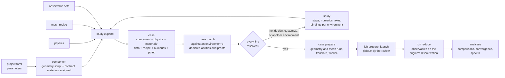
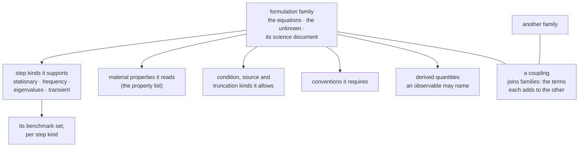

# Models — one calculation, described once, solved in a chosen environment

**Role:** contract
**Status:** current. Built in `femkit/models/`: the part kinds
this contract owns — the project file and its parameters, physics, observable
sets and studies — each with its schema and its check, registered at femkit's
start; each study's pairing read from the contracts (§§ 3, 5); axes by
address and their crossing; named steps and what one takes from another
(§ 4.5); `case.json`, its exact form and its ID, `study expand` (§ 5.3);
`project check`, `project graph`, `study list`, `case list` (§ 11); the
formulation type with `electrostatics` and its benchmark, the template
`two_material` (§ 4.3); the units ([`core.md`](core.md) § 11); the mesher
definition type (`definitions/meshers.py`). Their fields are documented by
[`../reference/parts.md`](../reference/parts.md) and
[`../reference/cases.md`](../reference/cases.md). Not built: analyses (M9);
running steps (plan § 4, X); the rest is [`../plans/plan.md`](../plans/plan.md)
§ 4, M5, M6, M8, M9
**Authority:** how a calculation is described independently of any engine — its
parameters, its physics, its studies, its observables and analyses; how a study
is expanded into cases; how a case is matched against an engine environment's
declared abilities, with every limitation shown; how abilities are proven; how
a person decides on each limitation and adds their own steps; how a case is
prepared and handed to a job; how results are reduced and analysed. A
project's tree, its parts and the one door are [`projects.md`](projects.md)'s;
the geometry, its contract and its meshes [`geometry.md`](geometry.md)'s; materials
[`materials.md`](materials.md)'s. The reasons are
[ADR 0008](../decisions/0008-one-model-declared-abilities.md) and ADRs
[0011](../decisions/0011-project-structure.md)–[0014](../decisions/0014-materials.md)

## The short version

| rule | § |
|---|---|
| A person describes **physics** — parameters, a formulation, conditions and sources on named groups — never solver input; a **study** asks the questions and binds each environment's choices | 3, 5 |
| A project's parts, their files and the one door through which they are read and written are [`projects.md`](projects.md); the geometry and its meshes [`geometry.md`](geometry.md); materials [`materials.md`](materials.md) | 2 |
| The physics a project may state is a closed list of **formulations**, solver-neutral, each with its benchmark set | 4 |
| **Observables** are sets of their own, on named groups, which studies name; **analyses** compare and report across runs | 5.2, 10.2 |
| A **case** is the component, the physics, the materials' data, the mesh recipe, the numerics and one axis point — nothing about an environment or the study's observables; each study's cases are its own, never shared or compared with another's; its ID is the hash of its content, canonical and unit-exact | 5.3 |
| Each **engine environment declares its abilities** as data; matching a case gives a **match report**: for each element, how exactly the environment translates it and whether that is proven | 6 |
| An ability counts only once **proven** in that environment by benchmark runs, recorded beside the environment and keyed to everything it rests on | 6.3 |
| Nothing is approximated silently: an approximation or an unproven ability needs a **decision**, an unsupported element a **customization** or another environment; both are bound per environment in a study and go stale when what they answered changes | 7, 8 |
| **One mesh path**: Gmsh makes every mesh, and femkit hands each engine its mesh as declared data | 6.5 |
| **case prepare** uses the case's geometry and mesh runs, writes the pure translation, applies the customizations and writes the job request; the **job's plan** is the review; a preparation is `blocked`, `orphaned`, `open`, `stale` or `prepared` | 9 |
| Values come from the engine's own discretization; every observable says how faithful it is; comparisons show fidelity and refuse what does not solve the same stated problem | 10 |
| The project is also a **graph** derived from its parts, addressed in one grammar; a surface renders it and changes no file the person wrote | 11 |

## 1. The chain



A person writes the project's parameters, a component — its geometry script,
the groups it promises, which material fills each — physics, mesh recipes and
observable sets, and one or more studies. `study expand` writes the study's
cases. For a chosen engine environment, `case match` matches a case against
what that environment declares, and has proven, it can do, and lists every
element of the case with its status. Until every line is resolved — by a
recorded decision, a customization, or another environment — nothing is
prepared. `case prepare` uses the case's geometry and mesh runs, writes the input,
applies the customizations and writes the job request; the job's plan shows
the person what will run before it runs ([`jobs.md`](jobs.md)). After the run,
`run reduce` computes the study's observables, and analyses compare them.

## 2. The project

A project's tree — every folder and file, its writer, the door that reads it,
and whether it moves with the project — is [`projects.md`](projects.md) § 2.
What this contract adds:

- **One writer each.** `generated/` is evidence of the translation and is never
  edited; what a person wants changed is a customization (§ 8), applied into
  `final/`. A file whose hash differs from its manifest makes the preparation
  `stale` (§ 9.5), and the job refuses it ([`jobs.md`](jobs.md)).
- **Cases and preparations belong to their study.** Each study's cases are its
  own, in its own folder, `cases/<study>/<id>/case.json`; femkit never shares a
  case between studies or compares them, so two studies of the same content
  each write their own cases, and each prepares its own, with its own bindings
  and runs, in the project's run folders (designed with execution, plan § 4, X).
- **Intent is never read back from input.** Prepared input is evidence, never
  the source of intent ([`../design.md`](../design.md), scientific data).
- **Every file carries its shape.** A JSON file femkit writes carries
  `schema`, an integer raised when its shape changes: `case.json`,
  `manifest.json`, `result.json`, a geometry's record, a mesh's manifest, the
  proof record (§ 6.3), the script's inputs ([`geometry.md`](geometry.md)
  § 2). Every part's file the person writes states it too, as its first key,
  `schema = 1`, the number of its part kind's shape. A file stating another
  number does not load: it is a finding naming the shape the file states, the
  shape femkit reads, and what changed between them, which each part schema
  declares for every shape after its first — femkit never rewrites the file,
  and the person brings it to the new shape in their editor, the templates
  showing it whole. Built: a file stating another number does not load; not
  built yet: the finding saying what changed, with a part kind's second shape.
- **A case is named by its content**, its ID (§ 5.3), within its study:
  "500 nm" and "0.5 µm" give the same ID, and renaming a group or a material
  changes the case and its ID — the old preparations become `orphaned` and keep
  their runs.
- **Benchmarks** (§ 4, § 6.3) are femkit's project templates
  ([`projects.md`](projects.md) § 7) that a formulation names, each holding its
  materials as its own so a proof never depends on a person's library;
  `formulation verify` copies them to
  `<data>/benchmarks/<environment>/<formulation>/<benchmark>/` to prepare and
  run them there. What a benchmark's reference rests on is a parameter of its
  template — the two-material slab's interface position is `interface` in its
  project file — so a test computes the reference from the template itself.

## 3. Parameters and physics

**Parameters** live in the project file ([`projects.md`](projects.md) § 2):
named quantities with units — a gap, a wavelength, a length — and expressions
of them with `+`, `−`, `×`, `÷` and parentheses (`gap / 2`). They are what a
component's script, a physics, a mesh recipe and an observable set may use,
and, besides
a mesh recipe's values, numerics and a material's dataset, the only things a
study's axes vary (§ 5). A parameter may not be named like a unit. An
expression may use any other parameter, in any order in the file; parameters
that use each other in a circle are a finding naming the circle. The project's
parameters are resolved once, for every check, by the check frame (§ 11.1):
each by name, exactly; a circle is one finding, `parameter-circle`, on the
parameter where it was met; a text that does not read is a finding,
`bad-quantity`, on its parameter; one using a parameter that does not resolve
does not resolve either, and has no finding of its own.

**A physics** is one file of the project, `physics/<p>.toml`. It states, on
named groups — never naming a component, so it serves every component whose
contract promises the groups it names ([`geometry.md`](geometry.md) § 3):

| part | holds | rule |
|---|---|---|
| `formulation` | one formulation family (§ 4) | the family supports the step kind each study asks of it |
| `meaning` | for each dimension of the components it serves, keyed by the dimension, what it means for the formulation (§ 4): in 2-D per unit depth or axisymmetric, TE or TM | chosen, never assumed: a study pairing it with a component of a dimension it does not state is a finding, so one physics serves a 3-D and a 2-D component by stating both |
| `conventions` | what the formulation requires chosen — for a frequency-domain problem, `phasor` (`"exp(-iwt)"` or `"exp(+iwt)"`: the sign s of [`electromagnetics.md`](../science/electromagnetics.md)) and `amplitude` (`"peak"` or `"rms"`) | never defaulted |
| `conditions` | keyed by the group: for every outer-boundary group, one condition of a kind the formulation allows; for an interface group that carries one, `interface` (continuity, stated) or a sheet condition the formulation allows — each its `kind` and the parameters its kind lists (`value`) | a natural condition on an outer boundary is stated, never implied; a kind stands only on the places its `on` names ([`geometry.md`](geometry.md) § 7) |
| `radiation` | for an open problem: the outer-boundary groups through which waves leave to infinity, and the material beyond them | how the domain is truncated there is each environment's numerics (§ 5) |
| `sources` | each by its name: its `kind`, one the formulation allows; the group it is `on`; and every parameter the formulation lists for it — for a plane wave: total or scattered field, amplitude, polarization, direction, the background medium, the phase reference point | — |

Which material fills each body is the component's, never a physics'
([`materials.md`](materials.md) § 5): every physics a component is paired with
uses it.

- **Units.** Every dimensional value is written with its unit (`"1 nm"`) or as
  an expression of parameters (`"gap / 2"`). A physics, a mesh recipe and an
  observable set serve any component, so a coordinate in them is a length with
  its unit, measured from the origin of the component a study pairs it with;
  only the geometry script's own numbers are bare, in its contract's unit
  ([`geometry.md`](geometry.md) § 3).
  Internally each quantity has a canonical unit — SI, and degrees for angles,
  so that a written angle stays exact — and is held as an exact rational
  (§ 5.3); translators convert to what an engine reads. Conversion for display
  happens only at a surface, in the study's display units. Unknown keys are
  refused. The grammar, the unit table and the canonical units are
  [`core.md`](core.md) § 11.
- **Complex values follow the physics' convention**: a material's data is
  converted from its source's convention when a case is expanded
  ([`materials.md`](materials.md) § 6).
- `project check` applies every rule of this table and of the formulation, each
  study's pairing ([`projects.md`](projects.md) § 3), and, once the geometry
  exists, the kinds and coverage of [`geometry.md`](geometry.md) § 7; it
  changes nothing.

The Laplace check is the template `laplace_square`
(`femkit/data/templates/laplace_square/`, [`projects.md`](projects.md) § 7):
a square of side `side`, its left side held at 0 V and its right side at
`bias`, its top and bottom insulating, filled with the project's own
`vacuum`. Its project file and its physics, in short:

```toml
# project.toml
schema = 1
description = "Laplace on a square: 0 V on the left, the bias on the right, insulated top and bottom"
components = ["square"]
studies = ["check"]

[parameters]
side = "1 m"
bias = "1 V"
```

```toml
# physics/electrostatics.toml
schema = 1
formulation = "electrostatics"
meaning = { 2 = "per unit depth" }          # what 2-D means for electrostatics (§ 4)

[conditions]
left  = { kind = "potential", value = "0 V" }
right = { kind = "potential", value = "bias" }
sides = { kind = "insulating" }
```

Its component's contract is [`geometry.md`](geometry.md) § 3's, with
`dimension = 2`, `unit = "m"`, `side` its one input, the groups `domain = 2`,
`left`, `right` and `sides` each `1`, and `[assign.domain]` naming
`material = "vacuum"`.

## 4. Formulations: families and step kinds

A formulation is one physical problem stated without reference to any engine.
It is cut in two, so the physics is written once whatever is asked of it:

- **a family** — the equations, their unknown, the properties they read, the
  conditions and sources they allow — declared as data, one file per family,
  `femkit/data/formulations/<family>.toml`, with its science document; a
  physics names its family (§ 3);
- **a step kind** — the kind of calculation: a static field, a field at one
  frequency, the structure's resonances, a field in time — declared as data in
  one list, `femkit/data/step_kinds.toml`; a study's step names a physics and a
  kind (§ 5.1), and the family must support that kind.

The person's decision: one physics file serves a frequency sweep and
an eigenvalue study of the same structure; a new kind of calculation is a new
step kind, never a copy of every physics file. Both lists are closed: what is
not declared is refused, naming what is.

### 4.1 The family tree



| family | the equations | unknown | step kinds | science document | state |
|---|---|---|---|---|---|
| `electrostatics` | −∇·(ε∇φ) = ρ | potential φ, in H¹, in V | `stationary` | [`electrostatics.md`](../science/electrostatics.md) | built, as `electrostatics` |
| `maxwell` | Maxwell's equations, time-harmonic | electric field **E**, in H(curl), in V/m | `frequency`; `eigenvalues` later | [`electromagnetics.md`](../science/electromagnetics.md) | not built (plan § 4, M9) |

A family is one physics. Several physics are joined by steps and couplings
(§ 4.5), never by a family of their own. Families to come are added to this
table as they are declared; none is named here before it is.

### 4.2 Step kinds — `femkit/data/step_kinds.toml`

| kind | the calculation | the variable it supplies | what it produces, for a later step | state |
|---|---|---|---|---|
| `stationary` | a field that does not change in time | none | the field | built, as electrostatics' one kind |
| `frequency` | a field oscillating at one frequency, the phasor of its convention | the frequency, or the vacuum wavelength, from a named parameter | the field; absorbed power and the other derived quantities | not built (M9) |
| `eigenvalues` | the frequencies and fields the structure supports without a source | none; it finds them | each mode: its frequency and its field | not built; named for the tree |
| `transient` | a field in time | time | the field at each time | not built; named for the tree |

Each kind states, as data, in `femkit/data/step_kinds.toml`: its sentence;
the variables it supplies, which a material's data may vary with
([`materials.md`](materials.md) §§ 2, 6) — built, with `stationary`, which
supplies none; what it produces, which a later step of a study may take; and
what a family that supports it must add — a `frequency` family, its phasor and
amplitude conventions — each not declared yet (plan § 4, M9).

### 4.3 A family's declaration

Each family states:

- the unknown, its function space and unit — potential φ in H¹ (V), electric
  field **E** in H(curl) (V/m);
- the equation, with every symbol and unit defined near its first use, in its
  science document (`docs/science/`: `electrostatics.md` for `electrostatics`,
  [`electromagnetics.md`](../science/electromagnetics.md) for
  `maxwell`);
- what each dimension means for it — for `electrostatics` in 2-D, per unit
  depth or axisymmetric; for `maxwell` in 2-D, TE or TM — chosen in the
  physics, never assumed;
- the material properties it reads, by their names in the property list
  ([`materials.md`](materials.md) § 1), each needed real or allowed complex,
  the variable a dataset may vary with being the one its step kind supplies
  (§ 4.2), so a dataset that varies with what the step does not supply is
  refused ([`materials.md`](materials.md) § 6);
- the condition, source and truncation kinds it allows, each with its
  parameters and their units, and its `on`: the places it may stand on, by
  their names in the one vocabulary of places ([`geometry.md`](geometry.md)
  § 7) — `outer_boundary`, `interface`, `body`;
- the conventions a physics must choose;
- the derived quantities an observable may name — **E**, **D**, energy
  density, Poynting flux, absorbed power — and expressions of them (plan § 4,
  M6);
- its **benchmark set**, per step kind it supports (§ 6.3): problems with known answers — each a project, a
  study binding what each environment chooses (a truncation, say), and its
  reference solution — chosen so that each
  ability they prove is one an error would show in. A solution a translation
  reproduces whatever it gets wrong proves nothing: φ = x on a square is
  reproduced exactly by linear elements and does not depend on ε. So a set
  holds manufactured, non-polynomial solutions with a measured convergence
  rate per element family, degree and geometry order — their sources and
  boundary values written in the expression language (plan § 4, M6) — a
  two-material case for interfaces and ε, and, for `maxwell` in the frequency
  kind, TE and
  TM cases in 2-D, a reflection benchmark for each truncation, and a lossy,
  open problem with a known answer — scattering by a lossy sphere against its
  series solution, its absorbed power positive — so that a wrong phasor sign or
  truncation shows.

Loading a formulation checks that each ability any environment declares for it
is exercised by at least one benchmark; one that is not could never be proven,
and is refused.

`electrostatics` in its keys, in part — the whole file is
`femkit/data/formulations/electrostatics.toml`, and every key is in
[`../reference/definitions.md`](../reference/definitions.md). Each property
(its sentence the property list's, with what the formulation adds), condition,
source and derived quantity carries the one plain sentence a person
reads beside it — a tooltip in the page, a hint in a finding, a line of the
reference — and the section of the science document that defines it; loading
refuses a section the document lacks. Abilities name its kinds from each
environment's definition (§ 6.1), and its benchmark set is a table of its own
here:

```toml
description = "the electrostatic potential: -div(eps grad phi) = rho"
kinds = ["stationary"]                           # the step kinds it supports (§ 4.2)
science = "docs/science/electrostatics.md"
unknown = { name = "potential", space = "H1", unit = "V" }
meanings = { 2 = ["per unit depth", "axisymmetric"], 3 = ["full"] }
conventions = []

[properties.relative_permittivity]               # a name of the property list (materials.md § 1)
note = "a real, positive number"                 # what this formulation adds to the list's sentence
section = "1-terms-and-symbols"
complex = false

[conditions.surface_charge]
description = "the boundary is the surface of a conductor carrying a free charge; femkit writes n . D = -sigma"
section = "3-conditions-on-an-outer-boundary"
on = ["outer_boundary"]                     # the places it may stand on (geometry.md § 7)
parameters.value = { unit = "C/m^2", description = "sigma, the free charge per unit area on the conductor's surface" }

[derived.electric_field]
description = "E = -grad phi"
section = "7-derived-quantities"
unit = "V/m"

[benchmarks.two_material]
description = "a layered capacitor: two materials in series between two held potentials, a named interface between them"
section = "91-two_material-a-layered-capacitor"
project = "two_material"
exercises = ["potential", "insulating", "interface", "relative_permittivity"]
tolerance = "1e-9"

[benchmarks.two_material.reference]
potential_middle = "4/5 V"
energy_low = "5.666680204032e-12 J/m"
```

- **`constants`**: each physical constant the equation uses — `vacuum_permittivity`
  — given to every engine as stated there, never an engine's own value.
- **A benchmark** names one of femkit's project templates by its bare name
  (`project = "two_material"`, [`projects.md`](projects.md) § 7) — its project
  file, its component with its geometry script, its materials, its physics, its
  observable sets and its one study — with the kinds and properties it
  exercises, a
  relative tolerance whose basis is in its section of the science document,
  and the exact value each observable of its study must reproduce.
  `schema check` loads each project and refuses one that `project check`
  faults where it can check without building its geometry, or a reference that
  names no observable of its study, or is in another dimension than the
  observable; the coverage checks that need the geometry built run with the
  benchmark's proof (§ 6.3).

### 4.4 Extending the tree

- **A new family** is one data file, its science document, and a benchmark set
  for each step kind it supports; it changes no code that is not the engines'
  translators for it.
- **A new step kind** is one entry in `step_kinds.toml`, each family that
  supports it adding what the kind asks for, and a benchmark set for each such
  family.
- **Names**: a family is named by its physics, lowercase (`electrostatics`,
  `maxwell`, `heat`); a step kind by its calculation (`stationary`,
  `frequency`). A name is declared once and never reused for another meaning.
- **An engine** declares its abilities per family and step kind (§ 6.1): an
  engine that solves `maxwell` at a frequency but not its eigenvalues says so,
  and a study asking for what it does not declare is a match line.

### 4.5 Multiphysics: steps and couplings

Several physics are solved in one of two ways, each declared as data:

- **In turn.** A study's steps are named, each solving one physics, and a
  step takes what another produced by that step's name, as its kind declares
  it (§ 4.2) and its family declares it can accept: the `thermal` step takes
  the `optics` step's absorbed power density as its heat source. A step runs
  after every step it takes from; the order the file writes them in means
  nothing, and steps that take nothing from each other may run in any order.

  ```toml
  [steps.optics]
  physics = "optics"                          # family maxwell
  kind = "frequency"

  [steps.thermal]
  physics = "thermal"                         # family heat
  kind = "stationary"
  takes = { heat_source = "optics.absorbed_power_density" }   # a step's name, then what its kind produces
  ```

  femkit checks each hand-off before anything runs: the step taken from
  exists, its kind produces the quantity, and its dimension is what the later
  family accepts. Steps that take from each other in a circle are refused
  unless the study repeats them (next sentence).
  Where the later result must feed back — the temperature changing the metal's
  permittivity — the study repeats its steps in turn until the change between
  two rounds is below the tolerance it states, and says how many rounds it
  allows.
- **Together.** Physics whose equations must be solved in one system are
  joined in one step by **couplings**, each declared as data,
  `femkit/data/couplings/<coupling>.toml`: the families it joins, the terms it
  adds to each — Joule heating's heat source σ|**E**|² to the heat equation, and
  a conductivity that depends on the temperature back — the step kinds it holds
  for, and the section of the science document that states it.

  ```toml
  [steps.heating]
  physics = ["electric", "thermal"]           # two physics, on the same component's groups
  couplings = ["joule_heating"]
  kind = "stationary"
  ```

- **What stays one.** Every physics of a step lies on the same component, its
  groups and its one mesh; a material carries every property each physics
  reads, from the one property list ([`materials.md`](materials.md) § 1); a
  case holds every step, its physics and its couplings (§ 5.3).
- **Engines** declare which couplings they support, as they declare families
  and step kinds (§ 6.1); a study asking for one an environment lacks is a
  match line.
- **Built**: named steps, and each hand-off checked — the step taken from is
  another of the study's, its formulation derives the quantity, and no steps
  take from each other in a circle. **Not built yet**: what a family accepts
  from another, couplings and repeated steps (plan § 4, after M9); the
  first couplings declared are electromagnetic heating and Joule heating, each
  with its science document and benchmarks.

**Scope.** Symmetry planes and periodicity are conditions a family lists when
it allows them; until then a component is solved whole.

A problem no formulation states is still possible, as a customization of the
nearest one (§ 8); its results say so.

## 5. Studies, observables and cases

### 5.1 Studies

A project holds one or more studies, `studies/<study>.toml`. A study pairs a component with what is solved on it —
the physics of each step, a mesh recipe, observable sets
([`projects.md`](projects.md) § 3) — and holds everything that is not the
physics:

| part | holds |
|---|---|
| `component` | the component it solves |
| `steps` | each step by its name: one physics, or several joined by couplings, and the kind of calculation (§ 4); a step taking what another produced runs after it, the file's order meaning nothing, repeated until it settles where the study says so (§ 4.5); one step until M9 |
| `mesh` | the mesh recipe it uses ([`geometry.md`](geometry.md) § 6) |
| `observables` | the observable sets it reports (§ 5.2) |
| `numerics` | the element family and its degree (common fields, each mapped per environment with a match status, § 6.4); the linear solver and its tolerance; the adaptivity block — error limit, smallest element, depth — when the mesh adapts |
| `axes` | what varies — a parameter, a mesh recipe's value, a numerics field, a material assignment's dataset — each axis keyed by the address of what it varies ([`projects.md`](projects.md) § 5), with its values and one class: **numerical convergence** (mesh, degree, tolerance, the open domain's padding and layer thickness), **geometry convergence** (lengths of the modeled structure that stand for a longer one, such as an electrode's), **physical sweep** (wavelength, material dataset, gap) |
| `crossing` | when the axes are of more than one class: `axes`, the address of every axis, and `reason`, why their full product is needed |
| `environments.<environment>` | per engine environment, the study's bindings: its job's resources ([`jobs.md`](jobs.md) § 2); its truncation of each radiation boundary — an absorbing condition, or a perfectly matched layer with its profile, its parameters and the condition on its outer face ([`geometry.md`](geometry.md) § 8) — its engine-only options (§ 6.4), its decisions (§ 7) and its customizations (§ 8), each of which may be limited to cases by their axis values. Built: `resources` alone; decisions and engine-only options join with the match (M5, M6), customizations with M8, truncations with M9 |
| `display` | a list of units: a value shows in the first listed unit of its dimension, else in its canonical unit (`["nm"]` for a nanogap) |

- **Several axes are crossed**: every value of each with every value of the
  others. Axes of different classes are never crossed silently: a study whose
  axes are of more than one class states `[crossing]`, naming every one of
  its axes and why the full product is needed. An axis added later that the
  crossing does not name is a finding, so a reason given for some axes never
  covers another.

  ```toml
  [crossing]
  axes = ["mesh:fine:sizes.gap", "project:parameters.wavelength"]
  reason = "the gap's resolution must be shown converged at every wavelength of the resonance"
  ```

- **An axis's values are checked in their key's place**: a parameter's value
  with every parameter computed again from it, in its dimension; a recipe's
  or a numerics value put in place and its part loaded again by its schema —
  a recipe's checked again by its own rules at that key, and compared with
  the dimension of what the key holds now only where that holds no finding of
  its own; a dataset, one its material holds, whose datasets are the
  finding's choices. What the varied part finds wrong of its own — its file
  does not load, another of its keys or the value it holds now does not
  read — is that part's finding, never the axis's. An axis keyed by no
  address of what it may vary names, as its right value, the address it most
  likely means: `[axes.bias]`, `project:parameters.bias`.

- **The pairing is checked before anything runs, and said once, in the file
  that needs changing**, at the key that names what is wrong: a group the
  component does not promise, or one that cannot be the place a condition or
  source stands on, at the physics', the recipe's or the observable's key
  naming it, the groups that would do its choices and the closest offered
  ("did you mean `sides`?"); a dimension the physics states no meaning for,
  at its `meaning.<d>`; an axisymmetric physics paired with a frame stating
  no axis of revolution, at the component's `frame.symmetry`
  ([`geometry.md`](geometry.md) § 3); an observable's quantity, point, side or
  unit its study cannot read, at the observable's key; a property a material
  lacks, at the material's. The step kind is the step's own, checked whether
  or not its component is there. A part the study uses that does not load is
  one note on the study, at the key naming it — what is paired with it is
  checked once it loads — so the study is `unchecked`, never `complete`
  ([`projects.md`](projects.md) § 8); and what only the built geometry tells —
  whether its faces are outer boundaries or interfaces — is one note on the
  study, at `component`, in the person's words: "whether `left`, `right` and
  `sides` are each an outer boundary is checked once the geometry of `square`
  is built".

The Laplace check's study, in short — the whole file, each key with its help,
is the template's `studies/check.toml` ([`projects.md`](projects.md) § 7):

```toml
schema = 1
component = "square"
mesh = "uniform"
observables = ["midpoint"]
display = ["m", "V", "V/m"]

[steps.solve]                           # a step, by its name
physics = "electrostatics"
kind = "stationary"                     # its step kind (§ 4.2)

[numerics]
element = { family = "lagrange", degree = 1 }
solver = { kind = "direct" }            # or { kind = "iterative", tolerance = 1e-10 }

[axes."mesh:uniform:size"]              # keyed by the address it varies
class = "numerical convergence"         # | "geometry convergence" | "physical sweep"
values = ["0.1 m", "0.05 m", "0.025 m"]

[environments.elmer.resources]          # jobs.md § 2
ranks = 1
threads = 1
gpus = 0
wall = "00:10:00"
memory = "2G"
```

- **Truncation is an environment's choice**, recorded in its manifest and
  every result: a perfectly matched layer in one environment and an absorbing
  condition in another are two numerical approximations of one stated
  radiation condition, which a comparison shows (§ 10).

### 5.2 Observable sets

An observable set is a file of the project, `observables/<o>.toml`, written on
named groups and on points, lines and planes given with their units; a study
names the sets it reports, and analyses read their results (§ 10.2). Its
observables are a table, `[observables.<name>]`, each holding:

| key | holds |
|---|---|
| `quantity` | what it reads: a derived quantity of the formulation of the physics a study pairs it with (§ 4.3) — or, from M6, an expression of them and of coordinates, `\|φ − x\|` |
| `point`, `line`, `group`, `plane` | where it is read — exactly one: a point, one length per axis of the component's frame; a line, its two end points; a group the paired component promises; a plane, a point on it and its normal (from M9) |
| `side` | on an interface group, the body group it is read from |
| `reduction` | `value` at a point; over a line or a group, `average`, `integral`, `maximum` or `norm` |
| `unit` | the unit it is reported in: its quantity's dimension, times its support's measure for an integral — `J/m` for an energy density integrated over a body of a 2-D component per unit depth |
| the source it is normalized by, total or scattered field, the complex part | for a frequency-domain physics (plan § 4, M9) |

```toml
schema = 1

[observables.potential_middle]
quantity = "potential"
point = ["interface", "height / 2"]           # lengths, from the component's origin
reduction = "value"
unit = "V"

[observables.energy_low]
quantity = "energy_density"
group = "low"
reduction = "integral"
unit = "J/m"
```

- **A point is measured from the frame's origin** of the component a study
  pairs the set with ([`geometry.md`](geometry.md) § 3), its lengths
  converted to the frame's unit. One set serves several components when their
  scripts put the origin at the same place in the structure — the gap's
  centre, for each bowtie; a point given with fewer or more lengths than the
  frame has axes is a finding at the observable's key (§ 5.1), and once the geometry exists a
  point or line outside it is a finding naming the point and the component
  (plan § 4, X).
- **Names are unique across a study's sets**, so a benchmark's reference and
  an analysis name an observable by its name alone; two sets of one study that
  share a name are a finding on the study.
- Not built yet: expressions (M6); planes and what a frequency-domain
  physics adds (M9).

An observable set can change what a preparation computes — Elmer's region-wise
absorbed power is computed inside the solver input, a probe line becomes a
save command (§ 10) — so a study's sets enter its preparations' manifests and
their staleness (§ 9.5). They never enter a case: adding an observable never
changes a case or its ID.

### 5.3 Cases

- **A case is the component, the steps' physics, the materials' data, the mesh
  recipe, the numerics and one axis point.** Nothing bound to an environment or
  a study's observables enters a case: recording a decision changes no case ID,
  and two environments prepare the same case.
- **Each study's cases are its own.** `study expand` writes them in the
  study's folder, `cases/<study>/<id>/case.json`; femkit never shares a case
  between studies or compares them, so two studies of the same content each
  write their own.
- `study expand` writes one `case.json` per point the study lacks. A case is complete:
  every default the schema has is written into it, and every material's data
  worked out for it ([`materials.md`](materials.md) § 6), so nothing about a
  case depends on femkit's version or a person's settings. It is refused,
  naming the part, while a part the study uses does not load or `project
  check` has a finding on one, and for axes of different classes crossed
  without a `[crossing]` naming them all (§ 5.1).
- **`case.json`** holds `schema`, `component`, `steps`, `mesh`, `numerics` and
  `point`, each resolved:
  - `component`: its geometry script's SHA-256, the values of the inputs its
    contract declares and each declared file's SHA-256
    ([`geometry.md`](geometry.md) § 3), its frame — its dimension and unit —
    its promised groups, and its assignment with each dataset's name and
    content ([`materials.md`](materials.md) § 6);
  - `steps`: each step by its name, with its kind, its physics — of its
    `meaning`, the component's dimension's alone — and what it takes; `mesh`: the
    recipe; `numerics`;
  - `point`: each axis's address and its value — the axis point applied, a
    parameter's value replaced and every parameter computed again from it.
- **Every value in exact form.** Every quantity — a parameter, a coordinate (a
  length, since no file but the script writes a bare one, § 3), a
  condition's or source's parameter, a material's value or range, a mesh size —
  is written as `{"value": "<p/q>", "dimension": {"<base>": <power>}}`, its exact
  value in its dimension's canonical units ([`core.md`](core.md) § 11); every
  other number — a degree, a direction's component — as its exact value in text
  (`"2"`, `"-1/2"`), so `-1` and `-1.0` are one value; every schema default is
  written.
- **The case ID** is the SHA-256 of `case.json`'s canonical JSON — keys sorted,
  no whitespace, UTF-8 — so two spellings of one value give one ID. It serves
  `study expand` of the same study alone, to know a case it wrote already. Its
  plan lists the cases it adds — each that its materials' changed data makes
  naming the case it renews ([`materials.md`](materials.md) § 6) — those it
  keeps, and the study's preparations
  of cases it no longer produces, which become `orphaned` (§ 9.5) and are
  never deleted by it.
- `case list` shows each study's cases under it, with their axis values,
  whether the study makes each now and, per environment, its match and
  preparation state; a case may be named by a unique prefix of its ID. The
  cases the study makes come first, then those it no longer makes; within
  each, in the study's own order — axis by axis as it declares them, each
  value where its list puts it.
- Execution benchmarks — ranks, threads — are job requests, not cases: the
  same case run on different resources must give the same answer.

## 6. Abilities, proof and the match report

### 6.1 Abilities are declared per environment

Each engine environment's definition ([`definitions.md`](definitions.md) § 4)
declares, per formulation it can solve, what it can do; a `-cuda` environment's
`[cuda]` part adds what only it can do, such as AmgX. Declared as data, read by
generic code:

- per formulation family, the step kinds and couplings it solves (§ 4); the
  element families, degrees and geometry orders, condition, source,
  truncation and material kinds, linear solvers, reductions (computed after the
  run, or inside the generated input, § 10) and output forms it supports;
- for each, how exactly: **exact** — as the formulation states it; or
  **approximated** — with an approximation ID, the approximation in words, its
  basis (a derivation, a citation or a measurement), and the study axis that
  bounds its error where there is one; anything not declared is absent;
- the mesh it reads: the hand-over declared for it ([`geometry.md`](geometry.md) § 8);
- its extension points (§ 8);
- its engine-only options and what each does.

Each declared ability has a digest, the hash of its declaration, so a decision
or a proof names exactly what it answered.

### 6.2 The match report

`case match CASE --study S --environment E` matches a case, with the study's
bindings for E, against E and prints the match report; it writes nothing.
`study match` does it for every case of a study and shows, per element, the
worst line across them. One line per element — the mesh's hand-over and its
geometry order, each group the physics uses, material assignment, convention, condition,
radiation boundary and its truncation, source, observable, and numerics item —
each with two facts:

| fact | values | meaning |
|---|---|---|
| translation | `exact` | translated as the case states it |
| | `approximated` | the environment does a stated approximation |
| | `unsupported` | the environment cannot do it |
| | `engine-only` | an option from the environment's own block; it never changes a common field |
| | `customized` | covered by a customization (§ 8) |
| proof | `proven` | proven in this environment, as § 6.3 records |
| | `unproven` | not proven in this environment |

Proof applies to declared abilities only: an `engine-only` or `customized`
line has no proof fact, and a customization resolves its line by itself. A line
is **open** when it is `approximated` or `unproven` without a current decision
accepting it (§ 7), or `unsupported` without a customization covering it. Nothing is prepared while a line is open; the refusal lists each open line
with what resolves it. The match report a preparation was made from is kept in
its manifest (§ 9.4).

### 6.3 Proof

An ability counts as proven in an environment once that environment's
translation has reproduced the formulation's benchmarks that exercise it
(§ 4), in runs:

1. `formulation verify FORMULATION --environment E --resources FILE` writes
   the projects of the benchmarks that exercise an ability E declares into
   `<data>/benchmarks/E/FORMULATION/`, with the job resources the
   file gives (a `[resources]` table, [`jobs.md`](jobs.md) § 2), and prepares
   each. A benchmark is exempt from the proof rule, from decisions and from the
   comparison refusal of § 10 — it is how an ability and its approximation are
   measured — and from nothing else.
2. The person launches each benchmark's job, one job per launch
   ([`jobs.md`](jobs.md)).
3. `formulation verify FORMULATION --environment E --record`
   reduces the finished runs, compares each against its reference solution, and
   records each ability whose benchmarks all passed in
   `<prefix>/.femkit/proofs.json`, citing the runs.

A proof is keyed to everything it rests on: the environment's install
fingerprint and its lock's hash, the digest of its engine package (translators,
parsers and finalizers), the ability's digest, and the mesh step environment's
fingerprint and lock hash, which made the benchmarks' geometry and meshes.
Any of them changing makes the ability `unproven` again. The record's schema
is `models`'; it goes with the prefix when the environment is removed.

### 6.4 Engine-only options and common numerics

An option only one engine has lives in that environment's block of the study
and appears as an `engine-only` line: a preconditioner, a reordering. It never
changes the meaning of a common field. What changes the discrete problem —
the element family and degree, the geometry order and curving, the mesh — is a
common numerics field — the geometry order excepted, which is the mesh recipe's
([`geometry.md`](geometry.md) § 6) — mapped per environment with its match status, because
two engines given the same words must solve the same discrete problem or say
they do not: NGSolve's H(curl) space of a degree differs by its type from
Elmer's Whitney and second-kind bases of the same degree.

### 6.5 Meshes

Every mesh is made by Gmsh, in the mesh step's environment, from the case's
geometry and its study's mesh recipe, and handed to each engine as declared
data ([`geometry.md`](geometry.md) §§ 5, 8;
[ADR 0012](../decisions/0012-one-mesh-path.md)). The smallest feature of a
geometry against Gmsh's declared tolerance, in its contract's unit, is a
finding once the geometry exists, naming a unit that works: Gmsh's absolute
tolerance merges a 1 nm gap written in metres. Every derived quantity a unit change scales — fields,
powers, fluxes, the wavenumber — is rescaled by the translator, and the factor
is recorded in the manifest. Not built yet (plan § 4, X).

## 7. Decisions

A decision is a person's recorded answer to one match line, bound to one
environment in a study:

```toml
[environments.elmer.decisions."physics:optics:radiation.outer"]
accept = ["approximated", "unproven"]           # what of the line it accepts
approximation = "first-order-absorbing"         # the ID the ability declares
reason = "outer boundary at 3 wavelengths; the padding axis bounds the reflection"
```

- A decision names its line by address ([`projects.md`](projects.md) § 5), its environment and its
  reason, and records what it accepted: the translation status and
  approximation ID, whether the line was unproven, and the ability's digest
  and engine version when it was recorded.
- **Stale is detected.** A decision whose recorded acceptance no longer matches
  the line — the environment changed its approximation, its version or its
  declaration, or the line's proof changed — is stale; the match report shows
  what was accepted beside what is declared now, and nothing is prepared until
  the person answers again. A decision whose line is now `exact` and `proven`
  is reported as no longer needed.
- A decision may be limited to cases by their axis values (an absorbing
  boundary accepted at the short wavelengths only).

## 8. Customizations

### 8.1 Kinds

A customization is the person's own addition to one environment's preparation,
at a point that environment's engine package declares. From lightest to
heaviest:

| kind | does | e.g. for Elmer | e.g. for NGSolve |
|---|---|---|---|
| `overlay` | sets or adds an engine option in a named place, merged by name | a keyword in a SIF section, merged by section and keyword — femkit holds the SIF as a structure, never as text to patch | a solver or space option in the script's settings |
| `hook` | the person's code, called by the generated input inside the job | a user solver module, compiled into the job with the environment's own compiler wrapper | a Python module whose `before_solve` or `after_solve` the generated script calls |
| `replace` | the person supplies one generated artifact | their own mesh, or one SIF section | their own mesh, or their own form definition |
| `step` | a program run in the job before or after the solve | a conversion, an extra post-processing | the same |
| `custom-input` | the person supplies the whole input | their own SIF and mesh | their own script |

A `hook` or `step` may supply an observable: its output is written into the
result form (§ 10), and that observable's fidelity is `customized`.

### 8.2 Declaration

Each customization is declared in its environment's block of the study, with
an ID, and is a file or a folder of pieces under `custom/`, written by the
person. How an uploaded file ([`web.md`](web.md) § 5) becomes one is settled
at M8's start (plan § 4, M8), never by femkit writing the person's file
([ADR 0015](../decisions/0015-the-persons-files.md)). A declaration holds:

| field | holds |
|---|---|
| `point` | the extension point the engine package declares |
| `files` | its file or folder under `custom/`; each file's SHA-256 is recorded in the manifest |
| `versions` | the engine versions it was written against |
| `interface` | the translator interface version it was written against — the section names an overlay sets, the call a hook receives |
| `covers` | the match lines it resolves, by address |
| `physics` | `true` when it changes physics the project states, with a sentence saying how; `false` otherwise |
| `description` | what it does, in a sentence |

- A customization that sets a value the translator took from the project is
  shown as "overrides model value …", and is accepted only with `physics =
  true`.
- A missing file, a hash that differs from the one in the manifest, an
  extension point not declared, an engine version outside `versions`, an
  `interface` the translator no longer offers, or a customization that covers
  no line, is refused, naming it — so a customization written for an older
  translator is stale, never silently misapplied.
- File names under `custom/` are relative; each part is letters, digits, `.`,
  `_` or `-`, starting with neither `.` nor `-`; no part is `..`, and no link
  lies along the path.

### 8.3 How customizations combine

- One customization is one ID; a folder holds its pieces — an Elmer hook's
  module and the overlay lines that call it are one customization.
- Several at one point apply in the study's order, which the job's review
  shows. The same keyword set by two overlays is refused, naming both.
- Customizations name regions by the project's group names; the region map in the
  manifest (§ 9.4) translates them into the engine's identifiers, so a mesh
  that renumbers bodies breaks nothing. A hook receives the case document and
  the region map.
- `step` customizations become the job request's steps before and after the
  solve, which the run script runs ([`jobs.md`](jobs.md) § 4 gains them with
  M8).

### 8.4 Code a person supplies

A `hook`, `step` or `custom-input` runs only inside a job the person reviewed,
in the environment, under the same confinement as femkit's own steps
([`envs.md`](envs.md) § 4.4). It is never imported, compiled or run by an
upload, a check, a match, a preparation or a reduction — an NGSolve hook's
functions are found by parsing it, not by importing it. One exception: a
component's geometry script, which runs only as the first step of a case's
pipeline, in a run folder — its environment, and how its imports are provided,
designed with execution (plan § 4, X) — its contract checked before and after ([`geometry.md`](geometry.md) § 3;
[ADR 0013](../decisions/0013-geometry-scripts.md)).

### 8.5 Developing post-processing

`run reduce RUN` runs only the parser again on a finished run's kept raw
output and records a new result (§ 10). A post-processing `step` or `hook` is
developed by a job of its own whose inputs are an earlier run's outputs, so it
runs reviewed and never rewrites the earlier run.

## 9. Preparation

### 9.1 The engine boundary

Each environment's engine package holds, per formulation it declares, a
translator, a parser and a finalizer for each customization kind
(`femkit/engines/<engine>/`). Engine code runs inside the environment and
imports only the standard library, `femkit.core.process` and its own package
([`framework.md`](framework.md) § 1), so the documents crossing that boundary —
the case and the study's bindings for the environment it receives, the answer
a translator returns, the observations a parser returns — are each defined
once, in the standard library only, with a
`schema` number, in `femkit/engines/` (as the check summary is,
[`definitions.md`](definitions.md) § 5.3). The translator writes only its
generated files and its answer; `case prepare` hashes them and writes the
manifest and the job request. `models` comes after `jobs` in the layers: it
writes `job.toml` in the jobs schema, and `jobs` reads nothing of `models`.

### 9.2 Geometry and mesh

A case's geometry and mesh are the first two steps of its pipeline
([`geometry.md`](geometry.md) § 4), each a run of its own, made once per
geometry and recipe and shared by every case and environment that needs the
same; `case prepare` checks the case's geometry against the component's
contract and the coverage of its groups, and hands each environment the mesh as
it reads it. How each step runs — its run folder and run script — is designed
with execution (plan § 4, X).

### 9.3 prepare and finalize

`case prepare CASE --study S --environment E` refuses while a match line is
open, then: the translator writes `generated/`; the customizations are applied
into `final/` by the engine package's finalizers — overlays merged by name,
replaced artifacts swapped, hooks placed where the generated input calls them;
and it writes `manifest.json` and `job.toml`. `study prepare` does it for every
case of a study.

`job.toml` carries all the job needs and nothing it must read elsewhere — the
prepared case's fields of [`jobs.md`](jobs.md) § 2 — with the study's
resources for the environment. The request names the base environment
(`elmer`), and `gpus > 0` selects its `-cuda` twin ([`jobs.md`](jobs.md) § 3,
step 4): preparing for `elmer-cuda` writes `environment = "elmer"` with the
study's `gpus`, and resources that contradict the environment are refused
here, inside the request — `gpus = 0` for a `-cuda` environment, `gpus > 0`
for a CPU one.

### 9.4 The manifest

`manifest.json` records what the preparation was made from and what it made:

- the case ID and the study; the environment, its install fingerprint, its
  lock's hash and its engine version;
- the match report as it stood, every decision and customization applied, with
  their hashes, the truncation, the engine-only options and the resources;
- the engine package's digest and the translator's interface version, the
  abilities' digests, the geometry's and the mesh's identities and the mesh file's
  hash, the study's observable sets with their hashes, where each material was
  found (the project or the library) with its file's hash, and the length
  unit's scale factor;
- every file of `generated/` and `final/` with its SHA-256, and which differ;
- the mesh's region map translated to the engine's identifiers, and each
  region's measure ([`geometry.md`](geometry.md) § 5);
- the command, its declared variables, and the products the run must leave.

### 9.5 The preparation state

A study's preparation of a case for one environment is a state machine
([`framework.md`](framework.md) § 3), observed by these rules in order:

| # | observed when | state | `case prepare` |
|---|---|---|---|
| 1 | the study does not load, or a part the case rests on does not | `blocked` | refused: names the file and its first problem |
| 2 | the study no longer produces the case | `orphaned` | refused: offers `study expand` |
| 3 | no `manifest.json` | `open` | prepares, once no match line is open |
| 4 | a binding, an observable set, the geometry or the mesh, the environment's fingerprint or lock, the engine package, an ability's digest, or a file's hash differs from the manifest | `stale` | prepares again, once no match line is open, after its plan shows what differs |
| 5 | otherwise | `prepared` | nothing to do |

A job runs the preparation it was given: its own request and inputs, checked
by their hashes ([`jobs.md`](jobs.md)). `case list` is where a preparation that
went `stale` after its job was made is seen.

### 9.6 Review

The plan of `case prepare` shows the match report, every decision with its
reason, every customization with its hash, and the translator's command — all
known before it writes. The plan of `job prepare` reads `job.toml` and shows
the inputs, which of them customizations changed, the steps and the command —
the review a person consents to before anything runs.

### 9.7 Locks

Every operation that writes in a project — a run's steps,
`study expand`, `case prepare`, a mesh, `run reduce`, an analysis — holds the
project's lock (a write to the global library: [`materials.md`](materials.md)
§ 4); each lock's subject is computed from the
path in the request ([`core.md`](core.md) § 5). How a run's own folder is
locked against a preparation is designed with execution (plan § 4, X). `formulation verify` holds the benchmark projects' locks, and `--record`
also the environment's (`env-<name>`), since it writes into the prefix.

## 10. Results and analyses

### 10.1 A run's results

- **`run reduce RUN`** runs the environment's parser inside it on a finished
  run's raw output and writes `run-NNN/result.json`: each observable of the
  study's sets — its value, unit, support, reduction, normalization, the method
  that computed it and the discretization it came from, the truncation and the
  mesh's key, the measured mesh
  size and number of unknowns per region, and its fidelity.
- **Values on the engine's own discretization.** A reduction is computed from
  the engine's own basis functions — after the run where the parser can reach
  them, or by post-processing inside the generated input where only the
  solver can (Elmer's region-wise absorbed power); the method is recorded
  either way.
- **Raw output stays** beside the result; a parser never substitutes zero or
  an empty array for missing output.
- **Fields for viewing** are exported in a ParaView-readable form
  ([ADR 0002](../decisions/0002-paraview-visualization-boundary.md)).
- **Fidelity per observable**: `exact`, `approximated` (naming each accepted
  approximation that touches it, a truncation included), `customized`,
  `unverified` (it rests on an accepted `unproven` line), or `custom-input`. A
  run's fidelity is its worst observable's.
- **Four statements.** Process success and algebraic convergence are a run's;
  mesh convergence is analysis over a study's axis, never a single run's; and
  physical validity is the person's judgement on all of them
  ([`../design.md`](../design.md)).
- **Comparisons.** `result show` prints a run's observables and changes
  nothing. A comparison — in an analysis (§ 10.2), or `result compare` for one
  look — compares observables across cases, studies or environments on
  named groups and points, lines and planes given with their units, never on
  raw node indices, and shows each
  side's fidelity, truncation and mesh beside the difference. It refuses an observable that is `unverified` or `custom-input`
  on either side, and a pair that does not solve the same stated problem —
  conventions, excitation normalization, observable support or side —
  naming the difference; other observables of the same runs remain comparable.
  A benchmark is compared against its reference solution as its proof (§ 6.3).

### 10.2 Analyses

An analysis, `analyses/<analysis>.toml`, names studies and their observable
sets and declares what to make of their results: a comparison across
environments or studies, convergence over an axis, a spectrum over a sweep, an
export. `analysis run ANALYSIS` reads the reduced runs and writes
`results/<analysis>/`; it changes no run, and an analysis whose runs changed
since is out of date. Not built yet (plan § 4, M6, M9).

## 11. Surfaces

### 11.1 Commands

Every command reaches the project through its one door
([`projects.md`](projects.md) § 6); its parts and values are named by address
(§ 5 there). The `project` names are the person's decision. No
command changes a file the person wrote (§ 7 there): they write every part in
their own editor, and these read it, check it, start it from a template, or
write femkit's own outputs.

| command | does | changes | declared in |
|---|---|---|---|
| `project new NAME --from SOURCE`, `project list` | a new project, a copy of one of femkit's templates or of one of the person's projects ([`projects.md`](projects.md) § 7); the projects under the root | the new project; the root when it does not exist yet; the root's global library, holding femkit's shipped materials and its record of them, when the root has none ([`materials.md`](materials.md) § 4); nothing | `projects` |
| `project check` | every rule of § 3 and the formulation's; each study's pairing; kinds and coverage ([`geometry.md`](geometry.md) § 7) once a geometry exists; each finding with its file, its key and what would be right ([`core.md`](core.md) § 10) | nothing | `models` |
| `project graph [--study S] [--environment E] [--mermaid]` | the project as a graph (§ 11.2), with findings and, with an environment, the worst match line per node | nothing | `models` |
| `project view` | remembers where the page draws nodes, when the person asks; no project data ([`projects.md`](projects.md) § 2) | `.femkit/view.json` | `projects` |
| `material import SOURCE FILE --as NAME --into library\|project [--project P]` | a new material from another source's file, never over or into one ([`materials.md`](materials.md) § 7) | the new material's folder, in the library or the project's `materials/` | `materials` |
| `study list` | a project's studies, each with whether it expands and, if not, why — the page's study chooser ([`web.md`](web.md) § 8.6) | nothing | `models` |
| `study expand` | write a study's cases, in its own folder | `cases/<study>/` | `models` |
| `case list` | each study's cases under it, their axis values, whether the study makes each now and, for one it no longer makes, the material data that changed; each case's materials, where each name finds its material now, the dataset and its source ([`materials.md`](materials.md) §§ 4, 6); their match and preparation state per environment; a study that does not expand, and why | nothing | `models` |
| `case match`, `study match` | the match report (§ 6.2) | nothing | `models` |
| `case prepare`, `study prepare` | prepare (§ 9.3); how its steps run is designed with execution (plan § 4, X) | `runs/` | `models` |
| `formulation verify`, `--record` | prepare a benchmark set; record proofs from its finished runs (§ 6.3) | the benchmark projects; the proof record | `results` |
| `run reduce`, `analysis run` | a finished run's results; an analysis (§ 10) | the run's `result.json`; `results/` | `results` |
| `result show`, `result compare` | a run's observables; one comparison (§ 10.1) | nothing | `results` |

- **Each command is declared in the lowest package that can do it**
  ([`api.md`](api.md) § 6): `project new`, `project list` and `project view`
  need nothing above the door, so `projects` declares them; `project check`
  and `project graph` read every part's rules, which live above the door —
  the door cannot import them — so `models` declares them.

- **The check frame** every part kind's check is handed, and the run over a
  project's parts in the chain's order, are [`projects.md`](projects.md) § 6
  (`femkit/projects/checking.py`); the rules each part kind's check applies
  are its owner's — this contract's for the project file, physics, observable
  sets and studies.

- **Two tiers of validity.** A part that does not load — a wrong type, a
  reference to a part or group that does not exist — is a finding on it, and
  every other part is still read. An incomplete project is allowed while it is
  being written, and shown as findings; it is refused when cases are expanded or
  prepared.

### 11.2 The project as a graph

A project is a graph by construction: every reference in it is by name. femkit
derives the graph from the parts, read through the door, and the schemas; it is
never stored, and no surface draws it from a list of its own.

- **Overview.** One node per part, in the chain's order — what a part is made
  from before the part, as the layout ranks them ([`projects.md`](projects.md)
  § 4) — inside the person's grouping folders, drawn as boxes that open and
  close: the parameters; each component, its promised groups as typed ports,
  marked whether its geometry exists yet; the physics, mesh recipes and
  observable sets; each study, with its cases prepared and done per
  environment; each analysis. Wires are the references
  between parts. A global library's material the project names is a node too,
  `material:GLOBAL/<name>`, grouped as the library's, and an assignment's wire
  reaches the material its name finds ([`materials.md`](materials.md) § 4).
- **Detail.** Inside a component: the groups its contract promises and the
  materials assigned to them. Inside a physics: its groups and the conditions
  and sources on
  them. Inside a study: its axes and what each varies; its environments and
  their open match lines. Inside an observable set: each observable and its
  support.
- **Ports are typed by the schema.** A field that refers to another part or a
  group carries its target type as a schema annotation
  ([`core.md`](core.md) § 2) — `group:outer_boundary`, `material`, `parameter` —
  and becomes a port of that type; the loader reads the same annotation, so the
  graph and the check cannot disagree.
- **Each node shows its part's text** — or a component's script — beside the
  help of every key it may hold ([`web.md`](web.md) § 8.3); a wire whose
  group's kind cannot be checked before the geometry exists is shown out of
  date, never hidden.
- **The next step.** `project check` gives errors first, then warnings, then
  notes, each group in the chain's order, each a whole sentence, its file and
  key on the line under it, and the first is the project's next step; a new project is checked as any other. Each finding's fixes follow the
  vocabulary's rule ([`web.md`](web.md) § 7.4).
- **Status.** Each node carries the findings that name it; with an
  environment, the worst match line across the study's cases.
- **Where a node is drawn is the page's, never the project's data**
  ([`web.md`](web.md) § 2.2): the graph document carries no position; a
  remembered one lives in the project's view file, which no step reads.

### 11.3 The web interface

The web interface renders this graph and every operation's forms, runs only
these operations, and changes no file the person wrote ([`web.md`](web.md)).

## 12. Where each part lives

| part | home |
|---|---|
| a project's tree, the one door, what femkit writes | `femkit/projects/` ([`projects.md`](projects.md)) |
| materials, the library, importers, a property's data for a case | `femkit/materials/` ([`materials.md`](materials.md)) |
| the script's contract, mesh recipes, the mesh step, kinds and coverage, the hand-over | `femkit/geometry/` ([`geometry.md`](geometry.md)); the mesh step's code in `femkit/engines/`, run in the mesh step's environment (plan § 4, X) |
| physics, study and case schemas; expansion and case IDs; matching and the match report; decisions; customization resolution; preparation, the manifest and its state; the proof record's schema; the graph | `femkit/models/` ([`framework.md`](framework.md) § 1) |
| `run reduce`, `formulation verify`, `result show`, `result compare`, analyses | `femkit/results/`, a domain after `models`: it reads runs |
| formulations, the property list, dispersion models, the mesh hand-over, the project layout | `femkit/data/`, under schema ([`definitions.md`](definitions.md) § 1) |
| units: the grammar, exact values, the unit table | `femkit/core/units.py`, `femkit/data/units.toml` ([`core.md`](core.md) § 11) |
| abilities, extension points, engine-only options | each environment definition, its `[cuda]` part adding to its CUDA environment ([`definitions.md`](definitions.md) § 4) |
| the documents crossing into an environment | `femkit/engines/`, standard library only (§ 9.1) |
| translators, parsers, finalizers | `femkit/engines/<engine>/`, run inside the environment |
| the proof record | `<prefix>/.femkit/proofs.json` ([`envs.md`](envs.md) § 4.3) |
| benchmark projects | `<data>/benchmarks/<environment>/<formulation>/<benchmark>/` |

## 13. Refusals

| refused | names | what resolves it |
|---|---|---|
| an unknown key; a dimensional value without its unit | the key | the schema's key; the value with its unit |
| a part's file stating another shape than femkit reads (§ 2) | the file | the file in the shape femkit reads, as what changed says |
| a physics whose `meaning` states nothing for the dimension of the component a study pairs it with; a point with more or fewer lengths than the frame has axes; an axisymmetric physics paired with a frame stating no axis of revolution | the physics; the observable; the component's frame | a meaning for that dimension; one length per axis; `[frame.symmetry]` |
| expanding a study while a part it uses does not load | the part | the part's file, as its finding says |
| a body with no material or two, an outer boundary with no condition or two ([`geometry.md`](geometry.md) § 7); a group a physics, a recipe or an observable names that the paired component does not promise | the piece; the group | an assignment, a condition; the group promised, or another pairing |
| an interface group that needs a condition without one; an open problem without `radiation`, or a radiation boundary without a truncation in an environment's bindings | the group | a condition, a `radiation` entry, a truncation |
| a material property without source, convention or range; a passive material made active by its convention; a case outside a property's range | the material and property | the missing field; the source's convention; a case inside the range |
| a formulation, condition, source or truncation kind not declared | the ID and the declared ones | a declared kind |
| a declared ability no benchmark exercises | the ability | a benchmark that exercises it |
| a convention the formulation requires, left unchosen | the convention | `conventions` |
| axes of different classes crossed without a `[crossing]` naming every axis and its reason; an axis varying anything but a parameter, a mesh recipe's value, numerics or a material dataset | the axes | a `[crossing]`; a parameter |
| preparing with an open match line | each line | a decision, a customization, another environment |
| a stale decision | the decision, what it accepted and what is declared now | answering it again |
| a customization: missing file, changed hash, undeclared point, engine version or interface outside its range, covering nothing, overriding a project's value without `physics = true`, a name outside the rule of § 8.2 | the customization and the reason | the file, the range, the declaration |
| a comparison of an `unverified` or `custom-input` observable, or of results that do not solve the same stated problem | the observable; the difference | proving the ability; — |
| a case's geometry missing a group its contract promises, or one of another dimension | the axis point and the group | a script that keeps its promise at every point |
| a dispersion model not on the list; a dataset varying with a variable the step does not supply | the model; the dataset | a listed model; a dataset for the formulation |
