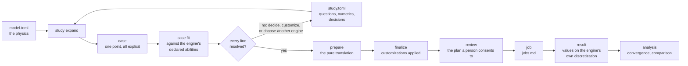
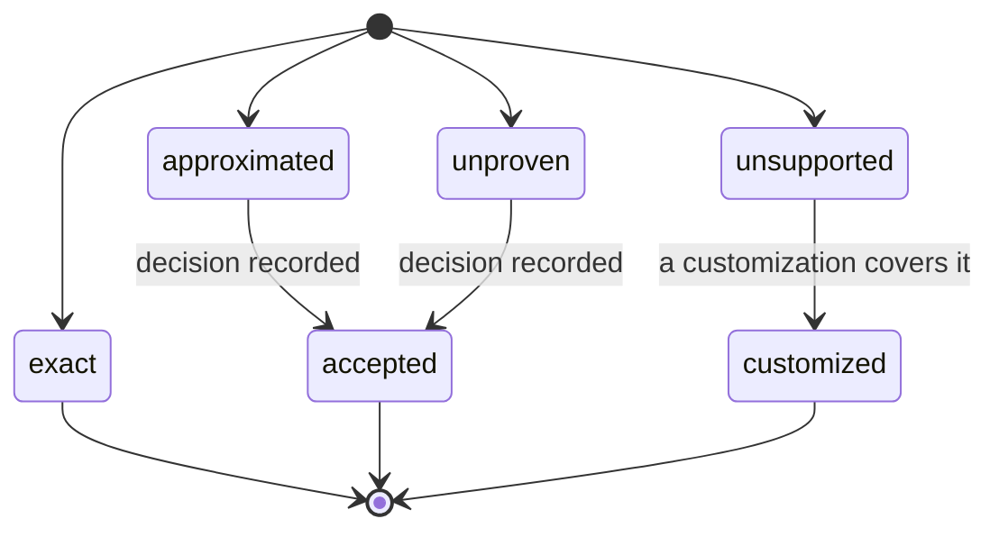
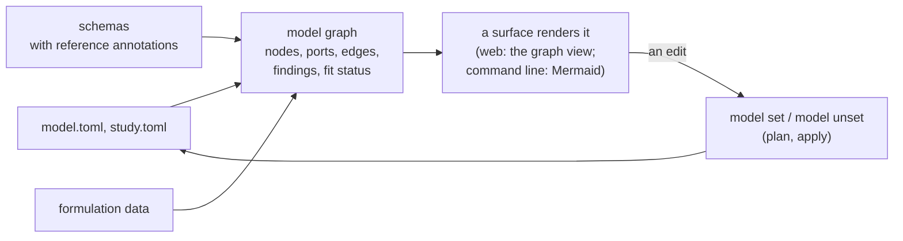

# Models — one calculation, described once, solved by a chosen engine

**Role:** contract
**Status:** current; nothing it describes is built yet — the work order is
[`../plans/plan.md`](../plans/plan.md) § 6
**Authority:** how a calculation is described independently of any engine; how
it is matched against an engine's declared abilities, with every limitation
shown; how a person decides on each limitation and adds their own steps; how
the result is prepared and handed to a job; the files involved and who writes
each. The reasons and the alternatives not chosen are
[ADR 0008](../decisions/0008-one-model-declared-abilities.md)

## The short version

| rule | § |
|---|---|
| A person describes **physics** — regions, materials, equations, conditions, sources, the quantities wanted — never solver input | 3 |
| Each file has **one writer**: model and study by the person, cases and reports by femkit, input by the engine's translator | 2 |
| The physics a model may state is a closed list of **formulations**, each solver-neutral and each with its analytic benchmark | 4 |
| Numerical policy, convergence axes and physical sweeps are separate parts of the **study**; a **case** is one point with every value explicit | 5 |
| Each engine **declares its abilities** as data; matching a case against them gives a **fit report**, one line per element of the case | 6 |
| Meshers are declared too: each engine meshes with its own by default, and a study may share one mesh between engines | 6.4 |
| Nothing is approximated silently: an approximation needs a recorded **decision**, an unsupported element a **customization** or another engine | 6, 7 |
| A person adds their own steps only at an engine's **declared extension points**, as files they own, referenced by path and hash — never by editing generated input | 8 |
| **prepare** writes the pure translation, **finalize** applies the customizations, **review** shows both and every decision before anything runs | 9 |
| Values are computed on the engine's own discretization and written to one result form; every result says how faithful it is to the model | 10 |
| The model is also a **graph** — nodes, typed ports, references as edges — derived from the files by femkit, never stored; a surface renders and edits it only through operations | 11.2 |

## 1. The chain



A person writes the model and the study. femkit expands the study into cases,
one per point. For a chosen engine, `case fit` matches a case against what the
engine declares it can do, and lists every element of the case with its status.
Until every line is resolved — by a recorded decision, a customization, or
another engine — nothing is prepared. Then the engine's translator writes the
input, the person's customizations are applied at their declared places, and
the person reviews the whole before the job runs ([`jobs.md`](jobs.md)). The
engine's own parser reduces the output to the observables the study asked
for; analysis compares cases and engines.

## 2. Files and their writers

```text
<calculation>/
├── model.toml                 the physics                                   the person
├── study.toml                 questions, numerical policy, axes, decisions  the person
├── custom/                    customizations: files the person owns         the person
├── cases/<case id>/
│   ├── case.json              one resolved case                             study expand
│   └── <engine>/
│       ├── fit.json           the fit report                                case fit, case prepare
│       ├── generated/         the pure translation, its manifest.json       the engine's translator
│       ├── final/             generated + customizations, its manifest.json case prepare (finalize)
│       └── runs/              one folder per run                            the job (jobs.md)
└── results/                   cross-case and cross-engine products          analysis
```

- **One writer each.** A file is written by its writer alone. `generated/` is
  evidence of the translation and is never edited; what a person wants changed
  is a customization (§ 8), applied into `final/`. Editing `generated/` or
  `final/` by hand makes the manifest's hashes disagree, and the next
  `case prepare` or job refuses, naming the file.
- **Intent is never read back from input.** Prepared input is evidence, never
  the source of intent ([`../design.md`](../design.md), scientific data).
- A case ID is the SHA-256 of the case's canonical JSON (keys sorted, one
  number form), so the same point always has the same ID whatever order its
  values were written in.
- How a job request names `final/` as its input is [`jobs.md`](jobs.md)'s, when
  local jobs are built (plan § 2, M3).

## 3. The model

The model states the physics and nothing about any engine. Its parts:

| part | holds | rule |
|---|---|---|
| `frame` | the length unit of the file, the origin, right-handed axes | every coordinate is in this frame; a plane is an origin and a normal, never a label |
| `geometry` | the shapes and how they combine (a parametric construction), or an imported CAD file with its SHA-256 | the dimension (2 or 3) is stated |
| `regions` | named domains (top dimension) and boundaries (one dimension lower), each selected from the geometry by an explicit rule: a shape, a plane, a box | every domain and every outer boundary belongs to exactly one region; an overlap or a gap is refused, naming the place |
| `materials` | named materials, each property with its value or table, unit, source, independent variable, interpolation rule, complex-value convention and valid range | a bare constant named after a substance ("gold") is refused |
| `assign` | a material for every domain region | a domain without one is refused |
| `formulation` | one formulation ID (§ 4) | unknown IDs are refused |
| `conditions` | for every boundary region, one condition of a kind the formulation allows, with its parameters | a natural condition is stated, not implied: a boundary with no condition is refused |
| `sources` | excitations of the kinds the formulation allows, attached to regions | — |
| `conventions` | what the formulation requires to be chosen, e.g. the phasor sign for a frequency-domain problem ([`../science/electromagnetics.md`](../science/electromagnetics.md)) | never defaulted |

Every dimensional value is written with its unit; internally one SI convention
holds, and conversion for display happens only at a surface. Unknown keys are
refused. `model check` applies every rule of this table and of the
formulation, and changes nothing.

An illustrative model — the exact keys are fixed by the schema when built
([`../reference/`](../reference/)):

```toml
schema = 1
formulation = "electrostatics"

[frame]
unit = "m"
origin = [0, 0]

[geometry]
dimension = 2
shapes.square = { kind = "rectangle", corner = [0, 0], size = [1, 1] }

[regions]
domain = { kind = "domain", shapes = ["square"] }
left   = { kind = "boundary", on.plane = { origin = [0, 0], normal = [-1, 0] } }
right  = { kind = "boundary", on.plane = { origin = [1, 0], normal = [1, 0] } }
sides  = { kind = "boundary", rest = true }        # every outer boundary not named above

[materials.vacuum]
relative_permittivity = { value = 1.0, source = "definition of vacuum" }

[assign]
domain = "vacuum"

[conditions]
left  = { kind = "potential", value = "0 V" }
right = { kind = "potential", value = "1 V" }
sides = { kind = "insulating" }                    # the natural condition, stated
```

## 4. Formulations

A formulation is one physical problem stated without reference to any engine.
femkit holds a closed list of them, as data under a schema
(`femkit/data/formulations/<id>.toml`), each with its science document. Each
states:

- the unknown, its function space and unit — e.g. potential φ in H¹ (V), or
  electric field **E** in H(curl) (V/m);
- the equation, with every symbol and unit defined near its first use, in its
  science document (`docs/science/`);
- the material properties it reads;
- the condition kinds and source kinds it allows, each with its parameters
  and their units;
- the conventions a model must choose;
- the derived quantities an observable may name — e.g. **E**, **D**, energy
  density, Poynting flux, absorbed power;
- its analytic benchmark: the case with a known answer that every engine's
  translation of it must reproduce before its results count.

A formulation enters femkit with its benchmark, never without. The first two
are `electrostatics` (its benchmark: Laplace on the unit square, exact
potential φ = x) and `maxwell-frequency`
([`../science/electromagnetics.md`](../science/electromagnetics.md)).

A problem no formulation states is still possible: it is a customization
(§ 8) of the nearest one, or custom input, and its result says so.

## 5. The study and its cases

The study names the model and holds everything that is not the physics:

| part | holds |
|---|---|
| `numerics` | the numerical policy: mesh sizes, globally and per region; element order; linear solver and tolerance; the mesher for each engine, or one shared mesher (§ 6.4) |
| `axes` | what varies, each axis of one class: **numerical convergence** (mesh, order, tolerance, outer padding, PML thickness), **geometry convergence** (truncation dimensions), **physical sweep** (wavelength, material, gap), **execution benchmark** (ranks, threads) |
| `observables` | the quantities wanted, each with a name, the quantity (a derived quantity of the formulation), its support — point, line, surface, volume, by region or explicit geometry — its reduction — value, average, integral, maximum, norm — normalization, unit and complex-value part |
| `engines` | the engines this study is prepared for, each with its own block of engine-only options (§ 6.3) |
| `decisions` | each recorded decision about a fit-report line (§ 7) |
| `customizations` | each customization the study uses (§ 8) |

- Axes of different classes are never combined silently: a study that crosses
  them names the classes and says why the full product is needed.
- `study expand` writes one case per point. A case is complete: every default
  the schema has is written into it, so nothing about a case depends on
  femkit's version or a person's settings. It is written once and never
  changed; a changed study gives new cases with new IDs.
- Resources (ranks, memory, wall time) are not part of a case; they belong to
  the job request ([`framework.md`](framework.md) § 4).

## 6. Engine abilities and the fit report

### 6.1 Abilities are declared

Each engine's definition file declares, per formulation it can solve, what it
can do — data under the schema of [`definitions.md`](definitions.md), read by
generic code:

- the element orders, condition kinds, source kinds, material models, linear
  solvers and output forms it supports;
- for each, one status: **exact** — as the formulation states it; or
  **approximated** — with the approximation stated in words, its basis (a
  derivation, a citation or a measurement), and the study axis that bounds its
  error where there is one; anything not declared is absent;
- the meshers whose meshes it reads, and its own (§ 6.4);
- its extension points (§ 8);
- its engine-only options and what each does.

A declared ability counts only once the engine's translation reproduces the
formulation's benchmark; until then the fit report marks it `unproven`.

### 6.2 The fit report

`case fit CASE --engine E` matches the case against E's abilities and writes
the fit report: one line for every element of the case — each region, material
assignment, condition, source, convention, observable and numerical option.

| status | meaning | resolved by |
|---|---|---|
| `exact` | translated as the case states it | — |
| `approximated` | the engine does a stated approximation | a decision accepting it (§ 7) |
| `unsupported` | the engine cannot do it | a customization covering it (§ 8), or another engine |
| `unproven` | declared, but the benchmark has not passed for this engine | a decision accepting it, or the benchmark passing |
| `engine-only` | an option from the engine's own block | — (shown; it never changes a common field) |
| `customized` | covered by a customization | — |



Nothing is prepared while a line is `approximated`, `unsupported` or
`unproven` without its resolution; the refusal lists each open line with the
commands or study entries that resolve it.

### 6.3 Engine-only options

An option that only one engine has lives in that engine's block of the study
and appears as an `engine-only` line. It may tune how the engine works —
a preconditioner, a mesh-curving order — and never changes the meaning of a
common field. An option that would change the physics is a customization that
says so (§ 8).

### 6.4 Meshers

A mesher turns the model's geometry and the study's mesh policy into a mesh
whose named parts are the model's regions. Meshers are declared as data
(`femkit/data/meshers/<id>.toml`), each stating the environment that provides
it, the geometry it can build (primitives, boolean operations, imported files),
the mesh controls it honors (sizes per region, grading, element order,
curving) and the mesh format it writes. Two are declared at first:

| mesher | provided by | builds |
|---|---|---|
| `netgen` | the `ngsolve` environment | constructive solid geometry, 2-D geometry and STL; no STEP import while its build sets `USE_OCC = false` |
| `gmsh` | the `elmer` environment | its own geometry kernels; ElmerGrid converts its meshes for Elmer |

- **Each engine meshes with its own by default** — NGSolve with Netgen, Elmer
  with Gmsh — declared as the engine's default mesher. A comparison between
  engines is then made on declared probes, lines, planes and regions, as every
  comparison is (§ 10).
- **A study may share one mesher** between its engines: one mesh per case,
  made once and read by every engine that declares it reads that mesher's
  meshes — NGSolve reads Gmsh meshes through Netgen's Gmsh reader. A
  difference between the engines is then their discretization alone.
- Geometry the chosen mesher cannot build is a fit-report line like any other
  (§ 6.2), resolved by another mesher, a `replace` customization supplying the
  mesh, or another engine.

## 7. Decisions

A decision is a person's recorded answer to one fit-report line, kept in the
study:

```toml
[[decisions]]
engine = "elmer"
line   = "conditions.outer"          # the fit-report line it resolves
accept = "approximated"              # or "unproven"
reason = "outer boundary at 3 wavelengths; the padding axis bounds the reflection"
```

- A decision names one line, one engine and its reason; a decision that matches
  no current line — the model or the engine changed — is refused as stale,
  naming it.
- Decisions live in the study, so one model can be prepared for different
  engines with different decisions.

## 8. Customizations

### 8.1 Kinds

A customization is the person's own addition to one engine's preparation, at a
point the engine's adapter declares. From lightest to heaviest:

| kind | does | e.g. for Elmer | e.g. for NGSolve |
|---|---|---|---|
| `overlay` | sets or adds an engine option in a named place, merged by name | a keyword in a SIF section, merged by section and keyword — femkit holds the SIF as a structure, never as text to patch | a solver or space option in the script's settings |
| `hook` | the person's code, run at a named point | a user solver module, compiled into the job with the environment's own compiler wrapper | a Python module whose `after_mesh`, `before_solve` or `after_solve` the generated script calls |
| `replace` | the person supplies one generated artifact | their own mesh, or one SIF section | their own mesh, or their own form definition |
| `step` | a program run in the job before or after the solve | a conversion, an extra post-processing | the same |
| `custom-input` | the person supplies the whole input | their own SIF and mesh | their own script |

### 8.2 Declaration

Each customization is declared in the study and is a file, or a folder, under
`custom/`:

| field | holds |
|---|---|
| `id` | its name |
| `engine`, `versions` | the engine it is for and the engine versions it was written against |
| `point` | the extension point the engine declares |
| `file` | its path under `custom/`; its SHA-256 is recorded in the manifest |
| `covers` | the fit-report lines it resolves |
| `physics` | whether it changes the physics the model states, and how, in a sentence |
| `description` | what it does, in a sentence |

- A customization that sets a value the translator took from the model — a
  frequency, a material value, a condition — is shown as "overrides model value
  …", and is accepted only with `physics` saying so.
- A missing file, a hash that differs from the one reviewed, an extension point
  the engine does not declare, an engine version outside `versions`, or a
  customization that covers no line, is refused, naming it.
- `custom-input` is a case like any other: prepared, reviewed, run and
  recorded. It is marked "not translated from the model", and femkit does not
  claim that its observables mean what the model's would.

### 8.3 Code a person supplies

A `hook`, `step` or `custom-input` runs inside the job, in the engine's
environment, under the same confinement as femkit's own steps
([`envs.md`](envs.md) § 4.4). It reaches femkit only as a file in the
calculation folder; no request field ever carries executable text
([`api.md`](api.md) § 5). Consent to run it is the review (§ 9.3), which shows
each one with its hash.

## 9. Preparation

### 9.1 prepare: the pure translation

Each engine has one translator per formulation it declares, in its own package
(`femkit/engines/<engine>/`). A translator reads the case as its JSON
document and writes `generated/` and its manifest; it runs inside the engine's
environment, beside that environment's own tools, like the engine's check
programs ([`framework.md`](framework.md) § 1). The manifest holds:

- the engine and the version range the translation needs;
- every generated file with its SHA-256;
- the mesh's fingerprint;
- the map from each region name to the engine's identifiers;
- the exact command and its declared variables;
- the products the run must leave, for the parser.

The mesh is made by the mesher the study chose for this engine (§ 6.4): by
the engine's own, inside its environment, as part of its preparation; or, for
a shared mesher, once per case, before any engine's preparation, and listed in
each manifest by its fingerprint. Each region is a named part of the mesh, and
the manifest maps each region name to the engine's identifiers.

### 9.2 finalize: the customizations applied

`case prepare` copies `generated/` to `final/` and applies each
customization at its point: overlays merged by name, replaced artifacts
swapped, hooks and steps placed where the generated input calls them. The
final manifest lists every customization with its hash and every file that
differs from `generated/`.

### 9.3 review

The plan `case prepare` shows before consent ([`api.md`](api.md) § 3) holds
the fit report, every decision with its reason, every customization with its
hash and what it covers, the files `final/` changes from `generated/`, and the
command. A job starts only from a `final/` whose manifest agrees with the
files on disk ([`jobs.md`](jobs.md)).

## 10. Results

- **Values on the engine's own discretization.** Each engine's parser runs
  inside its environment after the run and computes the study's observables
  with the engine's own basis functions — a volume average of an H(curl)
  field is computed from the field itself, not from values exported to mesh
  nodes. It writes one result document per run in one form for every engine:
  each observable's value, unit, support, reduction and the discretization it
  came from, and the mesher that made the mesh.
- **Raw output stays** beside the result; a parser never substitutes zero or
  an empty array for missing output.
- **Fields for viewing** are exported in a ParaView-readable form
  ([ADR 0002](../decisions/0002-paraview-visualization-boundary.md)).
- **Fidelity.** Every result carries its case's fidelity: `exact`,
  `approximated` (listing each decision), `customized` (listing each
  customization, and those that change physics), or `custom-input`.
- **Four statements.** Process success, algebraic convergence, mesh
  convergence and physical validity are recorded separately
  ([`../design.md`](../design.md)).
- **Comparisons** across cases and engines are analysis's, on declared probe
  lines, planes and regions, never on raw node indices; a comparison is refused
  when the two sides do not solve the same stated problem — frame, excitation
  normalization, material convention, observable support or fidelity — naming
  the difference. Analysis has its own contract when it is built (plan § 6).

## 11. Surfaces

### 11.1 Commands

| command | does | changes |
|---|---|---|
| `model check [PATH]` | every rule of § 3 and the formulation | nothing |
| `model graph [--engine E] [--mermaid]` | the model and study as a graph (§ 11.2), with each node's findings and, with an engine, its fit status | nothing |
| `model set PATH VALUE`, `model unset PATH` | one edit of `model.toml` or `study.toml`: add or replace an entry, set a reference, remove an entry; keeps the file's comments and layout | the file |
| `study expand` | writes the study's cases | `cases/` |
| `case fit CASE --engine E` | the fit report | `fit.json` |
| `case prepare CASE --engine E` | refuses while a line is open; prepare, finalize; its plan is the review | `generated/`, `final/` |

A job then runs `final/` ([`jobs.md`](jobs.md), plan § 2, M3–M4).

### 11.2 The model as a graph

A model is a graph by construction: every reference in it is by name. femkit
derives the graph from the files and the schemas; it is never stored, and no
surface draws it from a list of its own.



- **Nodes** are the objects of the two files — the frame, each shape, region,
  material, assignment, condition, source, convention and observable; the
  formulation; the study's numerics, axes, meshers, decisions and
  customizations. A node's ID is the object's address in its file
  (`model:regions.left`), so every edit names exactly what it changes.
- **Ports are typed by the schema.** A field that refers to another object
  carries its target type in the schema — `region:boundary`, `region:domain`,
  `material`, `quantity` — and becomes a port of that type; a reference becomes
  an edge. A port accepts only its own type: a condition attaches only to a
  boundary region.
- **The palette comes from the formulation**: the condition, source and
  observable kinds it allows, and the material properties it reads. Nothing
  else can be added.
- **Status.** Each node carries the findings of `model check` that name it;
  with an engine, each also carries its fit-report status (§ 6.2), so a
  surface can mark what the engine does exactly, approximately or not at all.
- **Two tiers of validity.** An edit that would leave the file unloadable — a
  wrong type, a reference to an object that does not exist — is refused. An
  incomplete model — a boundary still without a condition — is allowed while
  it is being built, and shown as findings; it is refused only when cases are
  expanded or prepared.
- **Layout is presentation.** Node positions live in
  `<calculation>/.femkit/layout.json`, written through its own operation and
  read by no other step; deleting it loses only positions.

### 11.3 The web interface

The web interface renders this graph and every operation's forms, and edits
only through these operations ([`api.md`](api.md) § 5). It handles
customizations as files in the calculation folder.

## 12. Where each part lives

| part | home |
|---|---|
| model, study, case schemas; expansion and case IDs; matching and the fit report; decisions; customization resolution; preparation orchestration | `femkit/models/`, a domain after `envs` ([`framework.md`](framework.md) § 1) |
| formulations | `femkit/data/formulations/<id>.toml`, under schema; the equations in `docs/science/` |
| meshers | `femkit/data/meshers/<id>.toml`, under schema |
| abilities, extension points, engine-only options | each engine's definition file ([`definitions.md`](definitions.md)) |
| translators and parsers | `femkit/engines/<engine>/`, run inside the engine's environment |
| the graph (§ 11.2) | derived in `femkit/models/` from the files and the schemas' reference annotations; positions in `<calculation>/.femkit/layout.json` |
| analysis | `femkit/analysis/`, with its own contract when built |

## 13. Refusals

| refused | names |
|---|---|
| an unknown key; a dimensional value without its unit | the key |
| a domain or boundary in no region, or in two | the place |
| a domain without a material; a boundary without a condition | the region |
| a material property without source, convention or range | the material and property |
| a formulation, condition kind or source kind not declared | the ID and the declared ones |
| a convention the formulation requires, left unchosen | the convention |
| axes of different classes crossed without a stated reason | the axes |
| preparing with an open fit-report line | each line and what resolves it |
| a stale decision | the decision |
| a customization: missing file, changed hash, undeclared point, engine version outside its range, covering nothing, overriding a model value without saying so | the customization and the reason |
| a job from a `final/` whose files disagree with its manifest | the file |
| an edit that would leave `model.toml` or `study.toml` unloadable | the address and the reason |
| a comparison of results that do not solve the same stated problem | the difference |
