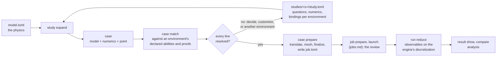
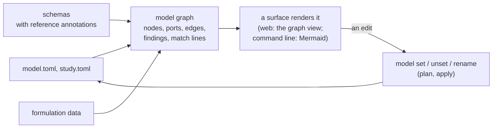

# Models — one calculation, described once, solved in a chosen environment

**Role:** contract
**Status:** current; of what it describes, the units ([`core.md`](core.md)
§ 11), the model and study schemas with their first tier of validity
(§ 11.2; [`../reference/models.md`](../reference/models.md)), the formulation
type with `electrostatics`, `model check`, `study expand`, `study copy`,
`case list` and case IDs are built — the rest is
[`../plans/plan.md`](../plans/plan.md) § 3, M5, M6, M8, M9
**Authority:** how a calculation is described independently of any engine; how
it is matched against an engine environment's declared abilities, with every
limitation shown; how abilities are proven; how a person decides on each
limitation and adds their own steps; how a case is prepared and handed to a
job; how results are reduced and compared; the files involved and who writes
each. The reasons and the alternatives not chosen are
[ADR 0008](../decisions/0008-one-model-declared-abilities.md)

## The short version

| rule | § |
|---|---|
| A person describes **physics** — parameters, geometry, regions, materials, one formulation, conditions, sources — never solver input; a **study** asks the questions and binds each environment's choices | 3, 5 |
| A **project** holds one model, its studies, its cases and their preparations; a study's prepared case is a job's calculation folder | 2 |
| Each file has **one writer**; every JSON file carries a `schema` number | 2 |
| The physics a model may state is a closed list of **formulations**, solver-neutral, each with its benchmark set | 4 |
| A **case** is the model, the numerics and one axis point — nothing about an environment or a study; its ID is the hash of that, canonical and unit-exact | 5 |
| Each **engine environment declares its abilities** as data; matching a case gives a **match report**: for each element, how exactly the environment translates it and whether that is proven | 6 |
| An ability counts only once **proven** in that environment by benchmark runs, recorded beside the environment and keyed to everything it rests on | 6.3 |
| Nothing is approximated silently: an approximation or an unproven ability needs a **decision**, an unsupported element a **customization** or another environment; both are bound per environment in a study and go stale when what they answered changes | 7, 8 |
| **Meshers** are declared: each engine meshes with its own by default; a study may share one mesh | 6.5 |
| **case prepare** writes the pure translation, applies the customizations and writes the job request; the **job's plan** is the review; a preparation is `blocked`, `orphaned`, `open`, `stale` or `prepared` | 9 |
| Values come from the engine's own discretization; every observable says how faithful it is; comparisons show fidelity and refuse what does not solve the same stated problem | 10 |
| The model is also a **graph** derived from the files; a surface renders and edits it only through operations, addressed in one grammar | 11 |

## 1. The chain



A person writes the model and one or more studies. `study expand` writes the
study's cases. For a chosen engine environment, `case match` matches a case
against what that environment declares, and has proven, it can do, and lists
every element of the case with its status. Until every line is resolved — by a
recorded decision, a customization, or another environment — nothing is
prepared. `case prepare` writes the input, applies the customizations and
writes the job request; the job's plan shows the person what will run before
it runs ([`jobs.md`](jobs.md)). After the run, `run reduce` computes the
study's observables; results are compared on declared probes.

## 2. The project: folders, files and writers

```text
<project>/
├── model.toml                      the physics                                   the person
├── studies/<study>/
│   ├── study.toml                  questions, numerics, axes, bindings           the person
│   └── prepared/<case id>/<environment>/   a calculation folder (jobs.md § 1):
│       ├── generated/              the pure translation                          the environment's translator
│       ├── final/                  generated plus customizations: the job's inputs   case prepare
│       ├── manifest.json           what the preparation was made from (§ 9.4)    case prepare
│       ├── job.toml                the job request                               case prepare (jobs.md's preparer)
│       └── run-NNN/                one start, and its result.json (§ 10)         the job; run reduce
├── cases/<case id>/case.json       one resolved case, shared by the studies that produce it   study expand
├── meshes/<key>/                   a shared mesh and its manifest (§ 6.5)        case prepare
├── custom/                         customizations: files the person owns         the person, or the customization's operation (§ 8.2)
├── results/                        cross-case and cross-environment products     result compare, analysis
└── .femkit/
    ├── layout.json                 node positions for the graph (§ 11.2)         model layout
    ├── preview/                    a coarse mesh labeled by region (§ 11.1)      model preview
    └── uploads/<sha256>            files received by the web, before they are named   the upload route (api.md § 5.5)
```

- **One writer each.** A file is written by its writer alone. `generated/` is
  evidence of the translation and is never edited; what a person wants changed
  is a customization (§ 8), applied into `final/`. A file whose hash differs
  from its manifest makes the preparation `stale` (§ 9.5), and the job refuses
  it ([`jobs.md`](jobs.md)).
- **Preparations belong to their study.** Two studies that produce the same
  case — a copy, or a convergence study and a sweep sharing a point — share
  its `case.json` and prepare it separately, each with its own bindings and
  runs.
- **Intent is never read back from input.** Prepared input is evidence, never
  the source of intent ([`../design.md`](../design.md), scientific data).
- **Every JSON file carries `schema`**, an integer raised when its shape
  changes: `case.json`, `manifest.json`, `result.json`, `layout.json`, a
  mesh's manifest, the proof record (§ 6.3).
- **A case is named by its content**, its ID (§ 5): "500 nm" and "0.5 µm"
  give the same ID, and renaming a region or a material changes the case and
  its ID — the old preparations become `orphaned` and keep their runs.
- **Benchmarks** (§ 6.3) are projects femkit writes, one per benchmark,
  `<data>/benchmarks/<environment>/<formulation>/<mesher>/<benchmark>/`, each
  a model and a study laid out as above.

## 3. The model

The model states the physics and nothing about any engine, environment or
numerical choice.

| part | holds | rule |
|---|---|---|
| `parameters` | named quantities with units — a gap, a wavelength, a length — and expressions of them with `+`, `−`, `×`, `÷` and parentheses (`gap / 2`) | the only values a study's axes vary besides numerics (§ 5) |
| `frame` | the length unit a bare-number coordinate is written in; the axes are Cartesian and right-handed, their origin where coordinates are zero | a coordinate is a number in this unit, a quantity (`"20 nm"`) or an expression of parameters; a plane is a point and a normal, never a label |
| `geometry` | the dimension (2 or 3) and what it means for the formulation (§ 4), the shapes and how they combine, or an imported CAD file with its SHA-256 | — |
| `regions` | named domains (top dimension), outer boundaries and interfaces (internal boundaries between two domains), each with its `kind` and exactly one selection rule, under the rule's own key: `shapes` (a domain: named shapes), `plane` (a point and a normal), `box`, `faces_of` (the outer faces of a named shape) or `rest` (the outer boundary no other region selects), `between` (an interface: two named domains) | names match `[a-z][a-z0-9_]*`; every domain and every outer boundary belongs to exactly one region, and an overlap or a gap is refused, naming the place — where a mesher runs (§ 9.2), since it needs the geometry built; a face between two domains is continuous by the formulation's function space, and is named as an interface only to carry a sheet condition or an observable's support |
| `materials` | named materials; each property with its value or table, unit, source, independent variable, interpolation rule, the complex-value convention of the source data (`"real"`, `"exp(-iwt)"`, `"exp(+iwt)"`), and valid range (`"all"`, or `[from, to]` in its variable) | a bare constant named after a substance is refused; a case outside a property's range is refused when expanded — the case's value of the range's variable is the model's parameter of that name (`wavelength`) |
| `assign` | a material for every domain region | — |
| `formulation` | one formulation ID (§ 4) | — |
| `conventions` | what the formulation requires to be chosen — for a frequency-domain problem, `phasor` (`"exp(-iwt)"` or `"exp(+iwt)"`: the sign s of [`electromagnetics.md`](../science/electromagnetics.md)) and `amplitude` (`"peak"` or `"rms"`) | never defaulted |
| `conditions` | for every outer boundary, one condition of a kind the formulation allows; for every named interface, `interface` (continuity, stated) or a sheet condition the formulation allows | a natural condition on an outer boundary is stated, never implied |
| `radiation` | for an open problem: the outer boundaries through which waves leave to infinity, and the background medium beyond them | how the domain is truncated there is numerics, chosen per environment (§ 5) |
| `sources` | excitations of the kinds the formulation allows, attached to regions, with every parameter the formulation lists — for a plane wave: total or scattered field, amplitude, polarization, direction, the background medium, the phase reference point | — |

- **Units.** Every dimensional value is written with its unit (`"1 nm"`) or as
  an expression of parameters (`"gap / 2"`); a coordinate may also be a bare
  number, in the frame's unit. Internally each quantity has a canonical
  unit — SI, and degrees for angles, so that a written angle stays exact — and
  is held as an exact rational (§ 2); translators convert to what an engine
  reads. Conversion for display happens only at a surface, in the study's
  display units. Unknown keys are refused. The grammar, the unit table and the
  canonical units are [`core.md`](core.md) § 11; a parameter may not be named
  like a unit.
- **Complex values follow the model's convention.** Each material table is
  converted from its source's convention to the model's when the case is
  expanded, and the case records the conversion. A passive material whose
  converted loss has the wrong sign — a gain medium made by a convention
  mismatch — is refused, naming the material and its source convention.
- `model check` applies every rule of this table and of the formulation but
  region coverage, which needs the geometry built, and changes nothing.

The Laplace check (plan § 3, M6) in the schema's keys; once the schema is
built, [`../reference/`](../reference/) lists every key:

```toml
schema = 1
formulation = "electrostatics"

[parameters]                    # a quantity, or an expression of parameters above it
bias = "1 V"

[frame]
unit = "m"                      # bare-number coordinates are in metres

[geometry]
dimension = 2
meaning = "per unit depth"      # what 2-D means for electrostatics (§ 4)

[geometry.shapes]
square = { kind = "rectangle", corner = [0, 0], size = [1, 1] }

[regions]                       # exactly one selection rule each
domain = { kind = "domain", shapes = ["square"] }
left   = { kind = "boundary", plane = { point = [0, 0], normal = [-1, 0] } }
right  = { kind = "boundary", plane = { point = [1, 0], normal = [1, 0] } }
sides  = { kind = "boundary", rest = true }

[materials.vacuum.relative_permittivity]
value = "1"
convention = "real"
source = "definition of vacuum"
range = "all"

[assign]
domain = "vacuum"

[conditions]
left  = { kind = "potential", value = "0 V" }
right = { kind = "potential", value = "bias" }
sides = { kind = "insulating" }
```

- **Shapes**: in 2-D `rectangle`, `disk`, `polygon`; in 3-D `box`, `sphere`,
  `cylinder`, `extrusion` (a polygon swept along a vector); `union`,
  `difference` and `intersection` of named shapes (`of = [...]`); `import`, a
  CAD file under `custom/` with its SHA-256. Overlapping domains have no
  precedence: a medium around bodies is an explicit `difference`.
- **A tabulated property**, for a frequency-domain model (plan § 3, M9):

  ```toml
  [conventions]
  phasor = "exp(-iwt)"
  amplitude = "peak"

  [materials.gold.relative_permittivity]
  table = "custom/materials/gold-jc.csv"   # columns: the variable, real part, imaginary part
  sha256 = "…"
  variable = { name = "wavelength", unit = "nm" }
  interpolation = "linear"
  convention = "exp(-iwt)"                 # the source data's
  source = "Johnson and Christy, Phys. Rev. B 6, 4370 (1972)"
  range = ["188 nm", "1937 nm"]

  [radiation]
  boundaries = ["outer"]
  background = "water"
  ```

## 4. Formulations

A formulation is one physical problem stated without reference to any engine.
femkit holds a closed list of them, as data under a schema
(`femkit/data/formulations/<id>.toml`, a definition type of
[`definitions.md`](definitions.md) § 1), each with its science document. Each
states:

- the unknown, its function space and unit — potential φ in H¹ (V), electric
  field **E** in H(curl) (V/m);
- the equation, with every symbol and unit defined near its first use, in its
  science document (`docs/science/`: `electrostatics.md` for `electrostatics`,
  [`electromagnetics.md`](../science/electromagnetics.md) for
  `maxwell-frequency`);
- what each dimension means for it — for `electrostatics` in 2-D, per unit
  depth or axisymmetric; for `maxwell-frequency` in 2-D, TE or TM — chosen in
  the model, never assumed;
- the material properties it reads;
- the condition, source and truncation kinds it allows, each with its
  parameters and their units;
- the conventions a model must choose;
- the derived quantities an observable may name — **E**, **D**, energy
  density, Poynting flux, absorbed power — and expressions of them (plan § 3,
  M6);
- its **benchmark set** (§ 6.3): problems with known answers — each a model, a
  study binding what each environment chooses (a truncation, say), and its
  reference solution — chosen so that each
  ability they prove is one an error would show in. A solution a translation
  reproduces whatever it gets wrong proves nothing: φ = x on a square is
  reproduced exactly by linear elements and does not depend on ε. So a set
  holds manufactured, non-polynomial solutions with a measured convergence
  rate per element family, degree and geometry order — their sources and
  boundary values written in the expression language (plan § 3, M6) — a
  two-material case for interfaces and ε, and, for `maxwell-frequency`, TE and
  TM cases in 2-D, a reflection benchmark for each truncation, and a lossy,
  open problem with a known answer — scattering by a lossy sphere against its
  series solution, its absorbed power positive — so that a wrong phasor sign or
  truncation shows.

Loading a formulation checks that each ability any environment declares for it
is exercised by at least one benchmark; one that is not could never be proven,
and is refused.

`electrostatics` in its keys, in part — the whole file is
`femkit/data/formulations/electrostatics.toml`, and every key is in
[`../reference/definitions.md`](../reference/definitions.md). Each property,
condition, source and derived quantity carries the one plain sentence a person
reads beside it — a tooltip in the page, a hint in a finding, a line of the
reference — and the section of the science document that defines it; loading
refuses a section the document lacks. Abilities name its kinds from each
environment's definition (§ 6.1), and its benchmark set is a table of its own
here:

```toml
description = "the electrostatic potential: -div(eps grad phi) = rho"
science = "docs/science/electrostatics.md"
unknown = { name = "potential", space = "H1", unit = "V" }
meanings = { 2 = ["per unit depth", "axisymmetric"], 3 = ["full"] }
conventions = []

[properties.relative_permittivity]
description = "the material's relative permittivity, eps_r: a real, positive number"
section = "1-terms-and-symbols"
unit = "1"
complex = false

[conditions.surface_charge]
description = "the boundary is the surface of a conductor carrying a free charge; femkit writes n . D = -sigma"
section = "3-conditions-on-an-outer-boundary"
on = ["boundary"]
parameters.value = { unit = "C/m^2", description = "sigma, the free charge per unit area on the conductor's surface" }

[derived.electric_field]
description = "E = -grad phi"
section = "7-derived-quantities"
unit = "V/m"
```

**Scope.** One formulation per model. Coupled problems (photothermal heating,
a field-dependent conductivity), eigenproblems and time-domain problems are
not stated by these two; each would be a formulation of its own. Symmetry
planes and periodicity are conditions a formulation lists when it allows them;
until then a model is solved whole.

A problem no formulation states is still possible, as a customization of the
nearest one (§ 8); its results say so.

## 5. Studies and cases

A project holds one or more studies, `studies/<study>/study.toml`; `study
copy` starts one from another. A study names its model's parameters and holds
everything that is not the physics:

| part | holds |
|---|---|
| `numerics` | the element family, its degree and the geometry order (common fields, each mapped per environment with a match status, § 6.4); the mesh policy — sizes globally and per region, and the length unit geometry is handed to the mesher in (§ 6.5); the linear solver and its tolerance; the adaptivity block — error limit, smallest element, depth, the re-mesher — when the mesh adapts |
| `axes` | what varies — parameters and numerics only — each axis keyed by the case path it varies (`parameters.<name>`, `numerics.<path>`), with its values and one class: **numerical convergence** (mesh, degree, tolerance, the open domain's padding and layer thickness), **geometry convergence** (lengths of the modeled structure that stand for a longer one, such as an electrode's), **physical sweep** (wavelength, material, gap) |
| `observables` | each with a name, the quantity (a derived quantity of the formulation, or an expression of them and of coordinates — `\|φ − x\|`), its support — point, line, surface, volume, by region or explicit geometry; on an internal boundary, the side it is read from — its reduction — value, average, integral, maximum, norm — the source it is normalized by, total or scattered field, unit and complex part |
| `environments.<environment>` | per engine environment, the study's bindings: its mesher (or the study's shared mesher), its truncation of each radiation boundary — an absorbing condition, or a perfectly matched layer on named layer regions with its profile, its parameters and the condition on its outer face — its engine-only options (§ 6.4), its decisions (§ 7), its customizations (§ 8), and its job's resources ([`jobs.md`](jobs.md) § 2) |
| `display` | a list of units: a value shows in the first listed unit of its dimension, else in its canonical unit (`["nm"]` for a nanogap) |

- Several axes are crossed. Axes of different classes are never crossed
  silently: the study says why the full product is needed, in `axes.reason`.
The Laplace check's study:

```toml
schema = 1
display = ["m", "V", "V/m"]

[numerics]
element = { family = "lagrange", degree = 1 }
geometry_order = 1
mesh = { unit = "m", size = "0.05 m", regions = { left = "0.01 m" } }
solver = { kind = "direct" }            # or { kind = "iterative", tolerance = "1e-10" }

[axes."numerics.mesh.size"]             # keyed by the case path it varies
class = "numerical convergence"         # | "geometry convergence" | "physical sweep"
values = ["0.1 m", "0.05 m", "0.025 m"]

[observables.midpoint]
quantity = "potential"
support = { point = [0.5, 0.5] }
reduction = "value"
unit = "V"

[environments.elmer]
mesher = "gmsh"
resources = { ranks = 1, threads = 1, gpus = 0, wall = "00:10:00", memory = "2G" }   # jobs.md § 2

[environments.ngsolve]
mesher = "netgen"
resources = { ranks = 1, threads = 1, gpus = 0, wall = "00:10:00", memory = "2G" }
```

- **A case is the model, the numerics and one axis point.** Nothing bound to an
  environment or a study enters a case: recording a decision changes no case
  ID, two environments prepare the same case, and two studies share it.
- **Truncation is an environment's choice**, recorded in its manifest and
  every result: a perfectly matched layer in one environment and an absorbing
  condition in another are two numerical approximations of one stated
  radiation condition, which a comparison shows (§ 10).
- `study expand` writes one `case.json` per point it lacks. A case is complete:
  every default the schema has is written into it, and every material
  converted (§ 3), so nothing about a case depends on femkit's version or a
  person's settings. It is refused while `model check` has a finding, and for
  axes of different classes crossed without a reason.
- **`case.json`** holds `schema`, `model`, `numerics` and `point`, each
  resolved: the axis point applied — a parameter's value replaced, and every
  parameter computed again from it; every quantity — a parameter, a coordinate
  (a bare number times the frame's unit, so the frame itself is resolved away),
  a condition's or source's parameter, a material's value or range, a mesh size
  — written as `{"value": "<p/q>", "dimension": {"<base>": <power>}}`, its exact
  value in its dimension's canonical units ([`core.md`](core.md) § 11); every
  other number — a degree, a direction's component — as its exact value in text
  (`"2"`, `"-1/2"`), so `-1` and `-1.0` are one value; every schema default
  written; each tabulated property's rows read from its file,
  checked against its SHA-256, converted to the model's phasor convention, with
  the conversion recorded beside them. `point` maps each axis's case path to its
  value in the same form. Only `model`, `numerics` and `point` enter the case:
  the study's observables, display units and environment bindings never do.
- **The case ID** is the SHA-256 of `case.json`'s canonical JSON — keys sorted,
  no whitespace, UTF-8 — so two spellings of one value give one ID, and two
  studies producing the same point share one case. Its plan lists the cases it adds, those it keeps, and the
  study's preparations of cases it no longer produces, which become `orphaned`
  (§ 9.5) and are never deleted by it.
- `case list` shows every case with its axis values and, per study and
  environment, its match and preparation state; a case may be named by a
  unique prefix of its ID.
- Execution benchmarks — ranks, threads — are job requests, not cases: the
  same case run on different resources must give the same answer.

## 6. Abilities, proof and the match report

### 6.1 Abilities are declared per environment

Each engine environment's definition ([`definitions.md`](definitions.md) § 4)
declares, per formulation it can solve, what it can do; a `-cuda` environment's
`[cuda]` part adds what only it can do, such as AmgX. Declared as data, read by
generic code:

- the element families, degrees and geometry orders, condition, source,
  truncation and material kinds, linear solvers, reductions (computed after the
  run, or inside the generated input, § 10) and output forms it supports;
- for each, how exactly: **exact** — as the formulation states it; or
  **approximated** — with an approximation ID, the approximation in words, its
  basis (a derivation, a citation or a measurement), and the study axis that
  bounds its error where there is one; anything not declared is absent;
- the meshers whose meshes it reads, and its default mesher (§ 6.5);
- its extension points (§ 8);
- its engine-only options and what each does.

Each declared ability has a digest, the hash of its declaration, so a decision
or a proof names exactly what it answered.

### 6.2 The match report

`case match CASE --study S --environment E` matches a case, with the study's
bindings for E, against E and prints the match report; it writes nothing.
`study match` does it for every case of a study and shows, per element, the
worst line across them. One line per element — the geometry and the mesher's
ability to build it, each region, material assignment, convention, condition,
radiation boundary and its truncation, source, observable, and numerics item —
each with two facts:

| fact | values | meaning |
|---|---|---|
| translation | `exact` | translated as the case states it |
| | `approximated` | the environment does a stated approximation |
| | `unsupported` | the environment cannot do it |
| | `engine-only` | an option from the environment's own block; it never changes a common field |
| | `customized` | covered by a customization (§ 8) |
| proof | `proven` | proven in this environment, as § 6.3 records |
| | `unproven` | not proven in this environment |

Proof applies to declared abilities only: an `engine-only` or `customized`
line has no proof fact, and a customization resolves its line by itself. A line
is **open** when it is `approximated` or `unproven` without a current decision
accepting it (§ 7), or `unsupported` without a customization covering it. Nothing is prepared while a line is open; the refusal lists each open line
with what resolves it. The match report a preparation was made from is kept in
its manifest (§ 9.4).

### 6.3 Proof

An ability counts as proven in an environment once that environment's
translation has reproduced the formulation's benchmarks that exercise it
(§ 4), in runs:

1. `formulation verify FORMULATION --environment E [--mesher M] --resources
   FILE` writes the projects of the benchmarks that exercise an ability E
   declares into `<data>/benchmarks/E/FORMULATION/<mesher>/` — the
   environment's own mesher unless one is named — with the job resources the
   file gives (a `[resources]` table, [`jobs.md`](jobs.md) § 2), and prepares
   each. A benchmark is exempt from the proof rule, from decisions and from the
   comparison refusal of § 10 — it is how an ability and its approximation are
   measured — and from nothing else.
2. The person launches each benchmark's job, one job per launch
   ([`jobs.md`](jobs.md)).
3. `formulation verify FORMULATION --environment E [--mesher M] --record`
   reduces the finished runs, compares each against its reference solution, and
   records each ability whose benchmarks all passed in
   `<prefix>/.femkit/proofs.json`, citing the runs.

A proof is keyed to everything it rests on: the environment's install
fingerprint and its lock's hash, the digest of its engine package (translators,
parsers and finalizers), the ability's digest, and the mesher — with the
shared mesher's environment fingerprint and lock hash when a mesh is shared.
Any of them changing makes the ability `unproven` again. The record's schema
is `models`'; it goes with the prefix when the environment is removed.

### 6.4 Engine-only options and common numerics

An option only one engine has lives in that environment's block of the study
and appears as an `engine-only` line: a preconditioner, a reordering. It never
changes the meaning of a common field. What changes the discrete problem —
the element family and degree, the geometry order and curving, the mesh — is a
common numerics field, mapped per environment with its match status, because
two engines given the same words must solve the same discrete problem or say
they do not: NGSolve's H(curl) space of a degree differs by its type from
Elmer's Whitney and second-kind bases of the same degree.

### 6.5 Meshers

A mesher turns the model's geometry and the study's mesh policy into a mesh
whose named parts are the model's regions. Meshers are declared as data
(`femkit/data/meshers/<id>.toml`, a definition type), each stating the
environment that provides it, the geometry it can build (primitives, boolean
operations, imported files), the mesh controls it honors, its geometric
tolerance — absolute or relative to the model's size — the mesh format and
version it writes, the geometry orders it writes, and the region names it
keeps.

| mesher | provided by | builds | writes |
|---|---|---|---|
| `netgen` | the `ngsolve` environment | constructive solid geometry, 2-D geometry and STL; no STEP import while its build sets `USE_OCC = false` | its own mesh, curved to its geometry |
| `gmsh` | the `elmer` environment | its own geometry kernels; ElmerGrid converts its meshes for Elmer | MSH 2.2 ASCII when the mesh is shared, the form Netgen's Gmsh reader parses; first or second geometry order, which ElmerGrid and Netgen's reader both keep |

- **Each engine meshes with its own by default** — NGSolve with Netgen, Elmer
  with Gmsh — declared as the environment's default mesher, and run inside the
  environment during its preparation; no person's code runs there. A
  comparison between environments is then made on declared probes and regions,
  as every comparison is (§ 10).
- **A study may share one mesher** between environments: one mesh per geometry
  and mesh policy, made once under `<project>/meshes/<key>/` and copied into
  each environment's `generated/` as an input of its job. A difference between
  the environments is then their discretization alone. A shared mesh whose
  geometry order is lower than the study's is a match line.
- **A mesh is keyed by the geometry and the mesh policy**, so cases that differ
  only in a wavelength or a material share one mesh, and mesh noise stays out
  of a spectrum.
- **Length unit.** Geometry is handed to the mesher in the study's mesh length
  unit. A mesher whose declared tolerance would merge the smallest geometric
  feature in that unit — Gmsh's absolute tolerance merges a 1 nm gap written in
  metres — is a match line naming a unit that works. Every derived quantity the
  unit change scales — fields, powers, fluxes, the wavenumber — is rescaled by
  the translator, and the factor is recorded in the manifest.
- Geometry the mesher cannot build is a match line, resolved by another mesher,
  a `replace` customization supplying the mesh, or another environment.

## 7. Decisions

A decision is a person's recorded answer to one match line, bound to one
environment in a study:

```toml
[environments.elmer.decisions."model:radiation.outer"]
accept = ["approximated", "unproven"]           # what of the line it accepts
approximation = "first-order-absorbing"         # the ID the ability declares
reason = "outer boundary at 3 wavelengths; the padding axis bounds the reflection"
```

- A decision names its line by address (§ 11.1), its environment and its
  reason, and records what it accepted: the translation status and
  approximation ID, whether the line was unproven, and the ability's digest
  and engine version when it was recorded.
- **Stale is detected.** A decision whose recorded acceptance no longer matches
  the line — the environment changed its approximation, its version or its
  declaration, or the line's proof changed — is stale; the match report shows
  what was accepted beside what is declared now, and nothing is prepared until
  the person answers again. A decision whose line is now `exact` and `proven`
  is reported as no longer needed.
- A decision may be limited to cases by their axis values (an absorbing
  boundary accepted at the short wavelengths only).

## 8. Customizations

### 8.1 Kinds

A customization is the person's own addition to one environment's preparation,
at a point that environment's engine package declares. From lightest to
heaviest:

| kind | does | e.g. for Elmer | e.g. for NGSolve |
|---|---|---|---|
| `overlay` | sets or adds an engine option in a named place, merged by name | a keyword in a SIF section, merged by section and keyword — femkit holds the SIF as a structure, never as text to patch | a solver or space option in the script's settings |
| `hook` | the person's code, called by the generated input inside the job | a user solver module, compiled into the job with the environment's own compiler wrapper | a Python module whose `before_solve` or `after_solve` the generated script calls |
| `replace` | the person supplies one generated artifact | their own mesh, or one SIF section | their own mesh, or their own form definition |
| `step` | a program run in the job before or after the solve | a conversion, an extra post-processing | the same |
| `custom-input` | the person supplies the whole input | their own SIF and mesh | their own script |

A `hook` or `step` may supply an observable: its output is written into the
result form (§ 10), and that observable's fidelity is `customized`.

### 8.2 Declaration

Each customization is declared in its environment's block of the study, with
an ID, and is a file or a folder of pieces under `custom/`, written by the
person or by the operation that adds one from an upload ([`api.md`](api.md)
§ 5.5):

| field | holds |
|---|---|
| `point` | the extension point the engine package declares |
| `files` | its file or folder under `custom/`; each file's SHA-256 is recorded in the manifest |
| `versions` | the engine versions it was written against |
| `interface` | the translator interface version it was written against — the section names an overlay sets, the call a hook receives |
| `covers` | the match lines it resolves, by address |
| `physics` | `true` when it changes physics the model states, with a sentence saying how; `false` otherwise |
| `description` | what it does, in a sentence |

- A customization that sets a value the translator took from the model is
  shown as "overrides model value …", and is accepted only with `physics =
  true`.
- A missing file, a hash that differs from the one in the manifest, an
  extension point not declared, an engine version outside `versions`, an
  `interface` the translator no longer offers, or a customization that covers
  no line, is refused, naming it — so a customization written for an older
  translator is stale, never silently misapplied.
- File names under `custom/` are relative; each part is letters, digits, `.`,
  `_` or `-`, starting with neither `.` nor `-`; no part is `..`, and no link
  lies along the path.

### 8.3 How customizations combine

- One customization is one ID; a folder holds its pieces — an Elmer hook's
  module and the overlay lines that call it are one customization.
- Several at one point apply in the study's order, which the job's review
  shows. The same keyword set by two overlays is refused, naming both.
- Customizations name regions by the model's names; the region map in the
  manifest (§ 9.4) translates them into the engine's identifiers, so a mesh
  that renumbers bodies breaks nothing. A hook receives the case document and
  the region map.
- `step` customizations become the job request's steps before and after the
  solve, which the run script runs ([`jobs.md`](jobs.md) § 4 gains them with
  M8).

### 8.4 Code a person supplies

A `hook`, `step` or `custom-input` runs only inside a job the person reviewed,
in the environment, under the same confinement as femkit's own steps
([`envs.md`](envs.md) § 4.4). It is never imported, compiled or run by an
upload, a check, a match, a preparation or a reduction — an NGSolve hook's
functions are found by parsing it, not by importing it.

### 8.5 Developing post-processing

`run reduce RUN` runs only the parser again on a finished run's kept raw
output and records a new result (§ 10). A post-processing `step` or `hook` is
developed by a job of its own whose inputs are an earlier run's outputs, so it
runs reviewed and never rewrites the earlier run.

## 9. Preparation

### 9.1 The engine boundary

Each environment's engine package holds, per formulation it declares, a
translator, a parser and a finalizer for each customization kind
(`femkit/engines/<engine>/`). Engine code runs inside the environment and
imports only the standard library, `femkit.core.process` and its own package
([`framework.md`](framework.md) § 1), so the documents crossing that boundary —
the case and the study's bindings for the environment it receives, the answer
a translator returns, the observations a parser returns — are each defined
once, in the standard library only, with a
`schema` number, in `femkit/engines/` (as the check summary is,
[`definitions.md`](definitions.md) § 5.3). The translator writes only its
generated files and its answer; `case prepare` hashes them and writes the
manifest and the job request. `models` comes after `jobs` in the layers: it
writes `job.toml` in the jobs schema, and `jobs` reads nothing of `models`.

### 9.2 Meshing

The mesh is made by the mesher the study binds for this environment (§ 6.5):
by the environment's own, inside it, as part of its translation; or, for a
shared mesher, once per geometry and mesh policy, under `<project>/meshes/<key>/`
with its own manifest, then copied into `generated/`. Each region is a named
part of the mesh; the manifest records each region's measured area or volume,
so two meshers' regions can be compared. Region coverage (§ 3) is checked
here, on the built geometry: a domain or outer boundary in no region, or in
two, is refused, naming the place.

### 9.3 prepare and finalize

`case prepare CASE --study S --environment E` refuses while a match line is
open, then: the translator writes `generated/`; the customizations are applied
into `final/` by the engine package's finalizers — overlays merged by name,
replaced artifacts swapped, hooks placed where the generated input calls them;
and it writes `manifest.json` and `job.toml`. `study prepare` does it for every
case of a study.

`job.toml` carries all the job needs and nothing it must read elsewhere — the
prepared case's fields of [`jobs.md`](jobs.md) § 2 — with the study's
resources for the environment. The request names the base environment
(`elmer`), and `gpus > 0` selects its `-cuda` twin ([`jobs.md`](jobs.md) § 3,
step 4): preparing for `elmer-cuda` writes `environment = "elmer"` with the
study's `gpus`, and resources that contradict the environment are refused
here, inside the request — `gpus = 0` for a `-cuda` environment, `gpus > 0`
for a CPU one.

### 9.4 The manifest

`manifest.json` records what the preparation was made from and what it made:

- the case ID and the study; the environment, its install fingerprint, its
  lock's hash and its engine version;
- the match report as it stood, every decision and customization applied, with
  their hashes, the truncation, the engine-only options and the resources;
- the engine package's digest and the translator's interface version, the
  abilities' digests, the mesher and the mesh's fingerprint, and the length
  unit's scale factor;
- every file of `generated/` and `final/` with its SHA-256, and which differ;
- the map from each region name to the engine's identifiers, and each region's
  measure;
- the command, its declared variables, and the products the run must leave.

### 9.5 The preparation state

A study's preparation of a case for one environment is a state machine
([`framework.md`](framework.md) § 3), observed by these rules in order:

| # | observed when | state | `case prepare` |
|---|---|---|---|
| 1 | the study does not load, or the case's model does not | `blocked` | refused: names the file and its first problem |
| 2 | the study no longer produces the case | `orphaned` | refused: offers `study expand` |
| 3 | no `manifest.json` | `open` | prepares, once no match line is open |
| 4 | a binding, the environment's fingerprint or lock, the engine package, an ability's digest, or a file's hash differs from the manifest | `stale` | prepares again, once no match line is open, after its plan shows what differs |
| 5 | otherwise | `prepared` | nothing to do |

A job runs the preparation it was given: its own request and inputs, checked
by their hashes ([`jobs.md`](jobs.md)). `case list` is where a preparation that
went `stale` after its job was made is seen.

### 9.6 Review

The plan of `case prepare` shows the match report, every decision with its
reason, every customization with its hash, and the translator's command — all
known before it writes. The plan of `job prepare` reads `job.toml` and shows
the inputs, which of them customizations changed, the steps and the command —
the review a person consents to before anything runs.

### 9.7 Locks

Every operation that writes in a project — edits, the layout, `study expand`,
`case prepare`, a shared mesh, `run reduce`, `result compare`,
`model preview` — holds the project's lock, its subject computed from the
project's path in the request ([`core.md`](core.md) § 5). `case prepare` also
holds the calculation folder's run lock (`run-<calculation path hash>`), which
`job prepare` and `job launch` hold, so a preparation is never rewritten under a
job. `formulation verify` holds the benchmark projects' locks, and `--record`
also the environment's (`env-<name>`), since it writes into the prefix.

## 10. Results

- **`run reduce RUN`** runs the environment's parser inside it on a finished
  run's raw output and writes `run-NNN/result.json`: each observable's value,
  unit, support, reduction, normalization, the method that computed it and the
  discretization it came from, the truncation and the mesher, the measured mesh
  size and number of unknowns per region, and its fidelity.
- **Values on the engine's own discretization.** A reduction is computed from
  the engine's own basis functions — after the run where the parser can reach
  them, or by post-processing inside the generated input where only the
  solver can (Elmer's region-wise absorbed power); the method is recorded
  either way.
- **Raw output stays** beside the result; a parser never substitutes zero or
  an empty array for missing output.
- **Fields for viewing** are exported in a ParaView-readable form
  ([ADR 0002](../decisions/0002-paraview-visualization-boundary.md)).
- **Fidelity per observable**: `exact`, `approximated` (naming each accepted
  approximation that touches it, a truncation included), `customized`,
  `unverified` (it rests on an accepted `unproven` line), or `custom-input`. A
  run's fidelity is its worst observable's.
- **Four statements.** Process success and algebraic convergence are a run's;
  mesh convergence is analysis over a study's axis, never a single run's; and
  physical validity is the person's judgement on all of them
  ([`../design.md`](../design.md)).
- **Comparisons.** `result show` prints a run's observables and changes
  nothing. `result compare` compares observables across cases, studies or
  environments on declared probes, lines, planes and regions, never on raw node
  indices, and shows each side's fidelity, truncation and mesher beside the
  difference. It refuses an observable that is `unverified` or `custom-input`
  on either side, and a pair that does not solve the same stated problem —
  conventions, excitation normalization, observable support or side —
  naming the difference; other observables of the same runs remain comparable.
  A benchmark is compared against its reference solution as its proof (§ 6.3).

## 11. Surfaces

### 11.1 Commands and addresses

| command | does | changes |
|---|---|---|
| `model check` | every rule of § 3 and the formulation but region coverage (§ 9.2) | nothing |
| `model graph [--study S] [--environment E] [--mermaid]` | the model and a study as a graph (§ 11.2), with findings and, with an environment, the worst match line per node | nothing |
| `model set ADDRESS VALUE`, `model unset ADDRESS`, `model rename ADDRESS NAME` | one edit of `model.toml` or a study; a rename changes every reference to the name; removing what others refer to is refused, listing them | the file |
| `model layout` | saves node positions | `.femkit/layout.json` |
| `model preview [--mesher M]` | a coarse mesh of the geometry, each region labeled, for ParaView, by the mesher named or the first environment's default; region coverage checked (§ 9.2) | `.femkit/preview/` |
| `study expand`, `study copy` | write a study's cases; start a study from another | `cases/`, `studies/` |
| `case list` | every case, its axis values, its match and preparation state per study and environment | nothing |
| `case match`, `study match` | the match report (§ 6.2) | nothing |
| `case prepare`, `study prepare` | prepare (§ 9.3) | the study's prepared folder |
| `formulation verify`, `--record` | prepare a benchmark set; record proofs from its finished runs (§ 6.3) | the benchmark projects; the proof record |
| `run reduce` | the result of a finished run (§ 10) | `result.json` |
| `result show`, `result compare` | observables, and comparisons (§ 10) | nothing; `results/` |

**Addresses.** One grammar names every object, in edits, graph nodes, match
lines, decisions and `covers`: `<file>:<dotted path>`, where `<file>` is
`model` or `study:<study>`, and each step is a table key — `model:regions.left`,
`study:sweep:environments.elmer.decisions."model:radiation.outer"`. Entries are
keyed by name, never by position. `VALUE` is a TOML inline value
(`'"1 nm"'`, `'{ kind = "potential", value = "0 V" }'`). The first `model set`
in an empty folder creates `model.toml`.

### 11.2 The model as a graph

A model is a graph by construction: every reference in it is by name. femkit
derives the graph from the files and the schemas; it is never stored, and no
surface draws it from a list of its own.



- **Nodes** are the objects of the model and the study, each identified by its
  address (§ 11.1).
- **Ports are typed by the schema.** A field that refers to another object
  carries its target type as a schema annotation ([`core.md`](core.md) § 2) —
  `region:boundary`, `region:domain`, `region:interface`, `material`,
  `quantity`, `parameter` — and becomes a port of that type; the reference
  validator reads the same annotation, so the graph and the check cannot
  disagree. A port accepts only its own type.
- **The palette comes from the formulation**: the condition, source, truncation
  and observable kinds it allows, and the material properties it reads.
- **Status.** Each node carries the findings of `model check` that name it;
  with an environment, the worst match line across the study's cases.
- **Two tiers of validity.** An edit that would leave a file unloadable — a
  wrong type, a reference to an object that does not exist — is refused. An
  incomplete model is allowed while it is being built, and shown as findings;
  it is refused when cases are expanded or prepared.
- **Layout is presentation.** Node positions live in
  `<project>/.femkit/layout.json`, written by `model layout`, read by no other
  step.

### 11.3 The web interface

The web interface renders this graph and every operation's forms, and edits
only through these operations ([`api.md`](api.md) § 5).

## 12. Where each part lives

| part | home |
|---|---|
| model, study and case schemas; expansion and case IDs; matching and the match report; decisions; customization resolution; preparation, the manifest and its state; the proof record's schema; the graph | `femkit/models/`, a domain after `jobs` ([`framework.md`](framework.md) § 1) |
| `run reduce`, `formulation verify`, `result show`, `result compare`, and analysis | `femkit/results/`, a domain after `models`: it reads runs |
| formulations, meshers | `femkit/data/formulations/`, `femkit/data/meshers/`, under schema ([`definitions.md`](definitions.md) § 1) |
| units: the grammar, exact values, the unit table | `femkit/core/units.py`, `femkit/data/units.toml` ([`core.md`](core.md) § 11) |
| abilities, default mesher, extension points, engine-only options | each environment definition, its `[cuda]` part adding to its CUDA environment ([`definitions.md`](definitions.md) § 4) |
| the documents crossing into an environment | `femkit/engines/`, standard library only (§ 9.1) |
| translators, parsers, finalizers | `femkit/engines/<engine>/`, run inside the environment |
| the proof record | `<prefix>/.femkit/proofs.json` ([`envs.md`](envs.md) § 4.3) |
| benchmark projects | `<data>/benchmarks/<environment>/<formulation>/<mesher>/<benchmark>/` |

## 13. Refusals

| refused | names | what resolves it |
|---|---|---|
| an unknown key; a dimensional value without its unit | the key | the schema's key; the value with its unit |
| a domain or outer boundary in no region, or in two (where a mesher runs, § 9.2) | the place | a region rule that covers it once |
| a domain without a material; an outer boundary or a named interface without a condition; an open problem without `radiation`, or a radiation boundary without a truncation in an environment's bindings | the region | an `assign`, a condition, a `radiation` entry, a truncation |
| a material property without source, convention or range; a passive material made active by its convention; a case outside a property's range | the material and property | the missing field; the source's convention; a case inside the range |
| a formulation, condition, source or truncation kind not declared | the ID and the declared ones | a declared kind |
| a declared ability no benchmark exercises | the ability | a benchmark that exercises it |
| a convention the formulation requires, left unchosen | the convention | `conventions` |
| axes of different classes crossed without a stated reason; an axis varying anything but a parameter or numerics | the axes | a reason; a model parameter |
| preparing with an open match line | each line | a decision, a customization, another environment |
| a stale decision | the decision, what it accepted and what is declared now | answering it again |
| a customization: missing file, changed hash, undeclared point, engine version or interface outside its range, covering nothing, overriding a model value without `physics = true`, a name outside the rule of § 8.2 | the customization and the reason | the file, the range, the declaration |
| an edit that would leave a file unloadable; removing what others refer to | the address; the references | the edit that keeps it loadable; `model rename` |
| a comparison of an `unverified` or `custom-input` observable, or of results that do not solve the same stated problem | the observable; the difference | proving the ability; — |
