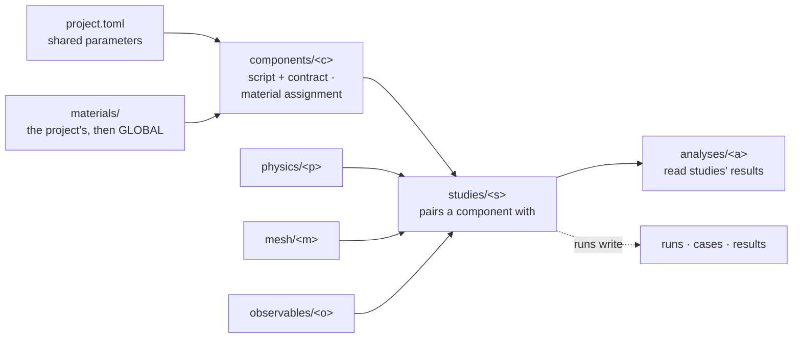

# Projects contract — the projects root, a project's tree, and the one door

**Role:** contract
**Status:** current, approved by the person (plan § 6); nothing in it is
built yet (plan § 3, R)
**Authority:** where projects live; the tree of a project — every folder and
file, what it holds, who writes it, which door reads it, and whether it moves
with the project; the part kinds and what each may cite; addresses; the one
door through which every read and write of a project passes; transactions and
undo. What each part holds inside is the owning contract's:
[`models.md`](models.md) (physics, studies, analyses),
[`geometry.md`](geometry.md) (the geometry script and its contract, mesh recipes),
[`materials.md`](materials.md) (materials and their assignment). The reasons
are [ADR 0011](../decisions/0011-project-structure.md).

## The short version

| rule | § |
|---|---|
| One **projects root**, set once in `config.toml`, holds the person's global material library and their projects | 1 |
| A command names **a project as a whole**: by its path from the root, or by the folder it runs in | 1 |
| A **project** is parts in a fixed tree: the project file, components, physics, mesh recipes, observable sets, studies, analyses, materials — and what runs write | 2 |
| A **component** is one geometry: its script and the contract that wraps it; physics, mesh recipes and observable sets name the groups a contract promises, and a study pairs them | 3 |
| Parts refer to each other **by name**; a name is a path, and a folder only groups | 3 |
| The **layout is data**: each part kind's folder, file, schema, writer, and whether it moves with the project | 4 |
| One **address** grammar names every part and every value in it | 5 |
| **One door**: only `femkit/projects/` forms a path in a project or reads or writes its files | 6 |
| Each part **loads on its own**; a broken file is a finding on that part, never a refusal of the project | 6 |
| Every change is **one transaction** — files created, changed, moved or deleted together; an edit is one undo step | 7 |



## 1. The projects root

`paths.projects` in `config.toml` ([`config.md`](config.md) § 3) names the
projects root. It holds:

- `materials/` — the person's global material library, named with the
  `GLOBAL/` prefix ([`materials.md`](materials.md) § 4);
- one folder per project.

- **A command names a project as a whole** — never a loose file or folder
  inside it: by its path from the projects root (`--project bowtie`), or, with
  none named, by the folder the command runs in, when that folder is the
  project or lies inside it. The page lists the projects under the root and
  creates new ones there.
- **A project is one folder.** Every path inside it is relative, so a project
  can be zipped and unpacked under another projects root and still work; how
  its `GLOBAL/` materials are found there is [`materials.md`](materials.md)
  § 4. A run carries the data it needs ([`models.md`](models.md) § 5.3), so a
  run needs no library at all.

## 2. A project's tree

```text
<project>/
├── project.toml                    the project file
├── materials/<material>/           the project's own materials
├── components/<component>/         one geometry
│   ├── component.toml              the script's contract, the material assignment
│   └── geometry.py                 the geometry script
├── physics/<physics>.toml          one physics, on named groups
├── mesh/<recipe>.toml              one mesh recipe, on named groups
├── observables/<set>.toml          one set of observables, on named groups
├── studies/<study>.toml            pairs a component with a physics, a recipe and observable sets; what varies; each environment's choices
├── analyses/<analysis>.toml        comparisons, convergence, spectra, exports, from studies' results
├── custom/                         customization files
├── cases/<case id>/case.json       one resolved case
├── runs/                           what the steps write — geometry, meshes, solves — in run folders
├── results/<analysis>/             what an analysis produces
└── .femkit/                        undo history, uploads, the page's view file
```

| path | holds | written by | moves with the project |
|---|---|---|---|
| `project.toml` | its description, the shared parameters, and the names of its components and studies (§ 3) | the person | yes |
| `materials/<m>/` | `material.toml` and its tables ([`materials.md`](materials.md) § 3) | the person; `material add`, `material import` | yes |
| `components/<c>/component.toml` | the script's contract ([`geometry.md`](geometry.md) § 3) and the material assignment ([`materials.md`](materials.md) § 5) | the person | yes |
| `components/<c>/geometry.py` | the geometry script ([`geometry.md`](geometry.md) § 2) | the person | yes |
| `physics/<p>.toml` | one physics ([`models.md`](models.md) § 3) | the person | yes |
| `mesh/<r>.toml` | one mesh recipe ([`geometry.md`](geometry.md) § 6) | the person | yes |
| `observables/<o>.toml` | one set of observables ([`models.md`](models.md) § 5.2) | the person | yes |
| `studies/<s>.toml` | one study ([`models.md`](models.md) § 5) | the person | yes |
| `analyses/<a>.toml` | one analysis ([`models.md`](models.md) § 10.2) | the person | yes |
| `custom/` | customization files ([`models.md`](models.md) § 8) | the person; the upload route | yes |
| `cases/<id>/case.json` | one resolved case ([`models.md`](models.md) § 5.3) | `study expand` | yes |
| `runs/` | each step's run folder — the geometry, the mesh, the solve ([`geometry.md`](geometry.md) § 4) — its run script, its log and its outputs | the run | yes; designed with execution (plan § 3, X) |
| `results/<a>/` | an analysis's products | the analysis | yes |
| `.femkit/` | undo history, uploads; `view.json`, where the page draws each node when the person chooses to remember it — no project data | femkit; `view.json` by `project view` | never: local; `view.json` may go along or be lost, harmlessly |

- **Only data, facts and design are the project's protected data.** Where the
  page draws a node is not: when the person chooses to remember it, it is kept
  in `.femkit/view.json`, written by `project view` — an operation that asks
  no confirmation, records no undo, and is never checked; no case, run or check
  reads the file. It is a disposable side file, as a folder's thumbnail cache
  is: deleting it, or a project moved without it, loses only the positions,
  and the diagram arranges itself again ([`web.md`](web.md) § 2.2).
- **One writer each.** A file is written by its writer alone, through the door
  (§ 6). A file in a folder of the tree that no part kind declares is a
  finding, never read. A run is the one writer that does not ask the door: the
  door makes its run folder, and what the run writes inside it is its own.
- **`component.toml` has one schema**, the `geometry` package's; its `[assign]`
  table's part of it is the `materials` package's
  ([`materials.md`](materials.md) § 5).
- **`project new NAME`** creates the whole tree from the layout (§ 4), with a
  project file from its template; a project is never made folder by folder.

## 3. Part kinds and what they cite

| part | its file | cites |
|---|---|---|
| project | `project.toml` | its components and studies, by name |
| component | `components/<c>/component.toml` and its script | the shared parameters its script reads; materials |
| physics | `physics/<p>.toml` | group names; parameters; materials — the medium beyond an open boundary, a source's background |
| mesh recipe | `mesh/<r>.toml` | group names; parameters |
| observable set | `observables/<o>.toml` | group names; points, lines and planes given with their units |
| study | `studies/<s>.toml` | one component, one or more physics per step, a mesh recipe, observable sets; parameters |
| analysis | `analyses/<a>.toml` | studies and their results |
| material | `materials/<m>/material.toml` | nothing |

- **Groups are the joint.** A component's contract promises named groups
  ([`geometry.md`](geometry.md) § 3); a physics, a mesh recipe and an
  observable set name groups, never a component, so each serves every
  component that promises what it names — a sharp-tipped bowtie, a rounded one,
  a 2-D cross-section. A study pairs them, and `project check` checks the
  pairing from the contracts as soon as the study is written: a group the
  physics needs that the component does not promise is a finding on the study,
  naming the group.
- **Names, and grouping folders.** A part's name is its path inside its
  kind's folder, each step matching `[a-z][a-z0-9_]*`, the steps joined by `/`:
  `studies/sweeps/gap_sweep.toml` is the study `sweeps/gap_sweep`, and
  `materials/metals/gold/` the material `metals/gold`. A person may group the
  parts of any kind in folders, as deep as they like. A name is unique among
  parts of one kind; two parts may share their last step in different groups,
  since the whole path is the name.
- **`GLOBAL/`** opens a name that means the global library's, explicitly —
  its rule is [`materials.md`](materials.md) § 4.
- **A folder only groups.** It carries no settings and means nothing to the
  physics: what a part states is in its own file, never in a folder above it.
  A folder is a part — it holds the part's own file, `component.toml` or
  `material.toml` (§ 4) — or a group, never both; a file in a group folder that
  is no part is a finding, never read.
- **A citation is read from the schema**: each field that names a part or a
  group carries a `ref` annotation ([`core.md`](core.md) § 2), the one source
  for the references the loader checks and the graph draws.
- **The project file names its components and studies**, by their names
  (`studies = ["convergence/mesh_ladder", "sweeps/gap_sweep"]`); physics, mesh
  recipes, observable sets, analyses and materials are found in their folders,
  as the layout declares them. A component or study the project file does not
  name is a finding — inert, never loaded into a case; a name with no file is a
  finding with its fix.

## 4. The layout, declared as data

`femkit/data/project/layout.toml` declares, for every part kind and every
folder femkit writes: its folder, its owner (the project or the global
library), its rank in the chain's order — what a part is made from comes before
it: parameters, materials and components, physics, mesh recipes and observable
sets, studies, analyses — whether a part is one file (`<name>.toml`) or a folder holding its
own file (`component.toml`, `material.toml`), the schema it loads with, its
writer, and whether it moves with the project, is regenerated, or stays
local. Whether a folder is a part or a group is read from that declaration,
never guessed from its name. The object types inside a part — a condition of a physics, a promised group
of a component, an axis of a study — extend the same table, each with the
table it lives in, whether it is named, the field holding its type, and its
place in the chain's order (today `OBJECTS` in `femkit/models/schema.py`). The
door, the graph, the checks, the templates and the page all read this one
declaration; adding a part kind is an entry here and its schema.

## 5. Addresses

One grammar names every part and every value in it, in edits, graph nodes,
findings, match lines and decisions:

```text
<kind>:<name>[:<dotted path>]
```

The kinds are the layout's (§ 4): `project`, `component`, `physics`, `mesh`,
`observables`, `study`, `analysis`, `material`. The project file has no name:
its values are `project:<dotted path>`. A name may hold `/` (§ 3), and a global
material's opens with `GLOBAL/`: `component:bowtie:outputs.groups.gap`,
`physics:optics:conditions.outer`, `study:sweeps/gap_sweep:axes."project:parameters.gap"`,
`material:GLOBAL/metals/gold:properties.relative_permittivity`,
`project:parameters.gap`. Entries are keyed by name, never by position.
In an address, `material:<name>` is the project's own material and
`material:GLOBAL/<name>` the global library's: an edit names its target
exactly, and the fall-back to the global library is a component's assignment's
alone ([`materials.md`](materials.md) § 4). Renaming a part — moving it to
another group is one — or an entry is one transaction that moves its file where
it has one and rewrites every address that names it: a citation, a reference, a
decision's key.

## 6. The one door — `femkit/projects/`

- **Only this package** forms a path in a project, opens a project's file, or
  writes one; every other package asks it ([`framework.md`](framework.md) § 1,
  rule 2). Files are read and written by `core/persist.py`.
- **Finding projects**: the root, the projects under it, `project new`.
- **Listing a project**: for each part kind, its tree — its groups and the
  parts in each — read from the folders as the layout declares them. The page's lists and the
  graph's grouping boxes are drawn from it; the global library is listed the
  same way.
- **Opening a project** reads the project file and every part the layout finds,
  each through its schema, **each on its own**: a part that does not load is a
  finding on that part — its file, its key path, its reason — and every other
  part is still read. A project file that does not load is a finding too: the
  components and studies are then listed from their folders, uncited, so each
  can still be opened and the project file fixed.
- **Schemas are registered, never imported.** The layout names each part
  kind's schema by the package that owns it; that package registers it with
  the door when femkit starts (the registry, [`framework.md`](framework.md)
  § 1), so the door, a lower layer, imports no package above it.
- **What cannot be checked yet is said so**: a group's kind is known only once
  the geometry of the component a study pairs it with exists
  ([`geometry.md`](geometry.md) § 7).
- **A part's text** is the file as it holds it, comments kept; a value's text
  is its TOML.
- **Every operation** — check, graph, edits, expand, prepare, reduce, the page —
  receives the opened project; none reads a file again on its own.

## 7. Transactions and undo

- **A change is one transaction**: a list of file steps — create, change, move,
  delete — computed in the plan with nothing written. The plan reads the
  project as the change would leave it, and refuses a change that would leave
  a part it touches unloadable, or a reference into one broken, naming each
  problem; a part broken by hand elsewhere never blocks it. An incomplete part
  is allowed and shown as findings ([`models.md`](models.md) § 11.1).
- **Apply** holds the project's lock ([`core.md`](core.md) § 5), refuses when
  any file the plan read changed since (hashes), and writes every step or none.
  A group folder is made by the first part written into it, and removed with
  the last part moved or removed out of it: no empty group is left behind.
- **Undo**: each transaction records each file's text before and after, and
  each move, in `.femkit/history/`; `undo` and `redo` move through as many
  edits as `projects.undo` says ([`config.md`](config.md) § 3) — refused when
  a file has changed since, by hand. A record names files by their path in the
  project, checked to lie inside it.
- **The global library is not the project's**: a write to it is never in a
  project's undo; its lock and its confirmation are
  [`materials.md`](materials.md) § 4. Renaming or regrouping a global
  material lists the projects under the root that use it, and is refused while
  any does.
- An edit, its undo and its redo ask no confirmation of the page
  ([`api.md`](api.md) § 2): each is taken back at once.

## 8. States of a part

A part's state is observed, never stored ([`core.md`](core.md) § 7), by rules
declared as data:

| state | observed when |
|---|---|
| `unloadable` | its file does not load |
| `unchecked` | it loads, but what it names cannot be checked yet: a group's kind, before the geometry of a component a study pairs it with exists |
| `findings` | it loads and `project check` has findings on it |
| `complete` | otherwise |

A project's state is a count over its parts; it is never a machine of its own.
