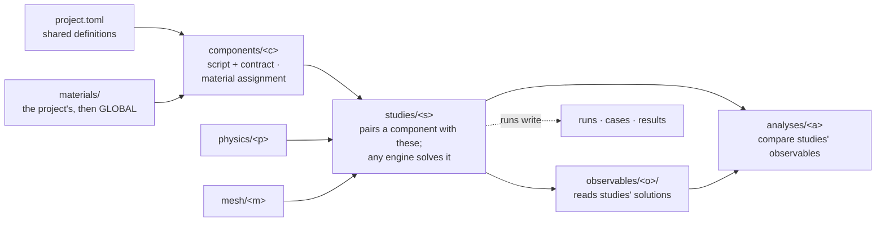

# Projects contract — the projects root, a project's tree, and the one door

**Role:** contract
**Status:** current, approved by the person
([ADR 0011](../decisions/0011-project-structure.md)); built in
`femkit/projects/`, proven on a layout of the tests' own and on the shipped
one: finding and naming projects and the root made by the first project
(§ 1), names and groups (§ 3), the shipped layout with its fixed files,
library, writers and object types (§ 4), addresses (§ 5), opening each part on
its own, a folder part's other files and its citations, each part kind's
schema registered at start, the check frame and what cannot be checked yet
(§ 6); `project new` and `project list`, and the templates, each passing
`project check` and carrying each key's help, held by tests (§ 7); the states
of § 8 and their block words; each kind's section and both orders (§ 4); the global library, seeded by the first `project new` on a root and
read when a project names one of its parts (§§ 1, 6, 7); the observables
part as a folder holding `observe.py`, ranked after the studies it reads,
and a file of its first shape told so (§§ 2–4;
[ADR 0025](../decisions/0025-one-engine-per-study-observables-after.md)); the
project file's `[postprocess] packages` (§ 2). The part kinds'
schemas are their owners' ([`models.md`](models.md),
[`geometry.md`](geometry.md), [`materials.md`](materials.md))
**Authority:** where projects live; the tree of a project — every folder and
file, what it holds, who writes it, which door reads it, and whether it moves
with the project; the part kinds and what each may cite; addresses; the one
door through which every read and write of a project passes; what femkit
writes into a project. What each part holds inside is the owning contract's:
[`models.md`](models.md) (physics, studies, observables parts, analyses),
[`geometry.md`](geometry.md) (the geometry script and its contract, mesh recipes),
[`materials.md`](materials.md) (materials and their assignment). The reasons
are [ADR 0011](../decisions/0011-project-structure.md).

## The short version

| rule | § |
|---|---|
| One **projects root**, set once in `config.toml`, holds the person's global material library and their projects | 1 |
| A command names **a project as a whole**: by its path from the root, or by the folder it runs in | 1 |
| A **project** is parts in a fixed tree: the project file, components, physics, mesh recipes, studies, observables parts, analyses, materials — and what runs write | 2 |
| A **component** is one geometry: its script and the contract that wraps it; physics and mesh recipes name the groups a contract promises, and a study pairs them; an observables part reads studies | 3 |
| Parts refer to each other **by name**; a name is a path, and a folder only groups | 3 |
| The **layout is data**: each part kind's folder, files, schema, writer, whether it moves with the project, and whether the root holds a library of it | 4 |
| One **address** grammar names every part and every value in it | 5 |
| **One door**: only `femkit/projects/` forms a path in a project or reads or writes its files | 6 |
| Each part **loads on its own**; a broken file is a finding on that part, never a refusal of the project | 6 |
| femkit **changes no file the person wrote**, but through the page's plain text editor, exactly as typed: they write every part as text; femkit copies a template they ask for, each key with its help above it, and writes its own outputs | 7 |



## 1. The projects root

`paths.projects` in `config.toml` ([`config.md`](config.md) § 3) names the
projects root. It holds:

- `materials/` — the person's global material library, named with the
  `GLOBAL/` prefix ([`materials.md`](materials.md) § 4): the folder of the one
  part kind the layout declares with a library (§ 4), which holds no project;
- one folder per project, perhaps inside the person's grouping folders.

- **The first project makes the root.** `paths.projects` may name a folder
  that does not exist yet — `config init` asks for it
  ([`config.md`](config.md) § 3.2); `project new` makes it, as a step of its
  plan, and every other command refuses a root that is no folder, naming
  `project new`. `project new` also makes the root's library when it lacks
  one, seeding it with femkit's shipped materials
  ([`materials.md`](materials.md) § 4).
- **A command names a project as a whole** — never a loose file or folder
  inside it: by its path from the projects root (`--project bowtie`), or, with
  none named, by the folder the command runs in, when that folder is the
  project or lies inside it. The page lists the projects under the root and
  creates new ones there.
- **A project is one folder.** Every path inside it is relative, so a project
  can be zipped and unpacked under another projects root and still work; how
  its `GLOBAL/` materials are found there is [`materials.md`](materials.md)
  § 4. A run carries the data it needs ([`models.md`](models.md) § 5.3), so a
  run needs no library at all.

## 2. A project's tree

```text
<project>/
├── project.toml                    the project file
├── definitions.py                  the functions that compute definitions
├── materials/<material>/           the project's own materials
│   ├── material.toml               the material
│   └── <table>                     its tables, as material.toml declares them
├── components/<component>/         one geometry
│   ├── component.toml              the script's contract, the material assignment
│   ├── geometry.py                 the geometry script
│   └── <input file>                the files it reads, as component.toml declares them
├── physics/<physics>.toml          one physics, on named groups
├── mesh/<recipe>.toml              one mesh recipe, on named groups
├── studies/<study>.toml            pairs a component with a physics and a recipe; what varies; its jobs' resources
├── observables/<o>/                one observables part, reading studies' solutions
│   ├── observables.toml            the studies it reads, each observable
│   └── observe.py                  the functions that compute its observables
├── analyses/<analysis>.toml        comparisons, convergence, spectra, exports, from studies' results
├── custom/                         customization files
├── cases/<study>/<case id>/case.json  one resolved case of a study
├── computed/<study>/definitions.nc  a study's computed definitions' values, kept
├── runs/                           the stages — geometry, mesh, solve, translate, observe — in calculation folders, and their jobs
├── results/<analysis>/             what an analysis produces
└── .femkit/                        uploads, the page's view file
```

| path | holds | written by | moves with the project |
|---|---|---|---|
| `project.toml` | its description, its definitions ([`models.md`](models.md) § 3), the names of its components and studies (§ 3), and the packages its observables scripts need, `[postprocess] packages` ([`models.md`](models.md) § 2) | the person | yes |
| `definitions.py` | the functions that compute the project's computed definitions, imports and functions only; optional — the layout's project kind lists it under `optional`, and its findings are the project's, with the file and the line ([`models.md`](models.md) § 3; [ADR 0021](../decisions/0021-definitions.md)) | the person; its header written once by the template | yes |
| `materials/<m>/` | `material.toml` and its tables ([`materials.md`](materials.md) § 3) | the person; `material import`, a new one | yes |
| `components/<c>/component.toml` | the script's contract ([`geometry.md`](geometry.md) § 3) and the material assignment ([`materials.md`](materials.md) § 5) | the person | yes |
| `components/<c>/geometry.py` | the geometry script ([`geometry.md`](geometry.md) § 2) | the person | yes |
| `components/<c>/<file>` | a file the script reads, by its path from the component's folder, as its contract declares it ([`geometry.md`](geometry.md) § 3) | the person | yes |
| `physics/<p>.toml` | one physics ([`models.md`](models.md) § 3) | the person | yes |
| `mesh/<r>.toml` | one mesh recipe ([`geometry.md`](geometry.md) § 6) | the person | yes |
| `studies/<s>.toml` | one study ([`models.md`](models.md) § 5) | the person | yes |
| `observables/<o>/observables.toml` | one observables part: the studies it reads, and each observable — its function, what it takes, its type and unit ([`models.md`](models.md) § 5.2) | the person | yes |
| `observables/<o>/observe.py` | the part's script: a function per observable ([`models.md`](models.md) § 5.2) | the person | yes |
| `analyses/<a>.toml` | one analysis ([`models.md`](models.md) § 10.2) | the person | yes |
| `custom/` | customization files ([`models.md`](models.md) § 8) | the person | yes |
| `cases/<study>/<id>/case.json` | one resolved case of its study ([`models.md`](models.md) § 5.3) | `study prep` | yes |
| `computed/<study>/definitions.nc` | a study's computed definitions' values, an entry per distinct set of constants, with the SHA-256s that keep them in sync; a folder that holds no part, declared in the layout with its `holds` ([`models.md`](models.md) § 3) | `study prep` | yes |
| `runs/<study>/` | each stage's calculation folder, `<kind>/<id>/` — `geometry/`, `mesh/`, later `solve/`, `translate/` and `observe/` — with its request, `stage.json`, run script and runs ([`workflow.md`](workflow.md) § 4; [`jobs.md`](jobs.md) § 1); in `launch/`, the launch folders of the batches and sequences that run them, each its request, header, walk, launch record and log ([`jobs.md`](jobs.md) § 1.2; their names, [`workflow.md`](workflow.md) § 7) | the jobs domain's commands, in each folder the door forms ([`framework.md`](framework.md) § 1, rule 2), and a run's script what is inside its `run-NNN/` ([`jobs.md`](jobs.md) §§ 1–5) | yes |
| `results/<a>/` | an analysis's products | the analysis | yes |
| `.femkit/` | uploads — no project data | femkit | never: local |

- **Only data, facts and design are the project's protected data.** Where the
  page draws a node is not: a position says nothing of what connects to what,
  so it is never stored — the diagram arranges itself, and the person moves
  blocks freely in the page ([`web.md`](web.md) § 2.2).
- **One writer each.** A file is written by its writer alone, through the door
  (§ 6). A file in a folder of the tree that no part kind declares is a
  finding, never read. A run is the one writer that does not ask the door: the
  door makes its run folder, and what the run writes inside it is its own.
- **`component.toml` has one schema**, the `geometry` package's; its `[assign]`
  table's part of it is the `materials` package's
  ([`materials.md`](materials.md) § 5).
- **`project new NAME --from SOURCE`** copies a template or a project — every
  part and the person's own folder, nothing femkit or a run wrote (§ 7); a
  project is never made folder by folder.

## 3. Part kinds and what they cite

| part | its file | cites |
|---|---|---|
| project | `project.toml` | its components and studies, by name |
| component | `components/<c>/component.toml` and its script | the definitions its script reads; materials |
| physics | `physics/<p>.toml` | group names; definitions; materials — the medium beyond an open boundary, a source's background |
| mesh recipe | `mesh/<r>.toml` | group names; definitions |
| study | `studies/<s>.toml` | one component, one or more physics per step, a mesh recipe; definitions |
| observables part | `observables/<o>/observables.toml` and its script | the studies it reads; definitions; group names of their component |
| analysis | `analyses/<a>.toml` | studies and their results |
| material | `materials/<m>/material.toml` | nothing |

The person's own output translators join as a part kind with M6
([`workflow.md`](workflow.md) § 2.4; plan § 4, M6).

- **Groups are the joint.** A component's contract promises named groups
  ([`geometry.md`](geometry.md) § 3); a physics and a mesh recipe name
  groups, never a component, so each serves every
  component that promises what it names — a sharp-tipped bowtie, a rounded one,
  a 2-D cross-section — and an observables part takes groups of the component
  the studies it reads pair. A study pairs them, and `project check` checks the
  pairing from the contracts as soon as the study is written: a group the
  physics needs that the component does not promise is a finding at the key
  that names the group, in the file that names it ([`models.md`](models.md)
  § 5.1).
- **Names, and grouping folders.** A part's name is its path inside its
  kind's folder, each step matching `[a-z][a-z0-9_]*`, the steps joined by `/`:
  `studies/sweeps/gap_sweep.toml` is the study `sweeps/gap_sweep`, and
  `materials/metals/gold/` the material `metals/gold`. A person may group the
  parts of any kind in folders, as deep as they like. A name is unique among
  parts of one kind; two parts may share their last step in different groups,
  since the whole path is the name.
- **`GLOBAL/`** opens a name that means the global library's, explicitly —
  its rule is [`materials.md`](materials.md) § 4.
- **A folder only groups.** It carries no settings and means nothing to the
  physics: what a part states is in its own file, never in a folder above it.
  A folder is a part — it holds the part's own file, `component.toml` or
  `material.toml` (§ 4) — or a group, never both; a file in a group folder that
  is no part is a finding, never read.
- **A citation is read from the schema**: each field that names a part or a
  group carries a `ref` annotation ([`core.md`](core.md) § 2), the one source
  for the references the loader checks and the graph draws.
- **The project file names its components and studies**, by their names
  (`studies = ["convergence/mesh_ladder", "sweeps/gap_sweep"]`); physics, mesh
  recipes, observables parts, analyses and materials are found in their folders,
  as the layout declares them. A component or study the project file does not
  name is a finding — inert, never loaded into a case; a name with no file is a
  finding with its fix.

## 4. The layout, declared as data

`femkit/data/project/layout.toml` declares, for every part kind and every
folder that holds no part: its folder; its rank in the chain's order — what a
part is made from comes before it: definitions, materials and components,
physics and mesh recipes, studies, observables parts — each after the studies
it reads ([ADR 0025](../decisions/0025-one-engine-per-study-observables-after.md))
— analyses; its
**section**, where a person finds it, in sections read from what is shared to what is computed —
Definitions (the project's definitions, materials), Component, Physics, Mesh,
Study, Results (observables parts, analyses) — the sections and their order
declared once in the same file
([ADR 0019](../decisions/0019-section-order-block-states-axes-together.md));
whether a part is
one file (`<name>.toml`) or a folder holding its own file (`component.toml`,
`material.toml`, `observables.toml`), and the other files every part of its
kind holds by a fixed name (a component's `geometry.py`, an observables
part's `observe.py`); the schema it loads with; its writer —
`person`, `femkit` or `run`; whether it moves with the project, is
regenerated, or stays local; whether the projects root holds a global
library of its kind; and, for a kind the person writes, the manual's chapter
that explains it, which its keys' help names ([`core.md`](core.md) § 2).
Whether a folder is a part or a group is read from that declaration, never
guessed from its name.

**Two orders, each declared here alone, each read through the layout** (one
function each; no caller sorts on its own):

- **the chain's order**, by rank, then the kind's place in this file, then
  name — loading, checking, and the order of the findings: an observables
  part is checked after the studies it reads;
- **the reading order**, by section, then rank, then the kind's place in this
  file, then name — everything a
  person reads lists parts so: the description diagram, `project check`'s
  and `project graph`'s tables, the manual's chapters on writing them — so
  an observables part is shown under Results, after the studies.

```toml
[kinds.material]
folder = "materials"
shape = "folder"
file = "material.toml"
schema = "materials.material"      # the key the layout names the schema by: its package, then its name
rank = 1
section = "Definitions"         # where a person finds it: one of `sections`, in their order
library = true                  # the projects root holds a global library of materials, in materials/
manual = "6-materials.md"       # the manual's chapter its keys' help names

[kinds.component]
folder = "components"
shape = "folder"
file = "component.toml"
files = ["geometry.py"]         # every component holds its script by this name
schema = "geometry.component"
rank = 2
section = "Component"

[folders.cases]
writer = "femkit"
moves = "yes"
holds = { case = "{study}/{id}/case.json" }

[folders.runs]
writer = "run"
moves = "yes"
holds = { stage = "{study}/{kind}/{id}", launch = "{study}/launch/{name}" }
```

- **A folder that holds no part** is femkit's or a run's — `cases/`, `runs/`,
  `results/`, `.femkit/` — or the person's own, `custom/`: its files are never
  read as parts, and none is a stray finding; each declares its writer.
- **What the door forms inside such a folder** is declared there, `holds`:
  each form by its name, its path from the folder, each step it is formed from
  a whole step in braces, named once — a case's file, a stage's folder, a
  launch folder (§ 6: `case_file`, `stage_folder`, `launch_folder`). A form
  declared twice, or one naming a step twice, does not load.
- **An editor's own files** — a backup, `name~`; a swap file, `.name.swp`; an
  autosave, `#name#`; a lock, `.#name` — are named by the patterns
  `editor_files` declares, the one list of them: wherever one lies it is no
  part and no stray, and a copy leaves it out.
- **The kind `project list` names beside each project** — its studies
  ([`web.md`](web.md) § 8.6) — is the one `listed` names; the framework names
  no part kind, and a package finds the kind its own schema is by the schema's
  key (`Layout.kind_of`).
- **A library.** A part kind declared with `library` has a global library at
  the projects root, in a folder of its kind's name (§ 1): the root's search
  for projects passes it by, and only a name of that kind may open with
  `GLOBAL/` (§ 5). Materials are the one such kind
  ([`materials.md`](materials.md) § 4).
- **The writer decides what a copy takes**: `project new` copies what the
  person writes, never what femkit or a run writes (§ 7).
- **A part kind whose part was once a file and is now a folder** declares
  the file it was — the observables kind, `observables/<o>.toml` — so the
  door gives a file of that form its own finding, `now-a-folder`, at the
  file: "an observables part is now a folder", holding `observables.toml`
  and `observe.py`, as the templates show — never a `stray` (§ 6): an
  error, since the part it was is no longer read.
- **Read two ways.** By its own rules alone — what finding projects, `project
  new`'s names and copy and `schema check` need — and bound to the part schemas
  the registry registered, a schema no package registered refused at its kind's
  key — what opening a project needs (§ 6). So the shipped layout loads, and
  is checked, before any part's package registers its schema.
- **Every folder is one step** at the project's top, and holds one kind of
  thing: one part kind's parts, or one such folder's files.
- **The project file is fixed**, `project.toml`, what makes a folder a project
  (§ 2): the layout declares its kind's schema and rank, never its name.

The object types inside a part — a condition of a physics, a promised group
of a component, an axis of a study — extend the same table, under `[objects]`,
each with the part kind whose file holds it (`part`), the table it lives in
(`table`, its keys joined by `.`), whether it is a table of entries each by its
name or one object (`named`), and the key holding its type (`typed`); it
takes its place in both orders from its part's kind; an object type is named by one step of
the name rule, never a part kind's name. The door, the graph, the checks
and the page all read this one declaration; adding a part kind is an entry
here and its schema.

## 5. Addresses

One grammar names every part and every value in it, in graph nodes,
findings, match lines and decisions:

```text
<kind>:<name>[:<dotted path>]
```

The kinds are the layout's (§ 4): `project`, `component`, `physics`, `mesh`,
`observables`, `study`, `analysis`, `material`. The project file has no name:
its values are `project:<dotted path>` — a definition `project:definitions.gap`
([`models.md`](models.md) § 3). A name may hold `/` (§ 3), and a
global material's opens with `GLOBAL/`: `component:bowtie:groups.gap`,
`physics:optics:conditions.outer`, `mesh:fine:sizes.gap`,
`study:sweeps/gap_sweep:axes."project:definitions.gap"`,
`material:GLOBAL/metals/gold:properties.relative_permittivity`,
`project:definitions.gap`. Entries are keyed by name, never by position.
`GLOBAL/` opens a name only of a kind the layout declares with a library — a
material's (§ 4); `component:GLOBAL/bowtie` is refused, code `bad-address`. In
an address, `material:<name>` is the project's own material and
`material:GLOBAL/<name>` the global library's: an address names its target
exactly, and the fall-back to the global library is a component's assignment's
alone ([`materials.md`](materials.md) § 4).

The same grammar names a part's own file and what femkit makes, each by a
form no part kind can take — the layout refuses a part kind named `stage`,
`launch` or `job`:

| names | form | example |
|---|---|---|
| a file of a folder part, by its path from the part's folder | `<kind>:<name>@<file>` | `component:bowtie@geometry.py` |
| a stage ([`workflow.md`](workflow.md) § 4) | `stage:<study>/<stage kind>/<id>`, the last two steps its kind and its ID, 64 hexadecimal digits | `stage:sweeps/gap/mesh/91c0…` |
| a launch folder ([`jobs.md`](jobs.md) § 1.2) | `launch:<study>/<name>`, its name one step | `launch:check/mesh-check-001` |
| a job launched from this machine ([`jobs.md`](jobs.md) § 5.4) | `job:<id>`, one step | `job:workstation-41822` |

A file's form names a folder part's other files alone — its own file is the
part — so each file has one address; the made forms are refused where a part
is asked for. A study's name has no step that is a stage kind or `launch`, so
no study's folder under `runs/` lies inside another's: a name that does is a
finding of `project check` at the project file's `studies`, naming the step,
so `study prep` refuses it before any case is written — the stage kinds
read from their declaration, so a kind added later makes such a name a
finding then.

## 6. The one door — `femkit/projects/`

- **Only this package** forms a path in a project, opens a project's file, or
  writes one; every other package asks it ([`framework.md`](framework.md) § 1,
  rule 2). Files are read and written by `core/persist.py`. One exception:
  inside a calculation folder under `runs/`, whose path the door forms, the
  jobs domain writes, and a run's script writes its run — a calculation
  folder is the jobs domain's wherever it lies ([`jobs.md`](jobs.md) §§ 1–5).
- **Finding projects**: the root, the projects under it, `project new`.
- **Listing a project**: for each part kind, its tree — its groups and the
  parts in each — read from the folders as the layout declares them. The page's lists and the
  graph's grouping boxes are drawn from it; the global library is listed the
  same way.
- **Opening a project** reads the project file and every part the layout finds,
  each through its schema, **each on its own**: a part that does not load is a
  finding on that part — its file, its key path, its reason — and every other
  part is still read. A project file that does not load is a finding too: the
  components and studies are then listed from their folders, uncited, so each
  can still be opened and the project file fixed.
- **Schemas are registered, never imported.** The layout names each part
  kind's schema by a key; the package that owns it declares the key and its
  model, and the registry registers it with the door when femkit starts
  ([`api.md`](api.md) § 6), so the door, a lower layer, imports no package
  above it. The layout loads with the registered keys in its validation
  context ([`core.md`](core.md) § 2): a key no package registered is refused.
- **A part loads as every declared file does**: through `schema.load_text`,
  its numbers read exactly and the unit table in its validation context
  ([`core.md`](core.md) §§ 2, 11), each on its own; no part is built on
  another.
- **A folder part's other files** are read through the door too, when it
  opens the project: those its kind's `files` fix — a component's
  `geometry.py`, an observables part's `observe.py` — and those its own file declares — a component's
  `[inputs.files]` ([`geometry.md`](geometry.md) § 3), a material's tables
  ([`materials.md`](materials.md) § 3) — each by its path from the part's
  folder, which the door forms and refuses outside it. The opened project keeps
  each one's bytes and SHA-256, so the case's digest of a script and the page's
  view of it read the same bytes, once. A declared file that is missing is a
  finding on the key that declares it; a file in a part's folder that neither
  its kind nor its own file declares is a `stray` finding, never read — but a
  file of the form a part kind declares it once was, which is that kind's
  `now-a-folder` finding (§ 4).
  - **A file is declared by its schema**: a field whose `ref` is `file`
    ([`core.md`](core.md) § 2) — on a table, `{"key": "file"}` — names a file
    of the part's folder, by its path from it: steps of letters, digits, `.`,
    `_` and `-`, none starting with `.` or `-`. A path out of the folder is a
    finding on its key, never read.
  - **A part that does not load** declares nothing that can be known: the
    files its kind fixes are still read, and its folder's other files are
    neither read nor strays until it loads.
  - **Each finding names where the person opens it** ([`core.md`](core.md)
    § 10): a part that does not load is one finding for each problem, at its
    key, said plainly with what would be right there, as its schema's loader
    says it ([`core.md`](core.md) § 2) — "`szie` is no key here; did you mean
    `size`?"; a missing or unreadable declared file is a finding at the key
    that declares it, a missing fixed one names that file; a stray names
    itself, and the folder the person's own files go in (`custom/`). The codes
    are the door's (`femkit/projects/door.py`).
- **The check frame** (`femkit/projects/checking.py`) sits with the door,
  below every package that owns a part kind, so each types its checks by it
  ([`framework.md`](framework.md) § 1). Each part kind's check is declared by
  the module that owns its schema, beside it, in its `REGISTERS`' `checks`,
  `{"<schema key>": check}`, `check(checking, part) -> Iterable[Issue]`, and registered
  at femkit's start ([`api.md`](api.md) § 6); a schema may have checks from
  several modules — the materials package checks a component's assignment. A
  check is handed a `Checking` — the project as opened, the definitions its
  rules read (the unit table, the formulations, the property list, the
  variables and dispersion models, the step kinds, the kinds of place, the
  engines `study prep --engine` may name, the stage kinds, the meshers and the hand-overs) and the definitions
  resolved once
  ([`models.md`](models.md) § 3) — and makes each finding with
  `Checking.issue(part, *keys, code=…, message=…, right=…, choices=…)`, at
  its part's file and key, `right` and `choices` given as plain values and
  written as the file writes them; reads each value written as a quantity
  with `Checking.measure` — the one quantity form, `{value, unit}`, a plain
  number or a definition's name, read by `Units.measure` ([`core.md`](core.md)
  § 11), with the project's definitions or, for a material's, naming none
  (§ 3), in the dimension the check states —
  `bad-quantity` where it does not read, `wrong-dimension` where it is not in
  that dimension, and nothing for one using a definition that does not
  resolve, whose own finding says why; and says what it cannot check yet with
  `Checking.unchecked`. `run(opened, ctx)` is every finding: the door's, the
  definitions' and each loaded part's checks' — the errors first, then the
  warnings, then the notes, so the first finding is the next step
  ([`models.md`](models.md) § 11.2) — each part by part in the chain's order,
  the layout's ranks, those on a file that is no part's last; a part that does
  not load is not checked.
- **What cannot be checked yet is said so**: a group's kind is known only once
  the geometry of the component a study pairs it with exists
  ([`geometry.md`](geometry.md) § 7). It is an `info` finding, code
  `not-checked-yet`, which a check makes with `Checking.unchecked` and a
  part's state reads (§ 8).
- **A part's text** is the file as it holds it, comments kept; a value's text
  is its TOML. The text of a part that could not be read, or a value in a part
  that is not TOML, is refused: a `UsageError`, code `unloadable`, its subject
  the address asked for ([`core.md`](core.md) § 9).
- **Every operation** — check, graph, prep, the page —
  receives the opened project; none reads a file again on its own.
- **One part's file read on its own**, never the project opened: the door's
  `read_alone(project, layout, address)`, the text of the part's own file
  where the layout puts it — None where it is not there — for a reader that
  needs one table of it alone, through that table's schema: each project
  file's `[postprocess]`, for `env install` ([`models.md`](models.md) § 2;
  [`framework.md`](framework.md) § 5), so a project whose other parts or
  keys do not load still says what it declares there.
- **femkit's own outputs** are read and written through the door too:
  `read_output(opened, path)`, a file's text or None, and `write_output(opened,
  path, data)`, written whole as JSON (`core.md` § 4), each by its path from
  the project's folder and refused, a `UsageError` `not-femkits`, outside a
  folder the layout declares femkit writes (§ 7). A stage's calculation folder
  and a launch folder are formed by the door alone — `stage_folder(opened,
  study, kind, id)`, `runs/<study>/<kind>/<id>/`, and `launch_folder(opened,
  study, name)`, `runs/<study>/launch/<name>/`, as the layout declares `runs/`
  (§ 4) — and the jobs domain writes inside them ([`jobs.md`](jobs.md) § 1.1;
  [`workflow.md`](workflow.md) § 5).
- **A global library** is read through the door too: opening a project lists
  each library's materials and its record of femkit's copies, and loads each
  library material a loaded part names (`material:GLOBAL/<name>`, its file by
  its full path); `load_library` loads one a case names that the project no
  longer does, for `case list` ([`materials.md`](materials.md) § 4).
- **A new part the person brings** — an imported material
  ([`materials.md`](materials.md) § 7) — is written through the door too:
  `write_part(home, layout, kind, name, files)` writes the new folder part
  whole, built apart and moved into place, into the project or a global
  library; `new_part` says where it goes and refuses, `Refused` with the name
  its subject, `exists` where a file or folder is there already and
  `inside-part` where a folder along the name is a part of that kind — never
  over or into a part (§ 7).

## 7. What femkit writes

- **No file the person wrote, but as they typed it.** The person writes every
  part as text; femkit reads it, checks it and says what is wrong and what
  would be right, and never changes it
  ([ADR 0015](../decisions/0015-the-persons-files.md)). No command sets,
  renames or undoes a part, and none writes into one but the page's save
  (below), which writes what the person typed; a new file is written only
  when the person asks for it — a template, an imported material, the
  library's first copy of femkit's materials (below).
- **The page's text editor**, for a project the person's own tools may not
  reach — run remotely
  ([ADR 0018](../decisions/0018-one-graph-from-description-to-execution.md)):
  `project save`, an operation of the page alone ([`api.md`](api.md) § 2),
  writes the file an address names — a part's, or a folder part's own file,
  `component:bowtie@geometry.py` (§ 5) — exactly as the text its request
  carries, through the door (`door.save_text`), under the project's lock. Its
  request states the file's SHA-256 when the page opened it: a file whose
  SHA-256 differs now is refused, `Refused` · `file-changed`, naming it, and
  nothing is written. Its plan is the change's impact — what the new text
  breaks, which promise it breaks, what it makes impossible, which stages it
  makes anew — shown before it writes ([`workflow.md`](workflow.md) § 10),
  for which the door opens the project with that one file's text in place of
  the file's, in memory (`open_project(…, texts={address: text})`). It formats
  nothing, keeps no history and offers no undo; the person's own tools keep
  the history. It is declared in `workflow`, the lowest layer that reads the
  impact's every comparison; its verb stands beside its request in
  `projects`, so the door gives each file it reads the action that saves it.
  A file of a `GLOBAL/` part is saved under the library's lock too.
- **A template the person asks for**: `project new NAME --from SOURCE` copies
  one of femkit's project templates, or one of the person's own projects —
  built apart and moved into place, never over a project already there
  ([`models.md`](models.md) § 11.1). A template is named bare
  (`laplace_square`), a project by its path from the root; a name that is both
  is refused, naming both; without `--from`, the refusal offers `project new
  NAME --from` each template, for the very name given.
  The person's own starting points are their projects, with no folder of their
  own. The source is opened through the door, bound to the part schemas, so
  what a part declares is known; a folder part that does not load is copied
  with its whole folder, since what it declares cannot be read. Its plan rests
  on each copied file's digest: one changed before the copy is applied is
  refused, `PlanStale`, and nothing is made.
  - **What it copies** is what the layout declares the person writes (§ 4):
    the project file, every part — a folder part with the files its kind fixes
    and its own file declares — and `custom/`. Never `.femkit/`, `cases/`,
    `runs/` or `results/`, which femkit or a run writes, never a stray file,
    which nothing reads, and never an editor's own file (§ 4): the copy is a
    new project with no cases and no runs, which `project check` reads as it
    read the source. Its plan and its outcome name each file it leaves out,
    and why, as an `info` finding `not-copied` — a stray, or a part of a kind
    femkit writes, by its path; a folder femkit or a run writes once, with how
    many files it holds. An editor's own file, never looked at, is not named.
  - **Which names are refused**, each naming `NAME`: as a `UsageError`, one
    that breaks the name rule (§ 3), so no step is a dot-folder; one whose
    first step is a library's folder at the root (`materials/…`, § 4); and one
    inside another project — a step along it is a project. As `Refused`
    ([`core.md`](core.md) § 9), one where a file or folder already is, a
    project or a group alike.
- **One set of templates** ([ADR 0015](../decisions/0015-the-persons-files.md)):
  `femkit/data/templates/` holds the settings file's template
  ([`config.md`](config.md) § 3.2) and the project templates, one folder each,
  every one a whole, working project written by hand. They are femkit's
  examples, its formulations' benchmarks ([`models.md`](models.md) § 2) and its
  tests' projects; nothing else holds a project. Each passes `project check` in
  a test, and the comment above each key is that key's help as its schema
  states it, held so by a test. The first two are `laplace_square` and
  `two_material`; `schema check` holds each a project named by one step of
  the name rule.
  - **The tests start from them.** A test that needs a project copies a
    template with `project new`, then changes its copy; the protected
    two-material test computes its reference values from the template's own
    definitions and materials ([`models.md`](models.md) § 4.3).
  - **A key's help is the comment above it**: the comment lines directly
    above the key, with no blank line between, read without their `# ` and
    joined by single spaces, equal to its help as the schema states it
    (`described`, [`core.md`](core.md) § 2), or, for a key a formulation,
    the property list or the dispersion list declares, as they state it — its
    sentence, then `, in` and its unit, or its units joined by ` or `
    (`the potential the boundary is held at, in V`) ([`web.md`](web.md)
    § 8.3). The same holds for a file femkit writes for the person to keep —
    an imported material ([`materials.md`](materials.md) § 7) — written by
    the core's one writer of such a file, `persist.commented_text`.
  - **Which keys carry it**: every key whose name the schema fixes, and every
    table header that ends in one — so each table the schema names is written
    as its own header, `[inputs]` before `[inputs.definitions]`, and no key
    the schema names is written inside an inline table but a quantity's
    `{value, unit}`, written on its key's line. A key whose name the
    person chooses — a group, a definition, a material, an observable, a
    step — has no help of its own: its table's header carries
    it, and a comment above the key is a note, not compared.
  - **A key a template leaves unset** is shown commented out under its help,
    `# quality = 0.2`, and compared the same way: a comment line that reads
    as a TOML key or table header is a key, and the comment lines above it
    that do not are its help.
  - **A comment followed by a blank line** is the file's prose, and is not
    compared.
- **Its own outputs**: cases, runs and results, each written by the operation
  that owns it, under the project's lock ([`core.md`](core.md) § 5), regenerated
  rather than edited.
- **A new file the person brings**, never over or into one there: `material
  import` writes a new material's folder from another source's file
  ([`materials.md`](materials.md) § 7) — to add a source to a material they
  have, the person copies its lines — and the upload route writes a file into
  `.femkit/uploads/` ([`web.md`](web.md) § 5); how an upload is offered is
  settled with uploads (M7's remainder).
- **The global library's seed**: the first `project new` on a root without
  `materials/` copies femkit's shipped materials into it, and records what it
  copied in `materials/.femkit/shipped.json` ([`materials.md`](materials.md)
  § 4).
- **The global library is not the project's**: its lock and its confirmation
  are [`materials.md`](materials.md) § 4.

## 8. States of a part

A part's state is observed, never stored ([`core.md`](core.md) § 7), by the
rules `femkit/data/states/part.toml` declares, in this order, over the facts
`femkit/projects/state.py` gathers and names: `loads`, its file loads;
`errors`, an error on it — a
warning or a note never stops what it would stop, so it changes no part's
state, one predicate with what refuses prep ([`models.md`](models.md)
§ 5.3); `unchecked`, a finding of what cannot be checked yet (the `info`
finding `not-checked-yet`, § 6). The findings on a part are its own, by
their subject — a file of it, `<kind>:<name>@<file>`, among them, so a
finding in `observe.py` is its part's:

| state | observed when | its block shows |
|---|---|---|
| `unloadable` | its file does not load | *needs attention* |
| `errors` | it loads and `project check` has an error on it | *needs attention* |
| `unchecked` | it loads with no error, but what it names cannot be checked yet: a group's kind, before the geometry of a component a study pairs it with exists | *waiting* |
| `complete` | otherwise | *up to date* |

A project's state is a count over its parts; it is never a machine of its own.
Each state's block word ([`web.md`](web.md) § 7.6) is declared beside it, in
the same file's `[shows]` ([`core.md`](core.md) § 7). A part the person changed is not itself out of date — it is what
they wrote; what is made from it is, and the workflow diagram shows it so
([`workflow.md`](workflow.md) § 6).

**A part's next steps** are its state table's (`part.toml`), never written
by a result: a study `complete`, or `unchecked` — waiting only on what a
built geometry shows — offers `study prep` when prep can make its cases;
`project check`, `study list`, `case list` and the project's graph fill
their `next` from those rows, and the door's refusals carry theirs
(`project list`). While any part has an error, no part's next step is
offered: the first error is the project's next step
([`models.md`](models.md) § 11.2). `project new`, and `material import` into
a project, end with `project check` of it — what writing a project's files
leads to.
