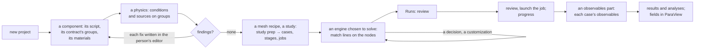
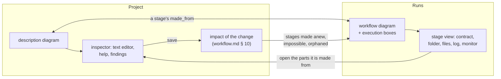
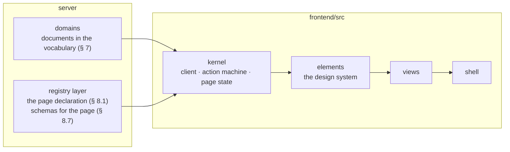

# Web contract — the server's routes, `serve`, and the page

**Role:** contract
**Status:** current; what is not built yet is marked so
**Authority:** the web surface: its routes and access (`femkit/web/`), serving
it (`serve`, the `server` domain), and the page (`frontend/`) — what the server
gives it, the one vocabulary that is written in, what the server declares about
the page, and the page's layers, state machines, elements, styles and help

## The short version

| rule | § |
|---|---|
| Every route is derived from the operation registry; a request body is the request model and nothing else | 1 |
| The page is built from the registry, the schemas and the server's documents, never from a list of its own, and writes only through plan and apply | 2 |
| The page is built by `web build` in the `web` environment and shipped, with its hashes | 3 |
| `serve` is a state machine observed from its lock and pidfile; a supervisor runs the application | 4 |
| Every request carries the token; the page holds nothing the server did not give it | 5 |
| The page shows the project's structure; each part's detail is its text — TOML, or a geometry script — shown in a plain text editor beside the help of every key it may hold, with its findings and the templates to copy; it writes a file the person wrote only as they typed it there ([ADR 0018](../decisions/0018-one-graph-from-description-to-execution.md)). A study's workflow — its stages, their states and the jobs that run them — is drawn by the same graph element | 2.2, 8.3 |
| A view is a thin consumer of documents and elements; a missing capability is work on the document or the element | 6 |
| Everything the page shows is written in one vocabulary: help, action, field, finding, table, graph, report | 7 |
| The server declares the page's structure, the part kinds and object types, what may be added, the next step | 8 |
| The page is a kernel, elements, views and a shell; one action machine; one page state the address mirrors | 9 |
| Styles in five layers, every value a token | 10 |
| Every element carries its help; every action a key path | 11 |


Two parts: a flask application built from the same registry as the command
line ([`api.md`](api.md) § 6), and a page that runs in the browser. Both live
in the `web` environment ([`envs.md`](envs.md) § 1): the server runs on its
Python, and the page is built with its Node.js; the control environment holds
neither. The routes and `serve` are built in token mode, and the page: its
framework (§ 6), the Project workspace, Runs, the Operations forms and the
documents; what is left of it is marked where it stands (plan § 4, G); TLS,
sign-in, `--no-auth` and uploads are not built yet (M7's remainder), and
these rules hold when they are. A basic test checks that every registered operation
can be expressed this way (its request and result models produce a JSON
schema). The reasons for the page's form are
[ADR 0009](../decisions/0009-web-front-end.md).

## 1. Routes

| route | does |
|---|---|
| `GET /api/operations` | every operation the page offers ([`api.md`](api.md) § 2, `surfaces`): name, description, its `effect`, its group and its command words (`core/commandline.py`), its `fills` (`Fill.of`, the one builder), request and result JSON schemas, and `choices` — for each request field whose values are declared data, the names declared now (`schema.choices`) |
| `GET /api/page` | the page declaration (§ 8.1), loaded against the operations the server serves |
| `POST /api/<name>` | a read-only operation: request JSON in, result JSON out |
| `POST /api/<name>/plan` | a changing operation: request JSON in, plan JSON out |
| `POST /api/<name>/apply` | `{"request": …, "digest": …}`: re-plans, refuses with `PlanStale` unless the new plan's digest equals the one the person saw, then applies. A refusal before the run starts is answered as any other; otherwise the answer is JSON lines: `{"operation": "<subject>/<time>"}` as each run starts — its operation directory, the address `GET /api/events/…` and `GET /api/tail/…` take; an operation over several subjects runs once per subject (core.md § 6) — and last the outcome, or the defect. The apply runs to its end whether or not the page still reads |
| `GET /api/events/<subject>/<time>` | the event log of the operation in `<state>/operations/<subject>/<time>/`, as a stream of its fold (`LogState`, [`core.md`](core.md) § 6) each time it changes, ending when the operation ends or is found interrupted: how a long apply's progress reaches the page; the address must keep its grammar (core.md §§ 5–6) and lie inside `<state>/operations/` |
| `GET /api/health?nonce=<n>` | that the server is up, and an HMAC of the client's nonce keyed with the server's token, which proves the answer comes from this server without the client sending the token; the one `/api` route that needs no token (§ 5) |
| `PUT /api/upload?project=<path>` | streams one file into that project's upload area and answers with its SHA-256 (§ 5) |
| `GET /auth/start/<provider>`, `GET /auth/callback/<provider>`, `POST /auth/sign-out` | sign-in, with sign-in configured (§ 5) |
| `GET /api/tail/<subject>/<time>/<step>` | the last lines of that step's log, for the running step's live line: a step the operation's event log names, its log inside the operation directory; the address checked as the event stream's (core.md § 6) |
| `GET /api/docs` | every document the viewer shows: the repository's own Markdown files (below) |
| `GET /api/docs/<path>` | one of them — its text and its headings, each with its link anchor — or an image a document shows, as data; any other path is 404 |
| `GET /`, `GET /docs` and `/static/…` | the built front end; `/docs` opens it as the document viewer |

HTTP status follows [`api.md`](api.md) § 4.3: 200 for a result, exit 0 or 1 (the body says `ok`);
409 for a refusal; 500 for a defect, with the log path. A request body is the
request model and nothing else: no field takes executable text, a shell
fragment, an environment variable or a path outside the folders the operation
names — but `project save`'s text, a file of the person's written exactly as
typed and never run by the save (a geometry script among them, run only as
below). A component's geometry script is the person's own file in the
project, written in their own editor, and is run only as the first step of a
pipeline, in a run folder, its contract checked before and after
([`geometry.md`](geometry.md) §§ 3–4;
[ADR 0013](../decisions/0013-geometry-scripts.md)).

## 2. The front end

- **Built from the registry and the schemas, never from a list of its own.**
  Forms are rendered from the JSON schemas; every diagram from the `Graph`
  document its operation returns — `project graph`, `study flow` (§ 2.4); the
  port types and the statuses come from that document. Adding a
  field, an operation or a node kind changes no front-end code.
- **Writes only through plan and apply, and a file the person wrote only as
  they typed it.** The person writes a project's files as text, in their own
  editor or the page's text editor, whose save, `project save`, is an
  operation like any other, its plan the change's impact
  ([ADR 0018](../decisions/0018-one-graph-from-description-to-execution.md);
  [`workflow.md`](workflow.md) § 10); what else the page does —
  prepping a study — is an operation, shown as its plan
  first and applied with its plan's digest (§ 9.1). How a decision reaches the
  study is settled at M5's start (plan § 4, M5), never by femkit writing the
  person's file. Where a node is drawn is no project data at all (§ 2.2). The
  page holds no state the files do not. The one exception is an upload, which
  writes only into a project's upload area, which nothing reads until an
  operation names the file (§ 5).
- **Code is a file.** A customization is a file of the person's under
  `custom/`, recorded by its hash in each preparation's manifest
  ([`models.md`](models.md) § 8.2); the page shows it and never runs code
  typed into a form. A geometry script is a file of its component: the page
  shows its text as any part's and never runs it
  ([ADR 0013](../decisions/0013-geometry-scripts.md)). One exception, named:
  the project's `definitions.py` runs where the command line runs it — in
  `project check` and `project graph` (their one check, which computes the
  definitions), and in `study prep`'s definitions step, its Preview included —
  each time in its own process, in `model_prep`, with its time limit, cached
  by what it rests on, so an unchanged file is not run again; never by a save
  ([ADR 0022](../decisions/0022-one-prep-step.md); [`models.md`](models.md)
  § 3).
- **Fields are viewed in ParaView**
  ([ADR 0002](../decisions/0002-paraview-visualization-boundary.md)); the page
  shows numbers, tables and where the field files are.

### 2.1 Views

| view | shows | acts through |
|---|---|---|
| operation | any operation as a form, its plan, its outcome | the routes of § 1 |
| project graph | the project's parts and their references — the overview, and the detail inside a part ([`models.md`](models.md) § 11.2); findings on each node; with a study chosen, each node's worst match line in an engine (M5) | `project graph`, `project check` |
| node | the selected part's text as its file holds it — a component's geometry script included — in a plain text editor, beside the help of every key it may hold, and its findings; for an open match line, the decisions and customizations that resolve it ([ADR 0018](../decisions/0018-one-graph-from-description-to-execution.md)) | `project save`, with the file's digest when opened |
| review | `study prep`'s preview — every value, case, stage and job's fit, and, for a solve stage, the match report, each decision, each customization with its hash, the input writer's command ([`models.md`](models.md) § 9.6) | apply with the digest |
| progress | an operation's steps as they run, and the running step's log's last lines | `GET /api/events/…`, `GET /api/tail/…` |
| workflow | a study's workflow graph — each case's stages, their typed wires, each stage's state; each job a box around the stages it runs ([`workflow.md`](workflow.md) §§ 3, 9) | `study flow`, `study prep`, `job launch`, `job list`, `job cancel` |
| stage | the selected stage's kind, its contract — inputs, outputs and their types, its program and check — its folder, its files with the lines that open them, its run's log and the monitor's readings; opening it opens the parts it is made from as text | `study flow`, `job status` |
| results | the result tables; where each field file is, for ParaView | the result operations |
| documents | the repository's documents, in a tab of their own (§ 2.3) | `GET /api/docs…` |

### 2.2 Layout

The page has three workspaces — **Project**, **Runs** and **Operations** —
under one top bar, and the documents in a tab of their own (§ 2.3):

```text
┌─────────────────────────────────────────────────────────────────────────────────────┐
│ femkit  project ▾  study ▾  machine ▾  [Project] [Runs] [Operations]  docs ↗        │
├──────────────┬──────────────────────────────────────────────────────┬───────────────┤
│ palette      │ canvas — the overview, or the detail inside a part   │ inspector     │
│              │                                                      │               │
│ components   │ definitions ─▶ component ─┬─▶ physics ─┐             │ the selected  │
│ physics      │   (script + contract,     └─▶ mesh ────┴─▶ study ─┐  │ part's text,  │
│ conditions   │    materials assigned)   analysis ◀─ observables ◀┘  │ or its script,│
│ mesh recipes │                                                      │ beside the    │
│ studies      │  nodes: geometry made?, findings ● and, with a       │ help of each  │
│ library:     │  study, the worst match line of each in an engine    │ key it may    │
│ materials    │                                                      │ hold; findings│
├──────────────┴──────────────────────────────────────────────────────┴───────────────┤
│ findings · cases · progress of the running operation                                │
└─────────────────────────────────────────────────────────────────────────────────────┘
```

- **The top bar** chooses the project, the study and the machine its stages
  are for. A study chosen overlays each node with its worst match line in an
  engine ([`models.md`](models.md) § 6.2; M5); with none chosen, the
  graph shows the description alone.
- **Project** is the palette, the canvas and the inspector:
  - **the palette** lists femkit's project templates and their parts
    (§ 8.3), each shown to copy into a file of the person's. Each entry's
    tooltip is its sentence, linked to its section in the document viewer;
  - **the canvas** shows the overview — one node per part, in the chain's
    order, wires the references between parts; the person's grouping folders
    as boxes that open and close ([`projects.md`](projects.md) § 3) — and,
    opened on a part, its
    detail: the groups a component's contract promises and the materials
    assigned to them; a physics' groups and the conditions and sources on them;
    a study's pairing and its axes ([`models.md`](models.md) § 11.2). A component's named
    groups are its ports, each of its own type. **The project is the master
    list, not a node**: its part is listed, never drawn — a list in the side
    column, by section, each entry with its category's shape, colour and icon,
    its state and its findings, a definition and a material under
    Definitions; an entry clicked selects its node and brings its card into
    view — and **each definition is a small card of its own**, its value
    and its one output slot, placed beside what uses it (the person,
    2026-11-26: the project "is the master list", and "each used
    constant/definition is a small card that can be more flexibly used in the
    graph next to the card that use them"); which kind is listed and which
    object is a card are the declaration's. **The canvas is a node
    editor**: each node a card — a title bar tinted by its group's colour (a
    part's section; a stage's kind, with a tag naming its case, or "shared by N
    cases"), its name, then its kind, state badge, engine and tags on one line,
    the card widening to hold that line up to its widest (`size.card-wide`)
    and wrapping it only past that — and its slots and nothing else, always
    shown: its own ports, and a row for each object that has a slot, each a
    connector with its name and what it connects to — an output a round dot,
    an input a triangle pointing into its card, one size for both — on the
    edge that faces the
    cards its wires come from or go to — the side most of their other ends
    stand on, read again as cards move, an input on the left and an output on
    the right where none is either side. A row's label and its sentence start at its top, a sentence that
    wraps running down inside its own row; a port whose names are no node of
    the graph — its types no kind of node and nothing a wire carries, a
    recipe's mesher — is no slot, nothing ever reaching it: each name it
    holds a tag on the card's kind line, as a stage's engine is; an object
    with no slot is read in the inspector, a finding on an object counted on its slot's row or, where it
    has none, on the card's badge. **The project's master list is no card**:
    the part kind the declaration names (`canvas.listed`, the layout's
    project kind) is listed in the side column and never drawn, nor any wire
    to or from it — its listing of the components and studies — and **an
    object kind the declaration names (`canvas.cards`, the definitions) is a
    card of its own**, smaller (`size.card-small`), in its section's shape,
    colour and icon: its name, its value with its unit where the graph gives
    one (its facts), and one output slot, a wire running from it to each slot
    that uses it — dragged and copied as any card, so a copy stands beside
    each user. An observables part names the studies it reads, so each such
    wire runs from the study into the part by the data itself, and the part
    stands after them
    ([ADR 0025](../decisions/0025-one-engine-per-study-observables-after.md));
    every
    wire a smooth curve plugged from slot to slot, coloured by what it carries
    (its `type`, one colour token each, the slots' dots the same), dashed while
    not checked yet; no box, band or frame around any node — a category (a
    part's section; a stage's kind) is its card's shape, colour and icon, each
    declared per category (the shape a word of a closed list), with a legend
    of them; a card may be folded. **A card may stand in several places**: the
    person puts a copy of any card where it serves, and each wire attaches to
    the copy nearest its other end, so links stay short and untangled;
    selecting any copy lights every copy, one node, and the editor
    edits its one file through any of them — copies, like positions, are the
    page's alone and never stored. **Where nodes
    stand is the page's alone**, never the project's, and never stored — a
    position says nothing of what connects to what: ELK proposes where the
    cards first stand, by the wires that run forward in the reading order
    ([`projects.md`](projects.md) § 4) — positions only, no routes, no
    compound nodes — the first draw and **reset layout** fitting every card in
    view, down to the readable minimum; the person drags any card anywhere,
    a slot's dot on the side facing the cards its wires come from, the curves
    following,
    a refresh of the same graph keeping where they put it and ELK placing only
    the cards it adds, and **reset layout** returning to ELK's proposal; pan,
    zoom, a minimap, and the legend — each category's shape, colour and icon,
    each wire's colour — opened from the canvas's toolbar. React Flow draws the cards and wires and places none
    itself ([ADR 0023](../decisions/0023-react-flow-draws-elk-places.md));
  - **the inspector** is the selected part's text, as its file holds it with
    its comments — a component's geometry script included; beside it the help
    of every key the part may hold — its sentence, its unit or choices, whether
    it is required, its defining section — and each port with the names it may
    hold. A component's contract is shown beside its script, and the groups it
    promises are its ports.
    Below are the part's findings, each saying what is wrong and what would be
    right, and, for an open match line, the decisions and customizations that
    resolve it. The text is a plain text editor, for a project the person's
    own tools may not reach: saving writes exactly the text typed, refused when
    the file changed since it was opened — no form per key, no structured
    editing; the editor's own undo while typing, and no undo of a saved file
    ([`projects.md`](projects.md) § 7;
    [ADR 0018](../decisions/0018-one-graph-from-description-to-execution.md);
    [ADR 0024](../decisions/0024-codemirror-text-editor.md)). Each file the
    graph gives a node carries the action that saves it (`File.save`, built by
    the door: `project save` of its address and the SHA-256 it was read with,
    its text the one value to fill), and each part node its keys (§ 8.3), so
    the page names no operation or field to edit; the save opens docked beside
    the workspaces, its plan — the impact — shown first and marked on the
    diagram by its findings' subjects.
- **Every canvas action is also a keyboard action**: moving through the
  nodes, opening a part, a finding or a template.
- **The side column**, beside the canvas, holds the inspector and the panels
  as tabs — the inspector appearing and taking focus when a node is selected;
  first, the parts: the project's master list, from the canvas's own graph,
  the project at its head and under it every part by its section in the
  layout's order — under Definitions each definition and each material — each
  entry in its category's shape, colour and icon, with its state and its
  findings counted, a press selecting it and bringing its card, the first of
  its copies, into view; the findings of `project check`, alone, each leading
  to its node — the project's own among them; the cases,
  with their axis values and their match and preparation
  state (`case list`), and `study prep`; and the progress of the running
  operation (§ 2.1) — so the canvas fills the height under one header row
  holding the workspace's title, its document's summary, its next step and
  the context's choosers; the canvas's own controls in a toolbar above it,
  over no node. The fit shows the whole graph, never at a zoom below the
  readable minimum (`size.readable` over the smallest type, tokens): past it,
  the graph opens at that zoom on its content's top-left and the person pans.
  On a narrow screen the column becomes drawers.
- **Runs** is the study's workflow graph ([`workflow.md`](workflow.md) § 9),
  drawn by the same graph element as the canvas: each case's stages and
  their typed wires, each colored by its block word (§ 7.6), each job a box around the
  stages it runs; selecting a stage shows its contract, its folder, its files
  and the lines that open them, its log and the monitor's readings, and its
  state's next steps — `study prep`, `job launch`, `job cancel`; opening it
  opens the parts it is made from in the text editor. Then the review of
  prep's plan before a job is launched, the result tables and
  analyses, and where each field file is for ParaView.
- **Operations** is every operation as a form (§ 2.1), for what no workspace
  shows.
- **On a narrow screen** the palette and the inspector become drawers over the
  canvas.

A person's way through it, from a new project:



The Project workspace, Runs with prep's Preview and Prep, Operations,
progress and the documents are built; the match overlay waits on
abilities and the match report (M5); Runs, past the geometries and meshes,
on the solve's and observe's stages (M6).

### 2.3 The document viewer

- **The document viewer** opens in its own tab at `/docs`, its token handed
  over in the address's fragment as the page's own is (§ 5). It shows every
  Markdown file under `docs/`, and the root documents
  `PROJECT_CONTRACT.md` § 2 names — by name, so a local file beside them is
  never shown — as a tree of folders that expand, and renders each as GitHub does: tables, code,
  math (KaTeX), Mermaid diagrams. Links work as in the repository: a link to
  another of these documents opens it in the viewer, at its section, and the
  browser's back and forward move through them; a link to any other file of the
  repository shows its path, not followed; a link outside opens in a new tab.
  A section of a document has an address of its own, so a tooltip or a finding
  can link to it.
- **It cannot be made to reach beyond its documents.** The server serves a
  path only when it is on the list `GET /api/docs` gives — made by walking
  those folders without following a symbolic link — so no spelling of a path
  reaches another file, and a document's text is never sent as anything but
  text. The page renders a document's raw HTML as text, follows no
  `javascript:` link, loads an image only from that list, and applies a
  diagram's or a formula's styles through the page's object model, so the
  content-security policy (§ 5) holds without an exception.
- **Each heading's anchor is the server's**, by GitHub's rule — the same
  function that checks a formulation's sections ([`models.md`](models.md) § 4)
  — so a link written in one document, a section a formulation names, and the
  viewer's address of that section always agree.

### 2.4 The diagrams, and how they relate

Three diagrams, one `Graph` each (§ 7.6), drawn by the one graph element;
their one relation is declared, a stage's `made_from`, never inferred from a
name or a position. The description and the workflow are built; the
execution's job boxes come with the execution layer (plan § 4):

| diagram | where | nodes | ports and wires | boxes | derived by |
|---|---|---|---|---|---|
| **description** | Project | each part and object, laid out by section, in the sections' order (§ 7.6) | the fields that name another part or a group, typed by `ref`; each reference | the person's grouping folders | `project graph` ([`models.md`](models.md) § 11.2) |
| **workflow** | Runs | each stage of each case | each artifact a stage takes or gives, typed; each flowing | each case, a tag on its stages | `study flow` ([`workflow.md`](workflow.md) § 3) |
| **execution** | Runs, over the workflow | the same stages, with their folders and runs' states | — | each job, from its runs' `launched.json` and, for a batch or a sequence, its launch record | `study flow` with the jobs domain's facts |



- **Selecting relates the views**: selecting a part marks the stages made
  from it in the workflow — a component, its geometry stages; a recipe, its
  mesh stages; a study, all of its own — and selecting a stage marks its
  parts in the description and its job's box.
- **Opening a stage** opens the parts it is made from in the inspector, as
  text; a stage has no text of its own.
- **Preview and Prep** run `study prep` for the study and machine in view —
  Preview its `--dry-run`, Prep the act — the engine that solves asked first,
  the action's one fill, its choices the engines that can solve the study
  (`solvers`, [`models.md`](models.md) § 5.1), which may be left unset; the
  workflow diagram then shows what it made
  ([`workflow.md`](workflow.md) § 7).
- **Saving a part** shows its impact (§ 8.5) before it writes, marked on both
  diagrams.

## 3. Source and build

- **Source** is a React application, in a top-level `frontend/` folder
  (`PROJECT_CONTRACT.md` § 2); its graph view uses React Flow
  ([ADR 0009](../decisions/0009-web-front-end.md)). `package.json` declares,
  under `femkit.sources`, the files the bundle is built from, its lock file
  included.
- **Built by `web build`**, an operation like any other, with the Node.js of
  the `web` environment ([`definitions.md`](definitions.md) § 4.7;
  `env install web`) — never the control environment, and never a Node.js of
  the person's own. It copies the declared sources into
  `<cache>/frontend/work/`, runs `npm ci --ignore-scripts` there from the
  committed lock file, then `npm run build`, each inside the environment
  through the manager ([`envs.md`](envs.md) § 4.4), with npm's cache and
  configuration under `<cache>/frontend/`: nothing is read from or written to
  the person's `~/.npm` or `~/.npmrc`, and no `node_modules` lands in the
  checkout. `web build --relock` first solves `package-lock.json` again from
  `package.json` and writes it into `frontend/`.
- **The built bundle is shipped** in `femkit/web/static/`: generated, never
  edited by hand. `web build` writes `static/build.json`: the SHA-256 over the
  declared source files — the core's one digest of a value, `canonical_sha256`
  of each file's digest by its path ([`core.md`](core.md) § 4) — the Node.js and npm versions, and the SHA-256 of every
  bundle file; and `static/THIRD-PARTY-LICENSES.txt`, each package the lock
  file installs for the page, with its license text. A basic test recomputes
  both hashes without Node.js, so a source changed without rebuilding and a
  bundle edited by hand both fail.
  Installing femkit never needs Node.js, and the page loads nothing from the
  network: scripts, styles and fonts are all in the bundle.

## 4. Serving — `serve`

`serve` is a group of verbs, declared as operations of the `server` domain
([`framework.md`](framework.md) § 1); a verb is always named, never implied:

| verb | does |
|---|---|
| `serve start` | plans the address, the files and the child's command; applying takes the server's lock, opens the listening socket, writes the access token (§ 5) and starts the supervisor detached, which inherits the lock and holds it for as long as it runs; returns once the child answers with that token, printing the address to open, with the token |
| `serve status` | every server this account runs, each with two answers kept apart: is the process up (the pidfile's checks), and does it answer with this server's token (§ 5); the address with its token only for one named server (`--port`, `--socket`) |
| `serve restart` | reads the configuration and the page's declaration (§ 8.1) first, as a fresh child would, and refuses with its reason if either does not load — leaving the running server alone; refuses while the child holds an operation's lock (an install started from the page) unless `--force`, naming each; otherwise signals the supervisor (`SIGHUP`), which replaces its child with the same token |
| `serve stop` | refuses while the child holds an operation's lock unless `--force`, naming each; otherwise stops the supervisor (`SIGTERM`), which sends its child `SIGTERM`, ends its event streams, waits, then sends `SIGKILL`, and removes the pidfile, the socket and the token |
| `serve foreground` | `start` without detaching: the same lock, checks and files, so `status`, `restart` and `stop` from another terminal act on it; the child's output goes to the terminal as well as the log; Ctrl-C stops them, and is a normal stop, exit 0 |

The supervisor runs the `server` program `programs.toml` declares — femkit's
module `femkit.web`, handed to it as `--module` — as a child process, with the `web`
environment's Python, as femkit starts its own programs (`dirs.femkit_argv`,
`dirs.femkit_env`; [`envs.md`](envs.md) § 7), the checkout as its working
folder; the supervisor is started the same way, on the control
environment's Python. Both go through the one door every process femkit starts
for an environment goes through ([`envs.md`](envs.md) § 4.4): `start` begins
the supervisor from the clean start, femkit's checkout its one addition, and
each child it starts begins from that same start — `foreground`'s from the
clean start of its own invocation — so nothing of the shell `serve` was typed
in reaches the server but what the start passes; `start` and
`foreground` refuse while that environment's state does not allow its use,
with that state's own next steps ([`envs.md`](envs.md) § 3.3). The supervisor itself runs in the control environment, and
the `server` domain never imports the web package, as no domain imports a
surface. The
supervisor imports only the standard library and the core's file and process
building blocks — never flask, the web package or another domain — so a change
that breaks the application never breaks the supervisor: it says what its child
printed, and ends cleanly (below). Everything `start` refuses — a server already
running, a held address, an unsafe runtime folder, a configuration, the
project layout or a page declaration (§ 8.1) that does not load — it refuses before it detaches, with the listening socket already
open: after that nothing reaches the terminal. The declaration names every
domain's operations, so the registry hands the server its loading at
femkit's start ([`api.md`](api.md) § 6), and the `server` domain imports
nothing above it. The
supervisor and its child are each the core's one block that owns a child
([`core.md`](core.md) § 8): the child is spawned
from the supervisor's main thread, ends when its supervisor ends
(`PR_SET_PDEATHSIG`, checked again with `getppid` after it is set), and both are
identified as a run's process is — process ID and start time. **`start` opens
the listening socket once, and the supervisor hands it to each child**, so the address is
never free between a child's end and the next one's start, and no other
program can take it in that gap.

**Listening.** On a machine femkit observes as a cluster login node
([`jobs.md`](jobs.md) § 9.1) the server listens on a Unix socket,
`<runtime>/serve-<name>.sock`, which only its owner can open: no other account
on the node can connect to it or take its place. The person forwards it with
SSH from their own machine, with the forwarding line `start` prints (§ 5),
and opens the printed address there. Elsewhere it listens on TCP, `127.0.0.1` and
`--port`; `--socket` and `--tcp` choose either explicitly. A `--port` where the
server would listen on a socket is refused, offering it with `--tcp`, and
`stop`, `restart` or `status` given both `--socket` and `--port` is refused: a
stated port is never dropped. `status` looks and writes nothing — not even a
line in the server's log.

**Files**, each in a directory of the person's own account:

| file | holds | made |
|---|---|---|
| `<runtime>/serve-<name>.pid` | the supervisor's and the child's process IDs and start times, the host and its boot ID, and where it listens | by `start`, rewritten by the supervisor at each respawn, `0600` |
| `<runtime>/serve-<name>.token` | the access token (§ 5) | by `start`, before the child runs: created exclusively, never following a link, `0600` |
| `<runtime>/serve-<name>.sock` | the Unix socket, when it listens on one; its path at most 108 bytes, or `start` refuses, naming it; never an abstract socket, which has no permissions | by the supervisor, `0600` |
| `<state>/logs/serve-<name>.log` | every event the supervisor and the server report, one line each, `[serve-<source>] <moment> <message>` (`protocol.event_line`, its moment as `core/clock.py` writes one): child start, respawn, give-up, stop; each request's — but an answered `GET /api/health`, which `start` and `status` ask — method, path without its query (control characters escaped), status, time and, with sign-in, the account — never a header, a token or a body | by the supervisor alone, `0600` |
| `<state>/logs/serve-<name>.supervisor.log` | what the detached supervisor itself prints before or outside the server's log — a traceback, an import that failed; `start` shows its last lines when the child never answers, so it is begun empty at each start and those lines are that start's own | by the supervisor's own output, `0600` |
| `<state>/logs/serve-<name>.stacks.log` | every thread's stack, appended each time the child receives `SIGUSR1` | by the child, `0600` |

`<name>` is the port, or `sock` for the socket. `<runtime>` is the runtime
directory ([`config.md`](config.md) § 2), host-keyed under `<state>` on every
machine: a session's `$XDG_RUNTIME_DIR` is deleted at its last logout, on a
workstation as on a login node, while a detached server lives on. It is made
`0700`, and refused — naming the folder — if anyone else can enter it or any
folder above it is writable by others.

- **The log is capped and rotated** by the supervisor, the log's one writer:
  over its size limit it is closed and compressed to
  `serve-<name>.log.1.gz`, older archives each renamed one place up through
  the core ([`core.md`](core.md) § 4) — never read and written again — and only
  the newest few are kept (`--log-max-mb`, `--log-keep`).
- **Every verb checks before it acts**: the processes the pidfile names are
  alive, this account's, femkit servers, with the recorded start times; a
  pidfile written on another host names that host and is never treated as
  stale.
- **The supervisor respawns a child that dies by a signal**, and gives up after
  two such deaths within 30 s, saying so in the log and removing the pidfile, the
  socket and the token. A child that exits by itself — an application that
  does not import, a configuration it cannot load — is not respawned: the
  supervisor ends too, saying so in the log and removing the same files, so
  `status` shows the server stopped and `serve start` brings it back, with a
  new token.
- **It never kills a running child on its own.** A server that is up but not
  answering is a question, not a verdict: its stacks are dumped and read
  (`kill -USR1`), and a person decides on `serve restart`.
- **The web server** handles requests on a bounded pool of threads, with a
  time limit for reading a request's headers and a cap on open event streams,
  and does the TLS handshake in the connection's thread, never in the loop that
  accepts connections, so a slow or silent client can neither stall nor
  exhaust it. No debugger or code-reloading mode is ever served.

The server is a state machine ([`framework.md`](framework.md) § 3), declared as
data in `femkit/data/states/server.toml` ([`core.md`](core.md) § 7) and observed
from its lock, its pidfile and the processes the pidfile names, the facts
`server/state.py` gathers. **The lock is
the supervisor's liveness**: the subject `server-<host>-<name>`
([`core.md`](core.md) § 5), taken by `start` and `foreground` through the
operation runner, and held by the supervisor from then on — the kernel releases
it however the supervisor ends, so a supervisor that is gone is observed, never
guessed from a process ID that may have been reused. `start` and `foreground`
also take the `web` environment's subject, `env-web`, and the control
environment's, `control`, **shared**, and the supervisor holds both with the
server's own: while any server runs, `env install web`, `env clean web` and
`env validate web`, which need the first alone, and the install script's
rebuild of the control environment, which needs the second alone
([`envs.md`](envs.md) § 7.3), are refused, naming each server and its `serve
stop`; and no server starts while anything holds either alone
([`core.md`](core.md) § 5). `restart` and `stop`
take no lock of their own: they verify the holder and signal it. Which operation
locks the child holds is read from the kernel's lock table, never from a lock
file's text. The rules, in order:

| # | observed when | state | `start` | `stop` | `restart` |
|---|---|---|---|---|---|
| 1 | the pidfile was written on another host | `elsewhere` | refused: names the host | refused: names the host | refused: names the host |
| 2 | the lock is free, and no pidfile | `stopped` | starts | nothing to do | refused: offers `start` |
| 3 | the lock is free, and a pidfile is left — its supervisor ended without removing it: killed, or the machine restarted | `stale` | ends a child it names that still runs, removes the files, starts | the same, without starting | refused: offers `start` |
| 4 | the lock is held, and the pidfile names its supervisor, alive with its recorded start time | `running` | refused: already running | stops | restarts |
| 5 | otherwise: the lock is held, and no pidfile names its holder yet | `starting` | refused: names the holder | refused: names the holder | refused: names the holder |

Whether a `running` server answers is a fact `status` shows, not a state:
answering can change between two looks.

## 5. Access

The state reached by configuring nothing is the safe one: a mistake leaves a
capability missing, never open to everyone. Every rule here holds in every
mode, unless it says otherwise.

**The access token** — every server has one; the page and programs must send it
unless sign-in or `--no-auth` says otherwise below. A machine's loopback address
is reached by every account on that machine, so loopback alone keeps nobody
out.

- `serve start` makes 32 random bytes from the operating system's secure
  source, URL-safe, and writes them to `serve-<name>.token` (§ 4). The child
  reads the token from that file; it never travels on a command line or in an
  environment variable, which other accounts can read.
- The printed address carries the token in its fragment,
  `http://127.0.0.1:8000/#token=<token>`. A browser never sends a fragment to a
  server, so the token is in no request line, server log, proxy log or
  `Referer` header. The page reads it, keeps it in the tab's session storage —
  which belongs to this origin, port included, and is kept only by this tab,
  coming back only if the browser restores the tab — replaces the address so
  the token leaves the address bar and the history entry, and sends
  `Authorization: Bearer <token>` with every request it makes; a `#token=`
  arriving later, in a change of the fragment, is taken in the same way. Any
  request the server refuses for its token (401) returns the page to its token
  gate, whatever route it came from — never an empty page. A program does the
  same.
- For a socket, `start` prints the forwarding line to run on the person's own
  machine, `ssh -o ExitOnForwardFailure=yes -L 127.0.0.1:8000:<socket> <host>`,
  so a local port already taken by another program stops the forwarding instead
  of handing the token to that program.
- **No cookie is set in token mode.** Cookies are shared by every port of a
  host, and any page in the browser can make a request that carries them; a
  token sent only as a header cannot be ridden by another page or leak to
  another server on the same host.
- Every route requires the token except the page itself and its bundle, which
  hold nothing secret, the sign-in routes (below), and `GET /api/health`, which answers a client's nonce
  with an HMAC keyed by the token: `status` and `start` check the answer, so
  they tell their own server from another program on the address without ever
  sending the token. On a Unix socket the server also checks the connecting
  process's account (`SO_PEERCRED`) is its owner's. A request without the
  token gets 401 in JSON; the page then asks for it. A refusal at the door is
  the one refusal answer: `Refused` for who may not ask (401, 403), a
  `UsageError` for a request the door cannot take, each with its code and
  subject — `token` (`Authorization`), `host` (`Host`), `origin` (`Origin`),
  `content-type` (`Content-Type`), `nonce` (`nonce`); `size`, `route`,
  `method`, `body` and `range` (a `Range` past the file's end), each about the
  request's path; too many event streams open is `Busy`, code `streams`,
  about the stream's path. An HTTP error the door has no code for is a
  defect.
- The event stream is read with `fetch`, which sends the header; a browser's
  `EventSource` cannot.
- Tokens are compared in constant time. A restart keeps the token; `serve
  start` makes a new one; `serve stop` and a supervisor that gives up delete
  it. `status` prints it only for one named server. With sign-in configured,
  the token still serves the owner's own programs, as `Bearer`, and the page
  uses sign-in.

**Every request is checked**, in every mode:

- **Host.** The `Host` header must name the server: on TCP, the address it
  listens on — printed as `127.0.0.1`, never `localhost`, which another account
  can answer on `[::1]` — with its port, or `web.public_name` when it serves a
  public name; on a
  Unix socket, whose local port the person picks when forwarding it,
  `127.0.0.1`, `localhost` or `[::1]` with any port. Anything else is refused
  before any handler runs: a web page cannot reach the server by pointing a
  name of its own at `127.0.0.1`.
- **Writes** — every method but `GET` and `HEAD` — must carry
  `Content-Type: application/json` (an upload, its declared type), and, when
  the browser sends an `Origin`, one equal to the origin the `Host` names, its
  scheme that of the TLS listener or, behind a trusted proxy, its
  `X-Forwarded-Proto`; `Origin: null` is refused. No CORS headers are sent and no `OPTIONS` route
  exists, so no other origin is ever allowed.
- **Size.** A request body is capped (JSON at 1 MiB; uploads at their own
  limit, below); a larger one gets 413 naming the limit.
- **Failed attempts** — a 401, a refused `Host` — are answered at once and
  logged, never delayed or locked out: a 256-bit token cannot be guessed, a
  delay would hold one of the bounded threads, and every local client arrives
  from the same address, so a lockout would let any page or account lock the
  owner out. The cap on event streams stays below the thread pool's size,
  checked when the server starts.
- **Errors** answer with the reason and nothing else: no path outside the
  project, stack trace or version string reaches a response. The
  full detail is in the server's log.

**Every response** carries:

```text
Content-Security-Policy: default-src 'none'; script-src 'self'; style-src 'self';
  img-src 'self' data:; font-src 'self'; connect-src 'self'; form-action 'self';
  frame-ancestors 'none'; base-uri 'none'; object-src 'none'
X-Content-Type-Options: nosniff
Referrer-Policy: no-referrer
Cross-Origin-Opener-Policy: same-origin
Cross-Origin-Resource-Policy: same-origin
Cache-Control: no-store            (every /api response)
Strict-Transport-Security: max-age=31536000   (over HTTPS only)
```

The bundle contains no inline script or style element: the built page loaded
headlessly under this policy would not run with one (plan § 4, M7's remainder);
styles a script sets through the page's object model are allowed by
this policy. The browser validates nothing a schema could forbid: a value is
checked by the plan route, so the policy needs no `unsafe-eval`.

**HTTPS.** A server on the loopback address or a Unix socket, reached from
this machine or through an SSH tunnel, is carried encrypted by SSH and serves
plain HTTP. Any other address (`--host`), and any server with a
`web.public_name`, requires TLS, and the refusal says so:

- directly from PEM files (`--cert` and `--key`, or `web.tls` in
  `config.toml`; the command line wins): the key file must be this account's
  and readable by no one else, or the server refuses to start; TLS 1.2 is the
  minimum, with the standard library's default server context and its
  ciphers;
- or from a reverse proxy that terminates TLS in front of a loopback server,
  with `web.trust_proxy` trusting exactly one hop of its forwarded headers.
  `web.trust_proxy` and `--no-auth` together are refused.

**Sign-in** opens the page to a group, and requires HTTPS. With no
`[web.auth]` section in `config.toml` nobody signs in.

- A `[web.auth]` section names one or more identity providers (OpenID Connect)
  and an **allow-list** in which each entry names one provider's issuer and one
  account at it — its subject identifier, or an address that provider asserts
  as verified; a section without a non-empty allow-list is refused, since a
  provider alone admits anyone with an account there, and an address alone is
  trusted from any provider that will assert it. Everyone on the list acts
  with the server owner's account on this machine — reading the projects,
  preparing and running work, uploading files whose code runs in a reviewed
  job — so the list names only people the owner trusts that far.
- The flow is the authorization code flow with PKCE. Each provider has its own
  redirect address, and the provider is bound to the `state`; the `state`, the
  `nonce` and the PKCE verifier live, for the round trip only, in a cookie of
  their own — `__Host-` prefixed, `Secure`, `HttpOnly`, `SameSite=Lax` so it
  survives the provider's redirect back, a few minutes long, used once. The ID
  token's signature is checked against the provider's published keys (found
  through its discovery document) with the algorithms the configuration pins,
  and its issuer, audience, expiry, `nonce` and identity are checked against
  the round trip and the allow-list; femkit never holds a password.
- **Sessions are kept on the server.** The session cookie holds only a random
  session ID — `__Host-` prefixed, `Secure`, `HttpOnly`, `SameSite=Strict`,
  `Path=/`; the record in `<runtime>` holds the account, the idle timeout and
  the absolute lifetime. Signing out deletes the record, and the allow-list is
  checked again on every request — read again whenever `config.toml` changes,
  and admitting nobody while it does not load — so removing someone from it
  ends their session at once.
- Each apply records who made it in its event log ([`core.md`](core.md) § 6) —
  the signed-in account, or `owner (token)` — as each request does in the
  server's log.
- The sign-in routes (§ 1) need no token; they are how a session begins.
- The provider's client secret and the session-signing key are files in
  `<config>/secrets/`, under fixed names; the folder must be `0700` and each
  file `0600`, or the server refuses to start, naming the file. The session key
  is created on the first run.

**`--no-auth`** stops requiring the token on the routes; the token is still
written, so `start` and `status` still prove their server through the health
route. It is accepted only on TCP's loopback address — never on a Unix socket, which a forwarding opens to every account on
the machine it is forwarded to, and never with `web.trust_proxy` — and the
server says when it starts that every account on this machine can then reach
it.

**Uploads.** A file reaches the server only through `PUT /api/upload`, whose
`project` names a project under the projects root (`paths.projects`)
— checked as a path inside it, opened without following links — and which streams the file,
under its own size limit and the project's total quota (`web.upload_max_mb`),
to a temporary file renamed to `<project>/.femkit/uploads/<sha256>`, and
answers with the hash. While `paths.projects` or `web.upload_max_mb` is unset,
uploads are refused, naming the key. How an uploaded file reaches the study
as a customization is settled at M8's start (plan § 4, M8), never by femkit
writing the person's file ([ADR 0015](../decisions/0015-the-persons-files.md)).
Nothing uploaded runs except in a job the person reviewed
([`models.md`](models.md) § 8.4). The page shows code as text inside JSON,
never as a document of its own.

## 6. The page's framework

Built: the vocabulary (§ 7), the page declaration (§ 8.1) and the theme
(§ 10.1), the kernel, the views and the shell, a node's keys and their
fragments (§ 8.3), and the elements of § 9.2, the text editor,
`TextEditor`, among them. Not built: the elements `Keys`, `Confirm` and
`Busy` (plan § 4, G). The page is held to the
web discipline of [`../process/conventions.md`](../process/conventions.md)
§ 2.1, and to one
doctrine: **a view is a thin consumer of documents and elements; a missing
capability is work on the document or the element, never a workaround in the
view.**



The server owns every fact: the fields, kinds, operations and sentences, what
may be added and what may be done next, and the page's own structure (§ 8.1).
The page owns presentation: layout, elements and interaction.

## 7. The vocabulary — one data structure

Pydantic models in `femkit/core/view.py`. Every document the page renders, and
every answer of a route (§ 1) but two, is built from them; each is built in one
place, so a refusal's JSON, for one, exists once. The two: `GET /api/page`
answers with the declaration's own model, `Page` in `femkit/page.py` (§ 8.1),
and the event stream with the event log's lines as they are written
([`core.md`](core.md) § 6). The plan answer — a plan, its digest
and its text — is built beside the plan it carries, in `core/operations.py`,
which the vocabulary sits below.

### 7.1 Help

`Help {sentence, doc}` — a sentence a person reads, and `doc`, where it is
defined: a document and its section. A schema's description is a sentence and
nothing else; a reference to a document is a `doc` annotation beside it
([`core.md`](core.md) § 2), which the command line's help, the reference pages
and the page each render their own way.

### 7.2 Action

`Action {label, call, shell, command, effect, fills, help, note, on}`
— something a person may do.

- `call` is an operation with its request, or `shell` a line for what is no
  operation: a shell's activation line, a scheduler's interactive command.
- `command` — the line the command line writes for it, built once by
  `core/commandline.py` and serialized with it: the page shows each step's
  line from it, and an `on` step only as that line, never re-implementing the
  mapping.
- `effect` — `reads`, `changes` or `removes` — from its operation's verb
  ([`api.md`](api.md) § 2), serialized with it: the page tones its button by
  it, `removes` as destructive, and asks before applying one that is not
  `reads`, as the command line asks consent; it decides neither.
- `fills` — each request field the action still needs, whole: a `Fill`
  {field, label, help, json_schema, example, toml}, to type or choose it;
  where what the field may take is narrower for the action's subject than
  its declaration — the engines that can solve a study — its `json_schema`
  is a closed list of those names (`Fill.of(…, choices=…)`), so the page
  offers those alone.
- `on` — the machine it runs on, by its record's name, where that is not the
  one the page or command line runs on: a surface writes it as a line for that
  machine, its paths — the request's fields declared `path` — from the
  project's folder, and never runs it here: the page draws no button for it.
  The command line writes, after the command, its note, then where it is
  typed — "on the machine X describes", "in the project's folder there" —
  then each value still to fill's example, said as one (`NAME e.g. gold_2`);
  a value to fill is written as what it asks for, never as its example.

**Every next step is an `Action`**: a refusal's and an issue's `next`, a state
machine's action ([`core.md`](core.md) § 7), a result field that holds a
command. The command line writes its `command`; the page draws a button where
it may run here, and the line where it may not. A request model lives apart
from its operation's code (`<domain>/requests.py`), so a check builds an action
without importing the operation that runs it.

### 7.3 Field

`Field {label, required, value, json_schema, help, set}` — one value as a person sees
it: a request's field in an operation's form, or a key an object may hold, in
the help beside its text. The page shows a part's detail as text (§ 8.3); the
person writes it.

- `value` is the TOML text the file holds — the one convention of every value
  a person writes, `config set` and the command line alike — so
  a decimal stays the text it was typed as.
- `required`: whether what holds it must state it.
- `json_schema` is a self-contained JSON schema fragment of what it may hold: a
  quantity's carries its dimension and the unit table's symbols for it
  ([`core.md`](core.md) § 11); a closed list carries `enum`, so a choice is no
  separate part.
- One builder makes the fragments of a project's parts, joining each schema
  with what its formulation family and the property list declare, so a
  condition's parameters and a material's properties are keys like any other.
- `set` is the action that writes it, where one value is written alone — a
  setting of `config set`; none in a key's help.

A field that names another object is a port of its node
([`models.md`](models.md) § 11.2), never a field as well.

### 7.4 Issue

`Issue {severity, code, subject, label, message, file, line, key, right,
choices, next}` — one finding, one name everywhere ([`core.md`](core.md)
§ 10): `subject` the address, `label` what a person calls it, `message` a
whole sentence, `file`, `line` and `key` where the person opens it in their
editor — `line` for every finding at a key, the door reading it from the
file's own text, a TOML key's line as a Python file's — `right` the one value
that would be right, `choices` the values that would, `next` its actions —
operations that exist, never an edit of the person's file. **A fix never
chooses among alternatives**: where more than one value would do, it shows the
choices and leaves the value to the person.

### 7.5 Table

`Table {columns, rows}` built from its row model (`Table.of`; `Table.over` for
columns of several models): each column's label the field's short name — the
`title` its declaration gives, else its key, spaces for underscores — and its
help the field's description and `doc`, shown on hover; never a heading written
by hand in a `report`. A cell holds a value, or an `Action` — a row's own
next step. On the command line a graph is written as its tables: its nodes, its
wires, and each output holding a file with the line that opens it.

### 7.6 Graph

`Graph {nodes, wires, boxes}` — every diagram the page draws, one shape
([ADR 0018](../decisions/0018-one-graph-from-description-to-execution.md)), a
block of a report (§ 7.7), built by the operation that derives it and drawn by
the one graph element:

- `GraphNode {address, family, kind, type, part, label, rank, section, state,
  shows, ports, issues, files, keys, facts, made_from, engine, environment,
  folder, actions}` — one field list for every node: `address` in the one grammar
  ([`projects.md`](projects.md) § 5); `family` — `part`, `object` or
  `stage` — and `kind` within it, as its declaration names it, so the mesh
  recipe (`part`, `mesh`) and the mesh stage (`stage`, `mesh`) are told apart,
  each its own icon; `type` its type within its kind where its declaration has
  one — a condition's, a source's; `part`, for an object, the address of the
  part holding it; `rank` and `section` its kind's, as the layout declares
  them — an object's its part's ([`projects.md`](projects.md) § 4) — none for
  a stage; `state` in its machine's words, and `shows` its block word (below),
  for a part or a stage — none for an object; `files` each file it opens as,
  a `File {address, path, text, sha256, save}` — its text as the file holds it and its
  SHA-256, read once by the door, which a save sends back
  ([`projects.md`](projects.md) § 7): a part's, a component's contract and its
  script — an object none of its own: the page shows its part's, the node
  `part` names, so a file's text is sent once; `facts` what a person reads of
  it, each a `Fact {label, value, shows}` its operation builds, drawn
  generically — in `project graph`, what the project's files give: a study's
  cases written and the cases `study prep` makes now, and the engines that
  can solve it, and a definition's
  value in the unit it declares — a computed one's as its function returned
  it — where one is at hand; what is built for a
  machine — a geometry, a mesh — is a stage's, shown by `study flow`, which
  knows the machine; `made_from`, for a stage, the addresses of the parts and the
  stages it is made from; `engine`, for a solve stage alone, the engine whose
  solve it is — never read from its label; none for a geometry or a mesh
  stage, which is its study's, made for no engine, and none for a study,
  which names none
  ([ADR 0025](../decisions/0025-one-engine-per-study-observables-after.md)
  decision 1); the page shows the engine's tag only where it is given, and
  the command line's table writes what a node's ports name that is no node,
  `mesher: gmsh`; `environment` and `folder`, for a stage, the
  environment its program runs in and its calculation folder's path; `actions` its
  state's next steps.
- `GraphPort {name, side, accepts, many, names, file, actions}` —
  a field or an artifact the node takes or gives, typed by its declaration —
  a `ref` annotation ([`core.md`](core.md) § 2) or an artifact type
  ([`workflow.md`](workflow.md) § 2.2): `side` `in`, what it reads or takes,
  or `out`, what it gives — a component's groups, a stage's outputs; for a
  stage's output, `file`, its path in its newest finished run, and `actions`,
  the lines that open it.
- `Wire {source, source_port, target, target_port, type, address, key, checked}` —
  one reference, or one artifact flowing, of the type both ends declare, in
  one direction everywhere: from what gives or is named to what takes or
  names it — a component's group to the condition on it, a stage's output to
  the stage that takes it; `address`, for a reference, the address of the
  value that names it, and `key`, that value's key within the naming part's
  file as a finding names it; `checked` false for a wire through a group
  whose kind waits on the built geometry. A component's groups are its `out` ports; a
  condition, a source, a recipe's size, a group an observable takes — every
  field naming a group of the component a study pairs — are `in` ports, typed
  `group:<place>` for each place the group may be. A group an observable
  takes is wired from the component of each study its part reads, the part
  naming its studies — its pairing its own, whatever study is in view; a
  group a physics or a recipe names is wired through the study's pairing
  (`project graph --study S`, the page's study context) — without a study,
  drawn unwired.
- `Box {address, label, kind, members, serves}` — a grouping folder, a case,
  or a job; "box", since "group" names a geometry's named group. Boxes of one
  kind never overlap: a stage several cases share lies in a box of kind
  `shared`, its `serves` the case boxes it serves, its address theirs joined
  by `+`. The page draws a box as a tag on each card it holds — a case's ID,
  or "shared by N cases" — never as a frame around them (§ 2.2).
- **One plain word per block**, a closed list declared once in the
  vocabulary, `Shows`
  ([ADR 0019](../decisions/0019-section-order-block-states-axes-together.md)):
  *up to date* — nothing to do; *needs update* — it is to be made, or made
  again; *needs attention* — the person must fix something first; *waiting* —
  it waits on something else: a stage it takes from, or its job; *running*;
  *failed*. Each state table of a thing drawn as a block declares its states'
  words ([`core.md`](core.md) § 7): a part's ([`projects.md`](projects.md)
  § 8), a stage's ([`workflow.md`](workflow.md) § 6), and a calculation
  folder's and its run's, which a stage past its own states is
  ([`jobs.md`](jobs.md) § 5.5). The page colors a block by its word alone, the
  same in every diagram — each word's color the page declaration's (§ 8.1) —
  and shows its own state beside it; the page's drawing of them is G's.
- **One relation between the views**: a stage's `made_from`. The page selects
  across the views by it alone — a stage's parts from it, a part's stages by
  the stages that name it; a stage's job is the box it lies in.

The description graph (`femkit/models/graph.py`) and the workflow graph
(`femkit/workflow/graph.py`) are built with these models; the page's drawing
of each, its icons, its block colors and its layout, is G's.

### 7.7 Report

`Report {blocks}` — what a result shows a person, as data: each block a
`Text` (one line a person reads), a `Code` (text a person copies as it is),
a `Table` (§ 7.5), a `Graph` (§ 7.6), or a `Next` (a heading and its
actions); a result's issues follow its blocks. `report` is a field of every
result's schema, computed from its fields, so the page's type is generated,
never written. A result builds its report from its own fields and decides
nothing ([`api.md`](api.md) § 2.3); a plan carries the outcome it foresees,
status `planned`, where its operation declares one — never saying a thing is
done — its steps beside it, and an operation whose outcome is not known
before it runs shows its steps alone; prep's Preview the whole of what prep
would write, as the earlier tool's Preview is "the one prep entry, stopped
before the save". The command line writes a report as text — a graph as its
tables — the page draws it: one renderer each, so a new operation's result
shows on both with no code of its own on either.

## 8. What the server declares

### 8.1 The page declaration

`femkit/data/web/page.toml`, under schema, served at `GET /api/page`:

- **the app**: its name, its tagline — one sentence — and its mark;
- **the workspaces**, in order: key, title, icon, tagline, help, the operation
  whose document it shows and the context it needs, and its **panels** — each
  a read-only operation's document and its context, or none, the page's own
  (the running operation's progress, from the events and tail routes, § 2.1),
  and what of its document it shows (`shows`): its report, or its issues
  alone (the Findings panel, `project check`'s findings without its parts
  table, which the graph already shows), refused for a panel with no
  document; or, for a panel with none, the parts its workspace's own graph
  lists (`parts`, the master list, § 2.2) — shown beside the document (the
  Project workspace's parts, issues, cases and progress) — Runs showing `study flow`
  for the study and the machine in view;
- **the groups of operations**: each of the registry's groups and no other,
  with its title, icon and accent token, in the order the declaration lists
  them — the person's order of work: project, materials, study, cases, jobs,
  environments, settings, the server, the page, definitions, femkit's own —
  the page separating them visually (§ 10.2), never a list of operations
  written in page code;
- **the context** — project, study, and the machine a study's
  stages are for, `target`, its choices `job machines`' — each with the
  operation that
  lists its choices, and what it depends on, and, where the request field has
  a default, the word its empty choice shows (`unset`: `target`, "this
  machine"); a request field that takes one carries the `context` annotation
  ([`core.md`](core.md) § 2), so a form opened in the Operations view starts
  from the context, and a document's actions, made for the context, carry it
  already. A workspace's `context` is what must be chosen before its document
  is drawn; the other contexts its request takes are choosers, optional; a
  context with one choice is chosen without asking;
- **a workspace's landing** (`landing`): before its context is chosen, what
  it offers as cards — the rows of the operation that lists a context's
  choices (`cards`, `project`), each its `detail` (its studies), opening it on
  a click — and a card for each declared value of the field that starts a new
  one (`starts`, `project new`'s `source`), each checked at load;
- **the kinds' icons**, one for each part kind, object type and stage kind,
  keyed by the node's `family` and `kind` (§ 7.6) — an icon tells a kind,
  never a color;
- **the block words' colors**, a design token for each word of the
  vocabulary's closed list (§ 7.6), a word without one refused — the tokens
  themselves `theme.toml`'s (§ 10.1);
- **the themes**: the system's, first and the default, and each theme
  `theme.toml` declares, each its name and icon (§ 10.2); the attribute that
  carries the choice generated, never written in code;
- **the families each workspace draws** (`families`), so following a stage's
  `made_from` opens the workspace that draws the address's family;
- **the outcomes**: each step outcome's word and colour token, a word without
  a colour or a contrast refused;
- **the categories of the canvas** (`sections`, `stages`): each section of the
  layout and each stage kind its colour, its shape — a word of a closed list
  (`tab`, `square`, `round`, `notch`, `double`, `rounded`) — and its icon,
  none missing, none for what does not exist, each colour held to its
  contrast; **what a wire carries** (`wires`): each part kind and artifact
  type a wire may carry its colour token; **the tags** (`tags`): the colours a
  box's tag takes in turn — a case's, on its stages; **the canvas's reading
  of the layout** (`canvas`): the part kind that is the master list, listed
  and not drawn (`listed`, the project kind), the object kinds drawn as
  cards of their own (`cards`, the definition), each refused where the
  layout declares no such kind;
- **the gate and the addresses**: the token gate's words, icon and mark, and
  the page's own addresses (the bundle, the documents) — written by `schema
  docs` into `frontend/src/generated/bundle.json`, so the bundle carries them
  before any token;
- **the documents' first** (`documents.first`): the document the viewer
  opens on;
- **the action machine** (`action`): its states, what each shows and offers,
  and each event's move (§ 9.1);
- **the notices**: how many stay in the stack; and the templates the page
  writes its own words with (`line`, `section`, `none`);
- **the canvas's sentences** (`sentences`): how a wire clicked and a port of
  an opened block are said — each a list of templates over the fields of
  `Wire` or `GraphPort`, the first whose every placeholder a wire or port
  fills; refused at load where a placeholder is no text field of its model,
  or the last template of a list cannot be filled by every wire or port; the
  legend's words and the reset-layout control;
- **the severities**: each finding's severity, its word, icon and colour
  token;
- **the controls and the page's sentences** (`controls`, `says`): every word
  the page says of its own — a button, a label, an empty list — so no
  sentence is written in its code (§ 11);
- **a workspace's first step** (`first`): what the hero offers before there
  is anything to show (§ 10.2);
- **the shortcuts**: each key and what it does;
- **the empty states**: what a workspace says before there is anything to
  show.

Adding a workspace is an entry here and one view (§ 9.3). Loading the
declaration refuses a part kind or object type of the layout without its icon,
an icon of a kind the layout lacks, and a workspace whose operation does not
exist.

### 8.2 Parts and object types, one layout

Each part kind — its folder, its file, its schema — and each object type inside
a part — its table, whether it is named, its place in the chain's order — is
declared once, in the project layout ([`projects.md`](projects.md) § 4); the
door, the graph, the checks and the page all read it. A kind is told by its
icon (§ 8.1) and placed by its section; a block is colored by its word alone
(§ 7.6), so no style names a kind or a state.

### 8.3 Text, its help, and templates

Each node carries its **text** — its part's file as it holds it, comments
kept, or the value's TOML — and its **keys**: a `Field` for every key it may
hold, built from the schema and, for what a formulation or the property list
declares, from those, by one builder of fragments — the very fragments the
loader's schema states (`schema.fragment`; `view.Field.keys`, from
`checking.keys`, each part module's `REGISTERS`' `keys`). A key's `key` is its dotted
path as a finding names it — each entry the text writes, or shows commented
out, by its own path — and its fragment carries `enum`, `unit`, `dimension`
(base unit to power) and `units` (the symbols the unit table reads for it).
The editor's help on hover and its suggestions are these and nothing else
([ADR 0024](../decisions/0024-codemirror-text-editor.md)); a file's language
— TOML, Python — is the declaration's, by its name's pattern (`editor`).

The **templates** are femkit's project templates
([`projects.md`](projects.md) § 7): whole, working projects, each key with its
help as a comment. The page shows each template's parts to copy into a file of
the person's, and `project new` copies one whole
([`models.md`](models.md) § 11.1); no value is asked for field by field
([ADR 0015](../decisions/0015-the-persons-files.md)). Built: the templates,
a node's text and its keys with their fragments (`project graph`), each
key's help on hover in the text editor and its allowed values suggested as
the person types; the help of a key a declaration states (`declared`,
[`core.md`](core.md) § 2). Not built: the palette of each template's parts
to copy (plan § 4, G).

### 8.4 The way through

The project's next step — its first error in the chain's order, else the
parts' next steps ([`projects.md`](projects.md) § 8) — stays in view with its
actions.

### 8.5 What the page writes

A file the person wrote only through the text editor's save, exactly as
typed ([`projects.md`](projects.md) § 7), its plan the change's impact — what
it breaks, which promise it breaks, what it makes impossible, which stages
are made anew — shown before it writes ([`workflow.md`](workflow.md) § 10);
otherwise only what an operation produces — cases, runs, results — each shown
as its plan first, and the view file (§ 2.2).

### 8.6 Projects

`project list` lists the projects under the projects root, `paths.projects`
([`config.md`](config.md) § 3, [`projects.md`](projects.md) § 1), and `project new` creates one there, whole; `study
list` lists a project's studies. They are the context's choices (§ 8.1).

### 8.7 Schemas for the page

`schema docs` also writes the vocabulary's, the declaration's and the routes'
answers' JSON schemas, in their serialization form, into
`frontend/src/generated/` — committed, and checked as the reference pages are
([`definitions.md`](definitions.md) § 2.3). `web build` turns them into
TypeScript with `json-schema-to-typescript`; the icons the declaration names
become one generated module. No type of server data is written by hand in the
page.

## 9. The page's layers

Imports point down; each layer is a folder of `frontend/src/`; the review
holds it ([`testing.md`](testing.md) § 3).

### 9.1 Kernel

- **The client** (`kernel/client.ts`) — the only code that talks to the server,
  and the one reader of its answers: each comes back as ok, refused (with its
  next steps), defect (with its log), token missing, unreachable or unreadable
  — each said one way, never painted as data. One renderer draws the server's
  sentences: a command in backticks as code.
- **Never a blank window** — femkit rebuilt under an open page leaves a piece
  of the old page gone from the server: asking for it fails, and the page reads
  itself again, once for each build of it (`main.tsx`, `vite:preloadError`). A
  view that still cannot be drawn says so (`says.cannot-draw`), with its error
  and the control to read the page again (`controls.redraw`), in the shell's
  one holder around each workspace (`shell/Recover.tsx`).
- **The action machine** — one machine for every action, in every view,
  declared as a table in the declaration (`action`: each state with what it
  shows and offers, each event's move), run generically by `kernel/action.ts`
  and checked at load — every state reachable from the start, every run able
  to end:

  ```mermaid
  stateDiagram-v2
      [*] --> idle
      idle --> filling: values to fill
      idle --> running: reads
      idle --> planning: changes or removes
      filling --> running: reads
      filling --> planning: changes or removes
      filling --> idle: discard
      planning --> planned: the plan shown, its steps and its Preview
      planning --> filling: the plan asks for values
      planning --> applying: nothing to consent to
      planned --> applying: apply, with the digest
      planned --> idle: discard
      applying --> applying: started
      running --> done
      running --> failed
      applying --> done
      applying --> failed
  ```

  Every state but `idle` and `planned` may also end `refused`, `defect` or
  `lost` (the connection gone, or the stream ended without an outcome). Every
  change is planned, shown as its plan first, and applied with one press, with
  its plan's digest.
- **The page state** (`kernel/state.ts`) — one store: the context, the
  workspace, the selection, the open drawer. The address mirrors the context,
  the workspace and the selection: a change of context or workspace is a
  history entry, a selection replaces the current one. Nothing is applied from
  an address, and an action is never in one.

### 9.2 Elements — the design system

One component for each, each with its stylesheet, its classes prefixed with
its name; every view uses these and nothing else. **Two tiers, one API
each**: an element that renders server data takes one model of the
vocabulary (§ 7) and the page's context — never a props shape of its own, its
words and behaviour from the model and the declaration (§ 8.1), never a
literal; a **primitive** takes a small closed set of options and no server
data. The page derives nothing the server holds — an operation's group,
command words and fills come in `/api/operations`, a result typed as what the
page reads of every result (`Shown`: report, issues, status), a run's progress
as the event log's fold, a stage's facts built by `study flow`. `Keys`,
`Confirm` and `Busy` are not built yet (plan § 4, G).

| element | renders | is |
|---|---|---|
| `Report`, `Text`, `Code`, `Table`, `Next` | a report and its blocks | a result as data; a table's columns' help on their heads |
| `ActionButton`, `Actions` | an `Action` | any action: its fills asked, then the action machine — one `Flow`, in a dialog or inline in the Operations view, its outcome kept until the person closes it; in a list, actions of one label one press with their count, opening a menu of each one's `command` and machine; an operation the page does not offer drawn as its command line to copy |
| `Issue`, `Issues` | an `Issue` | a finding with its next steps, at its file's line; in a list, findings of one severity, code and message one, with their count and their subjects on demand |
| `Graph` | a `Graph` | the node editor, every diagram of § 2.2–2.4: a card from a graph node — title bar in its group's colour, name, then kind, state badge, engine and tags on one line, its named slots always shown, each dot on the edge facing its wires' other ends, its objects as rows, an object kind `canvas.cards` names a small card of its own, the kind `canvas.listed` names never drawn but listed (`Parts`); a `Box` a case tag on its stages, never a frame; smooth curves slot to slot coloured by their `type`, dashed while not checked yet, each ending at its input's triangle — every marker inside its card's border, an output a round dot, an input a triangle pointing in; a legend of the colours; every card dragged freely, the curves following; pan, zoom, minimap; clicking a wire lights every wire under the click and their ends, dims the rest and says each by the first `sentences.wire` template it fills, a second click letting them go; selecting a card, or Tab to it, lights its wires and neighbours; the pointer passing over a card or a wire lights nothing (the person, 2026-11-27) |
| `Inspector`, `Fact` | a `GraphNode`, a `Fact` | the selected node: its text, its facts, its findings, its actions |
| `Parts` | a `Graph` | the master list beside the canvas: the listed part at its head, then every drawn card's node by its section, each in its category's look with its state and its findings counted; a press selects it and brings its first card into view |
| `TextEditor` | a `File` and its node's keys | a file's text, read-only where shown and plain text where edited, on CodeMirror 6 ([ADR 0024](../decisions/0024-codemirror-text-editor.md)): each finding at its line and key, each key's help on hover, its allowed values and the keys the part may hold suggested as the person types — the file always exactly what was typed; its save shows its plan — the change's impact — before it writes ([`workflow.md`](workflow.md) § 10) |
| `Field` | a `Fill` | one request field from its schema fragment: text, number, choice, boolean, list, record |
| `Plan`, `Progress` | a `PlanAnswer`, the event log's fold (`LogState`) | a plan's steps, its Preview and its findings; a run's steps as they go, the running step said |
| `Help`, `Context`, `Chooser`, `Notifications`, `Document` | a field's help, a `ContextPart`, a run's end, a document | a sentence on hover and `?` to its section; the context's choosers; the one stack of what applied and what failed; a document of the viewer |
| `Keys` | a node's keys | the help of every key an object may hold; not built yet |
| `Button`, `Icon`, `Tabs`, `Dialog`, `Drawer`, `Card`, `Badge`, `Empty`, `Banner` | — (primitives) | a press — primary, quiet or danger; an icon the declaration names; one tab strip, one tab stop, the arrow keys; the one dialog, never the browser's; a side panel on a narrow screen; a surface; a word toned by its ancestor's binding; what to do first; the mark, name and tagline |
| `Confirm`, `Busy` | — | the one confirmation; one cover for a long action; not built yet |

### 9.3 Views

One `Workspace` view for every workspace that shows a document — Project and
Runs are its declarations — and Operations and Documents. A view holds no
form, table, plan, error or request code, and no style but its arrangement;
adding a workspace is its entry in the declaration alone.

### 9.4 Shell

The banner, the workspaces from the declaration, the theme switch, the token
gate — its words, icon and mark from the generated bundle, before any token
(§ 8.1) — the flows' dialogs, the notifications, and the drawers on a narrow
screen. The context's choosers are elements (`Context`), imported downward.

## 10. Styles and look

### 10.1 Five layers

| layer | owns |
|---|---|
| `femkit/data/web/theme.toml` | every design value, declared once under schema (`Theme`, `femkit/page.py`; `schema check` loads it): under `color` a palette scale, each token for the light and the dark theme, the opacities, and the pairs held to a contrast — a text on its surface 4.5:1, a graphic 3:1 — refused at load below it; `space` on the 4px grid, refused off it; `size`; `type`; `motion` — durations, easings, and which timings reduced motion leaves; `layer` — each layer's z-order and its shadow; `layout` — the content's minimums; with the group, block-word and severity tokens the declaration names, a name it lacks refused; the one place a value changes |
| `frontend/src/generated/tokens.css` | generated from `theme.toml` and the declaration by `schema docs`, with the page's other generated files (§ 3) — each value a custom property, `--color-*`, `--space-*`, …, both themes, and the bindings of `data-shows`, `data-group` and `data-severity` to `--shows`, `--group` and `--severity`, so no page code names a colour — never written by hand: the reference test refuses one that differs from what they give; nothing else |
| `styles/shell.css` | the page: body, the banner's place, the workspace bar, `main` |
| `elements/<element>.css` | one element each, its classes prefixed with its name |
| a view's sheet | arrangement only |
| anywhere else | nothing: no inline style, no raw colour outside `tokens.css` |

**No magic number**, in a stylesheet or the page's code: every length, colour,
duration, z-order and breakpoint is a token of `tokens.css`, read by its
name; a component's sheet holds tokens and arrangement only, and the page's
code no literal size, colour or timing. The page's code is modules by layer
(§ 9) — the kernel's data, state and client; the elements' one API; the
views' composition — each function doing one thing, used by every caller
that needs it, never copied. Spacing is a 4px grid; one font family; focus is
one token; motion is short and honours reduced motion. A layout reflows by its content — grids with a
`min()` floor, container queries — and a screen-width breakpoint is derived
from the content's declared minimums, never chosen — computed by the page's
code from the `layout` tokens (`kernel/tokens.ts`, `measure`), since a custom
property cannot stand in a media query's condition. ELK runs in a worker file
the bundle ships, same-origin under the page's `script-src 'self'`. The
review holds the layers.

### 10.2 Look

- **Two themes, light and dark, switched by the person** — a control in the
  top bar with three choices: light, dark, and the system's — the system's
  the first default; the choice remembered in the browser alone, never on the
  server. Both themes are one set of tokens (§ 10.1), each value given for
  both, so no element knows a theme; every pair of a text and its surface, and
  every block word's color on its block, meets WCAG AA contrast in both.
- **A designed palette**: a neutral scale for surfaces and text, one primary
  accent, each group of operations its own accent (§ 8.1) — the project's
  parts, a study's prep and flow, materials, environments, jobs, the server —
  and the block words' colors, each a token, harmonious in both themes, so
  the groups read as separate bands wherever they are listed, each with its
  title and icon.
- **The icon**: femkit's one logo, `docs/assets/femkit.svg` — the README's
  and the repository's — copied into the page as its mark
  (`frontend/public/mark.svg`) by `schema docs` and checked against it, so the
  two never differ: the banner's mark, the page's icon and the documents';
  legible at the browser tab's size and in both themes.
- **A hero banner** at the top of the Project workspace before a project is
  chosen, and of the landing page: the mark, the name, the tagline from the
  declaration and the first step to take, over a gradient of the accent with a
  quiet depth effect; when a project is open, the banner folds into the top
  bar.
- **Visual effects** — soft elevation for surfaces, a hover and a focus state
  for everything that acts, short transitions between states — each a token,
  every motion honouring reduced motion.
- Icons from the Lucide set, named by the declaration; a block's color the
  token of its word, as the declaration gives it (§§ 7.6, 8.1).

## 11. Help and use

- Every element shows its `Help`; every workspace its tagline; every empty
  state what to do first; the project's next step stays in view with its action.
- The words are the server's — the schemas', the formulations', the
  declaration's. The page names only its own controls, from the declaration.
- Every action has a key path; the shortcuts are the declaration's.
- A refusal names the field or the line it is about, and the form shows it there.
- A project is chosen from those under the projects root, or created there.

## 12. Tests

- The vocabulary round-trips; every action a document offers plans against its
  operation; every template passes `project check`, and its comments are its schemas' help; the
  generated schemas are fresh.
- The page works on any project the server describes: served a project whose
  fields and kinds are renamed, it still shows them — the API's test
  of a page that names no field of its own.
- The page's discipline — no field, kind, operation, address or sentence named
  in its code, no `fetch` outside the client, no style outside `elements/` and
  the views' arrangement, no raw colour or number outside `tokens.css`, no
  hand-written type of server data — is held by review, never by a test
  reading the page's code ([`testing.md`](testing.md) § 3, the person's
  decision); what tests hold is data: the generated `tokens.css` against
  `theme.toml` and the declaration, each contrast pair computed from
  `theme.toml`, the theme and the declaration refused at load where a value or
  a name is missing.
- At each step of the page's work (plan § 4, G), every element is exercised
  in a browser, the Laplace project is shown in the page — every part, its
  help, its findings, its templates — and the step is reviewed independently
  against [`../process/conventions.md`](../process/conventions.md) § 2.1.
