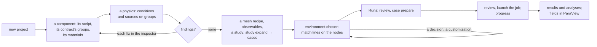
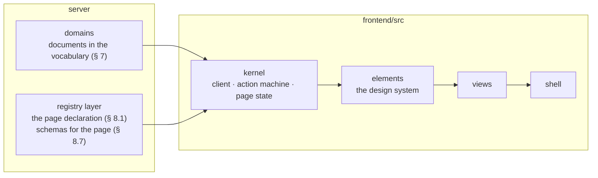

# Web contract — the server's routes, `serve`, and the page

**Role:** contract
**Status:** current; what is not built yet is marked so
**Authority:** the web surface: its routes and access (`femkit/web/`), serving
it (`serve`, the `server` domain), and the page (`frontend/`) — what the server
gives it, the one vocabulary that is written in, what the server declares about
the page, and the page's layers, state machines, elements, styles and help

## The short version

| rule | § |
|---|---|
| Every route is derived from the operation registry; a request body is the request model and nothing else | 1 |
| The page is built from the registry, the schemas and the server's documents, never from a list of its own, and writes only through plan and apply | 2 |
| The page is built by `web build` in the `web` environment and shipped, with its hashes | 3 |
| `serve` is a state machine observed from its lock and pidfile; a supervisor runs the application | 4 |
| Every request carries the token; the page holds nothing the server did not give it | 5 |
| The page shows the project's structure and edits its relations; each part's detail is its text — TOML, or a geometry script — edited beside the help of every key it may hold ([ADR 0010](../decisions/0010-describe-the-system.md)) | 2.2, 8.3 |
| A view is a thin consumer of documents and elements; a missing capability is work on the document or the element | 6 |
| Everything the page shows is written in one vocabulary: help, action, field, finding, table | 7 |
| The server declares the page's structure, the part kinds and object types, what may be added, the next step | 8 |
| The page is a kernel, elements, views and a shell; one action machine; one page state the address mirrors | 9 |
| Styles in five layers, every value a token | 10 |
| Every element carries its help; every action a key path | 11 |


Two parts: a flask application built from the same registry as the command
line ([`api.md`](api.md) § 6), and a page that runs in the browser. Both live
in the `web` environment ([`envs.md`](envs.md) § 1): the server runs on its
Python, and the page is built with its Node.js; the control environment holds
neither. The routes and `serve` are built in token mode, with the first page's
operation, progress and documents views, and the page's framework in part
(§ 6 says which parts); TLS, sign-in, `--no-auth`, uploads and the rest of
§§ 6–12 are not built yet (plan § 3, R and M7), and these rules hold when they
are. A basic test checks that every registered operation can be expressed this
way (its request and result models produce a JSON schema). The reasons for the
page's form are [ADR 0009](../decisions/0009-web-front-end.md).

## 1. Routes

| route | does |
|---|---|
| `GET /api/operations` | every operation: name, description, whether it changes things, asks for confirmation and is taken back by undo, request and result JSON schemas |
| `GET /api/page` | the page declaration (§ 8.1), loaded against the operations the server serves |
| `POST /api/<name>` | a read-only operation: request JSON in, result JSON out |
| `POST /api/<name>/plan` | a changing operation: request JSON in, plan JSON out |
| `POST /api/<name>/apply` | `{"request": …, "digest": …}`: re-plans, refuses with `PlanStale` unless the new plan's digest equals the one the person saw, then applies. A refusal before the run starts is answered as any other; otherwise the answer is JSON lines: `{"operation": "<subject>/<time>"}` as each run starts — its operation directory, the address `GET /api/events/…` and `GET /api/tail/…` take; an operation over several subjects runs once per subject (core.md § 6) — and last the outcome, or the defect. The apply runs to its end whether or not the page still reads |
| `GET /api/events/<subject>/<time>` | the event log of the operation in `<state>/operations/<subject>/<time>/`, as a stream from its first line as it grows, ending when the operation ends or is found interrupted: how a long apply's progress reaches the page; each path part must match its pattern and the path must lie inside `<state>/operations/` |
| `GET /api/health?nonce=<n>` | that the server is up, and an HMAC of the client's nonce keyed with the server's token, which proves the answer comes from this server without the client sending the token; the one `/api` route that needs no token (§ 5) |
| `PUT /api/upload?project=<path>` | streams one file into that project's upload area and answers with its SHA-256 (§ 5) |
| `GET /auth/start/<provider>`, `GET /auth/callback/<provider>`, `POST /auth/sign-out` | sign-in, with sign-in configured (§ 5) |
| `GET /api/tail/<subject>/<time>/<step>` | the last lines of that step's log, for the running step's live line; its path checked as the event stream's |
| `GET /api/docs` | every document the viewer shows: the repository's own Markdown files (below) |
| `GET /api/docs/<path>` | one of them — its text and its headings, each with its link anchor — or an image a document shows, as data; any other path is 404 |
| `GET /`, `GET /docs` and `/static/…` | the built front end; `/docs` opens it as the document viewer |

HTTP status follows [`api.md`](api.md) § 4.3: 200 for a result, exit 0 or 1 (the body says `ok`);
409 for a refusal; 500 for a defect, with the log path. A request body is the
request model and nothing else: no field takes executable text, a shell
fragment, an environment variable or a path outside the folders the operation
names. One exception, the person's decision (plan § 6;
[ADR 0013](../decisions/0013-geometry-scripts.md)): a component's geometry
script travels as the text of its file, written by `project write`, and is run
only as the first step of a pipeline, in a run folder, its contract checked
before and after ([`geometry.md`](geometry.md) §§ 3–4).

## 2. The front end

- **Built from the registry and the schemas, never from a list of its own.**
  Forms are rendered from the JSON schemas; the project graph from the graph
  document `project graph` returns ([`models.md`](models.md) § 11.2); the
  palette, the port types and the statuses come from that document. Adding a
  field, an operation or a node kind changes no front-end code.
- **Writes only through plan and apply.** Every change the page makes — an
  edit of the project, a decision, preparing a case — is an operation, planned
  and applied with its plan's digest; a change a person can take back at once
  — an edit recorded for undo — is applied as soon as it is committed, any
  other shown as its plan first (§ 9.1). Where a node is drawn is no project
  data at all (§ 2.2). The page holds no state the files do not. The one
  exception is an upload, which writes only
  into a project's upload area, which nothing reads until an operation names
  the file (§ 5).
- **Code is a file.** A customization is uploaded as a file into the project
  (§ 5) and named by an operation that records its hash; the page shows it
  and never runs or edits code typed into a form. A geometry script is a file
  of its component: the page edits its text as any part's and never runs it
  ([ADR 0013](../decisions/0013-geometry-scripts.md)).
- **Fields are viewed in ParaView**
  ([ADR 0002](../decisions/0002-paraview-visualization-boundary.md)); the page
  shows numbers, tables and where the field files are.

### 2.1 Views

| view | shows | acts through |
|---|---|---|
| operation | any operation as a form, its plan, its outcome | the routes of § 1 |
| project graph | the project's parts and their references — the overview, and the detail inside a part ([`models.md`](models.md) § 11.2); findings on each node; with an environment chosen, each node's worst match line | `project graph`, `project check`, `project set`, `project unset`, `project rename` |
| node | the selected part's text as its file holds it — a component's geometry script included — beside the help of every key it may hold, and its findings; for an open match line, the decisions and customizations that resolve it | `project write`, `project unset`, `project rename` |
| review | `case prepare`'s plan — the match report, each decision, each customization with its hash, the translator's command — and `job prepare`'s — the inputs, those customizations changed, the steps, the command ([`models.md`](models.md) § 9.6) | apply with the digest |
| progress | an operation's steps as they run, and the running step's log's last lines | `GET /api/events/…`, `GET /api/tail/…` |
| jobs and results | runs, their states, the result tables; where each field file is, for ParaView | the job and result operations |
| documents | the repository's documents, in a tab of their own (§ 2.3) | `GET /api/docs…` |

### 2.2 Layout

The page has three workspaces — **Project**, **Runs** and **Operations** —
under one top bar, and the documents in a tab of their own (§ 2.3):

```text
┌─────────────────────────────────────────────────────────────────────────────────────┐
│ femkit  project ▾  study ▾  environment ▾  [Project] [Runs] [Operations]  docs ↗    │
├──────────────┬──────────────────────────────────────────────────────┬───────────────┤
│ palette      │ canvas — the overview, or the detail inside a part   │ inspector     │
│              │                                                      │               │
│ components   │  parameters ─▶ component ─┬─▶ physics ──┐            │ the selected  │
│ physics      │   (script + contract,     ├─▶ mesh ─────┼─▶ study ─▶ │ part's text,  │
│ conditions   │    materials assigned)    └─▶ observables┘  analysis │ or its script,│
│ mesh recipes │                                                      │ beside the    │
│ studies      │  nodes: geometry made?, findings ● and, with an      │ help of each  │
│ library:     │  environment, the worst match line of each           │ key it may    │
│ materials    │                                                      │ hold; findings│
├──────────────┴──────────────────────────────────────────────────────┴───────────────┤
│ findings · cases · progress of the running operation                                │
└─────────────────────────────────────────────────────────────────────────────────────┘
```

- **The top bar** chooses the project, the study and an environment. The
  environment overlays each node with its worst match line
  ([`models.md`](models.md) § 6.2); with none chosen, the graph shows the
  description alone.
- **Project** is the palette, the canvas and the inspector:
  - **the palette** lists what may be added, each a template generated from
    the schemas and the formulation (§ 8.3): a component from a template
    script; a physics, and its condition and source kinds grouped by where they
    may stand; a mesh recipe; an observable set; a study and an analysis; a
    material from its template or from the library. Each entry's tooltip is its
    sentence, linked to its section in the document viewer;
  - **the canvas** shows the overview — one node per part, in the chain's
    order, wires the references between parts; the person's grouping folders
    as boxes that open and close ([`projects.md`](projects.md) § 3) — and,
    opened on a part, its
    detail: the groups a component's contract promises and the materials
    assigned to them; a physics' groups and the conditions and sources on them;
    a study's pairing and its axes
    and environments ([`models.md`](models.md) § 11.2). A component's named
    groups are its ports; a port accepts only its own type. Dropping a palette
    entry on the canvas, or on a node — a condition on a boundary group —
    opens its add with what the drop names filled in; drawing or removing a
    wire is the one transaction it means, applied at once with its Undo, as
    every edit is (§ 9.1). **Where nodes stand is the page's alone**, never
    the project's: the canvas arranges them by itself in the chain's order —
    parameters, components, physics, mesh recipes and observable sets,
    studies, analyses — and **Tidy** arranges them so again. When the person
    chooses to remember where they dragged nodes, the page keeps it in the
    project's view file, `.femkit/view.json`, by `project view` — no project
    data: never an edit, never undone, never read by a case, a run or a check
    ([`projects.md`](projects.md) § 2). React Flow arranges no nodes itself; the arrangement comes
    from a layout library — dagre or ELK, as its documentation shows — a new
    dependency of the page, the person's to approve (plan § 3, R step G);
  - **the inspector** is the selected part's text, as its file holds it with
    its comments, in an editor — a component's geometry script included; beside
    it the help of every key the part may hold — its sentence, its unit or
    choices, whether it is required, its defining section — and each port as a
    choice of the names it may hold. Saving the text is one `project write`,
    checked and undoable; a refusal is shown at its line. A component's
    contract is edited beside its script, and the groups it promises are its
    ports.
    Below are the part's findings, each with its fix as a button, and, for an
    open match line, the decisions and customizations that resolve it. The page
    never edits a value field by field
    ([ADR 0010](../decisions/0010-describe-the-system.md)).
- **Every canvas action is also a keyboard action.** Adding, wiring and
  removing each have their control in the palette and the inspector, so a
  project is built as fully by keyboard as by mouse.
- **The bottom panel** holds the findings of `project check`, each leading to
  its node and with its fix; the cases, with their axis values and, per
  environment, their match and preparation state (`case list`), and `study
  expand`; and the progress of the running operation (§ 2.1).
- **Runs** is each case against each environment: the review before
  `case prepare` and before a job is launched, the jobs and their states, the
  result tables and analyses, and where each field file is for ParaView.
- **Operations** is every operation as a form (§ 2.1), for what no workspace
  shows.
- **On a narrow screen** the palette and the inspector become drawers over the
  canvas.

A person's way through it, from a new project:



The Project workspace is rebuilt by plan § 3, R step G; the environment's
overlay waits on abilities and the match report (M5 step 3, M7 item 4); Runs,
past its cases and `study expand`, on run folders, preparation and jobs (X,
M3, M4, M6, M7 item 5). Operations, progress and the documents are built.

### 2.3 The document viewer

- **The document viewer** opens in its own tab at `/docs`, its token handed
  over in the address's fragment as the page's own is (§ 5). It shows every
  Markdown file under `docs/` and `examples/`, and the root documents
  `PROJECT_CONTRACT.md` § 2 names — by name, so a local file beside them is
  never shown — as a tree of folders that expand, and renders each as GitHub does: tables, code,
  math (KaTeX), Mermaid diagrams. Links work as in the repository: a link to
  another of these documents opens it in the viewer, at its section, and the
  browser's back and forward move through them; a link to any other file of the
  repository shows its path, not followed; a link outside opens in a new tab.
  A section of a document has an address of its own, so a tooltip or a finding
  can link to it.
- **It cannot be made to reach beyond its documents.** The server serves a
  path only when it is on the list `GET /api/docs` gives — made by walking
  those folders without following a symbolic link — so no spelling of a path
  reaches another file, and a document's text is never sent as anything but
  text. The page renders a document's raw HTML as text, follows no
  `javascript:` link, loads an image only from that list, and applies a
  diagram's or a formula's styles through the page's object model, so the
  content-security policy (§ 5) holds without an exception.
- **Each heading's anchor is the server's**, by GitHub's rule — the same
  function that checks a formulation's sections ([`models.md`](models.md) § 4)
  — so a link written in one document, a section a formulation names, and the
  viewer's address of that section always agree.

## 3. Source and build

- **Source** is a React application, in a top-level `frontend/` folder
  (`PROJECT_CONTRACT.md` § 2); its graph view uses React Flow
  ([ADR 0009](../decisions/0009-web-front-end.md)). `package.json` declares,
  under `femkit.sources`, the files the bundle is built from, its lock file
  included.
- **Built by `web build`**, an operation like any other, with the Node.js of
  the `web` environment ([`definitions.md`](definitions.md) § 4.7;
  `env install web`) — never the control environment, and never a Node.js of
  the person's own. It copies the declared sources into
  `<cache>/frontend/work/`, runs `npm ci --ignore-scripts` there from the
  committed lock file, then `npm run build`, each inside the environment
  through the manager ([`envs.md`](envs.md) § 4.4), with npm's cache and
  configuration under `<cache>/frontend/`: nothing is read from or written to
  the person's `~/.npm` or `~/.npmrc`, and no `node_modules` lands in the
  checkout. `web build --relock` first solves `package-lock.json` again from
  `package.json` and writes it into `frontend/`.
- **The built bundle is shipped** in `femkit/web/static/`: generated, never
  edited by hand. `web build` writes `static/build.json`: the SHA-256 over the
  declared source files, the Node.js and npm versions, and the SHA-256 of every
  bundle file; and `static/THIRD-PARTY-LICENSES.txt`, each package the lock
  file installs for the page, with its license text. A basic test recomputes
  both hashes without Node.js, so a source changed without rebuilding and a
  bundle edited by hand both fail.
  Installing femkit never needs Node.js, and the page loads nothing from the
  network: scripts, styles and fonts are all in the bundle.

## 4. Serving — `serve`

`serve` is a group of verbs, declared as operations of the `server` domain
([`framework.md`](framework.md) § 1); a verb is always named, never implied:

| verb | does |
|---|---|
| `serve start` | plans the address, the files and the child's command; applying takes the server's lock, opens the listening socket, writes the access token (§ 5) and starts the supervisor detached, which inherits the lock and holds it for as long as it runs; returns once the child answers with that token, printing the address to open, with the token |
| `serve status` | every server this account runs, each with two answers kept apart: is the process up (the pidfile's checks), and does it answer with this server's token (§ 5); the address with its token only for one named server (`--port`, `--socket`) |
| `serve restart` | reads the configuration first, as a fresh child would, and refuses with its reason if it does not load — leaving the running server alone; refuses while the child holds an operation's lock (an install started from the page) unless `--force`, naming each; otherwise signals the supervisor (`SIGHUP`), which replaces its child with the same token |
| `serve stop` | refuses while the child holds an operation's lock unless `--force`, naming each; otherwise stops the supervisor (`SIGTERM`), which sends its child `SIGTERM`, ends its event streams, waits, then sends `SIGKILL`, and removes the pidfile, the socket and the token |
| `serve foreground` | `start` without detaching: the same lock, checks and files, so `status`, `restart` and `stop` from another terminal act on it; the child's output goes to the terminal as well as the log; Ctrl-C stops them, and is a normal stop, exit 0 |

The supervisor runs `python -m femkit.web` as a child process, with the `web`
environment's Python and the checkout as its working folder; `start` and
`foreground` refuse while that environment is not `ready`, naming
`env install web`. The supervisor itself runs in the control environment, and
the `server` domain never imports the web package, as no domain imports a
surface. The
supervisor imports only the standard library and the core's file and process
building blocks — never flask, the web package or another domain — so a change
that breaks the application leaves the supervisor running, to start the fixed
child at the next `restart`. Everything `start` refuses — a server already
running, a held address, an unsafe runtime folder, a configuration that does
not load — it refuses before it detaches, with the listening socket already
open: after that nothing reaches the terminal. Starting
a detached, supervised process is a core building block
([`core.md`](core.md) § 8): the child is spawned
from the supervisor's main thread, ends when its supervisor ends
(`PR_SET_PDEATHSIG`, checked again with `getppid` after it is set), and both are
identified as a run's process is — process ID and start time. **The supervisor
opens the listening socket once and hands it to each child**, so the address is
never free between a child's end and the next one's start, and no other
program can take it in that gap.

**Listening.** On a machine femkit observes as a cluster login node
([`jobs.md`](jobs.md) § 9.1) the server listens on a Unix socket,
`<runtime>/serve-<name>.sock`, which only its owner can open: no other account
on the node can connect to it or take its place. The person forwards it with
SSH from their own machine, with the forwarding line `start` prints (§ 5),
and opens the printed address there. Elsewhere it listens on TCP, `127.0.0.1` and
`--port`; `--socket` and `--tcp` choose either explicitly.

**Files**, each in a directory of the person's own account:

| file | holds | made |
|---|---|---|
| `<runtime>/serve-<name>.pid` | the supervisor's and the child's process IDs and start times, the host and its boot ID, and where it listens | by `start`, rewritten by the supervisor at each respawn, `0600` |
| `<runtime>/serve-<name>.token` | the access token (§ 5) | by `start`, before the child runs: created exclusively, never following a link, `0600` |
| `<runtime>/serve-<name>.sock` | the Unix socket, when it listens on one; its path at most 108 bytes, or `start` refuses, naming it; never an abstract socket, which has no permissions | by the supervisor, `0600` |
| `<state>/logs/serve-<name>.log` | every event the supervisor and the server report, timestamped: child start, respawn, give-up, stop, a `status` that found it up but not answering; each request's method, path without its query (control characters escaped), status, time and, with sign-in, the account — never a header, a token or a body | by the supervisor alone, `0600` |
| `<state>/logs/serve-<name>.supervisor.log` | what the detached supervisor itself prints before or outside the server's log — a traceback, an import that failed; `start` shows its last lines when the child never answers | by the supervisor's own output, `0600` |
| `<state>/logs/serve-<name>.stacks.log` | every thread's stack, appended each time the child receives `SIGUSR1` | by the child, `0600` |

`<name>` is the port, or `sock` for the socket. `<runtime>` is the runtime
directory ([`config.md`](config.md) § 2), host-keyed under `<state>` on every
machine: a session's `$XDG_RUNTIME_DIR` is deleted at its last logout, on a
workstation as on a login node, while a detached server lives on. It is made
`0700`, and refused — naming the folder — if anyone else can enter it or any
folder above it is writable by others.

- **The log is capped and rotated** by the supervisor, the log's one writer:
  over its size limit it is closed and compressed to
  `serve-<name>.log.1.gz`, older archives shift up, and only the newest few are
  kept (`--log-max-mb`, `--log-keep`).
- **Every verb checks before it acts**: the processes the pidfile names are
  alive, this account's, femkit servers, with the recorded start times; a
  pidfile written on another host names that host and is never treated as
  stale.
- **The supervisor respawns a child that dies by a signal**, and gives up after
  two such deaths within 30 s, saying so in the log and removing the pidfile, the
  socket and the token. A child that exits with an error — a configuration it
  cannot load — is not respawned.
- **It never kills a running child on its own.** A server that is up but not
  answering is a question, not a verdict: its stacks are dumped and read
  (`kill -USR1`), and a person decides on `serve restart`.
- **The web server** handles requests on a bounded pool of threads, with a
  time limit for reading a request's headers and a cap on open event streams,
  and does the TLS handshake in the connection's thread, never in the loop that
  accepts connections, so a slow or silent client can neither stall nor
  exhaust it. No debugger or code-reloading mode is ever served.

The server is a state machine ([`framework.md`](framework.md) § 3), observed
from its lock, its pidfile and the processes the pidfile names. **The lock is
the supervisor's liveness**: the subject `server-<host>-<name>`
([`core.md`](core.md) § 5), taken by `start` and `foreground` through the
operation runner, and held by the supervisor from then on — the kernel releases
it however the supervisor ends, so a supervisor that is gone is observed, never
guessed from a process ID that may have been reused. `start` and `foreground`
also take the `web` environment's subject, `env-web`, **shared**, and the
supervisor holds it with the server's own: while any server runs, `env
install web`, `env clean web` and `env validate web`, which need it alone, are
refused, naming each server and its `serve stop`; and no server starts while
an operation holds it alone ([`core.md`](core.md) § 5). `restart` and `stop`
take no lock of their own: they verify the holder and signal it. Which operation
locks the child holds is read from the kernel's lock table, never from a lock
file's text. The rules, in order:

| # | observed when | state | `start` | `stop` | `restart` |
|---|---|---|---|---|---|
| 1 | the pidfile was written on another host | `elsewhere` | refused: names the host | refused: names the host | refused: names the host |
| 2 | the lock is free, and no pidfile | `stopped` | starts | nothing to do | refused: offers `start` |
| 3 | the lock is free, and a pidfile is left — its supervisor ended without removing it: killed, or the machine restarted | `stale` | ends a child it names that still runs, removes the files, starts | the same, without starting | refused: offers `start` |
| 4 | the lock is held, and the pidfile names its supervisor, alive with its recorded start time | `running` | refused: already running | stops | restarts |
| 5 | otherwise: the lock is held, and no pidfile names its holder yet | `starting` | refused: names the holder | refused: names the holder | refused: names the holder |

Whether a `running` server answers is a fact `status` shows, not a state:
answering can change between two looks.

## 5. Access

The state reached by configuring nothing is the safe one: a mistake leaves a
capability missing, never open to everyone. Every rule here holds in every
mode, unless it says otherwise.

**The access token** — every server has one; the page and programs must send it
unless sign-in or `--no-auth` says otherwise below. A machine's loopback address
is reached by every account on that machine, so loopback alone keeps nobody
out.

- `serve start` makes 32 random bytes from the operating system's secure
  source, URL-safe, and writes them to `serve-<name>.token` (§ 4). The child
  reads the token from that file; it never travels on a command line or in an
  environment variable, which other accounts can read.
- The printed address carries the token in its fragment,
  `http://127.0.0.1:8000/#token=<token>`. A browser never sends a fragment to a
  server, so the token is in no request line, server log, proxy log or
  `Referer` header. The page reads it, keeps it in the tab's session storage —
  which belongs to this origin, port included, and is kept only by this tab,
  coming back only if the browser restores the tab — replaces the address so
  the token leaves the address bar and the history entry, and sends
  `Authorization: Bearer <token>` with every request it makes. A program does
  the same.
- For a socket, `start` prints the forwarding line to run on the person's own
  machine, `ssh -o ExitOnForwardFailure=yes -L 127.0.0.1:8000:<socket> <host>`,
  so a local port already taken by another program stops the forwarding instead
  of handing the token to that program.
- **No cookie is set in token mode.** Cookies are shared by every port of a
  host, and any page in the browser can make a request that carries them; a
  token sent only as a header cannot be ridden by another page or leak to
  another server on the same host.
- Every route requires the token except the page itself and its bundle, which
  hold nothing secret, the sign-in routes (below), and `GET /api/health`, which answers a client's nonce
  with an HMAC keyed by the token: `status` and `start` check the answer, so
  they tell their own server from another program on the address without ever
  sending the token. On a Unix socket the server also checks the connecting
  process's account (`SO_PEERCRED`) is its owner's. A request without the
  token gets 401 in JSON; the page then asks for it.
- The event stream is read with `fetch`, which sends the header; a browser's
  `EventSource` cannot.
- Tokens are compared in constant time. A restart keeps the token; `serve
  start` makes a new one; `serve stop` and a supervisor that gives up delete
  it. `status` prints it only for one named server. With sign-in configured,
  the token still serves the owner's own programs, as `Bearer`, and the page
  uses sign-in.

**Every request is checked**, in every mode:

- **Host.** The `Host` header must name the server: on TCP, the address it
  listens on — printed as `127.0.0.1`, never `localhost`, which another account
  can answer on `[::1]` — with its port, or `web.public_name` when it serves a
  public name; on a
  Unix socket, whose local port the person picks when forwarding it,
  `127.0.0.1`, `localhost` or `[::1]` with any port. Anything else is refused
  before any handler runs: a web page cannot reach the server by pointing a
  name of its own at `127.0.0.1`.
- **Writes** — every method but `GET` and `HEAD` — must carry
  `Content-Type: application/json` (an upload, its declared type), and, when
  the browser sends an `Origin`, one equal to the origin the `Host` names, its
  scheme that of the TLS listener or, behind a trusted proxy, its
  `X-Forwarded-Proto`; `Origin: null` is refused. No CORS headers are sent and no `OPTIONS` route
  exists, so no other origin is ever allowed.
- **Size.** A request body is capped (JSON at 1 MiB; uploads at their own
  limit, below); a larger one gets 413 naming the limit.
- **Failed attempts** — a 401, a refused `Host` — are answered at once and
  logged, never delayed or locked out: a 256-bit token cannot be guessed, a
  delay would hold one of the bounded threads, and every local client arrives
  from the same address, so a lockout would let any page or account lock the
  owner out. The cap on event streams stays below the thread pool's size.
- **Errors** answer with the reason and nothing else: no path outside the
  project, stack trace or version string reaches a response. The
  full detail is in the server's log.

**Every response** carries:

```text
Content-Security-Policy: default-src 'none'; script-src 'self'; style-src 'self';
  img-src 'self' data:; font-src 'self'; connect-src 'self'; form-action 'self';
  frame-ancestors 'none'; base-uri 'none'; object-src 'none'
X-Content-Type-Options: nosniff
Referrer-Policy: no-referrer
Cross-Origin-Opener-Policy: same-origin
Cross-Origin-Resource-Policy: same-origin
Cache-Control: no-store            (every /api response)
Strict-Transport-Security: max-age=31536000   (over HTTPS only)
```

The bundle contains no inline script or style element: the built page loaded
headlessly under this policy would not run with one (plan § 3, M7 item 2);
styles a script sets through the page's object model are allowed by
this policy. The browser validates nothing a schema could forbid: a value is
checked by the plan route, so the policy needs no `unsafe-eval`.

**HTTPS.** A server on the loopback address or a Unix socket, reached from
this machine or through an SSH tunnel, is carried encrypted by SSH and serves
plain HTTP. Any other address (`--host`), and any server with a
`web.public_name`, requires TLS, and the refusal says so:

- directly from PEM files (`--cert` and `--key`, or `web.tls` in
  `config.toml`; the command line wins): the key file must be this account's
  and readable by no one else, or the server refuses to start; TLS 1.2 is the
  minimum, with the standard library's default server context and its
  ciphers;
- or from a reverse proxy that terminates TLS in front of a loopback server,
  with `web.trust_proxy` trusting exactly one hop of its forwarded headers.
  `web.trust_proxy` and `--no-auth` together are refused.

**Sign-in** opens the page to a group, and requires HTTPS. With no
`[web.auth]` section in `config.toml` nobody signs in.

- A `[web.auth]` section names one or more identity providers (OpenID Connect)
  and an **allow-list** in which each entry names one provider's issuer and one
  account at it — its subject identifier, or an address that provider asserts
  as verified; a section without a non-empty allow-list is refused, since a
  provider alone admits anyone with an account there, and an address alone is
  trusted from any provider that will assert it. Everyone on the list acts
  with the server owner's account on this machine — reading the projects,
  preparing and running work, adding customizations whose code runs in a
  reviewed job — so the list names only people the owner trusts that far.
- The flow is the authorization code flow with PKCE. Each provider has its own
  redirect address, and the provider is bound to the `state`; the `state`, the
  `nonce` and the PKCE verifier live, for the round trip only, in a cookie of
  their own — `__Host-` prefixed, `Secure`, `HttpOnly`, `SameSite=Lax` so it
  survives the provider's redirect back, a few minutes long, used once. The ID
  token's signature is checked against the provider's published keys (found
  through its discovery document) with the algorithms the configuration pins,
  and its issuer, audience, expiry, `nonce` and identity are checked against
  the round trip and the allow-list; femkit never holds a password.
- **Sessions are kept on the server.** The session cookie holds only a random
  session ID — `__Host-` prefixed, `Secure`, `HttpOnly`, `SameSite=Strict`,
  `Path=/`; the record in `<runtime>` holds the account, the idle timeout and
  the absolute lifetime. Signing out deletes the record, and the allow-list is
  checked again on every request — read again whenever `config.toml` changes,
  and admitting nobody while it does not load — so removing someone from it
  ends their session at once.
- Each apply records who made it in its event log ([`core.md`](core.md) § 6) —
  the signed-in account, or `owner (token)` — as each request does in the
  server's log.
- The sign-in routes (§ 1) need no token; they are how a session begins.
- The provider's client secret and the session-signing key are files in
  `<config>/secrets/`, under fixed names; the folder must be `0700` and each
  file `0600`, or the server refuses to start, naming the file. The session key
  is created on the first run.

**`--no-auth`** stops requiring the token on the routes; the token is still
written, so `start` and `status` still prove their server through the health
route. It is accepted only on TCP's loopback address — never on a Unix socket, which a forwarding opens to every account on
the machine it is forwarded to, and never with `web.trust_proxy` — and the
server says when it starts that every account on this machine can then reach
it.

**Uploads.** A file reaches the server only through `PUT /api/upload`, whose
`project` names a project inside the server's projects folder (`web.projects`;
the projects root, `paths.projects`, once plan § 3, R lands)
— checked as a path inside it, opened without following links — and which streams the file,
under its own size limit and the project's total quota (`web.upload_max_mb`),
to a temporary file renamed to `<project>/.femkit/uploads/<sha256>`, and
answers with the hash. While `web.projects` or `web.upload_max_mb` is unset,
uploads are refused, naming the key. The operation
that adds a customization names that hash and a name under `custom/` that
follows [`models.md`](models.md) § 8.2's rule, and opens the path without
following links. Nothing uploaded runs except in a job the person reviewed
([`models.md`](models.md) § 8.4). The page shows code as text inside JSON,
never as a document of its own.

## 6. The page's framework

Built (plan § 3, R step B): the vocabulary (§ 7), the page
declaration and what the server declares but the layout and text and templates
(§§ 8.2–8.3), the kernel and the elements in part (§ 9); the views, the shell,
§ 8.2's layout and § 8.3 are not (plan § 3, R), and the page as it
stands is the first page they replace. The page is held to the web discipline of
[`../process/conventions.md`](../process/conventions.md) § 2.1, and to one
doctrine: **a view is a thin consumer of documents and elements; a missing
capability is work on the document or the element, never a workaround in the
view.**



The server owns every fact: the fields, kinds, operations and sentences, what
may be added and what may be done next, and the page's own structure (§ 8.1).
The page owns presentation: layout, elements and interaction.

## 7. The vocabulary — one data structure

Pydantic models in `femkit/core/view.py`. Every document the page renders, and
every answer of a route (§ 1) but two, is built from them; each is built in one
place, so a refusal's JSON, for one, exists once. The two: `GET /api/page`
answers with the declaration's own model, `Page` in `femkit/page.py` (§ 8.1),
and the event stream with the event log's lines as they are written
([`core.md`](core.md) § 6). The plan answer — a plan, its digest
and its text — is built beside the plan it carries, in `core/operations.py`,
which the vocabulary sits below.

### 7.1 Help

`Help {sentence, doc}` — a sentence a person reads, and `doc`, where it is
defined: a document and its section. A schema's description is a sentence and
nothing else; a reference to a document is a `doc` annotation beside it
([`core.md`](core.md) § 2), which the command line's help, the reference pages
and the page each render their own way.

### 7.2 Action

`Action {label, call, fills, help}` — something a person may do.

- `call` is an operation with its request, or a `shell` line for what is no
  operation: a shell's activation line, a scheduler's interactive command.
- `fills` — each value the request still needs, by its path: a `Field` (§ 7.3)
  to type or choose it, or the node kinds whose names may fill it.
- Whether it reads, changes or removes, and whether it asks for confirmation,
  comes from its operation's declaration ([`api.md`](api.md) § 2), never from
  the action.

**Every next step is an `Action`**: a refusal's and a finding's `next`, a state
machine's action ([`core.md`](core.md) § 7), a result field that holds a
command. The surface renders it: the command line writes the command a person
types, from the request, with the one argument mapping it also parses by
(`core/commandline.py`); the page draws a button. A request model lives apart
from its operation's code (`<domain>/requests.py`), so a check builds an action
without importing the operation that runs it.

### 7.3 Field

`Field {label, key, value, schema, help, set}` — one value as a person sees
it: a request's field in an operation's form, or a key an object may hold, in
the help beside its text. The page edits a part's detail as text (§ 8.3),
never field by field.

- `value` is the TOML text the file holds — the one convention of every value
  a person writes, `project set` and `config set` and the command line alike — so
  a decimal stays the text it was typed as.
- `schema` is a self-contained JSON schema fragment of what it may hold: a
  quantity's carries its dimension and the unit table's symbols for it
  ([`core.md`](core.md) § 11); a closed list carries `enum`, so a choice is no
  separate part.
- One builder makes the fragments of a project's parts, joining each schema
  with what its formulation family and the property list declare, so a
  condition's parameters and a material's properties are keys like any other.
- `set` is the action that writes it, where one value is written alone — a
  setting of `config set`; none in a key's help.

A field that names another object is a port of its node
([`models.md`](models.md) § 11.2), never a field as well.

### 7.4 Finding

`Finding {severity, subject, label, message, next}` — `subject` the address,
`label` what a person calls it, `message` a whole sentence, `next` its actions.
**A fix never chooses among alternatives**: where more than one value would
do, it leaves the value to fill, with its choices.

### 7.5 Table

`Table {columns, rows}`, each column with its label and help.

## 8. What the server declares

### 8.1 The page declaration

`femkit/data/web/page.toml`, under schema, served at `GET /api/page`:

- **the app**: its name, its tagline — one sentence — and its mark;
- **the workspaces**, in order: key, title, icon, tagline, help, the operation
  whose document it shows, and the context it needs;
- **the context** — project, study, environment — each with the operation that
  lists its choices, and what it depends on; a request field that takes one
  carries the `context` annotation ([`core.md`](core.md) § 2), so a form opened
  in the Operations view starts from the context, and a document's actions,
  made for the context, carry it already;
- **the kinds' icons**, one for each part kind and object type of § 8.2;
- **the shortcuts**: each key and what it does;
- **the empty states**: what a workspace says before there is anything to
  show.

Adding a workspace is an entry here and one view (§ 9.3). Loading the
declaration refuses an object type without its icon and a workspace whose
operation does not exist.

### 8.2 Parts and object types, one layout

Each part kind — its folder, its file, its schema — and each object type inside
a part — its table, whether it is named, its place in the chain's order — is
declared once, in the project layout ([`projects.md`](projects.md) § 4); the
door, the graph, the checks, the templates and the page all read it. A kind's
colour is the design token of its place in that order (§ 10.2), so no style
names a kind.

### 8.3 Text, its help, and templates

Each node carries its **text** — its part's file as it holds it, comments
kept, or the value's TOML — and its **keys**: a `Field` for every key it may
hold, built from the schema and, for what a formulation or the property list
declares, from those, by one builder of fragments — the very fragments the
loader's schema states. Its `write` action is `project write`, which replaces
that text as one transaction, recorded for undo ([`projects.md`](projects.md)
§ 7).

A palette entry is a **template** generated from the same fragments: the
object's type held, its required keys written to fill, and every optional key
written as a comment with its sentence and its unit or choices, ready to
uncomment. A template is where the part's text starts: an add opens it in the
editor, and saving it is the write, checked as any write is — a template that
leaves a required value open does not load until it is filled. A component
starts from one of femkit's example scripts with its contract
([`geometry.md`](geometry.md) § 2): geometry is the person's, and its examples
are real scripts, not generated text. No other template text is written by
hand, and no value is asked for field by field
([ADR 0010](../decisions/0010-describe-the-system.md)). Not built yet (plan
§ 3, R step F).

### 8.4 The way through

The project's next step — the first finding of `project check`, in the chain's
order ([`models.md`](models.md) § 11.2) — stays in view with its actions.

### 8.5 Undo

`project undo` and `project redo` take back and make again the last edits, as
[`projects.md`](projects.md) § 7 records them.

### 8.6 Projects

`project list` lists the projects under the projects root, `paths.projects`
(replacing `web.projects`, decided, not built yet; [`config.md`](config.md) § 3,
[`projects.md`](projects.md) § 1), and `project new` creates one there, whole; `study
list` lists a project's studies. They are the context's choices (§ 8.1).

### 8.7 Schemas for the page

`schema docs` also writes the vocabulary's, the declaration's and the routes'
answers' JSON schemas, in their serialization form, into
`frontend/src/generated/` — committed, and checked as the reference pages are
([`definitions.md`](definitions.md) § 2.3). `web build` turns them into
TypeScript with `json-schema-to-typescript`; the icons the declaration names
become one generated module. No type of server data is written by hand in the
page.

## 9. The page's layers

Imports point down; each layer is a folder of `frontend/src/`; the review
holds it ([`testing.md`](testing.md) § 3).

### 9.1 Kernel

- **The client** (`kernel/client.ts`) — the only code that talks to the server,
  and the one reader of its answers: each comes back as ok, refused (with its
  next steps), defect (with its log), token missing, unreachable or unreadable
  — each said one way, never painted as data. One renderer draws the server's
  sentences: a command in backticks as code.
- **The action machine** (`kernel/action.ts`) — one state machine for every
  action, in every view:

  ```mermaid
  stateDiagram-v2
      [*] --> filling: values to fill
      [*] --> running: reads
      [*] --> planning: changes
      filling --> planning: filled
      planning --> applying: no confirmation
      planning --> planned: confirmation
      planning --> refused
      planned --> applying: apply, with the digest
      planned --> [*]: discard
      applying --> done
      applying --> failed
      applying --> refused
      running --> done
      running --> refused
  ```

  Every change is planned, and applied with its plan's digest. One whose
  operation asks no confirmation — a change a person can take back at once: an
  edit recorded for undo (§ 8.5) — is applied as soon as it is committed and
  announced with its Undo; any other is shown as its plan
  first, and applied with one press.
- **The page state** (`kernel/state.ts`) — one store: the context, the
  workspace, the selection, the open drawer. The address mirrors the context,
  the workspace and the selection: a change of context or workspace is a
  history entry, a selection replaces the current one. Nothing is applied from
  an address, and an action is never in one.

### 9.2 Elements — the design system

One component for each, each with its stylesheet, its classes prefixed with
its name; every view uses these and nothing else:

| element | is |
|---|---|
| `Banner` | the mark, the name, the version and the tagline; a workspace's title and tagline |
| `Icon` | an icon the declaration names |
| `Button` | a press: primary, quiet or danger |
| `Help` | a sentence on hover and on focus, and `?` to its document's section; never an element's name |
| `Field` | one request field from its schema fragment, in an operation's form: text, number, quantity with its unit, choice, boolean, list, record |
| `Form` | a request's fields edited together, committed as one action — Save or Enter; Esc puts them back |
| `TextEditor` | an object's text: one edit committed with Save, its lines marked where a refusal or a finding points |
| `Keys` | the help of every key an object may hold: its sentence, unit or choices, whether required, its section |
| `ActionButton` | any action: its fills asked, then the action machine |
| `Finding` | a finding with its next steps |
| `Table` | a table, its columns' help on their heads |
| `Tabs` | one tab strip, one tab stop, the arrow keys |
| `Dialog`, `Confirm` | the one dialog; never the browser's own |
| `Notifications` | the one stack: what applied, with its Undo; what failed |
| `Busy` | one cover for a long action |
| `Drawer`, `Card`, `Badge`, `Empty` | a side panel on a narrow screen; a surface; a state; what to do first |
| `Plan`, `Progress` | a plan's steps; a run's steps as they go, and the running step's last lines |
| `Graph` | the canvas: a node from a graph node, one handle for each port |

### 9.3 Views

Project, Runs, Operations and Documents, each mounting the elements on its
document. A view holds no form, table, plan, error or request code, and no
style but its arrangement.

### 9.4 Shell

The banner, the workspaces from the declaration, the context bar, the
notifications, and the drawers on a narrow screen.

## 10. Styles and look

### 10.1 Five layers

| layer | owns |
|---|---|
| `styles/tokens.css` | every colour, space, size, type and motion value, light and dark; nothing else |
| `styles/shell.css` | the page: body, the banner's place, the workspace bar, `main` |
| `elements/<element>.css` | one element each, its classes prefixed with its name |
| a view's sheet | arrangement only |
| anywhere else | nothing: no inline style, no raw colour outside `tokens.css` |

Spacing is a 4px grid; one font family; focus is one token; motion is short
and honours reduced motion. A layout reflows by its content — grids with a
`min()` floor, container queries — and a screen-width breakpoint is derived
from the content's declared minimums, never chosen. The review holds the layers.

### 10.2 Look

A calm, light surface with a dark mode from the same tokens; one accent; the
banner a quiet gradient of the accent under the mark; icons from the Lucide
set, named by the declaration; a kind's colour the token of its place in the
chain's order (§ 8.2). The mark is one SVG file, used by the banner and as the
page's icon.

## 11. Help and use

- Every element shows its `Help`; every workspace its tagline; every empty
  state what to do first; the project's next step stays in view with its action.
- The words are the server's — the schemas', the formulations', the
  declaration's. The page names only its own controls, from the declaration.
- Every action has a key path; the shortcuts are the declaration's.
- After an action, what it added is selected and what it removed deselected.
- A refusal names the field or the line it is about, and the form or the
  editor shows it there.
- A project is chosen from those under the projects root, or created there.

## 12. Tests

- The vocabulary round-trips; every action a document offers plans against its
  operation; every template parses and names every key its schema allows; a
  written text keeps its comments; the
  generated schemas are fresh.
- The page works on any project the server describes: served a project whose
  fields and kinds are renamed, it still shows and edits them — the API's test
  of a page that names no field of its own.
- The page's discipline — no field, kind, operation, address or sentence named
  in its code, no `fetch` outside the client, no style outside `elements/` and
  the views' arrangement, no raw colour outside `tokens.css`, no hand-written
  type of server data — is held by review, which reads the page's source
  ([`testing.md`](testing.md) § 3); no test reads it.
- At each step of plan § 3, R, every element is exercised in a browser
  and the Laplace project's structure is built in the page from a new project,
  its detail written as text, and the step
  is reviewed independently against [`../process/conventions.md`](../process/conventions.md)
  § 2.1.
