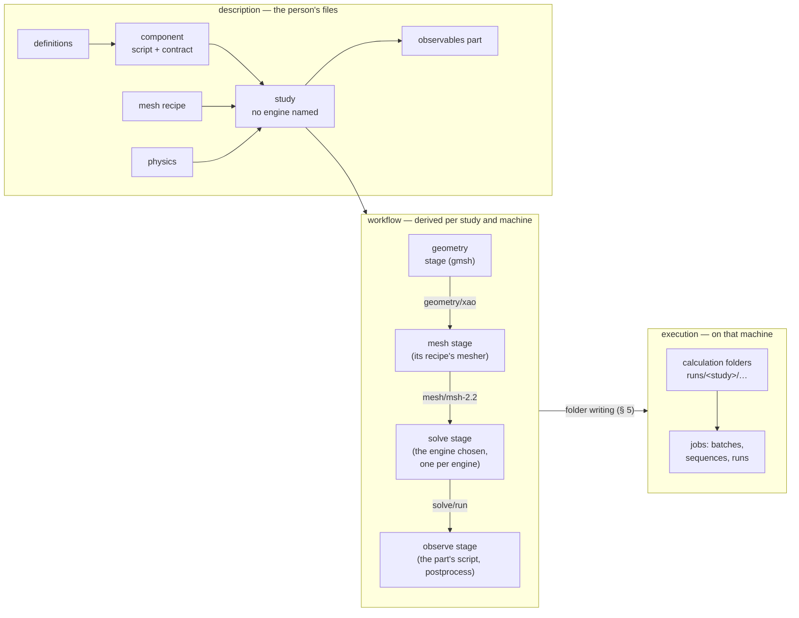

# Workflow contract — stages, the study's workflow graph, and their folders and jobs

**Role:** contract
**Status:** current, approved by the person
([ADR 0016](../decisions/0016-every-step-runs-from-a-run-folder.md),
[ADR 0017](../decisions/0017-netgen-curves-ngsolve-geometry.md),
[ADR 0018](../decisions/0018-one-graph-from-description-to-execution.md)).
Built: the stage kinds, artifacts, meshers and hand-overs as data — a stage
kind's `environment` and `brings` among them (§ 2.1) — the stage programs, a
study's workflow graph, its geometries and meshes the study's own, serving
every engine, each mesh by the mesher its recipe states
([ADR 0025](../decisions/0025-one-engine-per-study-observables-after.md)), a
stage's identity, its folder writing for the geometry and mesh kinds, its
states, `study flow`, `case list`'s stages, and `study prep` with its
definitions step, its meshing job and `--engine`, the engine chosen to solve
checked to take the study's mesh (§§ 2–8; § 11), a change's impact and
`project save` (§ 10). Being built (plan § 4, X): the check of a built
geometry's groups. Not built: the solve, translate and observe kinds (M6)
**Authority:** the stages of a case's pipeline and their kinds, declared as
data; the typed artifacts that flow between stages; the meshers' place as
programs of the mesh stage; a study's workflow graph; a stage's identity and
state; folder writing — a stage turned into its calculation folder — and a
study's stages put into batches and sequences; a change's impact; the commands that read
or make stages — `study prep`, `study flow`, `case list` and `project save`;
and the part check that reads a built geometry's groups, registered through
`PARTS` and run by the one check of `project check` and `project graph`
([`models.md`](models.md) § 11.1). What a project holds and where each path is, is
[`projects.md`](projects.md) § 2; how a calculation folder runs,
[`jobs.md`](jobs.md); the geometry script, its contract, the mesh recipes,
the six places, the mesh's check and each engine's hand-over,
[`geometry.md`](geometry.md); the rules each part is checked by,
[`models.md`](models.md); how the page draws the graph, [`web.md`](web.md)
§ 2.4

## The short version

| rule | § |
|---|---|
| femkit works at the level of structure, configuration, data and relations: every stage's work is a tool's — the person's script, a mesher, a solver — wrapped by a contract femkit declares, checks, wires and runs | 1 |
| One chain, one graph shape, three views: the **description** the person writes, the **workflow** derived from it, and its **execution** | 1 |
| A case's pipeline is **stages** — geometry, mesh, solve, an output translator's translate where a part reads a standard form, and an observe for each observables part reading its study — each of a **stage kind** declared as data: its typed inputs and outputs, where its environment comes from, the part whose files it brings, its program as a template, its check | 2 |
| **Each step's environment is its own**: only the solve is bound to an engine — the one chosen when the study is solved, `study prep --engine`; the definitions, the geometry, the mesh — by the mesher its recipe states — each translator and the observables run in environments of their own | 2 |
| What flows between stages is a typed **artifact**, opened as its type says; a wire joins an output to an input of the same type, so a mismatch is a finding before anything runs | 2.2 |
| A **mesher** is a program of the mesh stage, declared as a contract; a **pass-through** takes the mesh the person's script wrote | 2.3 |
| An **output translator** — the one thing "translator" names — is the translate stage's: a declaration and a Python script, run as femkit runs the person's Python, turning what an engine's solve writes into a standard form a script reads; femkit converts nothing itself | 2.4 |
| A study's **workflow graph** is derived for one machine, never stored: one node per stage, shared where the content is shared | 3 |
| A stage is **made once, within a study, per machine**, named by what it is made from, which its folder keeps; a geometry and a mesh serve every engine, a solve and what follows it are keyed by the engine | 4 |
| **Folder writing** turns a stage into its calculation folder from its kind's template and its listed context; a study's meshing is one job, and its solves in one engine another, each asking the resources the study states for it | 5 |
| A stage's **state** and what `study prep` does in each are declared as data | 6 |
| **`study prep`** is the one step between a written study and its launch: its definitions computed and validated, its cases, its stages and their jobs, planned whole before anything is written; `--engine` chooses the engine that solves; **`study flow`** shows the graph, and the page's **Preview** and **Prep** run the same operation | 7 |
| A save in the page's text editor shows its **impact** first — what it breaks, which promise it breaks, what it makes impossible, which stages it makes anew — by a closed table of comparisons, each its owner's | 10 |

## 1. One chain, three views

femkit supports the design of a calculation — its structure, its
configuration files, its data and the relations between its parts — and runs
it; it does no part's work itself. Each stage's work is a tool's: the
person's Gmsh script builds the geometry, a mesher meshes it, an engine
solves, the person's observables script reads the solution. femkit declares
each tool's contract, checks what goes in and what
comes out, wires the stages, writes their calculation folders, puts them in
jobs and runs them
([`jobs.md`](jobs.md)). A part of femkit that would do a tool's work is
raised with the person first, as its own question.

| view | what it is | derived by | drawn |
|---|---|---|---|
| description | the parts and their references | `models` ([`models.md`](models.md) § 11.2), `project graph` | the Project workspace |
| workflow | each case's stages, their typed wires, each stage's state | `femkit/workflow/graph.py`, `study flow` (§ 3) | the Runs workspace |
| execution | each stage's calculation folder, its runs, the job each rides | the workflow graph with the jobs domain's facts (§ 6; [`jobs.md`](jobs.md) § 5) | the Runs workspace, over the workflow |

All three are one graph document ([`web.md`](web.md) § 7.6), drawn by one
element. A stage names the parts it is made from; that one declared relation
is how the page relates the views, in both directions (§ 9).

## 2. Stages

A **stage** is one step of one case's pipeline — its geometry, its mesh and
its solve; after the solve, a translate for each output translator a part
reading the study needs; and an observe for each observables part that reads
the study — and is one calculation folder ([`jobs.md`](jobs.md) § 1).
"Stage" is the earlier tool's word; femkit's "step" is a study's step of
physics ([`models.md`](models.md) § 4.2).

**Each step's environment is its own**
([ADR 0025](../decisions/0025-one-engine-per-study-observables-after.md)
decision 1, the person's rule: "the only thing that can be physics/equation
specific is the study section, all the others are tied to environment
created specific for those steps"). Only the solve is engine-specific: it
runs in the engine chosen when the study is solved, `study prep --engine`
(§ 7) — the environment that engine resolves to
([`framework.md`](framework.md) § 5). Every other step runs in the
environment that is its own, whatever the engine: a project's definitions
in `model_prep` ([`models.md`](models.md) § 3); the geometry in `gmsh`, the
geometry kind's; the mesh in its mesher's, the mesher — Gmsh, Netgen —
stated by the mesh recipe, never by the study ([`geometry.md`](geometry.md)
§ 6); each output translator in the one declared for it (§ 2.4); the
observables in `postprocess`. So a study's `[solve]` is all of it that is
an engine's ([`models.md`](models.md) § 5.1), and nothing of an engine
enters a geometry or a mesh stage: they serve every engine. When an engine
is chosen, femkit checks, before anything runs, that it can take the mesh
the study's recipe makes, through a hand-over where one is needed (§ 2.2);
without one, the solve and that check wait (§ 7).

`stages.toml`, `artifacts.toml`, the meshers' files and the output
translators' hold the shipped rows and are their authority; the tables of
§§ 2.1–2.4 summarize them, and give
way to the reference pages once those render each file's rows
([`definitions.md`](definitions.md) § 2.3; plan § 4, X).

### 2.1 Stage kinds — `femkit/data/stages.toml`

`stages.toml` holds `sequence`, the name of the sequence a meshing job is —
`mesh`, never a batch's name — `made_from`, the name of the file each stage
folder keeps of what it is made from (`stage.json`, § 4), and each kind
under `[kinds.<kind>]`. Each
kind is declared once, as data (`femkit/definitions/stages.py`): its
`documents`, the ones femkit writes for it; its `inputs`, `outputs` and
`asked` — the outputs it gives only when asked — each a table of the role its
program and check call it by to its artifact type; its `environment`, where
the environment a stage of it runs in comes from — a fixed one by its name
(`gmsh`, `postprocess`), or `engine`, the environment the engine chosen to
solve resolves to ([`framework.md`](framework.md) § 5), the solve kind's alone —
or, for the mesh kind, `filled_by = "mesher"`, its environment, roles and
program the mesher's its recipe states, and for the translate kind
`filled_by = "translator"`, its output translator's (§ 2.4) — the one home
of a stage's environment, never `programs.toml`; `brings`, the part whose fixed files a stage of it
gets in its folder, as the layout declares that part kind's files
([`projects.md`](projects.md) § 4) — `component`, its script and the files
its contract declares, the script being the program it runs; `observables`,
the part's `observables.toml` and `observe.py`, which femkit's program
runs — or none, a stage that runs femkit's program on what stages before it
made; its `program` and `check` as argument lists; `one_process`; and
`batch`, the name of the batch of its stages a meshing job holds
(`geometries`, `meshes`) — none for a kind whose stages ride no meshing
job. Code reads each declaration, never a kind's, an environment's or a
part's name. `{checked}` and `{outputs}` name the run's records the check
writes (`jobs.md` § 2). A kind declared before its stages are made states
where it runs and what it brings alone — no `check`, no `program`, nothing it
reads or writes: the observe kind is declared so, `environment =
"postprocess"` and `brings = "observables"`, the one home of where every
observables part's `observe.py` runs, which `project check` reads what it may
import from ([`models.md`](models.md) § 5.2) and `env install` what to
install into ([`envs.md`](envs.md) § 2). The solve kind joins with each
engine's input writer, the translate kind with the output translators
(§ 2.4), and the observe kind's stages with both (plan § 4, M6): one observe
stage for each case and each observables part that reads its study, after
the case's solve, in `postprocess`, its program femkit's, which runs the
part's `observe.py` in one process with its time limit, calling each
observable's function and checking what it returns ([`models.md`](models.md)
§§ 5.2, 10.1). In summary:

| field | geometry | mesh | solve | translate | observe |
|---|---|---|---|---|---|
| `inputs` | none from a stage; the component's declared definitions and files ([`geometry.md`](geometry.md) § 3) | what its mesher `reads` (§ 2.3) | `mesh`: the type the engine's hand-over reads ([`geometry.md`](geometry.md) § 8) | what its output translator `takes` (§ 2.4) | `run`: `solve/run`, its solve's finished run, by its folder, and the standard forms its part takes, each an output translator's (§ 2.4) |
| `outputs` | `geometry/xao`, `geometry/groups`; `geometry/brep` when the recipe's mesher reads it; `mesh/msh-2.2` when the component's contract declares a mesh | its mesher's `writes` | `solve/run`, its finished run, holding the engine's own files — the artifact types its definition declares its solve writes (§ 2.2; plan § 4, M6) | what its output translator `gives`, a standard form (§ 2.4) | the case's observables, typed values ([`models.md`](models.md) § 3) (M6) |
| `environment` | `gmsh` | the `provided_by` of the mesher its recipe states | `engine`: the chosen engine's, or its `-cuda` twin's where the study's `[solve]` resources ask GPUs | the one declared for its output translator (§ 2.4; M6) | `postprocess` |
| `brings` | `component` | — | — | its output translator (M6) | `observables` |
| `program` | the component's script, `{python} geometry.py {inputs} {output} {mesh?}` ([`geometry.md`](geometry.md) § 2) | the mesher's `program` and `arguments` | the engine's command from its input writer (M6) | femkit's runner of the translator's script (M6) | femkit's observe program ([`framework.md`](framework.md) § 1) (M6) |
| `check` | `{python} check_geometry.py …`, the component's contract ([`geometry.md`](geometry.md) § 3), which also writes `geometry.brep` with Gmsh when the stage's outputs hold it | `{python} check_mesh.py …`, one program for every mesher ([`geometry.md`](geometry.md) § 5) | the engine's reader of its log and status, and the files its definition declares there ([`models.md`](models.md) § 9.1) (M6) | (M6) | (M6) |
| `one_process` | true | true | false | true | true |

A template's placeholders are the core's one grammar ([`core.md`](core.md)
§ 2.1): `{python}` is the environment's own `python` ([`jobs.md`](jobs.md)
§ 4, block 9); `{mesh?}` is left out when the contract declares no mesh; the
rest name the stage's own files.

### 2.2 Artifacts — `femkit/data/artifacts.toml`

What flows between stages is an **artifact**, typed: its file's name, its
format and how it is opened — the environment and the command, or none for a
program outside femkit, ParaView ([ADR 0002](../decisions/0002-paraview-visualization-boundary.md)):

| type | file | format | opened |
|---|---|---|---|
| `geometry/xao` | `geometry.xao` | the OpenCASCADE shapes with their groups ([`geometry.md`](geometry.md) § 10) | `gmsh`: `gmsh geometry.xao` |
| `geometry/brep` | `geometry.brep` | the shapes alone, for Netgen ([`geometry.md`](geometry.md) § 8) | `gmsh`: `gmsh geometry.brep` |
| `geometry/groups` | `groups.json` | each promised group's pieces, place and measure | — |
| `mesh/msh-2.2` | `mesh.msh` | Gmsh's MSH 2.2, as text | `gmsh`: `gmsh mesh.msh` |
| `mesh/regions` | `regions.json` | the region map ([`geometry.md`](geometry.md) § 5) | — |

Two more join with what makes them (plan § 4, X): `mesh/netgen-vol`, Netgen's
own mesh, `mesh.vol`, with Netgen's mesher; and `mesh/view`, each mesh's copy
ParaView opens ([ADR 0016](../decisions/0016-every-step-runs-from-a-run-folder.md)
decision 15), its format chosen by measurement when built. And `solve/run`
joins with the solve kind (M6): a solve's finished run, its folder, opened
by none — the one input an observe stage takes of its solve, whole, its
script reading what it needs ([`models.md`](models.md) §§ 5.2, 10.1). What
a solve writes in its run is its engine's own files: the engine's definition
declares them as artifact types, as a mesher declares what it writes
([`models.md`](models.md) § 6.1), so an output translator binds to them
(§ 2.4), and femkit converts nothing itself — with M6. An observe stage
takes the standard forms its part takes, each by its file.

A wire joins an output to an input of the same type. A stage whose input no
stage before it writes — a recipe naming the pass-through for a component
that declares no mesh, or a mesher that makes no mesh at the recipe's
geometry order — is an error, `no-input`, at the study's `mesh`, before
anything runs, whatever engine solves: an error is what refuses prep
([`projects.md`](projects.md) § 8; [`models.md`](models.md) § 5.3). So the
study's state is `errors`, no reader offers its prep, and `study prep`
refuses it at its first step, `has-findings`, carrying the finding with its
file and key ([`core.md`](core.md) § 9) — the same answer with or without a
record of the machine; `study flow` is refused alike, and the graph draws no
stage of a case whose mesh has none.

**Whether an engine takes the mesh** is checked when that engine is chosen,
since the study's file names none: a mesh the recipe's mesher writes, at a
geometry order of the study's cases, that no hand-over gives the engine
`study prep --engine` names is that prep's refusal, `Refused` ·
`has-findings`, carrying one error, `no-input`, at the study's `mesh`,
naming the engine — the same finding, never a finding of `project check`;
its next steps are the prep with each engine that can take it. Which
engines can is a fact of the study, which `project check` and `study list`
show ([`models.md`](models.md) §§ 5.1, 11.1). With the match report (plan
§ 4, M5) it is a match line, `unsupported` ([`models.md`](models.md) § 6.2),
which links here.

### 2.3 Meshers are programs of the mesh stage

A mesher's definition, `femkit/data/meshers/<name>.toml`
(`femkit/definitions/meshers.py`), fills the mesh kind's slots: the
environment that provides it, `provided_by`; its `program` and `arguments`;
what it `reads` and `writes`, each a table of role to artifact type — its
mesh, `mesh/regions`, and `mesh/view` where it makes one; the recipe keys it
honours — a key it does not is a match line ([`models.md`](models.md) § 6.2);
and where the geometry order of its mesh comes from, `order` — `recipe`, or
for the pass-through `contract`, the order the component's contract
declares. A mesh stage's mesher is the one its recipe states, `mesher`
([`geometry.md`](geometry.md) § 6) — never the study's, and never chosen for
an engine: a mesher's definition names no engine and no mesher is a
default, and which engine takes what it writes is the hand-overs'
([`geometry.md`](geometry.md) § 8).

| mesher | provided by | reads | writes | built |
|---|---|---|---|---|
| `gmsh` | `gmsh` | `geometry/xao` | `mesh/msh-2.2`, `mesh/regions` — and `mesh/view` once built | yes |
| `netgen` | `ngsolve` | `geometry/brep`, `geometry/groups` | `mesh/netgen-vol`, `mesh/regions` | no (plan § 4, X; [ADR 0017](../decisions/0017-netgen-curves-ngsolve-geometry.md)) |
| `given` — the pass-through | `gmsh` | `mesh/msh-2.2` and `geometry/groups`, from the geometry stage | the same mesh unchanged, `mesh/regions` | yes |

The pass-through is for a mesh the person's script makes itself — a
transfinite block, an extruded layer, any control a mesh recipe does not
state: the component's contract declares that its script writes a mesh and
its order ([`geometry.md`](geometry.md) § 3), femkit names the file as it
names the geometry's, and the mesh stage's program, `pass_mesh.py`, passes
it on unchanged — the file copied byte for byte, never written again — and
writes its region map from it and `groups.json`, under the same check as any
mesher's. It honours no recipe key but the check's
tolerance and quality. Whether `geometry.xao` keeps such controls is not
measured.

### 2.4 Output translators are the translate stage's

An engine's solve writes its own files, in its own forms (§ 2.2). An
**output translator** — "translator" names nothing else — turns one such
output into a **standard form** a script reads — the solution's fields on
the mesh, or resampled onto a grid — as a mesher turns a geometry into a
mesh: a party with a declared contract, never femkit converting the data
itself, a translator resampling onto a grid included
([ADR 0025](../decisions/0025-one-engine-per-study-observables-after.md)
decision 7). It is a declaration and a Python script, under the one way
femkit runs the person's Python ([`framework.md`](framework.md) § 6): one
runner, one static reader of its functions, one check of what they return,
and the one store for what it gives — netCDF with its metadata in the file
([`models.md`](models.md) § 3) — whether femkit ships it, in
`femkit/data/translators/`, or the person writes it, as a part kind of the
project. Its declaration, as a hand-over's is
([`geometry.md`](geometry.md) § 8), states what it `takes` — an artifact
type an engine's solve writes, or another output translator's output — and
what it `gives`, a standard form's artifact type; the person's own states no
`program` and no `provided_by` of its own, femkit's runner running its
script. Each runs in the environment declared for it; which one the
standard translators need — an NGSolve solution is read only in `ngsolve` —
is measured and settled with M6 (plan § 4, M6), as is the person's own part
kind.

The `translate` kind is `filled_by = "translator"`, as the mesh kind is by
its mesher: one translate stage for each case and each output translator a
part reading the study needs, after the solve — or the translator it takes
from — and before the observe stage, made by prep's stages step, drawn in
the graph and in Runs as every stage is. An observables part names the
standard forms it reads (`takes.forms`, [`models.md`](models.md) § 5.2);
for each engine, the chain of output translators from what its solve
writes to each form is found by their types, and a form no chain reaches is
a finding at `takes.forms`, naming the engine, before anything runs; two
chains reaching one form from one
engine's output are refused when the translators load, as two hand-overs
giving one engine one mesh type at one order are
([`definitions.md`](definitions.md) § 2.2). Through translators giving one
form, one script serves every engine's solves. Not built (plan § 4, M6).

## 3. A study's workflow graph — `femkit/workflow/graph.py`

Derived from the opened project ([`projects.md`](projects.md) § 6), the
cases the study makes now ([`models.md`](models.md) § 5.3) — written by prep
or not, so a change shows at once (§ 6); a case resting on a computed
definition taken from the kept values where they are in sync, and otherwise
not drawn — its stages have no identity yet — one finding, `not-kept`,
saying they wait for `study prep` ([`models.md`](models.md) § 3) — the engine
chosen to solve, where one is (§ 7), the declared stage kinds, meshers and
hand-overs, and one machine's record — the target's,
chosen as `job prepare` chooses it ([`jobs.md`](jobs.md) § 3, step 2: the
record `--target` names, or `local` when no other machine's record is there,
else refused `target-unchosen`), by the jobs domain's one function — since a
stage's identity is that machine's (§ 4); never stored. For each case, in its study's order,
the chain of its stages:

- **one geometry node**, named by its identity; a case whose geometry
  content another shares — a wavelength sweep — shares the node;
- **one mesh node**, by the mesher its recipe states (§ 2.3); shared the
  same way;
- **one solve node** in the engine chosen, keyed by it (plan § 4, M6);
- **one translate node** for each output translator a part reading the
  study needs, after the solve (§ 2.4; plan § 4, M6);
- **one observe node** for each observables part that reads the study, after
  the solve and the translate nodes it takes from (plan § 4, M6).

Each node is the page's `GraphNode` ([`web.md`](web.md) § 7.6): its address,
`stage:<study>/<kind>/<id>` ([`projects.md`](projects.md) § 5); its kind; its
typed ports; its state (§ 6), its block word and its actions; `made_from`,
the addresses of the parts it is made from — the component, the mesh recipe,
the study — and of the stages it takes from; and the fields the vocabulary
gives every stage ([`web.md`](web.md) § 7.6): its `type`, its
`environment`, its `folder` — and, for a solve node alone, `engine`, the
engine whose solve it is; a geometry or a mesh node names none, being the
study's, made for no engine. Which cases a stage serves is the boxes'
membership, never a field of the node: a stage of one case lies in that case's
box; one several cases share, in a `shared` box whose `serves` names their
case boxes ([`web.md`](web.md) § 7.6), so boxes of one kind never overlap. A wire joins each input port to the
output that feeds it; each case is a box.

## 4. A stage's identity — `femkit/workflow/identity.py`

A stage's folder is `runs/<study>/<kind>/<id>/` ([`projects.md`](projects.md)
§ 2), its ID the SHA-256 of the canonical JSON of what it is made from
([`core.md`](core.md) § 4), which the folder keeps as `stage.json`:

| kind | made from |
|---|---|
| geometry | the script's SHA-256, the value of each input its contract declares, each declared file's SHA-256, the frame, the promised groups, whether it writes a mesh and its order, and the outputs it gives — `geometry/brep` among them when the recipe's mesher reads it — the case's `component` but its assignment ([`models.md`](models.md) § 5.3) |
| mesh | the geometry's ID and the case's `mesh` — the recipe resolved, its mesher among it |
| solve | the mesh's ID and the case's prepared input (M6) |
| translate | the ID of the stage it takes from — the solve's, or another translate's — and the output translator, by its declaration's and its script's SHA-256 (M6; § 2.4) |
| observe | the solve stage's ID — as a mesh takes its geometry's — and the ID of each translate stage it takes a form from, the observables part's file and its script by their SHA-256, and what each function's `takes` hands it: each definition's value at the case's point, the groups by name, their regions held through the solve's ID (M6; [`models.md`](models.md) §§ 5.2, 10.1) |

and, for a solve stage, the engine that solves, by its name — chosen by
`study prep --engine` (§ 7) — and the environment it serves, the one that
engine resolves to, its definition's or its `-cuda` twin's where the study's
`[solve]` resources ask GPUs ([`framework.md`](framework.md) § 5) — which a
translate and an observe stage hold through its ID (M6): so each engine's
solves, and what follows them, are keyed by the engine and kept apart, and
switching engines reuses what each engine already made. A geometry or a
mesh stage holds nothing of an engine: it is its study's, in its study's
folder, serving every engine, so a study whose solve turns to GPUs, or to
another engine, reuses its geometries and meshes. And, for every kind, each stage it takes an
input from, by the role of that input — `takes_from` in `stage.json` — the
SHA-256 of each program its folder runs — the stage's program and check and
the modules they run with, never the monitor that watches it — the target's
machine, by its record's identity of the host, never the record's name, and
the install fingerprint of the stage's environment as the target's record
lists it ([`jobs.md`](jobs.md) § 9.1) — for an observe stage, femkit's
`postprocess` set and the packages its own project declares, never another
project's, so another project's package never makes it anew
([`envs.md`](envs.md) § 2; M6). So a changed program
or a rebuilt environment makes a stage anew, a second machine its own, and
two studies never share one ([`models.md`](models.md) § 5.3;
[ADR 0020](../decisions/0020-each-engine-its-own-stages.md), as
[ADR 0025](../decisions/0025-one-engine-per-study-observables-after.md)
decision 1 amends it). Each mesh's check records every group's measure
(`groups.json`, `regions.json`), so an analysis compares two engines' solves
on the mesh each read.

- **Forming an ID needs the fingerprint.** A record that does not list the
  stage's environment, or lists its fingerprint unknown, is refused where an
  ID is formed (§ 7) — unlike `job prepare`, which shows a missing
  environment as a warning ([`jobs.md`](jobs.md) § 3), an identity cannot be
  formed without it.
- **A stage folder whose `stage.json` is missing, does not read, or names
  another kind than its folder** is a warning, `unreadable`, naming the
  file, wherever stages are listed — `case list`, `study flow`, prep's
  plan — never a stage silently dropped.
- **Finding a stage.** `study prep` and the graph form each stage's ID for
  their machine and look for its folder; every other reader — `case list`,
  the part check of a built geometry's groups — finds a case's stages by their `stage.json`, whichever
  machine made them, never by forming an ID from this machine's facts.

## 5. Folder writing — `femkit/workflow/folder_writing.py`

**Folder writing** turns a stage node into its calculation folder, by its
kind's template and its context — a translator being an output translator
alone (§ 2.4). Every value it reads is listed here; nothing else reaches it:

| kind | context read |
|---|---|
| geometry | the part's files it brings — the component's contract, its script and declared files — and the values of the definitions its contract declares, in the frame's unit, computed ones included, once built: the case records them, the one source ([`geometry.md`](geometry.md) § 2) |
| mesh | the geometry stage's outputs its mesher reads, the recipe resolved, the mesher's definition |
| solve | the mesh stage's outputs, the case's prepared input (M6) |
| translate | the output of the stage it takes from, the output translator's declaration and script (M6) |
| observe | the part's files it brings — `observables.toml` and `observe.py` — the solve stage's finished run, `solve/run`, by its folder, the translate stages' outputs its part takes, and what each function's `takes` lists: the case's values of its definitions, its groups from the built geometry's `groups.json`, their regions from the solve's manifest; the study and its engine (M6) |
| every kind | the stage kind, the environment, the target's record, the job's resources (below) |

It writes, through the jobs domain's one writer of a calculation folder
(`jobs.folders.write`, [`jobs.md`](jobs.md) § 1.1), at the path the door
forms (`projects.door.stage_folder`, [`projects.md`](projects.md) § 6): the
request ([`jobs.md`](jobs.md) § 2) — the command and the check from the
kind's templates, the `programs` they name, `one_process` where the kind says
so, the inputs, the outputs, and a share for each input artifact, read where
the stage before it made it — the input documents, and `stage.json`; then
`job prepare` prepares it. The solve stage's folder is written the same way,
the generated input its engine's input writer returns among its inputs
([`models.md`](models.md) § 9; plan § 4, M6): one writer for every stage.

**Resources** (the person, 2026-11-25: one job is one batch, and every stage
inside it runs with what the job holds). Each job states its resources once,
explicitly, in its launch folder's request ([`jobs.md`](jobs.md) § 1.2):

- **a study's meshing**, prep's jobs step (§ 7), is one job — its
  geometries and its meshes — asking the resources the study states for it,
  `[meshing.resources]`; a job that stops at its wall is continued by
  launching it again ([`jobs.md`](jobs.md) § 1.2);
- **a study's solves** are one job too, as its meshing is
  ([ADR 0016](../decisions/0016-every-step-runs-from-a-run-folder.md)
  decision 4; the earlier tool's one launch, one job for a run of points),
  after its meshes (M6), asking the resources the study states for its
  solve, `[solve.resources]` ([`models.md`](models.md) § 5.1);
- **a translate or an observe stage** rides its study's solve job, after
  its solve — a dependency of data, as a mesh rides its geometry's job — and runs with
  what that job holds; it can be run again alone, its solve finished, as
  when an observable is added: where such a job's resources are stated is
  settled with M6 (plan § 4, M6);
- **a stage inside a meshing job** states the job's queue, wall and memory,
  one rank, the job's cores — its `ranks × threads` — as its threads, and
  no GPU; what a stage inside a solve job states is settled with M6.

Each stage is its study's (§ 4), so two studies' jobs share nothing. No
stage has resources
of its own: its request states its job's, and when the study's statement of
the job's changes, `study prep` states them again in each stage's request it puts
in a job ([`jobs.md`](jobs.md) § 1.1, `restate`) — never a stage a job holds
or runs — which makes it `stale`, and prepares it again; and in a job not
launched yet whose launch folders state other resources than the study now
does — each launch folder's request and each member's, then the job prepared
again — so a job launched runs with what the study states.

## 6. A stage's state — `femkit/data/states/stage.toml`

Declared as data ([`core.md`](core.md) § 7, `femkit/workflow/state.py`): a
stage's own states first, each with the rule that observes it, what `study
prep` does in it and its block word; past them, the stage is in its
calculation folder's state ([`jobs.md`](jobs.md) § 5.5) — the folder's own,
then its newest run's — with that table's actions and words, never declared
here again: `stage.toml` ends in `past = "calculation"` (core.md § 7). What
`study prep` does to a stage is the stage table's own `[tasks]` — `write`,
`prepare`, `restate` (its request's resources stated again, § 5), `place`
(puts it in a job), `use`, `leave` — each with its own sentence, which prep's
plan and outcome say. The table's `[does]` gives, for each of its own
states and each state of its folder's — every one named — the tasks prep
does there, none where prep refuses, naming that state; a task's guard, its
`when` over the stage's facts, says where it is done — `write` where it has
no folder, `prepare` where its folder is not ready to launch, `restate`
where its job's statement differs from the study's, `place` unless it waits
on a stage this prep places in no job — so a stage `in_launch` whose job is
restated reads `leave, restate`, each restated stage its own plan step and
the job's launch folders the job's, and code decides nothing the table does
not say. A waiting stage's next steps are those of
the stage it waits on, declared (`[next_from.waiting]`). Each name is
checked when the table loads.

| state | when | `study prep` | next | its block shows |
|---|---|---|---|---|
| `waiting` | a stage it takes from has no finished newest run, and its folder is not in a job not launched yet | writes it where it has no folder and prepares it as its folder's state allows; places it in a job only behind the stage it takes from, where this prep places that one in the same job — otherwise it waits, and a later prep places it | what the stage it takes from allows | *waiting* |
| `to_prep` | it has no folder for this machine | writes it, prepares it, and places it in a job — its case written by prep's cases step before it; a folder that is there is never written again, whichever case first needed it | `study prep` | *needs update* |
| — | otherwise | by its folder's state: a finished stage is used, never made again; one whose state allows `prepare` and not `launch` is prepared; one whose state then allows `launch` is placed in a job, a failed one for a new run in its own folder; one held, queued or running is left to its job, *goes in job <id>*; one unreadable is refused, naming the file | its folder's state's | its folder's state's |

A stage already in a job not launched yet reads its folder's `in_launch`
([`jobs.md`](jobs.md) § 5.5), past its own states — `waiting` excludes it —
whatever it takes from: `study prep` leaves it to that job and never writes a
second. A stage waiting
on another reads so whether or not its folder is written, as
the earlier tool's stage "waits for a run it builds on". A change to a part
reads downstream at once: the graph is drawn from the cases the study makes
now (§ 3), so a changed recipe's new cases' stages, with new identities
(§ 4), read `to_prep`. The words are declared in
each table's `[shows]` ([`core.md`](core.md) § 7; [`web.md`](web.md) § 7.6;
[ADR 0019](../decisions/0019-section-order-block-states-axes-together.md)).

## 7. Commands — `femkit/workflow/operations.py`

Each is declared here, the lowest layer that reads stages
([`api.md`](api.md) § 6):

| command | does | changes |
|---|---|---|
| `study prep STUDY [--engine NAME] [--target NAME]` | prep: the study from its written parts to what its jobs run, for that machine — its definitions computed and every value validated, its cases, its stages and their jobs ([ADR 0022](../decisions/0022-one-prep-step.md)); `--engine`, the engine that solves it, its solves among them (M6); `--dry-run` is its preview | `cases/<study>/`, `computed/`, `runs/<study>/` |
| `study flow STUDY [--target NAME]` | the study's workflow graph for a machine, chosen as `job prepare` chooses it ([`jobs.md`](jobs.md) § 3), each stage with its state, folder and actions (§§ 3, 6): before prep, what prep will make | no file — but a job's word ([`jobs.md`](jobs.md) § 5.1) |
| `case list` | each study's cases, as [`models.md`](models.md) § 11.1 says, with each case's stages and their states, found by their `stage.json` (§ 4) | no file — but a job's word |
| `project check` (the models domain's, § 1) | every rule [`models.md`](models.md) declares, and, once a geometry stage has finished, the places and coverage its `groups.json` gives ([`geometry.md`](geometry.md) § 7); it computes and validates the definitions, writing nothing — `model_prep` in a state that does not allow its use a finding with that state's own steps ([`models.md`](models.md) § 3) | no file |
| `project save ADDRESS` | of the page alone ([`api.md`](api.md) § 2): a file written exactly as the person typed it, its plan the change's impact (§ 10; [`projects.md`](projects.md) § 7) | that one file |

Where the target's record cannot enter a stage's environment, `study flow`
still shows the stage, its outputs without the line that opens them, and a
warning carrying that refusal's code and next steps.

`--target` names the machine whose record a stage's identity is formed with —
one of femkit's own options ([`api.md`](api.md) § 4), never a value of the
calculation. `--engine` names the engine that solves the study — which party
solves, the person's decision, never a value of the calculation
([`api.md`](api.md) § 4;
[ADR 0025](../decisions/0025-one-engine-per-study-observables-after.md)
decision 1): its names are the catalogue's engines (`catalogue.engines`),
and one no engine environment declares is refused, `UsageError` ·
`no-such-engine`, with the one closest it may mean; one that cannot solve
the study is refused at its `mesh` (§ 2.2). Where it is asked of the
person — the fill of the part's and the stage's `study prep` actions, each
declared in their state tables ([`core.md`](core.md) § 7), and of the
`no-engine` note's next step — its choices are the engines that can solve
the study, by the one rule `solvers` ([`models.md`](models.md) § 5.1), as
a refusal's next steps are: the page offers no engine the command line
would refuse.

**`study prep`** is the one step between a written study and its launch, as
the person's earlier tool's `jobset prep` is
([ADR 0022](../decisions/0022-one-prep-step.md)). Its steps run in this
order, each deciding within what the ones before it fixed, every one in its
plan — a job folder's prepare planned from its request in memory
([`jobs.md`](jobs.md) § 3) — so every refusal comes before anything is
written:

| step | decides | writes, at apply |
|---|---|---|
| 1 · definitions | the project's definitions computed in `model_prep` and every value resolved and validated at every point of the study's sweep ([`models.md`](models.md) § 3) | `computed/<study>/definitions.nc` |
| 2 · cases | each case the study makes now, every value final ([`models.md`](models.md) § 5.3) | each case not written yet |
| 3 · machine | the target's record, chosen as `job prepare` chooses it: it loads, is not stale, states its activation, names a manager kind femkit has | — |
| 4 · stages | the study's stages of every kind `stages.toml` declares, in its order, each in the state § 6 gives it — the solve kind's, its input written by its engine's input writer, the translate kind's, one for each output translator a part reading the study needs, and the observe kind's, one for each observables part that reads the study but a part with an error, whose observe stages wait, the outcome naming it, once they are built (plan § 4, M6) — and what prep does in each | each stage not written yet, prepared; a stage's request restated where its job's resources changed (§ 5) |
| 5 · jobs | the study's meshing job: a batch of each stage kind's stages, named by the kind's `batch` and the study — the last step of its name, `<s>` — `geometries-<s>-NNN/`, `meshes-<s>-NNN/`, a batch's members taking nothing from each other, and `mesh-<s>-NNN/`, the sequence of those batches, each kind taking only from kinds before it, which the catalogue checks when it loads; each job's header and walk | the launch folders, prepared, each with its `maker.json` naming `study prep STUDY` as the action that writes it again ([`jobs.md`](jobs.md) § 1.1) |

- **What needs no machine never waits for one.** Where step 3 cannot go on —
  no record of the target — prep writes steps 1 and 2 and its outcome names
  what the stages wait for, with the steps that settle it; so it does where
  the record lacks the install of an environment the study's stages run in,
  naming it. **Without `--engine`**, prep makes the study's cases,
  geometries and meshes as ever, and says, one note, `no-engine`, that they
  serve every engine and that the engine is chosen when the study is
  solved, with the command that chooses it, `study prep STUDY --engine
  ENGINE` — never an error, and never words that a solve would start.
  **With `--engine`**, before its first step, the engine is checked to take
  the study's recipe's mesh at each geometry order of its cases (§ 2.2) —
  refused otherwise, the error at the study's `mesh` — and its outcome names
  the engine and says the study is prepared for it, and that solving is not
  built yet; with M6, its solves are among its stages. Every
  other refusal writes nothing. A step that needs a value only the person
  knows — how this machine enters an environment — is the command that asks
  for it in words (`config init`), never an example written as if it were
  theirs. Which refusals stop the machine step is told by kind and
  code together ([`core.md`](core.md) § 9), each code exported by the code
  that raises it: a `--target` naming no record is the person's slip, a
  `UsageError`, and writes nothing.
- **A stage whose input is not made yet** is placed only behind it, in the
  job this prep writes for both — a mesh behind its geometry; one whose
  input another job holds waits (§ 6), and a later prep places it. The solve
  kind declares that it rides no meshing job, so the person looks at the
  meshes before a solve (plan § 4, M6).
- **The definitions run once per plan**, cached by what they rest on
  ([`api.md`](api.md) § 3); `--dry-run` is the preview: the report its
  outcome would show — every value, every stage with what prep would do to
  it, used and left ones included, every folder it would write, every job's
  fit — carried by its plan ([`web.md`](web.md) § 7.7), the page's Preview the
  same.
- Its plan names the project's subject and every folder's it writes or
  prepares, so the runner holds each; its outcome carries each prepare's
  warnings.
- **Its plan holds a step for each thing it writes**, and nothing else: a
  stage it uses or leaves is shown in its outcome's table, and a prep with
  nothing to write says so and asks nothing. What its stages wait for is one
  finding of its plan and outcome — its code, subject, message and the steps
  that settle it, its file and key formed through the door where it is about
  a part — shown in the preview as in the outcome. Its basis covers every text it
  would write, so a file changed between its plan and its apply — a study's
  resources edited between Preview and Prep — refuses the apply as stale
  ([`api.md`](api.md) § 3), as the earlier tool's plan identity does.
- **Its outcome** names the machine it prepped for first, and its next
  steps are the launch each job not launched yet that holds the study's
  stages allows — one it wrote, or one a prep before it wrote — read from
  that launch folder's state, by its full path, as the earlier tool's prep
  ends with the launch it makes possible; never a launch the target cannot
  make: while submitting through a scheduler is not built (plan § 4, M4), a
  target with one is offered no launch, and its finding says so; the launch
  step says where and how it runs ("on this machine, in the background").
  For another machine's target, a step of an operation that acts on the
  machine it runs on — declared on its verb ([`api.md`](api.md) § 2.2):
  `job launch`, `env install`, `job probe`, `config init`, … — and the line
  that opens an output carries that machine (`Action.on`,
  [`web.md`](web.md) § 7.2): a line for that machine, its `path` fields from
  the project's folder, never an operation this machine runs; `study prep`,
  `study flow` and `job prepare` run here for any target, and stay operations.
  The machine a record describes is told by its identity of the host, never
  its name, in one function, `record.of_this_machine` — a record that does
  not load, or a machine with no record of its own, another machine's: on the cluster, its own record `cluster-a` is
  this machine's, as `local` is. With no such
  job, `study flow`. The page's **Preview** and **Prep** run this one operation
  ([`web.md`](web.md) § 2.4).
- Built; the page's Preview and Prep are G's.

| refusal | kind · code | subject |
|---|---|---|
| a part the study uses has an error — a definition that does not compute or validate among them, at its key, its file and line said; the study's mesh with no input, `no-input` (§ 2.2) ([`models.md`](models.md) §§ 3, 5.3); an observables part reading the study is none of them, its error holding back only its own observe stages ([`models.md`](models.md) § 5.2) | `Refused` · `has-findings` | the first; next: `project check` |
| `--engine` naming an engine no engine environment declares | `UsageError` · `no-such-engine` | the name given; next: prep with each engine that can solve the study |
| `--engine` naming an engine that cannot take the study's recipe's mesh (§ 2.2) | `Refused` · `has-findings`, carrying the error `no-input` at the study's `mesh` | the study's `mesh`; next: prep with each engine that can take it |
| `model_prep` in a state that does not allow its use, for a project with a computed definition | `Refused` · `not-allowed` (or `Busy`, while a command holds it) | `model_prep`; next: that state's own steps ([`envs.md`](envs.md) § 3.3) — `env install model_prep` where it is absent |
| the cases cannot be made — the refusals of [`models.md`](models.md) § 5.3, passed through as they are, kind, code and subject — `study flow` too | theirs | theirs |
| prep without `--engine` — not refused: its cases, geometries and meshes are made, serving every engine; the engine is chosen, and its hand-over checked, when the study is solved, said as a note of prep's | `no-engine` (a note) | the study; next: `study prep STUDY --engine ENGINE`, its engine a fill whose choices are the engines that can solve the study |
| a stage `unreadable` (§ 6) | `Refused` · `unreadable` | the file; next: `job status` of its folder |
| a stage in another state where prep does nothing (`[does]` an empty list) | `Refused` · `not-allowed` | its folder; next: what its state allows |
| the refusals of `job prepare` ([`jobs.md`](jobs.md) § 3), planned in memory | theirs | theirs; next: this command with what they name |

The target's refusals — `target-unchosen`, `no-record` (`Unstated`, this
machine's record missing), `stale` ([`jobs.md`](jobs.md) § 3) — and
`no-fingerprint` (§ 4; next, on that machine: `env install <environment>`
where the record lists it not installed, then `job probe --write`) stop the
machine step: prep writes its definitions and cases, and says what the
stages wait for. `study flow` refuses the target's, since its graph is the
machine's, and `no-fingerprint`, its stages then having no identity. Where the steps are what writes this machine's record, they are
the record machine's own — `config init` first while a key the person
states is unset — the one source `doctor`'s row reads too
([`envs.md`](envs.md) § 6.1).

## 8. Results kept, and opened

Every stage's run keeps what it made, read-only once checked, never removed
or overwritten by femkit ([`jobs.md`](jobs.md) § 2). Each output is opened as
its artifact type says (§ 2.2): a view with an environment is a `shell`
action ([`web.md`](web.md) § 7.2) carrying that environment's entry lines —
the machine's preamble, then the activation, written by the one writer
([`envs.md`](envs.md) § 6.2; [`jobs.md`](jobs.md) § 4) — so the line runs
from the person's shell; a
view outside femkit names the file alone. `study flow` shows each stage's
outputs and their views; `case list` names each case's stages and states.

## 9. On the page

The Runs workspace draws `study flow`'s graph with the one graph element
([`web.md`](web.md) § 2.4): each stage colored by its block word, each case
a box, the stages cases share in a box of their own, each job a box around
the stages it runs (the job boxes with the execution layer, plan § 4). Selecting a stage shows its
kind, its contract — its inputs and outputs and their types, its program and
check — its folder and files with their views, its run's log and the
monitor's readings; its actions are its state's next steps (§ 6). A stage's
`made_from` is the one relation between the views: selecting a stage marks
the parts it names; selecting a part marks the stages that name it. Opening a
stage opens, as text, the parts it is made from in the page's text editor
([ADR 0018](../decisions/0018-one-graph-from-description-to-execution.md)).

## 10. A change's impact — `femkit/workflow/impact.py`

When the person saves a file in the page's text editor, femkit opens the
project as it would be with the new text, in memory — the door's
`open_project` with that one file's text in place of the file's
([`projects.md`](projects.md) § 6) — and compares it with the project as it
is, by these comparisons, each its owner's, each reading only what its owner
declares:

| comparison | owner | says |
|---|---|---|
| the file | the part's schema, through the door ([`projects.md`](projects.md) § 6) | whether it loads; where not, its file, key and reason |
| the project's findings | `project check` on both (§ 7; [`models.md`](models.md) § 11.2) | each finding new and each resolved, by its code, file and key — a broken promise among them: a group the contract no longer promises that a physics, a recipe, an observables part or an assignment names; a definition it declares that no longer exists |
| a built geometry's promise | each finished geometry stage's `groups.json` ([`geometry.md`](geometry.md) § 7) | a group the contract now promises that a built geometry does not hold |
| each study's cases | the cases rule `study prep` follows ([`models.md`](models.md) § 5.3) | the cases no longer made, and the new ones |
| each study's workflow | the graph on both (§ 3), for each machine whose stages the study has | the stages whose identity changes — made anew, their finished runs no longer used; the stages made impossible — an input no stage writes (§ 2.2); the stages no longer needed |
| the jobs going | the jobs domain's addresses ([`jobs.md`](jobs.md) § 5.4) | a job still going that runs a stage the change makes anew: it runs on with what it was given, and its result serves no case of the changed study |

- **Explicit, never inferred.** Each comparison reads the declared inputs
  alone — a contract's `[inputs]`, `[groups]` and `[outputs]`, the parts' `ref`
  annotations, the stage kinds' typed ports, the meshers' `reads`, the cases'
  identities — never a rule read from a name, a file's place or a
  convention. A comparison joins this table only with its owner's
  declaration.
- **Shown first, decided by the person.** `project save`'s plan shows every
  line, each a finding of its severity with its next step, marked on both
  diagrams ([`web.md`](web.md) § 2.4); the file is the person's, so a save is
  never refused for what its text says, and nothing it changes goes unsaid.
  A file changed since the page opened it is refused, `file-changed`
  ([`projects.md`](projects.md) § 7). Each line's code says its comparison:
  `resolved` and a finding's own code, `promise-not-held`,
  `cases-no-longer-made`, `cases-new`, `cases-not-made`, `cases-wait`,
  `made-anew` — an old stage paired with its new one by kind, environment
  and a case point they share — `made-impossible`, `no-longer-needed`,
  `not-compared` where no record of the study's machine is here, `job-going`
  with `job cancel` its next step, and `computed-again`; its subject is the
  part or stage address it is about, so both diagrams mark it.
- **Quick**: it runs no tool — no script, no mesher, no solver, no function
  of `definitions.py`, whose computed values it takes as they are kept and
  names those the change will compute again ([`models.md`](models.md) § 3) —
  and reads no run but the records the comparisons name.
- An edit made in the person's own editor has no "before" femkit saw: `project
  check` shows its findings and `study flow` each stage's state.

## 11. Where each piece lives

| piece | module | built |
|---|---|---|
| stage kinds, artifacts | `femkit/data/stages.toml`, `femkit/data/artifacts.toml`; `femkit/definitions/stages.py` | yes, but the solve and translate kinds, the observe kind's stages — it is declared with its environment — and `solve/run` (M6) |
| meshers | `femkit/data/meshers/`; `femkit/definitions/meshers.py`; named by the mesh recipe ([`geometry.md`](geometry.md) § 6) | `gmsh` and `given`, each named by a recipe's `mesher`; `netgen` not (plan § 4, X) |
| output translators | `femkit/data/translators/`, and the person's own (§ 2.4) | no (plan § 4, M6) |
| hand-overs | `femkit/data/handovers/<name>.toml`, keyed by the artifact type read and the engine ([`geometry.md`](geometry.md) § 8) | `elmergrid`, `layer`; Netgen's not |
| the graph | `femkit/workflow/graph.py` | yes, but the solve and observe kinds (M6) |
| identity | `femkit/workflow/identity.py` | yes |
| folder writing | `femkit/workflow/folder_writing.py`, through `jobs.folders.write` and `projects.door.stage_folder` | the geometry and mesh kinds |
| state | `femkit/data/states/stage.toml`; `femkit/workflow/state.py` | yes |
| commands | `femkit/workflow/operations.py`, `requests.py` — `study prep`, `study flow`, `case list`, calling the models domain's cases and the jobs domain's prepare; `project check` and `project graph` are the models domain's, `project check`'s verb beside its request in projects | yes, but the check of a built geometry's groups |
| a change's impact | `femkit/workflow/impact.py` (§ 10) | yes |
| the stage programs | femkit's own, beside the person's script: `femkit/engines/stages/` ([`framework.md`](framework.md) § 1) — the geometry's check, Gmsh's meshing, the mesh's check, the pass-through, the monitor; the observe program and the translators' runner, `femkit/engines/person/`, with the modules they share with the definitions' program | yes, `femkit/engines/person/` among them, but Netgen's meshing (plan § 4, X) and the observe program and the translators' runner (M6) |
| geometry's | `femkit/geometry/steps.py`: `places_of` and `handed`; the hand-over's lookup by type is the mesher definitions' (`definitions/meshers.py`), read here | yes |
