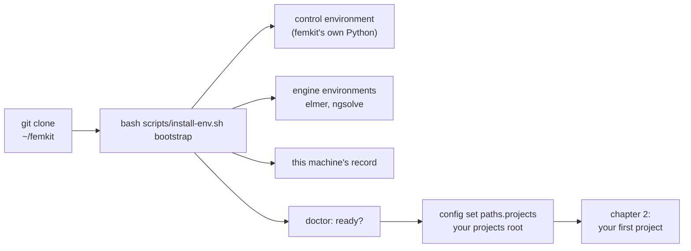

# 1 · Install and set up

**Role:** manual
**Status:** current; what is not built yet is marked so
**Authority:** none of its own: it shows what femkit does, and the basic
tests run each example and hold it to what femkit prints

This chapter takes you from a fresh machine to a femkit that is ready for
your first project: the install, the commands you type every day, the one
setting you choose — where your projects live — and where femkit keeps its
own files.



## What you need

Linux, Bash, `flock`, and the conda package manager (or mamba). On a
cluster, load the manager's module in your shell first, and do the install
inside an interactive allocation: a login node's limits stop large
compilations.

femkit runs from its own folder — the copy of its repository you clone,
called the **checkout** — and is never installed into Python. This manual
puts the checkout at `~/femkit`. The install writes a `femkit` command into
femkit's own environment, which runs femkit from that checkout in whatever
folder you are in. If you move the checkout, run the install script again
from its new place; until then `femkit` says the checkout is gone.

## Install

One script builds everything femkit needs, each piece in its own
environment — a self-contained folder of programs and libraries that your
own Python and packages never see:

- the **control environment**, femkit's own Python, which runs every
  `femkit` command;
- one **engine environment** for each solver — femkit calls a solver an
  **engine** — `elmer` for Elmer and `ngsolve` for NGSolve, each compiled
  from pinned sources and then proven: before any source is downloaded, its
  compilers must build and run a small program on your machine, and
  afterwards the solver must solve small problems with known answers to
  within their tolerances;
- **this machine's record**: what femkit measured about the machine — its
  cores, memory, GPUs, and on a cluster its scheduler and queues.

```bash
git clone https://github.com/Qing-LAB/femkit.git ~/femkit
cd ~/femkit
bash scripts/install-env.sh bootstrap
```

`bootstrap` asks what nothing on the machine can tell it:

- the shell lines a job runs before it can use the package manager — on a
  cluster, typically a `module load` line; on a workstation, often none;
- how a shell enters an environment here: `source activate`,
  `conda activate` or `mamba activate`;
- where the engine environments go — they take several gigabytes, so on a
  cluster choose project storage rather than a small home folder;
- your **projects root**: the one folder that holds all your projects and
  your material library (chapter 2).

It shows its plan — every step it will take, including an install it would
refuse and why — and asks before it starts. To answer everything on the
command line and be asked nothing, give `--yes` with the answers:

```bash
bash scripts/install-env.sh bootstrap --yes --no-preamble --activation 'conda activate' --environments ~/femkit-environments --projects ~/femkit-projects
```

On a cluster, `--preamble 'module load conda'` (once per line) takes the
place of `--no-preamble`.

`bootstrap` ends with a report of each part and the lines that enter femkit
day to day on this machine.

## Every day

Each time you open a shell to use femkit, enter its control environment.
`bootstrap` prints the exact lines for your machine; on a workstation with
conda they look like this:

```bash
source /home/you/miniforge3/etc/profile.d/conda.sh
conda activate /home/you/.local/share/femkit/environments/control
femkit doctor
```

From then on `femkit …` works in any folder. A command that works on one
project takes the project you are in — your shell inside its folder — or
names it with `--project` from anywhere else:

```bash
cd ~/femkit-projects/square
femkit project check                     # the project this folder is in
femkit project check --project square    # the same, from any folder
```

## Is the machine ready? — `doctor`

```bash
femkit doctor
```

`doctor` reads, and changes nothing. It reports one line for each thing
femkit needs — the control environment, your settings file, this machine's
record, each engine environment — with its state and, for anything not
ready, the command that fixes it. It exits with 0 only when every line is
ready, so a script can ask it too.

## Help on every command

Every command and every command group answers `--help`:

```console
$ femkit --help
Usage: femkit [OPTIONS] COMMAND [ARGS]...

  femkit — a solver-neutral finite-element workbench.

Options:
  --help  Show this message and exit.

Commands:
  case      the cases a study's expansion wrote, each with its study and...
  config    this machine's settings, femkit's own
  doctor    Whether this machine is ready: control environment, configuration,
            this machine's record, every engine environment.
  env       the engine environments: install, validate, list, clean, log
  job       this machine's record and the jobs femkit runs
  material  materials: make a new one from another source's file
  project   a project: start one from a template, check it, list them,...
  schema    femkit's own definitions and the reference pages written from...
  serve     the web page's server: start, stop, status
  study     a project's studies: list them, write their cases
  web       the web page's bundle, built from its sources

  (manual: 1 · Install and set up)
```

```console
$ femkit project new --help
Usage: femkit project new [OPTIONS] NAME

  Make a new project under the projects root, a copy of one of femkit's
  templates or of one of your projects: every part, the files each fixes and
  declares, and your own folder — nothing femkit or a run wrote; the first
  makes the root. A root without its global material library gets one, holding
  a copy of femkit's shipped materials, yours from then on.

  Arguments:
    NAME  its name: its path from the projects root

Options:
  --from TEXT  what it copies: a template by its bare name, or one of your
               projects by its path from the projects root; the templates:
               `laplace_square`, `two_material`
  --json       print one JSON document on stdout
  --dry-run    print the plan; change nothing
  -y, --yes    consent in advance
  --help       Show this message and exit.

  (manual: 2 · Start a project)
```

A command's help says what it does, then its **arguments** — the words it
needs, written in capitals in its usage line, such as `NAME` — and its
**options**, the words that open with `--`. A **template** is a whole,
working project femkit ships, which you copy to start your own (chapter 2).
`stdout` is the screen, unless you send it elsewhere. The last line,
`(manual: 2 · Start a project)`, names the chapter of this manual that
explains the command; the comments in the files femkit starts you with end
the same way.

Every command that changes something shows its **plan** first — the
numbered steps it will take — and asks on your terminal whether to proceed
before it acts. Two options change that:

- `--dry-run` shows the plan and changes nothing;
- `--yes` agrees in advance, so the command runs without asking.

The examples in this manual use `--yes`, so you see the plan, each step as
it runs, and the outcome in one go. Every command also takes `--json`, which
prints one JSON document instead, for a script to read.

## Your settings — `config`

femkit keeps your choices for this machine in one file, `config.toml`; each
setting in it is a **key**. `config show` prints every key, its value, and
what it means while it is unset. On a machine with no settings yet:

```console
$ femkit config show
[config show] no config.toml: every key is unset
  key                       value  when unset
  paths.projects            unset  no project is listed, made or named; each says so, naming this key
  paths.environments        unset  <data>/environments
  build.cuda_architectures  unset  installing an environment with a build compiled for CUDA is refused, naming this key
  build.jobs                unset  the CPUs this process may use (its CPU affinity: on a cluster, the allocation's share, never the whole login node)
  launch.mpi                unset  a multi-rank check or job, and installing an environment with MPI, are refused, naming this key
  activation.preamble       unset  `job probe --write` is refused, naming this key
  activation.command        unset  `job probe --write` is refused, naming this key
```

Every line femkit prints opens with the command in brackets, here
`[config show]`. `<data>` is femkit's data folder, `~/.local/share/femkit`
(below).

The one setting every project needs is `paths.projects`, your projects root.
`config set` writes one setting; its value is written the way the file holds
it, so a folder goes in double quotes, and the single quotes keep your shell
from removing them:

```console
$ femkit config set paths.projects '"~/femkit-projects"' --dry-run
[config set] plan: 1 step
  1. set paths.projects: unset -> ~/femkit-projects
$ femkit config set paths.projects '"~/femkit-projects"' --yes
[config set] plan: 1 step
  1. set paths.projects: unset -> ~/femkit-projects
[config set] 1 step; logs in ~/.local/state/femkit/operations/config/20261125T181904.913703Z
[1/1] set paths.projects: unset -> ~/femkit-projects
[config set] set paths.projects: unset -> ~/femkit-projects, in ~/.config/femkit/config.toml
```

With `--dry-run`, femkit prints the plan and stops. With `--yes`, it prints
the plan, then runs it: the line with `logs in` names the folder where it
keeps a log of what it did, then each step is counted as it runs — `[1/1]`,
the first of one — and the last line is the outcome. The folder need not
exist yet: your first project makes it (chapter 2).

A bare word is not a value, so femkit refuses it rather than guess what you
meant — here your shell has already turned `~` into your home folder. A
**refused** command changes nothing, and under `next -- instead:` femkit
prints what you could type instead, ready to copy:

```console
$ femkit config set paths.projects ~/femkit-projects --yes
[config set] refused: /home/you/femkit-projects is no value as config.toml writes one: a text is written in quotes
next -- instead:
    femkit config set paths.projects '"/home/you/femkit-projects"'
```

`config show` now reads the file:

```console
$ femkit config show
[config show] read ~/.config/femkit/config.toml
  key                       value              when unset
  paths.projects            ~/femkit-projects
  paths.environments        unset              <data>/environments
  build.cuda_architectures  unset              installing an environment with a build compiled for CUDA is refused, naming this key
  build.jobs                unset              the CPUs this process may use (its CPU affinity: on a cluster, the allocation's share, never the whole login node)
  launch.mpi                unset              a multi-rank check or job, and installing an environment with MPI, are refused, naming this key
  activation.preamble       unset              `job probe --write` is refused, naming this key
  activation.command        unset              `job probe --write` is refused, naming this key
```

Two more `config` commands:

```bash
femkit config init    # write config.toml from its template, adding only the keys it lacks
femkit config path    # where femkit keeps its files on this machine, and what chose each place
```

`config init` is what `bootstrap` runs to write your settings, asking for
each one nothing on the machine reveals; it never replaces a value you set,
and `config set` changes one. Its options give the answers on the command
line instead — `--projects`, `--environments`, `--preamble`,
`--no-preamble`, `--activation`, and the same on `bootstrap`. Every key, with
its type, is listed in the [settings reference](../reference/config.md).

## Where femkit puts things

femkit writes only into its own folders, each under your home folder by
default, and into your projects root:

```text
~/.config/femkit/            your settings: config.toml, and machines/ with this machine's record
~/.local/share/femkit/       the control environment and its `femkit` command, the engine environments, their exact package lists
~/.cache/femkit/             downloads and build files: safe to empty at any time
~/.local/state/femkit/       the log of every command that changed something
~/femkit-projects/           your projects root: your projects and your material library
```

`femkit config path` prints the folders on your machine. Each can
be moved by a variable, for instance `FEMKIT_CONFIG_DIR`; the engine
environments can go elsewhere with the `paths.environments` setting.

## The engine environments — `env`

`bootstrap` installs and checks the two default environments. These commands
look after them afterwards:

```bash
femkit env list                 # every environment, its state, and whether its GPU path is proven
femkit env install ngsolve      # install one; an interrupted install resumes where it stopped
femkit env install --all        # every default environment
femkit env validate ngsolve     # run its checks again: small problems with known answers
femkit env validate ngsolve --gpu   # the GPU checks, on a machine with a GPU
femkit env log ngsolve          # the last command run on it: each step, how it ended, its log
femkit env clean ngsolve        # remove it; install it again any time
femkit env bootstrap            # what the install script runs: set up this machine again
```

An environment is `ready` only when its checks pass on this machine. GPU
builds are separate environments, `ngsolve-cuda` and `elmer-cuda`, installed
only when you ask for them by name; so is `web`, which the web page needs
(below). `env install NAME --clean` rebuilds one from scratch.

## This machine's record — `job`

```bash
femkit job machines           # every machine record, or one with where each fact came from
femkit job probe              # measure this machine and show the record; --write keeps it
```

`job probe --write` writes the record after `activation.preamble` and
`activation.command` are set. On a cluster, `--scheduler` names the
scheduler when femkit cannot tell, and `--set` says where one of its
commands is.

## The web page — `serve`

femkit's web page runs its commands and shows each one's progress, and it
shows femkit's documents — this manual among them — with their tables and
diagrams drawn. It needs the `web` environment
(`femkit env install web`).

```bash
femkit serve start        # start the page's server in the background and print the address to open
femkit serve status       # every server you run here: is it up, and does it answer
femkit serve stop         # stop it
femkit serve restart      # start it afresh, keeping its address
femkit serve foreground   # run it in this terminal; Ctrl-C stops it
```

On a workstation the page listens on `127.0.0.1`, port 8000 (`--port` to
change). On a cluster's login node it listens on a socket only your account
can open (`--socket`; `--tcp` for a port instead), which you reach from your
own computer through `ssh -L`. Showing and checking your projects on the page
is not built yet ([plan](../plans/plan.md) § 4, G).

## Commands for changing femkit itself

Three commands are for someone who changes femkit's own files, not for using
it:

```bash
femkit schema check    # load every definition femkit ships, and report each problem
femkit schema docs     # write the reference pages from femkit's definitions again
femkit web build       # build the web page from its sources, with the web environment
```

## What is not built yet

Running a calculation — building the geometry, meshing it, solving it on a
workstation or through a cluster's scheduler, and reading the results — is
not built yet ([plan](../plans/plan.md) § 4, X, M4, M6). Today femkit
installs and proves the solvers, and starts, checks and expands your
projects: chapters 2 to 6.
