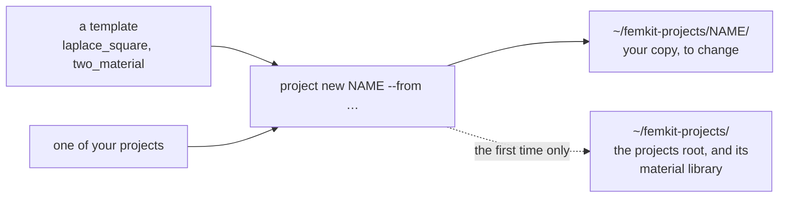

# 2 · Start a project

**Role:** manual
**Status:** current
**Authority:** none of its own: it shows what femkit does, and the basic
tests run each example and hold it to what femkit prints

A project is one folder of files you write: what you simulate, on which
geometry, with which materials, and what you vary. You never start from an
empty folder: you copy a **template** — a whole, working project femkit
ships — or one of your own projects, and change the copy.



## Your projects root

All your projects live in one folder, your **projects root**, which you
chose when you installed femkit (chapter 1). If you have not set it yet:

```console
$ femkit config set paths.projects '"~/femkit-projects"' --yes
[config set] plan: 1 step
  1. set paths.projects: unset -> ~/femkit-projects
[config set] 1 step; logs in ~/.local/state/femkit/operations/config/20261125T181906.552255Z
[1/1] set paths.projects: unset -> ~/femkit-projects
[config set] set paths.projects: unset -> ~/femkit-projects, in ~/.config/femkit/config.toml
```

Until your first project exists, the folder need not exist either, and
femkit says so:

```console
$ femkit project list
[project list] refused: the projects root ~/femkit-projects (paths.projects) is no folder: the first project new makes it
next -- instead:
    femkit project new NAME --from SOURCE   # the first project makes the root
    femkit config set paths.projects '"/path/to/projects"'   # the folder that holds your projects
```

Under `next -- instead:`, femkit prints the commands that would get you
further, ready to copy, each with a comment after `#` saying what it is for:
here, making the first project, or choosing another root. A word in capitals
— `NAME`, `SOURCE` — or a made-up path such as `/path/to/projects` is yours
to fill in. Most refusals end this way.

## The templates

femkit ships two templates, each a small electrostatics problem whose exact
answer is known:

| template | what it is |
|---|---|
| `laplace_square` | a square of vacuum, 0 V on its left side and a bias on its right, insulated top and bottom; the potential rises linearly, so the centre holds half the bias on any mesh. Its study refines the mesh three times. |
| `two_material` | a layered capacitor: two materials side by side between the same two potentials, relative permittivities 1 and 4, with the face between them named. Its study is one calculation, whose values have exact reference answers. |

`project new` needs to know what to copy; without `--from` it lists the
templates:

```console
$ femkit project new square
[project new] refused: project new copies a template or one of your projects, named with --from; the templates: laplace_square, two_material
next -- instead:
    femkit project new square --from laplace_square
    femkit project new square --from two_material
```

`--dry-run` shows what it would do:

```console
$ femkit project new square --from laplace_square --dry-run
[project new] plan: 3 steps
  1. make the projects root ~/femkit-projects
  2. make the global library ~/femkit-projects/materials, holding a copy of femkit's shipped materials: vacuum
  3. copy 8 files of laplace_square to ~/femkit-projects/square
```

Your first project makes the projects root, and with it your **material
library** — femkit calls it the **global library**, since every one of your
projects can use it. It starts with a copy of the materials femkit ships —
its **shipped materials**, today one, `vacuum` — which are yours from then
on. Chapter 6 is about materials. Then it copies the template:

```console
$ femkit project new square --from laplace_square --yes
[project new] plan: 3 steps
  1. make the projects root ~/femkit-projects
  2. make the global library ~/femkit-projects/materials, holding a copy of femkit's shipped materials: vacuum
  3. copy 8 files of laplace_square to ~/femkit-projects/square
[project new] 3 steps; logs in ~/.local/state/femkit/operations/project-square/20261125T164701.911331Z
[1/3] make the projects root ~/femkit-projects
[2/3] make the global library ~/femkit-projects/materials, holding a copy of femkit's shipped materials: vacuum
[3/3] copy 8 files of laplace_square to ~/femkit-projects/square
[project new] made ~/femkit-projects/square from laplace_square: 8 files
  components/square/component.toml
  components/square/geometry.py
  materials/vacuum/material.toml
  mesh/uniform.toml
  observables/midpoint.toml
  physics/electrostatics.toml
  project.toml
  studies/check.toml
```

The second project has only its own files to copy:

```console
$ femkit project new layers --from two_material --yes
[project new] plan: 1 step
  1. copy 9 files of two_material to ~/femkit-projects/layers
[project new] 1 step; logs in ~/.local/state/femkit/operations/project-layers/20261125T164702.540227Z
[1/1] copy 9 files of two_material to ~/femkit-projects/layers
[project new] made ~/femkit-projects/layers from two_material: 9 files
  components/slab/component.toml
  components/slab/geometry.py
  materials/dielectric_1/material.toml
  materials/dielectric_2/material.toml
  mesh/uniform.toml
  observables/benchmark.toml
  physics/electrostatics.toml
  project.toml
  studies/benchmark.toml
```

Your projects root now holds this:

```text
~/femkit-projects/
├── materials/                       your material library
│   └── vacuum/material.toml
├── square/                          one project
│   ├── project.toml                 the project file
│   ├── components/square/
│   │   ├── component.toml           what the geometry script promises, and the material of each body
│   │   └── geometry.py              the geometry script
│   ├── materials/vacuum/material.toml   the project's own vacuum
│   ├── mesh/uniform.toml            a mesh recipe
│   ├── observables/midpoint.toml    what to report
│   ├── physics/electrostatics.toml  the physics: the equation and the conditions on each boundary
│   └── studies/check.toml           a study: what is solved, and what varies
└── layers/                          another project
    └── …
```

Chapter 3 goes through each of these files. The Laplace template carries a
`vacuum` of its own beside your library's; a project's own material comes
first (chapter 6).

`project list` shows your projects, each with its studies:

```console
$ femkit project list
[project list] 2 projects in ~/femkit-projects
  layers  benchmark
  square  check
```

## Names

A project's name is its folder's name: lower-case letters, digits and `_`,
starting with a letter. A name with `/` puts the project inside folders of
your own, to keep related projects together:

```console
$ femkit project new gaps/narrow --from laplace_square --yes
[project new] plan: 1 step
  1. copy 8 files of laplace_square to ~/femkit-projects/gaps/narrow
[project new] 1 step; logs in ~/.local/state/femkit/operations/project-gaps.narrow/20261125T164703.716953Z
[1/1] copy 8 files of laplace_square to ~/femkit-projects/gaps/narrow
[project new] made ~/femkit-projects/gaps/narrow from laplace_square: 8 files
  components/square/component.toml
  components/square/geometry.py
  materials/vacuum/material.toml
  mesh/uniform.toml
  observables/midpoint.toml
  physics/electrostatics.toml
  project.toml
  studies/check.toml
$ femkit project list
[project list] 3 projects in ~/femkit-projects
  gaps/narrow  check
  layers       benchmark
  square       check
```

A name that breaks the rule is refused, and so is a name already taken:
femkit never makes a project over anything that is there.

```console
$ femkit project new Square_2 --from laplace_square --yes
[project new] refused: 'Square_2' is not a project's name: steps of lowercase letters, digits and `_`, each starting with a letter, joined by `/`
$ femkit project new square --from laplace_square --yes
[project new] refused: ~/femkit-projects/square is there already: a new project is never made over it
```

## From one of your own projects

`--from` also takes one of your projects, by its name. It copies every file
you wrote, and the folder `custom/`, where your own files go — scripts,
notes, plots — and nothing else. Say you keep notes in the project folder
itself and a plotting script in `custom/`:

<!-- write ~/femkit-projects/layers/notes.txt -->
```text
try a thinner first layer next
```

<!-- write ~/femkit-projects/layers/custom/plot.py -->
```python
print("my own plotting script")
```

```console
$ femkit project new layers_thin --from layers --yes
[project new] plan: 1 step
  1. copy 10 files of layers to ~/femkit-projects/layers_thin, leaving out what each note below names
[project new] 1 step; logs in ~/.local/state/femkit/operations/project-layers_thin/20261125T164705.976645Z
[1/1] copy 10 files of layers to ~/femkit-projects/layers_thin, leaving out what each note below names
[project new] made ~/femkit-projects/layers_thin from layers: 10 files
  components/slab/component.toml
  components/slab/geometry.py
  custom/plot.py
  materials/dielectric_1/material.toml
  materials/dielectric_2/material.toml
  mesh/uniform.toml
  observables/benchmark.toml
  physics/electrostatics.toml
  project.toml
  studies/benchmark.toml
  - not copied: femkit does not read this file, as it is none of the project's parts
      notes.txt
```

The copy keeps `custom/plot.py`, and leaves out `notes.txt`, saying so in a
**note** — a line opening with `-`, the file it is about under it. Each file
a project is made of is one of its **parts** (chapter 3); femkit reads only
those, so a file that is none of them is not copied. Your notes belong in
`custom/`.
Whatever femkit itself writes into a project — its cases (chapter 5), and
later its runs and results — is never copied either, nor the backup files an
editor keeps beside the file you edit: a copy starts clean.

## Your files are yours

femkit never changes a file you wrote. You change your files in your own
editor; femkit reads them, checks them (chapter 4), and says what is wrong
and what would be right. There is no femkit command to rename, move or delete
a project: it is one folder, which you rename, move, zip or delete as any
other. A project moved to another computer works under that computer's
projects root.
