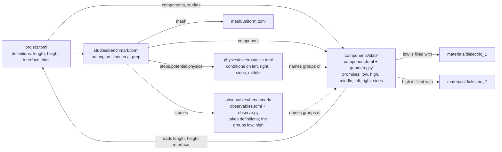
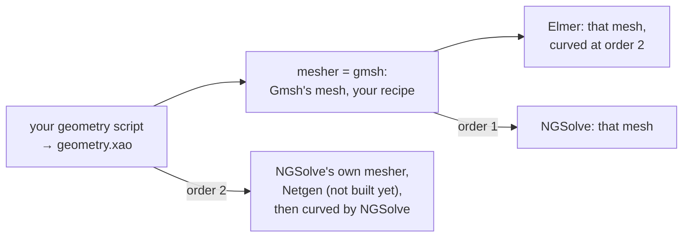

# 3 · Write each part

**Role:** manual
**Status:** current; what is not built yet is marked so
**Authority:** none of its own: it shows what femkit does, and the basic
tests run each example and hold it to what femkit prints

A project is made of **parts**: each is one file you write in your own
editor — or, for a geometry and for observables, a folder of a file and a
script — and each says one thing: the shared definitions, a material, a
geometry, the physics, a mesh recipe, a study that puts them together, and
the observables computed from each solved case. No file names a solver: you
choose the one that solves a study when you prep it (chapter 5). This
chapter goes through each kind, using the two templates of chapter 2, and
shows for each a mistake and what femkit says about it.

Parts refer to each other by name. The geometry promises named pieces —
bodies and faces, which femkit calls **groups** — and everything else is
written on those groups, never on a particular geometry, so a physics, a mesh
recipe or an observables part serves every geometry that promises the
groups it names. A study pairs them; an observables part reads studies once
they are solved:



## How to read a part's file

Every file femkit starts you with explains itself: the comment directly
above each setting — each **key**, in the file's terms — is that key's help,
and a key shown commented out (`# growth = 0.5`) is one you may set. Every
quantity that has a unit is a small table of its number and its unit —
`{value = 1, unit = "m"}`, `{value = 500, unit = "nm"}`, `{value = 9.03,
unit = "eV"}` — or the name of one of your definitions (`"bias"`); a plain
number with no unit is written as itself (`4`). A comment followed by a
blank line is just prose. Every part's file holds `schema`, the version of
its format: `schema = 2` for a study, a mesh recipe and an observables part,
whose format changed, `schema = 1` for every other. A file of an older
version is told what changed since, at its `schema`.

The full list of every key of every part, with its type and default, is the
[parts reference](../reference/parts.md); each section below names its table
there.

To follow along, make the two projects of chapter 2:

```console
$ femkit config set paths.projects '"~/femkit-projects"' --yes
[config set] plan: 1 step
  1. set paths.projects: unset -> ~/femkit-projects
[config set] 1 step; logs in ~/.local/state/femkit/operations/config/20261125T181952.318071Z
[1/1] set paths.projects: unset -> ~/femkit-projects
[config set] set paths.projects: unset -> ~/femkit-projects, in ~/.config/femkit/config.toml
$ femkit project new layers --from two_material --yes
[project new] plan: 3 steps
  1. make the projects root ~/femkit-projects
  2. make the global library ~/femkit-projects/materials, holding a copy of femkit's shipped materials: vacuum
  3. copy 11 files of two_material to ~/femkit-projects/layers
[project new] 3 steps; logs in ~/.local/state/femkit/operations/project-layers/20261128T040244.029019Z
[1/3] make the projects root ~/femkit-projects
[2/3] make the global library ~/femkit-projects/materials, holding a copy of femkit's shipped materials: vacuum
[3/3] copy 11 files of two_material to ~/femkit-projects/layers
[project new] made ~/femkit-projects/layers from two_material: 11 files
  copied
  components/slab/component.toml
  components/slab/geometry.py
  definitions.py
  materials/dielectric_1/material.toml
  materials/dielectric_2/material.toml
  mesh/uniform.toml
  observables/benchmark/observables.toml
  observables/benchmark/observe.py
  physics/electrostatics.toml
  project.toml
  studies/benchmark.toml
next -- check the new project, as any other:
    femkit project check --project layers
$ femkit project new square --from laplace_square --yes
[project new] plan: 1 step
  1. copy 10 files of laplace_square to ~/femkit-projects/square
[project new] 1 step; logs in ~/.local/state/femkit/operations/project-square/20261128T040244.970353Z
[1/1] copy 10 files of laplace_square to ~/femkit-projects/square
[project new] made ~/femkit-projects/square from laplace_square: 10 files
  copied
  components/square/component.toml
  components/square/geometry.py
  definitions.py
  materials/vacuum/material.toml
  mesh/uniform.toml
  observables/midpoint/observables.toml
  observables/midpoint/observe.py
  physics/electrostatics.toml
  project.toml
  studies/check.toml
next -- check the new project, as any other:
    femkit project check --project square
```

Each mistake below is checked with `project check` (chapter 4 reads its
output in detail), then put right before the next.

## The project file — `project.toml`

The project file says what the project is, names its geometries (its
**components**) and its studies, and holds the **definitions** every other
file may use:

```console
$ cat ~/femkit-projects/layers/project.toml
# The two-material benchmark (docs/science/electrostatics.md § 9.1): a layered capacitor, two
# materials in series between two held potentials, a named interface between them. Its exact
# potential is linear in each layer, so first-order elements reproduce it on any mesh; the
# formulation's reference values follow from the definitions below and the two materials.
#
# This is the project file (manual: 3 · Write each part). Every key's help is the comment
# directly above it; a key shown commented out is one you may set.

# the version of this file's format, which femkit raises when it changes how files of this kind are written: one of `1` (manual: 3 · Write each part)
schema = 1

# what the project is, in a sentence or two
description = "A layered capacitor: relative permittivity 1 up to the interface, 4 beyond it, 0 V on the left side and the bias on the right"

# the project's components, by name: each the folder `components/<name>/`, holding `component.toml` and `geometry.py`
components = ["slab"]

# the project's studies, by name: each the file `studies/<name>.toml`
studies = ["benchmark"]

# what the project's observables scripts need beyond femkit's `postprocess` environment, so a copy of the project carries it (manual: 3 · Write each part)
# [postprocess]
# the conda packages its scripts import beyond what femkit's `postprocess` environment holds, each installed into it on every machine: a package by its name, which a script imports by that name, or `{ conda = "scikit-image", module = "skimage" }` for one it imports by another
# packages = ["pint"]

# the project's definitions, by name: each a number of its type with its unit, written as its value or computed by a function in `definitions.py`; every other part uses one by its name (manual: 3 · Write each part)
[definitions]

# the slab's extent along x, from the frame's origin
[definitions.length]
# the number's type: an `int` a whole number, a `float` a 64-bit double, a `complex` a pair of them: one of `int`, `float`, `complex`
type = "float"
# its value, a number of its type — a `float` may be written `10`, a `complex` as `[real, imaginary]` — its unit written apart, in `unit`; else `function`
value = 1
# else the name of the function in the project's `definitions.py` that computes it: it takes no arguments, reads every other definition as `defs.<name>`, a plain number in SI units — an angle in degrees — and returns its own the same way
# function = "length"
# its unit: a unit femkit reads, or a product of them — `nm`, `F/m`, `C^2/(N m^2)` — and `1` for a plain number, an `int`'s alone
unit = "m"

# the slab's extent along y
[definitions.height]
# the number's type: an `int` a whole number, a `float` a 64-bit double, a `complex` a pair of them: one of `int`, `float`, `complex`
type = "float"
# its value, a number of its type — a `float` may be written `10`, a `complex` as `[real, imaginary]` — its unit written apart, in `unit`; else `function`
value = 1
# else the name of the function in the project's `definitions.py` that computes it: it takes no arguments, reads every other definition as `defs.<name>`, a plain number in SI units — an angle in degrees — and returns its own the same way
# function = "height"
# its unit: a unit femkit reads, or a product of them — `nm`, `F/m`, `C^2/(N m^2)` — and `1` for a plain number, an `int`'s alone
unit = "m"

# where the two materials meet, along x: between 0 and the length
[definitions.interface]
# the number's type: an `int` a whole number, a `float` a 64-bit double, a `complex` a pair of them: one of `int`, `float`, `complex`
type = "float"
# its value, a number of its type — a `float` may be written `10`, a `complex` as `[real, imaginary]` — its unit written apart, in `unit`; else `function`
value = 0.5
# else the name of the function in the project's `definitions.py` that computes it: it takes no arguments, reads every other definition as `defs.<name>`, a plain number in SI units — an angle in degrees — and returns its own the same way
# function = "interface"
# its unit: a unit femkit reads, or a product of them — `nm`, `F/m`, `C^2/(N m^2)` — and `1` for a plain number, an `int`'s alone
unit = "m"

# the potential the right side is held at
[definitions.bias]
# the number's type: an `int` a whole number, a `float` a 64-bit double, a `complex` a pair of them: one of `int`, `float`, `complex`
type = "float"
# its value, a number of its type — a `float` may be written `10`, a `complex` as `[real, imaginary]` — its unit written apart, in `unit`; else `function`
value = 1
# else the name of the function in the project's `definitions.py` that computes it: it takes no arguments, reads every other definition as `defs.<name>`, a plain number in SI units — an angle in degrees — and returns its own the same way
# function = "bias"
# its unit: a unit femkit reads, or a product of them — `nm`, `F/m`, `C^2/(N m^2)` — and `1` for a plain number, an `int`'s alone
unit = "V"
```

- `description`: a sentence or two for you and your colleagues.
- `components` and `studies`: the names of the project's components and
  studies. A component or study the project file does not name is never
  used, and `project check` says so.
- `[postprocess]`, shown commented out: the packages your observables
  scripts need beyond what femkit's `postprocess` environment holds (numpy,
  scipy, matplotlib, netCDF4, xarray and meshio), each by its conda name —
  `packages = ["pint"]` — or, for one a script imports by another name,
  `{ conda = "scikit-image", module = "skimage" }`. A copy of the project
  carries them, and `femkit env install postprocess` installs them on each
  machine (chapter 1).
- `[definitions]`: the project's shared values, each by its name a small
  table — `type`, the number's kind (`int`, `float` or `complex`); `unit`,
  any unit femkit reads or a product of them (`nm`, `F/m`), `1` for a plain
  number; and either `value`, the number itself, or `function`, the name of
  a function in `definitions.py` that computes it (below). The geometry
  script, the physics, the mesh recipe and the observables use them by name,
  and a study can vary a written one (chapter 5).

A value written as text, the way femkit once read it:

<!-- edit ~/femkit-projects/layers/project.toml -->
```diff
-value = 0.5
+value = "0.5 m"
```

```console
$ femkit project check --project layers
[project check] layers: 1 error, 1 note; the first is the next step
  section      part                    file                                    state      engines that can solve it
  Definitions  project                 project.toml                            errors
  Definitions  material:dielectric_1   materials/dielectric_1/material.toml    complete
  Definitions  material:dielectric_2   materials/dielectric_2/material.toml    complete
  Component    component:slab          components/slab/component.toml          complete
  Physics      physics:electrostatics  physics/electrostatics.toml             complete
  Mesh         mesh:uniform            mesh/uniform.toml                       complete
  Study        study:benchmark         studies/benchmark.toml                  unchecked  elmer, ngsolve
  Results      observables:benchmark   observables/benchmark/observables.toml  complete
  x `interface`'s value is "0.5 m", and a value here is a number of its type (`float`); its unit is written apart, in `unit`
      project.toml, line 56: definitions.interface.value
  - whether `left`, `right` and `sides` are each an outer boundary, and `middle` an interface, is checked once the geometry of `slab` is built
      studies/benchmark.toml, line 13: component
```

`project check` lists each part with its state, then its **findings**: here
an error, marked `x`, at the key of `project.toml` that holds the text — a
value is a number, its unit written apart in `unit` — and a note, marked `-`, on what cannot be checked until the geometry is
built. Chapter 4 reads this output line by line. Put the value back:

<!-- edit ~/femkit-projects/layers/project.toml -->
```diff
-value = "0.5 m"
+value = 0.5
```

Its keys: the `ProjectFile`, `Definition`, `Postprocess` and `Package`
tables of the [parts reference](../reference/parts.md).

### A value you calculate — `definitions.py`

A value you need to calculate comes from a Python function in one file of
the project, `definitions.py`, which every template starts with its header:
`import numpy as np`, `from scipy import constants` and `import
project.definitions as defs`. The definition names its function:

```toml
[definitions.gap]
type = "float"
value = 10
unit = "nm"

[definitions.half_gap]
type = "float"
function = "half_gap"
unit = "nm"
```

```python
def half_gap():
    return defs.gap / 2
```

- A function takes no arguments and reads every other definition as
  `defs.<name>` — a plain number of its type, **in SI units**, an angle in
  degrees — and returns its own value the same way: `defs.gap` above is
  `1e-08`, and the `5e-09` it returns is shown as 5 nm. You never convert a
  unit; femkit does, both ways.
- The file holds imports and functions alone, and may import numpy, scipy,
  `math`, `cmath` and `project.definitions`. `project check` reads it without
  running it, and says at its line a `defs.<name>` naming no definition, a
  circle of functions, a function the file lacks, or anything else at its
  top level.
- femkit runs your functions in an environment of its own, `model_prep`
  (numpy, scipy, netCDF4 and xarray), which the install sets up with the
  others (chapter 1). `project check` runs them to
  validate them and writes nothing; `study prep` runs them once for every
  point of the study and keeps their values in `computed/<study>/definitions.nc`,
  which every other command reads while it is in step with your files. A
  function that fails, returns a number not of its type, or runs past a
  minute is a finding at its definition, with the file and the line. Saving a
  file never runs them.

## A material — `materials/<name>/material.toml`

A material is a folder holding `material.toml` and any tables it uses. Its
name is the folder's name. Here is the second layer's material:

```console
$ cat ~/femkit-projects/layers/materials/dielectric_2/material.toml
# The benchmark's second material (manual: 6 · Materials), filling the layer beyond the
# interface: relative permittivity 4, the benchmark's choice.

# the version of this file's format, which femkit raises when it changes how files of this kind are written: one of `1` (manual: 6 · Materials)
schema = 1

# the name shown to a person; nothing refers to the material by it, since its folder's name is its name
display = "Dielectric 2"

# its chemical formula, as `Au` or `SiO2`
# formula = "SiO2"

# other names it goes by, for a person; nothing refers to the material by them
# aliases = ["second layer"]

# each property, by its name in femkit's list of material properties, holding its datasets, each named by its source (manual: 6 · Materials)
[properties]

# the material's relative permittivity, in 1
[properties.relative_permittivity]

# the dataset named `benchmark`
[properties.relative_permittivity.benchmark]
# a real constant: `{value, unit}`, a plain number where it has no unit
value = 4
# the convention of the source's complex values: one of `real`, `exp(-iwt)`, `exp(+iwt)`
convention = "real"
# where the data comes from: a citation a reader can check, with its DOI where there is one
source = "the two-material benchmark's choice (docs/science/electrostatics.md § 9.1)"
# where the data holds: `all`, or `{value = [from, to], unit = "…"}` in its variable
range = "all"

# anything kept beside the material; read by no step
# [notes]
```

Each **property** — here `relative_permittivity`, the one an electrostatics
calculation reads — holds one or more **datasets**: a dataset is one set of
values for the property, from one source, here named `benchmark`. Every
dataset says where it comes from (`source`), whether its values are real or
complex and, if complex, in which sign convention (`convention`), and over
what range they hold (`range`). A dataset can be a single value, as here, a
table, or a dispersion formula: chapter 6 is about materials.

A value in the wrong unit — a relative permittivity has none:

<!-- edit ~/femkit-projects/layers/materials/dielectric_2/material.toml -->
```diff
 # a real constant: `{value, unit}`, a plain number where it has no unit
-value = 4
+value = { value = 4, unit = "V" }
```

```console
$ femkit project check --project layers
[project check] layers: 1 error, 1 note; the first is the next step
  section      part                    file                                    state      engines that can solve it
  Definitions  project                 project.toml                            complete
  Definitions  material:dielectric_1   materials/dielectric_1/material.toml    complete
  Definitions  material:dielectric_2   materials/dielectric_2/material.toml    errors
  Component    component:slab          components/slab/component.toml          complete
  Physics      physics:electrostatics  physics/electrostatics.toml             complete
  Mesh         mesh:uniform            mesh/uniform.toml                       complete
  Study        study:benchmark         studies/benchmark.toml                  unchecked  elmer, ngsolve
  Results      observables:benchmark   observables/benchmark/observables.toml  complete
  x `value` is {value = 4, unit = "V"}, a quantity of current^-1 length^2 mass time^-3; it needs a number with no unit
      materials/dielectric_2/material.toml, line 25: properties.relative_permittivity.benchmark.value
  - whether `left`, `right` and `sides` are each an outer boundary, and `middle` an interface, is checked once the geometry of `slab` is built
      studies/benchmark.toml, line 13: component
```

femkit names what it read by its dimension in SI base quantities — a volt is
mass × length² ÷ (time³ × current) — and a relative permittivity has none: it
is a plain number, written as itself. Put it back:

<!-- edit ~/femkit-projects/layers/materials/dielectric_2/material.toml -->
```diff
 # a real constant: `{value, unit}`, a plain number where it has no unit
-value = { value = 4, unit = "V" }
+value = 4
```

Its keys: the `Material`, `Value`, `Table` and `Modelled` tables of the
[parts reference](../reference/parts.md).

## A component — `components/<name>/`

A **component** is one geometry: a Python script that draws it with Gmsh,
`geometry.py`, and the file that wraps it, `component.toml`, which says what
the script needs and what it promises. The two-material slab looks like this,
each name a group its script promises:

```text
            sides (the top)
     ┌───────────────┬───────────────┐
     │               │               │
left │      low      │     high      │ right
     │               │               │
     └───────────────┴───────────────┘
   x = 0       x = interface     x = length
            sides (the bottom)
                    middle: the face between low and high
```

```console
$ cat ~/femkit-projects/layers/components/slab/component.toml
# The slab's contract (manual: 3 · Write each part): what geometry.py beside it reads, the
# groups it promises — two bodies, the interface between them, and the outer sides — and the
# material that fills each body.

# the version of this file's format, which femkit raises when it changes how files of this kind are written: one of `1` (manual: 3 · Write each part)
schema = 1

# the space the script draws in: its dimension and its unit; its origin is where the script's coordinates are zero, and every point another file gives is measured from it (manual: 3 · Write each part)
[frame]
# the geometry's dimension, drawn in the x-y plane when 2: one of `2`, `3`
dimension = 2
# the length unit of every number the script writes and of every length handed to it
unit = "m"

# for a 2-D geometry a physics treats as axisymmetric: the axis it is revolved about
# [frame.symmetry]
# the axis of revolution, in the drawing's plane; the drawing lies on one side of it: one of `x`, `y`
# axis = "y"

# what the script reads beside its own numbers
[inputs]

# the project's definitions the script reads, by name, each with what it must be — a length reaches the script in the frame's unit, an angle in degrees, a number as itself: one of `length`, `angle`, `number`
[inputs.definitions]
length = "length"
height = "length"
interface = "length"

# the files beside the script that it reads, each by its path from the component's folder, with its SHA-256
# [inputs.files]
# "profile.csv" = "<the file's SHA-256>"

# what the script writes beside the geometry: a mesh, only for a script that meshes too (manual: 3 · Write each part)
# [outputs]

# a mesh it writes too, every promised group a named group of it — for a mesh no recipe can state; a mesh recipe names the `given` mesher to take it on unchanged
# [outputs.mesh]
# its geometry order, as a mesh recipe's — 2 for elements bent to follow a curved surface: one of `1`, `2`
# order = 2

# the named groups the script promises, each with its dimension — the frame's for a body, one less for a face, 1 for an edge in 3-D, 0 for a point; every other part names only these
[groups]
# the layer from x = 0 to the interface
low = 2
# the layer from the interface to x = length
high = 2
# the face between the two layers, at x = interface
middle = 1
# the side at x = 0
left = 1
# the side at x = length
right = 1
# the top and the bottom of both layers
sides = 1

# the material that fills each body group, keyed by the group (manual: 3 · Write each part)
[assign]

[assign.low]
# the material, by name: the project's own, else the global library's; `GLOBAL/` names the global library's
material = "dielectric_1"
# for each property whose material holds several datasets, the one used, by its name
# datasets = { relative_permittivity = "benchmark" }

[assign.high]
# the material, by name: the project's own, else the global library's; `GLOBAL/` names the global library's
material = "dielectric_2"
# for each property whose material holds several datasets, the one used, by its name
# datasets = { relative_permittivity = "benchmark" }
```

- `[frame]`: the geometry's space — its `dimension`, 2 (drawn in the x-y
  plane) or 3, and its length `unit`. Its origin is where the script's
  coordinates are zero; every point another file gives is measured from it.
  For a 2-D drawing that a physics treats as a body of revolution,
  `[frame.symmetry]` names the axis.
- `[inputs.definitions]`: the project's definitions the script reads, each with
  what it must be — `length`, `angle` or `number`. A length reaches the
  script as a plain number in the frame's unit; an angle in degrees.
  `[inputs.files]` lists files beside the script that it reads, each with
  its **SHA-256**: a 64-character fingerprint computed from the file's
  bytes, which changes if any byte of the file changes, so a file changed
  under its component is noticed.
- `[outputs]`: left out, as here, unless your script meshes too — a mesh
  no mesh recipe can state, such as a structured block or an extruded
  layer. `[outputs.mesh]` then gives the mesh's geometry `order`, 1 or 2 as
  a recipe's; the script is handed a third file name, `mesh.msh`, writes
  its mesh there as MSH 2.2 text (setting `Mesh.MshFileVersion` to 2.2 and
  `Mesh.Binary` to 0 first), and every group it promises must be a named
  group of that mesh. A mesh recipe takes it on unchanged by naming the
  mesher `given` (below).
- `[groups]`: every group the script promises, with its dimension — the
  frame's for a body, one less for a face, 1 for an edge in 3-D, 0 for a
  point. Every other part names only these.
- `[assign]`: the material that fills each body group. A material is
  looked for in the project's own `materials/` first, then in your material
  library; `GLOBAL/vacuum` names the library's explicitly (chapter 6).

The script is yours: a full Python program, written as you like. femkit hands
it its values in a small JSON file and names the file it writes; the
script draws the shapes and names the groups, and — unless its contract
declares a mesh — does not mesh:

<details>
<summary>The slab's <code>geometry.py</code></summary>

```console
$ cat ~/femkit-projects/layers/components/slab/geometry.py
"""The two-material slab: a rectangle `length` by `height` in the x-y plane, its lower-left
corner at the frame's origin, cut at x = `interface` into two layers that share the face
between them. It names the groups its contract (component.toml) promises — the bodies `low`
and `high`, the face `middle` between them, and the outer sides `left` (x = 0), `right`
(x = length) and `sides` (the top and the bottom of both layers).

femkit runs it as `python geometry.py INPUTS OUTPUT` (manual: 3 · Write each part). INPUTS is
a JSON file, {"schema": 2, "definitions": {"length": 1.0, "height": 1.0, "interface": 0.5}}: each
definition the contract declares, a length in the frame's unit — metres here. OUTPUT is the
file to write the geometry to; its format is femkit's choice, by its extension. The script
builds the shapes and names the groups; it does not mesh, since meshing is femkit's next
step. Run it by hand the same way, with an INPUTS file of your own.
"""

import json
import sys

import gmsh


def main(inputs: str, output: str) -> None:
    with open(inputs) as f:
        definitions = json.load(f)["definitions"]
    length, height, interface = definitions["length"], definitions["height"], definitions["interface"]
    if not 0 < interface < length or not height > 0:
        sys.exit(f"the interface must lie inside the slab, 0 < {interface} < {length}, "
                 f"and its height must be positive, not {height}")

    gmsh.initialize()
    try:
        gmsh.option.setNumber("General.Terminal", 1)   # Gmsh's messages into the run's log
        gmsh.model.add("two_material")
        low = gmsh.model.occ.addRectangle(0, 0, 0, interface, height)
        high = gmsh.model.occ.addRectangle(interface, 0, 0, length - interface, height)

        # Fragmenting makes the two layers share one face between them, so the mesh is
        # conforming across it; its map says which surface each rectangle became.
        _, pieces = gmsh.model.occ.fragment([(2, low)], [(2, high)])
        gmsh.model.occ.synchronize()
        low_surfaces = [tag for _, tag in pieces[0]]
        high_surfaces = [tag for _, tag in pieces[1]]

        low_edges = edges(low_surfaces)
        high_edges = edges(high_surfaces)
        middle = low_edges & high_edges              # the face both layers touch
        outer = (low_edges | high_edges) - middle

        # Each outer side is told apart by where its middle lies.
        near = length / 1000
        left, right, sides = [], [], []
        for curve in sorted(outer):
            x, _, _ = gmsh.model.occ.getCenterOfMass(1, curve)
            if abs(x) < near:
                left.append(curve)
            elif abs(x - length) < near:
                right.append(curve)
            else:
                sides.append(curve)

        name(2, low_surfaces, "low")
        name(2, high_surfaces, "high")
        name(1, list(middle), "middle")
        name(1, left, "left")
        name(1, right, "right")
        name(1, sides, "sides")

        gmsh.write(output)
    finally:
        gmsh.finalize()


def edges(surfaces: list[int]) -> set[int]:
    """The curves that bound the given surfaces."""
    return {tag for _, tag in gmsh.model.getBoundary([(2, s) for s in surfaces], combined=False, oriented=False)}


def name(dimension: int, tags: list[int], group: str) -> None:
    """One named group — in Gmsh's terms, a physical group with its name."""
    tag = gmsh.model.addPhysicalGroup(dimension, sorted(tags))
    gmsh.model.setPhysicalName(dimension, tag, group)


if __name__ == "__main__":
    main(sys.argv[1], sys.argv[2])
```

</details>

femkit runs the script for each case of a study, and meshes what it draws,
with `study prep` (chapter 7). You can also run it yourself, in a
Python that has Gmsh's Python module — the `gmsh` environment, which femkit
installs beside its engines, as `femkit-gmsh` (chapter 1): enter it first —
with an inputs file of your own, in a folder outside the project, since
femkit warns about any file in a project that is none of its parts
(chapter 4):

```bash
conda activate femkit-gmsh
mkdir -p ~/geometry-try && cd ~/geometry-try
echo '{"schema": 2, "definitions": {"length": 1.0, "height": 1.0, "interface": 0.5}}' > inputs.json
python ~/femkit-projects/layers/components/slab/geometry.py inputs.json geometry.xao
```

`geometry.xao` is the file femkit names for the script to write: the exact
shapes — a straight side stays a line, a circle stays a circle — and their
named groups, in OpenCASCADE's format, the geometry kernel Gmsh draws with.
femkit's meshing reads it back, so the mesh follows the true shapes.

A material can fill only a body. Assigning one to the face between the
layers:

<!-- edit ~/femkit-projects/layers/components/slab/component.toml -->
```diff
-[assign.high]
+[assign.middle]
```

```console
$ femkit project check --project layers
[project check] layers: 1 error, 1 note; the first is the next step
  section      part                    file                                    state      engines that can solve it
  Definitions  project                 project.toml                            complete
  Definitions  material:dielectric_1   materials/dielectric_1/material.toml    complete
  Definitions  material:dielectric_2   materials/dielectric_2/material.toml    complete
  Component    component:slab          components/slab/component.toml          errors
  Physics      physics:electrostatics  physics/electrostatics.toml             complete
  Mesh         mesh:uniform            mesh/uniform.toml                       complete
  Study        study:benchmark         studies/benchmark.toml                  unchecked  elmer, ngsolve
  Results      observables:benchmark   observables/benchmark/observables.toml  complete
  x a material fills a body; `middle` is outer_boundary or interface or embedded
      components/slab/component.toml, line 65: assign.middle
      one of: "high", "low"
  - whether `left`, `right` and `sides` are each an outer boundary, and `middle` an interface, is checked once the geometry of `slab` is built
      studies/benchmark.toml, line 13: component
```

A face lies on the outside of the geometry (`outer_boundary`), between two
bodies (`interface`), or inside one body (`embedded`); which of them
`middle` is shows once the geometry is built, but a face it is already, so no
material can fill it. `one of:` lists the groups that can be filled — the
bodies. Put it back:

<!-- edit ~/femkit-projects/layers/components/slab/component.toml -->
```diff
-[assign.middle]
+[assign.high]
```

Its keys: the `Component`, `Frame`, `Symmetry`, `Inputs`, `Outputs`,
`DeclaredMesh` and `Assignment` tables of the
[parts reference](../reference/parts.md).

## The physics — `physics/<name>.toml`

A physics states the equation to solve — its **formulation** — and the
condition on each boundary, on groups only, so it serves every component that
promises them:

```console
$ cat ~/femkit-projects/layers/physics/electrostatics.toml
# One physics (manual: 3 · Write each part): the electrostatic potential, stated on the groups
# it names — never on a component. The face between the two layers is named, so it carries its
# condition: `interface` states that the potential and the normal displacement are continuous
# across it.

# the version of this file's format, which femkit raises when it changes how files of this kind are written: one of `1` (manual: 3 · Write each part)
schema = 1

# the formulation family it states: one of `electrostatics` (manual: 3 · Write each part)
formulation = "electrostatics"

# what each dimension of the components it serves means for its formulation, keyed by the dimension (manual: 3 · Write each part)
[meaning]
# for electrostatics in 2-D: `per unit depth`, or `axisymmetric` about the axis the component's `[frame.symmetry]` names; in 3-D: `full`
2 = "per unit depth"

# the condition on each outer-boundary group, and on each interface group that carries one, keyed by the group
[conditions]

[conditions.left]
# which condition holds on the group: one of `potential`, `insulating`, `surface_charge`, `normal_flux`, `interface`
kind = "potential"
# the potential the boundary is held at, in V
value = {value = 0, unit = "V"}

[conditions.right]
# which condition holds on the group: one of `potential`, `insulating`, `surface_charge`, `normal_flux`, `interface`
kind = "potential"
# the potential the boundary is held at, in V
value = "bias"

[conditions.sides]
# which condition holds on the group: one of `potential`, `insulating`, `surface_charge`, `normal_flux`, `interface`
kind = "insulating"

[conditions.middle]
# which condition holds on the group: one of `potential`, `insulating`, `surface_charge`, `normal_flux`, `interface`
kind = "interface"

# each source by its name: its kind, the group it acts in or on, and the parameters its kind lists
# [sources]
# [sources.charge]
# which source it is: one of `charge_density`
# kind = "charge_density"
# the group it acts in or on, by name
# on = "low"
# rho, the free charge per unit volume, in C/m^3
# value = {value = 1e-12, unit = "C/m^3"}
```

- `formulation`: today `electrostatics`, the electrostatic potential
  ([its equations](../science/electrostatics.md)).
- `[meaning]`: what a 2-D drawing stands for — `per unit depth`, a slice of
  a long object, or `axisymmetric`, a body of revolution; a 3-D one is
  `full`.
- `[conditions]`: for each boundary group, one condition: `potential`
  (held at a `value`), `insulating`, `surface_charge`, `normal_flux`; and
  `interface` on a named face between two bodies, which states that the
  potential and the normal displacement are continuous across it.
- `[sources]`: a free charge density in a body, when there is one.

A condition on a group the component does not promise:

<!-- edit ~/femkit-projects/layers/physics/electrostatics.toml -->
```diff
-[conditions.sides]
+[conditions.top]
```

```console
$ femkit project check --project layers
[project check] layers: 1 error, 1 note; the first is the next step
  section      part                    file                                    state      engines that can solve it
  Definitions  project                 project.toml                            complete
  Definitions  material:dielectric_1   materials/dielectric_1/material.toml    complete
  Definitions  material:dielectric_2   materials/dielectric_2/material.toml    complete
  Component    component:slab          components/slab/component.toml          complete
  Physics      physics:electrostatics  physics/electrostatics.toml             errors
  Mesh         mesh:uniform            mesh/uniform.toml                       complete
  Study        study:benchmark         studies/benchmark.toml                  unchecked  elmer, ngsolve
  Results      observables:benchmark   observables/benchmark/observables.toml  complete
  x the study `benchmark` pairs this physics with the component `slab`, which promises no group `top`
      physics/electrostatics.toml, line 32: conditions.top
      one of: "middle", "left", "right", "sides"
  - whether `left` and `right` are each an outer boundary, and `middle` an interface, is checked once the geometry of `slab` is built
      studies/benchmark.toml, line 13: component
```

The physics names groups only, so the finding names the study that pairs it
with a component, and `one of:` the groups that component promises. Put it
back:

<!-- edit ~/femkit-projects/layers/physics/electrostatics.toml -->
```diff
-[conditions.top]
+[conditions.sides]
```

Its keys: the `Physics`, `Condition` and `Source` tables of the
[parts reference](../reference/parts.md).

## A mesh recipe — `mesh/<name>.toml`

A mesh recipe says which mesher makes the mesh, and how fine the mesh is,
over the whole geometry and near named groups:

```console
$ cat ~/femkit-projects/square/mesh/uniform.toml
# One mesh recipe (manual: 3 · Write each part): an even size over the whole square. It names
# no group, so it serves any component; the study's axis varies its `size` as
# `mesh:uniform:size`.

# the version of this file's format, which femkit raises when it changes how files of this kind are written: one of `2` (manual: 3 · Write each part)
schema = 2

# the mesher that makes the mesh, by name — `given`, the mesh the component's script writes, passed on unchanged; the meshers: `given`, `gmsh` (manual: 3 · Write each part)
mesher = "gmsh"

# the largest element size anywhere: a length above 0
size = {value = 0.1, unit = "m"}

# the geometry order — how closely elements follow a curved surface, 2 bending them to it: one of `1`, `2`
order = 1

# how far each group's measure in the mesh may differ from its measure in the geometry, relative: a plain number, 0 or above
tolerance = 1e-9

# how fast the size grows away from a group of `sizes`: the size added per unit of distance, a plain number above 0; required with `sizes`
# growth = 0.5

# the smallest quality an element may have, by Gmsh's signed inverse condition number, at most 1; unset, only an inverted element, below 0, is refused
# quality = 0.3

# a finer size on and near named groups, keyed by the group: each a length above 0
# [sizes]
# left = {value = 0.02, unit = "m"}
```

- `mesher`: what makes the mesh — `gmsh`, Gmsh's mesher, in the `gmsh`
  environment; or `given`, the mesh your geometry script writes itself,
  taken on unchanged (above). The recipe names it, never the study: a mesh
  has its own environment, whatever solver then takes it.
- `size`: the largest element anywhere.
- `order`: 1 for straight-sided elements, 2 for elements bent to follow a
  curved surface.
- `tolerance`: how closely each group's length, area or volume in the mesh
  must match the geometry's.
- `[sizes]` with `growth`: a finer size on and near named groups, and how
  fast the size grows away from them.
- `quality`: the worst element shape accepted, measured by Gmsh's *signed
  inverse condition number*: 1 for a perfectly shaped element, near 0 for one
  squashed flat, and below 0 for an *inverted* element — one folded inside
  out, its corners in the wrong order, which no solver can use. Left unset,
  only an inverted element is refused.

### Curved surfaces, and what `order` does in each solver

A mesh cuts a shape into small triangles (in 2-D) or tetrahedra (in 3-D).
With `order = 1` every element has straight sides, so a circle becomes a
polygon; with `order = 2` each side gets a middle point placed on the true
surface, and the element bends to follow it:

```text
   order = 1                     order = 2
   ________                      ___..___
  /        \  straight sides    /        \  sides bent onto
 /          \ cut the curve    (          ) the true curve
```

How much that matters, measured on a disk of radius 1 meshed with elements of
size 0.2: its area is off by 0.6 % at order 1, and by 0.0003 % at order 2.
When your result depends on a curved surface — the field at a rounded metal
tip, say — ask for `order = 2`.

Each solver takes the curved mesh differently. A study makes one mesh per
case, from its recipe, and every engine you choose solves from it; femkit
checks, when you choose an engine, that it can take that mesh:



- **Elmer** solves exactly the mesh Gmsh made from the recipe, curved or
  not.
- **NGSolve at order 1** solves the same Gmsh mesh.
- **NGSolve at order 2** cannot take a curved mesh made elsewhere: it bends
  its elements using the shape behind the mesh, and a mesh brought in from
  outside has none. It needs a recipe whose mesher is NGSolve's own, Netgen,
  which meshes your geometry in the `ngsolve` environment, NGSolve curving
  that mesh when it solves. Netgen's mesher is not built yet
  ([plan](../plans/plan.md) § 4, X; the reasons:
  [ADR 0017](../decisions/0017-netgen-curves-ngsolve-geometry.md)), and
  whether Elmer can take Netgen's mesh is not known yet; until then only
  Elmer takes an `order = 2` recipe's mesh, and choosing NGSolve for it is
  refused (below).

`study prep` meshes with it (chapter 7); the recipe is checked first. A
misspelled key:

<!-- edit ~/femkit-projects/square/mesh/uniform.toml -->
```diff
 # the largest element size anywhere: a length above 0
-size = {value = 0.1, unit = "m"}
+szie = {value = 0.1, unit = "m"}
```

```console
$ femkit project check --project square
[project check] square: 1 error, 2 notes; the first is the next step
  section      part                    file                                   state       engines that can solve it
  Definitions  project                 project.toml                           complete
  Definitions  material:vacuum         materials/vacuum/material.toml         complete
  Component    component:square        components/square/component.toml       complete
  Physics      physics:electrostatics  physics/electrostatics.toml            complete
  Mesh         mesh:uniform            mesh/uniform.toml                      unloadable
  Study        study:check             studies/check.toml                     unchecked
  Results      observables:midpoint    observables/midpoint/observables.toml  complete
  x `szie` is no key here; did you mean `size`?
      mesh/uniform.toml, line 12: szie
      one of: size, sizes, quality, growth
  - what the study pairs with `mesh:uniform` is checked once that file loads
      studies/check.toml, line 16: mesh
  - whether `left`, `right` and `sides` are each an outer boundary is checked once the geometry of `square` is built
      studies/check.toml, line 13: component
```

A key femkit does not know makes the file unreadable — its state is
`unloadable` — so `one of:` lists the keys it does know, and what the study
pairs with the recipe waits, in a second note, until the file reads. Put it
back:

<!-- edit ~/femkit-projects/square/mesh/uniform.toml -->
```diff
 # the largest element size anywhere: a length above 0
-szie = {value = 0.1, unit = "m"}
+size = {value = 0.1, unit = "m"}
```

Its keys: the `Recipe` table of the
[parts reference](../reference/parts.md).

## A study — `studies/<name>.toml`

A study puts the parts together: it pairs one component with the physics
of each step and a mesh recipe, and says how the equations are solved and
what varies. It names no solver — the **engine**: you choose the one that
solves it when you prep it (below):

```console
$ cat ~/femkit-projects/square/studies/check.toml
# The Laplace check (manual: 3 · Write each part): it pairs the square with the physics and a mesh
# recipe, and holds everything that is not the physics. It names no engine: the engine that solves
# it is chosen when it is prepped — `femkit study prep check --engine elmer`, or `--engine ngsolve`
# — and femkit then checks that the engine takes the recipe's mesh; the solve itself is not built
# yet. Its one axis refines the mesh: `study prep` writes one case per size. Its solve's job and
# its meshing job each ask one core, a short wall and modest memory, ample for the square's small
# 2-D meshes.

# the version of this file's format, which femkit raises when it changes how files of this kind are written: one of `2` (manual: 3 · Write each part)
schema = 2

# the component it solves, by name
component = "square"

# the mesh recipe it meshes with, by name: the recipe states the mesher that makes its mesh, which the engine chosen to solve the study must take
mesh = "uniform"

# the units values are shown in: each value in the first listed unit of its dimension, else in SI units, angles in degrees
display = ["m", "V", "V/m"]

# its steps, by name: each solves its physics as a kind of calculation, after any step it takes from; the order they are written in means nothing; one step for now, several in one study not built yet (manual: 3 · Write each part)
[steps]

[steps.potential]
# the physics it solves, by name
physics = "electrostatics"
# the kind of calculation, which the physics' formulation must support: one of `stationary` (manual: 3 · Write each part)
kind = "stationary"
# when several physics are solved in turn, what it takes from a step that runs before it — a heat step taking an optics step's absorbed power, say: each by what it is to its own physics, then the step's name and a quantity that step derives; not built yet, since a study solves one step until several are
# takes_from = { heat_source = "optics.absorbed_power_density" }

# how the equations are discretized and solved — the finite element and the linear solver — the same whatever the engine (manual: 3 · Write each part)
[numerics]

# the finite element
[numerics.element]
# the element family: one of `lagrange`, `nedelec`
family = "lagrange"
# its polynomial degree: a whole number, 1 or more
degree = 1

# the linear solver
[numerics.solver]
# how the linear system is solved, exactly or to a tolerance: one of `direct`, `iterative`
kind = "direct"
# the relative tolerance an iterative solver stops at: a plain number; required with `iterative`
# tolerance = 1e-10

# what varies, each axis keyed by the address of what it varies — a definition written as its value, `project:definitions.side`; a value of the mesh recipe, `mesh:uniform:size`; a numerics field; or a material's dataset — every axis crossed with every other, but those a group steps together, which cross as one; a value one formula gives is that formula, not an axis (manual: 3 · Write each part)
[axes]

# the recipe's size, halved twice
[axes."mesh:uniform:size"]
# why it varies: one of `numerical convergence`, `geometry convergence`, `physical sweep`
class = "numerical convergence"
# its values, in order: plain numbers — in its `unit` where what it varies has one — or, for a material's dataset, each dataset by its name
values = [0.1, 0.05, 0.025]
# the unit its values are in, where what it varies has one: a unit of its dimension
unit = "m"

# groups of axes that step together, each by its name: the n-th case takes each one's n-th value — for values no formula relates, such as each sample's measured sizes (manual: 3 · Write each part)
# [together]

# [together.samples]
# the address of each axis of the study it steps together, two or more, of one class, with as many values each
# axes = ["project:definitions.side", "project:definitions.bias"]
# why their values belong together, in a sentence
# reason = "each square as built, with the bias it was measured at"

# when what is crossed holds axes of more than one class: every axis, and why their full product is needed
# [crossing]
# the address of every axis of the study
# axes = ["mesh:uniform:size", "project:definitions.bias"]
# why the full product is needed, in a sentence
# reason = "the midpoint must hold half the bias at every size, whatever the bias"

# what belongs to the solve, whatever engine solves it: the resources of the job that solves its cases (manual: 3 · Write each part)
[solve]

# the resources of the job that solves the study's cases, each in turn within it, stated, never derived (manual: 3 · Write each part)
[solve.resources]
# MPI ranks
ranks = 1
# threads per rank
threads = 1
# GPUs per node, a count; 0 states that none is used
gpus = 0
# wall time, `[D-]HH:MM:SS`; read on a machine with a scheduler
wall = "00:10:00"
# memory per node, a whole number with `K`, `M`, `G`, `T` or `P`; read on a machine with a scheduler
memory = "2G"
# the queue, on a machine with a scheduler
# partition = "batch"
# the quality of service, where the record lists one
# qos = "normal"

# the job that makes its geometries and meshes: its resources alone (manual: 3 · Write each part)
[meshing]

# the resources of the job that makes the study's geometries and meshes, each in turn within it, stated, never derived (manual: 3 · Write each part)
[meshing.resources]
# MPI ranks
ranks = 1
# threads per rank
threads = 1
# GPUs per node, a count; 0 states that none is used
gpus = 0
# wall time, `[D-]HH:MM:SS`; read on a machine with a scheduler
wall = "00:05:00"
# memory per node, a whole number with `K`, `M`, `G`, `T` or `P`; read on a machine with a scheduler
memory = "1G"
# the queue, on a machine with a scheduler
# partition = "batch"
# the quality of service, where the record lists one
# qos = "normal"
```

- `component`, `mesh`: the parts it pairs, by name. The recipe names the
  mesher that makes the mesh; the engine you choose must be able to take
  that mesh (below).
- `display`: the units values are shown in.
- `[steps]`: each step solves one physics as one kind of calculation —
  today `stationary`, a field that does not change in time. A study holds
  one step for now: several steps in one study, and what a step takes from
  one before it, `takes_from`, are not built yet, and a second step is an
  error.
- `[numerics]`: the finite element — its family and polynomial degree — and
  the linear solver, the same whatever the engine.
- `[axes]`: what varies, each axis named by what it varies — its
  **address**, in the file's comments: the kind of file, its name, and the
  key, `mesh:uniform:size` being `size` in the mesh recipe `uniform`, and
  `project:definitions.bias` the definition `bias` of the project file. Each
  axis has its values and its reason — its `class`: `numerical
  convergence`, `geometry convergence` or `physical sweep`.
- `[crossing]`: when the axes have more than one reason, every axis and why
  all their combinations are needed.
- `[solve]`: what belongs to the solve, whatever engine solves it:
  `resources`, the MPI ranks, threads, GPUs, time and memory of the job that
  solves the study's cases (not built yet) — a GPU asked for there means the
  engine's GPU build, such as `elmer-cuda`. What only one engine has — its
  own options — will go under that engine's name, `[solve.elmer]`, and apply
  only when it solves; that is not built yet.
- `[meshing]`: `resources` alone, the job that makes the study's geometries
  and meshes (chapter 7), each step of it one process — so it asks for one
  core and far less time than a solve.

A kind of calculation the physics does not have:

<!-- edit ~/femkit-projects/square/studies/check.toml -->
```diff
 # the kind of calculation, which the physics' formulation must support: one of `stationary` (manual: 3 · Write each part)
-kind = "stationary"
+kind = "static"
```

```console
$ femkit project check --project square
[project check] square: 1 error, 1 note; the first is the next step
  section      part                    file                                   state     engines that can solve it
  Definitions  project                 project.toml                           complete
  Definitions  material:vacuum         materials/vacuum/material.toml         complete
  Component    component:square        components/square/component.toml       complete
  Physics      physics:electrostatics  physics/electrostatics.toml            complete
  Mesh         mesh:uniform            mesh/uniform.toml                      complete
  Study        study:check             studies/check.toml                     errors    elmer, ngsolve
  Results      observables:midpoint    observables/midpoint/observables.toml  complete
  x electrostatics does not support the `static` kind of calculation
      studies/check.toml, line 28: steps.potential.kind
      one of: "stationary"
  - whether `left`, `right` and `sides` are each an outer boundary is checked once the geometry of `square` is built
      studies/check.toml, line 13: component
```

<!-- edit ~/femkit-projects/square/studies/check.toml -->
```diff
 # the kind of calculation, which the physics' formulation must support: one of `stationary` (manual: 3 · Write each part)
-kind = "static"
+kind = "stationary"
```

### The engine — chosen when you prep it

Every step but the solve runs in an environment of its own, whatever the
engine — the geometry in `gmsh`, the mesh in its mesher's, the observables
in `postprocess` — so the engine is no part of the study: it is the solver
you choose when you prep the study, `femkit study prep check --engine elmer`
or `--engine ngsolve` (chapter 5), and you may choose another at any time.
Each engine's solves are kept apart, and every engine solves the same cases
from the study's one set of geometries and meshes. Solving is not built yet:
today `--engine` checks that the engine takes the study's mesh.

`project check` shows, for each study, the engines that can solve it: those
that take the mesh its recipe makes. NGSolve takes no curved mesh from Gmsh
yet, so a recipe at `order = 2` leaves Elmer alone:

<!-- edit ~/femkit-projects/square/mesh/uniform.toml -->
```diff
 # the geometry order — how closely elements follow a curved surface, 2 bending them to it: one of `1`, `2`
-order = 1
+order = 2
```

```console
$ femkit project check --project square
[project check] square: every part loads and checks; 1 note
  section      part                    file                                   state      engines that can solve it
  Definitions  project                 project.toml                           complete
  Definitions  material:vacuum         materials/vacuum/material.toml         complete
  Component    component:square        components/square/component.toml       complete
  Physics      physics:electrostatics  physics/electrostatics.toml            complete
  Mesh         mesh:uniform            mesh/uniform.toml                      complete
  Study        study:check             studies/check.toml                     unchecked  elmer
  Results      observables:midpoint    observables/midpoint/observables.toml  complete
  - whether `left`, `right` and `sides` are each an outer boundary is checked once the geometry of `square` is built
      studies/check.toml, line 13: component
next -- what the parts' states allow:
    femkit study prep --project square check --engine ENGINE   # make its cases, geometries and meshes, and the jobs that make them
```

No error: the study names no engine, so nothing in it is wrong. Choosing
NGSolve to solve it is refused before anything is written, the error at the
study's `mesh`, and the engines that can take it are offered instead. The
error says no **hand-over** gives NGSolve the mesh: a hand-over is the step
that gives an engine a mesh in the form it reads — Elmer's converts Gmsh's
mesh with ElmerGrid, NGSolve's builds its own mesh from Gmsh's — run in the
solve's job, just before the solve. NGSolve's takes Gmsh's mesh at order 1
alone, since it cannot keep the curved elements of order 2:

```console
$ femkit study prep --project square check --engine ngsolve --dry-run
  x no hand-over gives ngsolve the mesh gmsh writes at geometry order 2: the engine ngsolve cannot take this recipe's mesh
      studies/check.toml, line 16: mesh
[study prep] refused: the engine ngsolve cannot take the mesh the study check's recipe makes
next -- instead:
    femkit study prep --project square check --engine elmer
```

Put the order back:

<!-- edit ~/femkit-projects/square/mesh/uniform.toml -->
```diff
 # the geometry order — how closely elements follow a curved surface, 2 bending them to it: one of `1`, `2`
-order = 2
+order = 1
```

A study file that names an engine is told where the engine is chosen:

<!-- edit ~/femkit-projects/square/studies/check.toml -->
```diff
 # the component it solves, by name
 component = "square"
+engine = "elmer"
```

```console
$ femkit project check --project square
[project check] square: 1 error; the first is the next step
  section      part                    file                                   state       engines that can solve it
  Definitions  project                 project.toml                           complete
  Definitions  material:vacuum         materials/vacuum/material.toml         complete
  Component    component:square        components/square/component.toml       complete
  Physics      physics:electrostatics  physics/electrostatics.toml            complete
  Mesh         mesh:uniform            mesh/uniform.toml                      complete
  Study        study:check             studies/check.toml                     unloadable
  Results      observables:midpoint    observables/midpoint/observables.toml  complete
  x `engine` is no key here: the engine is chosen when the study is solved, `femkit study prep STUDY --engine ENGINE`
      studies/check.toml, line 14: engine
```

<!-- edit ~/femkit-projects/square/studies/check.toml -->
```diff
 # the component it solves, by name
 component = "square"
-engine = "elmer"
```

Chapter 5 is about studies, their axes, and the calculations they make. A
study's keys: the `Study`, `Step`, `Numerics`, `Element`, `Solver`, `Axis`,
`Together`, `Crossing`, `Solve`, `Meshing` and `Resources` tables of the
[parts reference](../reference/parts.md).

## Observables — `observables/<name>/`

An **observables part** says what each solved case gives you: each
**observable** a number — or an array over the case's own dimensions — that
a function of yours computes from the case's solution. It reads studies
after they are solved, naming each, and comes after them; a study names no
observables. It is a folder holding two files, `observables.toml`, which
declares each observable, and `observe.py`, its functions:

```console
$ cat ~/femkit-projects/layers/observables/benchmark/observables.toml
# The benchmark's observables (manual: 3 · Write each part; docs/science/electrostatics.md
# § 9.1): the potential at the middle of each layer and on the interface, halfway up, and the
# energy in each layer, each computed by its function in observe.py beside this file, from the
# solve's output of the study's case. The solve is not built yet, so no value is computed yet.
# The formulation's reference values name them.

# the version of this file's format, which femkit raises when it changes how files of this kind are written: one of `2` (manual: 3 · Write each part)
schema = 2

# the studies it reads, by name: any whose components promise the groups it takes (manual: 3 · Write each part)
studies = ["benchmark"]

# its observables, by name, unique across the parts reading one study: each computed by its function (manual: 3 · Write each part)
[observables]

# the potential halfway through the first layer
[observables.potential_low]
# the name of its function in the part's `observe.py`: it takes one argument, `case`, and returns a number of its type, or an xarray DataArray of it over its `dims`, in SI units
function = "potential_low"
# the number's type: an `int` a whole number, a `float` a 64-bit double, a `complex` a pair of them: one of `int`, `float`, `complex`
type = "float"
# its unit: a unit femkit reads, or a product of them — `nm`, `F/m`, `C^2/(N m^2)` — and `1` for a plain number, an `int`'s alone
unit = "V"
# for an array, each of its dimensions by name, with the unit of its coordinate — `{ x = "nm" }`, a profile along a line; none: one number
# dims = { x = "m" }

# what its function reads of the case beside its solve's run: definitions, groups
[observables.potential_low.takes]
# the project's definitions it reads, by name, each at the case's point, in SI units, as `case.defs.<name>`
definitions = ["interface", "height"]
# groups of the components of the studies it reads, by name, each as the built geometry holds it, with its regions in the case's mesh, as `case.groups.<name>`
# groups = ["low"]

# the potential on the interface
[observables.potential_middle]
# the name of its function in the part's `observe.py`: it takes one argument, `case`, and returns a number of its type, or an xarray DataArray of it over its `dims`, in SI units
function = "potential_middle"
# the number's type: an `int` a whole number, a `float` a 64-bit double, a `complex` a pair of them: one of `int`, `float`, `complex`
type = "float"
# its unit: a unit femkit reads, or a product of them — `nm`, `F/m`, `C^2/(N m^2)` — and `1` for a plain number, an `int`'s alone
unit = "V"
# for an array, each of its dimensions by name, with the unit of its coordinate — `{ x = "nm" }`, a profile along a line; none: one number
# dims = { x = "m" }

# what its function reads of the case beside its solve's run: definitions, groups
[observables.potential_middle.takes]
# the project's definitions it reads, by name, each at the case's point, in SI units, as `case.defs.<name>`
definitions = ["interface", "height"]
# groups of the components of the studies it reads, by name, each as the built geometry holds it, with its regions in the case's mesh, as `case.groups.<name>`
# groups = ["low"]

# the potential halfway through the second layer
[observables.potential_high]
# the name of its function in the part's `observe.py`: it takes one argument, `case`, and returns a number of its type, or an xarray DataArray of it over its `dims`, in SI units
function = "potential_high"
# the number's type: an `int` a whole number, a `float` a 64-bit double, a `complex` a pair of them: one of `int`, `float`, `complex`
type = "float"
# its unit: a unit femkit reads, or a product of them — `nm`, `F/m`, `C^2/(N m^2)` — and `1` for a plain number, an `int`'s alone
unit = "V"
# for an array, each of its dimensions by name, with the unit of its coordinate — `{ x = "nm" }`, a profile along a line; none: one number
# dims = { x = "m" }

# what its function reads of the case beside its solve's run: definitions, groups
[observables.potential_high.takes]
# the project's definitions it reads, by name, each at the case's point, in SI units, as `case.defs.<name>`
definitions = ["interface", "length", "height"]
# groups of the components of the studies it reads, by name, each as the built geometry holds it, with its regions in the case's mesh, as `case.groups.<name>`
# groups = ["low"]

# the field's energy in the first layer, per metre of depth
[observables.energy_low]
# the name of its function in the part's `observe.py`: it takes one argument, `case`, and returns a number of its type, or an xarray DataArray of it over its `dims`, in SI units
function = "energy_low"
# the number's type: an `int` a whole number, a `float` a 64-bit double, a `complex` a pair of them: one of `int`, `float`, `complex`
type = "float"
# its unit: a unit femkit reads, or a product of them — `nm`, `F/m`, `C^2/(N m^2)` — and `1` for a plain number, an `int`'s alone
unit = "J/m"
# for an array, each of its dimensions by name, with the unit of its coordinate — `{ x = "nm" }`, a profile along a line; none: one number
# dims = { x = "m" }

# what its function reads of the case beside its solve's run: definitions, groups
[observables.energy_low.takes]
# the project's definitions it reads, by name, each at the case's point, in SI units, as `case.defs.<name>`
# definitions = ["interface"]
# groups of the components of the studies it reads, by name, each as the built geometry holds it, with its regions in the case's mesh, as `case.groups.<name>`
groups = ["low"]

# the field's energy in the second layer, per metre of depth
[observables.energy_high]
# the name of its function in the part's `observe.py`: it takes one argument, `case`, and returns a number of its type, or an xarray DataArray of it over its `dims`, in SI units
function = "energy_high"
# the number's type: an `int` a whole number, a `float` a 64-bit double, a `complex` a pair of them: one of `int`, `float`, `complex`
type = "float"
# its unit: a unit femkit reads, or a product of them — `nm`, `F/m`, `C^2/(N m^2)` — and `1` for a plain number, an `int`'s alone
unit = "J/m"
# for an array, each of its dimensions by name, with the unit of its coordinate — `{ x = "nm" }`, a profile along a line; none: one number
# dims = { x = "m" }

# what its function reads of the case beside its solve's run: definitions, groups
[observables.energy_high.takes]
# the project's definitions it reads, by name, each at the case's point, in SI units, as `case.defs.<name>`
# definitions = ["interface"]
# groups of the components of the studies it reads, by name, each as the built geometry holds it, with its regions in the case's mesh, as `case.groups.<name>`
groups = ["high"]
```

- `studies`: the studies it reads, by name — any whose components promise
  the groups it takes: here the two-material benchmark. It reads each solve
  of their cases, whatever engine solved it.
- `[observables.<name>]`: each observable, its name unique among the parts
  reading one study:
  - `function`: its function in `observe.py`;
  - `type` and `unit`: what it gives, as a definition's (above) — the
    number's type and the unit its value is in;
  - `dims`: for an array, each of its dimensions with the unit of its
    coordinate — `dims = { x = "m" }`, a profile along a line;
  - `[observables.<name>.takes]`: what its function uses of the case —
    `definitions`, the project's definitions by name, and `groups`, groups
    of the components of the studies it reads.

```console
$ cat ~/femkit-projects/layers/observables/benchmark/observe.py
# The functions that compute the benchmark's observables (manual: 3 · Write each part). Each takes
# one argument, `case` — the folder of the case's finished solve run, `case.run`; the definitions
# its `takes` names, `case.defs.<name>`, in SI units; the groups it names, `case.groups.<name>`,
# each with its regions in the case's mesh; the study and the engine whose solve it reads,
# `case.study` and `case.engine` — and returns a number of its type, in SI units. This file holds
# functions alone. femkit runs it after each case's solve, in its postprocess environment, as a
# stage of its own. The solve is not built yet, and what it writes in its run is not settled, so
# each function says what it would read and computes nothing.


def potential_low(case):
    """The potential halfway through the first layer, halfway up."""
    x, y = case.defs.interface / 2, case.defs.height / 2          # in metres
    raise NotImplementedError(f"the potential at ({x} m, {y} m) is read from the solve's output, which femkit does not make yet")


def potential_middle(case):
    """The potential on the interface, halfway up."""
    x, y = case.defs.interface, case.defs.height / 2              # in metres
    raise NotImplementedError(f"the potential at ({x} m, {y} m) is read from the solve's output, which femkit does not make yet")


def potential_high(case):
    """The potential halfway through the second layer, halfway up."""
    x, y = (case.defs.interface + case.defs.length) / 2, case.defs.height / 2   # in metres
    raise NotImplementedError(f"the potential at ({x} m, {y} m) is read from the solve's output, which femkit does not make yet")


def energy_low(case):
    """The field's energy in the first layer, per metre of depth."""
    regions = case.groups.low.regions                             # the engine's own IDs of `low` in the case's mesh
    raise NotImplementedError(f"the energy in the regions {regions} is read from the solve's output, which femkit does not make yet")


def energy_high(case):
    """The field's energy in the second layer, per metre of depth."""
    regions = case.groups.high.regions                            # the engine's own IDs of `high` in the case's mesh
    raise NotImplementedError(f"the energy in the regions {regions} is read from the solve's output, which femkit does not make yet")
```

Each function takes one argument, `case`, which holds what its `takes`
names and where the solution is:

- `case.run`: the folder of the case's finished solve, a Python
  `pathlib.Path`, holding what its engine wrote, which your function reads
  as it likes — the files are the engine's, and femkit reads none of them;
- `case.defs.<name>`: each definition its `takes.definitions` names, at the
  case's values, in SI units, as `definitions.py` reads `defs.<name>` — a
  plain number;
- `case.groups.<name>`: each group its `takes.groups` names: `.regions`,
  the engine's own numbers for it in that case's mesh, a list of whole
  numbers, and `.place`, where it lies — a body, a boundary, an interface —
  as the built geometry holds it;
- `case.study`, `case.engine`: the study, and the engine whose solve it
  reads, by their names.

`takes` is all a function may read of `case`: a function — or one it calls,
handing it `case` — that reads a definition or a group its `takes` does not
name is an error, said before anything runs.

It returns a number of its type in SI units, or an xarray DataArray over its
`dims`; femkit checks what it returns against what `observables.toml`
declares. `observe.py` holds imports and functions alone, and may import what
`postprocess` holds — numpy, scipy, matplotlib, netCDF4, xarray and meshio —
and the packages its project names in `[postprocess]` (above). `project
check` reads it without running it. Its functions run after each case's
solve, which is not built yet; what a solve writes in its run is not settled
either, so the template's functions read what `takes` gives them — the
definitions, the groups' regions — and say, in one line, what they would
read of the solve, computing nothing.

A function `observe.py` does not have:

<!-- edit ~/femkit-projects/layers/observables/benchmark/observables.toml -->
```diff
 # the field's energy in the first layer, per metre of depth
 [observables.energy_low]
 # the name of its function in the part's `observe.py`: it takes one argument, `case`, and returns a number of its type, or an xarray DataArray of it over its `dims`, in SI units
-function = "energy_low"
+function = "energy_lwo"
```

```console
$ femkit project check --project layers
[project check] layers: 1 error, 1 note; the first is the next step
  section      part                    file                                    state      engines that can solve it
  Definitions  project                 project.toml                            complete
  Definitions  material:dielectric_1   materials/dielectric_1/material.toml    complete
  Definitions  material:dielectric_2   materials/dielectric_2/material.toml    complete
  Component    component:slab          components/slab/component.toml          complete
  Physics      physics:electrostatics  physics/electrostatics.toml             complete
  Mesh         mesh:uniform            mesh/uniform.toml                       complete
  Study        study:benchmark         studies/benchmark.toml                  unchecked  elmer, ngsolve
  Results      observables:benchmark   observables/benchmark/observables.toml  errors
  x observe.py has no function `energy_lwo`; did you mean `energy_low`?
      observables/benchmark/observables.toml, line 73: observables.energy_low.function
      one of: "energy_high", "energy_low", "potential_high", "potential_low", "potential_middle"
  - whether `left`, `right` and `sides` are each an outer boundary, and `middle` an interface, is checked once the geometry of `slab` is built
      studies/benchmark.toml, line 13: component
```

<!-- edit ~/femkit-projects/layers/observables/benchmark/observables.toml -->
```diff
 # the field's energy in the first layer, per metre of depth
 [observables.energy_low]
 # the name of its function in the part's `observe.py`: it takes one argument, `case`, and returns a number of its type, or an xarray DataArray of it over its `dims`, in SI units
-function = "energy_lwo"
+function = "energy_low"
```

A function reading what its `takes` does not name — the slab's length, here,
where its height was meant:

<!-- edit ~/femkit-projects/layers/observables/benchmark/observe.py -->
```diff
 def potential_middle(case):
     """The potential on the interface, halfway up."""
-    x, y = case.defs.interface, case.defs.height / 2              # in metres
+    x, y = case.defs.interface, case.defs.length / 2              # in metres
```

```console
$ femkit project check --project layers
[project check] layers: 1 error, 1 note; the first is the next step
  section      part                    file                                    state      engines that can solve it
  Definitions  project                 project.toml                            complete
  Definitions  material:dielectric_1   materials/dielectric_1/material.toml    complete
  Definitions  material:dielectric_2   materials/dielectric_2/material.toml    complete
  Component    component:slab          components/slab/component.toml          complete
  Physics      physics:electrostatics  physics/electrostatics.toml             complete
  Mesh         mesh:uniform            mesh/uniform.toml                       complete
  Study        study:benchmark         studies/benchmark.toml                  unchecked  elmer, ngsolve
  Results      observables:benchmark   observables/benchmark/observables.toml  errors
  x `potential_middle` reads `case.defs.length` (observe.py, line 19), and its `takes.definitions` names no `length`: what a function reads of the case is what its `takes` lists
      observables/benchmark/observables.toml, line 48: observables.potential_middle.takes.definitions
  - whether `left`, `right` and `sides` are each an outer boundary, and `middle` an interface, is checked once the geometry of `slab` is built
      studies/benchmark.toml, line 13: component
```

Its `takes` names what it reads; here the function should read the height:

<!-- edit ~/femkit-projects/layers/observables/benchmark/observe.py -->
```diff
 def potential_middle(case):
     """The potential on the interface, halfway up."""
-    x, y = case.defs.interface, case.defs.length / 2              # in metres
+    x, y = case.defs.interface, case.defs.height / 2              # in metres
```

An import of what `postprocess` does not hold, which no machine would have:

<!-- edit ~/femkit-projects/layers/observables/benchmark/observe.py -->
```diff
 # each function says what it would read and computes nothing.
+
+import skimage
```

```console
$ femkit project check --project layers
[project check] layers: 1 error, 1 note; the first is the next step
  section      part                    file                                    state      engines that can solve it
  Definitions  project                 project.toml                            complete
  Definitions  material:dielectric_1   materials/dielectric_1/material.toml    complete
  Definitions  material:dielectric_2   materials/dielectric_2/material.toml    complete
  Component    component:slab          components/slab/component.toml          complete
  Physics      physics:electrostatics  physics/electrostatics.toml             complete
  Mesh         mesh:uniform            mesh/uniform.toml                       complete
  Study        study:benchmark         studies/benchmark.toml                  unchecked  elmer, ngsolve
  Results      observables:benchmark   observables/benchmark/observables.toml  errors
  x observe.py imports `skimage`, and may import only the modules matplotlib, meshio, netCDF4, numpy, scipy, xarray; to import it, add its conda package to the project file's `[postprocess] packages`: `packages = ["skimage"]`, or `{ conda = "NAME", module = "skimage" }` in that list where its conda name differs
      observables/benchmark/observe.py, line 10
  - whether `left`, `right` and `sides` are each an outer boundary, and `middle` an interface, is checked once the geometry of `slab` is built
      studies/benchmark.toml, line 13: component
```

As the finding says, named in the project file — here by its conda name,
`scikit-image`, with the name it is imported by — it is one the project
brings, and each machine installs it into `postprocess` (chapter 1):

<!-- edit ~/femkit-projects/layers/project.toml -->
```diff
 # what the project's observables scripts need beyond femkit's `postprocess` environment, so a copy of the project carries it (manual: 3 · Write each part)
-# [postprocess]
+[postprocess]
 # the conda packages its scripts import beyond what femkit's `postprocess` environment holds, each installed into it on every machine: a package by its name, which a script imports by that name, or `{ conda = "scikit-image", module = "skimage" }` for one it imports by another
-# packages = ["pint"]
+packages = [{ conda = "scikit-image", module = "skimage" }]
```

```console
$ femkit project check --project layers
[project check] layers: every part loads and checks; 1 note
  section      part                    file                                    state      engines that can solve it
  Definitions  project                 project.toml                            complete
  Definitions  material:dielectric_1   materials/dielectric_1/material.toml    complete
  Definitions  material:dielectric_2   materials/dielectric_2/material.toml    complete
  Component    component:slab          components/slab/component.toml          complete
  Physics      physics:electrostatics  physics/electrostatics.toml             complete
  Mesh         mesh:uniform            mesh/uniform.toml                       complete
  Study        study:benchmark         studies/benchmark.toml                  unchecked  elmer, ngsolve
  Results      observables:benchmark   observables/benchmark/observables.toml  complete
  - whether `left`, `right` and `sides` are each an outer boundary, and `middle` an interface, is checked once the geometry of `slab` is built
      studies/benchmark.toml, line 13: component
next -- what the parts' states allow:
    femkit study prep --project layers benchmark --engine ENGINE   # make its cases, geometries and meshes, and the jobs that make them
```

Take both back out:

<!-- edit ~/femkit-projects/layers/observables/benchmark/observe.py -->
```diff
 # each function says what it would read and computes nothing.
-
-import skimage
```

<!-- edit ~/femkit-projects/layers/project.toml -->
```diff
 # what the project's observables scripts need beyond femkit's `postprocess` environment, so a copy of the project carries it (manual: 3 · Write each part)
-[postprocess]
+# [postprocess]
 # the conda packages its scripts import beyond what femkit's `postprocess` environment holds, each installed into it on every machine: a package by its name, which a script imports by that name, or `{ conda = "scikit-image", module = "skimage" }` for one it imports by another
-packages = [{ conda = "scikit-image", module = "skimage" }]
+# packages = ["pint"]
```

An observables part written as a single file, `observables/<name>.toml`, as
femkit once read it, is told that it is now a folder, and is not read.

Its keys: the `ObservablesPart`, `Observable` and `Takes` tables of the
[parts reference](../reference/parts.md).

## Your own files — `custom/`

Anything else you keep with a project — notes, plotting scripts, data —
goes in its `custom/` folder. femkit never reads it, copies it with the
project (chapter 2), and warns about a file anywhere else that is no part
(chapter 4).
