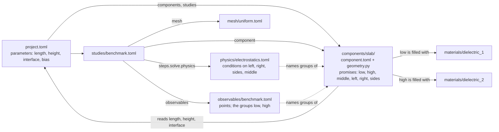

# 3 · Write each part

**Role:** manual
**Status:** current; what is not built yet is marked so
**Authority:** none of its own: it shows what femkit does, and the basic
tests run each example and hold it to what femkit prints

A project is made of **parts**: each is one file you write in your own
editor, and each says one thing — the shared parameters, a material, a
geometry, the physics, a mesh recipe, what to report, and a study that puts
them together. This chapter goes through each kind, using the two templates
of chapter 2, and shows for each a mistake and what femkit says about it.

Parts refer to each other by name. The geometry promises named pieces —
bodies and faces, which femkit calls **groups** — and everything else is
written on those groups, never on a particular geometry, so a physics, a mesh
recipe or a set of observables serves every geometry that promises the
groups it names. A study pairs them:



## How to read a part's file

Every file femkit starts you with explains itself: the comment directly
above each setting — each **key**, in the file's terms — is that key's help,
and a key shown commented out (`# growth = 0.5`) is one you may set. Every
value that has a unit is written with it, in quotes: `"1 m"`, `"500 nm"`,
`"0.5 um"`, `"1 V"`, `"9.03 eV"`. A comment followed by a blank line is just
prose. Every part's file holds `schema = 1`: the version of its format.

The full list of every key of every part, with its type and default, is the
[parts reference](../reference/parts.md); each section below names its table
there.

To follow along, make the two projects of chapter 2:

```console
$ femkit config set paths.projects '"~/femkit-projects"' --yes
[config set] plan: 1 step
  1. set paths.projects: unset -> ~/femkit-projects
[config set] 1 step; logs in ~/.local/state/femkit/operations/config/20261125T181952.318071Z
[1/1] set paths.projects: unset -> ~/femkit-projects
[config set] set paths.projects: unset -> ~/femkit-projects, in ~/.config/femkit/config.toml
$ femkit project new layers --from two_material --yes
[project new] plan: 3 steps
  1. make the projects root ~/femkit-projects
  2. make the global library ~/femkit-projects/materials, holding a copy of femkit's shipped materials: vacuum
  3. copy 9 files of two_material to ~/femkit-projects/layers
[project new] 3 steps; logs in ~/.local/state/femkit/operations/project-layers/20261125T164829.685662Z
[1/3] make the projects root ~/femkit-projects
[2/3] make the global library ~/femkit-projects/materials, holding a copy of femkit's shipped materials: vacuum
[3/3] copy 9 files of two_material to ~/femkit-projects/layers
[project new] made ~/femkit-projects/layers from two_material: 9 files
  components/slab/component.toml
  components/slab/geometry.py
  materials/dielectric_1/material.toml
  materials/dielectric_2/material.toml
  mesh/uniform.toml
  observables/benchmark.toml
  physics/electrostatics.toml
  project.toml
  studies/benchmark.toml
$ femkit project new square --from laplace_square --yes
[project new] plan: 1 step
  1. copy 8 files of laplace_square to ~/femkit-projects/square
[project new] 1 step; logs in ~/.local/state/femkit/operations/project-square/20261125T164830.279349Z
[1/1] copy 8 files of laplace_square to ~/femkit-projects/square
[project new] made ~/femkit-projects/square from laplace_square: 8 files
  components/square/component.toml
  components/square/geometry.py
  materials/vacuum/material.toml
  mesh/uniform.toml
  observables/midpoint.toml
  physics/electrostatics.toml
  project.toml
  studies/check.toml
```

Each mistake below is checked with `project check` (chapter 4 reads its
output in detail), then put right before the next.

## The project file — `project.toml`

The project file says what the project is, names its geometries (its
**components**) and its studies, and holds the **parameters** every other
file may use:

```console
$ cat ~/femkit-projects/layers/project.toml
# The two-material benchmark (docs/science/electrostatics.md § 9.1): a layered capacitor, two
# materials in series between two held potentials, a named interface between them. Its exact
# potential is linear in each layer, so first-order elements reproduce it on any mesh; the
# formulation's reference values follow from the parameters below and the two materials.
#
# This is the project file (manual: 3 · Write each part). Every key's help is the comment
# directly above it; a key shown commented out is one you may set.

# the version of this file's format, which femkit raises when it changes how files of this kind are written: one of `1` (manual: 3 · Write each part)
schema = 1

# what the project is, in a sentence or two
description = "A layered capacitor: relative permittivity 1 up to the interface, 4 beyond it, 0 V on the left side and the bias on the right"

# the project's components, by name: each the folder `components/<name>/`, holding `component.toml` and `geometry.py`
components = ["slab"]

# the project's studies, by name: each the file `studies/<name>.toml`
studies = ["benchmark"]

# the shared parameters, by name: each a quantity with its unit, or an expression of other parameters with `+`, `-`, `*`, `/` and parentheses (manual: 3 · Write each part)
[parameters]
# the slab's extent along x, from the frame's origin
length = "1 m"
# the slab's extent along y
height = "1 m"
# where the two materials meet, along x: between 0 and the length
interface = "0.5 m"
# the potential the right side is held at
bias = "1 V"
```

- `description`: a sentence or two for you and your colleagues.
- `components` and `studies`: the names of the project's components and
  studies. A component or study the project file does not name is never
  used, and `project check` says so.
- `[parameters]`: each a quantity with its unit, or an expression of other
  parameters with `+`, `-`, `*`, `/` and parentheses — `"length / 2"`,
  `"(interface + length) / 2"`. The geometry script, the physics, the mesh
  recipe and the observables use them by name, and a study can vary one
  (chapter 5).

A misspelled name in an expression:

<!-- edit ~/femkit-projects/layers/project.toml -->
```diff
 # where the two materials meet, along x: between 0 and the length
-interface = "0.5 m"
+interface = "lenght / 2"
```

```console
$ femkit project check --project layers
[project check] layers: 1 error, 1 note; the first is the next step
  part                    file                                  state
  project                 project.toml                          findings
  material:dielectric_1   materials/dielectric_1/material.toml  complete
  material:dielectric_2   materials/dielectric_2/material.toml  complete
  component:slab          components/slab/component.toml        complete
  mesh:uniform            mesh/uniform.toml                     complete
  observables:benchmark   observables/benchmark.toml            complete
  physics:electrostatics  physics/electrostatics.toml           complete
  study:benchmark         studies/benchmark.toml                unchecked
  x the parameter interface does not read: `lenght` is neither a unit nor a parameter given here; did you mean `length`? (the parameters: `bias`, `height`, `length`)
      project.toml: parameters.interface
  - whether `left`, `right` and `sides` are each an outer boundary, and `middle` an interface, is checked once the geometry of `slab` is built
      studies/benchmark.toml: component
```

`project check` lists each part with its state, then its **findings**: here
an error, marked `x`, at the key `parameters.interface` of `project.toml` —
a name femkit knows neither as a parameter nor as a unit, with the closest
parameter's name and the list of them — and a note, marked `-`, on what
cannot be checked until the geometry is built. Chapter 4 reads
this output line by line. Put the value back:

<!-- edit ~/femkit-projects/layers/project.toml -->
```diff
 # where the two materials meet, along x: between 0 and the length
-interface = "lenght / 2"
+interface = "0.5 m"
```

Its keys: the `ProjectFile` table of the
[parts reference](../reference/parts.md).

## A material — `materials/<name>/material.toml`

A material is a folder holding `material.toml` and any tables it uses. Its
name is the folder's name. Here is the second layer's material:

```console
$ cat ~/femkit-projects/layers/materials/dielectric_2/material.toml
# The benchmark's second material (manual: 6 · Materials), filling the layer beyond the
# interface: relative permittivity 4, the benchmark's choice.

# the version of this file's format, which femkit raises when it changes how files of this kind are written: one of `1` (manual: 6 · Materials)
schema = 1

# the name shown to a person; nothing refers to the material by it, since its folder's name is its name
display = "Dielectric 2"

# its chemical formula, as `Au` or `SiO2`
# formula = "SiO2"

# other names it goes by, for a person; nothing refers to the material by them
# aliases = ["second layer"]

# each property, by its name in femkit's list of material properties, holding its datasets, each named by its source (manual: 6 · Materials)
[properties]

# the material's relative permittivity, in 1
[properties.relative_permittivity]

# the dataset named `benchmark`
[properties.relative_permittivity.benchmark]
# a real constant, with its unit where it has one
value = "4"
# the convention of the source's complex values: one of `real`, `exp(-iwt)`, `exp(+iwt)`
convention = "real"
# where the data comes from: a citation a reader can check, with its DOI where there is one
source = "the two-material benchmark's choice (docs/science/electrostatics.md § 9.1)"
# where the data holds: `all`, or `[from, to]` in its variable
range = "all"

# anything kept beside the material; read by no step
# [notes]
```

Each **property** — here `relative_permittivity`, the one an electrostatics
calculation reads — holds one or more **datasets**: a dataset is one set of
values for the property, from one source, here named `benchmark`. Every
dataset says where it comes from (`source`), whether its values are real or
complex and, if complex, in which sign convention (`convention`), and over
what range they hold (`range`). A dataset can be a single value, as here, a
table, or a dispersion formula: chapter 6 is about materials.

A value in the wrong unit — a relative permittivity has none:

<!-- edit ~/femkit-projects/layers/materials/dielectric_2/material.toml -->
```diff
 # a real constant, with its unit where it has one
-value = "4"
+value = "4 V"
```

```console
$ femkit project check --project layers
[project check] layers: 1 error, 1 note; the first is the next step
  part                    file                                  state
  project                 project.toml                          complete
  material:dielectric_1   materials/dielectric_1/material.toml  complete
  material:dielectric_2   materials/dielectric_2/material.toml  findings
  component:slab          components/slab/component.toml        complete
  mesh:uniform            mesh/uniform.toml                     complete
  observables:benchmark   observables/benchmark.toml            complete
  physics:electrostatics  physics/electrostatics.toml           complete
  study:benchmark         studies/benchmark.toml                unchecked
  x `value` is "4 V", a quantity of current^-1 length^2 mass time^-3; it needs a number with no unit
      materials/dielectric_2/material.toml: properties.relative_permittivity.benchmark.value
  - whether `left`, `right` and `sides` are each an outer boundary, and `middle` an interface, is checked once the geometry of `slab` is built
      studies/benchmark.toml: component
```

femkit names what it read by its dimension in SI base quantities — a volt is
mass × length² ÷ (time³ × current) — and a relative permittivity has none: it
is a plain number. Put it back:

<!-- edit ~/femkit-projects/layers/materials/dielectric_2/material.toml -->
```diff
 # a real constant, with its unit where it has one
-value = "4 V"
+value = "4"
```

Its keys: the `Material`, `Value`, `Table` and `Modelled` tables of the
[parts reference](../reference/parts.md).

## A component — `components/<name>/`

A **component** is one geometry: a Python script that draws it with Gmsh,
`geometry.py`, and the file that wraps it, `component.toml`, which says what
the script needs and what it promises. The two-material slab looks like this,
each name a group its script promises:

```text
            sides (the top)
     ┌───────────────┬───────────────┐
     │               │               │
left │      low      │     high      │ right
     │               │               │
     └───────────────┴───────────────┘
   x = 0       x = interface     x = length
            sides (the bottom)
                    middle: the face between low and high
```

```console
$ cat ~/femkit-projects/layers/components/slab/component.toml
# The slab's contract (manual: 3 · Write each part): what geometry.py beside it reads, the
# groups it promises — two bodies, the interface between them, and the outer sides — and the
# material that fills each body.

# the version of this file's format, which femkit raises when it changes how files of this kind are written: one of `1` (manual: 3 · Write each part)
schema = 1

# the space the script draws in: its dimension and its unit; its origin is where the script's coordinates are zero, and every point another file gives is measured from it (manual: 3 · Write each part)
[frame]
# the geometry's dimension, drawn in the x-y plane when 2: one of `2`, `3`
dimension = 2
# the length unit of every number the script writes and of every length handed to it
unit = "m"

# for a 2-D geometry a physics treats as axisymmetric: the axis it is revolved about
# [frame.symmetry]
# the axis of revolution, in the drawing's plane; the drawing lies on one side of it: one of `x`, `y`
# axis = "y"

# what the script reads beside its own numbers
[inputs]

# the project parameters the script reads, by name, each with what it must be — a length reaches the script in the frame's unit, an angle in degrees, a number as itself: one of `length`, `angle`, `number`
[inputs.parameters]
length = "length"
height = "length"
interface = "length"

# the files beside the script that it reads, each by its path from the component's folder, with its SHA-256
# [inputs.files]
# "profile.csv" = "<the file's SHA-256>"

# the named groups the script promises, each with its dimension — the frame's for a body, one less for a face, 1 for an edge in 3-D, 0 for a point; every other part names only these
[groups]
# the layer from x = 0 to the interface
low = 2
# the layer from the interface to x = length
high = 2
# the face between the two layers, at x = interface
middle = 1
# the side at x = 0
left = 1
# the side at x = length
right = 1
# the top and the bottom of both layers
sides = 1

# the material that fills each body group, keyed by the group (manual: 3 · Write each part)
[assign]

[assign.low]
# the material, by name: the project's own, else the global library's; `GLOBAL/` names the global library's
material = "dielectric_1"
# for each property whose material holds several datasets, the one used, by its name
# datasets = { relative_permittivity = "benchmark" }

[assign.high]
# the material, by name: the project's own, else the global library's; `GLOBAL/` names the global library's
material = "dielectric_2"
# for each property whose material holds several datasets, the one used, by its name
# datasets = { relative_permittivity = "benchmark" }
```

- `[frame]`: the geometry's space — its `dimension`, 2 (drawn in the x-y
  plane) or 3, and its length `unit`. Its origin is where the script's
  coordinates are zero; every point another file gives is measured from it.
  For a 2-D drawing that a physics treats as a body of revolution,
  `[frame.symmetry]` names the axis.
- `[inputs.parameters]`: the project parameters the script reads, each with
  what it must be — `length`, `angle` or `number`. A length reaches the
  script as a plain number in the frame's unit; an angle in degrees.
  `[inputs.files]` lists files beside the script that it reads, each with
  its **SHA-256**: a 64-character fingerprint computed from the file's
  bytes, which changes if any byte of the file changes, so a file changed
  under its component is noticed.
- `[groups]`: every group the script promises, with its dimension — the
  frame's for a body, one less for a face, 1 for an edge in 3-D, 0 for a
  point. Every other part names only these.
- `[assign]`: the material that fills each body group. A material is
  looked for in the project's own `materials/` first, then in your material
  library; `GLOBAL/vacuum` names the library's explicitly (chapter 6).

The script is yours: a full Python program, written as you like. femkit hands
it its parameters in a small JSON file and names the file it writes; the
script draws the shapes and names the groups, and does not mesh:

<details>
<summary>The slab's <code>geometry.py</code></summary>

```console
$ cat ~/femkit-projects/layers/components/slab/geometry.py
"""The two-material slab: a rectangle `length` by `height` in the x-y plane, its lower-left
corner at the frame's origin, cut at x = `interface` into two layers that share the face
between them. It names the groups its contract (component.toml) promises — the bodies `low`
and `high`, the face `middle` between them, and the outer sides `left` (x = 0), `right`
(x = length) and `sides` (the top and the bottom of both layers).

femkit runs it as `python geometry.py INPUTS OUTPUT` (geometry.md § 2). INPUTS is a JSON
file, {"schema": 1, "parameters": {"length": 1.0, "height": 1.0, "interface": 0.5}}: each
parameter the contract declares, a length in the frame's unit — metres here. OUTPUT is the
file to write the geometry to; its format is femkit's choice, by its extension. The script
builds the shapes and names the groups; it does not mesh, since meshing is femkit's next
step. Run it by hand the same way, with an INPUTS file of your own.
"""

import json
import sys

import gmsh


def main(inputs: str, output: str) -> None:
    with open(inputs) as f:
        parameters = json.load(f)["parameters"]
    length, height, interface = parameters["length"], parameters["height"], parameters["interface"]
    if not 0 < interface < length or not height > 0:
        sys.exit(f"the interface must lie inside the slab, 0 < {interface} < {length}, "
                 f"and its height must be positive, not {height}")

    gmsh.initialize()
    try:
        gmsh.option.setNumber("General.Terminal", 1)   # Gmsh's messages into the run's log
        gmsh.model.add("two_material")
        low = gmsh.model.occ.addRectangle(0, 0, 0, interface, height)
        high = gmsh.model.occ.addRectangle(interface, 0, 0, length - interface, height)

        # Fragmenting makes the two layers share one face between them, so the mesh is
        # conforming across it; its map says which surface each rectangle became.
        _, pieces = gmsh.model.occ.fragment([(2, low)], [(2, high)])
        gmsh.model.occ.synchronize()
        low_surfaces = [tag for _, tag in pieces[0]]
        high_surfaces = [tag for _, tag in pieces[1]]

        low_edges = edges(low_surfaces)
        high_edges = edges(high_surfaces)
        middle = low_edges & high_edges              # the face both layers touch
        outer = (low_edges | high_edges) - middle

        # Each outer side is told apart by where its middle lies.
        near = length / 1000
        left, right, sides = [], [], []
        for curve in sorted(outer):
            x, _, _ = gmsh.model.occ.getCenterOfMass(1, curve)
            if abs(x) < near:
                left.append(curve)
            elif abs(x - length) < near:
                right.append(curve)
            else:
                sides.append(curve)

        name(2, low_surfaces, "low")
        name(2, high_surfaces, "high")
        name(1, list(middle), "middle")
        name(1, left, "left")
        name(1, right, "right")
        name(1, sides, "sides")

        gmsh.write(output)
    finally:
        gmsh.finalize()


def edges(surfaces: list[int]) -> set[int]:
    """The curves that bound the given surfaces."""
    return {tag for _, tag in gmsh.model.getBoundary([(2, s) for s in surfaces], combined=False, oriented=False)}


def name(dimension: int, tags: list[int], group: str) -> None:
    """One named group — in Gmsh's terms, a physical group with its name."""
    tag = gmsh.model.addPhysicalGroup(dimension, sorted(tags))
    gmsh.model.setPhysicalName(dimension, tag, group)


if __name__ == "__main__":
    main(sys.argv[1], sys.argv[2])
```

</details>

femkit running the script, and then meshing what it draws, is not built yet
([plan](../plans/plan.md) § 4, X). You can run it yourself, in a Python
that has Gmsh's Python module, with an inputs file of your own, in a folder
outside the project — femkit warns about any file in a project that is none
of its parts (chapter 4):

```bash
mkdir -p ~/geometry-try && cd ~/geometry-try
echo '{"schema": 1, "parameters": {"length": 1.0, "height": 1.0, "interface": 0.5}}' > inputs.json
python ~/femkit-projects/layers/components/slab/geometry.py inputs.json slab.msh
```

A material can fill only a body. Assigning one to the face between the
layers:

<!-- edit ~/femkit-projects/layers/components/slab/component.toml -->
```diff
-[assign.high]
+[assign.middle]
```

```console
$ femkit project check --project layers
[project check] layers: 1 error, 1 note; the first is the next step
  part                    file                                  state
  project                 project.toml                          complete
  material:dielectric_1   materials/dielectric_1/material.toml  complete
  material:dielectric_2   materials/dielectric_2/material.toml  complete
  component:slab          components/slab/component.toml        findings
  mesh:uniform            mesh/uniform.toml                     complete
  observables:benchmark   observables/benchmark.toml            complete
  physics:electrostatics  physics/electrostatics.toml           complete
  study:benchmark         studies/benchmark.toml                unchecked
  x a material fills a body; `middle` is outer_boundary or interface or embedded
      components/slab/component.toml: assign.middle
      one of: "high", "low"
  - whether `left`, `right` and `sides` are each an outer boundary, and `middle` an interface, is checked once the geometry of `slab` is built
      studies/benchmark.toml: component
```

A face lies on the outside of the geometry (`outer_boundary`), between two
bodies (`interface`), or inside one body (`embedded`); which of them
`middle` is shows once the geometry is built, but a face it is already, so no
material can fill it. `one of:` lists the groups that can be filled — the
bodies. Put it back:

<!-- edit ~/femkit-projects/layers/components/slab/component.toml -->
```diff
-[assign.middle]
+[assign.high]
```

Its keys: the `Component`, `Frame`, `Symmetry`, `Inputs` and `Assignment`
tables of the [parts reference](../reference/parts.md).

## The physics — `physics/<name>.toml`

A physics states the equation to solve — its **formulation** — and the
condition on each boundary, on groups only, so it serves every component that
promises them:

```console
$ cat ~/femkit-projects/layers/physics/electrostatics.toml
# One physics (manual: 3 · Write each part): the electrostatic potential, stated on the groups
# it names — never on a component. The face between the two layers is named, so it carries its
# condition: `interface` states that the potential and the normal displacement are continuous
# across it.

# the version of this file's format, which femkit raises when it changes how files of this kind are written: one of `1` (manual: 3 · Write each part)
schema = 1

# the formulation family it states: one of `electrostatics` (manual: 3 · Write each part)
formulation = "electrostatics"

# what each dimension of the components it serves means for its formulation, keyed by the dimension (manual: 3 · Write each part)
[meaning]
# for electrostatics in 2-D: `per unit depth`, or `axisymmetric` about the axis the component's `[frame.symmetry]` names; in 3-D: `full`
2 = "per unit depth"

# the condition on each outer-boundary group, and on each interface group that carries one, keyed by the group
[conditions]

[conditions.left]
# which condition holds on the group: one of `potential`, `insulating`, `surface_charge`, `normal_flux`, `interface`
kind = "potential"
# the potential the boundary is held at, in V
value = "0 V"

[conditions.right]
# which condition holds on the group: one of `potential`, `insulating`, `surface_charge`, `normal_flux`, `interface`
kind = "potential"
# the potential the boundary is held at, in V
value = "bias"

[conditions.sides]
# which condition holds on the group: one of `potential`, `insulating`, `surface_charge`, `normal_flux`, `interface`
kind = "insulating"

[conditions.middle]
# which condition holds on the group: one of `potential`, `insulating`, `surface_charge`, `normal_flux`, `interface`
kind = "interface"

# each source by its name: its kind, the group it acts in or on, and the parameters its kind lists
# [sources]
```

- `formulation`: today `electrostatics`, the electrostatic potential
  ([its equations](../science/electrostatics.md)).
- `[meaning]`: what a 2-D drawing stands for — `per unit depth`, a slice of
  a long object, or `axisymmetric`, a body of revolution; a 3-D one is
  `full`.
- `[conditions]`: for each boundary group, one condition: `potential`
  (held at a `value`), `insulating`, `surface_charge`, `normal_flux`; and
  `interface` on a named face between two bodies, which states that the
  potential and the normal displacement are continuous across it.
- `[sources]`: a free charge density in a body, when there is one.

A condition on a group the component does not promise:

<!-- edit ~/femkit-projects/layers/physics/electrostatics.toml -->
```diff
-[conditions.sides]
+[conditions.top]
```

```console
$ femkit project check --project layers
[project check] layers: 1 error, 1 note; the first is the next step
  part                    file                                  state
  project                 project.toml                          complete
  material:dielectric_1   materials/dielectric_1/material.toml  complete
  material:dielectric_2   materials/dielectric_2/material.toml  complete
  component:slab          components/slab/component.toml        complete
  mesh:uniform            mesh/uniform.toml                     complete
  observables:benchmark   observables/benchmark.toml            complete
  physics:electrostatics  physics/electrostatics.toml           findings
  study:benchmark         studies/benchmark.toml                unchecked
  x the study `benchmark` pairs this physics with the component `slab`, which promises no group `top`
      physics/electrostatics.toml: conditions.top
      one of: "middle", "left", "right", "sides"
  - whether `left` and `right` are each an outer boundary, and `middle` an interface, is checked once the geometry of `slab` is built
      studies/benchmark.toml: component
```

The physics names groups only, so the finding names the study that pairs it
with a component, and `one of:` the groups that component promises. Put it
back:

<!-- edit ~/femkit-projects/layers/physics/electrostatics.toml -->
```diff
-[conditions.top]
+[conditions.sides]
```

Its keys: the `Physics`, `Condition` and `Source` tables of the
[parts reference](../reference/parts.md).

## A mesh recipe — `mesh/<name>.toml`

A mesh recipe says how fine the mesh is, over the whole geometry and near
named groups:

```console
$ cat ~/femkit-projects/square/mesh/uniform.toml
# One mesh recipe (manual: 3 · Write each part): an even size over the whole square. It names
# no group, so it serves any component; the study's axis varies its `size` as
# `mesh:uniform:size`.

# the version of this file's format, which femkit raises when it changes how files of this kind are written: one of `1` (manual: 3 · Write each part)
schema = 1

# the largest element size anywhere: a length
size = "0.1 m"

# the geometry order — how closely elements follow a curved surface, 2 bending them to it: one of `1`, `2`
order = 1

# how far each group's measure in the mesh may differ from its measure in the geometry, relative: a plain number
tolerance = 1e-9

# how fast the size grows away from a group of `sizes`: the size added per unit of distance, a plain number above 0; required with `sizes`
# growth = 0.5

# the smallest quality an element may have, by Gmsh's signed inverse condition number, at most 1; unset, only an inverted element, below 0, is refused
# quality = 0.3

# a finer size on and near named groups, keyed by the group: each a length
# [sizes]
# left = "0.02 m"
```

- `size`: the largest element anywhere.
- `order`: 1 for straight-sided elements, 2 for elements bent to follow a
  curved surface.
- `tolerance`: how closely each group's length, area or volume in the mesh
  must match the geometry's.
- `[sizes]` with `growth`: a finer size on and near named groups, and how
  fast the size grows away from them.
- `quality`: the worst element shape accepted.

Meshing itself is not built yet ([plan](../plans/plan.md) § 4, X); the
recipe is checked now. A misspelled key:

<!-- edit ~/femkit-projects/square/mesh/uniform.toml -->
```diff
 # the largest element size anywhere: a length
-size = "0.1 m"
+szie = "0.1 m"
```

```console
$ femkit project check --project square
[project check] square: 1 error, 2 notes; the first is the next step
  part                    file                              state
  project                 project.toml                      complete
  material:vacuum         materials/vacuum/material.toml    complete
  component:square        components/square/component.toml  complete
  mesh:uniform            mesh/uniform.toml                 unloadable
  observables:midpoint    observables/midpoint.toml         complete
  physics:electrostatics  physics/electrostatics.toml       complete
  study:check             studies/check.toml                unchecked
  x `szie` is no key here; did you mean `size`?
      mesh/uniform.toml: szie
      one of: size, sizes, quality, growth
  - what the study pairs with `mesh:uniform` is checked once that file loads
      studies/check.toml: mesh
  - whether `left`, `right` and `sides` are each an outer boundary is checked once the geometry of `square` is built
      studies/check.toml: component
```

A key femkit does not know makes the file unreadable — its state is
`unloadable` — so `one of:` lists the keys it does know, and what the study
pairs with the recipe waits, in a second note, until the file reads. Put it
back:

<!-- edit ~/femkit-projects/square/mesh/uniform.toml -->
```diff
 # the largest element size anywhere: a length
-szie = "0.1 m"
+size = "0.1 m"
```

Its keys: the `Recipe` table of the
[parts reference](../reference/parts.md).

## Observables — `observables/<name>.toml`

An observable set says what a study reports: each **observable** reads a
quantity of the physics somewhere — at a point, along a line or over a group
— and reduces it to a number in a unit you choose:

```console
$ cat ~/femkit-projects/layers/observables/benchmark.toml
# The benchmark's observables (manual: 3 · Write each part; docs/science/electrostatics.md
# § 9.1): the potential at the middle of each layer and on the interface, and the energy in each
# layer.
# Each point is an expression of the project's parameters, measured from the slab's lower-left
# corner, so the reference values follow from the parameters wherever the interface lies.

# the version of this file's format, which femkit raises when it changes how files of this kind are written: one of `1` (manual: 3 · Write each part)
schema = 1

# the set's observables, by name, unique across the sets a study reports (manual: 3 · Write each part)
[observables]

# the potential halfway through the first layer
[observables.potential_low]
# the quantity it reads: a derived quantity of the formulation of the physics a study pairs it with
quantity = "potential"
# where it is read, as a point: one length per axis of the component's frame, from its origin; or give `line` or `group` instead
point = ["interface / 2", "height / 2"]
# how it is reduced where it is read — a value at a point, the others over a line or a group: one of `value`, `average`, `integral`, `maximum`, `norm`
reduction = "value"
# the unit it is reported in: a unit of its quantity, or, for an integral, of its quantity times the length, area or volume it is integrated over
unit = "V"

# the potential on the interface
[observables.potential_middle]
# the quantity it reads: a derived quantity of the formulation of the physics a study pairs it with
quantity = "potential"
# where it is read, as a point: one length per axis of the component's frame, from its origin; or give `line` or `group` instead
point = ["interface", "height / 2"]
# how it is reduced where it is read — a value at a point, the others over a line or a group: one of `value`, `average`, `integral`, `maximum`, `norm`
reduction = "value"
# the unit it is reported in: a unit of its quantity, or, for an integral, of its quantity times the length, area or volume it is integrated over
unit = "V"

# the potential halfway through the second layer
[observables.potential_high]
# the quantity it reads: a derived quantity of the formulation of the physics a study pairs it with
quantity = "potential"
# where it is read, as a point: one length per axis of the component's frame, from its origin; or give `line` or `group` instead
point = ["(interface + length) / 2", "height / 2"]
# how it is reduced where it is read — a value at a point, the others over a line or a group: one of `value`, `average`, `integral`, `maximum`, `norm`
reduction = "value"
# the unit it is reported in: a unit of its quantity, or, for an integral, of its quantity times the length, area or volume it is integrated over
unit = "V"

# the field's energy in the first layer, per metre of depth
[observables.energy_low]
# the quantity it reads: a derived quantity of the formulation of the physics a study pairs it with
quantity = "energy_density"
# where it is read, as a group: one the paired component promises; or give `point` or `line` instead
group = "low"
# how it is reduced where it is read — a value at a point, the others over a line or a group: one of `value`, `average`, `integral`, `maximum`, `norm`
reduction = "integral"
# the unit it is reported in: a unit of its quantity, or, for an integral, of its quantity times the length, area or volume it is integrated over
unit = "J/m"

# the field's energy in the second layer, per metre of depth
[observables.energy_high]
# the quantity it reads: a derived quantity of the formulation of the physics a study pairs it with
quantity = "energy_density"
# where it is read, as a group: one the paired component promises; or give `point` or `line` instead
group = "high"
# how it is reduced where it is read — a value at a point, the others over a line or a group: one of `value`, `average`, `integral`, `maximum`, `norm`
reduction = "integral"
# the unit it is reported in: a unit of its quantity, or, for an integral, of its quantity times the length, area or volume it is integrated over
unit = "J/m"
```

- `quantity`: what it reads, such as `potential` or `energy_density`.
- `point`, `line` or `group`: where. A point is one length per axis of the
  component's frame, measured from its origin, and may use the parameters,
  so it stays in place when a parameter changes.
- `reduction`: `value` at a point; `average`, `integral`, `maximum` or
  `norm` over a line or a group.
- `unit`: the unit it is reported in. An integral's unit is the quantity's
  times the length, area or volume it is taken over — and in a 2-D slice of
  a long object, per unit depth.

An energy reported in joules, where the integral over a 2-D slice is per
metre of depth:

<!-- edit ~/femkit-projects/layers/observables/benchmark.toml -->
```diff
 # the field's energy in the first layer, per metre of depth
 [observables.energy_low]
 # the quantity it reads: a derived quantity of the formulation of the physics a study pairs it with
 quantity = "energy_density"
 # where it is read, as a group: one the paired component promises; or give `point` or `line` instead
 group = "low"
 # how it is reduced where it is read — a value at a point, the others over a line or a group: one of `value`, `average`, `integral`, `maximum`, `norm`
 reduction = "integral"
 # the unit it is reported in: a unit of its quantity, or, for an integral, of its quantity times the length, area or volume it is integrated over
-unit = "J/m"
+unit = "J"
```

```console
$ femkit project check --project layers
[project check] layers: 1 error, 1 note; the first is the next step
  part                    file                                  state
  project                 project.toml                          complete
  material:dielectric_1   materials/dielectric_1/material.toml  complete
  material:dielectric_2   materials/dielectric_2/material.toml  complete
  component:slab          components/slab/component.toml        complete
  mesh:uniform            mesh/uniform.toml                     complete
  observables:benchmark   observables/benchmark.toml            findings
  physics:electrostatics  physics/electrostatics.toml           complete
  study:benchmark         studies/benchmark.toml                unchecked
  x `energy_low` reads energy_density, in J/m^3 times an area, and is reported in J, which is not a unit of that
      observables/benchmark.toml: observables.energy_low.unit
  - whether `left`, `right` and `sides` are each an outer boundary, and `middle` an interface, is checked once the geometry of `slab` is built
      studies/benchmark.toml: component
```

The energy density, in J/m³, integrated over an area — a body of a 2-D
slice — is in J/m: per metre of depth. Put it back:

<!-- edit ~/femkit-projects/layers/observables/benchmark.toml -->
```diff
 group = "low"
 # how it is reduced where it is read — a value at a point, the others over a line or a group: one of `value`, `average`, `integral`, `maximum`, `norm`
 reduction = "integral"
 # the unit it is reported in: a unit of its quantity, or, for an integral, of its quantity times the length, area or volume it is integrated over
-unit = "J"
+unit = "J/m"
```

Its keys: the `ObservableSet`, `AtPoint`, `AlongLine` and `OverGroup` tables
of the [parts reference](../reference/parts.md).

## A study — `studies/<name>.toml`

A study puts the parts together: it pairs one component with the physics
of each step, a mesh recipe and observable sets, and says how the equations
are solved and what varies:

```console
$ cat ~/femkit-projects/square/studies/check.toml
# One study (manual: 3 · Write each part): it pairs the square with the physics, a mesh recipe
# and an observable set, and holds everything that is not the physics. Its one axis refines the
# mesh: `study expand` writes one case per size, and the midpoint's potential is the same in each.

# the version of this file's format, which femkit raises when it changes how files of this kind are written: one of `1` (manual: 3 · Write each part)
schema = 1

# the component it solves, by name
component = "square"

# the mesh recipe it meshes with, by name
mesh = "uniform"

# the observable sets it reports, by name
observables = ["midpoint"]

# the units values are shown in: each value in the first listed unit of its dimension, else in SI units, angles in degrees
display = ["m", "V", "V/m"]

# its steps, by name: each solves its physics as a kind of calculation, after any step it takes from; the order they are written in means nothing (manual: 3 · Write each part)
[steps]

[steps.solve]
# the physics it solves, by name
physics = "electrostatics"
# the kind of calculation, which the physics' formulation must support: one of `stationary` (manual: 3 · Write each part)
kind = "stationary"
# when several physics are solved in turn, what it takes from a step that runs before it — a heat step taking an optics step's absorbed power, say: each by what it is to its own physics, then the step's name and a quantity that step derives
# takes = { heat_source = "optics.absorbed_power_density" }

# how the equations are discretized and solved — the finite element and the linear solver — the same in every environment (manual: 3 · Write each part)
[numerics]

# the finite element
[numerics.element]
# the element family: one of `lagrange`, `nedelec`
family = "lagrange"
# its polynomial degree: a whole number, 1 or more
degree = 1

# the linear solver
[numerics.solver]
# how the linear system is solved, exactly or to a tolerance: one of `direct`, `iterative`
kind = "direct"
# the relative tolerance an iterative solver stops at: a plain number; required with `iterative`
# tolerance = 1e-10

# what varies, each axis keyed by the address of what it varies — a parameter, `project:parameters.side`; a value of the mesh recipe, `mesh:uniform:size`; a numerics field; or a material's dataset — every axis crossed with every other (manual: 3 · Write each part)
[axes]

# the recipe's size, halved twice
[axes."mesh:uniform:size"]
# why it varies: one of `numerical convergence`, `geometry convergence`, `physical sweep`
class = "numerical convergence"
# its values, in order, each written as the value the axis varies is written in its own file
values = ["0.1 m", "0.05 m", "0.025 m"]

# when the axes are of more than one class: every axis, and why their full product is needed
# [crossing]
# the address of every axis of the study
# axes = ["mesh:uniform:size", "project:parameters.bias"]
# why the full product is needed, in a sentence
# reason = "the midpoint must hold half the bias at every size, whatever the bias"

# each engine environment's settings for this study, by the environment's name (manual: 3 · Write each part)
[environments]

# the job's resources in this environment (manual: 3 · Write each part)
[environments.elmer.resources]
# MPI ranks
ranks = 1
# threads per rank
threads = 1
# GPUs per node, a count; 0 states that none is used
gpus = 0
# wall time, `[D-]HH:MM:SS`; read on a machine with a scheduler
wall = "00:10:00"
# memory per node, a whole number with `K`, `M`, `G` or `T`; read on a machine with a scheduler
memory = "2G"
# the queue, on a machine with a scheduler
# partition = "batch"
# the quality of service, where the record lists one
# qos = "normal"

# the job's resources in this environment (manual: 3 · Write each part)
[environments.ngsolve.resources]
# MPI ranks
ranks = 1
# threads per rank
threads = 1
# GPUs per node, a count; 0 states that none is used
gpus = 0
# wall time, `[D-]HH:MM:SS`; read on a machine with a scheduler
wall = "00:10:00"
# memory per node, a whole number with `K`, `M`, `G` or `T`; read on a machine with a scheduler
memory = "2G"
# the queue, on a machine with a scheduler
# partition = "batch"
# the quality of service, where the record lists one
# qos = "normal"
```

- `component`, `mesh`, `observables`: the parts it pairs, by name.
- `display`: the units values are shown in.
- `[steps]`: each step solves one physics as one kind of calculation —
  today `stationary`, a field that does not change in time.
- `[numerics]`: the finite element — its family and polynomial degree — and
  the linear solver, the same in every engine.
- `[axes]`: what varies, each axis named by what it varies — its
  **address**, in the file's comments: the kind of file, its name, and the
  key, `mesh:uniform:size` being `size` in the mesh recipe `uniform`, and
  `project:parameters.bias` the parameter `bias` of the project file. Each
  axis has its values and its reason — its `class`: `numerical
  convergence`, `geometry convergence` or `physical sweep`.
- `[crossing]`: when the axes have more than one reason, every axis and why
  all their combinations are needed.
- `[environments]`: for each engine, the resources a run asks for — MPI
  ranks, threads, GPUs, time and memory.

Chapter 5 is about studies, their axes, and the calculations they make. A
kind of calculation the physics does not have:

<!-- edit ~/femkit-projects/square/studies/check.toml -->
```diff
 # the kind of calculation, which the physics' formulation must support: one of `stationary` (manual: 3 · Write each part)
-kind = "stationary"
+kind = "static"
```

```console
$ femkit project check --project square
[project check] square: 1 error, 1 note; the first is the next step
  part                    file                              state
  project                 project.toml                      complete
  material:vacuum         materials/vacuum/material.toml    complete
  component:square        components/square/component.toml  complete
  mesh:uniform            mesh/uniform.toml                 complete
  observables:midpoint    observables/midpoint.toml         complete
  physics:electrostatics  physics/electrostatics.toml       complete
  study:check             studies/check.toml                findings
  x electrostatics does not support the `static` kind of calculation
      studies/check.toml: steps.solve.kind
      one of: "stationary"
  - whether `left`, `right` and `sides` are each an outer boundary is checked once the geometry of `square` is built
      studies/check.toml: component
```

<!-- edit ~/femkit-projects/square/studies/check.toml -->
```diff
 # the kind of calculation, which the physics' formulation must support: one of `stationary` (manual: 3 · Write each part)
-kind = "static"
+kind = "stationary"
```

Its keys: the `Study`, `Step`, `Numerics`, `Element`, `Solver`, `Axis`,
`Crossing`, `Binding` and `Resources` tables of the
[parts reference](../reference/parts.md).

## Your own files — `custom/`

Anything else you keep with a project — notes, plotting scripts, data —
goes in its `custom/` folder. femkit never reads it, copies it with the
project (chapter 2), and warns about a file anywhere else that is no part
(chapter 4).
