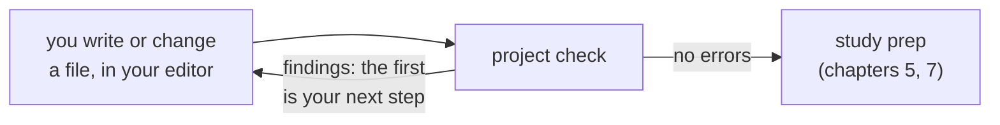
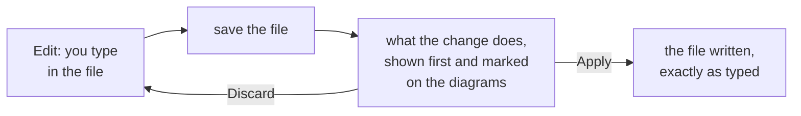

# 4 · Check it

**Role:** manual
**Status:** current; what is not built yet is marked so
**Authority:** none of its own: it shows what femkit does, and the basic
tests run each example and hold it to what femkit prints

`project check` reads every file of a project and says what is wrong, before
anything runs. It changes nothing. Each thing it says is a **finding**, with
the file and the key it is about, and, where femkit can tell, what would be
right. While there is an error, the first one is your next step: fix it,
check again, repeat — nothing else is offered beside it. A warning or a note
never stops you: with none of those errors left, the check offers what your
parts allow next, `study prep` among them.



To follow along:

```console
$ femkit config set paths.projects '"~/femkit-projects"' --yes
[config set] plan: 1 step
  1. set paths.projects: unset -> ~/femkit-projects
[config set] 1 step; logs in ~/.local/state/femkit/operations/config/20261125T181958.855675Z
[1/1] set paths.projects: unset -> ~/femkit-projects
[config set] set paths.projects: unset -> ~/femkit-projects, in ~/.config/femkit/config.toml
$ femkit project new layers --from two_material --yes
[project new] plan: 3 steps
  1. make the projects root ~/femkit-projects
  2. make the global library ~/femkit-projects/materials, holding a copy of femkit's shipped materials: vacuum
  3. copy 11 files of two_material to ~/femkit-projects/layers
[project new] 3 steps; logs in ~/.local/state/femkit/operations/project-layers/20261128T040300.997452Z
[1/3] make the projects root ~/femkit-projects
[2/3] make the global library ~/femkit-projects/materials, holding a copy of femkit's shipped materials: vacuum
[3/3] copy 11 files of two_material to ~/femkit-projects/layers
[project new] made ~/femkit-projects/layers from two_material: 11 files
  copied
  components/slab/component.toml
  components/slab/geometry.py
  definitions.py
  materials/dielectric_1/material.toml
  materials/dielectric_2/material.toml
  mesh/uniform.toml
  observables/benchmark/observables.toml
  observables/benchmark/observe.py
  physics/electrostatics.toml
  project.toml
  studies/benchmark.toml
next -- check the new project, as any other:
    femkit project check --project layers
```

Work inside the project's folder: there, `femkit project check` checks this
project, with no `--project`.

```console
$ cd ~/femkit-projects/layers
```

## A check with nothing wrong

```console
$ femkit project check
[project check] layers: every part loads and checks; 1 note
  section      part                    file                                    state      engines that can solve it
  Definitions  project                 project.toml                            complete
  Definitions  material:dielectric_1   materials/dielectric_1/material.toml    complete
  Definitions  material:dielectric_2   materials/dielectric_2/material.toml    complete
  Component    component:slab          components/slab/component.toml          complete
  Physics      physics:electrostatics  physics/electrostatics.toml             complete
  Mesh         mesh:uniform            mesh/uniform.toml                       complete
  Study        study:benchmark         studies/benchmark.toml                  unchecked  elmer, ngsolve
  Results      observables:benchmark   observables/benchmark/observables.toml  complete
  - whether `left`, `right` and `sides` are each an outer boundary, and `middle` an interface, is checked once the geometry of `slab` is built
      studies/benchmark.toml, line 13: component
next -- what the parts' states allow:
    femkit study prep --project layers benchmark --engine ENGINE   # make its cases, geometries and meshes, and the jobs that make them
```

The first line sums up the project. Then each part, one line each, in the
order they build on each other: what it is — `material:dielectric_1` is the
material named `dielectric_1`, `study:benchmark` the study named
`benchmark` — its file, and its **state**:

| state | means |
|---|---|
| `complete` | the file reads, and nothing is wrong with it |
| `errors` | the file reads, and `project check` found an error in it; a warning or a note leaves the state as it is |
| `unloadable` | the file cannot be read; its findings say why |
| `unchecked` | nothing is wrong so far, but something it depends on cannot be checked yet |

For each study, the last column names the engines that can solve it: those
that take the mesh its recipe makes (chapter 3). The study names none
itself; you choose one when you prep it — the next step, at the end, where
`--engine ENGINE` stands for one of them, and may be left out until you
solve (chapter 5).

Under the table come the findings. Here there is one **note**: whether the
faces the physics puts its conditions on — `left`, `right`, `sides` — are on
the outside of the slab, and whether `middle` lies between two bodies, can
only be seen once the geometry is built. It is said for `benchmark`, the
study that pairs the physics with the slab. `study prep` writes the job that builds the
geometry (chapter 7); reading the built geometry back for this check is not
built yet ([plan](../plans/plan.md) § 4, X), so this note stays, and it
never stops `study prep`.

## Reading a finding

Each finding opens with its mark:

| mark | kind | means |
|---|---|---|
| `x` | **error** | something is wrong: `study prep` refuses every study that uses this file until it is fixed |
| `!` | **warning** | probably not what you meant, though it stops no calculation but its own: a file femkit ignores, a study the project file does not name |
| `-` | **note** | something to know: what cannot be checked yet, or what was left out |

Errors come first, then warnings, then notes. Under each finding:

- the **file**, from the project's folder, and after the colon the **key**
  in it — `assign.high.material` is the key `material` under the heading
  `[assign.high]`;
- `right:` — what would be right there, written as you would type it in the
  file, when femkit can tell;
- `one of:` — the values that would do, when there is a choice.

Here are four mistakes at once. A new study, finer than the template's —
second-degree elements instead of first — made by copying it and changing
the degree:

```console
$ cp studies/benchmark.toml studies/fine.toml
```

<!-- edit ~/femkit-projects/layers/studies/fine.toml -->
```diff
 # its polynomial degree: a whole number, 1 or more
-degree = 1
+degree = 2
```

A misspelled material name:

<!-- edit ~/femkit-projects/layers/components/slab/component.toml -->
```diff
 [assign.high]
 # the material, by name: the project's own, else the global library's; `GLOBAL/` names the global library's
-material = "dielectric_2"
+material = "dielectric2"
```

An observable taking a group the slab does not promise:

<!-- edit ~/femkit-projects/layers/observables/benchmark/observables.toml -->
```diff
 # groups of the components of the studies it reads, by name, each as the built geometry holds it, with its regions in the case's mesh, as `case.groups.<name>`
-groups = ["low"]
+groups = ["lower"]
```

And a file of notes in the project's folder:

<!-- write ~/femkit-projects/layers/notes.txt -->
```text
the finer study: does degree 2 change the energies?
```

```console
$ femkit project check
[project check] layers: 3 errors, 2 warnings, 2 notes; the first is the next step
  section      part                    file                                    state      engines that can solve it
  Definitions  project                 project.toml                            complete
  Definitions  material:dielectric_1   materials/dielectric_1/material.toml    complete
  Definitions  material:dielectric_2   materials/dielectric_2/material.toml    complete
  Component    component:slab          components/slab/component.toml          errors
  Physics      physics:electrostatics  physics/electrostatics.toml             complete
  Mesh         mesh:uniform            mesh/uniform.toml                       complete
  Study        study:benchmark         studies/benchmark.toml                  unchecked  elmer, ngsolve
  Study        study:fine              studies/fine.toml                       unchecked  elmer, ngsolve
  Results      observables:benchmark   observables/benchmark/observables.toml  errors
  x no material `dielectric2` in the project's materials/ or in the global library ~/femkit-projects/materials; did you mean `dielectric_2`?
      components/slab/component.toml, line 67: assign.high.material
      right: "dielectric_2"
  x `energy_low` reads `case.groups.low` (observe.py, line 31), and its `takes.groups` names no `low`: what a function reads of the case is what its `takes` lists
      observables/benchmark/observables.toml, line 86: observables.energy_low.takes.groups
  x `energy_low` takes the group `lower`, and the component `slab` the study `benchmark` solves promises no `lower`; did you mean `low`?
      observables/benchmark/observables.toml, line 86: observables.energy_low.takes.groups
      one of: "low", "high", "middle", "left", "right", "sides"
  ! the study `fine` is not named in the project file: it is inert, `study prep` makes no case of it
      project.toml, line 19: studies
      right: ["benchmark", "fine"]
  ! femkit reads only the project's parts, and this file is none of them; your own files go in custom/
      notes.txt
  - whether `left`, `right` and `sides` are each an outer boundary, and `middle` an interface, is checked once the geometry of `slab` is built
      studies/benchmark.toml, line 13: component
  - whether `left`, `right` and `sides` are each an outer boundary, and `middle` an interface, is checked once the geometry of `slab` is built
      studies/fine.toml, line 13: component
```

The first error says where femkit looked for the material — in both places
a material can be, the project's `materials/` and your material library —
and gives the closest name it found as `right:`. Fix it:

<!-- edit ~/femkit-projects/layers/components/slab/component.toml -->
```diff
-material = "dielectric2"
+material = "dielectric_2"
```

```console
$ femkit project check
[project check] layers: 2 errors, 2 warnings, 2 notes; the first is the next step
  section      part                    file                                    state      engines that can solve it
  Definitions  project                 project.toml                            complete
  Definitions  material:dielectric_1   materials/dielectric_1/material.toml    complete
  Definitions  material:dielectric_2   materials/dielectric_2/material.toml    complete
  Component    component:slab          components/slab/component.toml          complete
  Physics      physics:electrostatics  physics/electrostatics.toml             complete
  Mesh         mesh:uniform            mesh/uniform.toml                       complete
  Study        study:benchmark         studies/benchmark.toml                  unchecked  elmer, ngsolve
  Study        study:fine              studies/fine.toml                       unchecked  elmer, ngsolve
  Results      observables:benchmark   observables/benchmark/observables.toml  errors
  x `energy_low` reads `case.groups.low` (observe.py, line 31), and its `takes.groups` names no `low`: what a function reads of the case is what its `takes` lists
      observables/benchmark/observables.toml, line 86: observables.energy_low.takes.groups
  x `energy_low` takes the group `lower`, and the component `slab` the study `benchmark` solves promises no `lower`; did you mean `low`?
      observables/benchmark/observables.toml, line 86: observables.energy_low.takes.groups
      one of: "low", "high", "middle", "left", "right", "sides"
  ! the study `fine` is not named in the project file: it is inert, `study prep` makes no case of it
      project.toml, line 19: studies
      right: ["benchmark", "fine"]
  ! femkit reads only the project's parts, and this file is none of them; your own files go in custom/
      notes.txt
  - whether `left`, `right` and `sides` are each an outer boundary, and `middle` an interface, is checked once the geometry of `slab` is built
      studies/benchmark.toml, line 13: component
  - whether `left`, `right` and `sides` are each an outer boundary, and `middle` an interface, is checked once the geometry of `slab` is built
      studies/fine.toml, line 13: component
```

Now the first two are the observable's group: its function reads
`case.groups.low`, which its `takes` no longer names; and no study it reads
pairs a component that promises `lower` — `one of:` listing the groups the
slab does promise. The warning after it says the new study is not named in the
project file, so it would never be used — never turned into calculations,
which femkit calls **cases** (chapter 5) — and `right:` gives the whole list
to write. The second warning is the notes file: femkit reads only the files
a project is made of, and your own files go in `custom/`. Fix all three:

<!-- edit ~/femkit-projects/layers/observables/benchmark/observables.toml -->
```diff
-groups = ["lower"]
+groups = ["low"]
```

<!-- edit ~/femkit-projects/layers/project.toml -->
```diff
 # the project's studies, by name: each the file `studies/<name>.toml`
-studies = ["benchmark"]
+studies = ["benchmark", "fine"]
```

```console
$ mkdir custom
$ mv notes.txt custom/
$ femkit project check
[project check] layers: every part loads and checks; 2 notes
  section      part                    file                                    state      engines that can solve it
  Definitions  project                 project.toml                            complete
  Definitions  material:dielectric_1   materials/dielectric_1/material.toml    complete
  Definitions  material:dielectric_2   materials/dielectric_2/material.toml    complete
  Component    component:slab          components/slab/component.toml          complete
  Physics      physics:electrostatics  physics/electrostatics.toml             complete
  Mesh         mesh:uniform            mesh/uniform.toml                       complete
  Study        study:benchmark         studies/benchmark.toml                  unchecked  elmer, ngsolve
  Study        study:fine              studies/fine.toml                       unchecked  elmer, ngsolve
  Results      observables:benchmark   observables/benchmark/observables.toml  complete
  - whether `left`, `right` and `sides` are each an outer boundary, and `middle` an interface, is checked once the geometry of `slab` is built
      studies/benchmark.toml, line 13: component
  - whether `left`, `right` and `sides` are each an outer boundary, and `middle` an interface, is checked once the geometry of `slab` is built
      studies/fine.toml, line 13: component
next -- what the parts' states allow:
    femkit study prep --project layers benchmark --engine ENGINE   # make its cases, geometries and meshes, and the jobs that make them
    femkit study prep --project layers fine --engine ENGINE   # make its cases, geometries and meshes, and the jobs that make them
```

Only the notes are left, one for each study: each pairs the physics with
the slab, whose faces are checked once its geometry is built.

## A file that does not read

A file that is not valid TOML — here a quantity whose closing `}` is missing —
cannot be read at all. The finding gives its line, and what is checked
against that file waits until it reads — each study that uses
`mesh:uniform`, written as in the table, the mesh recipe `uniform`, says so
in a note:

<!-- edit ~/femkit-projects/layers/mesh/uniform.toml -->
```diff
 # the largest element size anywhere: a length above 0
-size = {value = 0.25, unit = "m"}
+size = {value = 0.25, unit = "m"
```

```console
$ femkit project check
[project check] layers: 1 error, 4 notes; the first is the next step
  section      part                    file                                    state       engines that can solve it
  Definitions  project                 project.toml                            complete
  Definitions  material:dielectric_1   materials/dielectric_1/material.toml    complete
  Definitions  material:dielectric_2   materials/dielectric_2/material.toml    complete
  Component    component:slab          components/slab/component.toml          complete
  Physics      physics:electrostatics  physics/electrostatics.toml             complete
  Mesh         mesh:uniform            mesh/uniform.toml                       unloadable
  Study        study:benchmark         studies/benchmark.toml                  unchecked
  Study        study:fine              studies/fine.toml                       unchecked
  Results      observables:benchmark   observables/benchmark/observables.toml  complete
  x a table opened with `{` is not closed with `}`
      mesh/uniform.toml, line 12
  - what the study pairs with `mesh:uniform` is checked once that file loads
      studies/benchmark.toml, line 16: mesh
  - whether `left`, `right` and `sides` are each an outer boundary, and `middle` an interface, is checked once the geometry of `slab` is built
      studies/benchmark.toml, line 13: component
  - what the study pairs with `mesh:uniform` is checked once that file loads
      studies/fine.toml, line 16: mesh
  - whether `left`, `right` and `sides` are each an outer boundary, and `middle` an interface, is checked once the geometry of `slab` is built
      studies/fine.toml, line 13: component
```

<!-- edit ~/femkit-projects/layers/mesh/uniform.toml -->
```diff
 # the largest element size anywhere: a length above 0
-size = {value = 0.25, unit = "m"
+size = {value = 0.25, unit = "m"}
```

Every other file is still read and checked: one broken file never hides the
findings in the others.

## The project as a graph — `project graph`

`project graph` shows how the files name each other: every part, every
named thing inside it, and every **wire** — a place where one file names
another, or uses a definition. The Laplace template, the smaller of the two —
from inside `layers`, another project is named with `--project`:

```console
$ femkit project new square --from laplace_square --yes
[project new] plan: 1 step
  1. copy 10 files of laplace_square to ~/femkit-projects/square
[project new] 1 step; logs in ~/.local/state/femkit/operations/project-square/20261128T040307.394829Z
[1/1] copy 10 files of laplace_square to ~/femkit-projects/square
[project new] made ~/femkit-projects/square from laplace_square: 10 files
  copied
  components/square/component.toml
  components/square/geometry.py
  definitions.py
  materials/vacuum/material.toml
  mesh/uniform.toml
  observables/midpoint/observables.toml
  observables/midpoint/observe.py
  physics/electrostatics.toml
  project.toml
  studies/check.toml
next -- check the new project, as any other:
    femkit project check --project square
$ femkit project graph --project square
[project graph] square: 24 nodes, 11 wires
  node                                               kind                         names         state      shows       findings
  project                                            project                                    complete   up to date
  project:definitions.side                           definition
  project:definitions.bias                           definition
  material:vacuum                                    material                                   complete   up to date
  material:vacuum:properties.relative_permittivity   property
  component:square                                   component                                  complete   up to date
  component:square:frame                             frame
  component:square:inputs.definitions.side           input
  component:square:groups.domain                     group
  component:square:groups.left                       group
  component:square:groups.right                      group
  component:square:groups.sides                      group
  component:square:assign.domain                     assignment
  physics:electrostatics                             physics                                    complete   up to date
  physics:electrostatics:conditions.left             condition: potential
  physics:electrostatics:conditions.right            condition: potential
  physics:electrostatics:conditions.sides            condition: insulating
  mesh:uniform                                       mesh                         mesher: gmsh  complete   up to date
  study:check                                        study                                      unchecked  waiting     1
  study:check:steps.potential                        step: stationary
  study:check:numerics                               numerics
  study:check:axes."mesh:uniform:size"               axis: numerical convergence
  observables:midpoint                               observables                                complete   up to date
  observables:midpoint:observables.potential_middle  observable: float

  from                      to                                                 to port             written at
  component:square          project                                            components          project:components
  study:check               project                                            studies             project:studies
  project:definitions.side  component:square                                   inputs.definitions  component:square:inputs.definitions.side
  material:vacuum           component:square:assign.domain                     material            component:square:assign.domain.material
  project:definitions.bias  physics:electrostatics:conditions.right                                physics:electrostatics:conditions.right.value
  component:square          study:check                                        component           study:check:component
  mesh:uniform              study:check                                        mesh                study:check:mesh
  physics:electrostatics    study:check:steps.potential                        physics             study:check:steps.potential.physics
  mesh:uniform              study:check:axes."mesh:uniform:size"                                   study:check:axes."mesh:uniform:size"
  study:check               observables:midpoint                               studies             observables:midpoint:studies
  project:definitions.side  observables:midpoint:observables.potential_middle  takes.definitions   observables:midpoint:observables.potential_middle.takes.definitions
```

Each line of the first table is one **node** — a part, or a thing inside
it, named by its part and its key — with its kind, its state, and how many
findings name it: `study:check:steps.potential` is the step
`potential` of the study `check`. Where a part names something that is no
node of the graph — the recipe's mesher — `names` says it; a study names no
engine, so it shows none, on the page as here. `shows` is the one plain word the page colors a block by
— *up to date*, *needs update*, *needs attention*, *waiting* — beside the
part's own state. Each line of the second is one wire: from the thing named,
to the thing that names it, and the key where the name is written — the
direction the page draws it, what is given flowing to what takes it. The
observables part takes a wire from each study it reads, at its `studies`:
it comes after them.

The physics and the mesh name groups — `left`, `right`, `sides` — and the
component promises them; which promise each name meets is the study's
pairing. `--study` draws it: each group a condition, a recipe or an
observable names is wired from the component's group of that name, through
the study you name:

```console
$ femkit project graph --project square --study check
[project graph] square: 24 nodes, 14 wires
  node                                               kind                         names         state      shows       findings
  project                                            project                                    complete   up to date
  project:definitions.side                           definition
  project:definitions.bias                           definition
  material:vacuum                                    material                                   complete   up to date
  material:vacuum:properties.relative_permittivity   property
  component:square                                   component                                  complete   up to date
  component:square:frame                             frame
  component:square:inputs.definitions.side           input
  component:square:groups.domain                     group
  component:square:groups.left                       group
  component:square:groups.right                      group
  component:square:groups.sides                      group
  component:square:assign.domain                     assignment
  physics:electrostatics                             physics                                    complete   up to date
  physics:electrostatics:conditions.left             condition: potential
  physics:electrostatics:conditions.right            condition: potential
  physics:electrostatics:conditions.sides            condition: insulating
  mesh:uniform                                       mesh                         mesher: gmsh  complete   up to date
  study:check                                        study                                      unchecked  waiting     1
  study:check:steps.potential                        step: stationary
  study:check:numerics                               numerics
  study:check:axes."mesh:uniform:size"               axis: numerical convergence
  observables:midpoint                               observables                                complete   up to date
  observables:midpoint:observables.potential_middle  observable: float

  from                      from port  to                                                 to port             written at                                                           checked
  component:square                     project                                            components          project:components
  study:check                          project                                            studies             project:studies
  project:definitions.side             component:square                                   inputs.definitions  component:square:inputs.definitions.side
  material:vacuum                      component:square:assign.domain                     material            component:square:assign.domain.material
  project:definitions.bias             physics:electrostatics:conditions.right                                physics:electrostatics:conditions.right.value
  component:square                     study:check                                        component           study:check:component
  mesh:uniform                         study:check                                        mesh                study:check:mesh
  physics:electrostatics               study:check:steps.potential                        physics             study:check:steps.potential.physics
  mesh:uniform                         study:check:axes."mesh:uniform:size"                                   study:check:axes."mesh:uniform:size"
  study:check                          observables:midpoint                               studies             observables:midpoint:studies
  project:definitions.side             observables:midpoint:observables.potential_middle  takes.definitions   observables:midpoint:observables.potential_middle.takes.definitions
  component:square          left       physics:electrostatics                             conditions          physics:electrostatics:conditions.left                               not checked yet
  component:square          right      physics:electrostatics                             conditions          physics:electrostatics:conditions.right                              not checked yet
  component:square          sides      physics:electrostatics                             conditions          physics:electrostatics:conditions.sides                              not checked yet
```

The wires through a group are marked `not checked yet` where the group's
kind — a face, a body — can only be seen once the geometry is built (the
note under `project check` above); `study prep` builds it.

`--mermaid` prints the same graph as a Mermaid diagram, to paste into a
Markdown file between ` ```mermaid ` fences — GitHub, and many editors,
draw it:

```console
$ femkit project graph --project square --mermaid
flowchart LR
    subgraph n0box["project"]
        n0["project<br/>project"]
        n1["side<br/>definition"]
        n2["bias<br/>definition"]
    end
    subgraph n3box["material:vacuum"]
        n3["vacuum<br/>material"]
        n4["relative_permittivity<br/>property"]
    end
    subgraph n5box["component:square"]
        n5["square<br/>component"]
        n6["frame<br/>frame"]
        n7["side<br/>input"]
        n8["domain<br/>group"]
        n9["left<br/>group"]
        n10["right<br/>group"]
        n11["sides<br/>group"]
        n12["domain<br/>assignment"]
    end
    subgraph n13box["physics:electrostatics"]
        n13["electrostatics<br/>physics"]
        n14["left<br/>condition: potential"]
        n15["right<br/>condition: potential"]
        n16["sides<br/>condition: insulating"]
    end
    n17["uniform<br/>mesh"]
    subgraph n18box["study:check"]
        n18["check<br/>study (1 finding)"]
        n19["potential<br/>step: stationary"]
        n20["numerics<br/>numerics"]
        n21["mesh:uniform:size<br/>axis: numerical convergence"]
    end
    subgraph n22box["observables:midpoint"]
        n22["midpoint<br/>observables"]
        n23["potential_middle<br/>observable: float"]
    end
    n5 -->|components| n0
    n18 -->|studies| n0
    n1 -->|inputs.definitions| n5
    n3 -->|material| n12
    n2 --> n15
    n5 -->|component| n18
    n17 -->|mesh| n18
    n13 -->|physics| n19
    n17 --> n21
    n18 -->|studies| n22
    n1 -->|takes.definitions| n23
```

## Editing a file on the page

When a project lies on a machine your own editor cannot reach — a cluster
whose page you open through a tunnel (chapter 1, *The web page*) — you can
change its files on the page. Choose a part on the Project canvas: its file
opens beside the canvas, each finding marked at its line and key, each key's
help shown as you point at it. Press **Edit**, and the keys the file may hold,
and the values each key allows, are offered as you type. What is saved is
exactly what you typed: the page formats nothing, and keeps no history —
the editor's undo works while you type, and a saved file's history is your
own tools' to keep. The project's `definitions.py` is shown, and cannot be
saved on the page yet.

Saving shows what the change does before anything is written:



What the change does is said as findings, the same marks as `project
check`'s, each on the diagram where it lands:

- each finding the change brings, and each it resolves — among them, a group
  the component no longer promises that a physics, a mesh recipe, an
  observable or a material's assignment still names;
- a group the component now promises that a geometry already built does
  not hold;
- the cases a study no longer makes, and the new ones;
- the stages made anew — their finished runs no longer used — those it makes
  impossible, and those no longer needed;
- a job still running a stage the change makes anew: it runs on with what it
  was given, and `job cancel` stops it;
- the computed definitions that will be computed again.

None of these stops the save: the file is yours, and you decide. One thing
does: a file changed since the page opened it — in your own editor, say — is
not saved over; read it again (**Reload**) and make the change there. A
change made in your own editor has no "before" the page saw: `project check`
shows its findings, and `study flow` each stage's state (chapter 7).
