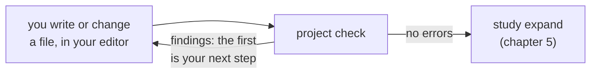

# 4 · Check it

**Role:** manual
**Status:** current; what is not built yet is marked so
**Authority:** none of its own: it shows what femkit does, and the basic
tests run each example and hold it to what femkit prints

`project check` reads every file of a project and says what is wrong, before
anything runs. It changes nothing. Each thing it says is a **finding**, with
the file and the key it is about, and, where femkit can tell, what would be
right. The first finding is always your next step: fix it, check again,
repeat.



To follow along:

```console
$ femkit config set paths.projects '"~/femkit-projects"' --yes
[config set] plan: 1 step
  1. set paths.projects: unset -> ~/femkit-projects
[config set] 1 step; logs in ~/.local/state/femkit/operations/config/20261125T181958.855675Z
[1/1] set paths.projects: unset -> ~/femkit-projects
[config set] set paths.projects: unset -> ~/femkit-projects, in ~/.config/femkit/config.toml
$ femkit project new layers --from two_material --yes
[project new] plan: 3 steps
  1. make the projects root ~/femkit-projects
  2. make the global library ~/femkit-projects/materials, holding a copy of femkit's shipped materials: vacuum
  3. copy 9 files of two_material to ~/femkit-projects/layers
[project new] 3 steps; logs in ~/.local/state/femkit/operations/project-layers/20261125T164931.688852Z
[1/3] make the projects root ~/femkit-projects
[2/3] make the global library ~/femkit-projects/materials, holding a copy of femkit's shipped materials: vacuum
[3/3] copy 9 files of two_material to ~/femkit-projects/layers
[project new] made ~/femkit-projects/layers from two_material: 9 files
  components/slab/component.toml
  components/slab/geometry.py
  materials/dielectric_1/material.toml
  materials/dielectric_2/material.toml
  mesh/uniform.toml
  observables/benchmark.toml
  physics/electrostatics.toml
  project.toml
  studies/benchmark.toml
```

Work inside the project's folder: there, `femkit project check` checks this
project, with no `--project`.

```console
$ cd ~/femkit-projects/layers
```

## A check with nothing wrong

```console
$ femkit project check
[project check] layers: every part loads and checks; 1 note
  part                    file                                  state
  project                 project.toml                          complete
  material:dielectric_1   materials/dielectric_1/material.toml  complete
  material:dielectric_2   materials/dielectric_2/material.toml  complete
  component:slab          components/slab/component.toml        complete
  mesh:uniform            mesh/uniform.toml                     complete
  observables:benchmark   observables/benchmark.toml            complete
  physics:electrostatics  physics/electrostatics.toml           complete
  study:benchmark         studies/benchmark.toml                unchecked
  - whether `left`, `right` and `sides` are each an outer boundary, and `middle` an interface, is checked once the geometry of `slab` is built
      studies/benchmark.toml: component
```

The first line sums up the project. Then each part, one line each, in the
order they build on each other: what it is — `material:dielectric_1` is the
material named `dielectric_1`, `study:benchmark` the study named `benchmark`
— its file, and its **state**:

| state | means |
|---|---|
| `complete` | the file reads, and nothing is wrong with it |
| `findings` | the file reads, and `project check` has findings on it |
| `unloadable` | the file cannot be read; its findings say why |
| `unchecked` | nothing is wrong so far, but something it depends on cannot be checked yet |

Under the table come the findings. Here there is one **note**: whether the
faces the physics puts its conditions on — `left`, `right`, `sides` — are on
the outside of the slab, and whether `middle` lies between two bodies, can
only be seen once the geometry is built. Building the geometry is not built
yet ([plan](../plans/plan.md) § 4, X), so this note stays, and it never
stops a study from expanding.

## Reading a finding

Each finding opens with its mark:

| mark | kind | means |
|---|---|---|
| `x` | **error** | something is wrong: no study that uses this file expands into calculations until it is fixed |
| `!` | **warning** | probably not what you meant, though it stops no calculation but its own: a file femkit ignores, a study the project file does not name |
| `-` | **note** | something to know: what cannot be checked yet, or what was left out |

Errors come first, then warnings, then notes. Under each finding:

- the **file**, from the project's folder, and after the colon the **key**
  in it — `assign.high.material` is the key `material` under the heading
  `[assign.high]`;
- `right:` — what would be right there, written as you would type it in the
  file, when femkit can tell;
- `one of:` — the values that would do, when there is a choice.

Here are four mistakes at once. A new study, written by hand, finer than the
template's — second-degree elements instead of first:

<!-- write ~/femkit-projects/layers/studies/fine.toml -->
```toml
schema = 1
component = "slab"
mesh = "uniform"
observables = ["benchmark"]

[steps.solve]
physics = "electrostatics"
kind = "stationary"

[numerics]
element = { family = "lagrange", degree = 2 }
solver = { kind = "direct" }
```

A misspelled material name:

<!-- edit ~/femkit-projects/layers/components/slab/component.toml -->
```diff
 [assign.high]
 # the material, by name: the project's own, else the global library's; `GLOBAL/` names the global library's
-material = "dielectric_2"
+material = "dielectric2"
```

An observable read at a point, but averaged:

<!-- edit ~/femkit-projects/layers/observables/benchmark.toml -->
```diff
 # the potential halfway through the first layer
 [observables.potential_low]
 # the quantity it reads: a derived quantity of the formulation of the physics a study pairs it with
 quantity = "potential"
 # where it is read, as a point: one length per axis of the component's frame, from its origin; or give `line` or `group` instead
 point = ["interface / 2", "height / 2"]
 # how it is reduced where it is read — a value at a point, the others over a line or a group: one of `value`, `average`, `integral`, `maximum`, `norm`
-reduction = "value"
+reduction = "average"
```

And a file of notes in the project's folder:

<!-- write ~/femkit-projects/layers/notes.txt -->
```text
the finer study: does degree 2 change the energies?
```

```console
$ femkit project check
[project check] layers: 2 errors, 2 warnings, 2 notes; the first is the next step
  part                    file                                  state
  project                 project.toml                          findings
  material:dielectric_1   materials/dielectric_1/material.toml  complete
  material:dielectric_2   materials/dielectric_2/material.toml  complete
  component:slab          components/slab/component.toml        findings
  mesh:uniform            mesh/uniform.toml                     complete
  observables:benchmark   observables/benchmark.toml            findings
  physics:electrostatics  physics/electrostatics.toml           complete
  study:benchmark         studies/benchmark.toml                unchecked
  study:fine              studies/fine.toml                     unchecked
  x no material `dielectric2` in the project's materials/ or in the global library ~/femkit-projects/materials; did you mean `dielectric_2`?
      components/slab/component.toml: assign.high.material
      right: "dielectric_2"
  x `potential_low` is read at a point, where it has one value
      observables/benchmark.toml: observables.potential_low.reduction
      right: "value"
  ! the study `fine` is not named in the project file: it is inert, never expanded into a case
      project.toml: studies
      right: ["benchmark", "fine"]
  ! femkit reads only the project's parts, and this file is none of them; your own files go in custom/
      notes.txt
  - whether `left`, `right` and `sides` are each an outer boundary, and `middle` an interface, is checked once the geometry of `slab` is built
      studies/benchmark.toml: component
  - whether `left`, `right` and `sides` are each an outer boundary, and `middle` an interface, is checked once the geometry of `slab` is built
      studies/fine.toml: component
```

The first error says where femkit looked for the material — in both places
a material can be, the project's `materials/` and your material library —
and gives the closest name it found as `right:`. Fix it:

<!-- edit ~/femkit-projects/layers/components/slab/component.toml -->
```diff
-material = "dielectric2"
+material = "dielectric_2"
```

```console
$ femkit project check
[project check] layers: 1 error, 2 warnings, 2 notes; the first is the next step
  part                    file                                  state
  project                 project.toml                          findings
  material:dielectric_1   materials/dielectric_1/material.toml  complete
  material:dielectric_2   materials/dielectric_2/material.toml  complete
  component:slab          components/slab/component.toml        complete
  mesh:uniform            mesh/uniform.toml                     complete
  observables:benchmark   observables/benchmark.toml            findings
  physics:electrostatics  physics/electrostatics.toml           complete
  study:benchmark         studies/benchmark.toml                unchecked
  study:fine              studies/fine.toml                     unchecked
  x `potential_low` is read at a point, where it has one value
      observables/benchmark.toml: observables.potential_low.reduction
      right: "value"
  ! the study `fine` is not named in the project file: it is inert, never expanded into a case
      project.toml: studies
      right: ["benchmark", "fine"]
  ! femkit reads only the project's parts, and this file is none of them; your own files go in custom/
      notes.txt
  - whether `left`, `right` and `sides` are each an outer boundary, and `middle` an interface, is checked once the geometry of `slab` is built
      studies/benchmark.toml: component
  - whether `left`, `right` and `sides` are each an outer boundary, and `middle` an interface, is checked once the geometry of `slab` is built
      studies/fine.toml: component
```

Now the first is the observable: at a point there is one value, so `right:`
says `"value"`. The warning after it says the new study is not named in the
project file, so it would never be used — never turned into calculations,
which femkit calls **cases** (chapter 5) — and `right:` gives the whole list
to write. The second warning is the notes file: femkit reads only the files
a project is made of, and your own files go in `custom/`. Fix all three:

<!-- edit ~/femkit-projects/layers/observables/benchmark.toml -->
```diff
-reduction = "average"
+reduction = "value"
```

<!-- edit ~/femkit-projects/layers/project.toml -->
```diff
 # the project's studies, by name: each the file `studies/<name>.toml`
-studies = ["benchmark"]
+studies = ["benchmark", "fine"]
```

```console
$ mkdir custom
$ mv notes.txt custom/
$ femkit project check
[project check] layers: every part loads and checks; 2 notes
  part                    file                                  state
  project                 project.toml                          complete
  material:dielectric_1   materials/dielectric_1/material.toml  complete
  material:dielectric_2   materials/dielectric_2/material.toml  complete
  component:slab          components/slab/component.toml        complete
  mesh:uniform            mesh/uniform.toml                     complete
  observables:benchmark   observables/benchmark.toml            complete
  physics:electrostatics  physics/electrostatics.toml           complete
  study:benchmark         studies/benchmark.toml                unchecked
  study:fine              studies/fine.toml                     unchecked
  - whether `left`, `right` and `sides` are each an outer boundary, and `middle` an interface, is checked once the geometry of `slab` is built
      studies/benchmark.toml: component
  - whether `left`, `right` and `sides` are each an outer boundary, and `middle` an interface, is checked once the geometry of `slab` is built
      studies/fine.toml: component
```

Only the notes are left, one for each study.

## A file that does not read

A file that is not valid TOML — here a value whose closing quote is missing —
cannot be read at all. The finding gives its line, and what is checked
against that file waits until it reads — each study that uses
`mesh:uniform`, written as in the table, the mesh recipe `uniform`, says so
in a note:

<!-- edit ~/femkit-projects/layers/mesh/uniform.toml -->
```diff
 # the largest element size anywhere: a length
-size = "0.25 m"
+size = "0.25 m
```

```console
$ femkit project check
[project check] layers: 1 error, 4 notes; the first is the next step
  part                    file                                  state
  project                 project.toml                          complete
  material:dielectric_1   materials/dielectric_1/material.toml  complete
  material:dielectric_2   materials/dielectric_2/material.toml  complete
  component:slab          components/slab/component.toml        complete
  mesh:uniform            mesh/uniform.toml                     unloadable
  observables:benchmark   observables/benchmark.toml            complete
  physics:electrostatics  physics/electrostatics.toml           complete
  study:benchmark         studies/benchmark.toml                unchecked
  study:fine              studies/fine.toml                     unchecked
  x line 9: a quoted text is not closed before the line ends
      mesh/uniform.toml
  - what the study pairs with `mesh:uniform` is checked once that file loads
      studies/benchmark.toml: mesh
  - whether `left`, `right` and `sides` are each an outer boundary, and `middle` an interface, is checked once the geometry of `slab` is built
      studies/benchmark.toml: component
  - what the study pairs with `mesh:uniform` is checked once that file loads
      studies/fine.toml: mesh
  - whether `left`, `right` and `sides` are each an outer boundary, and `middle` an interface, is checked once the geometry of `slab` is built
      studies/fine.toml: component
```

<!-- edit ~/femkit-projects/layers/mesh/uniform.toml -->
```diff
 # the largest element size anywhere: a length
-size = "0.25 m
+size = "0.25 m"
```

Every other file is still read and checked: one broken file never hides the
findings in the others.

## The project as a graph — `project graph`

`project graph` shows how the files name each other: every part, every
named thing inside it, and every **wire** — a place where one file names
another, or uses a parameter. The Laplace template, the smaller of the two —
from inside `layers`, another project is named with `--project`:

```console
$ femkit project new square --from laplace_square --yes
[project new] plan: 1 step
  1. copy 8 files of laplace_square to ~/femkit-projects/square
[project new] 1 step; logs in ~/.local/state/femkit/operations/project-square/20261125T164935.517501Z
[1/1] copy 8 files of laplace_square to ~/femkit-projects/square
[project new] made ~/femkit-projects/square from laplace_square: 8 files
  components/square/component.toml
  components/square/geometry.py
  materials/vacuum/material.toml
  mesh/uniform.toml
  observables/midpoint.toml
  physics/electrostatics.toml
  project.toml
  studies/check.toml
$ femkit project graph --project square
[project graph] square: 26 nodes, 10 wires
  node                                               kind                         state      findings
  project                                            project                      complete
  project:parameters.side                            parameter
  project:parameters.bias                            parameter
  material:vacuum                                    material                     complete
  material:vacuum:properties.relative_permittivity   property
  component:square                                   component                    complete
  component:square:frame                             frame
  component:square:inputs.parameters.side            input
  component:square:groups.domain                     group
  component:square:groups.left                       group
  component:square:groups.right                      group
  component:square:groups.sides                      group
  component:square:assign.domain                     assignment
  mesh:uniform                                       mesh                         complete
  observables:midpoint                               observables                  complete
  observables:midpoint:observables.potential_middle  observable: potential
  physics:electrostatics                             physics                      complete
  physics:electrostatics:conditions.left             condition: potential
  physics:electrostatics:conditions.right            condition: potential
  physics:electrostatics:conditions.sides            condition: insulating
  study:check                                        study                        unchecked  1
  study:check:steps.solve                            step: stationary
  study:check:numerics                               numerics
  study:check:axes."mesh:uniform:size"               axis: numerical convergence
  study:check:environments.elmer                     binding
  study:check:environments.ngsolve                   binding
  from                                               to                       written at
  project                                            component:square         project:components
  project                                            study:check              project:studies
  component:square                                   project:parameters.side  component:square:inputs.parameters
  component:square:assign.domain                     material:vacuum          component:square:assign.domain.material
  observables:midpoint:observables.potential_middle  project:parameters.side  observables:midpoint:observables.potential_middle.point
  physics:electrostatics:conditions.right            project:parameters.bias  physics:electrostatics:conditions.right.value
  study:check                                        component:square         study:check:component
  study:check                                        mesh:uniform             study:check:mesh
  study:check                                        observables:midpoint     study:check:observables
  study:check:steps.solve                            physics:electrostatics   study:check:steps.solve.physics
```

Each line of the first table is one **node** — a part, or a thing inside
it, named by its part and its key — with its kind, its state, and how many
findings it has: `study:check:steps.solve` is the step `solve` of the study
`check`; a `binding` is a study's settings for one engine, from its
`[environments]`. Each line of the second is one wire: from the thing that
names, to the thing named, and the key where the name is written.

`--mermaid` prints the same graph as a Mermaid diagram, to paste into a
Markdown file between ` ```mermaid ` fences — GitHub, and many editors,
draw it:

```console
$ femkit project graph --project square --mermaid
flowchart LR
    subgraph n0box["project"]
        n0["project<br/>project"]
        n1["side<br/>parameter"]
        n2["bias<br/>parameter"]
    end
    subgraph n3box["material:vacuum"]
        n3["vacuum<br/>material"]
        n4["relative_permittivity<br/>property"]
    end
    subgraph n5box["component:square"]
        n5["square<br/>component"]
        n6["frame<br/>frame"]
        n7["side<br/>input"]
        n8["domain<br/>group"]
        n9["left<br/>group"]
        n10["right<br/>group"]
        n11["sides<br/>group"]
        n12["domain<br/>assignment"]
    end
    n13["uniform<br/>mesh"]
    subgraph n14box["observables:midpoint"]
        n14["midpoint<br/>observables"]
        n15["potential_middle<br/>observable: potential"]
    end
    subgraph n16box["physics:electrostatics"]
        n16["electrostatics<br/>physics"]
        n17["left<br/>condition: potential"]
        n18["right<br/>condition: potential"]
        n19["sides<br/>condition: insulating"]
    end
    subgraph n20box["study:check"]
        n20["check<br/>study (1 finding)"]
        n21["solve<br/>step: stationary"]
        n22["numerics<br/>numerics"]
        n23["mesh:uniform:size<br/>axis: numerical convergence"]
        n24["elmer<br/>binding"]
        n25["ngsolve<br/>binding"]
    end
    n0 -->|components| n5
    n0 -->|studies| n20
    n5 -->|inputs.parameters| n1
    n12 -->|material| n3
    n15 --> n1
    n18 --> n2
    n20 -->|component| n5
    n20 -->|mesh| n13
    n20 -->|observables| n14
    n21 -->|physics| n16
```
