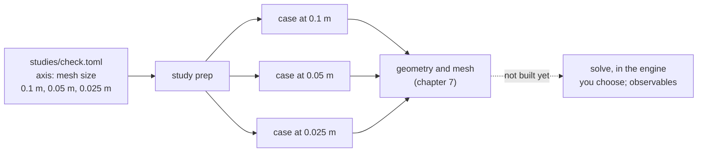

# 5 · Studies and cases

**Role:** manual
**Status:** current; what is not built yet is marked so
**Authority:** none of its own: it shows what femkit does, and the basic
tests run each example and hold it to what femkit prints

A **study** says what to solve and what to vary. A **case** is one
calculation: your study's settings at one point of its sweep. `study prep`
writes one file for each case, holding everything that calculation needs and
nothing else, so a case can be run, compared and repeated on its own.



To follow along:

```console
$ femkit config set paths.projects '"~/femkit-projects"' --yes
[config set] plan: 1 step
  1. set paths.projects: unset -> ~/femkit-projects
[config set] 1 step; logs in ~/.local/state/femkit/operations/config/20261125T182005.472539Z
[1/1] set paths.projects: unset -> ~/femkit-projects
[config set] set paths.projects: unset -> ~/femkit-projects, in ~/.config/femkit/config.toml
$ femkit project new square --from laplace_square --yes
[project new] plan: 3 steps
  1. make the projects root ~/femkit-projects
  2. make the global library ~/femkit-projects/materials, holding a copy of femkit's shipped materials: vacuum
  3. copy 10 files of laplace_square to ~/femkit-projects/square
[project new] 3 steps; logs in ~/.local/state/femkit/operations/project-square/20261128T040312.731096Z
[1/3] make the projects root ~/femkit-projects
[2/3] make the global library ~/femkit-projects/materials, holding a copy of femkit's shipped materials: vacuum
[3/3] copy 10 files of laplace_square to ~/femkit-projects/square
[project new] made ~/femkit-projects/square from laplace_square: 10 files
  copied
  components/square/component.toml
  components/square/geometry.py
  definitions.py
  materials/vacuum/material.toml
  mesh/uniform.toml
  observables/midpoint/observables.toml
  observables/midpoint/observe.py
  physics/electrostatics.toml
  project.toml
  studies/check.toml
next -- check the new project, as any other:
    femkit project check --project square
```

## A project's studies — `study list`

```console
$ femkit study list --project square
[study list] square: 1 study
  study  prep can make its cases  cases  engines that can solve it  why not
  check  yes                      3      elmer, ngsolve
next -- what the parts' states allow:
    femkit study prep --project square check --engine ENGINE   # make its cases, geometries and meshes, and the jobs that make them
```

The Laplace template's study `check` varies one thing — the mesh size,
three values — so it makes three cases, which Elmer and NGSolve can both
solve: the engines that take its mesh (below). `study prep` can make a
study's cases when nothing it uses has an error (chapter 4); when it cannot,
`study list` says why.

## Writing the cases — `study prep`

```console
$ femkit study prep check --project square --dry-run
[study prep] plan: 3 steps
  1. write cases/check/a7bd2bbbd624…/case.json: mesh:uniform:size = 0.1 m
  2. write cases/check/bbcdf9cfa4fa…/case.json: mesh:uniform:size = 0.05 m
  3. write cases/check/d69ecd997718…/case.json: mesh:uniform:size = 0.025 m
check: 3 cases to write, 0 kept
  case                                                              point                        written
  a7bd2bbbd6240462207b1fd80387c174672506d512c01c0f09c8ef07ddbc2fb7  mesh:uniform:size = 0.1 m    to write
  bbcdf9cfa4fae5c404e6ee6489f806560e4bcba96614d8521f41bd003dd056bb  mesh:uniform:size = 0.05 m   to write
  d69ecd9977189415ff0e6960c048165d1a2656159b2e7dde8ead86016bb22ceb  mesh:uniform:size = 0.025 m  to write
  - no engine is chosen for the study check: its cases, geometries and meshes serve every engine, and the engine is chosen when the study is solved
      studies/check.toml
      femkit study prep --project square check --engine ENGINE
  ! its stages wait: there is no record of this machine in ~/.config/femkit/machines
      femkit config init   # asks for activation.preamble and activation.command
      femkit job probe --write   # measure this machine, and write its record
```

Each case is named by its content's SHA-256 fingerprint — 64 characters,
often shown by its first twelve and `…` — so two cases with the same content
always have the same name, and a case's name changes whenever anything in it
does. Each step of the plan says where a case is written and its **point**:
the value of each axis there, here the mesh recipe `uniform`'s `size`.

```console
$ femkit study prep check --project square --yes
[study prep] plan: 3 steps
  1. write cases/check/a7bd2bbbd624…/case.json: mesh:uniform:size = 0.1 m
  2. write cases/check/bbcdf9cfa4fa…/case.json: mesh:uniform:size = 0.05 m
  3. write cases/check/d69ecd997718…/case.json: mesh:uniform:size = 0.025 m
[study prep] 3 steps; logs in ~/.local/state/femkit/operations/project-square/20261128T070138.840639Z
[1/3] write cases/check/a7bd2bbbd624…/case.json: mesh:uniform:size = 0.1 m
[2/3] write cases/check/bbcdf9cfa4fa…/case.json: mesh:uniform:size = 0.05 m
[3/3] write cases/check/d69ecd997718…/case.json: mesh:uniform:size = 0.025 m
[study prep] check: 3 cases written, 0 kept
  case                                                              point                        written
  a7bd2bbbd6240462207b1fd80387c174672506d512c01c0f09c8ef07ddbc2fb7  mesh:uniform:size = 0.1 m    now
  bbcdf9cfa4fae5c404e6ee6489f806560e4bcba96614d8521f41bd003dd056bb  mesh:uniform:size = 0.05 m   now
  d69ecd9977189415ff0e6960c048165d1a2656159b2e7dde8ead86016bb22ceb  mesh:uniform:size = 0.025 m  now
  - no engine is chosen for the study check: its cases, geometries and meshes serve every engine, and the engine is chosen when the study is solved
      studies/check.toml
      femkit study prep --project square check --engine ENGINE
  ! its stages wait: there is no record of this machine in ~/.config/femkit/machines
      femkit config init   # asks for activation.preamble and activation.command
      femkit job probe --write   # measure this machine, and write its record
$ ls ~/femkit-projects/square/cases/check
a7bd2bbbd6240462207b1fd80387c174672506d512c01c0f09c8ef07ddbc2fb7
bbcdf9cfa4fae5c404e6ee6489f806560e4bcba96614d8521f41bd003dd056bb
d69ecd9977189415ff0e6960c048165d1a2656159b2e7dde8ead86016bb22ceb
```

Prep wrote the cases and went no further: a case needs no machine, but the
geometry and mesh each case needs are made for one, and this session has no
record of it yet — they wait, and the steps under the line that says so write it
(chapter 7).

Each case is one folder holding `case.json`: the component — its script's
fingerprint, the definitions it is handed, its groups — and each body's
material data; the physics of each step; the mesh recipe; the numerics; and
the point. Every number in it is written exactly, as a whole number or a
fraction in SI base units — angles in degrees — so the 0.1 m of the mesh
size is `"1/10"` with the dimension of a length. What is read from a case —
its observables —, the engine that solves it and the resources each job
asks for are not part of it: the same case is the same calculation whatever
you read from it, whichever solver solves it, and wherever it runs. Every key of `case.json` is in the
[cases reference](../reference/cases.md).

The outcome lists each case by its whole name, `written` `now`. Prepping
again writes only the cases the study does not have yet — here, none; the
three it has are **kept**, written `before`:

```console
$ femkit study prep check --project square --yes
[study prep] check: 0 cases written, 3 kept
  case                                                              point                        written
  a7bd2bbbd6240462207b1fd80387c174672506d512c01c0f09c8ef07ddbc2fb7  mesh:uniform:size = 0.1 m    before
  bbcdf9cfa4fae5c404e6ee6489f806560e4bcba96614d8521f41bd003dd056bb  mesh:uniform:size = 0.05 m   before
  d69ecd9977189415ff0e6960c048165d1a2656159b2e7dde8ead86016bb22ceb  mesh:uniform:size = 0.025 m  before
  - no engine is chosen for the study check: its cases, geometries and meshes serve every engine, and the engine is chosen when the study is solved
      studies/check.toml
      femkit study prep --project square check --engine ENGINE
  ! its stages wait: there is no record of this machine in ~/.config/femkit/machines
      femkit config init   # asks for activation.preamble and activation.command
      femkit job probe --write   # measure this machine, and write its record
```

## The cases — `case list`

```console
$ femkit case list --project square
[case list] square: 3 cases written
check: 3 cases written; makes 3 cases
  case          point                        made now
  a7bd2bbbd624  mesh:uniform:size = 0.1 m    yes
  bbcdf9cfa4fa  mesh:uniform:size = 0.05 m   yes
  d69ecd997718  mesh:uniform:size = 0.025 m  yes
  case          body    material  found now  property               dataset     source                                                                                                                               changed since
  a7bd2bbbd624  domain  vacuum    vacuum     relative_permittivity  definition  the definition of vacuum: its permittivity is the vacuum electric permittivity ε0 itself, so its relative permittivity is exactly 1
  bbcdf9cfa4fa  domain  vacuum    vacuum     relative_permittivity  definition  the definition of vacuum: its permittivity is the vacuum electric permittivity ε0 itself, so its relative permittivity is exactly 1
  d69ecd997718  domain  vacuum    vacuum     relative_permittivity  definition  the definition of vacuum: its permittivity is the vacuum electric permittivity ε0 itself, so its relative permittivity is exactly 1
next -- what the parts' states allow:
    femkit study prep --project square check --engine ENGINE   # make its cases, geometries and meshes, and the jobs that make them
```

For each study, the first table lists its cases in the order of their
points — each by the start of its name — and whether the study, as it is
written now, still makes it (`made now`). The second table shows, for each
case, the material that fills each body, where that material is found now
(`found now`: the project's own, or your library's, `GLOBAL/…`), the dataset
and source the case used, and what of that data has changed since the case
was written (`changed since`; empty here, and chapter 6 shows one).

## A changed file makes new cases

A case holds the data it was made from, so changing that data — a mesh
setting, a definition, a material's value, the geometry script itself — makes
new cases, and the old ones are kept. Make the mesh follow curved surfaces,
second order:

<!-- edit ~/femkit-projects/square/mesh/uniform.toml -->
```diff
 # the geometry order — how closely elements follow a curved surface, 2 bending them to it: one of `1`, `2`
-order = 1
+order = 2
```

```console
$ femkit case list --project square
[case list] square: 3 cases written
check: 3 cases written; makes 3 cases
  case          point                        made now
  a7bd2bbbd624  mesh:uniform:size = 0.1 m    no
  bbcdf9cfa4fa  mesh:uniform:size = 0.05 m   no
  d69ecd997718  mesh:uniform:size = 0.025 m  no
  case          body    material  found now  property               dataset     source                                                                                                                               changed since
  a7bd2bbbd624  domain  vacuum    vacuum     relative_permittivity  definition  the definition of vacuum: its permittivity is the vacuum electric permittivity ε0 itself, so its relative permittivity is exactly 1
  bbcdf9cfa4fa  domain  vacuum    vacuum     relative_permittivity  definition  the definition of vacuum: its permittivity is the vacuum electric permittivity ε0 itself, so its relative permittivity is exactly 1
  d69ecd997718  domain  vacuum    vacuum     relative_permittivity  definition  the definition of vacuum: its permittivity is the vacuum electric permittivity ε0 itself, so its relative permittivity is exactly 1
next -- what the parts' states allow:
    femkit study prep --project square check --engine ENGINE   # make its cases, geometries and meshes, and the jobs that make them
```

The three cases are still there, and the study no longer makes them
(`made now: no`). Prep writes three new ones:

```console
$ femkit study prep check --project square --yes
[study prep] plan: 3 steps
  1. write cases/check/13a5439fd21e…/case.json: mesh:uniform:size = 0.1 m
  2. write cases/check/2bff5151ec95…/case.json: mesh:uniform:size = 0.05 m
  3. write cases/check/17ff03155bd8…/case.json: mesh:uniform:size = 0.025 m
[study prep] 3 steps; logs in ~/.local/state/femkit/operations/project-square/20261128T070143.929619Z
[1/3] write cases/check/13a5439fd21e…/case.json: mesh:uniform:size = 0.1 m
[2/3] write cases/check/2bff5151ec95…/case.json: mesh:uniform:size = 0.05 m
[3/3] write cases/check/17ff03155bd8…/case.json: mesh:uniform:size = 0.025 m
[study prep] check: 3 cases written, 0 kept
  case                                                              point                        written
  13a5439fd21e3caf93ecbac01e7a01482fa444578689704d3acf17c638b47a00  mesh:uniform:size = 0.1 m    now
  2bff5151ec9561cef5a4fe11d08cb7d88c190916a98b834c0eb2926aaa6342ef  mesh:uniform:size = 0.05 m   now
  17ff03155bd8f72cd60c2e6f6ee7ff6ed613dbe433d7a60fa5f652438c0c1e96  mesh:uniform:size = 0.025 m  now
  - no engine is chosen for the study check: its cases, geometries and meshes serve every engine, and the engine is chosen when the study is solved
      studies/check.toml
      femkit study prep --project square check --engine ENGINE
  ! its stages wait: there is no record of this machine in ~/.config/femkit/machines
      femkit config init   # asks for activation.preamble and activation.command
      femkit job probe --write   # measure this machine, and write its record
$ femkit case list --project square
[case list] square: 6 cases written
check: 6 cases written; makes 3 cases
  case          point                        made now
  13a5439fd21e  mesh:uniform:size = 0.1 m    yes
  2bff5151ec95  mesh:uniform:size = 0.05 m   yes
  17ff03155bd8  mesh:uniform:size = 0.025 m  yes
  a7bd2bbbd624  mesh:uniform:size = 0.1 m    no
  bbcdf9cfa4fa  mesh:uniform:size = 0.05 m   no
  d69ecd997718  mesh:uniform:size = 0.025 m  no
  case          body    material  found now  property               dataset     source                                                                                                                               changed since
  13a5439fd21e  domain  vacuum    vacuum     relative_permittivity  definition  the definition of vacuum: its permittivity is the vacuum electric permittivity ε0 itself, so its relative permittivity is exactly 1
  2bff5151ec95  domain  vacuum    vacuum     relative_permittivity  definition  the definition of vacuum: its permittivity is the vacuum electric permittivity ε0 itself, so its relative permittivity is exactly 1
  17ff03155bd8  domain  vacuum    vacuum     relative_permittivity  definition  the definition of vacuum: its permittivity is the vacuum electric permittivity ε0 itself, so its relative permittivity is exactly 1
  a7bd2bbbd624  domain  vacuum    vacuum     relative_permittivity  definition  the definition of vacuum: its permittivity is the vacuum electric permittivity ε0 itself, so its relative permittivity is exactly 1
  bbcdf9cfa4fa  domain  vacuum    vacuum     relative_permittivity  definition  the definition of vacuum: its permittivity is the vacuum electric permittivity ε0 itself, so its relative permittivity is exactly 1
  d69ecd997718  domain  vacuum    vacuum     relative_permittivity  definition  the definition of vacuum: its permittivity is the vacuum electric permittivity ε0 itself, so its relative permittivity is exactly 1
next -- what the parts' states allow:
    femkit study prep --project square check --engine ENGINE   # make its cases, geometries and meshes, and the jobs that make them
```

Prep never deletes a case: the old ones stay, each marked `no`, so
nothing made from them is lost.

## Several axes, and why they cross

A study can vary several things; each is an **axis**, and every value of
each axis is combined with every value of the others. Each axis says why it
varies — `numerical convergence` (the mesh, the element degree, a
tolerance), `geometry convergence` (a length of the model that stands for a
longer one), or `physical sweep` (a definition of the physics, a material's
dataset). Combining axes of different reasons multiplies the number of
cases, so femkit asks you to say why the full combination is needed.

The two-material template's study has no axis. Vary where the two
materials meet, and the mesh size with it, in `benchmark`:

```console
$ femkit project new layers --from two_material --yes
[project new] plan: 1 step
  1. copy 11 files of two_material to ~/femkit-projects/layers
[project new] 1 step; logs in ~/.local/state/femkit/operations/project-layers/20261128T040323.172740Z
[1/1] copy 11 files of two_material to ~/femkit-projects/layers
[project new] made ~/femkit-projects/layers from two_material: 11 files
  copied
  components/slab/component.toml
  components/slab/geometry.py
  definitions.py
  materials/dielectric_1/material.toml
  materials/dielectric_2/material.toml
  mesh/uniform.toml
  observables/benchmark/observables.toml
  observables/benchmark/observe.py
  physics/electrostatics.toml
  project.toml
  studies/benchmark.toml
next -- check the new project, as any other:
    femkit project check --project layers
```

<!-- edit ~/femkit-projects/layers/studies/benchmark.toml -->
```diff
 # what varies, each axis keyed by the address of what it varies — a definition written as its value, `project:definitions.side`; a value of the mesh recipe, `mesh:uniform:size`; a numerics field; or a material's dataset — every axis crossed with every other, but those a group steps together, which cross as one; a value one formula gives is that formula, not an axis (manual: 3 · Write each part)
-# [axes]
+[axes]
+
+[axes."project:definitions.interface"]
+class = "physical sweep"
+values = [0.25, 0.5, 0.75]
+unit = "m"
+
+[axes."mesh:uniform:size"]
+class = "numerical convergence"
+values = [0.25, 0.125]
+unit = "m"
```

```console
$ femkit project check --project layers
[project check] layers: 1 error, 1 note; the first is the next step
  section      part                    file                                    state     engines that can solve it
  Definitions  project                 project.toml                            complete
  Definitions  material:dielectric_1   materials/dielectric_1/material.toml    complete
  Definitions  material:dielectric_2   materials/dielectric_2/material.toml    complete
  Component    component:slab          components/slab/component.toml          complete
  Physics      physics:electrostatics  physics/electrostatics.toml             complete
  Mesh         mesh:uniform            mesh/uniform.toml                       complete
  Study        study:benchmark         studies/benchmark.toml                  errors    elmer, ngsolve
  Results      observables:benchmark   observables/benchmark/observables.toml  complete
  x what is crossed holds axes of 2 classes (numerical convergence, physical sweep), with no `[crossing]` saying why their full product is needed
      studies/benchmark.toml: crossing
  - whether `left`, `right` and `sides` are each an outer boundary, and `middle` an interface, is checked once the geometry of `slab` is built
      studies/benchmark.toml, line 13: component
$ femkit study prep benchmark --project layers --yes
  x what is crossed holds axes of 2 classes (numerical convergence, physical sweep), with no `[crossing]` saying why their full product is needed
      studies/benchmark.toml: crossing
[study prep] refused: the parts `study:benchmark` uses have findings to resolve
next -- instead:
    femkit project check --project layers
```

The study is refused until the error is fixed: the refusal shows the
findings it rests on first, each at its file and key, then names the part
that has them — `study:benchmark`, the study `benchmark` — and the command
that shows them all. The template already holds the `[crossing]` to write,
commented out; uncomment it:

<!-- edit ~/femkit-projects/layers/studies/benchmark.toml -->
```diff
 # when what is crossed holds axes of more than one class: every axis, and why their full product is needed
-# [crossing]
+[crossing]
 # the address of every axis of the study
-# axes = ["project:definitions.interface", "mesh:uniform:size"]
+axes = ["project:definitions.interface", "mesh:uniform:size"]
 # why the full product is needed, in a sentence
-# reason = "the potential on the interface must be shown converged wherever the interface lies"
+reason = "the potential on the interface must be shown converged wherever the interface lies"
```

```console
$ femkit study list --project layers
[study list] layers: 1 study
  study      prep can make its cases  cases  engines that can solve it  why not
  benchmark  yes                      6      elmer, ngsolve
next -- what the parts' states allow:
    femkit study prep --project layers benchmark --engine ENGINE   # make its cases, geometries and meshes, and the jobs that make them
$ femkit study prep benchmark --project layers --dry-run
[study prep] plan: 6 steps
  1. write cases/benchmark/4938b60f840c…/case.json: project:definitions.interface = 0.25 m, mesh:uniform:size = 0.25 m
  2. write cases/benchmark/6379ae5e8f97…/case.json: project:definitions.interface = 0.25 m, mesh:uniform:size = 0.125 m
  3. write cases/benchmark/9e3e4dd59600…/case.json: project:definitions.interface = 0.5 m, mesh:uniform:size = 0.25 m
  4. write cases/benchmark/dc1988174666…/case.json: project:definitions.interface = 0.5 m, mesh:uniform:size = 0.125 m
  5. write cases/benchmark/e4bacdc020b6…/case.json: project:definitions.interface = 0.75 m, mesh:uniform:size = 0.25 m
  6. write cases/benchmark/26caf755afc5…/case.json: project:definitions.interface = 0.75 m, mesh:uniform:size = 0.125 m
benchmark: 6 cases to write, 0 kept
  case                                                              point                                                                written
  4938b60f840c8267f85b299fde39c447e3baa99fe1e394af10357fd49e5d20d7  project:definitions.interface = 0.25 m, mesh:uniform:size = 0.25 m   to write
  6379ae5e8f97b454dc23459a1558fbbafb7212958c6b751a3bf4f46d637363bf  project:definitions.interface = 0.25 m, mesh:uniform:size = 0.125 m  to write
  9e3e4dd59600bb6f248be6a2c17071db2debbe8687e194b12cdf786f1ab0ff88  project:definitions.interface = 0.5 m, mesh:uniform:size = 0.25 m    to write
  dc19881746661d0990b26a5fb4573ac378f55aad35d2d3150c565fa2bb5cc3a5  project:definitions.interface = 0.5 m, mesh:uniform:size = 0.125 m   to write
  e4bacdc020b6372ee411f82e28842392e9f167c9d4868b588fe0615830ea5684  project:definitions.interface = 0.75 m, mesh:uniform:size = 0.25 m   to write
  26caf755afc5a949638ae8105407227fde33bca5522df664322bd049ddeba814  project:definitions.interface = 0.75 m, mesh:uniform:size = 0.125 m  to write
  - no engine is chosen for the study benchmark: its cases, geometries and meshes serve every engine, and the engine is chosen when the study is solved
      studies/benchmark.toml
      femkit study prep --project layers benchmark --engine ENGINE
  ! its stages wait: there is no record of this machine in ~/.config/femkit/machines
      femkit config init   # asks for activation.preamble and activation.command
      femkit job probe --write   # measure this machine, and write its record
```

Three positions of the interface, each at two mesh sizes: six cases. When the interface moves, everything that uses
it moves with it: the geometry script is handed `interface` at each case's
value, and the observable `potential_middle`, whose function reads
`case.defs.interface`, reads the potential on the interface wherever it
lies.

## The engine that solves them — `--engine`

A study names no solver. You choose the one that solves its cases when you
prep it, `--engine elmer` or `--engine ngsolve`, and you may choose the
other at any time: every engine solves the same cases, from the study's one
set of geometries and meshes (chapter 7), and what each engine makes of
them is kept apart. Prep without `--engine` makes the cases, geometries and
meshes as above, and says in a note that they serve every engine and that
the engine is chosen when the study is solved, with the command that
chooses it. With `--engine`, prep checks that the engine takes the study's
mesh, writes what prep without it writes, and says the study is prepared
for that engine — and that solving it is not built yet:

```console
$ femkit study prep benchmark --project layers --engine ngsolve --yes
[study prep] plan: 6 steps
  1. write cases/benchmark/4938b60f840c…/case.json: project:definitions.interface = 0.25 m, mesh:uniform:size = 0.25 m
  2. write cases/benchmark/6379ae5e8f97…/case.json: project:definitions.interface = 0.25 m, mesh:uniform:size = 0.125 m
  3. write cases/benchmark/9e3e4dd59600…/case.json: project:definitions.interface = 0.5 m, mesh:uniform:size = 0.25 m
  4. write cases/benchmark/dc1988174666…/case.json: project:definitions.interface = 0.5 m, mesh:uniform:size = 0.125 m
  5. write cases/benchmark/e4bacdc020b6…/case.json: project:definitions.interface = 0.75 m, mesh:uniform:size = 0.25 m
  6. write cases/benchmark/26caf755afc5…/case.json: project:definitions.interface = 0.75 m, mesh:uniform:size = 0.125 m
[study prep] 6 steps; logs in ~/.local/state/femkit/operations/project-layers/20261128T070151.684564Z
[1/6] write cases/benchmark/4938b60f840c…/case.json: project:definitions.interface = 0.25 m, mesh:uniform:size = 0.25 m
[2/6] write cases/benchmark/6379ae5e8f97…/case.json: project:definitions.interface = 0.25 m, mesh:uniform:size = 0.125 m
[3/6] write cases/benchmark/9e3e4dd59600…/case.json: project:definitions.interface = 0.5 m, mesh:uniform:size = 0.25 m
[4/6] write cases/benchmark/dc1988174666…/case.json: project:definitions.interface = 0.5 m, mesh:uniform:size = 0.125 m
[5/6] write cases/benchmark/e4bacdc020b6…/case.json: project:definitions.interface = 0.75 m, mesh:uniform:size = 0.25 m
[6/6] write cases/benchmark/26caf755afc5…/case.json: project:definitions.interface = 0.75 m, mesh:uniform:size = 0.125 m
[study prep] benchmark: 6 cases written, 0 kept
benchmark is prepared for ngsolve; solving it is not built yet
  case                                                              point                                                                written
  4938b60f840c8267f85b299fde39c447e3baa99fe1e394af10357fd49e5d20d7  project:definitions.interface = 0.25 m, mesh:uniform:size = 0.25 m   now
  6379ae5e8f97b454dc23459a1558fbbafb7212958c6b751a3bf4f46d637363bf  project:definitions.interface = 0.25 m, mesh:uniform:size = 0.125 m  now
  9e3e4dd59600bb6f248be6a2c17071db2debbe8687e194b12cdf786f1ab0ff88  project:definitions.interface = 0.5 m, mesh:uniform:size = 0.25 m    now
  dc19881746661d0990b26a5fb4573ac378f55aad35d2d3150c565fa2bb5cc3a5  project:definitions.interface = 0.5 m, mesh:uniform:size = 0.125 m   now
  e4bacdc020b6372ee411f82e28842392e9f167c9d4868b588fe0615830ea5684  project:definitions.interface = 0.75 m, mesh:uniform:size = 0.25 m   now
  26caf755afc5a949638ae8105407227fde33bca5522df664322bd049ddeba814  project:definitions.interface = 0.75 m, mesh:uniform:size = 0.125 m  now
  ! its stages wait: there is no record of this machine in ~/.config/femkit/machines
      femkit config init   # asks for activation.preamble and activation.command
      femkit job probe --write   # measure this machine, and write its record
```

An engine femkit does not have is refused, with the one you may mean:

```console
$ femkit study prep benchmark --project layers --engine elmr --dry-run
[study prep] refused: `elmr` is no engine femkit solves with: elmer, ngsolve; did you mean `elmer`?
next -- instead:
    femkit study prep --project layers benchmark --engine elmer
    femkit study prep --project layers benchmark --engine ngsolve
```

Checking one solver against the other — the same case solved by each, the
two answers compared — is how you catch a mistake in either. It is an
analysis of the two engines' solves of one study, case by case, not built
yet ([plan](../plans/plan.md) § 4, M9). Both engines solve the one mesh the
study's recipe makes, wherever both take it; NGSolve at `order = 2` needs
its own mesher, Netgen, not built yet, and whether Elmer can take Netgen's
mesh is not known yet (chapter 3, *Curved surfaces*).

## What happens next

Each case's geometry and mesh are made by the jobs `study prep` writes
(chapter 7). Solving a case in the engine you choose is not built yet
([plan](../plans/plan.md) § 4, M6); nor is checking a study against what an
engine can do (§ 4, M5), nor running its observables (§ 4, M6). The cases
you write today are the ones those steps will run.
