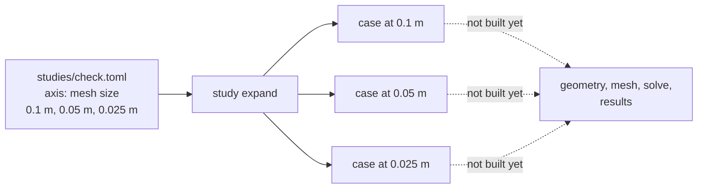

# 5 · Studies and cases

**Role:** manual
**Status:** current; what is not built yet is marked so
**Authority:** none of its own: it shows what femkit does, and the basic
tests run each example and hold it to what femkit prints

A **study** says what to solve and what to vary. A **case** is one
calculation: your study's settings at one point of its sweep. `study expand`
writes one file for each case, holding everything that calculation needs and
nothing else, so a case can be run, compared and repeated on its own.



To follow along:

```console
$ femkit config set paths.projects '"~/femkit-projects"' --yes
[config set] plan: 1 step
  1. set paths.projects: unset -> ~/femkit-projects
[config set] 1 step; logs in ~/.local/state/femkit/operations/config/20261125T182005.472539Z
[1/1] set paths.projects: unset -> ~/femkit-projects
[config set] set paths.projects: unset -> ~/femkit-projects, in ~/.config/femkit/config.toml
$ femkit project new square --from laplace_square --yes
[project new] plan: 3 steps
  1. make the projects root ~/femkit-projects
  2. make the global library ~/femkit-projects/materials, holding a copy of femkit's shipped materials: vacuum
  3. copy 8 files of laplace_square to ~/femkit-projects/square
[project new] 3 steps; logs in ~/.local/state/femkit/operations/project-square/20261125T165020.062847Z
[1/3] make the projects root ~/femkit-projects
[2/3] make the global library ~/femkit-projects/materials, holding a copy of femkit's shipped materials: vacuum
[3/3] copy 8 files of laplace_square to ~/femkit-projects/square
[project new] made ~/femkit-projects/square from laplace_square: 8 files
  components/square/component.toml
  components/square/geometry.py
  materials/vacuum/material.toml
  mesh/uniform.toml
  observables/midpoint.toml
  physics/electrostatics.toml
  project.toml
  studies/check.toml
```

## A project's studies — `study list`

```console
$ femkit study list --project square
[study list] square: 1 study
  study  expands  cases  why it does not expand
  check  yes      3
```

The Laplace template's study, `check`, varies one thing — the mesh size, three
values — so it makes three cases. A study **expands** when nothing it uses
has an error (chapter 4); when it does not, `study list` says why.

## Writing the cases — `study expand`

```console
$ femkit study expand check --project square --dry-run
[study expand] plan: 3 steps
  1. write cases/check/9bb05f00465c…/case.json: mesh:uniform:size = 0.1 m
  2. write cases/check/5395ed26a8bc…/case.json: mesh:uniform:size = 0.05 m
  3. write cases/check/0faeacdb6181…/case.json: mesh:uniform:size = 0.025 m
```

Each case is named by its content's SHA-256 fingerprint — 64 characters,
often shown by its first twelve and `…` — so two cases with the same content
always have the same name, and a case's name changes whenever anything in it
does. Each step of the plan says where a case is written and its **point**:
the value of each axis there, here the mesh recipe `uniform`'s `size`.

```console
$ femkit study expand check --project square --yes
[study expand] plan: 3 steps
  1. write cases/check/9bb05f00465c…/case.json: mesh:uniform:size = 0.1 m
  2. write cases/check/5395ed26a8bc…/case.json: mesh:uniform:size = 0.05 m
  3. write cases/check/0faeacdb6181…/case.json: mesh:uniform:size = 0.025 m
[study expand] 3 steps; logs in ~/.local/state/femkit/operations/project-square/20261125T182008.241033Z
[1/3] write cases/check/9bb05f00465c…/case.json: mesh:uniform:size = 0.1 m
[2/3] write cases/check/5395ed26a8bc…/case.json: mesh:uniform:size = 0.05 m
[3/3] write cases/check/0faeacdb6181…/case.json: mesh:uniform:size = 0.025 m
[study expand] check: 3 cases written, 0 kept
  case                                                              written
  9bb05f00465cf1a290001c1a4e3dced6db90cad5f7c6cd0339e4d9fb891e9c95  now
  5395ed26a8bc20068ac2f593c9ac0d383ca55bec005368f184a63962b180a73a  now
  0faeacdb6181dd726ee054e84861deb65f5e010f5e8f34562e1077d81535e296  now
$ ls ~/femkit-projects/square/cases/check
0faeacdb6181dd726ee054e84861deb65f5e010f5e8f34562e1077d81535e296
5395ed26a8bc20068ac2f593c9ac0d383ca55bec005368f184a63962b180a73a
9bb05f00465cf1a290001c1a4e3dced6db90cad5f7c6cd0339e4d9fb891e9c95
```

Each case is one folder holding `case.json`: the component — its script's
fingerprint, the parameters it is handed, its groups — and each body's
material data; the physics of each step; the mesh recipe; the numerics; and
the point. Every number in it is written exactly, as a whole number or a
fraction in SI base units — angles in degrees — so the 0.1 m of the mesh
size is `"1/10"` with the dimension of a length. What a study reports — its observables — and the
resources each engine asks for are not part of a case: the same case is the
same calculation whatever you read from it, and wherever it runs. Every key
of `case.json` is in the [cases reference](../reference/cases.md).

The outcome lists each case by its whole name, `written` `now`. Expanding
again writes only the cases the study does not have yet — here, none; the
three it has are **kept**, written `before`:

```console
$ femkit study expand check --project square --yes
[study expand] check: 0 cases written, 3 kept
  case                                                              written
  0faeacdb6181dd726ee054e84861deb65f5e010f5e8f34562e1077d81535e296  before
  5395ed26a8bc20068ac2f593c9ac0d383ca55bec005368f184a63962b180a73a  before
  9bb05f00465cf1a290001c1a4e3dced6db90cad5f7c6cd0339e4d9fb891e9c95  before
```

## The cases — `case list`

```console
$ femkit case list --project square
[case list] square: 3 cases written
check: 3 cases written; makes 3 cases
  case          point                        made now
  9bb05f00465c  mesh:uniform:size = 0.1 m    yes
  5395ed26a8bc  mesh:uniform:size = 0.05 m   yes
  0faeacdb6181  mesh:uniform:size = 0.025 m  yes
  case          body    material  found now  property               dataset     source                                                                                                                               changed since
  9bb05f00465c  domain  vacuum    vacuum     relative_permittivity  definition  the definition of vacuum: its permittivity is the vacuum electric permittivity ε0 itself, so its relative permittivity is exactly 1
  5395ed26a8bc  domain  vacuum    vacuum     relative_permittivity  definition  the definition of vacuum: its permittivity is the vacuum electric permittivity ε0 itself, so its relative permittivity is exactly 1
  0faeacdb6181  domain  vacuum    vacuum     relative_permittivity  definition  the definition of vacuum: its permittivity is the vacuum electric permittivity ε0 itself, so its relative permittivity is exactly 1
```

For each study, the first table lists its cases in the order of their
points — each by the start of its name — and whether the study, as it is
written now, still makes it (`made now`). The second table shows, for each
case, the material that fills each body, where that material is found now
(`found now`: the project's own, or your library's, `GLOBAL/…`), the dataset
and source the case used, and what of that data has changed since the case
was written (`changed since`; empty here, and chapter 6 shows one).

## A changed file makes new cases

A case holds the data it was made from, so changing that data — a mesh
setting, a parameter, a material's value, the geometry script itself — makes
new cases, and the old ones are kept. Make the mesh follow curved surfaces,
second order:

<!-- edit ~/femkit-projects/square/mesh/uniform.toml -->
```diff
 # the geometry order — how closely elements follow a curved surface, 2 bending them to it: one of `1`, `2`
-order = 1
+order = 2
```

```console
$ femkit case list --project square
[case list] square: 3 cases written
check: 3 cases written; makes 3 cases
  case          point                        made now
  9bb05f00465c  mesh:uniform:size = 0.1 m    no
  5395ed26a8bc  mesh:uniform:size = 0.05 m   no
  0faeacdb6181  mesh:uniform:size = 0.025 m  no
  case          body    material  found now  property               dataset     source                                                                                                                               changed since
  9bb05f00465c  domain  vacuum    vacuum     relative_permittivity  definition  the definition of vacuum: its permittivity is the vacuum electric permittivity ε0 itself, so its relative permittivity is exactly 1
  5395ed26a8bc  domain  vacuum    vacuum     relative_permittivity  definition  the definition of vacuum: its permittivity is the vacuum electric permittivity ε0 itself, so its relative permittivity is exactly 1
  0faeacdb6181  domain  vacuum    vacuum     relative_permittivity  definition  the definition of vacuum: its permittivity is the vacuum electric permittivity ε0 itself, so its relative permittivity is exactly 1
```

The three cases are still there, and the study no longer makes them
(`made now: no`). Expanding writes three new ones:

```console
$ femkit study expand check --project square --yes
[study expand] plan: 3 steps
  1. write cases/check/9ab6c8dc1f11…/case.json: mesh:uniform:size = 0.1 m
  2. write cases/check/dd5af9ca2a28…/case.json: mesh:uniform:size = 0.05 m
  3. write cases/check/ccff5782a7bf…/case.json: mesh:uniform:size = 0.025 m
[study expand] 3 steps; logs in ~/.local/state/femkit/operations/project-square/20261125T182011.216234Z
[1/3] write cases/check/9ab6c8dc1f11…/case.json: mesh:uniform:size = 0.1 m
[2/3] write cases/check/dd5af9ca2a28…/case.json: mesh:uniform:size = 0.05 m
[3/3] write cases/check/ccff5782a7bf…/case.json: mesh:uniform:size = 0.025 m
[study expand] check: 3 cases written, 0 kept
  case                                                              written
  9ab6c8dc1f11fbb35273320d7fe75e32e717405fc4ae31ca43a012f6ca7c2f26  now
  dd5af9ca2a28a9902a28fb87c0a3fb7c71aa85d702cb3a01b79426c0875f4346  now
  ccff5782a7bf98d2c14046714e7ecb941ad133a67c6f990922eafd1c76329eea  now
$ femkit case list --project square
[case list] square: 6 cases written
check: 6 cases written; makes 3 cases
  case          point                        made now
  9ab6c8dc1f11  mesh:uniform:size = 0.1 m    yes
  dd5af9ca2a28  mesh:uniform:size = 0.05 m   yes
  ccff5782a7bf  mesh:uniform:size = 0.025 m  yes
  9bb05f00465c  mesh:uniform:size = 0.1 m    no
  5395ed26a8bc  mesh:uniform:size = 0.05 m   no
  0faeacdb6181  mesh:uniform:size = 0.025 m  no
  case          body    material  found now  property               dataset     source                                                                                                                               changed since
  9ab6c8dc1f11  domain  vacuum    vacuum     relative_permittivity  definition  the definition of vacuum: its permittivity is the vacuum electric permittivity ε0 itself, so its relative permittivity is exactly 1
  dd5af9ca2a28  domain  vacuum    vacuum     relative_permittivity  definition  the definition of vacuum: its permittivity is the vacuum electric permittivity ε0 itself, so its relative permittivity is exactly 1
  ccff5782a7bf  domain  vacuum    vacuum     relative_permittivity  definition  the definition of vacuum: its permittivity is the vacuum electric permittivity ε0 itself, so its relative permittivity is exactly 1
  9bb05f00465c  domain  vacuum    vacuum     relative_permittivity  definition  the definition of vacuum: its permittivity is the vacuum electric permittivity ε0 itself, so its relative permittivity is exactly 1
  5395ed26a8bc  domain  vacuum    vacuum     relative_permittivity  definition  the definition of vacuum: its permittivity is the vacuum electric permittivity ε0 itself, so its relative permittivity is exactly 1
  0faeacdb6181  domain  vacuum    vacuum     relative_permittivity  definition  the definition of vacuum: its permittivity is the vacuum electric permittivity ε0 itself, so its relative permittivity is exactly 1
```

Expanding never deletes a case: the old ones stay, each marked `no`, so
nothing made from them is lost.

## Several axes, and why they cross

A study can vary several things; each is an **axis**, and every value of
each axis is combined with every value of the others. Each axis says why it
varies — `numerical convergence` (the mesh, the element degree, a
tolerance), `geometry convergence` (a length of the model that stands for a
longer one), or `physical sweep` (a parameter of the physics, a material's
dataset). Combining axes of different reasons multiplies the number of
cases, so femkit asks you to say why the full combination is needed.

The two-material template's study has no axis. Vary where the two materials
meet, and the mesh size with it:

```console
$ femkit project new layers --from two_material --yes
[project new] plan: 1 step
  1. copy 9 files of two_material to ~/femkit-projects/layers
[project new] 1 step; logs in ~/.local/state/femkit/operations/project-layers/20261125T165026.149724Z
[1/1] copy 9 files of two_material to ~/femkit-projects/layers
[project new] made ~/femkit-projects/layers from two_material: 9 files
  components/slab/component.toml
  components/slab/geometry.py
  materials/dielectric_1/material.toml
  materials/dielectric_2/material.toml
  mesh/uniform.toml
  observables/benchmark.toml
  physics/electrostatics.toml
  project.toml
  studies/benchmark.toml
```

<!-- edit ~/femkit-projects/layers/studies/benchmark.toml -->
```diff
 # what varies, each axis keyed by the address of what it varies — a parameter, `project:parameters.side`; a value of the mesh recipe, `mesh:uniform:size`; a numerics field; or a material's dataset — every axis crossed with every other (manual: 3 · Write each part)
-# [axes]
+[axes]
+
+[axes."project:parameters.interface"]
+class = "physical sweep"
+values = ["0.25 m", "0.5 m", "0.75 m"]
+
+[axes."mesh:uniform:size"]
+class = "numerical convergence"
+values = ["0.25 m", "0.125 m"]
```

```console
$ femkit project check --project layers
[project check] layers: 1 error, 1 note; the first is the next step
  part                    file                                  state
  project                 project.toml                          complete
  material:dielectric_1   materials/dielectric_1/material.toml  complete
  material:dielectric_2   materials/dielectric_2/material.toml  complete
  component:slab          components/slab/component.toml        complete
  mesh:uniform            mesh/uniform.toml                     complete
  observables:benchmark   observables/benchmark.toml            complete
  physics:electrostatics  physics/electrostatics.toml           complete
  study:benchmark         studies/benchmark.toml                findings
  x the axes are of 2 classes (numerical convergence, physical sweep), crossed with no `[crossing]` saying why their full product is needed
      studies/benchmark.toml: crossing
  - whether `left`, `right` and `sides` are each an outer boundary, and `middle` an interface, is checked once the geometry of `slab` is built
      studies/benchmark.toml: component
$ femkit study expand benchmark --project layers --yes
[study expand] refused: `study:benchmark` has a finding to resolve: the axes are of 2 classes (numerical convergence, physical sweep), crossed with no `[crossing]` saying why their full product is needed
next -- instead:
    femkit project check --project layers
```

The study is refused until the error is fixed: the refusal names the file
with the finding — `study:benchmark`, the study `benchmark` — and the command
that shows it. The template already holds the `[crossing]` to write,
commented out; uncomment it:

<!-- edit ~/femkit-projects/layers/studies/benchmark.toml -->
```diff
 # when the axes are of more than one class: every axis, and why their full product is needed
-# [crossing]
+[crossing]
 # the address of every axis of the study
-# axes = ["project:parameters.interface", "mesh:uniform:size"]
+axes = ["project:parameters.interface", "mesh:uniform:size"]
 # why the full product is needed, in a sentence
-# reason = "the potential on the interface must be shown converged wherever the interface lies"
+reason = "the potential on the interface must be shown converged wherever the interface lies"
```

```console
$ femkit study list --project layers
[study list] layers: 1 study
  study      expands  cases  why it does not expand
  benchmark  yes      6
$ femkit study expand benchmark --project layers --dry-run
[study expand] plan: 6 steps
  1. write cases/benchmark/07632c143757…/case.json: project:parameters.interface = 0.25 m, mesh:uniform:size = 0.25 m
  2. write cases/benchmark/2ad28bf1a046…/case.json: project:parameters.interface = 0.25 m, mesh:uniform:size = 0.125 m
  3. write cases/benchmark/3f217b41adaa…/case.json: project:parameters.interface = 0.5 m, mesh:uniform:size = 0.25 m
  4. write cases/benchmark/c06f0a60c502…/case.json: project:parameters.interface = 0.5 m, mesh:uniform:size = 0.125 m
  5. write cases/benchmark/c854ba31ac03…/case.json: project:parameters.interface = 0.75 m, mesh:uniform:size = 0.25 m
  6. write cases/benchmark/9ce70fa84bce…/case.json: project:parameters.interface = 0.75 m, mesh:uniform:size = 0.125 m
```

Three positions of the interface, each at two mesh sizes: six cases. When
the interface moves, every point given by the parameters — the observables'
points, here — moves with it, because the parameters are computed again
from the axis's value.

## What happens next

Running a case — building its geometry, meshing it, and solving it in each
engine — is not built yet ([plan](../plans/plan.md) § 4, X, M6); nor is
checking a study against what each engine can do (§ 4, M5), nor reading
results (§ 4, M6). The cases you write today are the ones those steps will
run.
