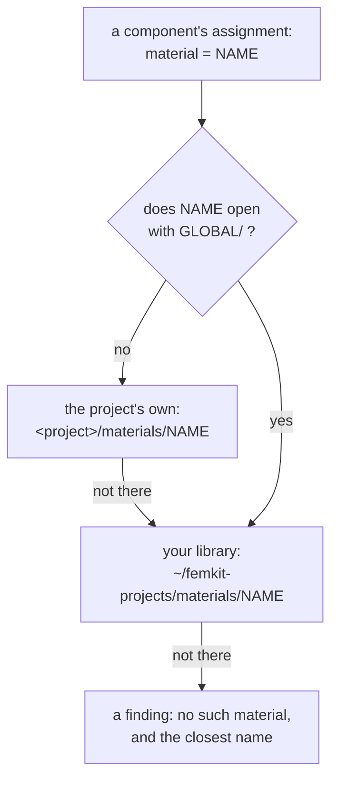

# 6 · Materials

**Role:** manual
**Status:** current; what is not built yet is marked so
**Authority:** none of its own: it shows what femkit does, and the basic
tests run each example and hold it to what femkit prints

A material is a folder holding `material.toml` — and any tables it uses —
named after the folder. Each of its properties holds one or more
**datasets**, each one source's values: a single value, a table, or a
dispersion formula. Every dataset says where it comes from. Materials live in
two places: in a project, for that project alone, and in your **material
library**, shared by all your projects.



To follow along:

```console
$ femkit config set paths.projects '"~/femkit-projects"' --yes
[config set] plan: 1 step
  1. set paths.projects: unset -> ~/femkit-projects
[config set] 1 step; logs in ~/.local/state/femkit/operations/config/20261125T182015.772490Z
[1/1] set paths.projects: unset -> ~/femkit-projects
[config set] set paths.projects: unset -> ~/femkit-projects, in ~/.config/femkit/config.toml
$ femkit project new layers --from two_material --yes
[project new] plan: 3 steps
  1. make the projects root ~/femkit-projects
  2. make the global library ~/femkit-projects/materials, holding a copy of femkit's shipped materials: vacuum
  3. copy 11 files of two_material to ~/femkit-projects/layers
[project new] 3 steps; logs in ~/.local/state/femkit/operations/project-layers/20261128T040331.705766Z
[1/3] make the projects root ~/femkit-projects
[2/3] make the global library ~/femkit-projects/materials, holding a copy of femkit's shipped materials: vacuum
[3/3] copy 11 files of two_material to ~/femkit-projects/layers
[project new] made ~/femkit-projects/layers from two_material: 11 files
  copied
  components/slab/component.toml
  components/slab/geometry.py
  definitions.py
  materials/dielectric_1/material.toml
  materials/dielectric_2/material.toml
  mesh/uniform.toml
  observables/benchmark/observables.toml
  observables/benchmark/observe.py
  physics/electrostatics.toml
  project.toml
  studies/benchmark.toml
next -- check the new project, as any other:
    femkit project check --project layers
```

## Your library

Your first `project new` made the library, `materials/` in your projects
root, and copied into it the materials femkit ships — today one, `vacuum`.
From then on they are yours, like any file you wrote:

```console
$ ls ~/femkit-projects/materials
vacuum
$ cat ~/femkit-projects/materials/vacuum/material.toml
# Vacuum, one of femkit's shipped materials (manual: 6 · Materials): its relative permittivity
# is exactly 1, by the definition of vacuum. `project new` copies it into a new projects root's
# global library, where it is yours; a component names it `GLOBAL/vacuum`, or `vacuum` where the
# project holds no material of that name.

# the version of this file's format, which femkit raises when it changes how files of this kind are written: one of `1` (manual: 6 · Materials)
schema = 1

# the name shown to a person; nothing refers to the material by it, since its folder's name is its name
display = "Vacuum"

# its chemical formula, as `Au` or `SiO2`
# formula = "Au"

# other names it goes by, for a person; nothing refers to the material by them
aliases = ["free space"]

# each property, by its name in femkit's list of material properties, holding its datasets, each named by its source (manual: 6 · Materials)
[properties]

# the material's relative permittivity, in 1
[properties.relative_permittivity]

# the dataset named `definition`
[properties.relative_permittivity.definition]
# a real constant: `{value, unit}`, a plain number where it has no unit
value = 1
# the convention of the source's complex values: one of `real`, `exp(-iwt)`, `exp(+iwt)`
convention = "real"
# where the data comes from: a citation a reader can check, with its DOI where there is one
source = "the definition of vacuum: its permittivity is the vacuum electric permittivity ε0 itself, so its relative permittivity is exactly 1"
# where the data holds: `all`, or `{value = [from, to], unit = "…"}` in its variable
range = "all"

# anything kept beside the material; read by no step
# [notes]
```

- `display`: the name shown to you. Nothing refers to a material by it: its
  name is its folder's, here `vacuum`. A material may sit in folders of your
  own: `materials/metals/gold/` is the material `metals/gold`.
- `formula`, `aliases`: for you, and for a search of the library.
- `[properties]`: each property, by its name in femkit's list — today
  `relative_permittivity`, and its other form, `refractive_index` (below) —
  holding its datasets, each named after its source: here `definition`.
- `[notes]`: anything you keep beside the material; nothing reads it.

## A dataset: a value, a table, or a formula

Every dataset states:

- `source`: where its numbers come from — a citation a reader can check,
  with its DOI where there is one;
- `convention`: `real` for real numbers; for complex ones, the sign
  convention of the source's time dependence, `exp(-iwt)` or `exp(+iwt)`:
  the same material has complex-conjugate values in the two, so the numbers
  mean nothing without it;
- `range`: where the data holds — `all`, or `{value = [from, to], unit = "…"}`.

What each convention means, and how femkit converts, is
[the science of material data](../science/material-data.md).

### A value

A single number, with its unit where it has one — the two-material
template's second layer:

```console
$ cat ~/femkit-projects/layers/materials/dielectric_2/material.toml
# The benchmark's second material (manual: 6 · Materials), filling the layer beyond the
# interface: relative permittivity 4, the benchmark's choice.

# the version of this file's format, which femkit raises when it changes how files of this kind are written: one of `1` (manual: 6 · Materials)
schema = 1

# the name shown to a person; nothing refers to the material by it, since its folder's name is its name
display = "Dielectric 2"

# its chemical formula, as `Au` or `SiO2`
# formula = "SiO2"

# other names it goes by, for a person; nothing refers to the material by them
# aliases = ["second layer"]

# each property, by its name in femkit's list of material properties, holding its datasets, each named by its source (manual: 6 · Materials)
[properties]

# the material's relative permittivity, in 1
[properties.relative_permittivity]

# the dataset named `benchmark`
[properties.relative_permittivity.benchmark]
# a real constant: `{value, unit}`, a plain number where it has no unit
value = 4
# the convention of the source's complex values: one of `real`, `exp(-iwt)`, `exp(+iwt)`
convention = "real"
# where the data comes from: a citation a reader can check, with its DOI where there is one
source = "the two-material benchmark's choice (docs/science/electrostatics.md § 9.1)"
# where the data holds: `all`, or `{value = [from, to], unit = "…"}` in its variable
range = "all"

# anything kept beside the material; read by no step
# [notes]
```

### A table

A table is a file beside `material.toml`: comma-separated, a first row
naming its columns, then one row per point, the variable increasing — the
variable first, then the value, or for complex data its two parts. Here, a
film you measured by ellipsometry, its refractive index $n$ and extinction
coefficient $\kappa$ against the wavelength in nanometres:

<!-- write ~/femkit-projects/layers/materials/film/ellipsometry.csv -->
```text
wavelength,n,k
400,1.52,0.010
500,1.50,0.004
600,1.49,0.001
700,1.48,0.000
```

<!-- write ~/femkit-projects/layers/materials/film/material.toml -->
```toml
schema = 1
display = "Our film"

[properties.refractive_index.ellipsometry]
table = "ellipsometry.csv"
variable = { name = "wavelength", unit = "nm" }
interpolation = "linear"
convention = "exp(-iwt)"
source = "our ellipsometry of sample F-12, 2026"
range = {value = [400, 700], unit = "nm"}
```

```console
$ femkit project check --project layers
[project check] layers: 1 error, 1 note; the first is the next step
  section      part                    file                                    state      engines that can solve it
  Definitions  project                 project.toml                            complete
  Definitions  material:dielectric_1   materials/dielectric_1/material.toml    complete
  Definitions  material:dielectric_2   materials/dielectric_2/material.toml    complete
  Definitions  material:film           materials/film/material.toml            errors
  Component    component:slab          components/slab/component.toml          complete
  Physics      physics:electrostatics  physics/electrostatics.toml             complete
  Mesh         mesh:uniform            mesh/uniform.toml                       complete
  Study        study:benchmark         studies/benchmark.toml                  unchecked  elmer, ngsolve
  Results      observables:benchmark   observables/benchmark/observables.toml  complete
  x the table ellipsometry.csv states no SHA-256; no case can rest on it until it does
      materials/film/material.toml, line 4: properties.refractive_index.ellipsometry.sha256
      right: "9b09b863f2e1d753a0b5fa08629e5e3ea283e2cb384bb51e4256b63f5df83628"
  - whether `left`, `right` and `sides` are each an outer boundary, and `middle` an interface, is checked once the geometry of `slab` is built
      studies/benchmark.toml, line 13: component
```

A table must state its file's **SHA-256** — the 64-character fingerprint
computed from the file's bytes — so a table changed after you wrote it is
noticed. You do not compute it yourself: `right:` gives it. Copy it in:

<!-- edit ~/femkit-projects/layers/materials/film/material.toml -->
```diff
 table = "ellipsometry.csv"
+sha256 = "9b09b863f2e1d753a0b5fa08629e5e3ea283e2cb384bb51e4256b63f5df83628"
 variable = { name = "wavelength", unit = "nm" }
```

Between two rows, a table is read on the straight line between them
(`interpolation = "linear"`), and never beyond its first and last rows.

### A formula

A dispersion formula and its parameters, from femkit's list of formulas:

- `sellmeier`: a transparent material's permittivity, from the poles it lies
  between — the importer below writes one for fused silica;
- `drude_lorentz`: a metal's permittivity, from its free electrons and its
  bound oscillators, in photon energies.

Gold, by the Lorentz–Drude parameters of Rakić and co-workers. They fit
their parameters over 0.1–6 eV, the range written here; check the paper for
the range of your metal before you rely on it.

<!-- write ~/femkit-projects/layers/materials/gold_drude/material.toml -->
```toml
schema = 1
display = "Gold, Lorentz-Drude"
formula = "Au"

[properties.relative_permittivity.rakic]
model = "drude_lorentz"
convention = "exp(-iwt)"
source = "A. D. Rakić, A. B. Djurišić, J. M. Elazar and M. L. Majewski, Optical properties of metallic films for vertical-cavity optoelectronic devices, Appl. Opt. 37, 5271-5283 (1998), doi:10.1364/AO.37.005271"
range = {value = [0.1, 6], unit = "eV"}

[properties.relative_permittivity.rakic.parameters]
eps_inf = 1
plasma = {value = 9.03, unit = "eV"}
f0 = 0.760
gamma0 = {value = 0.053, unit = "eV"}
oscillators = [
    { f = 0.024, energy = {value = 0.415, unit = "eV"}, gamma = {value = 0.241, unit = "eV"} },
    { f = 0.010, energy = {value = 0.830, unit = "eV"}, gamma = {value = 0.345, unit = "eV"} },
    { f = 0.071, energy = {value = 2.969, unit = "eV"}, gamma = {value = 0.870, unit = "eV"} },
    { f = 0.601, energy = {value = 4.304, unit = "eV"}, gamma = {value = 2.494, unit = "eV"} },
    { f = 4.384, energy = {value = 13.32, unit = "eV"}, gamma = {value = 2.214, unit = "eV"} },
]
```

```console
$ femkit project check --project layers
[project check] layers: every part loads and checks; 1 note
  section      part                    file                                    state      engines that can solve it
  Definitions  project                 project.toml                            complete
  Definitions  material:dielectric_1   materials/dielectric_1/material.toml    complete
  Definitions  material:dielectric_2   materials/dielectric_2/material.toml    complete
  Definitions  material:film           materials/film/material.toml            complete
  Definitions  material:gold_drude     materials/gold_drude/material.toml      complete
  Component    component:slab          components/slab/component.toml          complete
  Physics      physics:electrostatics  physics/electrostatics.toml             complete
  Mesh         mesh:uniform            mesh/uniform.toml                       complete
  Study        study:benchmark         studies/benchmark.toml                  unchecked  elmer, ngsolve
  Results      observables:benchmark   observables/benchmark/observables.toml  complete
  - whether `left`, `right` and `sides` are each an outer boundary, and `middle` an interface, is checked once the geometry of `slab` is built
      studies/benchmark.toml, line 13: component
next -- what the parts' states allow:
    femkit study prep --project layers benchmark --engine ENGINE   # make its cases, geometries and meshes, and the jobs that make them
```

Every parameter of `drude_lorentz` is positive — a source written in the
other sign convention gives the same parameters, since the convention
changes only the sign of $i$ — and a negative damping would make the metal
give out energy instead of absorbing it:

<!-- edit ~/femkit-projects/layers/materials/gold_drude/material.toml -->
```diff
-gamma0 = {value = 0.053, unit = "eV"}
+gamma0 = {value = -0.053, unit = "eV"}
```

```console
$ femkit project check --project layers
[project check] layers: 1 error, 1 note; the first is the next step
  section      part                    file                                    state      engines that can solve it
  Definitions  project                 project.toml                            complete
  Definitions  material:dielectric_1   materials/dielectric_1/material.toml    complete
  Definitions  material:dielectric_2   materials/dielectric_2/material.toml    complete
  Definitions  material:film           materials/film/material.toml            complete
  Definitions  material:gold_drude     materials/gold_drude/material.toml      errors
  Component    component:slab          components/slab/component.toml          complete
  Physics      physics:electrostatics  physics/electrostatics.toml             complete
  Mesh         mesh:uniform            mesh/uniform.toml                       complete
  Study        study:benchmark         studies/benchmark.toml                  unchecked  elmer, ngsolve
  Results      observables:benchmark   observables/benchmark/observables.toml  complete
  x `gamma0` is {value = -0.053, unit = "eV"}, below zero; its model needs it not negative, so that no term gives energy rather than absorb it (material-data.md § 6.2)
      materials/gold_drude/material.toml, line 15: properties.relative_permittivity.rakic.parameters.gamma0
  - whether `left`, `right` and `sides` are each an outer boundary, and `middle` an interface, is checked once the geometry of `slab` is built
      studies/benchmark.toml, line 13: component
```

<!-- edit ~/femkit-projects/layers/materials/gold_drude/material.toml -->
```diff
-gamma0 = {value = -0.053, unit = "eV"}
+gamma0 = {value = 0.053, unit = "eV"}
```

Each formula, with every symbol, is in
[the science of material data](../science/material-data.md); every key of
a dataset is in the `Value`, `Table`, `Column` and `Modelled` tables of the
[parts reference](../reference/parts.md).

## Refractive index or permittivity

A source may give the complex refractive index $n + i\kappa$ instead of the
relative permittivity. The two say the same thing: $\epsilon_r = (n +
i\kappa)^2$, so $\epsilon' = n^2 - \kappa^2$ and $\epsilon'' = 2n\kappa$
under `exp(-iwt)`. Hold each dataset under the property its source gives —
`refractive_index` or `relative_permittivity` — as written there; an
assignment names the dataset by the property the physics reads,
`relative_permittivity`, either way. femkit converts a refractive index to a
permittivity exactly, by squaring the source's numbers, when a case takes it
at a wavelength or a frequency; a step that supplies one is not built yet
([plan](../plans/plan.md) § 4, M9).

## Data that varies, in a static calculation

A table and a formula vary with a **variable** — the wavelength, the
frequency or the photon energy, each the same spectral position said another
way, or the temperature. A static field — the `stationary` step of an
electrostatics study — supplies no variable: it reads a material's response
at zero frequency, about which optical data says nothing. So a dataset that varies is refused there. Fill the
second layer with the film:

<!-- edit ~/femkit-projects/layers/components/slab/component.toml -->
```diff
 [assign.high]
 # the material, by name: the project's own, else the global library's; `GLOBAL/` names the global library's
-material = "dielectric_2"
+material = "film"
```

```console
$ femkit project check --project layers
[project check] layers: 2 errors, 1 note; the first is the next step
  section      part                    file                                    state      engines that can solve it
  Definitions  project                 project.toml                            complete
  Definitions  material:dielectric_1   materials/dielectric_1/material.toml    complete
  Definitions  material:dielectric_2   materials/dielectric_2/material.toml    complete
  Definitions  material:film           materials/film/material.toml            complete
  Definitions  material:gold_drude     materials/gold_drude/material.toml      complete
  Component    component:slab          components/slab/component.toml          errors
  Physics      physics:electrostatics  physics/electrostatics.toml             complete
  Mesh         mesh:uniform            mesh/uniform.toml                       complete
  Study        study:benchmark         studies/benchmark.toml                  unchecked  elmer, ngsolve
  Results      observables:benchmark   observables/benchmark/observables.toml  complete
  x the dataset `ellipsometry` of `film` is held as the refractive index, a form of the relative permittivity the study `benchmark` reads, and no case converts one yet: a dataset held as the relative permittivity itself would do
      components/slab/component.toml, line 65: assign.high.datasets.relative_permittivity
  x the study `benchmark` solves its step `potential` as a stationary calculation, which supplies no variable, and the dataset `ellipsometry` of `film` varies with the wavelength: a `value` of the relative permittivity at zero frequency, its range `all`, would hold there; no step femkit has yet supplies the wavelength
      components/slab/component.toml, line 65: assign.high.datasets.relative_permittivity
  - whether `left`, `right` and `sides` are each an outer boundary, and `middle` an interface, is checked once the geometry of `slab` is built
      studies/benchmark.toml, line 13: component
```

Two errors, at the same key. The film's data is a refractive index, which no
case converts yet; and it varies with the wavelength, which a static step
does not supply. The second says what would hold here: a `value` of the
relative permittivity at zero frequency, with the range `all`. A single
value whose range is a span of wavelengths is optical data too, and refused
the same way.

A single refractive index does not vary, but it is still a refractive index,
which a case converts only once a step supplies a wavelength or a frequency
— not built yet ([plan](../plans/plan.md) § 4, M9) — so `project check`
finds it, and `study prep` refuses the study until it is fixed:

<!-- write ~/femkit-projects/layers/materials/glass/material.toml -->
```toml
schema = 1
display = "Glass, by its refractive index"

[properties.refractive_index.handbook]
value = 1.5
convention = "real"
source = "a handbook's refractive index for visible light"
range = "all"
```

<!-- edit ~/femkit-projects/layers/components/slab/component.toml -->
```diff
-material = "film"
+material = "glass"
```

```console
$ femkit project check --project layers
[project check] layers: 1 error, 1 note; the first is the next step
  section      part                    file                                    state      engines that can solve it
  Definitions  project                 project.toml                            complete
  Definitions  material:dielectric_1   materials/dielectric_1/material.toml    complete
  Definitions  material:dielectric_2   materials/dielectric_2/material.toml    complete
  Definitions  material:film           materials/film/material.toml            complete
  Definitions  material:glass          materials/glass/material.toml           complete
  Definitions  material:gold_drude     materials/gold_drude/material.toml      complete
  Component    component:slab          components/slab/component.toml          errors
  Physics      physics:electrostatics  physics/electrostatics.toml             complete
  Mesh         mesh:uniform            mesh/uniform.toml                       complete
  Study        study:benchmark         studies/benchmark.toml                  unchecked  elmer, ngsolve
  Results      observables:benchmark   observables/benchmark/observables.toml  complete
  x the dataset `handbook` of `glass` is held as the refractive index, a form of the relative permittivity the study `benchmark` reads, and no case converts one yet: a dataset held as the relative permittivity itself would do
      components/slab/component.toml, line 65: assign.high.datasets.relative_permittivity
  - whether `left`, `right` and `sides` are each an outer boundary, and `middle` an interface, is checked once the geometry of `slab` is built
      studies/benchmark.toml, line 13: component
$ femkit study prep benchmark --project layers --yes
  x the dataset `handbook` of `glass` is held as the refractive index, a form of the relative permittivity the study `benchmark` reads, and no case converts one yet: a dataset held as the relative permittivity itself would do
      components/slab/component.toml, line 65: assign.high.datasets.relative_permittivity
[study prep] refused: the parts `study:benchmark` uses have findings to resolve
next -- instead:
    femkit project check --project layers
```

For a static calculation, write the material's static relative permittivity
under `relative_permittivity`, as the templates' materials do. Put the
second layer back:

<!-- edit ~/femkit-projects/layers/components/slab/component.toml -->
```diff
-material = "glass"
+material = "dielectric_2"
```

## Several datasets in one property

A property may hold datasets from several sources. Then the assignment names
the one it uses: there is no default. Add a second source to the second
layer:

<!-- edit ~/femkit-projects/layers/materials/dielectric_2/material.toml -->
```diff
 # where the data holds: `all`, or `{value = [from, to], unit = "…"}` in its variable
 range = "all"
+
+[properties.relative_permittivity.measured]
+value = 4.12
+convention = "real"
+source = "our capacitance measurement of sample D-3, 2026"
+range = "all"
```

```console
$ femkit project check --project layers
[project check] layers: 1 error, 1 note; the first is the next step
  section      part                    file                                    state      engines that can solve it
  Definitions  project                 project.toml                            complete
  Definitions  material:dielectric_1   materials/dielectric_1/material.toml    complete
  Definitions  material:dielectric_2   materials/dielectric_2/material.toml    complete
  Definitions  material:film           materials/film/material.toml            complete
  Definitions  material:glass          materials/glass/material.toml           complete
  Definitions  material:gold_drude     materials/gold_drude/material.toml      complete
  Component    component:slab          components/slab/component.toml          errors
  Physics      physics:electrostatics  physics/electrostatics.toml             complete
  Mesh         mesh:uniform            mesh/uniform.toml                       complete
  Study        study:benchmark         studies/benchmark.toml                  unchecked  elmer, ngsolve
  Results      observables:benchmark   observables/benchmark/observables.toml  complete
  x the relative_permittivity of `dielectric_2` holds several datasets; name the one used, as there is no default
      components/slab/component.toml, line 65: assign.high.datasets.relative_permittivity
      one of: "benchmark", "measured"
  - whether `left`, `right` and `sides` are each an outer boundary, and `middle` an interface, is checked once the geometry of `slab` is built
      studies/benchmark.toml, line 13: component
```

<!-- edit ~/femkit-projects/layers/components/slab/component.toml -->
```diff
 material = "dielectric_2"
 # for each property whose material holds several datasets, the one used, by its name
-# datasets = { relative_permittivity = "benchmark" }
+datasets = { relative_permittivity = "measured" }
```

```console
$ femkit project check --project layers
[project check] layers: every part loads and checks; 1 note
  section      part                    file                                    state      engines that can solve it
  Definitions  project                 project.toml                            complete
  Definitions  material:dielectric_1   materials/dielectric_1/material.toml    complete
  Definitions  material:dielectric_2   materials/dielectric_2/material.toml    complete
  Definitions  material:film           materials/film/material.toml            complete
  Definitions  material:glass          materials/glass/material.toml           complete
  Definitions  material:gold_drude     materials/gold_drude/material.toml      complete
  Component    component:slab          components/slab/component.toml          complete
  Physics      physics:electrostatics  physics/electrostatics.toml             complete
  Mesh         mesh:uniform            mesh/uniform.toml                       complete
  Study        study:benchmark         studies/benchmark.toml                  unchecked  elmer, ngsolve
  Results      observables:benchmark   observables/benchmark/observables.toml  complete
  - whether `left`, `right` and `sides` are each an outer boundary, and `middle` an interface, is checked once the geometry of `slab` is built
      studies/benchmark.toml, line 13: component
next -- what the parts' states allow:
    femkit study prep --project layers benchmark --engine ENGINE   # make its cases, geometries and meshes, and the jobs that make them
```

## Your library's materials — `GLOBAL/`

A name is looked for in the project first, then in your library; a name
opening with `GLOBAL/` is your library's, whatever the project holds — in
capitals, since a material's own name never has any. Fill the first layer
with the library's vacuum, the prefix mistyped:

<!-- edit ~/femkit-projects/layers/components/slab/component.toml -->
```diff
 [assign.low]
 # the material, by name: the project's own, else the global library's; `GLOBAL/` names the global library's
-material = "dielectric_1"
+material = "Global/vacuum"
```

```console
$ femkit project check --project layers
[project check] layers: 1 error, 1 note; the first is the next step
  section      part                    file                                    state      engines that can solve it
  Definitions  project                 project.toml                            complete
  Definitions  material:dielectric_1   materials/dielectric_1/material.toml    complete
  Definitions  material:dielectric_2   materials/dielectric_2/material.toml    complete
  Definitions  material:film           materials/film/material.toml            complete
  Definitions  material:glass          materials/glass/material.toml           complete
  Definitions  material:gold_drude     materials/gold_drude/material.toml      complete
  Component    component:slab          components/slab/component.toml          errors
  Physics      physics:electrostatics  physics/electrostatics.toml             complete
  Mesh         mesh:uniform            mesh/uniform.toml                       complete
  Study        study:benchmark         studies/benchmark.toml                  unchecked  elmer, ngsolve
  Results      observables:benchmark   observables/benchmark/observables.toml  complete
  x `Global/vacuum` is no material's name: `Global` is not `GLOBAL`: a name is in lowercase, and `GLOBAL/`, which names the global library's, alone is in capitals; it most likely means `GLOBAL/vacuum`
      components/slab/component.toml, line 61: assign.low.material
      right: "GLOBAL/vacuum"
  - whether `left`, `right` and `sides` are each an outer boundary, and `middle` an interface, is checked once the geometry of `slab` is built
      studies/benchmark.toml, line 13: component
```

<!-- edit ~/femkit-projects/layers/components/slab/component.toml -->
```diff
-material = "Global/vacuum"
+material = "GLOBAL/vacuum"
```

```console
$ femkit project check --project layers
[project check] layers: every part loads and checks; 1 note
  section      part                    file                                              state      engines that can solve it
  Definitions  project                 project.toml                                      complete
  Definitions  material:GLOBAL/vacuum  ~/femkit-projects/materials/vacuum/material.toml  complete
  Definitions  material:dielectric_1   materials/dielectric_1/material.toml              complete
  Definitions  material:dielectric_2   materials/dielectric_2/material.toml              complete
  Definitions  material:film           materials/film/material.toml                      complete
  Definitions  material:glass          materials/glass/material.toml                     complete
  Definitions  material:gold_drude     materials/gold_drude/material.toml                complete
  Component    component:slab          components/slab/component.toml                    complete
  Physics      physics:electrostatics  physics/electrostatics.toml                       complete
  Mesh         mesh:uniform            mesh/uniform.toml                                 complete
  Study        study:benchmark         studies/benchmark.toml                            unchecked  elmer, ngsolve
  Results      observables:benchmark   observables/benchmark/observables.toml            complete
  - whether `left`, `right` and `sides` are each an outer boundary, and `middle` an interface, is checked once the geometry of `slab` is built
      studies/benchmark.toml, line 13: component
next -- what the parts' states allow:
    femkit study prep --project layers benchmark --engine ENGINE   # make its cases, geometries and meshes, and the jobs that make them
```

The library's material is listed with its file's whole path, since it lies
outside the project. Every case says where each material was found, and the
dataset and source it used:

```console
$ femkit study prep benchmark --project layers --yes
[study prep] plan: 1 step
  1. write cases/benchmark/bfbb6c275bd4…/case.json: the one case
[study prep] 1 step; logs in ~/.local/state/femkit/operations/project-layers/20261128T070206.899402Z
[1/1] write cases/benchmark/bfbb6c275bd4…/case.json: the one case
[study prep] benchmark: 1 case written, 0 kept
  case                                                              point         written
  bfbb6c275bd4fd0613482b32cec60395f762f5ce37d0b9f68cbf94522afc5304  the one case  now
  - no engine is chosen for the study benchmark: its cases, geometries and meshes serve every engine, and the engine is chosen when the study is solved
      studies/benchmark.toml
      femkit study prep --project layers benchmark --engine ENGINE
  ! its stages wait: there is no record of this machine in ~/.config/femkit/machines
      femkit config init   # asks for activation.preamble and activation.command
      femkit job probe --write   # measure this machine, and write its record
$ femkit case list --project layers
[case list] layers: 1 case written
benchmark: 1 case written; makes 1 case
  case          point          made now
  bfbb6c275bd4  the one point  yes
  case          body  material      found now      property               dataset     source                                                                                                                               changed since
  bfbb6c275bd4  high  dielectric_2  dielectric_2   relative_permittivity  measured    our capacitance measurement of sample D-3, 2026
  bfbb6c275bd4  low   vacuum        GLOBAL/vacuum  relative_permittivity  definition  the definition of vacuum: its permittivity is the vacuum electric permittivity ε0 itself, so its relative permittivity is exactly 1
next -- what the parts' states allow:
    femkit study prep --project layers benchmark --engine ENGINE   # make its cases, geometries and meshes, and the jobs that make them
```

This study has no axis, so it makes one case, at `the one point`. The
`material` column is the material's own name; `found now` is where it is
found today — the project's own, or your library's, `GLOBAL/…`. A case holds
the material's data, never where it was found, so the library's vacuum
written without its prefix — this project has no `vacuum` of its own — is
the same case:

<!-- edit ~/femkit-projects/layers/components/slab/component.toml -->
```diff
-material = "GLOBAL/vacuum"
+material = "vacuum"
```

```console
$ femkit study prep benchmark --project layers --yes
[study prep] benchmark: 0 cases written, 1 kept
  case                                                              point         written
  bfbb6c275bd4fd0613482b32cec60395f762f5ce37d0b9f68cbf94522afc5304  the one case  before
  - no engine is chosen for the study benchmark: its cases, geometries and meshes serve every engine, and the engine is chosen when the study is solved
      studies/benchmark.toml
      femkit study prep --project layers benchmark --engine ENGINE
  ! its stages wait: there is no record of this machine in ~/.config/femkit/machines
      femkit config init   # asks for activation.preamble and activation.command
      femkit job probe --write   # measure this machine, and write its record
```

A project moved under another projects root finds its `GLOBAL/` materials in
that root's library.

## When femkit's own copy changes

The library's `vacuum` is your copy of femkit's. femkit keeps a note of what
it copied, `materials/.femkit/shipped.json` in the library. Should a later
femkit change its own `vacuum`, and your copy differ from femkit's new file,
the check of every project that uses yours says so, in a note on your
library's `vacuum` — the keys at which the two differ, some of them perhaps
your own edits, and where femkit's file is — and changes nothing: you copy
what you want. Once your copy matches femkit's file, the note is gone.

## An edited material makes new cases

A case holds the data it used, never where it found it. Change a value, and
the study makes a new case; the old one is kept and marked:

<!-- edit ~/femkit-projects/layers/materials/dielectric_2/material.toml -->
```diff
-value = 4.12
+value = 4.15
```

```console
$ femkit case list --project layers
[case list] layers: 1 case written
benchmark: 1 case written; makes 1 case
  case          point          made now
  bfbb6c275bd4  the one point  no
1 case of benchmark no longer made holds material data that has changed since; `study prep` writes new ones, and keeps these
  case          body  material      found now      property               dataset     source                                                                                                                               changed since
  bfbb6c275bd4  high  dielectric_2  dielectric_2   relative_permittivity  measured    our capacitance measurement of sample D-3, 2026                                                                                      value 4.12 → 4.15
  bfbb6c275bd4  low   vacuum        GLOBAL/vacuum  relative_permittivity  definition  the definition of vacuum: its permittivity is the vacuum electric permittivity ε0 itself, so its relative permittivity is exactly 1
next -- what the parts' states allow:
    femkit study prep --project layers benchmark --engine ENGINE   # make its cases, geometries and meshes, and the jobs that make them
$ femkit study prep benchmark --project layers --yes
[study prep] plan: 1 step
  1. write cases/benchmark/fa19e16bdb46…/case.json: the one case — in place of bfbb6c275bd4…, its materials' data changed: high's dielectric_2, dataset measured: value 4.12 → 4.15
[study prep] 1 step; logs in ~/.local/state/femkit/operations/project-layers/20261128T070211.721291Z
[1/1] write cases/benchmark/fa19e16bdb46…/case.json: the one case — in place of bfbb6c275bd4…, its materials' data changed: high's dielectric_2, dataset measured: value 4.12 → 4.15
[study prep] benchmark: 1 case written, 0 kept
  case                                                              point         written
  fa19e16bdb46f2a71f21e39aca5ec179b9eaf9cc6714f3e9e3e46a67ff39f75e  the one case  now
  - no engine is chosen for the study benchmark: its cases, geometries and meshes serve every engine, and the engine is chosen when the study is solved
      studies/benchmark.toml
      femkit study prep --project layers benchmark --engine ENGINE
  ! its stages wait: there is no record of this machine in ~/.config/femkit/machines
      femkit config init   # asks for activation.preamble and activation.command
      femkit job probe --write   # measure this machine, and write its record
```

`case list` says which cases hold data that has changed since, and under
`changed since` what changed: here `value 4.12 → 4.15`. Prep's plan names
the case each new one takes the place of, and why. The old case stays.

## Importing from refractiveindex.info — `material import`

[refractiveindex.info](https://refractiveindex.info) is a public database
of optical constants: one YAML file for each material and source, in the
public domain. Download the file of the page you want; femkit never
downloads anything itself. `material import` reads it and writes a **new**
material — never over one you have, nor into it:

```bash
femkit material import refractiveindex_info FILE --as NAME --into library
femkit material import refractiveindex_info FILE --as NAME --into project --project PROJECT
```

`refractiveindex_info` names where the file comes from: it is the one
source femkit reads today. `--into library` puts the new material in your
library, which your first project made (chapter 2); `--into project` in one
project's `materials/`. The new material holds the file's one dataset, named
after the file, with its source, its convention, its range and its
conditions, and each key under its help, as a template's. From then on it is
yours.

Nothing a file says is dropped: a key femkit does not know how to carry over
is refused, naming it. One such key is refractiveindex.info's `SPECS`, which
can say that a file's wavelengths are measured in air rather than in vacuum,
or its index relative to air. When your library already holds a material of
the name you import into a project, the plan warns that the project's will
be found first.

### A formula: Malitson's fused silica

Malitson's Sellmeier formula for fused silica, as the database's file holds
it:

<!-- write ~/Downloads/Malitson.yml -->
```yaml
# this file is part of refractiveindex.info database
# refractiveindex.info database is in the public domain
# copyright and related rights waived via CC0 1.0

REFERENCES: |
    1) I. H. Malitson.
    Interspecimen comparison of the refractive index of fused silica.
    [*J. Opt. Soc. Am.* **55**, 1205-1208 (1965)](https://doi.org/10.1364/JOSA.55.001205)<br>
    2) C. Z. Tan.
    Determination of refractive index of silica glass for infrared wavelengths by IR spectroscopy.
    [*J. Non-Cryst. Solids* **223**, 158-163 (1998)](https://doi.org/10.1016/S0022-3093(97)00438-9)<br>
    * Sellmeier formula is reported in Ref. 1 for the 0.21–3.71 μm wavelength range. Ref. 2 verifies the validity of the formula up to 6.7 μm.
NOTES: |
    Fused silica, 20 °C
CONDITIONS:
    temperature: 293
DATA:
  - type: formula 1
    wavelength_range: 0.21 6.7
    coefficients: 0 0.6961663 0.0684043 0.4079426 0.1162414 0.8974794 9.896161
```

Every option is needed; one left out is named as you would type it:

```console
$ femkit material import refractiveindex_info ~/Downloads/Malitson.yml --into library --yes
[material import] refused: --as NAME is missing: the new material's name: its path in the library or the project's materials
next -- instead:
    femkit material import refractiveindex_info /home/you/Downloads/Malitson.yml --as NAME --into library
```

Into your library, for every project:

```console
$ femkit material import refractiveindex_info ~/Downloads/Malitson.yml --as fused_silica --into library --yes
[material import] plan: 1 step
  1. write the new material GLOBAL/fused_silica in ~/femkit-projects/materials/fused_silica: material.toml
[material import] 1 step; logs in ~/.local/state/femkit/operations/library-materials/20261127T000334.018317Z
[1/1] write the new material GLOBAL/fused_silica in ~/femkit-projects/materials/fused_silica: material.toml
[material import] made the material GLOBAL/fused_silica in ~/femkit-projects/materials/fused_silica: its relative_permittivity, the dataset malitson
  files
  material.toml
$ cat ~/femkit-projects/materials/fused_silica/material.toml
# Written by `material import` from refractiveindex_info's file Malitson.yml; yours from now on, as a file you wrote is (manual: 6 · Materials).

# the version of this file's format, which femkit raises when it changes how files of this kind are written: one of `1` (manual: 6 · Materials)
schema = 1

# the name shown to a person; nothing refers to the material by it, since its folder's name is its name
display = "fused_silica"

# its chemical formula, as `Au` or `SiO2`
# formula = ""

# other names it goes by, for a person; nothing refers to the material by them
# aliases = []

# each property, by its name in femkit's list of material properties, holding its datasets, each named by its source (manual: 6 · Materials)
[properties]

# the material's relative permittivity, in 1
[properties.relative_permittivity]

# the dataset named `malitson`
[properties.relative_permittivity.malitson]
# the dispersion model, by its name in femkit's list of models (manual: 6 · Materials)
model = "sellmeier"
# the convention of the source's complex values: one of `real`, `exp(-iwt)`, `exp(+iwt)`
convention = "real"
# where the data comes from: a citation a reader can check, with its DOI where there is one
source = "1) I. H. Malitson. Interspecimen comparison of the refractive index of fused silica. J. Opt. Soc. Am. 55, 1205-1208 (1965), doi:10.1364/JOSA.55.001205 2) C. Z. Tan. Determination of refractive index of silica glass for infrared wavelengths by IR spectroscopy. J. Non-Cryst. Solids 223, 158-163 (1998), doi:10.1016/S0022-3093(97)00438-9 Sellmeier formula is reported in Ref. 1 for the 0.21–3.71 μm wavelength range. Ref. 2 verifies the validity of the formula up to 6.7 μm."
# where the data holds: `all`, or `{value = [from, to], unit = "…"}` in its variable
range = {value = [0.21, 6.7], unit = "um"}
# the temperature its data holds at, where it matters
temperature = {value = 293, unit = "K"}
# the uncertainty its source gives, as the source gives it
# uncertainty = "…"

# its parameters, each by its name in its model's declaration: a quantity in a dimension it declares, or, for a list of terms the model sums, a list of tables of them
[properties.relative_permittivity.malitson.parameters]
# A, the permittivity beyond 1 that the terms leave, in 1
A = 0

# a pole: the term B lambda^2 / (lambda^2 - C)
[[properties.relative_permittivity.malitson.parameters.terms]]
# B, the term's strength, in 1
B = 0.6961663
# C, the pole: a length squared, or the resonance wavelength whose square it is, in um^2 or um
C = {value = 0.0684043, unit = "um"}

# a pole: the term B lambda^2 / (lambda^2 - C)
[[properties.relative_permittivity.malitson.parameters.terms]]
# B, the term's strength, in 1
B = 0.4079426
# C, the pole: a length squared, or the resonance wavelength whose square it is, in um^2 or um
C = {value = 0.1162414, unit = "um"}

# a pole: the term B lambda^2 / (lambda^2 - C)
[[properties.relative_permittivity.malitson.parameters.terms]]
# B, the term's strength, in 1
B = 0.8974794
# C, the pole: a length squared, or the resonance wavelength whose square it is, in um^2 or um
C = {value = 9.896161, unit = "um"}

# anything kept beside the material; read by no step
[notes]
malitson = "Fused silica, 20 °C"
```

The file's formula 1 became a `sellmeier` dataset named `malitson`, its
coefficients the formula's terms, each term a table of its own
(`[[…terms]]`) and each parameter under its help; its references the
`source`, with their DOIs; its wavelength range the `range`; its
temperature the `temperature`; its notes the material's `[notes]`. A key
the file cannot fill — an uncertainty — is shown commented out, for you to
fill if you know it.

### A table: Johnson and Christy's gold

Johnson and Christy's gold is a table of $n$ and $\kappa$:

<details>
<summary>The database's <code>Johnson.yml</code></summary>

<!-- write ~/Downloads/Johnson.yml -->
```yaml
# this file is part of refractiveindex.info database
# refractiveindex.info database is in the public domain
# copyright and related rights waived via CC0 1.0

REFERENCES: |
    P. B. Johnson and R. W. Christy.
    Optical constants of the noble metals.
    [*Phys. Rev. B* **6**, 4370-4379 (1972)](https://doi.org/10.1103/PhysRevB.6.4370)
NOTES: |
    Room temperature
DATA:
  - type: tabulated nk
    data: |
        0.1879 1.28 1.188
        0.1916 1.32 1.203
        0.1953 1.34 1.226
        0.1993 1.33 1.251
        0.2033 1.33 1.277
        0.2073 1.30 1.304
        0.2119 1.30 1.350
        0.2164 1.30 1.387
        0.2214 1.30 1.427
        0.2262 1.31 1.460
        0.2313 1.30 1.497
        0.2371 1.32 1.536
        0.2426 1.32 1.577
        0.2490 1.33 1.631
        0.2551 1.33 1.688
        0.2616 1.35 1.749
        0.2689 1.38 1.803
        0.2761 1.43 1.847
        0.2844 1.47 1.869
        0.2924 1.49 1.878
        0.3009 1.53 1.889
        0.3107 1.53 1.893
        0.3204 1.54 1.898
        0.3315 1.48 1.883
        0.3425 1.48 1.871
        0.3542 1.50 1.866
        0.3679 1.48 1.895
        0.3815 1.46 1.933
        0.3974 1.47 1.952
        0.4133 1.46 1.958
        0.4305 1.45 1.948
        0.4509 1.38 1.914
        0.4714 1.31 1.849
        0.4959 1.04 1.833
        0.5209 0.62 2.081
        0.5486 0.43 2.455
        0.5821 0.29 2.863
        0.6168 0.21 3.272
        0.6595 0.14 3.697
        0.7045 0.13 4.103
        0.7560 0.14 4.542
        0.8211 0.16 5.083
        0.8920 0.17 5.663
        0.9840 0.22 6.350
        1.0880 0.27 7.150
        1.2160 0.35 8.145
        1.3930 0.43 9.519
        1.6100 0.56 11.21
        1.9370 0.92 13.78
```

</details>

Into the project's own materials this time:

```console
$ femkit material import refractiveindex_info ~/Downloads/Johnson.yml --as gold --into project --project layers --yes
[material import] plan: 1 step
  1. write the new material gold in ~/femkit-projects/layers/materials/gold: material.toml, johnson.csv
[material import] 1 step; logs in ~/.local/state/femkit/operations/project-layers/20261127T012416.096076Z
[1/1] write the new material gold in ~/femkit-projects/layers/materials/gold: material.toml, johnson.csv
[material import] made the material gold in ~/femkit-projects/layers/materials/gold: its refractive_index, the dataset johnson
  files
  material.toml
  johnson.csv
next -- check the project it is in:
    femkit project check --project layers
$ ls ~/femkit-projects/layers/materials/gold
johnson.csv
material.toml
```

The table became `johnson.csv` beside the material, its SHA-256 written in:

```console
$ cat ~/femkit-projects/layers/materials/gold/material.toml
# Written by `material import` from refractiveindex_info's file Johnson.yml; yours from now on, as a file you wrote is (manual: 6 · Materials).

# the version of this file's format, which femkit raises when it changes how files of this kind are written: one of `1` (manual: 6 · Materials)
schema = 1

# the name shown to a person; nothing refers to the material by it, since its folder's name is its name
display = "gold"

# its chemical formula, as `Au` or `SiO2`
# formula = ""

# other names it goes by, for a person; nothing refers to the material by them
# aliases = []

# each property, by its name in femkit's list of material properties, holding its datasets, each named by its source (manual: 6 · Materials)
[properties]

# the complex refractive index, in 1
[properties.refractive_index]

# the dataset named `johnson`
[properties.refractive_index.johnson]
# the file holding it, by its path from the material's folder: comma-separated, a first row naming its columns, then one row per point, the variable increasing
table = "johnson.csv"
# its file's SHA-256, so a table changed under its material is seen
sha256 = "d4687f44d70e49930fb10cc3c864ee64d0a9b80f9ea71fb4b1eb13382c9eaf91"
# how it is read between two rows: one of `linear` (manual: 6 · Materials)
interpolation = "linear"
# the convention of the source's complex values: one of `real`, `exp(-iwt)`, `exp(+iwt)`
convention = "exp(-iwt)"
# where the data comes from: a citation a reader can check, with its DOI where there is one
source = "P. B. Johnson and R. W. Christy. Optical constants of the noble metals. Phys. Rev. B 6, 4370-4379 (1972), doi:10.1103/PhysRevB.6.4370"
# where the data holds: `all`, or `{value = [from, to], unit = "…"}` in its variable
range = {value = [0.1879, 1.9370], unit = "um"}

# the temperature its data holds at, where it matters
# temperature = {value = "…", unit = "K"}
# the uncertainty its source gives, as the source gives it
# uncertainty = "…"

# the variable its first column is written in, and that column's unit
[properties.refractive_index.johnson.variable]
# the variable, by its name in femkit's list of variables
name = "wavelength"
# the unit its column is written in, of the variable's dimension
unit = "um"

# anything kept beside the material; read by no step
[notes]
johnson = "Room temperature"
```

A material of that name is there now, so importing again under the same name
is refused; femkit offers a free name, and says how to add the dataset to
the material you have instead:

```console
$ femkit material import refractiveindex_info ~/Downloads/Johnson.yml --as gold --into project --project layers --yes
[material import] refused: ~/femkit-projects/layers/materials/gold is there already: a new material is never made over it. Import it under another name, as gold_2; to add its dataset to a material you have, copy the dataset's lines and its table from the new material into yours, and project check checks them
next -- instead:
    femkit material import refractiveindex_info /home/you/Downloads/Johnson.yml --as NAME --into project --project layers   # the import under another name; NAME e.g. gold_2
```

That is: import it under a new name, then copy its dataset's lines — and its
table — into your material; `project check` checks them.

### Using an imported material

Both are optical data, varying with the wavelength, so a static study
refuses them, as above:

<!-- edit ~/femkit-projects/layers/components/slab/component.toml -->
```diff
 [assign.low]
 # the material, by name: the project's own, else the global library's; `GLOBAL/` names the global library's
-material = "vacuum"
+material = "GLOBAL/fused_silica"
```

```console
$ femkit project check --project layers
[project check] layers: 1 error, 1 note; the first is the next step
  section      part                          file                                                    state      engines that can solve it
  Definitions  project                       project.toml                                            complete
  Definitions  material:GLOBAL/fused_silica  ~/femkit-projects/materials/fused_silica/material.toml  complete
  Definitions  material:dielectric_1         materials/dielectric_1/material.toml                    complete
  Definitions  material:dielectric_2         materials/dielectric_2/material.toml                    complete
  Definitions  material:film                 materials/film/material.toml                            complete
  Definitions  material:glass                materials/glass/material.toml                           complete
  Definitions  material:gold                 materials/gold/material.toml                            complete
  Definitions  material:gold_drude           materials/gold_drude/material.toml                      complete
  Component    component:slab                components/slab/component.toml                          errors
  Physics      physics:electrostatics        physics/electrostatics.toml                             complete
  Mesh         mesh:uniform                  mesh/uniform.toml                                       complete
  Study        study:benchmark               studies/benchmark.toml                                  unchecked  elmer, ngsolve
  Results      observables:benchmark         observables/benchmark/observables.toml                  complete
  x the study `benchmark` solves its step `potential` as a stationary calculation, which supplies no variable, and the dataset `malitson` of `GLOBAL/fused_silica` varies with the wavelength: a `value` of the relative permittivity at zero frequency, its range `all`, would hold there; no step femkit has yet supplies the wavelength
      components/slab/component.toml, line 59: assign.low.datasets.relative_permittivity
  - whether `left`, `right` and `sides` are each an outer boundary, and `middle` an interface, is checked once the geometry of `slab` is built
      studies/benchmark.toml, line 13: component
```

Taking optical data at a wavelength — a frequency-domain study — is not
built yet ([plan](../plans/plan.md) § 4, M9).
