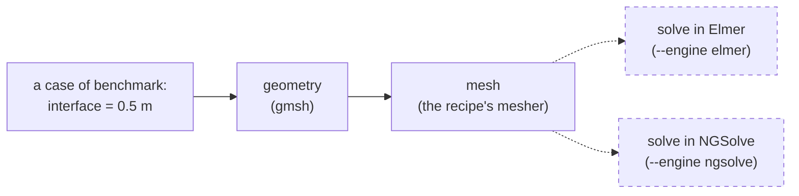

# 7 · Geometries and meshes

**Role:** manual
**Status:** current; what is not built yet is marked so
**Authority:** none of its own: it shows what femkit does, and the basic
tests run each example and hold it to what femkit prints

Once a study's cases are written (chapter 5), femkit makes what each case
needs before it is solved: its **geometry**, built by your component's
script, and its **mesh**, made from that geometry by your mesh recipe. Each
of these is a **stage**: one step of one case, run in a folder of its own
under the project's `runs/<study>/`, kept with everything it made. Each step
runs in its own environment, whatever solver you choose — the geometry in
`gmsh`, the mesh in its mesher's. A study's geometries and meshes are its
own, and every engine you choose to solve it solves from them: choosing
another engine makes no geometry or mesh again, and nothing one study
changes ever reaches another.



The dashed steps are not built yet. Two commands do this part:

- `study prep` gets a study ready to run, in one step: it works out every
  value, writes the cases, writes the study's geometry and mesh stages for a
  machine, prepares them, and writes the study's meshing **job** — a folder
  under `runs/<study>/launch/` that runs its geometries, then its meshes, one
  after another, with the resources the study states for it, `[meshing]`
  (chapter 3). It plans all of it first and writes nothing if any of it is
  refused; `--dry-run` shows the whole plan and writes nothing. `--engine`
  names the engine that solves the study (chapter 5): one that cannot take
  its recipe's mesh is refused at once, on any machine, the error at the
  study's `mesh` (chapter 3), and nothing is written.
- `study flow` shows a study's stages for a machine, each with a word that
  says where it stands, and what to do next.

To follow along, start the two-material project and prep its study. On a
machine femkit has no record of yet, prep writes the case and says what the
stages wait for:

```console
$ femkit config set paths.projects '"~/femkit-projects"' --yes
[config set] plan: 1 step
  1. set paths.projects: unset -> ~/femkit-projects
[config set] 1 step; logs in ~/.local/state/femkit/operations/config/20261126T065849.516656Z
[1/1] set paths.projects: unset -> ~/femkit-projects
[config set] set paths.projects: unset -> ~/femkit-projects, in ~/.config/femkit/config.toml
$ femkit project new layers --from two_material --yes
[project new] plan: 3 steps
  1. make the projects root ~/femkit-projects
  2. make the global library ~/femkit-projects/materials, holding a copy of femkit's shipped materials: vacuum
  3. copy 11 files of two_material to ~/femkit-projects/layers
[project new] 3 steps; logs in ~/.local/state/femkit/operations/project-layers/20261128T040355.886296Z
[1/3] make the projects root ~/femkit-projects
[2/3] make the global library ~/femkit-projects/materials, holding a copy of femkit's shipped materials: vacuum
[3/3] copy 11 files of two_material to ~/femkit-projects/layers
[project new] made ~/femkit-projects/layers from two_material: 11 files
  copied
  components/slab/component.toml
  components/slab/geometry.py
  definitions.py
  materials/dielectric_1/material.toml
  materials/dielectric_2/material.toml
  mesh/uniform.toml
  observables/benchmark/observables.toml
  observables/benchmark/observe.py
  physics/electrostatics.toml
  project.toml
  studies/benchmark.toml
next -- check the new project, as any other:
    femkit project check --project layers
$ femkit study prep --project layers benchmark --yes
[study prep] plan: 1 step
  1. write cases/benchmark/e3eea3efb026…/case.json: the one case
[study prep] 1 step; logs in ~/.local/state/femkit/operations/project-layers/20261128T070219.799270Z
[1/1] write cases/benchmark/e3eea3efb026…/case.json: the one case
[study prep] benchmark: 1 case written, 0 kept
  case                                                              point         written
  e3eea3efb026bbab7251ea8e7ecf07d18350ae4bb942d334e3aa1d34b2ae2f1f  the one case  now
  - no engine is chosen for the study benchmark: its cases, geometries and meshes serve every engine, and the engine is chosen when the study is solved
      studies/benchmark.toml
      femkit study prep --project layers benchmark --engine ENGINE
  ! its stages wait: there is no record of this machine in ~/.config/femkit/machines
      femkit config init   # asks for activation.preamble and activation.command
      femkit job probe --write   # measure this machine, and write its record
```

## A record of this machine

A stage is made for a machine: what femkit knows of it — which environments
are installed there, and their exact builds — is part of what names each
stage. That knowledge is the machine's **record**, which femkit writes when it
probes the machine — `env bootstrap` writes it (chapter 1). Where there is
none — a machine never bootstrapped, or a record removed — prep writes what
needs no machine, the cases, as above, and `study flow` says what is
missing:

```console
$ femkit study flow --project layers benchmark
[study flow] refused: there is no record of this machine in ~/.config/femkit/machines
next -- instead:
    femkit config init   # asks for activation.preamble and activation.command
    femkit job probe --write   # measure this machine, and write its record
```

On a machine set up as chapter 1 does it, `env bootstrap` wrote this
record already, and prep goes on to the stages at once: none of these steps
is shown to you. This chapter's session was started with nothing set, so
they are, in order: `config init`, which asks how this machine enters an
environment, as chapter 1 explains, then `job probe --write`, which writes
the record. Write it, then prep again. What these print depends on your
machine — its cores, its memory, its GPUs and the environments installed
on it:

```bash
femkit config init
femkit job probe --write
femkit study prep --project layers benchmark --dry-run
femkit study prep --project layers benchmark
```

This prep keeps the case, written already, and plans the study's stages and
its job; its preview shows every folder it would write and how the job fits
the machine, and it asks before it writes.

What it prints names the machine first — `for local`: `local` is the name of
this machine's record, the one `job probe --write` wrote. Then a table of
the stages, one row each: the stage, the state it is in, and what prep does
to it, in plain words — writes its folder, prepares it, puts it in the
study's job, uses it as it is, or leaves it to the job that has it. Where
you changed a study's `[meshing]` resources while its job is not launched
yet, a line says that prep states that job's resources again, and how they
differ. Only what prep writes is a step of its plan; a prep with nothing to
write asks nothing.

## What `study flow` shows

```bash
femkit study flow --project layers benchmark
```

For each case of the study, the geometry stage and the mesh stage, each with
one word for where it stands — the same words the page shows on each
block:

| word | what it means | what to do |
|---|---|---|
| *needs update* | it is to be made, or made again | `study prep`, or `job launch` of the job it is in |
| *waiting* | it waits on something else: a stage it takes from, or its job | nothing; or look at what it waits on |
| *running* | its job is running it | `job list` to follow it |
| *up to date* | it is made, and checked | open what it made |
| *failed* | its run ended without finishing — the program failed, its check did not pass, it was cancelled, or its job ended early | read its log; launch it again once the cause outside your files is fixed — a change to your files makes a new stage instead |
| *needs attention* | something must be fixed first | the line femkit names |

Beside each word, `study flow` prints the stage's own state, more exactly:

| state | word | it means |
|---|---|---|
| `waiting` | *waiting* | a stage it takes from has not finished |
| `to_prep` | *needs update* | no folder for this machine yet: `study prep` writes it |
| `unprepared`, `stale` | *needs update* | written, to be prepared — again, after a change |
| `in_launch` | *needs update* | in a job not launched yet: launch that job — or `job prepare` it, which takes it out of that job |
| `prepared`, `pending` | *needs update* | prepared, never launched |
| `held`, `queued` | *waiting* | its job has it and has not started it |
| `running` | *running* | its job runs it now |
| `finished` | *up to date* | made and checked |
| `failed` | *failed* | as above |
| `unreadable` | *needs attention* | a record of its run does not read |

Under the table come the next steps, each a command you can type as it
stands.

The record `study prep` and `study flow` use is this machine's. To make the
stages for another machine — the cluster whose record you carried over
(chapter 1) — name it, `--target NAME`; with records of other machines
here and none named, femkit asks you to name one. Prep's next step is then
each job's path from the project's folder: copy the whole project to that
machine, and type the line there, in the project's folder. A machine that
runs jobs through a scheduler — a cluster's SLURM — cannot be sent one yet:
submitting is not built ([plan](../plans/plan.md) § 4, M4), so prep offers
no launch for it and says so.

## What `study prep` writes

Under the project's `runs/benchmark/`:

```text
runs/benchmark/
├── geometry/<id>/                          one geometry stage — your script, its inputs, its check
├── mesh/<id>/                              one mesh stage — the mesher, the recipe, its check
└── launch/
    ├── geometries-benchmark-001/     its geometries, run one after another
    ├── meshes-benchmark-001/         its meshes, run one after another
    └── mesh-benchmark-001/           its meshing job: the geometries, then the meshes
```

Each launch folder is named by its batch, the study — the last step of its
name — and a number. Another study, prepped, writes the same under its own
`runs/<study>/`: its own stages and its own job, even where they are made
from the same files. Within one study, each stage's folder is named
by what it is made from, so a stage another case needs too — the cases of a
wavelength sweep, which share one shape and one mesh — is made once and
used by all of them. Prep's next step is `job launch` of the study's job,
by its full path. A stage already in a job not launched yet is left to that
job: running `study prep` again writes it no second job.

Launch a job, then look again:

```bash
femkit job launch ~/femkit-projects/layers/runs/benchmark/launch/mesh-benchmark-001
femkit study flow --project layers benchmark
```

Each stage's word moves on as its job runs. A stage *up to date* lists what
it made — `geometry.xao`, `mesh.msh` — with the line that opens each in Gmsh,
entering the `gmsh` environment first.

## Following a job

`job launch` starts the job in the background and returns; with
`--foreground` it waits in your terminal instead, and Ctrl-C stops it. Four
commands follow and steer what runs:

```bash
femkit job list
femkit job status ~/femkit-projects/layers/runs/benchmark/launch/mesh-benchmark-001
femkit job cancel <id>
femkit job prepare ~/femkit-projects/layers/runs/benchmark/geometry/<id>
```

- `job list` shows every job launched from this machine, each with its runs'
  states; a job that has ended is shown once more, then no longer.
- `job status` shows one folder's state — a stage's or a job's — each run
  beside it with the files it left, and what to do next; for a job, each of
  the folders it runs.
- `job cancel` stops one job `job list` shows, by the name it gives it; the
  job's run script ends each run it had started, as *failed*.
- `job prepare` writes one folder's run script again for its machine, and
  shows how its resources fit. A stage in a job not launched yet is taken
  out of that job by it: that job can no longer run whole, so it is never
  offered to launch, and the next `study prep` writes a new job for every
  stage it held.

## When you change a part

Change the mesh recipe, and its new cases need new meshes: `study flow`
shows their stages `to_prep`, *needs update*, its next step `study prep`.
The stages made before stay where they are, with everything they made; a
stage is never made over. A stage that takes from one its job has not made
yet waits; prep it again once that job has run — so you look at the meshes
before anything is solved.

## A study's name

A study's folder under `runs/` holds folders named `geometry`, `mesh` and
`launch`, so a study's name may not have one of these as one of its steps —
`sweeps/mesh` is not a study's name. `project check` says so, at the project
file's `studies`, before anything is written.

## What is not built yet

Solving each case in the engine you choose, and running its observables, are
not built yet ([plan](../plans/plan.md) § 4, M6); nor is NGSolve's own
mesher, Netgen, for curved shapes (§ 4, X).
