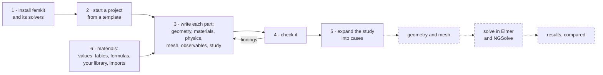

# The femkit manual

**Role:** manual
**Status:** current; what is not built yet is marked so
**Authority:** none of its own: it shows what femkit does, and the basic
tests run each example and hold it to what femkit prints

This manual is for the person who uses femkit: what to type, what to write,
and what femkit says back, step by step. Every example in it is real: the
tests run each one, in order, on a fresh machine of their own, and check
that femkit prints exactly what the manual shows.

## The way from an idea to a result

You describe a calculation once, in a project of small files you write in
your own editor; femkit checks them, says what is wrong and what would be
right, and turns your study into calculations. Running those calculations is
not built yet ([plan](../plans/plan.md) § 4, X).

The dashed steps are not built yet.

## Chapters

1. [Install and set up](1-install.md) — the install, the commands you type
   every day, your settings, and where femkit keeps its files.
2. [Start a project](2-start-a-project.md) — your projects root, the
   templates, and a copy of one of your own projects.
3. [Write each part](3-write-each-part.md) — the project file, a material,
   a component, the physics, a mesh recipe, observables and a study, each
   with a whole example and a mistake.
4. [Check it](4-check-it.md) — reading `project check`: errors, warnings
   and notes, the file and key of each, what would be right; the project as
   a graph.
5. [Studies and cases](5-studies-and-cases.md) — what a case is, expanding a
   study into its cases, and why a changed file makes new ones.
6. [Materials](6-materials.md) — a material's datasets — a value, a table, a
   formula — refractive index or permittivity, your library, and importing
   from refractiveindex.info.

## How to read the examples

- In a `console` block, a line opening with `$ ` is what you type, and the
  lines under it are what femkit prints back. The tests run every such
  block, so it shows what femkit prints today; each chapter's blocks run in
  order, as one session, starting in your home folder on a machine where
  femkit is installed and nothing else is set.
- `femkit` is the command the install writes; it works in any folder once
  you have entered femkit's environment (chapter 1). Inside a project's
  folder, a command works on that project; elsewhere, `--project NAME` names
  it.
- Every `--help`, and every comment in the files femkit starts you with,
  ends by naming the chapter here that explains it:
  `(manual: 4 · Check it)`.
- The examples answer `--yes`, so a command that changes something runs
  without asking; typed without it, femkit shows its plan and asks whether
  to proceed first.
- Where femkit prints your home folder in full, the manual shows
  `/home/you`. The date and time in a log folder's name, such as
  `20261125T164608.901212Z`, is when the command ran.
- A change to a file is shown as a `diff`: remove the lines marked `-`, and
  write the lines marked `+` in their place.
- A block of `bash` lines is shown but not run by the tests: installing,
  `doctor`, the web page.

## Words femkit uses

| word | means | chapter |
|---|---|---|
| projects root | the one folder that holds all your projects and your material library | 1, 2 |
| template | a whole, working project femkit ships, which you copy to start | 2 |
| part | one file of a project: the project file, a material, a component, a physics, a mesh recipe, an observable set, a study | 3 |
| key | one setting in a file, written `name = value`; `assign.high.material` is `material` under `[assign.high]` | 3 |
| component | one geometry: its script, and the file saying what it needs and promises | 3 |
| group | a named piece of a geometry — a body, a face, an edge or a point — that its script promises | 3 |
| engine | a solver: Elmer or NGSolve | 1 |
| plan | the numbered steps a command will take, shown before it changes anything | 1 |
| finding | something `project check` says about your files: an error (`x`), a warning (`!`) or a note (`-`) | 4 |
| study | what to solve, on which component, and what varies | 3, 5 |
| axis | one thing a study varies, with its values | 5 |
| case | one calculation: your study's settings at one point of its sweep | 5 |
| dataset | one source's values for a property of a material: a value, a table or a formula | 6 |
| SHA-256 | a 64-character fingerprint computed from a file's bytes; it changes when any byte does | 3, 6 |
| material library | your materials shared by all your projects, in the projects root's `materials/`; femkit calls it the global library | 2, 6 |
| `GLOBAL/` | opens a material's name that means your library's | 6 |

## Where else to look

- Every key of every file, with its type and default:
  [parts](../reference/parts.md), [cases](../reference/cases.md),
  [settings](../reference/config.md).
- The science behind each physics and material:
  [electrostatics](../science/electrostatics.md),
  [material data](../science/material-data.md).
