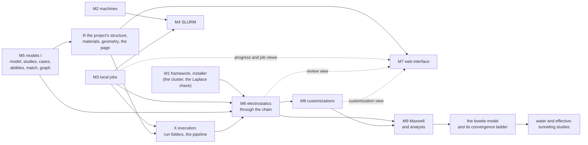

# femkit plan

**Role:** plan
**Status:** current
**Authority:** open work only, in its order, with its acceptance and its review;
`docs/contracts/` governs the code, and this plan never overrides a contract

## 1. Goal and where femkit stands

**Goal.** femkit makes a finite-element result inspectable and reproducible,
from physical intent through visualization, on a workstation or a cluster
([`../design.md`](../design.md)). This plan's end is the plasmonic bowtie
nanogap studied on a cluster: described once, solved by Elmer and by NGSolve,
each engine first proven on analytic benchmarks, the two cross-checked, and the
numerical convergence shown before any physical study (§ 3, after M9).

**Built**, with the basic test tier covering it:

- the framework — operations, plan and apply, event logs, locks, state machines,
  the generic command line;
- the installer — the install script, which lists every conda, mamba and
  micromamba in reach and proposes one; the control environment; engine
  environments built from pinned sources with their toolchain proven first and
  validated by their checks; the conda and mamba manager kinds (mamba 1.x and
  2.x); the live line of a running step;
- the machine probe, its record and `doctor`; per-machine activation settings;
- exact quantities: the unit table, its one grammar and conversion
  ([`../contracts/core.md`](../contracts/core.md) § 11);
- the web server: `serve` and its supervisor, the server's state observed from
  its lock and pidfile, and the routes in token mode
  ([`../contracts/web.md`](../contracts/web.md) § 1, § 4, § 5); the page's
  operation and progress views, served and built from the `web` environment
  ([`../contracts/web.md`](../contracts/web.md) § 3, [`../contracts/definitions.md`](../contracts/definitions.md) § 4.7);
- every manager command run in femkit's own places — its home, package cache
  and list of environments under `<cache>/`
  ([`../contracts/envs.md`](../contracts/envs.md) § 4.4).

**Proven**: on a workstation, a clean `env bootstrap` with conda, and again with
mamba 2.9.0, builds and validates `elmer` (seven checks) and `ngsolve` (six),
writes the machine record, and `doctor` reports the machine ready.

**Being tested by the person on the cluster** (M1): the bootstrap with the
cluster's mamba module inside an allocation, and the CUDA environments.

**Designed, not built**: describing, matching, preparing and reducing a
calculation ([`../contracts/models.md`](../contracts/models.md),
[ADR 0008](../decisions/0008-one-model-declared-abilities.md)); the web
interface's model graph, match overlay, sign-in, TLS and uploads
([`../contracts/web.md`](../contracts/web.md),
[ADR 0009](../decisions/0009-web-front-end.md)); running jobs (M3, M4); the
project's structure, materials, geometry and the page (R, ADRs 0010–0014).

## 2. How the work is done

The rules live in [`../process/conventions.md`](../process/conventions.md); in
one line each:

- **Order:** architecture, then framework and API, then the contract, and the
  code last (§ 1); a design change is proposed and agreed before it is
  written; a measured defect is fixed directly.
- **Discipline:** declarations, not branches; one fact, one home; the core is
  the only way to write a file, start a process or take a lock (§ 2, § 3).
- **Tests:** written from the contract and seen to fail with the rule broken,
  before the implementation ([`../contracts/testing.md`](../contracts/testing.md)
  § 3); the basic tier after every step, the field tier where the change
  reaches it.
- **The person decides**: environment changes, cluster runs, commits and pushes,
  and design changes (§ 6). A changed definition is solved whole, every `-cuda`
  environment included, before it is pushed. A note is a lead, never evidence.

**Review schedule** (`conventions.md` § 1, step 7, defines each review):

| when | what | by |
|---|---|---|
| every step | the unit against its contract, then its callers, then its domain; findings fixed; landed work removed from this plan | the author |
| every milestone's end | its acceptance and its tier green, then the independent review on separate aspects | independent reviewers; the person agrees before work that depends on the milestone starts — milestones that depend on nothing run side by side |
| before a branch merges into `main` | the basic tier, the field tier where the change reaches it, and a consistency review of every merged document | the author; the person agrees |

## 3. Milestones

| milestone | goal | needs |
|---|---|---|
| **M1** | the installer proven on the cluster, CUDA environments included; the installed solvers checked on an exact answer | — (its cluster items: the person's runs) |
| **M2** | the cluster's scheduler read for real | — |
| **M3** | jobs prepared and run on the workstation | — |
| **M4** | jobs submitted to SLURM | M2, M3 |
| **M5** | a calculation described, expanded and matched against an environment, with every limitation shown | — |
| **R** | the project as parts in a fixed tree behind one door; materials in femkit's format with libraries; geometry as the person's Gmsh script under a contract; the page describing the structure | M5 |
| **X** | every step run from a run folder: the geometry script, the mesh step, the solve | R, M3 |
| **M6** | `electrostatics` through the whole chain in both engines, its abilities proven | M1's exact-answer check, M3, M5, R, X |
| **M7** | the web interface and its server | M5, R, and M3's detached process; its progress and job views M3, its review view M6, its customization view M8 |
| **M8** | customizations | M6 |
| **M9** | frequency-domain Maxwell in both engines, and analysis | M6, M8 |

Then the bowtie model and its numerical convergence ladder (its data: § 5), and
only after the classical model is converged and cross-checked, the water and
effective-tunneling studies.

### M1 — framework, installer, tests

- **An installed-solver check with an exact answer**, shipped as a check of
  each CPU environment (`definitions.md` § 5), its expectations in the
  definition: Laplace on the unit square, 0 V on the left, 1 V on the right,
  insulated top and bottom, whose exact potential is φ = x. Elmer runs Gmsh,
  ElmerGrid and ElmerSolver to a VTU field; NGSolve solves the same case.
  Proposed expectations: every nodal |φ − x| ≤ 1e-7, at least 200 cells and 50
  interior points, area 1 ± 1e-8 — a linear field reproduced to rounding,
  which shows the solver runs, not that a translation is right (M6 proves
  translations). Elmer's case also runs threaded and on two ranks, the three
  agreeing.
- **Rebuilding from a saved lock** is shown once: an environment created from
  its lock (`envs.md` § 4.3) gives the same manifest.
- **A failed step shows its reason.** A step's tail on screen can miss the
  error a tool printed first and its progress after (mamba 2.9.0 does);
  the failure shows the log's error lines with its last lines.
- **A changed definition is solved whole** (`conventions.md` § 6): a check
  that dry-run solves every environment, each `-cuda` one included, with each
  manager kind.
- **The driver's CUDA version**, read on a GPU node, kept in the machine record
  and checked at install against each CUDA environment's toolkit — refused,
  naming both, when the driver is older, since what would be built could not
  run here (`framework.md` § 4). The driver is the machine's: femkit never
  installs or changes it. Its contract is written first.
- **Entering through the activate hook** where the manager kind's `run`
  cannot start a command, with the text of that failure in the kind
  (`envs.md` § 4.4).
- **On the cluster** (the person's runs):
  - `env bootstrap` with the cluster's mamba module, inside an allocation;
  - `ngsolve-cuda` and `elmer-cuda` built from the CUDA toolkit as its
    metapackage composes it, less its profilers (ADRs 0003, 0004), and
    validated with `--gpu` on a GPU node, settling whether nvcc's host compiler and CMake's CUDA toolkit are found
    inside the prefix without `CMAKE_CUDA_HOST_COMPILER` and `CUDAToolkit_ROOT`
    — Elmer finds AmgX through CMake's old FindCUDA module, which the pinned
    CMake 4.5 still offers — and whether a CUDA build starts on a node without
    the NVIDIA driver;
  - the GPU failure cases, each a failed check with its reason, never a false
    pass: a GPU whose architecture the build was not compiled for, running out
    of device memory, and ranks mapped to GPUs in a multi-rank GPU run (every
    shipped device check uses one rank and one device, while `jobs.md` § 2
    allows `gpus > 1`);
  - the `micromamba` kind file. A kind is chosen by more than the executable's
    file name: a `mamba` link to micromamba would otherwise get the wrong kind
    file.

### M2 — machines

`job probe` and `job machines` are built. Open: the SLURM readers
(`femkit/schedulers/slurm.py`) have read only made-up text; the field test on
the cluster's login node (`tests/field/test_job_probe.py`) is their first real
reading, and settles the `sacctmgr` column names and the shape of
`scontrol show node -o` there.

### M3 — local jobs

Job request, prepare, run script, run state machine;
`job prepare|launch|status|cancel` on the workstation; the engine tier. Open:

- how `env validate --gpu` is requested as a job (`envs.md` § 5): its command
  runs femkit, in the control environment, from the target's checkout;
- a run script starts its engine from none of the variables a shell or a
  cluster module set that redirect it — Elmer reads `ELMER_HOME`, `ELMER_LIB`
  and `ELMER_MODULES_PATH` to find its solver modules (`jobs.md` § 4);
- a run's state does not rest on the engine's exit status alone: Elmer is
  reported to exit 0 when a solver module fails to load (not yet measured);
- the core building block for a detached process, shared with the web server
  (`core.md` § 8);
- a prepared case's job (`jobs.md` § 1): its `job.toml` with input hashes,
  steps and the environment it was prepared for — its inputs' hashes checked
  at `job prepare`, the environment warned there and checked by the run
  script (`jobs.md` § 4).

Acceptance: a job prepared, launched, watched and ended on the workstation;
one cancelled; a killed run told from a failed one; the engine tier's first
case run through `job launch`.

### M4 — SLURM

The `slurm` kind's remaining parts and its readers in `femkit/schedulers/`
(`jobs.md` § 7); cluster probing and carrying a record; header, submission,
query, cancel, `launch --check`. The fit of a request against the machine
record and its wording follow `framework.md` § 4. Field tier on the cluster:
the readers' first real reading is M2's field test there. Acceptance: a job
submitted, queried and cancelled on the cluster; `launch --check` naming a
request the record cannot fit.

### M5 — models I

All by [`../contracts/models.md`](../contracts/models.md):

1. **The project, the model, studies and cases.** Built: the model and study
   schemas, each reference field annotated with its target type (`core.md`
   § 2), loaded with their first tier of validity — types, unknown keys,
   quantities, parameters and their arithmetic, references — and the job
   request's resources they bind; `model check`, the second tier: what is
   missing, and what the formulation does not allow; `study expand`, case
   IDs and `case.json` in their canonical form, tabulated materials converted
   to the model's convention with the passivity check, a case outside a
   property's range refused; `study copy`; `case list`. Open: `case list`'s
   match and preparation columns, which come with step 3 and M6.
2. **Formulations and meshers as definition types** (`definitions.md` § 1).
   Built: the formulation type, and `electrostatics` with its science document,
   its constants, and its first benchmark, `two_material`, checked by
   `schema check`; the mesher type, `gmsh` and `netgen`. The manufactured
   benchmarks come with the expression language (M6).
3. **Abilities**: their schema; each one's digest; the abilities, default
   mesher, extension points and engine-only options of `elmer` and `ngsolve`
   for `electrostatics`; the proof record's schema; `case match` and
   `study match`; decisions and their staleness.
4. **The graph and its edits.** Built: the address grammar; comment-preserving
   TOML editing in `core/persist.py`; `model graph` with `--mermaid`,
   `model set`, `model unset`, `model rename`; the Laplace model built from an
   empty folder by `model set` alone — all reshaped by R (the `project …`
   edits). Open: `project graph
   --environment`, which overlays the match report (step 3).

Acceptance: the Laplace model built from an empty folder by `model set` alone,
each intermediate state loadable, its findings shrinking to none; "500 nm" and
"0.5 µm" giving one case ID; a decision changing no case ID and going stale
when its ability's digest changes; a match line for each translation status
M5 can reach — `exact`, `approximated`, `unsupported`, `engine-only` — and for
`proven` and `unproven`, with a proof record written by the test.

### R — the project's structure, its data, and the page

By [ADR 0010](../decisions/0010-describe-the-system.md)–[ADR 0014](../decisions/0014-materials.md),
[`../contracts/projects.md`](../contracts/projects.md),
[`../contracts/materials.md`](../contracts/materials.md),
[`../contracts/geometry.md`](../contracts/geometry.md), and the parts of the
other contracts that carry § 6's decisions. Each step ends with tests seen to fail with
their rule broken, the basic tier green, an independent review against the
contracts and [`../process/conventions.md`](../process/conventions.md) § 2, and
the person's agreement before the next step starts. Running anything — the
geometry script, meshing, solving — is milestone X, designed after R.

- **B. A clean base.** Every uncommitted change is read against the agreed
  contracts: what fits is kept, what was made for the first web design or is
  redundant, unused or duplicated is removed — the tests that read source
  code among it (`testing.md` § 3); the result is committed in pieces the
  person approves. Acceptance: the basic tier green; the review finding nothing
  left that no contract asks for, and no test that reads code.
- **C. The framework.** `femkit/projects/` — the layout as data, names as
  paths and grouping folders, transactions and undo, addresses, opening a
  project part by part, naming a project by its path or the folder a command
  runs in — with every existing reader and writer of project files moved onto
  it; state machines declared as data (`core.md` § 7); the one-way rules of
  `framework.md` § 1, held by design and checked by the step's review of the
  source. Acceptance, through the API: a part broken by hand is a finding and
  blocks no edit of another part; a part renamed into another group with every
  reference to it rewritten, in one undo; undo reaching back as far as
  `projects.undo` says and no further; a project named from the root and from
  inside its folder alike; a project zipped and unpacked under another root
  opening as before. The review finds no package but `projects` forming a
  project path or opening a project's file.
- **D. The parts.** The schemas of the new tree: the project file and its
  parameters, a component's contract and its assignment, a physics, a mesh
  recipe, an observable set, a study with its steps and axes by address, an
  analysis, and the new `case.json`; `project new`; the graph document over
  parts; the Laplace and `two_material` benchmarks moved into the new tree,
  each geometry an example script with its contract. Acceptance: both projects
  open in the new tree; `project check` checking every pairing from the
  contracts — a group a physics needs that the component does not promise a
  finding on the study — and marking unchecked what needs the geometry.
- **E. Materials.** The property list, the dispersion models, the material
  format, the global and local libraries, a property's data for a case,
  `material add`, the refractiveindex.info importer (its YAML library an
  environment change, the person's), each formulation naming the list's
  properties and the variable its step kind supplies. Acceptance: the
  `two_material` benchmark's materials read from its own files and
  `study expand` giving one case per point; a `GLOBAL/` name taking the global
  library's and any other the project's first; each case's origin, dataset and
  source shown in `case list`'s and a result's text; a new projects root
  receiving femkit's shipped materials, and a changed shipped material offered,
  never applied; a dataset varying with a variable the step does not supply
  refused; an edited global material making new cases on expansion, the old
  ones kept and flagged by `case list`.
- **F. Detail as text.** Each part's text and the help of every key it may
  hold; `project write` as one transaction; templates generated from the
  schemas, the formulation and the property list. Acceptance: every action the
  graph document offers plans; a written text keeps its comments; the Laplace
  project's detail written from templates and its example script alone.
- **G. The page.** The Project workspace — the overview and the detail views,
  the grouping boxes, the diagram arranging itself with Tidy and its view file,
  the editor with its help for every part and the geometry script, the palette
  of templates and the library, the next step in view — Operations and
  Documents, and Runs as far as cases and `study expand` (the rest waits on X,
  M3 and M6); the first page's files removed; the layout library (dagre or
  ELK) a new dependency, the person's. Acceptance: the Laplace project built in
  the page from a new project, by mouse and by keyboard; the page still working
  on a project whose fields and kinds are renamed; the review finding no field,
  kind, operation, address or sentence named in the page's code, no style
  outside its layers and no hand-written type of server data; every element
  exercised in a browser.
- **H. Use.** The keyboard, the undo notification, the project chooser, what an
  action selects, errors at their text's line, the narrow screen's drawers.
  Acceptance: the Laplace project built and changed by keyboard alone; every
  workspace usable at the narrowest width the page declares; an independent
  review of the whole page against `conventions.md` § 2.1.

### X — execution: run folders and the pipeline

By the person's direction (plan § 6), designed after R, with molbuilder's job
set and run folder as the blueprint — the design copied, stated in femkit's own
words. A step runs only from a run folder: femkit constructs a run script that
puts the step's inputs together and runs inside the step's environment,
assuming nothing else, on a workstation or a cluster alike; it watches the run,
and the run's outputs land in its folder. Its contract is checked before and
after ([`../contracts/geometry.md`](../contracts/geometry.md) § 4). In it:

- the run folder and run script, monitoring and results — the design of M3's
  job and run, made one with the pipeline;
- the three steps: the person's geometry script, femkit's mesh step with its
  recipe, the engine's solve; the geometry's file format chosen by measurement;
- the mesh step's environment, proposed as `gmsh` (an environment change, the
  person's), and how a geometry script's imports are provided; the hand-over
  to Elmer through ElmerGrid and to NGSolve through femkit's own layer, its
  region names proven; the model's shape kinds and `netgen.toml` removed; the
  benchmarks converted to example scripts with contracts;
- after X, not in it: importing a CAD file through a standard import script.

Acceptance: the Laplace and `two_material` geometry built from their scripts in
run folders; a run refused before it starts for a missing parameter or a file
whose hash differs, and after it for a promised group missing or empty; the
geometry file's format chosen by measurement and recorded; a sweep of a
parameter the script reads making one geometry and one mesh per value, a sweep
of one it does not read making one in all; a failed run's log kept in its
folder; NGSolve's mesh holding every group by name. Done before M6's
translators.

### M6 — electrostatics through the chain

1. **The engine boundary**: the documents crossing into an environment, defined
   once in `femkit/engines/`; the check fingerprint narrowed to the checks and
   their readers first, so a translator's change does not mark its environment
   `unchecked` (§ 4).
2. **Translators, parsers and finalizers** for `electrostatics` in both
   engines, each reading the mesh the one mesh path hands it (X); `case prepare`,
   `study prepare`, the manifest and the preparation state machine.
3. **Jobs run prepared cases** (`jobs.md` § 1, § 4): `case prepare` writes the
   calculation folder's `job.toml`; `job prepare`'s plan shows the review from
   `job.toml`.
4. **The expression language** for spatial functions — sources, boundary
   values, manufactured solutions, observables such as `|φ − x|` — and complex
   constants (`"-11.7 + 1.26i"`), parsed by femkit, never evaluated as code,
   translated per engine (§ 6).
5. **Results**: the `results` domain and its contract; `run reduce`,
   `result show`, `result compare`; `formulation verify` and `--record`, and
   the proof record.

Acceptance: the `electrostatics` benchmark set passing in both engines — a
manufactured, non-polynomial solution converging at its element degree's
rate, and a two-material case with the right interface jump — each ability
recorded as proven; the Laplace case through the chain with M1's thresholds,
through the one mesh path, each result
`exact`; a file edited in `final/` making the preparation `stale` and refused
by the job.

### M7 — the web interface

By [`../contracts/web.md`](../contracts/web.md):

Built: the routes of `web.md` § 1 but uploads and sign-in; `serve`, its
five verbs as operations, the server's state machine observed from its lock and
pidfile, the supervisor, the rotated log; token-mode access with the `Host`,
`Origin`, write and size checks and the response headers; the page's operation
and progress views, from the registry's schemas, and `web build`; the document
viewer, in a tab of its own; the Model, Runs and Operations workspaces over
`model graph` and the edits — the first page, which item 3 replaces. Open:

1. **`serve` on a cluster**: the Unix socket on a login node, reached through
   `ssh -L`, and the manager's femkit-owned home with the cluster's mamba
   module — its root prefix unchanged by it (the person's run); two `start`s at
   the same instant, one refused.
2. **Access** (`web.md` § 5): TLS from files with the key's mode checked, or
   behind one proxy; sign-in with PKCE, issuer-bound allow-list entries, the
   round-trip cookie and server-side sessions; `--no-auth`; the upload route;
   the plan digest made of facts, not human text (§ 4). Acceptance: the token
   in no log, argument or environment of any process; no cookie in token mode;
   a correct token served while a thousand wrong ones are in flight at once;
   `--no-auth` on a socket refused; a sign-in configuration without an
   allow-list refused, and a removed account's session ended at once, and one
   edit of `config.toml` enough to do it; the CSP holding on a headless load of
   the built page; a connection from another account on a socket refused
   (`SO_PEERCRED`); no other program able to take the address while a child
   respawns; a runtime folder others can enter, or under a folder others can
   write, refused; `--no-auth` with `web.trust_proxy` refused; an upload over
   its quota, or naming a project outside the projects folder, refused;
   `SECURITY.md` saying what femkit then stores — the token, the session key, a
   provider's client secret — where, and that a browser extension with access
   to the page can act as the person, so a profile without extensions is used.
3. **The page**, describing the project's structure: plan § 3, R step G.
4. **The match overlay**: each node marked with its worst match line for a
   chosen environment; an open line offering the decisions that resolve it,
   and, once M8 lands, the customizations.
5. **Review, jobs and results**, as M3 and M6 land: `job prepare`'s
   review; runs and their states; result tables, and where each
   field file is for ParaView.

### M8 — customizations

`overlay`, `replace` and `step` first; `hook` and `custom-input` when a first
real case needs them (`models.md` § 8); their combination rules; the
customization's operation and its name rule; steps in the run script
(`jobs.md` § 4); a post-processing job over an earlier run's outputs.
Acceptance: a case with an `unsupported` line prepared with a customization
covering it, the affected observable `customized`; two overlays setting one
keyword refused; a customization whose `interface` the translator no longer
offers refused; a name starting with `.` or naming `..` refused; a changed
customization file making the preparation `stale`.

### M9 — Maxwell and analysis

1. **`maxwell`**: its data file and science document; conventions —
   the phasor sign, peak or RMS — with material conversion and the passivity
   check ([`../science/electromagnetics.md`](../science/electromagnetics.md));
   `radiation` and each environment's truncation — NGSolve's perfectly matched
   layer, Elmer's first-order absorbing condition (its `VectorHelmholtz` has
   no layer); the plane-wave source and its normalization; the reductions Elmer
   can compute only inside its input; its benchmark set — TE and TM cases in
   2-D, a reflection benchmark per truncation, and a lossy sphere against its
   series solution, absorbed power positive — passing in both engines.
2. **Analysis**, with its own contract when it is built:
   - **Products.** Beside each result document, ordinary tables and field
     files, for example `scalar-metrics.csv` (one row per case or frequency),
     probe profiles under `probes/`, `convergence.csv`, `mesh-summary.json`
     and the ParaView-readable fields under `fields/`. Their names become
     contractual with their schemas; large arrays stay in field and table
     files, never in JSON.
   - **Convergence over an axis**, from each result's measured mesh size and
     unknowns, and **pattern-aware**: whether the spatial pattern of the
     solution changes, not only its maximum — the relative change of integrated
     and averaged observables, the normalized correlation of complex field or
     intensity profiles, the shift of dominant peaks, sign and phase
     consistency where meaningful, the energy-balance or power residual, and
     for spectral studies the change of resonance wavelength and linewidth.
   - **Detection, parsing and scientific interpretation** as separate steps;
     every reduction recording its field source and expression; failed and
     unconverged attempts analyzable, labeled as such.

Completion gate: a small analytic Maxwell model is described once, matched
against both environments with every match line resolved, prepared
reproducibly for both, run as jobs, and reduced to comparable numerical tables
— with its field files ready for ParaView — without any manual GUI action.

### Tests across M5–M9

Each milestone's acceptance above, and throughout: strict schema round trips
and unknown-key refusal; unit conversion and coordinate-frame tests; region
coverage, overlap and gap refusals; material interpolation against fixed
reference points; mesh manifests and region maps complete, regions' measures
compared with their geometry's; parser fixtures for successful, failed and truncated
solver output; reductions tested on synthetic complex fields with known
answers; convergence tests that tell amplitude agreement from pattern change;
comparisons refused for `unverified` or `custom-input` observables and across
differing normalization, each side's fidelity shown; the ParaView
artifact catalogue, without importing VTK in the control process.

## 4. Framework debts, not yet scheduled

Each makes a likely future change touch generic code; each is fixed when the
milestone that first needs it starts, or sooner if cheap.

- **The GPU stack is CUDA by name**: the `[cuda]` part and `<name>-cuda`
  environments (ADR 0005), the `nvidia-smi` query, the CUDA architecture
  setting. A second stack (ROCm) would need a small declared GPU-stack kind —
  its CMake variable, architecture query, visibility and model queries — in
  their place.
- **Check kinds are dispatched in seven places** (`checks.py`, the `Check`
  model's optional fields); `ranks` means "launch this many" for `command` and
  "what the log must report" for `ctest`. One model per kind, as a discriminated
  union, and one table of what each kind does.
- **The check fingerprint lists its shared files by hand** (`checks.JUDGING`)
  and hashes every file of the engine package: a change to `cuda.py` marks the
  CPU environments `unchecked`, and a translator's change would too. Count only
  what each environment's checks import — first needed by M6.
- **Manager facts in generic code**: the activation variables
  (`envs/manager.py`), `conda-meta` spelled three times (`envs/state.py`,
  `jobs/probe.py`, `jobs/setup.py`), the explicit-lock parser in
  `envs/install.py`. Each becomes a manager-kind field or a registered reader.
- **The engine adapter is a set of module attributes** (`engines/__init__.py`);
  a missing one raises `AttributeError` (exit 1), not `DefinitionError`.
- **The engine-version rule is looser in code than in `definitions.md` § 5.3**:
  `engines/summary.py` accepts a summary without the engine's version entry, and
  Elmer's mesh check writes none.
- **The web's plan digest covers human text** (a step's `describe` carries the
  free space), so it can call a plan stale when no fact changed — first needed
  by M7.
- **A run copies its inputs** (`jobs.md` § 1), so a large mesh is kept in
  `final/` and again in every run.
- **`maturity` has no reader**; **`env plan` repeats `install --dry-run`**;
  **`doctor` prints the preamble's two commands under both the configuration
  and the record row**. Each is deleted, given its one use, or said once.

## 5. The bowtie model's data

What the bowtie model must state before it is prepared, beyond what every model
states (`models.md` § 3, § 5):

- **Geometry:** the main axis and the polarization axis; every dimension and
  the construction, its gap and lengths as parameters; named domains,
  boundaries and interfaces; named edges and points (for mesh sizes at the
  tips), each a group its component's contract promises (`geometry.md` § 3); probe planes
  as observables' supports; no unwanted buried or overlapping interfaces.
- **Materials:** the complex relative permittivity of each metal with its
  source, its convention, wavelength range and interpolation rule; water or
  air; the effective tunneling region and its conductivity law, marked as a
  phenomenological model.
- **Numerical policy:** the outer-domain extent and each environment's
  truncation of it; the
  element family, degree and geometry order; the gap, metal-surface, bulk and
  layer mesh sizes in a frame unit fit for a nanometre gap; mesh growth
  and quality limits; solver tolerance and iteration limits.
- **Observables:** the complex field and its amplitude enhancement at the gap
  center; the gap-volume means of amplitude and intensity enhancement and of
  the |E/E₀|⁴ proxy; field profiles along the main axis and through the gap
  normal; samples on explicitly defined vertical center planes; the power
  absorbed in each metal body and the leakage region; the resonance wavelength
  and linewidth when a spectral study exists. A point maximum may be reported
  as a diagnostic, never as the only convergence criterion.

## 6. Decisions

**Taken on the author's recommendation, open to the person's veto** (recorded in
the contracts):

- A case is the project's description of one calculation and one axis point —
  proposed: the component, the physics, the materials' data, the mesh recipe,
  the numerics; everything bound to an environment lives in the study and is
  recorded in each preparation's manifest (`models.md` § 5.3, § 9.4).
- An ability counts once proven per environment by a benchmark set; results
  resting on an accepted unproven line are `unverified` and refused in
  comparisons (`models.md` § 6.3, § 10).
- A prepared case's environment folder is a job's calculation folder, in the
  project's run folders, designed with X (`projects.md` § 2, `jobs.md` § 1).
- On a cluster login node the web server listens on a Unix socket, and its
  token travels in the address's fragment, never a cookie (`web.md` § 4,
  § 5).

**Taken by the person** (2026-11-23), in ADRs 0010–0014 and the contracts,
approved as written:

- The page describes the structure; each part's detail is commented text with
  its help beside it; templates are generated, never written by hand — a
  geometry's start is an example script, since geometry is the person's.
- A projects root holds a global material library and the projects; one module
  is the only door for reading and writing a project; a command names a project
  as a whole, by its path from the root or the folder it runs in; a project is
  one folder, which can be zipped and moved to another root.
- The project file names its components and studies; components, physics, mesh
  recipes, observable sets, studies and analyses each have a folder of their
  own, as COMSOL's tree shows them; physics, recipes and observable sets name
  groups, and a study pairs them with a component, the pairing checked before
  anything runs; analyses read studies' results. Parts of every kind may be
  grouped in folders: a name is a path, and a folder only groups.
- Geometry is the person's full Gmsh script, wrapped by a contract — the inputs
  checked before it runs, the file and named groups it promises checked after —
  and the pipeline is three steps, each so wrapped: geometry, femkit's mesh step
  with its recipe (the geometry order in the recipe), the engine's solve.
  femkit hands NGSolve its mesh, so NGSolve never deals with file formats. The
  model's shape kinds are removed; femkit ships examples and one guide;
  importing CAD files is a later script under the same contract.
- Anything runs only from a run folder, through a run script femkit constructs,
  inside the step's environment, watched, its results in its folder — designed
  after the structure, data and page, from molbuilder's job set and run folder
  (milestone X).
- Materials are in femkit's own format: one common name per property and its
  name in each engine; every value validated, with its source and an explicit,
  translatable unit; importers bring other sources into a library. `GLOBAL/`
  names the global library's material; any other name is the project's own
  first, then the global one; where each came from is shown in every log and
  result. femkit's shipped materials are copied into the global library when it
  is first made, updates offered and never applied silently.
- A formulation is a family (the equations) and a step kind (the kind of
  calculation), each declared as data in a family tree that is extended by
  adding entries; several physics are solved in turn, as a study's steps
  handing results forward, or together, joined by declared couplings
  (`models.md` § 4).
- Only data, facts and design are the project's protected data: where the page
  draws a node is arranged by itself in the chain's order, with a Tidy button;
  positions the person chooses to remember are kept in `.femkit/view.json` by
  `project view`, never an edit, never undone, never read by a case, a run or a
  check (`projects.md` § 2, `web.md` § 2.2).
- Coordinates carry their unit in a physics, a mesh recipe and an observable
  set, which serve any component; only the geometry script's own numbers are
  bare (`models.md` § 3). A material dataset missing its source, convention or
  range is a finding of `project check` while it is written, and refused by
  `study expand` (`materials.md` § 3).
- How many edits undo reaches back is a setting, `projects.undo` in
  `config.toml`, 100 when unset (`projects.md` § 7).
- The editing commands are `project …` — `project check`, `project write`,
  `project undo`, `project graph` — in place of today's `model …`
  (`models.md` § 11.1).
- The framework is layered, each concern in one module — the project door,
  units, materials, geometry — handling files and information one way, with no
  duplicated or hand-made code; data files and state machines drive it; each
  one-way rule is held by design and by each milestone's review of the source;
  tests check the API and never read code (`framework.md` § 1, `testing.md`
  § 3).

**Open, the person's** (the proposed answer in each contract):

- **A YAML library** for the refractiveindex.info importer, an environment
  change (R step E).
- **A layout library** for the page's automatic arrangement — dagre or ELK —
  a new dependency of the page (R step G).
- With execution (X): absorbing layers made by the mesh step per environment,
  or promised by the geometry (`geometry.md` § 8); the `gmsh` environment, an
  environment change.

- **CUDA versions:** keep 12.8 for `elmer-cuda` and 12.9 for `ngsolve-cuda`
  (recommended: the pinned engines' evidence, ADRs 0003 and 0004); or try 13 —
  for `ngsolve-cuda` untested, for `elmer-cuda` only after Elmer's
  `FindAMGX.cmake` stops requiring the removed NVTX version 2.
- **The expression language** (M6): a small grammar — numbers, parameters,
  coordinates, `+ − × ÷ ^`, `sin cos exp sqrt abs`, the imaginary unit —
  parsed by femkit and translated per engine (recommended), or each engine's
  own expression syntax inside its own block (not recommended: a model would
  no longer be solver-neutral).

## 7. Not scheduled: jobs across several nodes

A job runs on one node (`jobs.md` § 2). It stays that way unless one node turns
out to be too small for a real study, and the cluster's own documentation shows
that multi-node MPI is supported. The framework is ready for it: the request,
the record, the fit and the header can all be extended without changing how they
are built. What each piece would need:

- a `nodes` field in the request (`memory` and `gpus` are already per node);
- the partition's node limit, which the probe already reads, kept in the record;
- a fit worked out per node;
- one more line in the scheduler kind's header;
- the run's node list recorded in its outcome.

The real cost is not in femkit. The environment's MPI must start ranks through
the scheduler and use the cluster's fast network, not quietly fall back to TCP.
Showing that it does needs a validation job that runs across several nodes. That
may mean building against the cluster's own MPI, which is a deployment decision.
