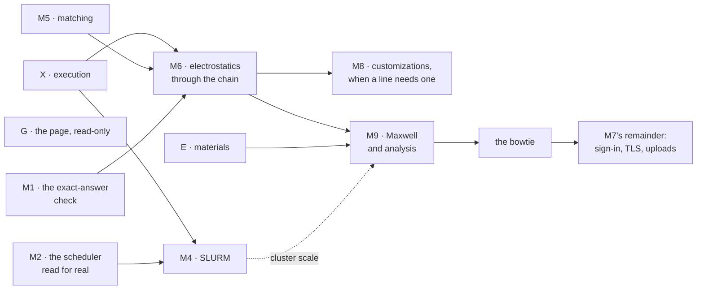

# femkit plan

**Role:** plan
**Status:** current
**Authority:** open work only, its order and its acceptance; `docs/contracts/`
governs the code, and this plan never overrides a contract

## 1. Goal and where femkit stands

**Goal.** femkit makes a finite-element result inspectable and reproducible,
from physical intent through visualization, on a workstation or a cluster
([`../design.md`](../design.md)). This plan's end is the plasmonic bowtie
nanogap studied on a cluster: described once, solved by Elmer and by NGSolve,
each engine first proven on analytic benchmarks, the two cross-checked, and the
numerical convergence shown before any physical study (§ 4, the bowtie; its
data, § 8).

**The person's model.** The person writes every part of a project — its
parameters, geometry script, materials, physics, mesh recipe, observables and
studies — in their own editor, and femkit changes none of it. femkit starts
them from one set of project templates, checks what they wrote, and says
exactly what is wrong and what would be right. Then it turns the project into calculations:
geometry, mesh and solve, each run from a folder the person can open, in either
engine, with the results reduced and compared.

**Built**, with the basic test tier covering it:

- the framework: operations, plan and apply, event logs, locks, every state
  machine declared as data, the generic command line; every result a report the
  terminal writes and the page draws ([`../contracts/web.md`](../contracts/web.md)
  § 7.6); every refusal with its kind, code and subject
  ([`../contracts/core.md`](../contracts/core.md) § 9); exact quantities, the
  unit table and its one grammar (§ 11 there);
- the installer: the install script, the control environment, engine
  environments built from pinned sources with their toolchain proven first and
  validated by their checks, the conda and mamba manager kinds (mamba 1.x and
  2.x), every manager command run in femkit's own places; the machine probe,
  its record, `doctor`, per-machine activation settings;
- a project written by hand and checked before anything runs
  ([`../contracts/projects.md`](../contracts/projects.md),
  [`../contracts/models.md`](../contracts/models.md),
  [`../contracts/geometry.md`](../contracts/geometry.md),
  [`../contracts/materials.md`](../contracts/materials.md)): the shipped
  layout; every part kind's schema and check — the project file and its
  parameters, a component's contract and its assignment, materials with fixed
  values, physics, mesh recipes, observable sets, studies; one set of
  templates, `laplace_square` and `two_material`, each passing `project check`
  and its comments held to the schemas' help; `project new --from`, `project
  list|check|graph`, `study list|expand`, `case list`; cases named by their
  content;
- the web server: `serve`, its supervisor and rotated log, the routes in token
  mode; the first page — Operations, progress and the documents — and, not yet
  wired in, part of the page's kernel and elements;

**Proven** on a workstation: a clean `env bootstrap` with conda, and again with
mamba 2.9.0, builds and validates `elmer` (seven checks) and `ngsolve` (six),
writes the machine record, and `doctor` reports the machine ready. The person's
cluster runs are open (M1, M7.1).

**Not built**: materials beyond fixed values; running anything from a run folder — geometry, mesh, jobs;
the match against an environment's abilities; translators; results; the
rebuilt page; sign-in, TLS and uploads.

## 2. The person's workflow

The whole way through, each line with the step of § 4 that builds it. The
chain behind it is [`../contracts/models.md`](../contracts/models.md) § 1.

| # | the person | femkit | built by |
|---|---|---|---|
| 1 | `bash scripts/install-env.sh bootstrap` | builds and proves the control, `elmer` and `ngsolve` environments, writes the machine record; `doctor` says ready | built; the cluster runs, M1 |
| 2 | `config set paths.projects '"/data/projects"'` | sets the projects root | built, and `config init` asks for it; seeding its `materials/`, E |
| 3 | `project new bowtie --from laplace_square`, a template, or `--from` a project of theirs | copies it whole, never over an existing project | built |
| 4 | writes each part in their own editor | each key of a template carries its help as its schema states it | built (materials with fixed values); E (tables, the global library, refractiveindex.info files) |
| 5 | `project check` | each finding names the file, the key, what is wrong and what would be right; the first finding is the next step; what needs the built geometry is "not checked yet" | built; the same in the page, read-only, with templates to copy, G |
| 6 | `study expand`, `case list` | one case per axis point; refused while findings stand | built |
| 7 | — | runs the geometry script in a run folder in the `gmsh` environment, checks the promised groups, meshes with the recipe, checks each group's kind and coverage | X |
| 8 | `study match --environment elmer` | each element exact, approximated or unsupported, proven or not; the person answers open lines in the study | M5 |
| 9 | `formulation verify`, `--record` | runs the benchmark jobs; records the proofs | M6 (electrostatics), M9 (Maxwell) |
| 10 | `study prepare` | writes the solver input, its manifest, `job.toml` | M6 |
| 11 | `job prepare`, `job launch\|status\|cancel` | shows the review; runs, watches, cancels | X (workstation), M4 (SLURM) |
| 12 | `run reduce`, `result show\|compare` | the observables of a run; a comparison | M6 |
| 13 | analyses | convergence, the cross-engine check, spectra; fields to ParaView | M9 |
| 14 | the bowtie | the mesh, padding and layer ladder converged and cross-checked; then wavelength, gap, water or air; then tunneling | after M9 |

Throughout: `serve start` on a login node, over a socket reached with `ssh -L`
— built; its cluster run is the person's (M7.1).

## 3. How the work is done

The rules live in [`../process/conventions.md`](../process/conventions.md); in
one line each:

- **Order:** architecture, then framework and API, then the contract, and the
  code last (§ 1); a design change is proposed and agreed before it is
  written; a measured defect is fixed directly.
- **Discipline:** declarations, not branches; one fact, one home; the core is
  the only way to write a file, start a process or take a lock (§ 2, § 3).
- **Tests:** written from the contract and seen to fail with the rule broken,
  before the implementation ([`../contracts/testing.md`](../contracts/testing.md)
  § 3); the basic tier after every step, the field tier where the change
  reaches it.
- **The person decides**: environment changes, cluster runs, commits and pushes,
  and design changes (`conventions.md` § 6). A changed definition is solved whole, every `-cuda`
  environment included, before it is pushed. A note is a lead, never evidence.
- **Parallel helpers**, each on its own files in its own worktree; the main
  line integrates and reviews; long checks run in the background
  (`conventions.md` § 6).

**Review schedule** (`conventions.md` § 1, step 7, defines each review):

| when | what | by |
|---|---|---|
| every step | the unit against its contract, then its callers, then its domain; findings fixed; landed work removed from this plan | the author |
| every milestone's end | its acceptance and its tier green, then the independent review on separate aspects, and a review of the whole system | independent reviewers; the person agrees before work that depends on the milestone starts — milestones that depend on nothing run side by side |
| before work that builds on existing code | a review of the whole system: every domain against its contract and the framework; each finding fixed, or scheduled at the start of the step that first works on its code | independent reviewers; the person agrees |
| before a branch merges into `main` | the basic tier, the field tier where the change reaches it, and a consistency review of every merged document | the author; the person agrees |

## 4. The road

*The order below, and its absorptions — local jobs (M3) into X; templates (F)
into D and E; the page's display and use (F, H) into G — are the reviewer's
proposal, awaiting the person's agreement.*

A project is written and checked; next, E, X, M5 and G can each start, X
first on the bowtie's path.
Each later step is detailed when it starts; until then it carries its purpose,
what it needs, its acceptance, and the open items no contract holds — among
them findings that its start settles. Every step ends as § 3 says.

### E — Materials

**Purpose.** Real material data, with where it came from, reaches a case.
**Needs** a YAML reader for the importer, an environment change, the
person's.

**Builds** what [`../contracts/materials.md`](../contracts/materials.md) marks
not built. Carried from the reviews: a table's digest required at load; a
range's variable supplied by the step kind; the phasor conventions and the
passive sign declared once. Settled at E's start: `materials.md` § 7 has an
import add a dataset to an existing material, and `models.md` § 11.1 has
`material add` write a material, against `projects.md` § 7.

**Acceptance.** The two-material template's materials read from their own files
and `study expand` giving one case per point; a `GLOBAL/` name taking the
global library's material and any other the project's first; each case's
origin, dataset and source shown in `case list`'s and a result's text; a new
projects root receiving femkit's shipped materials, and a changed shipped
material offered, never applied; a dataset varying with a variable the step
does not supply refused; an edited global material making new cases on
expansion, the old ones kept and flagged by `case list`.

### X — Execution: run folders, the pipeline, local jobs

**Purpose.** Everything femkit runs, it runs from a run folder through a run
script it writes, inside the step's environment, watched, its outputs in its
folder (§ 6). **Needs** the mesh step's environment, proposed `gmsh`, the
person's.

**Builds** what [`../contracts/jobs.md`](../contracts/jobs.md) §§ 1–6 and
[`../contracts/geometry.md`](../contracts/geometry.md) §§ 4–8 and 10 mark not
built, and the engine tier. Carried, found nowhere else: one core block that
owns a child process — start, output, wait, stop with one escalation and one
grace — the web server's supervisor moved onto it, its log rotation a
rename through `persist` rather than today's copy, `serve foreground`'s forwarding line a report's action; one
way to run a command inside an environment, the manager's facts in its kind;
the environment file's schema apart from the environment it builds; this
machine measured by one owner — its GPUs, the manager's version, an
environment's row, the login-node advice, the scheduler's detection and its
place in `femkit/schedulers/` — and the record's state declared; `job probe`'s
read and write apart, its plan making no cache folder, its results typed;
whether `jobs.md` §§ 1–5 are rewritten, and the fate of what was built ahead
for them — `Resources`, the scheduler kind's job variables, the record's
settings, the activation keys that gate readiness, the probe's 120-second
manager run (the person's); `env validate --gpu` requested as a job
(`envs.md` § 5); a run script that starts its engine from none of the
variables that redirect it (Elmer's `ELMER_HOME`, `ELMER_LIB`,
`ELMER_MODULES_PATH`); a run's state resting on more than the exit status
(Elmer is reported to exit 0 when a solver module fails to load, not
measured); the test that no command in a prefix sees the shell's build
settings, run on real steps; how a geometry script's imports are provided, and
pip's place (`definitions.md` § 4.1); in the page once G is in, runs and
their states. After X, not in it: importing a CAD file (`geometry.md` § 9).

**Acceptance.** A job prepared, launched, watched and ended on the
workstation; one cancelled; a killed run told from a failed one; the engine
tier's first case run through `job launch`; the Laplace and two-material
geometries built from their scripts in run folders; a run refused before it
starts for a missing parameter or a file whose hash differs, and after it for
a promised group missing or empty; the geometry file's format chosen by
measurement and recorded; a sweep of a parameter the script reads making one
geometry and one mesh per value, of one it does not read one in all; a failed
run's log kept in its folder; NGSolve's mesh holding every group by name. Done
before M6's translators.

### M5 — Matching

**Purpose.** A case matched against an environment, every limitation shown.

**Builds** [`../contracts/models.md`](../contracts/models.md) §§ 6.1–6.3 and
7 for `electrostatics` in `elmer` and `ngsolve` — abilities, extension points
and engine-only options, the proof record's schema, `case match` and `study
match`, decisions and their staleness — with § 11.1's match columns of `case
list` and `project graph --environment`; in the page once G is in, each node's
worst match line and what resolves an open one. Settled at M5's start: how a
decision reaches the study (`web.md` § 2), never by femkit writing the
person's file (`projects.md` § 7).

**Acceptance.** A decision changing no case ID and going stale when its
ability's digest changes; a match line for each translation status M5 can
reach — `exact`, `approximated`, `unsupported`, `engine-only` — and for
`proven` and `unproven`, with a proof record written by the test.

### G — The page, read-only

**Purpose.** The person sees their project's structure, each part's text with
the help of every key, its findings and the templates to copy, by mouse or
keyboard; the page changes no file they wrote. **Needs** a layout library
for the diagram (dagre or ELK), a new dependency, the person's. Runs beside X,
off the bowtie's path.

**Builds** what [`../contracts/web.md`](../contracts/web.md) §§ 2 and 6–12
mark not built: the page's own machines as declared tables; the elements
`Keys`, `Listing`, `Confirm` and `Busy`; the Project workspace, Runs as far
as cases and `study expand`, the keyboard, the project chooser, a
finding at its text's line, the narrow screen's drawers. Carried, found
nowhere else: what the page reads from the server — a run's facts, the door's
refusal kinds, typed results, one route table; the kernel's own TOML parser
replaced; the graph and field elements freed of the old model; the first
page's files removed, all but its document rendering — today they run a second
of each mechanism in one bundle: their own `fetch` beside the kernel's client,
`OperationView`'s phases beside `kernel/action.ts`, `Progress`, the plan list,
`Value`'s table and `schema.ts` beside their elements, and `styles.css`
redefining nine of the tokens — so the document view moves onto the server's
documents and the tokens first; the docs viewer's test pointing femkit at a
checkout by a variable, not by replacing `dirs.checkout`; a test's request
time limit set by the server's configuration, not by replacing
`READ_TIMEOUT`; whether a value an action asks for is one model with every
field (`web.md` § 7.2) or its own, settled at G's start. And B's findings in
the kernel and elements, fixed as each part enters the page — *reported
nowhere*: a lost connection, a wrong token or an unreadable answer during an
action, an event stream refused or ended early, a stream broken mid-apply;
*dropped*: a next step that is a shell line, each step's command and the
plan's asks, a failed outcome's findings and log, every action's help;
*written in the page instead of data*: the controls' words, the context's keys
and dependencies, the connect hole's spelling, a unit and quantity guessed in
the field element, server types (`Table`, `Plan`, `Step`); *in the
declaration*: the old Model workspace and sentences, the Delete shortcut's
help, context keys `web.md` § 8.1 does not list, context names repeated in
`page.py`, duplicate keys and a request field's context unchecked by the
loader; *behaviour*: an unknown operation run as a read, a record's fixed key
not written, an added list item written as `""`, the address keeping a project
from storage, a selection made a history entry, colours for five of the
chain's six places; *styles*: values outside the tokens, a breakpoint and a
container query that never apply, an inline style, class prefixes not the
element's own, a fourth button tone, unused parts, tokens and fonts, the mark
not the page's icon.

**Acceptance.** The Laplace project shown in the page — every part, its help,
its findings, its templates — by mouse and by keyboard alone; the page changing
no file the person wrote; the page still working on a project whose fields and
kinds are renamed; every workspace usable at the narrowest width the page
declares; the review finding no field, kind, operation, address or sentence
named in the page's code, no style outside its layers and no hand-written type
of server data; every element exercised in a browser; an independent review of
the whole page against `conventions.md` § 2.1.

### M4 — SLURM

**Purpose.** Jobs submitted to the cluster's scheduler: what `jobs.md` § 7
marks not built — header, submission, query, cancel, `launch --check` — with
the fit of a request against the record worded by `framework.md` § 4.
**Needs** X; M2.

**Acceptance.** A job submitted, queried and cancelled on the cluster;
`launch --check` naming a request the record cannot fit.

### M6 — Electrostatics through the chain

**Purpose.** `electrostatics` solved through the whole chain in both engines,
its abilities proven. **Needs** X, M5, M1's exact-answer check; the expression
language's form, the person's.

**Builds** `models.md` §§ 9–10 for `electrostatics` in both engines, and the
`results` domain with its contract. Carried: the engine boundary — the
documents crossing into an environment defined once in `femkit/engines/`, the
engines' version reader and the install's one, the check fingerprint narrowed
first (§ 7); a prepared case's `job.toml` with its inputs' hashes, its steps
and the environment it was prepared for, the hashes checked at `job prepare`,
the environment warned there and checked by the run script; the expression
language for spatial functions and complex constants, parsed by femkit, never
evaluated as code, translated per engine, and with it the manufactured
benchmarks; in the page once G is in, `job prepare`'s review, result tables,
and where each field file is for ParaView.

**Acceptance.** The `electrostatics` benchmark set passing in both engines — a
manufactured, non-polynomial solution converging at its element degree's rate,
and a two-material case with the right interface jump — each ability recorded
as proven; the Laplace case through the chain with M1's thresholds, through the
one mesh path, each result `exact`; a file edited in `final/` making the
preparation `stale` and refused by the job.

### M8 — Customizations

**Purpose.** The person's own addition at a declared point (`models.md` § 8),
built when a match line first needs one: `overlay`, `replace` and `step`
first, `hook` and `custom-input` when a real case needs them; their
combination rules; its name rule; steps in the run script (`jobs.md` § 4); a
post-processing job over an earlier run's outputs. Settled at M8's start: how
a customization, an uploaded one included, reaches the study (`web.md` § 5,
`models.md` § 8.2), never by femkit writing the person's file (`projects.md`
§ 7). **Needs** M6.

**Acceptance.** A case with an `unsupported` line prepared with a
customization covering it, the affected observable `customized`; two overlays
setting one keyword refused; a customization whose `interface` the translator
no longer offers refused; a name starting with `.` or naming `..` refused; a
changed customization file making the preparation `stale`.

### M9 — Maxwell and analysis

**Purpose.** Frequency-domain Maxwell in both engines, and the analyses a
study needs. **Needs** M6, E; M4 for cluster scale; M8 if a match line needs a
customization; whether absorbing layers are drawn by the geometry script or
added by the mesh step, the person's (`geometry.md` § 8).

**Carries**: `maxwell` — its data file and science document; the phasor sign
and peak or RMS, with material conversion and the passivity check
([`../science/electromagnetics.md`](../science/electromagnetics.md));
`radiation` and each environment's truncation — NGSolve's perfectly matched
layer, Elmer's first-order absorbing condition (its `VectorHelmholtz` has no
layer); the plane-wave source and its normalization; the reductions Elmer
computes only inside its input; its benchmarks — TE and TM in 2-D, a
reflection benchmark per truncation, a lossy sphere against its series
solution, absorbed power positive — passing in both engines. Analysis, with its
own contract and the analysis part's schema: products beside each result —
`scalar-metrics.csv`, `probes/`, `convergence.csv`, `mesh-summary.json`,
ParaView-readable `fields/` — named by their schemas, large arrays never in
JSON; convergence over an axis from each result's measured mesh size and
unknowns, by the pattern and not only the maximum — integrated and averaged
observables, the correlation of complex field or intensity profiles, the shift
of dominant peaks, sign and phase consistency, the energy-balance residual,
and for spectra the resonance wavelength and linewidth; detection, parsing and
interpretation as separate steps, each reduction recording its field source
and expression, failed and unconverged attempts analyzable and labeled. After
M9: a step's `takes`, couplings and repeated steps (`models.md` § 4.5),
electromagnetic and Joule heating first.

**Acceptance.** A small analytic Maxwell model described once, matched against
both environments with every match line resolved, prepared reproducibly for
both, run as jobs, and reduced to comparable numerical tables — its field
files ready for ParaView — with no manual GUI action.

### Tests across M5–M9

Each step's acceptance, and throughout: strict schema round trips and
unknown-key refusal; unit conversion and coordinate frames; region coverage,
overlap and gap refusals; material interpolation against fixed reference
points; mesh manifests and region maps complete, regions' measures compared
with their geometry's; parser fixtures for successful, failed and truncated
solver output; reductions on synthetic complex fields with known answers;
convergence tests that tell amplitude agreement from pattern change;
comparisons refused for `unverified` or `custom-input` observables and across
differing normalization, each side's fidelity shown; the ParaView artifact
catalogue, without importing VTK in the control process.

### The bowtie

**Purpose.** The study this plan exists for (its data, § 8). **Needs** M9; M4
on the cluster.

**Acceptance.** The classical model converged over its numerical ladder and
cross-checked between Elmer and NGSolve before any physical study; then the
wavelength, gap and water-or-air studies; only after those, the
effective-tunneling study.

### Beside the road: M1, M2, M7.1

Each runs on its own, mostly as the person's cluster runs.

- **M1 — the installer on the cluster, and an exact-answer check.**
  - A check of each CPU environment with an exact answer (`definitions.md`
    § 5): Laplace on the unit square, 0 V left, 1 V right, insulated top and
    bottom, φ = x; Elmer runs Gmsh, ElmerGrid and ElmerSolver to a VTU field,
    NGSolve solves the same case. Proposed expectations: every nodal
    |φ − x| ≤ 1e-7, at least 200 cells and 50 interior points, area 1 ± 1e-8 —
    a linear field reproduced to rounding, which shows the solver runs, not
    that a translation is right; Elmer's case also threaded and on two ranks,
    the three agreeing.
  - An environment created from its saved lock (`envs.md` § 4.3) giving the
    same manifest, shown once.
  - A failed step showing the log's error lines with its last lines (mamba
    2.9.0 prints the error first and its progress after).
  - A check that dry-run solves every environment, each `-cuda` one included,
    with each manager kind (`conventions.md` § 6).
  - The driver's CUDA version, read on a GPU node, kept in the machine record
    and checked at install against each CUDA environment's toolkit — refused,
    naming both, when the driver is older (`framework.md` § 4); its contract
    first. The CUDA versions are the person's: 12.8 for `elmer-cuda` and 12.9
    for `ngsolve-cuda`, by ADRs 0003 and 0004; or 13 — untested for
    `ngsolve-cuda`, and for `elmer-cuda` only once Elmer's `FindAMGX.cmake`
    stops requiring the removed NVTX version 2.
  - Entering through the activate hook where the manager kind's `run` cannot
    start a command, that failure's text in the kind (`envs.md` § 4.4).
  - The person's runs: `env bootstrap` with the cluster's mamba module inside
    an allocation; `ngsolve-cuda` and `elmer-cuda` built and validated with
    `--gpu` on a GPU node — whether nvcc's host compiler and CMake's CUDA
    toolkit are found in the prefix without `CMAKE_CUDA_HOST_COMPILER` and
    `CUDAToolkit_ROOT`, Elmer finding AmgX through CMake 4.5's FindCUDA module,
    whether a CUDA build starts on a node without the driver; the GPU failure
    cases, each a failed check with its reason — an architecture not compiled
    for, device memory exhausted, ranks mapped to GPUs in a multi-rank GPU run;
    the `micromamba` kind file, a kind chosen by more than the executable's
    file name.
- **M2 — the scheduler read for real.** The SLURM readers
  (`femkit/schedulers/slurm.py`) have read no real output: the field test on
  the cluster's login node (`tests/field/test_job_probe.py`) is their first
  reading, and settles `sacctmgr`'s column names and the shape of `scontrol
  show node -o` there.
- **M7.1 — the web server on the cluster.** `serve` on a login node's Unix
  socket through `ssh -L`, the manager's femkit-owned home under the cluster's
  mamba module leaving its root prefix unchanged (the person's run); two
  `start`s at the same instant, one refused.

### After the bowtie: M7's remainder

Sign-in with PKCE, issuer-bound allow-list entries, the round-trip cookie and
server-side sessions; TLS from files with the key's mode checked, or behind one
proxy; `--no-auth`; the upload route (`web.md` § 5). Acceptance: the token in
no log, argument or environment of any process; no cookie in token mode; a
correct token served while a thousand wrong ones are in flight; `--no-auth` on
a socket, or with `web.trust_proxy`, refused; a sign-in configuration without
an allow-list refused, a removed account's session ended at once by one edit
of `config.toml`; the CSP holding on a headless load of the built page; a
connection from another account on a socket refused (`SO_PEERCRED`); no other
program able to take the address while a child respawns; a runtime folder
others can enter, or under a folder others can write, refused; an upload over
its quota, or naming a project outside the projects folder, refused;
`SECURITY.md` saying what femkit then stores — the token, the session key, a
provider's client secret — where, and that a browser extension with access to
the page can act as the person.

## 5. Questions for the person

None is open. Each step's questions are asked when it starts.

## 6. Decisions not yet in a contract

The register of decisions in force is [`../design.md`](../design.md)'s
settled choices, each line naming the ADR or contract that states it. These
are the person's, and are not yet written where they belong:

- **Everything runs from a run folder**, through a run script femkit writes,
  inside the step's environment, watched, its outputs in its folder —
  `jobs.md` and `geometry.md` § 4, in X.

## 7. Framework debts, not yet scheduled

Each makes a likely future change touch generic code; each is fixed when the
step that first needs it starts, or sooner if cheap.

- **`schema docs` renders a state machine's table schema**, not each machine
  (`core.md` § 7), so a machine's declaration and its contract can drift.
- **A formulation names its properties itself** (`materials.md` § 1): its
  property specs repeat the property list's unit instead of naming the
  list's entries — first needed by E.
- **Nothing checks a schema's place names against `kinds.toml`**
  (`geometry.md` § 7).
- **A study's expansion is no declared state machine** (`framework.md` § 3) —
  first needed by X, whose runs a case feeds.

- **The GPU stack is CUDA by name**: the `[cuda]` part and `<name>-cuda`
  environments (ADR 0005), the `nvidia-smi` query, the CUDA architecture
  setting. A second stack (ROCm) would need a small declared GPU-stack kind —
  its CMake variable, architecture query, visibility and model queries.
- **Check kinds are dispatched in seven places** (`checks.py`, the `Check`
  model's optional fields); `ranks` means "launch this many" for `command` and
  "what the log must report" for `ctest`. One model per kind, as a
  discriminated union, and one table of what each kind does.
- **The check fingerprint lists its shared files by hand** (`checks.JUDGING`)
  and hashes every file of the engine package: a change to `cuda.py` marks the
  CPU environments `unchecked`, and a translator's change would too. Count only
  what each environment's checks import — first needed by M6.
- **The engine adapter is a set of module attributes** (`engines/__init__.py`);
  a missing one raises `AttributeError` (exit 1), not `DefinitionError`.
- **The engine-version rule is looser in code than in `definitions.md` § 5.3**:
  `engines/summary.py` accepts a summary without the engine's version entry, and
  Elmer's mesh check writes none.
- **The web's plan digest covers human text** (a step's `describe` carries the
  free space), so it can call a plan stale when no fact changed — made of facts
  before M7's remainder.
- **A run copies its inputs** (`jobs.md` § 1), so a large mesh is kept in
  `final/` and again in every run — first met by X.
- **`doctor` prints the preamble's two commands under both the configuration
  and the record row**: said once, with X's machine facts.
- **Two rules no test reaches through femkit's own doors**: `web build`
  recording an empty `node --version` as not measured (no build runs in a
  tier), and the configuration checks catching only a file that does not load
  (no door makes `settings.load` fail otherwise); each gets its test when a
  door reaches it.

## 8. The bowtie model's data

What the bowtie model must state before it is prepared, beyond what every model
states (`models.md` § 3, § 5):

- **Geometry:** the main axis and the polarization axis; every dimension and
  the construction, its gap and lengths as parameters; named bodies,
  boundaries and interfaces; named edges and points (for mesh sizes at the
  tips), each a group its component's contract promises (`geometry.md` § 3);
  probe planes as observables' supports; no unwanted buried or overlapping
  interfaces.
- **Materials:** the complex relative permittivity of each metal with its
  source, its convention, wavelength range and interpolation rule; water or
  air; the effective tunneling region and its conductivity law, marked as a
  phenomenological model.
- **Numerical policy:** the outer-domain extent and each environment's
  truncation of it; the element family, degree and geometry order; the gap,
  metal-surface, bulk and layer mesh sizes in a frame unit fit for a nanometre
  gap; mesh growth and quality limits; solver tolerance and iteration limits.
- **Observables:** the complex field and its amplitude enhancement at the gap
  center; the gap-volume means of amplitude and intensity enhancement and of
  the |E/E₀|⁴ proxy; field profiles along the main axis and through the gap
  normal; samples on explicitly defined vertical center planes; the power
  absorbed in each metal body and the leakage region; the resonance wavelength
  and linewidth when a spectral study exists. A point maximum may be reported
  as a diagnostic, never as the only convergence criterion.
- **Studies:** numerical axes — gap resolution and the other mesh sizes, the
  outer-domain padding, the absorbing layer's thickness — and electrode
  length, a geometry-convergence axis; then the physical axes — wavelength,
  gap, water or air, the effective tunneling conductivity. Numerical and
  physical axes are separate studies.

## 9. Not scheduled: jobs across several nodes

A job runs on one node (`jobs.md` § 2). It stays that way unless one node turns
out to be too small for a real study, and the cluster's own documentation shows
that multi-node MPI is supported. The framework is ready for it: the request,
the record, the fit and the header can all be extended without changing how they
are built. What each piece would need:

- a `nodes` field in the request (`memory` and `gpus` are already per node);
- the partition's node limit, which the probe already reads, kept in the record;
- a fit worked out per node;
- one more line in the scheduler kind's header;
- the run's node list recorded in its outcome.

The real cost is not in femkit. The environment's MPI must start ranks through
the scheduler and use the cluster's fast network, not quietly fall back to TCP.
Showing that it does needs a validation job that runs across several nodes. That
may mean building against the cluster's own MPI, which is a deployment decision.
