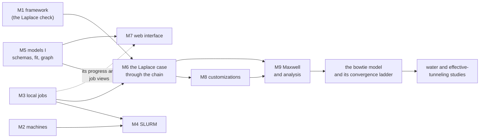

# femkit plan

**Role:** plan
**Status:** current
**Authority:** open work only, in its order; `docs/contracts/` governs the code,
and this plan never overrides a contract

## 1. Where femkit stands

The framework, the installer and the machine probe are built, and the basic test
tier covers them. On a workstation, `env bootstrap` from a clean slate builds and
validates `elmer` (seven checks, adaptive re-meshing with Mmg and ParMmg among
them) and `ngsolve` (six checks), writes the machine record, and `doctor` reports
the machine ready. Running a job is not built yet (M3, M4). How a calculation
is described, matched against an engine and prepared
([`../contracts/models.md`](../contracts/models.md)), and the web interface
([`../contracts/api.md`](../contracts/api.md) § 5), are designed and not built
(M5–M9).

Each milestone ends with its tier green and a review before the next starts.

## 2. Milestones

- **M1 — framework, installer, tests.** Open:
  - **An installed-solver check with an exact answer.** Laplace on the unit
    square, 0 V on the left, 1 V on the right, insulated top and bottom: the
    exact potential is φ = x. Elmer runs gmsh, ElmerGrid and the installed
    ElmerSolver to a VTU field; NGSolve solves the same case. Acceptance: every
    nodal |φ − x| ≤ 1e-7, at least 200 cells and 50 interior points, area
    1 ± 1e-8. It is the serial base for Elmer's same case run threaded and on two
    ranks, the three agreeing, on the installed solver, and the first case of
    the engine tier (`testing.md` § 1).
  - **Rebuilding from a saved lock** is shown once: an environment created from
    its lock (`envs.md` § 4.3) gives the same manifest.
  - **Entering through the activate hook** where the manager kind's `run`
    cannot start a command, with the text of that failure in the kind
    (`envs.md` § 4.4).
  - **On the cluster:**
    - build `ngsolve-cuda` and `elmer-cuda` (ADR 0005), settling whether nvcc's
      host compiler and CMake's CUDA toolkit are found inside the prefix without
      `CMAKE_CUDA_HOST_COMPILER` and `CUDAToolkit_ROOT` — Elmer finds AmgX
      through CMake's old FindCUDA module (`CUDA_TOOLKIT_ROOT_DIR`, policy
      CMP0146), which the pinned CMake 4.5 still offers — and whether a CUDA build
      starts on a node without the NVIDIA driver;
    - the GPU failure cases, each a failed check with its reason, never a false
      pass: a GPU whose architecture the build was not compiled for, running out
      of device memory, and ranks mapped to GPUs in a multi-rank GPU run (every
      shipped device check uses one rank and one device, while `jobs.md` § 2
      allows `gpus > 1`);
    - the `mamba` kind on that cluster's module (its forms measured here on
      mamba 1.5.9 and 2.9.0), and the `micromamba` kind file; until then the
      install script lists micromamba as one it cannot drive. A kind is chosen
      by more than the executable's file name: a `mamba` link to micromamba
      would otherwise get the wrong kind file.
- **M2 — machines.** `job probe` and `job machines` are built. Open: the SLURM
  readers (`femkit/schedulers/slurm.py`) have read only made-up text; the field
  test on the cluster's login node (`tests/field/test_job_probe.py`) is their
  first real reading, and settles the `sacctmgr` column names and the shape of
  `scontrol show node -o` there.
- **M3 — local jobs.** Job request, prepare, run script, run state machine;
  `job prepare|launch|status|cancel` on the workstation; the engine tier. Open:
  - how `env validate --gpu` is requested as a job (`envs.md` § 5): its command
    runs femkit, in the control environment, from the target's checkout;
  - a run script starts its engine from none of the variables a shell or a
    cluster module set that redirect it — Elmer reads `ELMER_HOME`, `ELMER_LIB`
    and `ELMER_MODULES_PATH` to find its solver modules (`jobs.md` § 4);
  - a run's state does not rest on the engine's exit status alone: Elmer is
    reported to exit 0 when a solver module fails to load (not yet measured).
- **M4 — SLURM.** The `slurm` kind's remaining parts and its readers in
  `femkit/schedulers/` (`jobs.md` § 7); cluster probing and carrying a record;
  header, submission, query, cancel, `launch --check`. The fit and its wording
  follow `framework.md` § 4. Field tier on the cluster: the
  readers' first real reading is M2's field test there.

## 3. Framework debts, not yet scheduled

Each makes a likely future change touch generic code; each is fixed when the
milestone that first needs it starts, or sooner if cheap.

- **The GPU stack is CUDA by name**: the `[cuda]` part and `<name>-cuda`
  environments (ADR 0005), the `nvidia-smi` query, the CUDA architecture
  setting. A second stack (ROCm) would need a small declared GPU-stack kind —
  its CMake variable, architecture query, visibility and model queries — in
  their place.
- **Check kinds are dispatched in seven places** (`checks.py`, the `Check`
  model's optional fields); `ranks` means "launch this many" for `command` and
  "what the log must report" for `ctest`. One model per kind, as a discriminated
  union, and one table of what each kind does.
- **The check fingerprint lists its shared files by hand** (`checks.JUDGING`:
  `checks.py`, `engines/__init__.py`, `summary.py`, `cuda.py`): a change to
  `cuda.py` marks the CPU environments `unchecked` too. Count only what each
  environment's checks import.
- **Manager facts in generic code**: the activation variables
  (`envs/manager.py`), `conda-meta` spelled three times (`envs/state.py`,
  `jobs/probe.py`, `jobs/setup.py`), the explicit-lock parser in
  `envs/install.py`. Each becomes a manager-kind field or a registered reader.
- **The engine adapter is a set of module attributes** (`engines/__init__.py`);
  a missing one raises `AttributeError` (exit 1), not `DefinitionError`.
- **The engine-version rule is looser in code than in `definitions.md` § 5.3**:
  `engines/summary.py` accepts a summary without the engine's version entry, and
  Elmer's mesh check writes none.
- **State tables are not rendered** into `docs/reference/`, so each contract's
  table is a second copy of its code (`core.md` § 7).
- **The web's plan digest covers human text** (a step's `describe` carries the
  free space), so it can call a plan stale when no fact changed.
- **`maturity` has no reader**; **`env plan` repeats `install --dry-run`**;
  **`doctor` prints the preamble's two commands under both the configuration
  and the record row**. Each is deleted, given its one use, or said once.

## 4. After the framework: the order

The framework milestones (§ 2) continue as M5–M9: describing calculations
([`../contracts/models.md`](../contracts/models.md),
[ADR 0008](../decisions/0008-one-model-declared-abilities.md)) and the web
interface ([`../contracts/api.md`](../contracts/api.md) § 5,
[ADR 0009](../decisions/0009-web-front-end.md)). No solver-model work starts
before the CPU environments validate.

| milestone | what | needs | where |
|---|---|---|---|
| **M5 — models I** | model, study and case schemas; formulations, meshers and abilities as data; `model check`, `model graph`, `model set`/`unset`, `study expand`, `case fit` | nothing beyond M1–M4's framework; can start now | § 6.1 |
| **M6 — the Laplace case through the chain** | the `electrostatics` translators and parsers; `case prepare`; a job runs `final/`; results in both engines | M1's exact-answer check, M3, M5 | § 6.2 |
| **M7 — web interface** | the flask routes, the built front end, the model graph, forms, review, progress, jobs and results | M5; its progress and job views M3 | § 7 |
| **M8 — customizations** | `overlay`, `replace`, `step`; `hook` and `custom-input` at first need | M6 | § 6.3 |
| **M9 — Maxwell and analysis** | `maxwell-frequency` and its analytic benchmark in both engines; analysis | M6, M8 | § 6.4 |

Then the bowtie model and its numerical convergence ladder (its data: § 6.5),
and only after the classical model is converged and cross-checked, the water
and effective-tunneling studies.

## 5. Not scheduled: jobs across several nodes

A job runs on one node (`jobs.md` § 2). It stays that way unless one node turns
out to be too small for a real study, and the cluster's own documentation shows
that multi-node MPI is supported. The framework is ready for it: the request,
the record, the fit and the header can all be extended without changing how they
are built. What each piece would need:

- a `nodes` field in the request (`memory` and `gpus` are already per node);
- the partition's node limit, which the probe already reads, kept in the record;
- a fit worked out per node;
- one more line in the scheduler kind's header;
- the run's node list recorded in its outcome.

The real cost is not in femkit. The environment's MPI must start ranks through
the scheduler and use the cluster's fast network, not quietly fall back to TCP.
Showing that it does needs a validation job that runs across several nodes. That
may mean building against the cluster's own MPI, which is a deployment decision.

## 6. Models, preparation and analysis

The architecture and its rules are [`../contracts/models.md`](../contracts/models.md),
the reasons [ADR 0008](../decisions/0008-one-model-declared-abilities.md). None
of it is built.

### 6.1 M5 — models I

1. **Model, study and case.** Their schemas, each reference field annotated
   with its target type (`models.md` § 11.2); formulations as data
   (`femkit/data/formulations/`), `electrostatics` first with its science
   document (`docs/science/electrostatics.md`, not written yet); `model check`,
   `study expand`, case IDs.
2. **Meshers.** Their schema and the two first declarations, `netgen` and
   `gmsh` (`models.md` § 6.4); each engine's default mesher; a shared mesh
   made in the `elmer` environment and read by NGSolve as a file.
3. **Abilities.** Their schema in `definitions.md`; the abilities, default
   mesher, extension points and engine-only options of `elmer` and `ngsolve`
   for `electrostatics`; `case fit` and the fit report.
4. **The graph and its edits.** `model graph` (with `--engine` and
   `--mermaid`), `model set`, `model unset`, and the layout file's operation.
   Acceptance: the Laplace model built from an empty folder by `model set`
   alone, each intermediate state loadable, its findings shrinking to none.

### 6.2 M6 — the Laplace case through the chain

1. The `electrostatics` translator and parser for both engines; `case prepare`
   — prepare, finalize, review — with no customization; the result document.
2. **Jobs run `final/`.** How a job request names a prepared case is settled
   in `jobs.md` with local jobs (§ 2, M3).

Acceptance: M1's (§ 2): every nodal |φ − x| ≤ 1e-7, at least 200 cells and 50
interior points, area 1 ± 1e-8, in both engines, each result `exact`, once
with each engine's own mesher and once with a shared mesh. M1's installed-solver
check runs the same case before this chain exists.

### 6.3 M8 — customizations

`overlay`, `replace` and `step` first; `hook` and `custom-input` when a first
real case needs them (`models.md` § 8.1). Acceptance: a case with an
`unsupported` line prepared with a customization covering it, its result
`customized`; a changed customization file refused at the job.

### 6.4 M9 — Maxwell and analysis

1. **`maxwell-frequency`.** Its data file, the phasor convention
   ([`../science/electromagnetics.md`](../science/electromagnetics.md)), each
   engine's abilities with their approximations, the translators and parsers,
   and an analytic Maxwell benchmark in both engines.
2. **Analysis**, with its own contract when it is built. Open:

   - **Products.** Beside each result document, ordinary tables and field files,
     for example `scalar-metrics.csv` (one row per case or frequency), probe
     profiles under `probes/`, `convergence.csv`, `mesh-summary.json` and the
     ParaView-readable fields under `fields/`. Their names become contractual
     with their schemas; large arrays stay in field and table files, never in
     JSON.
   - **Pattern-aware convergence.** Whether the spatial pattern of the solution
     changes, not only its maximum. On matched physical probes it reports the
     relative change of integrated and averaged observables, the normalized
     correlation of complex field or intensity profiles, the shift of dominant
     peaks, sign and phase consistency where meaningful, the energy-balance or
     power residual, and for spectral studies the change of resonance wavelength
     and linewidth.
   - **Discipline.** Detection, parsing and scientific interpretation are separate
     steps; every reduction records the field source and the expression used;
     failed and unconverged attempts stay analyzable, labeled as such.
   - **Expressions.** A language for observables such as `|φ − x|` or `|E/E₀|⁴`
     is not chosen.

### 6.5 The bowtie model's data

What the bowtie model must state before it is prepared, beyond what every
model states (`models.md` § 3, § 5):

- **Geometry:** the main axis and the polarization axis; every dimension and
  the construction; named volumes, surfaces, edges, points and probe planes;
  no unwanted buried or overlapping interfaces.
- **Materials:** the complex relative permittivity of each metal with its
  source, wavelength range and interpolation rule; water or air; the effective
  tunneling region and its conductivity law, marked as a phenomenological
  model.
- **Numerical policy:** the outer-domain extent and the open-boundary or PML
  treatment; the element order; the gap, metal-surface, bulk and PML mesh
  sizes; mesh growth and quality limits; solver tolerance and iteration
  limits.
- **Observables:** the complex field and its amplitude enhancement at the gap
  center; the gap-volume means of amplitude and intensity enhancement and of
  the |E/E₀|⁴ proxy; field profiles along the main axis and through the gap
  normal; samples on explicitly defined vertical center planes; the power
  absorbed in each metal body and the leakage region; the resonance wavelength
  and linewidth when a spectral study exists. A point maximum may be reported
  as a diagnostic, never as the only convergence criterion.

### 6.6 Tests and acceptance

- strict schema round trips and unknown-key refusal;
- unit conversion and coordinate-frame tests;
- case IDs independent of the order values were written in;
- region coverage, overlap and gap refusals;
- material interpolation against fixed reference points;
- a fit report for each status, and a refusal for each open line;
- stale decisions and every customization refusal (`models.md` § 13);
- mesh manifest and region-map completeness;
- parser fixtures for successful, failed and truncated solver output;
- reductions tested on synthetic complex fields with known answers;
- convergence tests that tell amplitude agreement from pattern change;
- comparison refused across different normalization or fidelity;
- the ParaView artifact catalogue, without importing VTK in the control process.

### 6.7 Completion gate

A small analytic Maxwell model is described once, matched against both
engines with every fit-report line resolved, prepared reproducibly for both,
run as jobs, and reduced to comparable numerical tables — with its field files
ready for ParaView — without any manual GUI action.

## 7. M7 — the web interface

The rules are [`../contracts/api.md`](../contracts/api.md) § 5, the reasons
[ADR 0009](../decisions/0009-web-front-end.md). None of it is built.

1. **The flask application**: the routes of `api.md` § 5.1, the event stream
   of an operation's log included; `python -m femkit web` on the loopback
   address. Acceptance: every registered operation served as a form, planned
   and applied with its digest; a stale digest refused.
2. **The front end's toolchain**: `frontend/` (added to `PROJECT_CONTRACT.md`
   § 2 with it), React and React Flow, Node.js from conda-forge in a
   developer's environment; the bundle in `femkit/web/static/`, and the basic
   test that refuses a bundle older than its sources.
3. **The model graph view** from `model graph`: the palette, typed
   connections, findings on each node, the selected node's form, positions
   saved. Acceptance: the Laplace model built in the page from an empty
   folder, with no field named in the front-end code.
4. **The fit overlay and the review**: each node marked with its fit status
   for a chosen engine; an open line offering the decisions and customizations
   that resolve it; `case prepare`'s plan reviewed and applied.
5. **Progress, jobs and results**, once local jobs exist (M3): an operation's
   steps live from its event stream; runs and their states; result tables, and
   where each field file is for ParaView.
6. **On a cluster**: served on the login node and reached through an SSH
   tunnel, shown once on the cluster.
