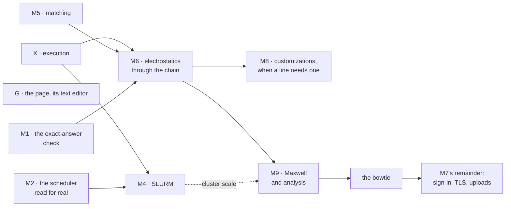

# femkit plan

**Role:** plan
**Status:** current
**Authority:** open work only, its order and its acceptance; `docs/contracts/`
governs the code, and this plan never overrides a contract

## 1. Goal and where femkit stands

**Goal.** femkit makes a finite-element result inspectable and reproducible,
from physical intent through visualization, on a workstation or a cluster
([`../design.md`](../design.md)). This plan's end is the plasmonic bowtie
nanogap studied on a cluster: described once, solved by Elmer and by NGSolve,
each engine first proven on analytic benchmarks, the two cross-checked, and the
numerical convergence shown before any physical study (§ 4, the bowtie; its
data, § 8).

**The person's model.** The person writes every part of a project — its
definitions, geometry script, materials, physics, mesh recipe, studies, and
observables with their script — in their own editor, and femkit changes none
of it. femkit starts
them from one set of project templates, checks what they wrote, and says
exactly what is wrong and what would be right. Then it turns the project into calculations:
geometry, mesh and solve, each run from a folder the person can open, the
solve in the engine chosen when the study is solved — no file names one;
then each case's observables, computed by the person's script from its
solution, and compared across cases and engines
([ADR 0025](../decisions/0025-one-engine-per-study-observables-after.md)).

**Built**, with the basic test tier covering it:

- the framework: operations, plan and apply, event logs, locks, every state
  machine declared as data, the generic command line; every result a report the
  terminal writes and the page draws ([`../contracts/web.md`](../contracts/web.md)
  § 7.7); every refusal with its kind, code and subject
  ([`../contracts/core.md`](../contracts/core.md) § 9); exact quantities, the
  unit table and its one grammar (§ 11 there);
- the installer: the install script, the control environment, engine
  environments built from pinned sources with their toolchain proven first and
  validated by their checks, the conda and mamba manager kinds (mamba 1.x and
  2.x); every environment an ordinary named one the manager keeps, `femkit`
  and `femkit-<name>`, its prefix asked of the manager; every process for an
  environment started clean, from one declared start, and entered by the
  manager's own `run` or activation; the machine probe, its record, `doctor`,
  per-machine activation settings; the `femkit` command linked from
  `~/.local/bin`, on the path of every shell;
- a project written by hand and checked before anything runs
  ([`../contracts/projects.md`](../contracts/projects.md),
  [`../contracts/models.md`](../contracts/models.md),
  [`../contracts/geometry.md`](../contracts/geometry.md),
  [`../contracts/materials.md`](../contracts/materials.md)): the shipped
  layout; every part kind's schema and check — the project file and its
  definitions — values, and Python functions in `definitions.py` run in
  `model_prep` — a component's contract and its assignment, physics, mesh
  recipes naming their mesher, studies naming no engine — the engines that
  can solve each shown as a fact, the engine chosen by `study prep
  --engine` — and observables parts reading studies, each observable
  computed by its function in `observe.py`, read without running it; one
  set of templates, `laplace_square` and `two_material`, each one study and
  an observables part reading it, each passing `project check` and
  its comments held to the schemas' help, which names the manual's chapter;
  `project new --from`, `project list|check|graph`, `study list`, `case
  list`; cases named by their content;
- materials ([`../contracts/materials.md`](../contracts/materials.md),
  [`../science/material-data.md`](../science/material-data.md)): the property
  list and its equivalent forms; datasets as values, tables with their digest,
  and the `sellmeier` and `drude_lorentz` models, with their signs and their
  passive data checked; the global library, seeded by the first `project new`,
  `GLOBAL/` and project-first lookup, femkit's changed shipped materials
  offered; a static step refusing data that varies; the conversions a
  frequency step will use, exact; `material import` of refractiveindex.info's
  files, each into a new material;
- running on a workstation ([`../contracts/jobs.md`](../contracts/jobs.md)):
  a calculation folder written by hand or by prep, `job
  prepare|launch|status|list|cancel`, batches and sequences, the run script
  and the monitor — the review's fixes written into `jobs.md` parked (§ 4, X);
- the workflow ([`../contracts/workflow.md`](../contracts/workflow.md)): a
  case's stages declared as data, each step in an environment of its own, a
  study's geometries and meshes its own, holding nothing of an engine,
  their identity and state; `study prep`, from a written study to the job
  that makes its geometries and meshes, planned whole before anything is
  written; `study flow`; its definitions computed and kept by the one store
  — but `project check` reading a built geometry (§ 4, X);
- the user manual ([`../manual/`](../manual/README.md)), chapters 1–7, its
  examples run against femkit's real output by the basic tests;
- the web server: `serve`, its supervisor and rotated log, the routes in token
  mode; the page — the landing, the Project workspace, Runs with Preview and
  Prep, Operations and the documents, light and dark, every design value in
  `theme.toml` (§ 4, G, what is left);

**Proven** on a workstation: a clean `env bootstrap` with conda, and again with
mamba 2.9.0, builds and validates `elmer` (seven checks) and `ngsolve` (six),
writes the machine record, and `doctor` reports the machine ready. The person's
cluster runs are open (M1, M7.1).

**Not built**: a case taking a material's data at a wavelength (M9); solving a study's cases through the workflow (M6), and jobs sent to a scheduler (M4);
the match against an engine's abilities; the engines' input writers and the
output translators; a case's observables
computed after its solve (M6); analyses (M9); studies feeding studies (after
M9); the page's palette of the templates' parts, its job boxes and the
elements left (§ 4, G); sign-in, TLS and uploads.

## 2. The person's workflow

The whole way through, each line with the step of § 4 that builds it. The
chain behind it is [`../contracts/models.md`](../contracts/models.md) § 1.

| # | the person | femkit | built by |
|---|---|---|---|
| 1 | `bash scripts/install-env.sh bootstrap` | builds and proves the control environment and the default ones — `elmer`, `ngsolve`, `gmsh`, `model_prep` and `postprocess` — writes the machine record; `doctor` says ready | built; the cluster runs, M1 |
| 2 | `config set paths.projects '"/data/projects"'` | sets the projects root | built, and `config init` asks for it |
| 3 | `project new bowtie --from laplace_square`, a template, or `--from` a project of theirs | copies it whole, never over an existing project; on a new root, seeds the global material library | built |
| 4 | writes each part as text — in their own editor, or the page's when the project is remote — the manual beside them: a study, naming no engine; an observables part — `observables.toml` and `observe.py` — naming the studies it reads; `material import` brings a refractiveindex.info file in as a new material | each key of a template carries its help as its schema states it, naming the manual's chapter | built |
| 5 | `project check` | each finding names the file, the key, what is wrong and what would be right; the first finding is the next step; what needs the built geometry is "not checked yet" | built, the same in the page with its text editor; the templates to copy there, G |
| 6 | `study prep --dry-run`, then `study prep`, with `--engine` to choose the engine that solves; `case list` | plans the study whole — every value, one case per axis point, its stages, each job's fit — and writes nothing if any of it is refused; refused while errors stand | built |
| 7 | `job launch` on what prep wrote; `job list`, `job status`, `job cancel`; `study flow` | each case's geometry and mesh stages, the study's own, and the job that makes them; runs the geometry script in the `gmsh` environment and checks the promised groups; meshes in each mesher's environment — or passes the script's own mesh through — and checks each group; keeps every result to be looked at, with the line that opens it; `project check` then reads each group's place from the built geometry | built on a workstation, but `project check` reading the built geometry (X); the page's workflow view, G |
| 8 | `study match STUDY --engine E` | each element exact, approximated or unsupported, proven or not, in the engine chosen; the person answers open lines under its name in the study's `[solve]` | M5 |
| 9 | `formulation verify`, `--record` | runs the benchmark jobs; records the proofs | M6 (electrostatics), M9 (Maxwell) |
| 10 | `study prep --engine E` again, once the meshes are made — for each study an observables part reads, and each engine | writes each case's solve stage in that engine — the solver input, its manifest, `job.toml` — and the job that solves them; after each solve, in that job, an observe stage for each observables part that reads the study | M6 |
| 11 | `job launch\|status\|cancel` through SLURM | submits, watches, cancels what prep wrote | M4; built on a workstation (line 7) |
| 12 | `job launch` of each study's solve job (line 10); `result show\|compare` | each case's observables, computed by the person's functions from its solution, in femkit's `postprocess` environment, after its solve; adding one runs its observe stage again, never the solve; a comparison | M6 |
| 13 | analyses | convergence, the cross-engine check — an analysis of two engines' solves of one study's cases — spectra; fields to ParaView | M9 |
| 14 | the bowtie | the mesh, padding and layer ladder converged and cross-checked; then wavelength, gap, water or air; then tunneling | after M9 |
| 15 | studies feeding studies | physics in different engines: a study taking another study's result, case by case, and studies feeding each other until they settle | after M9 |

Throughout: `serve start` on a login node, over a socket reached with `ssh -L`
— built; its cluster run is the person's (M7.1).

## 3. How the work is done

The rules live in [`../process/conventions.md`](../process/conventions.md); in
one line each:

- **Order:** architecture, then framework and API, then the contract, and the
  code last (§ 1); a design change is proposed and agreed before it is
  written; a measured defect is fixed directly.
- **Discipline:** declarations, not branches; one fact, one home; the core is
  the only way to write a file, start a process or take a lock (§ 2, § 3).
- **Tests:** written from the contract and seen to fail with the rule broken,
  before the implementation ([`../contracts/testing.md`](../contracts/testing.md)
  § 3); the basic tier after every step, the field tier where the change
  reaches it.
- **The person decides**: environment changes, cluster runs, commits and pushes,
  and design changes (`conventions.md` § 6). A changed definition is solved whole, every `-cuda`
  environment included, before it is pushed. A note is a lead, never evidence.
- **Parallel helpers**, each on its own files in its own worktree; the main
  line integrates and reviews; long checks run in the background
  (`conventions.md` § 6).

**Review schedule** (`conventions.md` § 1, step 7, defines each review):

| when | what | by |
|---|---|---|
| every step | the unit against its contract, then its callers, then its domain; the manual's chapters it reaches against the behaviour; findings fixed; landed work removed from this plan | the author |
| every milestone's end | its acceptance and its tier green, then the independent review on separate aspects, and a review of the whole system | independent reviewers; the person agrees before work that depends on the milestone starts — milestones that depend on nothing run side by side |
| before work that builds on existing code | a review of the whole system: every domain against its contract and the framework; each finding fixed, or scheduled at the start of the step that first works on its code | independent reviewers; the person agrees |
| before a branch merges into `main` | the basic tier, the field tier where the change reaches it, and a consistency review of every merged document | the author; the person agrees |

## 4. The road

A project is written and checked, its materials real data; next, X, M5 and G
can each start, X first on the bowtie's path.
Each later step is detailed when it starts; until then it carries its purpose,
what it needs, its acceptance, and the open items no contract holds — among
them findings that its start settles. Every step ends as § 3 says.



### X — The workflow and its execution: stages, local jobs

**Purpose.** A study's cases become a workflow of stages — geometry, mesh,
later the solve — declared as data, each a tool's program wrapped by a
contract, turned into calculation folders by folder writing and run as jobs by the person's
earlier tool's run design, copied
([ADR 0016](../decisions/0016-every-step-runs-from-a-run-folder.md),
[ADR 0018](../decisions/0018-one-graph-from-description-to-execution.md)).
After X, a study's geometries and meshes are made on the workstation, each
checked against its contract and kept to be looked at, and a job — a solver
run on inputs written by hand — is prepared, launched, watched and cancelled
there.

**What the person does** (§ 2, lines 7 and 11; a sketch, its words settled in
the contracts):

```console
$ femkit study prep check          # the cases, the stages up to the meshes, and the job that makes them
$ femkit job launch ~/femkit-projects/square/runs/check/launch/mesh-check-001
$ femkit job list                  # every job launched here, its runs' states; job cancel <id> stops one
$ femkit study flow check          # each case's stages, their states and folders
```

**The design** is three contracts, one per layer — `projects.md` § 2 (every
path in a project), `workflow.md` (the stages and their folder writing),
`jobs.md` (the execution) — with `geometry.md` §§ 2, 3, 5, 8, `core.md` §§ 5,
8, `api.md` §§ 2–4, `config.md` § 2, `envs.md` § 7 and `definitions.md`
§ 4.7, and ADRs 0016–0018. **Before any code**, a review reads each of these
contracts' rules against the code and lists, for each, its module and
function and whether it is built, differs or is missing; the person agrees
to that list, and the build goes by it, layer by layer from the bottom, each
module's tests first.

**Open**, in the order the layers are built. Built and reviewed: milestone 1
(the core, the API, the launcher). Built: milestone 2 (the jobs layer,
`jobs.md` §§ 1–9 for a machine without a scheduler) and milestone 3 (the
addresses and the door's folders, the stage kinds, artifacts, meshers and
hand-overs as data, the stage programs in `engines/stages/`, the component's
declared mesh), and ADR 0025's present part (a study naming no engine,
`study prep --engine` and the engines that can solve a study, the recipe's
mesher, the observables part).

- **Left by ADR 0025's present part**: `study flow --engine`, so the
  workflow graph draws an engine's solve stages, with M6, and the page's
  Runs view choosing it, a question for the person; the match overlay's
  engine on the page (M5), a question for the person; which engines
  `formulation verify` solves a benchmark in, and how a run names them
  (`models.md` § 6.3), settled at M6's start; a question for the person
  before a definition may be
  an array — where such a definition may be cited: a geometry's inputs, a
  quantity field, an axis (`models.md` § 3); the standard library's modules
  in `observe.py` — `os`, `pathlib`, `json` — which `models.md` § 5.2 does
  not allow, a script reading an engine's files by their names alone, a
  question for the person.

- **Jobs, parked** (the person, 2026-11-25: the project directory and the
  workflow come first; engine-specific scripts and execution after): the
  review's fixes written into `jobs.md` §§ 1–5.5 — a folder's own states and
  its newest run's read from `run.toml`, launch asking what the state allows,
  a sequence's records before its job goes and `--in-job` read, a member
  another job has or one finished left out, the check's records read through
  the stage programs' documents, the shares' own names, the run script's
  `PIPE` handled, runs numbered `run-0` — are not built; two unfinished
  attempts lie in the worktrees `fix-a` and `fix-b`, unmerged. Also: `job
  list` offering `job cancel` only for a job left in the background, never
  one the command line waits on (§ 5.4); a sequence's walk reading `use` and
  `leave` from the state tables, by name, never a state's name as text
  (`launch.py`, `jobs/operations.py`); every outcome's next steps a field
  filled from its subject's machine, `report()` deciding none — `job
  prepare`'s launch by the folder's full path, and none for another
  machine's target, which a maker's own steps say (`PrepareOutcome`,
  `LaunchOutcome`, `CancelOutcome`); a launched launch folder launched again
  to continue, as the earlier tool's group launched again whole — finished
  members used, the rest run anew, each launch's record kept, the
  `launched-once` refusal withdrawn (§ 1.2); a `held` folder offering `job cancel`
  only while its job was left in the background; `held` observed first, as § 5.5's row 1
  says, before `unprepared` and `stale` (`calculation.toml` checks it
  third). Departures from the earlier tool, neither measured nor the
  person's decision, settled with these fixes: the machine record written as
  TOML, where the earlier tool keeps it JSON; one consent question for every
  difference a probe finds, where it asks for each, default No, "so a weaker
  probe cannot erase a declared fact"; the launch mode taken from the
  record's scheduler, where it is never derived from it — a flag, else
  `launch.mode`, else a refusal (`jobs.md` §§ 5, 9); the run script taking
  no count, where the earlier tool's launch hands it `-np`/`-omp`, read
  flag, then the scheduler's, then the baked one; `started.json` written
  before the run's log and its exit trap, where `jobs.md`'s summary opens
  the log and the trap first. And a finished stage offering a new run as its
  next step, where it offers what it made to open (`calculation.toml`'s
  `[actions.finished]` and `run.toml`'s finished row two homes of a run's
  actions).
- **Left by milestones 2 and 3**: the monitor inside a scheduler's job,
  tested; `Resources.wall`'s help and the templates' comment saying what
  `jobs.md` § 2 says of a wall; the person's machine record written again at
  schema 3 (`job probe --write`); the pass-through's region map measured by
  the same code as Gmsh's meshing, not a copy of it; the order of the mesh a
  script declares checked; a mesher's honoured keys checked against the
  recipe's (`schema check`); the stage programs' documents' schema raised for
  their changed shapes; the `gmsh` environment validated again, its check
  programs changed; each stage program's argument order held to the roles
  its stage kind, mesher or hand-over declares, which it unpacks by position
  today, and its `stop()` written once beside it; the GPU query and the time
  format of the probe, the run script and the monitor each written once;
  `mesh/view`, each mesh's copy ParaView opens (ADR 0016 decision 15), its
  format chosen by measurement, written by Gmsh's mesher and declared in
  `artifacts.toml`; the reference pages rendering the rows of `stages.toml`,
  `artifacts.toml` and the meshers' and hand-overs' files, so
  `workflow.md` §§ 2.1–2.3's tables give way to them; a manual chapter on
  running a job folder — `job.toml` written by hand, with a common mistake;
  `job prepare`, `--target` and probing again; launching in the background
  and waited on; `job status`, `job list`, `job cancel`; a run's states and
  their words; the check's records and its outputs read-only; the monitor's
  log; the launch-door gate — its examples run by the basic tier, the
  manual's index and chapters 1, 3–5 pointing to it.
- **G, the page — left** (built and seen in the person's Chrome in both
  themes, 2026-11-26: the theme as configuration, the mark and the hero, the
  landing's cards, the Project workspace and Runs drawn by React Flow and
  ELK, the side column of the inspector and the panels, the Operations
  forms, the Documents; and built since, the text editor on CodeMirror 6,
  ADR 0024 — findings at their keys, each key's help on hover, its allowed
  values suggested, saving with what the change does shown first — with
  each node's keys and `project save`, and chapter 4's section on editing a
  file on the page): the `Keys`, `Confirm` and `Busy` elements; arrow keys
  through the nodes and the declared Escape bound; the match overlay (M5)
  and the job boxes (the execution layer); a fragment edited by hand without
  its token keeping the tab's token, the gate showing where to paste one;
  the manual's chapter on the page, and chapter 1's "The web page" made
  true; the palette — each template's parts to copy into a file (§ 8.3 of
  `web.md`). Left of the text editor: an address for `definitions.py`, so
  the editor can save it; CodeMirror's own words (its
  search panel's) from the declaration (`EditorState.phrases`); the
  artifact `geometry/groups` and the document `groups` tied by a declaration,
  not two literals in `geometry/steps.py`. The flowchart is a node editor (ADR 0023, decision 4, the
  person's design) — built: cards with named slots facing their wires, smooth
  wires coloured by what they carry, categories by shape, colour and icon, no
  frames, every card placed and copied by the person, the project a list on
  the side and each definition a small card; left of it: moving a card by
  keyboard, and the narrow screen's drawers seen in a browser.

- **Architectural unification II, left**: the environments' records
  stating their `schema` (a file with none read as its first shape,
  `core.md` § 4).
- **Architectural unification, what is left**: a `--target` and a folder's
  copy, and a member's and its job's records, compared by `record.of_this_machine`
  — `prepare.target` and `_member_target` compare identities apart from it,
  two unknown ones taken for one machine (`jobs.md` § 3, step 2). One machine
  per subject — launch folders apart from calculation folders, run states
  declared once in `run.toml` — goes with the parked jobs fixes.
- **The stage programs' other documents' schemas**: each document kind its
  own schema number now (`engines/stages/documents.py`, `CHANGES`); `inputs`
  raised to 2 with `definitions`; the others raised as their shapes changed
  since milestone 3 (`models.md` § 2).
- **Workflow, left by its reviews** (milestone 4 and two waves of fixes
  built, with ADRs 0019 and 0020, and the manual's chapter 7): `stage.json`'s
  model (`MadeFrom`) on a reference page; the
  contracts' dated quotes of the person moved to the ADRs that record them
  (docs/README D4); a study's `meshing` asking GPUs a finding, no stage
  inside using one (`workflow.md` § 5); a refusal `job prepare` gives about a
  request's key, passed through by prep, naming the study's key the person
  edits (`meshing.resources.partition`, not `resources.partition`);
  for a target whose scheduler cannot submit yet, until
  M4: a finding of prep's own wherever it withholds a launch, and `study
  flow` offering none; a key with a character
  outside the Basic Multilingual Plane quoted for TOML by `persist`, not
  `json.dumps` (`core/schema.py`'s `key_path`); the action names of
  `environment.toml` that spell command-line flags (`install --clean`) named
  by the action alone, the flag the request's.
- **Workflow, left by its review's fixes** (milestone 4 and its fixes built,
  with ADR 0019 and ADR 0020): `{python}` and a run file's grammar each
  declared once, in `definitions/stages.py`, read by the jobs domain's
  request (`jobs.md` § 2); `project check` reading a built geometry's
  `groups.json` for each group's place and the coverage (`geometry.md` § 7);
  the block words' color tokens in the page's styles, with G; the reference
  pages rendering each state table, so the contracts' and chapter 7's copies
  of the block words give way to them; `web build` run again.
- **Workflow, after its structure**: a next step naming `project save`, of
  the page alone, written by the command line as where it is in the page
  (`api.md` § 2, `surfaces`).
- **Netgen's mesher and hand-over** for NGSolve above geometry order 1: its
  meshing script in the `ngsolve` environment, the geometry's BREP beside
  `.xao`, each group carried onto Netgen's shapes from `groups.json` by its
  pieces' centre and measure, measured to match one for one (`geometry.md`
  § 8). A study's one mesh serves every engine, and at a high order NGSolve
  wants Netgen's mesh, which Elmer cannot take today: whether a Netgen →
  Elmer hand-over exists is not measured, and is measured with M6 or M9.
- The engine tier's calculation per engine through `job launch`, on inputs
  written by hand until M6's input writers.
- **The manual**: per-command manual chapters, once `api.md` § 4 says so; a geometry chapter, with worked
  examples of a geometry script, a meshing script's pass-through among them,
  each run by the basic or engine tier so none goes stale (`geometry.md` § 2);
  `schema docs` and `web build` run again.
- Left by the environment fix waves, fixed as X's code reaches them: the
  `gmsh` check's fingerprint covering the template files it reads (§ 7's
  debt on a command check's files).
- **The environments under conda's management** (the person, 2026-11-27;
  [ADR 0026](../decisions/0026-environments-under-condas-management.md);
  `envs.md` §§ 1, 3, 4.4, 7), left: every environment rebuilt as a named one
  and validated, by the person; the field tier run on conda and mamba for what
  is read in a manager's source or documentation but not measured — each
  kind's commands by `-n <name>`; its `env list --json` with conda's
  `envs_details` names, and its `info --json` `envs_dirs` (mamba 2's
  `envs directories`); `run -n` on mamba 1.x and 2.x; conda's `--no-pin`, its
  channels named by their full addresses and its `config --show-sources
  --json`, run; whether mamba 2 honours a person's `create_default_packages`,
  has a form that sets `pinned_packages` aside, and says where it read a
  setting (its kind then gaining `settings`); `conda shell.bash hook` and
  mamba's `shell hook --shell bash` evaluated in a run script; `conda activate
  NAME` and `source activate NAME` after a clean start in a batch job's
  shell, the preamble's `module` surviving the run script's clean start —
  the person's own HPC test; a manager's `run` keeping a socket open (for the
  web server's child, which `serve` starts on the web environment's own
  `python`); whether a site's module system needs a shell function beside
  `module` exported (`functions`, the scheduler kinds); the install script's
  `orphan` folder of the control environment's name, which its control state
  does not read yet. Questions for the person (§ 5): a shell where the
  manager's hook is not loaded names no manager; which environment receives a
  project's packages; and what femkit's own control process, which the
  `femkit` command now starts clean, reads of the shell it was typed in — a
  scheduler's commands and the GPU query found on `PATH` for `job probe`, and
  the loaded modules `config init` shows beside its question.
- Carried, internal: the environment file's schema apart from the environment it
  builds; this machine measured by one owner; `job probe`'s plan making no
  cache folder (§ 7). After X,
  not in it: importing a CAD file (`geometry.md` § 9); what is left of the
  page's views of the workflow (G).

**Acceptance.** A job prepared, launched, watched and ended on the
workstation, its monitor's log and closing record beside it; one launched
waited on, exiting 1 when its run failed; one cancelled from `job list`,
reading `failed`, *cancelled*; a killed run told from a failed one, and a run
whose process is gone written once, by `case list` as by `job status`, and
read the same from a copy of its folder; a launch cut short after its run
started never emptying it; a sequence whose geometry failed for one case
making the other cases' meshes; the engine tier's first case run through `job
launch`; the Laplace and two-material
geometries made from their scripts in calculation folders, through a sequence;
a run refused before it starts for a missing parameter or a file whose hash
differs, and after it for a promised group missing or empty; a sweep of a
parameter the script reads making one geometry and one mesh per value, of one
it does not read one in all; a mesh the script made passed through and
checked; a failed run's log kept in its folder; NGSolve's mesh holding every
group by name; each group's kind observed from a built geometry and a
material on an outer face refused by `project check`; `study flow` showing
every stage of the Laplace study with its state and folder; each contract of
the layers read against its code by the review with nothing left differing.
Done before M6's input writers.

### M5 — Matching

**Purpose.** A case matched against an environment, every limitation shown.

**Builds** [`../contracts/models.md`](../contracts/models.md) §§ 6.1–6.3 and
7 for `electrostatics` in `elmer` and `ngsolve` — abilities, extension points
and engine-only options, the proof record's schema, `case match` and `study
match`, each with `--engine`, decisions under the engine's name and their
staleness — with § 11.1's match columns of `case list` and the overlay of
`project graph --study`, each in an engine; in the page once G is in, each
node's worst match line and what resolves an open one. Settled at M5's
start: how a decision reaches the study's `[solve.<engine>]` (`web.md`
§ 2), never by femkit writing the person's file (`projects.md` § 7); how
the overlay names its engine.

**Acceptance.** A decision changing no case ID and going stale when its
ability's digest changes; a match line for each translation status M5 can
reach — `exact`, `approximated`, `unsupported`, `engine-only` — and for
`proven` and `unproven`, with a proof record written by the test.

### G — The page: the three diagrams and the text editor

**Purpose.** The person sees their project's structure, each part's text with
the help of every key, its findings and the templates to copy, and a study's
workflow and its runs, by mouse or keyboard; they edit a part's text in the
page's plain text editor, for a project their own tools may not reach, and see
what a save changes before it writes — the one write to their files. The
layout library is ELK ([ADR 0023](../decisions/0023-react-flow-draws-elk-places.md)).
Runs beside X, off the bowtie's path.

**Builds**, what is left of [`../contracts/web.md`](../contracts/web.md) §§ 2
and 6–12 (the rest built — the text editor and its save among it, with what
the change does shown first, and chapter 4's section on it): the elements
`Keys`, `Confirm` and `Busy`; the keyboard past Tab and Enter — arrows
through the nodes, the declared shortcuts bound; the execution's boxes, with
the execution layer; the palette of each template's parts; the manual's
chapter of the page — its workspaces and the three diagrams.
Carried: the docs viewer's test pointing femkit at a checkout by a variable,
not by replacing `dirs.checkout`; a test's request time limit set by the
server's configuration, not by replacing `READ_TIMEOUT`.

**Acceptance.** The Laplace project shown in the page — every part, its help,
its findings, its templates — by mouse and by keyboard alone; a part edited and
saved in the page, its impact shown first — a promised group removed that a
physics names shown as broken, a stage made anew marked — and the file holding
exactly what was typed; the Laplace study's workflow drawn with each stage's
state; the page writing no other file the person wrote; the page still working on a project whose fields and
kinds are renamed; every workspace usable at the narrowest width the page
declares; the review finding no field, kind, operation, address or sentence
named in the page's code, no style outside its layers and no hand-written type
of server data; every element exercised in a browser; an independent review of
the whole page against `conventions.md` § 2.1.

### M4 — SLURM

**Purpose.** Jobs submitted to the cluster's scheduler: what `jobs.md` § 7
marks not built — header, submission, query, cancel, `launch --check` — with
the fit of a request against the record worded by `framework.md` § 4; and
`env validate --gpu` as a job (`envs.md` § 5), its request and run script, so
a GPU node validates an environment — moved here from X by the person
(2026-11-25): on a machine without a scheduler it adds nothing to running the
check directly. Its cluster run is the person's (M1).
**Needs** X; M2.

**Acceptance.** A job submitted, queried and cancelled on the cluster;
`launch --check` naming a request the record cannot fit.

### M6 — Electrostatics through the chain

**Purpose.** `electrostatics` solved through the whole chain in both engines,
its abilities proven. **Needs** X, M5, M1's exact-answer check; the expression
language's form, the person's.

**Builds** `models.md` §§ 9–10 for `electrostatics` in both engines — each
engine's input writer, the reader of a solve's log and status, and the
files its definition declares its solve writes, checked there and never
read — and the `results` domain with its contract. Carried: the engine boundary — the
documents crossing into an environment defined once in `femkit/engines/`, the
engines' version reader and the install's one, the check fingerprint narrowed
first (§ 7); a prepared case's `job.toml` with its inputs' hashes, its steps
and the environment it was prepared for, the hashes checked at `job prepare`,
the environment warned there and checked by the run script; the expression
language for spatial functions and complex constants, parsed by femkit, never
evaluated as code, written per engine by its input writer, and with it the manufactured
benchmarks; the solve a stage kind of `stages.toml`, made by prep's stages
step, which walks every declared kind by its typed inputs — no branch per
kind: `derive`, `case list`'s choice of a case's stages, an asked output
decided by a declared contract key, `MadeFrom` one content per kind — its
state the stage table's, `models.md` § 9.5's conditions its facts and own
states, and declared to ride no meshing job, so the person looks at the
meshes before a solve (ADR 0022 decision 8); a study's solves one job, as
its meshing is, and `solve/run` the artifact its observe stages take
(`workflow.md` §§ 2.2, 5); NGSolve's layer naming each element by its piece, a group the
union of its pieces' regions, so groups sharing a piece reach NGSolve
(`geometry.md` § 8); in the page once G is in, prep's preview as the review, result tables,
and where each field file is for ParaView. **The observe stage**
([ADR 0025](../decisions/0025-one-engine-per-study-observables-after.md);
`models.md` §§ 5.2, 8.4, 10.1, `workflow.md` §§ 2–5): a stage kind of
`stages.toml`, one for each case and each observables part reading its
study, after the case's solve, in its study's solve job, made by prep's
stages step; its program femkit's, in `engines/person/`, running the part's
`observe.py` in `postprocess` through the one runner of the person's Python —
the kind's `environment` the one whose definition takes the projects'
packages, which until then tells what `observe.py` may import
(`models.md` § 5.2); its identity `workflow.md` § 4's, holding femkit's
`postprocess` set and its own project's packages alone; its results kept in its run by the one
store of typed values; the proof's record reading them (`models.md` § 6.3);
`formulation verify` solving each benchmark's study in the engines it
proves — which, and how a run names them, settled at M6's start — a `-cuda`
twin proven by a benchmark study asking GPUs; each solve stage keyed by its
engine, its observe stages after it, each engine's results kept apart and
switching engines reusing what each made; each function handed `case` — the finished
solve run by its folder, its definitions, its groups with the engine's
region IDs from the hand-over's report and the manifest, its study and
engine, its standard forms — the engine's files the script's to read,
femkit reading nothing of them (`models.md` § 5.2). **Output translators**
([ADR 0025](../decisions/0025-one-engine-per-study-observables-after.md)
decision 7; `workflow.md` § 2.4): each engine's declaration of the artifact
types its solve writes; the `translate` stage kind, filled by an output
translator as the mesh kind is by a mesher, a stage per case between the
solve and the observe stage, drawn in the graph and Runs; each translator a
declaration and a Python script, run by the one runner of the person's
Python, its output held by the one check and kept by the one store —
femkit's standard ones, the solution's fields on the mesh and resampled
onto a grid, and the person's own, a part kind of the project stating no
program or environment of its own; an observables part's `takes.forms`,
each form checked reachable from every engine's output before anything
runs. **Running a part's functions by hand** on a
finished case, as a geometry script is run (`geometry.md` § 2;
`models.md` § 10.1). Settled at M6's start: where an observe stage run again
alone, its solve finished, states its job's resources, and what a stage
inside a study's solve job states; the environment the standard
translators run in — an NGSolve solution is read only in `ngsolve` —
measured, and the person's own translators' part kind. **A question for the
person**, not decided: whether a case's observe stages run in its study's
solve job by themselves, after the solve, as `workflow.md` § 5 has them
today — where the earlier tool's rule is that stages do not chain, and
whether to go on after a stage is the person's decision.

**Acceptance.** The `electrostatics` benchmark set passing in both engines — a
manufactured, non-polynomial solution converging at its element degree's rate,
and a two-material case with the right interface jump — each ability recorded
as proven; the Laplace case through the chain with M1's thresholds, through the
one mesh path, each result `exact`; one observables script, reading a
standard form both engines' outputs reach through output translators,
serving both engines' solves of one study, its values within the benchmark's tolerance
in each, kept in the one store with their metadata; an
observable added running its observe stage again
and never the solve; a part's functions run by hand on a finished case giving
what its stage gave; a file edited in `final/` making the
preparation `stale` and refused by the job.

### M8 — Customizations

**Purpose.** The person's own addition at a declared point (`models.md` § 8),
built when a match line first needs one: `overlay`, `replace` and `step`
first, `hook` and `custom-input` when a real case needs them; their
combination rules; its name rule; steps in the run script (`jobs.md` § 4); a
post-processing job over an earlier run's outputs. Settled at M8's start: how
a customization, an uploaded one included, reaches the study (`web.md` § 5,
`models.md` § 8.2), never by femkit writing the person's file (`projects.md`
§ 7). With it, the study's `[solve.<engine>]` — what only one engine has,
under its name, applying only when that engine solves (`models.md` § 5.1):
engine-only options, customizations; truncations with M9. **Needs** M6.

**Acceptance.** A case with an `unsupported` line prepared with a
customization covering it, the affected observable `customized`; two overlays
setting one keyword refused; a customization whose `interface` the input
writer no longer offers refused; a name starting with `.` or naming `..` refused; a
changed customization file making the preparation `stale`.

### M9 — Maxwell and analysis

**Purpose.** Frequency-domain Maxwell in both engines, and the analyses a
study needs. **Needs** M6; M4 for cluster scale; M8 if a match line needs a
customization; whether absorbing layers are drawn by the geometry script or
added by the mesh step, the person's (`geometry.md` § 8).

**Carries**: `maxwell` — its data file and science document; the phasor sign
and peak or RMS; the `frequency` step kind, supplying the wavelength or
frequency, with which a case takes a material's table or model at its value —
the interpolation, the models, the equivalent form, the convention and the
passivity check, built as functions and checked
([`../contracts/materials.md`](../contracts/materials.md) § 6); a complex
constant as a dataset; whether refractiveindex.info's wavelengths are vacuum
wavelengths, measured before its data enters a spectrum
([`../science/material-data.md`](../science/material-data.md) § 4);
`radiation` and each engine's truncation — NGSolve's perfectly matched
layer, Elmer's first-order absorbing condition (its `VectorHelmholtz` has no
layer); the plane-wave source and its normalization; what Elmer computes
only inside its solve — its region-wise absorbed power — written by its
solve into its run, for a script to read; its benchmarks — TE and TM in 2-D, a
reflection benchmark per truncation, a lossy sphere against its series
solution, absorbed power positive — passing in both engines. Analysis, with its
own contract and the analysis part's schema — the cross-engine check an
analysis naming a study and two engines, comparing their solves of its
cases, each case with itself (`models.md` § 10.2) — its results kept by the one store, netCDF with its
metadata in the file (`models.md` § 3), fields for viewing in ParaView's
form; convergence over an axis from each case's mesh, as its region map
measures it, by the pattern and not only the maximum — integrated and averaged
observables, the correlation of complex field or intensity profiles, the shift
of dominant peaks, sign and phase consistency, the energy-balance residual,
and spectra over a sweep's cases, their resonance wavelength and linewidth;
failed and unconverged runs analyzable and labeled. After
M9: a step's `takes`, couplings and repeated steps (`models.md` § 4.5),
electromagnetic and Joule heating first; with them, the repeated steps'
method and relaxation, and whether a step may have a mesh of its own, its
field transfer stated in the coupling, done by the engine, reported and
proven by benchmark (ADR 0019 decisions 4–5); and studies feeding studies,
for physics in different engines — a study taking another study's result
as an input, case by case, and studies feeding each other in a loop until
they settle, stated where the studies are organized — with the first such
calculation (ADR 0025 decision 2).

**Acceptance.** A small analytic Maxwell model described once, matched against
both environments with every match line resolved, prepared reproducibly for
both, run as jobs, and reduced to comparable numerical tables — its field
files ready for ParaView — with no manual GUI action.

### Tests across M5–M9

Each step's acceptance, and throughout: strict schema round trips and
unknown-key refusal; unit conversion and coordinate frames; region coverage,
overlap and gap refusals; material interpolation against fixed reference
points; mesh manifests and region maps complete, regions' measures compared
with their geometry's; fixtures of successful, failed and truncated solver
logs, for each engine's reader of a solve's log and status;
convergence tests that tell amplitude agreement from pattern change;
comparisons refused for `unverified` or `custom-input` observables and across
differing normalization, each side's fidelity shown; each engine's declared
output files found after a solve, femkit reading none of them and importing
no VTK in the control process.

### The bowtie

**Purpose.** The study this plan exists for (its data, § 8). **Needs** M9; M4
on the cluster.

**Acceptance.** The classical model converged over its numerical ladder and
cross-checked between Elmer and NGSolve before any physical study; then the
wavelength, gap and water-or-air studies; only after those, the
effective-tunneling study.

### Beside the road: M1, M2, M7.1

Each runs on its own, mostly as the person's cluster runs.

- **M1 — the installer on the cluster, and an exact-answer check.**
  - A check of each CPU environment with an exact answer (`definitions.md`
    § 5): Laplace on the unit square, 0 V left, 1 V right, insulated top and
    bottom, φ = x; Elmer runs Gmsh, ElmerGrid and ElmerSolver to a VTU field,
    NGSolve solves the same case. Proposed expectations: every nodal
    |φ − x| ≤ 1e-7, at least 200 cells and 50 interior points, area 1 ± 1e-8 —
    a linear field reproduced to rounding, which shows the solver runs, not
    that a translation is right; Elmer's case also threaded and on two ranks,
    the three agreeing.
  - An environment created from its saved lock (`envs.md` § 4.3) giving the
    same manifest, shown once.
  - A failed step showing the log's error lines with its last lines (mamba
    2.9.0 prints the error first and its progress after).
  - A check that dry-run solves every environment, each `-cuda` one included,
    with each manager kind (`conventions.md` § 6).
  - The driver's CUDA version, read on a GPU node, kept in the machine record
    and checked at install against each CUDA environment's toolkit — refused,
    naming both, when the driver is older (`framework.md` § 4); its contract
    first. The CUDA versions are the person's: 12.8 for `elmer-cuda` and 12.9
    for `ngsolve-cuda`, by ADRs 0003 and 0004; or 13 — untested for
    `ngsolve-cuda`, and for `elmer-cuda` only once Elmer's `FindAMGX.cmake`
    stops requiring the removed NVTX version 2.
  - Entering through the activate hook where the manager kind's `run` cannot
    start a command, that failure's text in the kind (`envs.md` § 4.4).
  - The person's runs: `env bootstrap` with the cluster's mamba module inside
    an allocation; `ngsolve-cuda` and `elmer-cuda` built and validated with
    `--gpu` on a GPU node — whether nvcc's host compiler and CMake's CUDA
    toolkit are found in the prefix without `CMAKE_CUDA_HOST_COMPILER` and
    `CUDAToolkit_ROOT`, Elmer finding AmgX through CMake 4.5's FindCUDA module,
    whether a CUDA build starts on a node without the driver; the GPU failure
    cases, each a failed check with its reason — an architecture not compiled
    for, device memory exhausted, ranks mapped to GPUs in a multi-rank GPU run;
    the `micromamba` kind file, a kind chosen by more than the executable's
    file name.
- **M2 — the scheduler read for real.** The SLURM readers
  (`femkit/schedulers/slurm.py`) have read no real output: the field test on
  the cluster's login node (`tests/field/test_job_probe.py`) is their first
  reading, and settles `sacctmgr`'s column names and the shape of `scontrol
  show node -o` there.
- **M7.1 — the web server on the cluster.** `serve` on a login node's Unix
  socket through `ssh -L`, `femkit-web` made by the cluster's mamba module
  where it keeps environments (the person's run); two `start`s at the same
  instant, one refused.

### After the bowtie: M7's remainder

Sign-in with PKCE, issuer-bound allow-list entries, the round-trip cookie and
server-side sessions; TLS from files with the key's mode checked, or behind one
proxy; `--no-auth`; the upload route (`web.md` § 5). Acceptance: the token in
no log, argument or environment of any process; no cookie in token mode; a
correct token served while a thousand wrong ones are in flight; `--no-auth` on
a socket, or with `web.trust_proxy`, refused; a sign-in configuration without
an allow-list refused, a removed account's session ended at once by one edit
of `config.toml`; the CSP holding on a headless load of the built page; a
connection from another account on a socket refused (`SO_PEERCRED`); no other
program able to take the address while a child respawns; a runtime folder
others can enter, or under a folder others can write, refused; an upload over
its quota, or naming a project outside the projects folder, refused;
`SECURITY.md` saying what femkit then stores — the token, the session key, a
provider's client secret — where, and that a browser extension with access to
the page can act as the person.

## 5. Questions for the person

Each step's questions are asked when it starts; X's were answered on
2026-11-25, 2026-11-26 and 2026-11-27 (ADRs 0016–0022 and 0025). Open: what
M6's start settles, under M6; and two left by the environments under the
manager's own management (§ 4, X):

- In a shell where the manager's hook is not loaded — a cluster's module not
  loaded, conda not initialised — femkit finds no manager, and a command that
  needs one is refused: should the `femkit` launcher name the manager the
  install script found, which it would hand femkit's process alone?
- Which environment receives a project's packages: two stage kinds bring a
  part — `geometry` the component, in `gmsh`; `observe` the observables part,
  in `postprocess` — so "the environment of the stage kind that brings the
  person's scripts" names two; until the part kind whose scripts import the
  project's packages is named once, `postprocess` keeps its `projects = true`.

## 6. Decisions not yet in a contract

The register of decisions in force is [`../design.md`](../design.md)'s
settled choices, each line naming the ADR or contract that states it. None
is waiting: X's decisions of 2026-11-25 are
[ADR 0016](../decisions/0016-every-step-runs-from-a-run-folder.md),
[ADR 0017](../decisions/0017-netgen-curves-ngsolve-geometry.md),
[ADR 0018](../decisions/0018-one-graph-from-description-to-execution.md),
[ADR 0019](../decisions/0019-section-order-block-states-axes-together.md),
[ADR 0020](../decisions/0020-each-engine-its-own-stages.md),
[ADR 0021](../decisions/0021-definitions.md) and
[ADR 0022](../decisions/0022-one-prep-step.md), with
their rules in `projects.md`, `workflow.md`, `jobs.md`, `geometry.md`,
`web.md`, `models.md`, `core.md` and `definitions.md`; and 2026-11-27's
[ADR 0025](../decisions/0025-one-engine-per-study-observables-after.md),
with the person's answers and the technical details settled after its
two design reviews, in `models.md`, `geometry.md`, `projects.md`, `workflow.md`, `envs.md`,
`config.md`, `definitions.md`, `framework.md`, `core.md`, `api.md` and
`web.md`.

## 7. Framework debts, not yet scheduled

Each makes a likely future change touch generic code; each is fixed when the
step that first needs it starts, or sooner if cheap.

- **`schema docs` renders a state machine's table schema**, not each machine
  (`core.md` § 7), so a machine's declaration and its contract can drift.
- **Nothing checks a schema's place names against `kinds.toml`**
  (`geometry.md` § 7).
- **The GPU stack is CUDA by name**: the `[cuda]` part and `<name>-cuda`
  environments (ADR 0005), the `nvidia-smi` query, the CUDA architecture
  setting. A second stack (ROCm) would need a small declared GPU-stack kind —
  its CMake variable, architecture query, visibility and model queries.
- **Check kinds are dispatched in seven places** (`checks.py`, the `Check`
  model's optional fields); `ranks` means "launch this many" for `command` and
  "what the log must report" for `ctest`. One model per kind, as a
  discriminated union, and one table of what each kind does.
- **A command check cannot be handed a definition's file.** The `gmsh`
  environment's check runs inside an environment that holds none of femkit's
  libraries, so it finds the Laplace template beside femkit's data, and hands
  the script the template's side, 1 m, and the mesher's format as numbers of
  its own, rather than through the definitions' loader and the unit table: a
  test's own definitions do not reach it, and a change of the template's side
  or the mesher's format is not followed, and the check's fingerprint misses
  the template's files. A check placeholder for a file the control process
  writes before the check runs would carry them.
- **The engine adapter is a set of module attributes** (`engines/__init__.py`);
  a missing one raises `AttributeError` (exit 1), not `DefinitionError`.
- **The engine-version rule is looser in code than in `definitions.md` § 5.3**:
  `engines/summary.py` accepts a summary without the engine's version entry, and
  Elmer's mesh check writes none.
- **The web's plan digest covers human text** (a step's `describe` carries the
  free space), so it can call a plan stale when no fact changed — made of facts
  before M7's remainder.
- **`doctor` prints the preamble's two commands under both the configuration
  and the record row**: said once, with X's machine facts.
- **Two rules no test reaches through femkit's own doors**: `web build`
  recording an empty `node --version` as not measured (no build runs in a
  tier), and the configuration checks catching only a file that does not load
  (no door makes `settings.load` fail otherwise); each gets its test when a
  door reaches it.

## 8. The bowtie model's data

What the bowtie model must state before it is prepared, beyond what every model
states (`models.md` § 3, § 5):

- **Geometry:** the main axis and the polarization axis; every dimension and
  the construction, its gap and lengths as definitions; named bodies,
  boundaries and interfaces; named edges and points (for mesh sizes at the
  tips), each a group its component's contract promises (`geometry.md` § 3);
  probe planes, as what an observable takes; no unwanted buried or
  overlapping interfaces.
- **Materials:** the complex relative permittivity of each metal with its
  source, its convention, wavelength range and interpolation rule; water or
  air; the effective tunneling region and its conductivity law, marked as a
  phenomenological model.
- **Numerical policy:** the outer-domain extent and each engine's
  truncation of it, under its name; the element family, degree and geometry order; the gap,
  metal-surface, bulk and layer mesh sizes in a frame unit fit for a nanometre
  gap; mesh growth and quality limits; solver tolerance and iteration limits.
- **Observables:** the complex field and its amplitude enhancement at the gap
  center; the gap-volume means of amplitude and intensity enhancement and of
  the |E/E₀|⁴ proxy; field profiles along the main axis and through the gap
  normal; samples on explicitly defined vertical center planes; the power
  absorbed in each metal body and the leakage region. A point maximum may be
  reported as a diagnostic, never as the only convergence criterion. Each is
  an observable of an observables part reading the studies; a profile or a
  plane's samples an array over the case's own dimensions, with their
  coordinates (`models.md` § 3). The resonance wavelength and linewidth are
  an analysis over a wavelength sweep's cases (`models.md` § 10.2), never a
  case's observable.
- **Studies:** numerical axes — gap resolution and the other mesh sizes, the
  outer-domain padding, the absorbing layer's thickness — and electrode
  length, a geometry-convergence axis; then the physical axes — wavelength,
  gap, water or air, the effective tunneling conductivity. Numerical and
  physical axes are separate studies, each solved by both engines.

## 9. Not scheduled: jobs across several nodes

A job runs on one node (`jobs.md` § 2). It stays that way unless one node turns
out to be too small for a real study, and the cluster's own documentation shows
that multi-node MPI is supported. The framework is ready for it: the request,
the record, the fit and the header can all be extended without changing how they
are built. What each piece would need:

- a `nodes` field in the request (`memory` and `gpus` are already per node);
- the partition's node limit, which the probe already reads, kept in the record;
- a fit worked out per node;
- one more line in the scheduler kind's header;
- the run's node list recorded in its outcome.

The real cost is not in femkit. The environment's MPI must start ranks through
the scheduler and use the cluster's fast network, not quietly fall back to TCP.
Showing that it does needs a validation job that runs across several nodes. That
may mean building against the cluster's own MPI, which is a deployment decision.
