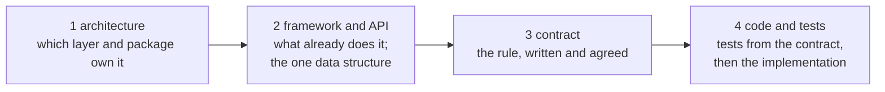

# Conventions — how work is done

**Role:** process
**Status:** current
**Authority:** the order every change follows, the design discipline, the rules
for code and configuration, and working practice;
[`../../PROJECT_CONTRACT.md`](../../PROJECT_CONTRACT.md) says which document wins

## The short version

| rule | § |
|---|---|
| Work starts at the architecture, then the framework and API, then the contract, and reaches the code last | 1 |
| A case solved by a private helper, a second file shape or a name check, where the framework could carry it, is not finished | 1 |
| What varies between engines, managers and schedulers is data under a schema, read by generic code | 2 |
| Every fact has one home and one reader; the core is the only way to write a file, start a process or take a lock | 2, 3 |
| The repository holds no user, machine or environment data | 4 |
| Environment changes, cluster submissions and history are the person's decisions | 6 |

## 1. The order of work

Work starts at the highest level it touches and goes down. It never starts with
the code.

1. **Architecture.** Which layer and which package own this
   ([`framework.md`](../contracts/framework.md) § 1, § 2)? If no package owns
   the concern, it is added to `framework.md` § 2 first.
2. **Framework and API.** What already does this: a core building block
   ([`core.md`](../contracts/core.md)), a declared operation
   ([`api.md`](../contracts/api.md)), a declared kind, the standard library, a
   declared dependency, the package manager's own command, the upstream
   project's own default? What is the one data structure that holds each new
   fact? An operation is declared once in its domain and every surface serves
   it.
3. **Contract.** The owning contract changes first, or an ADR is written when a
   settled choice changes. A design change is proposed and agreed before it is
   written.
4. **Code and tests.** Tests are written from the contract, and each is seen to
   fail with the rule it guards broken ([`testing.md`](../contracts/testing.md)
   § 3). The operation is implemented in its domain; surfaces reach it only
   through the registry.

A change that solves its own case with a private helper, a second file shape,
a test of a name or an unwritten convention, where the framework could carry
it, is not finished: the framework is extended first, and the case becomes one
use of it.

A change that crosses a public or persisted boundary then continues:

5. Regenerate [`docs/reference/`](../reference/) with
   `python -m femkit schema docs --yes`, and update guides and examples.
6. Run the unit's tests and every test that touches what moved; the full suite
   when a surface moves.
7. Review with fresh eyes, widening each pass: the unit against its contract,
   then its callers and readers, then the whole domain for duplicated facts and
   leftovers. Every finding is fixed in the contract and the code.
   A milestone ends with an independent review: reviewers each given one
   aspect — the documents' rules and consistency, the fit with the framework,
   scientific soundness, security for anything that serves requests or runs a
   person's code, and the person's workflow — and the documents and code, not
   the author's conclusions. Each finding is verified against the repository
   before it is fixed; the person agrees before work that depends on the
   milestone starts. Before a branch merges into `main`: the whole basic tier,
   the field tier where the change reaches it, and a consistency review of every
   merged document; the person agrees.
8. Remove what landed from the plan.

A change is incomplete if it adds any of these without registering its owner
in the governing contract: a persisted file or schema, a configuration lookup,
an engine capability or approximation, a state, a public command or field, a
top-level directory, a scientific observable or unit convention.

## 2. Design discipline

- **Declarations, not branches.** Engines, environments, sources, builds,
  checks, manager kinds and scheduler kinds are data under a schema
  ([`definitions.md`](../contracts/definitions.md)). Generic code never
  compares an engine, manager, scheduler, platform or environment name to a
  literal; it reads a declared field or a registered ID. Adding an engine adds
  data and one small adapter, and nothing in the command line, planner, runner
  or doctor.
- **One fact, one home, one reader**
  ([`PROJECT_CONTRACT.md`](../../PROJECT_CONTRACT.md) § 1). A schema model is
  the only place a field, its default or its validation rule is defined: a new
  input is a request-model field, a new setting a `UserConfig` field, a new
  definition key a definition-model field. Command-line help, web forms,
  reference pages and tests pick it up without edits.
- **One operation, one service function.** A command is a thin adapter over
  its operation: parse, call, render. Human output by default, `--json` for
  machines, `--dry-run` for the plan without side effects
  ([`api.md`](../contracts/api.md) § 3, § 4).
- **Reuse before inventing.** The standard library (`tomllib`, `dataclasses`,
  `subprocess`, `fcntl`), declared dependencies, the package manager's own
  commands and each upstream project's own defaults (its build system, its
  CMake generator, its options) come first. No hand-rolled argument grammar,
  parser or registry where a library or an existing module does the job. A
  wheel that must be invented is built once, as shared infrastructure in the
  core, not for one caller.
- **Prefer, in order:** delete; move to one obvious home; add a parameter; add
  an abstraction, as a last resort.
- **No compatibility shims.** Before 1.0, a rename changes code, schema,
  documents, examples and tests in one change, and nothing keeps the old name
  alive.
- **Parallel by default.** A build enables its parallel variant (MPI, and
  ParMmg beside Mmg); a serial-only build states why.
- **Scientific correctness before convenience.** Physical intent reaches the
  solver input with nothing absorbed silently; what an engine cannot do is
  refused, never approximated silently ([`design.md`](../design.md)). Clarity beats
  cleverness.

## 3. Rules for code

These hold for every change; a review checks each.

- **Layers.** Imports point down: surfaces → registry → domains → core
  ([`framework.md`](../contracts/framework.md) § 1). Importing a module never
  probes, reads user configuration, starts a process or writes a file.
- **Surfaces translate.** No module outside `femkit/cli/` imports click; none
  outside `femkit/web/` imports flask; no domain module prints or reads a
  terminal.
- **Through the core.** Files are written with `core.persist`, processes start
  with `core.process.run`, locks come from `core.locks`, declared files load
  with `core.schema`. No second way exists.
- **Refuse, do not guess.** A missing choice or a disallowed state is a
  `Refusal` with `next` commands, never a default chosen silently. What a
  machine record says, or does not say, follows
  [`framework.md`](../contracts/framework.md) § 4.
- **Environments through their manager.** A command runs inside an environment
  only through the manager's own mechanism or a generated run script, confined
  to the declared variables ([`envs.md`](../contracts/envs.md) § 4.4). Code
  never sets `PATH` or `LD_LIBRARY_PATH` by hand, and never derives a prefix
  from where a program lives. femkit itself runs on the control environment's
  own `python` and needs no activation.

## 4. Configuration and data

- The repository holds no user, machine or environment data: no home paths,
  host names, user names, GPU models, credentials or probe output
  ([`config.md`](../contracts/config.md) § 1).
- Environments, machine records, user configuration, caches and logs live in
  the person's XDG directories, each overridable by a `FEMKIT_*` variable
  ([`config.md`](../contracts/config.md)).
- Scopes never merge: a person's preference, a probed machine fact and a
  project's intent each have their own file, and a reader reports the one file
  it used. A probe writes facts, never preferences; nothing guesses the
  person's activation lines or a scheduler's facts.
- `projects/` and `work/` are the person's research data: never read as
  evidence or test input. A test builds its own fixture.

## 5. Tests

What earns a test is [`testing.md`](../contracts/testing.md) § 3; how the
suite runs is § 4. Tests run from the repository root inside the control
environment, through the runner: `python tools/testrun.py run basic`.

## 6. Working practice

- **Environment changes are agreed first.** Installing into or changing a
  managed environment, or editing a definition's packages or pins, is a
  deployment change: it is proposed and agreed before it is made.
- **A changed definition is solved whole before it is pushed.** After any
  change to a definition's packages or pins, every environment that includes
  it — each `-cuda` one too — is solved as a dry run with the manager kinds
  femkit drives; a pin proven on one environment can make another unsolvable
  (a CMake pin once made both CUDA environments unsolvable through a profiler's
  `krb5` pin).
- **A note is a lead, not evidence.** An old note, a code comment or another
  project's record is checked by a measurement now before anything is argued
  from it; what is not measured is said to be not measured.
- **One cluster job per submission**, submitted deliberately, never a burst.
- **Facts are checked, not assumed.** A claim about an upstream project, a
  tool or a machine is checked against its source, its documentation or a
  measurement before code or a document relies on it.
- **Commits carry their author only**: no co-author lines and no tool
  signatures, in commit messages, code or documents.
- **Uncommitted work is never discarded to undo an experiment**: the file is
  copied aside first and copied back.
- **Published history is never rewritten.**

## 7. Checklist

Before a change lands:

- Did the work start at the architecture and the framework, not the code?
- Is this fact already owned elsewhere?
- Did it create a second spelling or a second reader?
- Is every default visible and stated by its owner?
- Does malformed or unsupported input fail before a costly solve?
- Is the run independently inspectable and reproducible?
- Are machine details absent from portable descriptions?
- Do the command line and the web call the same operation?
- Are earlier runs and raw solver output kept?
- Does each test check the contract rather than an incidental implementation,
  and did it fail with its rule broken?
- Does each document say what is true now, and the plan only what is not yet?
